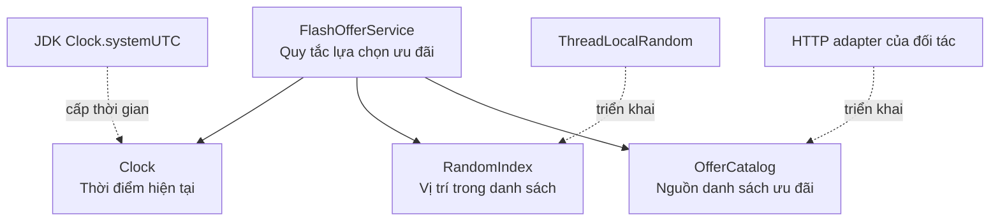

# Đưa phụ thuộc về thời gian, ngẫu nhiên và dịch vụ ngoài vào hợp đồng rõ ràng

Trong module `CODE_QUALITY_FUNDAMENTALS`, chất lượng mã nguồn được nhìn qua các thuộc tính giúp phần mềm **đáng tin cậy, dễ hiểu và dễ thay đổi**. Ở chương **Khả năng kiểm thử**, một nguyên nhân phổ biến khiến kiểm thử chậm, thất thường hoặc khó tái hiện là mã nghiệp vụ tự đọc đồng hồ, tự sinh số ngẫu nhiên và trực tiếp gọi dịch vụ ngoài. Khi đó, cùng một đầu vào nhìn thấy được có thể tạo các kết quả khác nhau tùy thời điểm, lịch sử bộ sinh số hoặc trạng thái mạng.

Ví dụ, chương trình chọn ưu đãi cho người dùng từ một danh sách do dịch vụ đối tác cung cấp, nhưng chỉ trong khoảng thời gian diễn ra chiến dịch. Kết quả phụ thuộc ít nhất ba yếu tố:

1. **Thời gian hiện tại:** chiến dịch đã bắt đầu hoặc kết thúc chưa?
2. **Ngẫu nhiên:** chọn ưu đãi nào trong danh sách?
3. **Dịch vụ ngoài:** hôm nay đối tác trả về ưu đãi nào, có lỗi mạng hay không?

Nếu ba yếu tố này nằm ẩn trong `Instant.now()`, `new Random()` và lời gọi HTTP ở giữa hàm, người kiểm thử phải chờ đúng giờ, mong nhận được nhánh ngẫu nhiên mong muốn và phụ thuộc vào mạng thật. Một cách thiết kế bền vững hơn là **biến những nguồn không kiểm soát đó thành các phụ thuộc có hợp đồng tường minh**, sau đó truyền chúng vào thành phần chứa quy tắc nghiệp vụ.

Sau bài học, bạn có thể:

- Nhận diện phụ thuộc không tất định và các tác dụng phụ nằm ẩn trong mã.
- Dùng `java.time.Clock` để kiểm soát thời gian và kiểm thử chính xác các giá trị biên.
- Tách việc chọn ngẫu nhiên thành hợp đồng có giới hạn đầu vào, đầu ra; hiểu khi nào cần `SecureRandom`.
- Định nghĩa cổng dịch vụ ngoài theo ngôn ngữ nghiệp vụ, gồm kết quả, lỗi, timeout và trách nhiệm retry.
- Thiết kế kiểm thử đơn vị độc lập với mạng và kiểm thử tích hợp ở ranh giới adapter.
- Đánh giá tính kiểm thử được mà không phải tạo abstraction cho mọi dòng mã.

## 1. Vấn đề: cùng đầu vào, kết quả vẫn thay đổi

Xét một ví dụ Java sơ lược:

```java
import java.time.Instant;
import java.util.List;
import java.util.concurrent.ThreadLocalRandom;

final class FlashOfferController {
    private final PartnerOfferHttpClient client = new PartnerOfferHttpClient();

    String chooseOffer(Instant campaignEndsAt) {
        if (!Instant.now().isBefore(campaignEndsAt)) {
            return "CLOSED";
        }
        List<String> offers = client.fetchOffers();
        if (offers.isEmpty()) {
            return "NONE";
        }
        int index = ThreadLocalRandom.current().nextInt(offers.size());
        return offers.get(index);
    }
}
```

`PartnerOfferHttpClient` ở đây là tên minh họa cho một client của ứng dụng, không phải lớp có sẵn trong JDK. Điều đáng chú ý là `chooseOffer` đã tự quyết định ba nguồn thông tin bên ngoài: đồng hồ, ngẫu nhiên và HTTP.

Phân tích rủi ro:

| Phụ thuộc ẩn | Lỗi hoặc khó khăn trong kiểm thử | Điều cần làm rõ trong hợp đồng |
| --- | --- | --- |
| `Instant.now()` | Ca kiểm thử sát giờ hết hạn có thể thất bại tùy thời điểm chạy | Đồng hồ nào được dùng, so sánh biên bằng hay khác, múi giờ có liên quan không? |
| `ThreadLocalRandom.current()` | Không chủ động chọn được nhánh; lỗi có thể chỉ xuất hiện khi random chọn một phần tử hiếm gặp | Khoảng giá trị, phân phối mong muốn, giả định về thread safety |
| `client.fetchOffers()` | Cần mạng/credential; kết quả thay đổi; timeout làm chậm bộ test | Danh sách rỗng có nghĩa gì, lỗi nào xảy ra, timeout và retry do ai xử lý? |
| Khởi tạo client trực tiếp trong lớp | Khó thay bằng fake và khó kiểm thử riêng quy tắc | Ai tạo client, ai cấu hình và quản lý vòng đời? |

Lưu ý: **khả năng kiểm thử** không đồng nghĩa “mọi hàm phải thuần” hay “mọi đối tượng phải có interface”. Vấn đề cốt lõi là muốn kiểm chứng một quy tắc, người kiểm thử có thể **điều khiển đầu vào và quan sát kết quả** mà không cần phụ thuộc vào những yếu tố ngoài phạm vi bài kiểm thử.

## 2. Xem phụ thuộc là một phần của hợp đồng

Một hợp đồng hữu ích cần nêu ít nhất:

- **Đầu vào và phạm vi hợp lệ:** ví dụ `nextInt(bound)` yêu cầu `bound > 0`; thời điểm bắt đầu phải trước thời điểm kết thúc.
- **Đầu ra và ý nghĩa:** ví dụ danh sách ưu đãi rỗng nghĩa là không có ưu đãi hợp lệ, khác với không truy cập được dịch vụ.
- **Tác dụng phụ:** thành phần nào được phép gọi mạng, ghi dữ liệu hoặc phát sự kiện?
- **Lỗi:** trường hợp nào trả kết quả bình thường, trường hợp nào báo lỗi có phân loại?
- **Thời gian và vòng đời:** timeout được áp dụng ở đâu, phụ thuộc có an toàn khi nhiều luồng cùng dùng không?
- **Cam kết khi thử lại:** cùng một yêu cầu lặp lại có làm phát sinh giao dịch mới không?

Một hình dung về chiều phụ thuộc:



Lớp nghiệp vụ nhận các phụ thuộc qua constructor. Mã khởi tạo ứng dụng (*composition root*) chọn implementation thật; bài kiểm thử chọn đồng hồ cố định, nguồn số dự đoán được và catalog giả.

**Hợp đồng nên có ý nghĩa nghiệp vụ.** Chẳng hạn, `OfferCatalog.loadOffers()` diễn đạt nhu cầu tải ưu đãi; không bắt logic chọn ưu đãi biết URL, HTTP status, header hay JSON của nhà cung cấp. Ngược lại, với thời gian, JDK đã có hợp đồng `Clock` đủ phù hợp nên không nhất thiết tự tạo `TimeProvider`.

## 3. Phụ thuộc thời gian: sử dụng `Clock`

### 3.1. Tránh gọi thời gian hiện tại ở nhiều điểm

Các lời gọi `Instant.now()` nằm rải rác có thể trả các thời điểm khác nhau ngay trong một thao tác. Nếu một hàm kiểm tra bắt đầu bằng một lần gọi và kiểm tra kết thúc bằng lần gọi khác, thời gian có thể vượt qua ranh giới giữa hai lần đọc. Tùy nghiệp vụ, điều đó có thể tạo quyết định khó giải thích.

Thay vào đó, truyền `Clock` và lấy **một giá trị `Instant now = clock.instant()`** cho mỗi quyết định cần nhất quán theo một mốc thời gian:

```java
import java.time.Clock;
import java.time.Instant;
import java.util.Objects;

final class CampaignWindow {
    private final Clock clock;
    private final Instant startsAt;
    private final Instant endsAt;

    CampaignWindow(Clock clock, Instant startsAt, Instant endsAt) {
        this.clock = Objects.requireNonNull(clock);
        this.startsAt = Objects.requireNonNull(startsAt);
        this.endsAt = Objects.requireNonNull(endsAt);
        if (!startsAt.isBefore(endsAt)) {
            throw new IllegalArgumentException("startsAt must precede endsAt");
        }
    }

    boolean isActive() {
        Instant now = clock.instant();
        return !now.isBefore(startsAt) && now.isBefore(endsAt);
    }
}
```

Ví dụ chọn khoảng thời gian **[startsAt, endsAt)**: bắt đầu **bao gồm**, kết thúc **không bao gồm**. Hai giá trị này là một phần của hợp đồng; đổi `now.isBefore(endsAt)` thành `!now.isAfter(endsAt)` sẽ khiến chiến dịch còn hiệu lực tại **đúng** thời điểm kết thúc.

### 3.2. Kiểm thử thời gian bằng `Clock.fixed`

Thay vì đặt `Thread.sleep()` hoặc đợi đúng thời điểm, dùng đồng hồ cố định:

```java
import static org.junit.jupiter.api.Assertions.assertFalse;
import static org.junit.jupiter.api.Assertions.assertTrue;

import java.time.Clock;
import java.time.Instant;
import java.time.ZoneOffset;
import org.junit.jupiter.api.Test;

class CampaignWindowTest {
    private static final Instant START = Instant.parse("2027-01-01T10:00:00Z");
    private static final Instant END   = Instant.parse("2027-01-01T11:00:00Z");

    @Test
    void campaignStartsInclusively() {
        Clock clock = Clock.fixed(START, ZoneOffset.UTC);
        assertTrue(new CampaignWindow(clock, START, END).isActive());
    }

    @Test
    void campaignEndsExclusively() {
        Clock clock = Clock.fixed(END, ZoneOffset.UTC);
        assertFalse(new CampaignWindow(clock, START, END).isActive());
    }

    @Test
    void campaignNotStartedYet() {
        Clock clock = Clock.fixed(START.minusNanos(1), ZoneOffset.UTC);
        assertFalse(new CampaignWindow(clock, START, END).isActive());
    }
}
```

Ca biên có thể chạy tức thì, không phụ thuộc tốc độ máy. Một `Clock.fixed` cũng giúp tái hiện lỗi vốn chỉ xuất hiện tại một thời điểm cụ thể.

### 3.3. Múi giờ, đồng hồ và timeout là ba vấn đề khác nhau

- `Instant` biểu diễn một thời điểm trên trục thời gian; phù hợp cho việc so sánh hạn cuối đã được xác định chính xác.
- `LocalDate`, `LocalTime` và `ZonedDateTime` liên quan đến lịch và giờ địa phương; quy tắc “kết thúc lúc 23:59 ở Việt Nam” cần được diễn giải bằng `ZoneId` đã chọn rồi mới chuyển sang `Instant`.
- Khi đổi giờ mùa hè ở các múi giờ có DST, một giờ địa phương có thể không tồn tại hoặc xuất hiện hai lần; không nên suy mọi ngày luôn có đúng 24 giờ.
- `Clock` dùng cho **thời gian tường (wall-clock)**; giờ hệ thống có thể được hiệu chỉnh. Khi đo độ dài đã trôi qua hoặc thực hiện deadline nội bộ yêu cầu đồng hồ đơn điệu, thường dùng nguồn đo elapsed time như `System.nanoTime()` hoặc abstraction tương ứng, không suy từ `Clock.instant()` rằng thời gian luôn tăng.

Việc truyền `Clock` giải quyết khả năng kiểm thử quy tắc thời gian; **timeout mạng** vẫn cần được cấu hình ở HTTP client hoặc adapter, chứ không tự xuất hiện khi thêm `Clock`.

## 4. Phụ thuộc ngẫu nhiên: xác định miền giá trị và mục đích

Ngẫu nhiên có hai nhu cầu khác nhau:

1. **Ngẫu nhiên phục vụ hành vi nghiệp vụ thông thường:** chọn gợi ý, chia mẫu, tạo độ lệch thời gian (*jitter*) cho retry. Kiểm thử thường cần thay kết quả bằng giá trị cố định để đi vào từng nhánh.
2. **Ngẫu nhiên phục vụ bảo mật:** sinh token đăng nhập, OTP, mã khôi phục, nonce hoặc khóa. Yêu cầu không chỉ là “khó đoán trong một lần chạy” mà là nguồn sinh có bảo đảm bảo mật phù hợp, thường là `SecureRandom`. Không dùng seed dự đoán được trong môi trường thật để tiện kiểm thử.

Với lựa chọn một vị trí trong danh sách, hợp đồng nhỏ sau đây phù hợp:

```java
@FunctionalInterface
interface RandomIndex {
    // bound > 0; kết quả thuộc [0, bound).
    int nextInt(int bound);
}
```

Trong ứng dụng chạy thật có thể chuyển lời gọi sang nguồn ngẫu nhiên phù hợp:

```java
import java.util.concurrent.ThreadLocalRandom;

RandomIndex productionRandom =
        bound -> ThreadLocalRandom.current().nextInt(bound);
```

Trong kiểm thử:

```java
RandomIndex alwaysFirst = bound -> 0;
RandomIndex alwaysLast = bound -> bound - 1;
```

Nhờ vậy, một ca kiểm thử có thể yêu cầu chính xác nhánh chọn phần tử đầu hoặc cuối, không phải lặp hàng nghìn lần rồi hy vọng sinh được số mong muốn. Việc dùng `Random` hoặc `RandomGenerator` với seed cố định cũng có ích để tái hiện một dãy số trong những bài kiểm thử phù hợp; nhưng khi muốn kiểm tra **một nhánh cụ thể**, fake có kết quả chỉ định thường rõ nghĩa hơn. Không nên gắn khả năng kiểm thử với thuật toán/chuỗi đầu ra của một generator mà bài học không chủ đích kiểm tra.

### 4.1. Không nhầm đầu vào ngẫu nhiên với tính duy nhất

Lấy một chỉ số ngẫu nhiên để chọn ưu đãi không bảo đảm **mỗi người chỉ nhận một ưu đãi** hay **mã giao dịch không trùng**. Nếu nghiệp vụ đòi tính duy nhất, phải có định danh và cơ chế ghi nhận/kiểm tra trùng ở nguồn dữ liệu phù hợp.

Ngược lại, trong phép chọn ngẫu nhiên cho trải nghiệm người dùng, nếu yêu cầu “mọi lựa chọn có xác suất bằng nhau”, implementation phải phân phối phù hợp; fake luôn chọn `0` chỉ dùng trong kiểm thử nhánh, không thể chứng minh phân phối của thuật toán thật.

### 4.2. Tách ngẫu nhiên bảo mật bằng hợp đồng riêng

Với token bảo mật, có thể định nghĩa `TokenGenerator` diễn đạt yêu cầu về độ dài, cách mã hóa, mức độ khó đoán và vòng đời token. Adapter thật sử dụng `SecureRandom` cùng cách tạo token không làm suy yếu phân phối; kiểm thử logic gọi token generator có thể truyền một fake trả giá trị đã biết. Phần kiểm thử **chất lượng sinh token bảo mật** phải được thực hiện riêng trên implementation thật; không thay SecureRandom bằng nguồn dễ đoán ở môi trường chạy thật.

## 5. Dịch vụ ngoài: đưa giao thức kỹ thuật ra ranh giới

Một lời gọi ngoài tiến trình có thể thất bại theo nhiều cách: timeout, mất kết nối, lỗi xác thực, quá giới hạn, dữ liệu sai định dạng hoặc dịch vụ trả lỗi nghiệp vụ. Nếu phương thức nghiệp vụ tự xử lý từng HTTP status, nó bị phụ thuộc vào chi tiết nhà cung cấp.

Một **port** nên mô tả điều ứng dụng cần, ví dụ:

```java
import java.util.List;

record Offer(String code, String title) {}

@FunctionalInterface
interface OfferCatalog {
    // Trả danh sách không null, phần tử không null.
    // Danh sách rỗng nghĩa là không có ưu đãi khả dụng.
    // Lỗi hạ tầng được ánh xạ thành CatalogUnavailableException.
    List<Offer> loadOffers();
}

final class CatalogUnavailableException extends RuntimeException {
    CatalogUnavailableException(String message, Throwable cause) {
        super(message, cause);
    }
}
```

Hợp đồng phân biệt hai kết quả khác nhau:

- `List.of()` là kết quả **hợp lệ**: dịch vụ trả lời thành công nhưng không có ưu đãi để chọn.
- `CatalogUnavailableException` là kết quả **thất bại kỹ thuật**: không thể có danh sách tin cậy tại thời điểm gọi.

Không nên im lặng đổi mọi lỗi mạng thành danh sách rỗng, vì như vậy phần mềm sẽ hiểu sự cố nhà cung cấp là “không có ưu đãi”. Nếu nghiệp vụ **chủ động cho phép fallback**, hãy định nghĩa fallback rõ ràng, giám sát được và kiểm thử như một chính sách.

### 5.1. Adapter chuyển đổi lỗi và dữ liệu

Adapter chịu trách nhiệm URL, giao thức, xác thực, cấu hình timeout và chuyển đổi phản hồi thành kiểu của ứng dụng. Trong ví dụ tối giản dưới đây, `ExternalOfferClient` là một hợp đồng minh họa cho thư viện kết nối thực tế:

```java
import java.io.IOException;
import java.util.List;
import java.util.Objects;

interface ExternalOfferClient {
    List<Offer> fetch() throws IOException;
}

final class RemoteOfferCatalog implements OfferCatalog {
    private final ExternalOfferClient client;

    RemoteOfferCatalog(ExternalOfferClient client) {
        this.client = Objects.requireNonNull(client);
    }

    @Override
    public List<Offer> loadOffers() {
        try {
            return List.copyOf(client.fetch());
        } catch (IOException e) {
            throw new CatalogUnavailableException(
                    "Offer catalog request failed", e);
        }
    }
}
```

Với hợp đồng này, adapter chuyển các lỗi I/O được khai báo thành ngoại lệ ứng dụng; `List.copyOf` tạo bản sao danh sách không cho sửa từ phía bên gọi (giả sử các phần tử `Offer` bất biến như record ở ví dụ). Tình huống đối tác trả `null` hoặc phần tử `null` là **vi phạm hợp đồng dữ liệu** cần được quyết định xử lý và giám sát, chứ không nên mặc định coi như kết quả rỗng.

Khi hiện thực HTTP thật, cần bổ sung xử lý theo loại status code, giới hạn kích thước phản hồi, timeout kết nối và phản hồi, hủy/ngắt tác vụ, xác thực, phân loại lỗi có thể thử lại và làm sạch thông tin nhạy cảm trong log. Ví dụ adapter trên minh họa **vị trí đặt trách nhiệm**, không phải một HTTP client hoàn chỉnh.

### 5.2. Hợp đồng lỗi, retry và deadline

| Tình huống | Cách diễn đạt rõ ràng tại ranh giới | Câu hỏi cần quyết định |
| --- | --- | --- |
| Không có dữ liệu | Danh sách rỗng hoặc kết quả `NOT_FOUND` theo nghiệp vụ | Đây là kết quả bình thường hay lỗi? |
| Timeout/mạng không sẵn sàng | Ngoại lệ kỹ thuật hoặc kiểu kết quả lỗi đã phân loại | Có được thử lại không, tổng thời gian chờ tối đa bao nhiêu? |
| Lỗi xác thực/cấu hình | Lỗi không nên tự retry mù quáng | Ai vận hành và nhận cảnh báo? |
| Bị giới hạn tần suất | Lỗi riêng hoặc thông tin backoff theo hợp đồng | Có thời gian chờ được nhà cung cấp chỉ định không? |
| Phản hồi sai dữ liệu | Lỗi hợp đồng dữ liệu, kèm chẩn đoán an toàn | Có fallback hợp lệ hay phải dừng xử lý? |
| Phản hồi thất lạc sau khi tác dụng phụ đã thành công | Trạng thái không chắc chắn | Có idempotency key hoặc cách tra cứu kết quả để retry an toàn không? |

Một operation **chỉ đọc** và không có tác dụng phụ thường dễ retry hơn một operation ghi. Với thao tác như tạo thanh toán hoặc cấp voucher, timeout không chứng minh tác vụ trước thất bại; nếu thử lại không có cơ chế chống trùng, có thể phát sinh kết quả hai lần.

Nơi đặt retry cần tường minh: một tầng retry có giới hạn cùng deadline toàn phần thường dễ quan sát hơn nhiều tầng tự retry lồng nhau, làm số lượt gọi thực tế tăng ngoài dự kiến. Nếu retry có chờ, có thể đặt việc chờ sau một interface riêng để kiểm thử không phải `sleep` theo thời gian thật. Vẫn phải kiểm tra số lần tối đa, phân loại lỗi, cơ chế hủy và rủi ro retry đối với tác dụng phụ.

## 6. Ví dụ tổng hợp Java: chọn ưu đãi trong thời gian chiến dịch

Yêu cầu nghiệp vụ của ví dụ:

- Chiến dịch hiệu lực trong khoảng **[startsAt, endsAt)**.
- Ngoài khoảng đó: không tải danh sách từ dịch vụ ngoài và không sinh số ngẫu nhiên.
- Trong thời gian hiệu lực: tải danh sách một lần; nếu rỗng thì không có ưu đãi, nếu có thì chọn một phần tử bằng chỉ số hợp lệ.
- Khi catalog không sẵn sàng: báo lỗi hạ tầng rõ ràng để tầng gọi xử lý theo chính sách đã định.
- Một lời gọi chọn ưu đãi chỉ **gợi ý** một phần tử. Nó không giữ chỗ, ghi nhận quyền nhận ưu đãi hay bảo đảm một ưu đãi chỉ được cấp cho một người.

Quy tắc cuối cùng giúp giới hạn hợp đồng: nếu sau này phải cấp voucher duy nhất và ghi dữ liệu, cần thêm cơ chế lưu trữ có đồng bộ/idempotency; chỉ thay bộ sinh số ngẫu nhiên chưa đủ.

### 6.1. Lớp nghiệp vụ phụ thuộc hợp đồng

Ví dụ dùng JDK 17 trở lên, các kiểu `Offer`, `OfferCatalog` và `RandomIndex` đã được giới thiệu ở phần trên:

```java
import java.time.Clock;
import java.time.Instant;
import java.util.List;
import java.util.Objects;
import java.util.Optional;

final class FlashOfferService {
    private final Clock clock;
    private final RandomIndex randomIndex;
    private final OfferCatalog catalog;
    private final Instant startsAt;
    private final Instant endsAt;

    FlashOfferService(
            Clock clock,
            RandomIndex randomIndex,
            OfferCatalog catalog,
            Instant startsAt,
            Instant endsAt) {
        this.clock = Objects.requireNonNull(clock);
        this.randomIndex = Objects.requireNonNull(randomIndex);
        this.catalog = Objects.requireNonNull(catalog);
        this.startsAt = Objects.requireNonNull(startsAt);
        this.endsAt = Objects.requireNonNull(endsAt);
        if (!startsAt.isBefore(endsAt)) {
            throw new IllegalArgumentException("Invalid campaign window");
        }
    }

    Optional<Offer> chooseOffer() {
        Instant now = clock.instant();
        if (now.isBefore(startsAt) || !now.isBefore(endsAt)) {
            return Optional.empty();
        }

        List<Offer> offers = List.copyOf(catalog.loadOffers());
        if (offers.isEmpty()) {
            return Optional.empty();
        }

        int index = randomIndex.nextInt(offers.size());
        return Optional.of(offers.get(index));
    }
}
```

Các điểm thiết kế cần chú ý:

1. **Không có đồng hồ hệ thống hoặc lời gọi mạng trực tiếp trong logic:** lớp chỉ biết `Clock`, `RandomIndex` và `OfferCatalog`. Mã khởi tạo quyết định dùng implementation nào.
2. **Đọc thời gian một lần:** điều kiện có hiệu lực được đánh giá theo một thời điểm cho một quyết định chọn ưu đãi.
3. **Không gọi dư:** ngoài thời gian hiệu lực thì không truy cập catalog; catalog rỗng thì không gọi random.
4. **Không giấu lỗi:** ngoại lệ catalog không bị biến thành `Optional.empty()`.
5. **Kết quả rõ nhưng cố ý nhỏ:** `Optional.empty()` hiện bao gồm cả “chiến dịch không hoạt động” và “không có ưu đãi”. Nếu bên gọi cần phân biệt để hiển thị hoặc giám sát, đổi sang một kiểu kết quả có các trạng thái tường minh là lựa chọn tốt hơn.

**Thời điểm kiểm tra có hiệu lực cũng là một quyết định nghiệp vụ.** Mã này kiểm tra trước khi tải catalog. Nếu lời gọi ngoài kéo dài quá thời điểm kết thúc, kết quả vẫn có thể được trả sau khi chiến dịch hết hạn. Nếu yêu cầu “ưu đãi chỉ được phát hành trước hạn” là bắt buộc, cần định nghĩa **thời điểm quyết định cuối** và kiểm tra lại/ghi nhận trong thao tác cấp phát thực tế. Bảo đảm đó không thể suy ra từ một lần đọc `Clock` trước thao tác mạng.

### 6.2. Lắp ráp ở môi trường thực

Mã khởi tạo ứng dụng có thể truyền:

```java
import java.time.Clock;
import java.time.Instant;
import java.util.concurrent.ThreadLocalRandom;

Clock realClock = Clock.systemUTC();
RandomIndex realRandom =
        bound -> ThreadLocalRandom.current().nextInt(bound);
OfferCatalog realCatalog = new RemoteOfferCatalog(realExternalClient);

FlashOfferService service = new FlashOfferService(
        realClock,
        realRandom,
        realCatalog,
        Instant.parse("2027-01-01T10:00:00Z"),
        Instant.parse("2027-01-01T11:00:00Z"));
```

Ở đoạn minh họa lắp ráp này, `realExternalClient` là đối tượng `ExternalOfferClient` do cấu hình hạ tầng cung cấp. Việc tạo HTTP client, đặt credential, timeout và đóng tài nguyên thuộc nơi cấu hình ứng dụng; đoạn mã này chỉ mô tả **cách nối phụ thuộc**, không phải một file Java đứng riêng có thể biên dịch nếu chưa khai báo client.

Không nhất thiết sử dụng framework dependency injection. Constructor injection thủ công đủ để làm phụ thuộc hiển thị rõ và thay được trong kiểm thử. Framework chỉ giúp tổ chức việc lắp ráp khi số lượng thành phần lớn.

### 6.3. Kiểm thử đơn vị với đồng hồ, ngẫu nhiên và catalog giả

Các test sau dùng JUnit 5, kết hợp các kiểu ở phần 5–6. Chúng kiểm chứng cả **kết quả** lẫn việc **không gọi** phụ thuộc trong trường hợp không cần thiết:

```java
import static org.junit.jupiter.api.Assertions.assertEquals;
import static org.junit.jupiter.api.Assertions.assertThrows;
import static org.junit.jupiter.api.Assertions.assertTrue;

import java.io.IOException;
import java.time.Clock;
import java.time.Instant;
import java.time.ZoneOffset;
import java.util.List;
import java.util.Optional;
import java.util.concurrent.atomic.AtomicInteger;
import org.junit.jupiter.api.Test;

class FlashOfferServiceTest {
    private static final Instant START =
            Instant.parse("2027-01-01T10:00:00Z");
    private static final Instant END =
            Instant.parse("2027-01-01T11:00:00Z");

    @Test
    void exactlyAtStartCanSelectTheLastOffer() {
        Clock clock = Clock.fixed(START, ZoneOffset.UTC);
        AtomicInteger calls = new AtomicInteger();

        OfferCatalog catalog = () -> {
            calls.incrementAndGet();
            return List.of(
                    new Offer("A", "Giảm 10%"),
                    new Offer("B", "Miễn phí giao hàng"));
        };
        RandomIndex last = bound -> bound - 1;
        FlashOfferService service =
                new FlashOfferService(clock, last, catalog, START, END);

        assertEquals(
                Optional.of(new Offer("B", "Miễn phí giao hàng")),
                service.chooseOffer());
        assertEquals(1, calls.get());
    }

    @Test
    void exactlyAtEndSkipsCatalogAndRandom() {
        Clock clock = Clock.fixed(END, ZoneOffset.UTC);
        AtomicInteger catalogCalls = new AtomicInteger();

        OfferCatalog catalog = () -> {
            catalogCalls.incrementAndGet();
            return List.of(new Offer("A", "Giảm 10%"));
        };
        RandomIndex failIfUsed = bound -> {
            throw new AssertionError("Random should not be called");
        };
        FlashOfferService service =
                new FlashOfferService(clock, failIfUsed, catalog, START, END);

        assertTrue(service.chooseOffer().isEmpty());
        assertEquals(0, catalogCalls.get());
    }

    @Test
    void emptyCatalogDoesNotConsumeRandom() {
        Clock clock = Clock.fixed(START, ZoneOffset.UTC);
        OfferCatalog catalog = List::of;
        RandomIndex failIfUsed = bound -> {
            throw new AssertionError("Random should not be called");
        };
        FlashOfferService service =
                new FlashOfferService(clock, failIfUsed, catalog, START, END);

        assertTrue(service.chooseOffer().isEmpty());
    }

    @Test
    void unavailableCatalogIsNotTreatedAsEmpty() {
        Clock clock = Clock.fixed(START, ZoneOffset.UTC);
        OfferCatalog catalog = () -> {
            throw new CatalogUnavailableException(
                    "Catalog unavailable", new IOException("timeout"));
        };
        RandomIndex first = bound -> 0;
        FlashOfferService service =
                new FlashOfferService(clock, first, catalog, START, END);

        assertThrows(
                CatalogUnavailableException.class,
                service::chooseOffer);
    }
}
```

Các ca trên không chờ thời gian thật và không truy cập mạng. Đồng hồ cố định kiểm tra chính xác biên bắt đầu/kết thúc; fake ngẫu nhiên buộc chọn phần tử cuối; catalog giả chủ động tạo danh sách rỗng hoặc lỗi. Lỗi do phụ thuộc ngoài được truyền lên để chính sách ở tầng gọi quyết định cách phản hồi.

Những ca khác có thể cần bổ sung theo hợp đồng thật:

- Thời điểm **ngay trước** bắt đầu và **ngay trước** kết thúc.
- Danh sách chỉ có một phần tử, danh sách lớn hoặc dữ liệu không hợp lệ từ adapter.
- Bộ sinh chỉ số trả ra ngoài khoảng quy định: đây là **vi phạm hợp đồng RandomIndex**, cần quyết định có kiểm tra phòng vệ ở ranh giới nghiệp vụ hay được bảo vệ bằng kiểm thử implementation.
- Cùng một yêu cầu được gửi lại: nếu chọn ngẫu nhiên mỗi lần thì kết quả có thể khác nhau. Nếu cần trả cùng ưu đãi cho cùng `requestId`, phải **lưu lựa chọn đã xác nhận** và xác định chính sách idempotency.
- Nhiều lời gọi đồng thời: implementation của catalog và random có được chia sẻ an toàn hay không? Nếu trạng thái giữ trong fake có thể thay đổi, mỗi test cần tránh làm rò trạng thái sang test khác.

### 6.4. Kiểm thử adapter tại ranh giới

Đơn vị `FlashOfferService` không có trách nhiệm biết JSON hay HTTP status. Nhưng `RemoteOfferCatalog` vẫn cần được kiểm tra riêng:

| Bài kiểm thử adapter | Bằng chứng cần thu |
| --- | --- |
| Phản hồi thành công với hai ưu đãi | Dữ liệu được ánh xạ đúng thành `Offer` và danh sách không bị thay đổi ngoài ý muốn. |
| Phản hồi thành công nhưng rỗng | Adapter trả `List.of()`, không ném lỗi. |
| Timeout hoặc lỗi kết nối | Adapter ánh xạ thành lỗi hạ tầng theo hợp đồng, giữ nguyên nguyên nhân hữu ích. |
| 401/403, 429, 5xx | Lỗi được phân loại đúng, chỉ retry khi chính sách cho phép. |
| JSON lỗi định dạng, thiếu trường, giá trị null | Không lặng lẽ dùng dữ liệu sai làm kết quả hợp lệ. |
| Kết nối bị hủy/ngắt và request chậm | Không treo vô hạn; cơ chế hủy và timeout được thực thi phù hợp. |

Có thể dùng HTTP stub server, môi trường hợp đồng hoặc phiên bản sandbox của đối tác, tùy mức cần kiểm chứng. **Mock interface của adapter không kiểm tra được** URL, serialize/deserialize, timeout thực, header hay quy tắc xử lý HTTP. Do đó test đơn vị và test tích hợp trả lời những câu hỏi khác nhau; cả hai cùng đóng góp vào độ tin cậy.

## 7. Khi nào cần thêm một hợp đồng, khi nào không?

Nguyên tắc chung là **biến thiên nằm ở ranh giới nào thì đặt khả năng thay thế ở ranh giới đó**:

| Tình huống | Lựa chọn thường hợp lý | Tránh điều gì |
| --- | --- | --- |
| Cần kiểm tra hạn cuối trong Java | Inject `Clock` chuẩn JDK | Tự viết interface thời gian chỉ bọc lại một phương thức mà không có lý do |
| Cần chọn một nhánh ngẫu nhiên trong unit test | Inject `RandomIndex` hoặc generator thích hợp | Dùng sleep/vòng lặp để “đợi” sinh đúng nhánh |
| Cần sinh mã dùng trong bảo mật | Hợp đồng tạo token riêng, adapter dùng `SecureRandom` | Dùng seed đoán được hoặc generator thông thường trong production |
| Nghiệp vụ đọc dữ liệu từ đối tác | Inject port như `OfferCatalog` | Để mã nghiệp vụ biết HTTP response, URL, SDK exception |
| Chỉ có một hàm thuần không phụ thuộc ngoài | Gọi trực tiếp hàm với dữ liệu | Tạo interface cho mọi hàm chỉ để có thể mock |
| Cần thử retry/backoff | Inject chính sách retry và nguồn chờ/thời gian phù hợp | Dùng `Thread.sleep()` trong unit test và chờ thời gian thật |
| Có nhiều lời gọi ngoài tạo một quy trình trạng thái | Đặt rõ hợp đồng giao dịch/đối soát, idempotency và trạng thái lỗi | Cho rằng thay API client bằng mock đã bảo đảm an toàn nghiệp vụ |

**Tách phụ thuộc không có nghĩa thay toàn bộ công cụ thật bằng mock.** Mục tiêu là để mỗi bài kiểm thử tập trung vào một mức trách nhiệm: logic dùng fake, adapter dùng test tích hợp/hợp đồng, hành trình người dùng dùng ít test đầu cuối có chọn lọc.

## 8. Các sai lầm thường gặp và cách phát hiện

### 8.1. Truy cập nguồn không tất định vẫn còn ẩn

Tạo constructor nhận `Clock` nhưng ở một helper sâu bên trong vẫn gọi `LocalDate.now()`, hoặc nhận `RandomIndex` nhưng một nhánh lại gọi `Math.random()`, sẽ khiến một số đường xử lý khó kiểm soát. Khi refactor, lần theo các điểm thực sự đọc thời gian, sinh ngẫu nhiên hoặc gọi mạng ở **toàn bộ luồng nghiệp vụ đang xét**.

### 8.2. Mock quá nhiều chi tiết triển khai

Nếu test buộc service phải gọi ba phương thức nội bộ theo đúng thứ tự trong khi hợp đồng chỉ yêu cầu “chọn một ưu đãi hợp lệ”, một refactor giữ nguyên hành vi có thể làm test hỏng. Nên kiểm tra **kết quả và những tương tác quan trọng về nghiệp vụ**; chỉ kiểm tra thứ tự, số lần gọi hoặc việc không gọi khi đó là một yêu cầu thật, như không gửi yêu cầu tới đối tác khi chiến dịch đã đóng.

### 8.3. Fake có hợp đồng khác implementation thật

Fake `OfferCatalog` luôn trả dữ liệu hợp lệ có thể làm logic nghiệp vụ trông đúng, trong khi adapter thật đôi khi trả `null`, dữ liệu trùng hoặc lỗi sai định dạng. Cần xác định hợp đồng và kiểm thử adapter độc lập, tránh cho fake “cho phép” hành vi mà production cấm, hoặc ngược lại.

Với nguồn ngẫu nhiên, fake trả giá trị nằm ngoài `[0, bound)` không còn mô phỏng một implementation đúng. Nếu dùng fake đó để thử cơ chế phòng vệ, hãy ghi rõ đây là kiểm thử **vi phạm hợp đồng**, không phải một trường hợp ngẫu nhiên hợp lệ.

### 8.4. Dùng thời gian thật để kiểm thử biên

`Thread.sleep(1000)` không bảo đảm test bắt đúng ranh giới và dễ gây chậm/flaky trên CI. Đồng hồ cố định hoặc đồng hồ có thể điều khiển giúp xác minh lập luận về biên trực tiếp. Với các hệ thống scheduler thực sự, vẫn cần test tích hợp cho việc lên lịch, đánh thức, ngắt và độ trễ, vì `Clock` không tự thay thế bộ lập lịch.

### 8.5. Thử lại thao tác có tác dụng phụ như thao tác đọc

Nếu thao tác đã ghi thành công nhưng phản hồi mất, retry mù quáng có thể tạo hai khoản thu, hai đơn hoặc hai voucher. Thiết kế phải xác định **nguồn sự thật**, định danh yêu cầu, cách truy vấn trạng thái và cơ chế chống trùng, thay vì chỉ kiểm thử rằng exception được ném đúng loại.

### 8.6. Không tính đến dùng chung và vòng đời

Một fake đếm lượt gọi lưu trong biến `static`, dùng lại giữa các test chạy song song có thể làm kết quả phụ thuộc thứ tự chạy. Một generator có trạng thái không an toàn cho nhiều luồng có thể làm production sai dù mọi unit test đơn luồng đều xanh. Hợp đồng phụ thuộc nên nêu phạm vi chia sẻ, thread safety, việc khởi tạo/đóng tài nguyên và cách dữ liệu được công bố.

## 9. Quy trình cải thiện khả năng kiểm thử trên mã hiện có

Một lộ trình thay đổi nhỏ thường hiệu quả hơn việc viết lại toàn bộ kiến trúc:

1. **Mô tả hành vi hiện có:** đầu vào, kết quả mong muốn, trường hợp biên, lỗi bên ngoài và tác dụng phụ. Xác định nơi kết quả hiện phụ thuộc vào môi trường.
2. **Chỉ ra nguồn không kiểm soát:** đồng hồ, ngẫu nhiên, HTTP client, SDK, môi trường, biến toàn cục và cấu hình thay đổi trong lúc chạy.
3. **Định nghĩa hợp đồng cần thiết:** dùng `Clock` khi phù hợp; tạo interface nghiệp vụ gọn cho nguồn random hoặc dịch vụ ngoài; nêu giá trị, lỗi, timeout và retry.
4. **Truyền phụ thuộc vào ranh giới:** từ constructor hoặc tham số hàm; giữ phần lắp ráp implementation thật ở vùng khởi tạo/hạ tầng. Không để helper bên trong tạo lại phụ thuộc ẩn.
5. **Bảo vệ hành vi bằng test:** cố định thời gian, chỉ định kết quả ngẫu nhiên, chủ động trả thành công/rỗng/lỗi từ fake; kiểm tra các nhánh nghiệp vụ quan trọng.
6. **Kiểm chứng adapter riêng:** hợp đồng HTTP, tuần tự hóa, lỗi mạng, timeout, các tình huống ngắt/retry; dùng môi trường thử nghiệm thích hợp.
7. **Đánh giá lại chi phí:** quy tắc có rõ hơn và test có ổn định, nhanh, dễ chẩn đoán hơn không? Có phát sinh những lớp chuyển tiếp không cần thiết không?

Một chỉ số bao phủ test cao không đủ khẳng định khả năng kiểm thử tốt. Kết quả hữu ích hơn là: người phát triển có thể tạo đúng tình huống cần thử, quan sát rõ kết quả, nhận lỗi theo nguyên nhân và đổi implementation ngoài mà không làm thay đổi logic nghiệp vụ.

## 10. Bài tập thực hành

**Bài 1 — Thời gian sát biên.** Một ưu đãi hiệu lực từ 10:00 đến trước 11:00 UTC. Hãy viết kiểm thử tại 09:59:59.999999999, 10:00:00, 10:59:59.999999999 và 11:00:00 bằng `Clock.fixed`. Nêu khác biệt giữa thời gian UTC và yêu cầu bắt đầu lúc 10:00 theo múi giờ địa phương.

**Bài 2 — Kết quả ngẫu nhiên có kiểm soát.** Với danh sách ba ưu đãi, dùng `RandomIndex` giả chọn lần lượt vị trí 0 và 2 trong hai ca kiểm thử riêng. Giải thích vì sao test này không chứng minh tính ngẫu nhiên đồng đều của implementation production.

**Bài 3 — Tách adapter.** Chuyển một đoạn mã đang gọi trực tiếp HTTP để đọc ưu đãi sang `OfferCatalog`. Định nghĩa cách phân biệt dữ liệu rỗng, 429, 503 và JSON lỗi. Xác định điểm đặt timeout và chính sách retry tối đa.

**Bài 4 — Không gọi phụ thuộc khi không cần.** Viết fake catalog có bộ đếm lượt gọi và fake random ném `AssertionError` khi bị sử dụng. Xác nhận rằng ngoài thời gian chiến dịch, `chooseOffer()` không gọi hai phụ thuộc đó.

**Bài 5 — Phát hiện kết quả không xác định.** Hai lần gọi `chooseOffer()` với cùng người dùng có thể chọn hai ưu đãi khác nhau. Nếu yêu cầu nghiệp vụ đổi thành “mỗi `requestId` nhận đúng một ưu đãi duy nhất và có thể đọc lại”, hãy đề xuất trạng thái cần lưu, cơ chế ghi nhận có điều kiện và cách xử lý hai request cùng đến. Chỉ ra phần nào nằm ngoài hợp đồng `RandomIndex`.

**Bài 6 — Xử lý timeout của thao tác ghi.** Một dịch vụ ngoài đã cấp voucher nhưng ứng dụng không nhận được phản hồi. Hãy mô tả vì sao client không thể kết luận thao tác thất bại, cách dùng idempotency key và cách tra cứu trạng thái trước khi retry.

**Bài 7 — Code review.** Một lớp nhận `Clock` trong constructor nhưng gọi `Instant.now()` trong helper, gọi `Math.random()` ở nhánh khuyến mãi và tự tạo `HttpClient` trong mỗi lần sử dụng. Hãy chỉ ra phụ thuộc nào còn ẩn, đề xuất refactor nhỏ nhất và những test sẽ chứng minh cải tiến.

**Tiêu chí tự đánh giá:** lời giải có thể tạo lại các tình huống cần kiểm thử mà không dựa vào thời gian, random hay mạng thật; hợp đồng đầu vào/đầu ra/lỗi rõ ràng; trách nhiệm retry và tác dụng phụ được xác định; và adapter thực tế vẫn được kiểm chứng ở lớp kiểm thử thích hợp.

## Ghi nhớ

**Khả năng kiểm thử tốt bắt đầu từ những phụ thuộc được nhìn thấy và điều khiển được.** Với thời gian, ưu tiên `Clock` và định nghĩa ranh giới hiệu lực chính xác. Với ngẫu nhiên, đưa cách sinh vào một hợp đồng phù hợp mục đích, giữ nguồn ngẫu nhiên bảo mật ở implementation an toàn. Với dịch vụ ngoài, dùng port theo nhu cầu nghiệp vụ và adapter để xử lý giao thức, timeout, dữ liệu và lỗi. Sau đó dùng fake để kiểm thử quyết định của logic, dùng test tích hợp để kiểm chứng adapter, và làm rõ cơ chế chống trùng cho thao tác có tác dụng phụ. Mục tiêu cuối cùng là mã **dễ hiểu, thay đổi an toàn và có thể xác minh bằng bằng chứng đáng tin cậy**, chứ không phải số lượng mock hay interface.
