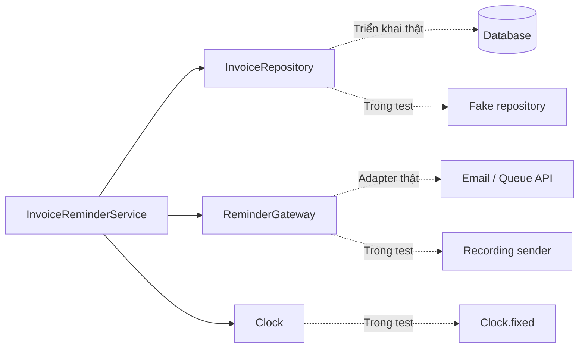

# Thiết kế điểm thay thế phụ thuộc khi cần kiểm thử

## 1. Vì sao khả năng thay thế phụ thuộc liên quan đến chất lượng mã nguồn?

Một hàm có thể đúng về mặt thuật toán nhưng rất khó kiểm thử nếu mỗi lần gọi đều kết nối cơ sở dữ liệu thật, lấy thời gian hệ thống, gửi email hoặc phụ thuộc vào cấu hình máy chủ. Khi test lúc chạy lúc không, người sửa dễ bỏ qua lỗi hồi quy; khi không thể tái hiện sự cố, người vận hành cũng khó tìm nguyên nhân.

Trong module `CODE_QUALITY_FUNDAMENTALS`, mục tiêu là **hiểu những thuộc tính quyết định mã nguồn có đáng tin cậy, dễ hiểu và dễ thay đổi hay không**. Thuộc chương **Khả năng kiểm thử**, bài này tập trung vào **thiết kế điểm thay thế phụ thuộc khi cần kiểm thử**: tạo ra những ranh giới đủ rõ để có thể thay một thành phần khó kiểm soát bằng thành phần kiểm soát được, trong khi vẫn bảo vệ hợp đồng hoạt động của hệ thống thật.

Xét chức năng nhắc thanh toán hóa đơn quá hạn. Muốn kiểm thử trường hợp “đúng thời điểm hết hạn”, ta cần kiểm soát đồng hồ. Muốn chắc chắn không gửi thông báo cho hóa đơn đã thanh toán, ta cần quan sát lời gọi gửi thông báo mà không gửi email thật. Muốn thử lỗi đọc hóa đơn, ta cần mô phỏng lỗi repository mà không làm hỏng cơ sở dữ liệu production.

Một thiết kế hỗ trợ tốt sẽ giúp test trả lời được các câu hỏi cụ thể:

- Với cùng đầu vào và cùng thời gian giả lập, kết quả có lặp lại được không?
- Khi dependency trả lỗi hoặc không có dữ liệu, logic nghiệp vụ xử lý thế nào?
- Trước khi xác định kết quả, hệ thống có vô tình thực hiện tác dụng phụ không?
- Khi thay cách lưu trữ hoặc nhà cung cấp dịch vụ, các kiểm thử nghiệp vụ có còn hữu ích không?
- Có cần thêm nhiều interface và factory mới kiểm thử được không, hay chỉ cần truyền một giá trị hoặc một đối tượng phụ thuộc?

**Mục tiêu không phải “mock được mọi thứ”.** Mục tiêu là kiểm thử các hành vi quan trọng một cách đáng tin cậy, nhanh và có khả năng phát hiện sai sót, đồng thời giữ thiết kế production dễ hiểu.

## 2. “Điểm thay thế” là gì và khác gì với mock?

**Điểm thay thế phụ thuộc** (*seam*) là nơi có thể thay đổi hoặc chọn một cộng tác viên, nguồn dữ liệu hay hành vi phụ thuộc mà không phải viết lại phần logic đang được kiểm thử. Trong Java, seam thường là tham số, dependency truyền qua constructor, một interface, một đối tượng thời gian hoặc một adapter ở ranh giới hạ tầng.

Ví dụ:

```java
// Khó kiểm soát thời gian trong test.
boolean isExpired(Instant deadline) {
    return !Instant.now().isBefore(deadline);
}

// Kiểm soát được mốc thời gian mà không cần mock.
boolean isExpired(Instant deadline, Instant now) {
    return !now.isBefore(deadline);
}
```

Ở phiên bản thứ hai, tham số `now` chính là một điểm cho phép test cung cấp thời gian bất kỳ. **Không cần tạo interface** chỉ để thay `Instant.now()` trong một phép so sánh thuần.

Phân biệt ba khái niệm:

| Khái niệm | Ý nghĩa | Ví dụ |
| --- | --- | --- |
| **Dependency** | Một đối tượng, giá trị hoặc dịch vụ ảnh hưởng đến hành vi | Đồng hồ, repository, HTTP client |
| **Seam** | Ranh giới cho phép kiểm soát/thay dependency | Constructor nhận `Clock`; service nhận `InvoiceRepository` |
| **Test double** | Một đối tượng dùng thay dependency trong môi trường test | Fake repository trong bộ nhớ; spy ghi lại yêu cầu gửi |

Seam không đồng nghĩa với **mock**. Mock chỉ là một loại test double, thường dùng để xác nhận một tương tác được kỳ vọng. Có thể dùng seam với fake, stub, spy, implementation thật của môi trường thử nghiệm hoặc đơn giản là một giá trị thời gian cố định.

**Dependency injection (DI)** là một cách phổ biến để cung cấp dependency từ bên ngoài; nó có thể tạo seam hữu ích, nhưng không nhất thiết cần framework DI. Constructor Java thông thường đã đủ cho nhiều bài toán.

## 3. Nhận diện những phụ thuộc khiến kiểm thử khó kiểm soát

Không phải dependency nào cũng cần thay thế. Hãy ưu tiên những nguồn gây **không xác định, tác dụng phụ, chi phí lớn hoặc lỗi khó tái hiện**.

| Phụ thuộc | Dấu hiệu trong code | Khó khăn khi kiểm thử | Điểm thay thế có thể dùng |
| --- | --- | --- | --- |
| Đồng hồ | `Instant.now()`, `System.currentTimeMillis()` | Test thay đổi theo thời điểm; biên hết hạn khó lặp | `Instant now`, `Clock` |
| Cơ sở dữ liệu | Service tự gọi SQL, tự mở kết nối | Chậm, cần dữ liệu và môi trường | Repository/port với triển khai fake hoặc database test |
| HTTP / dịch vụ ngoài | Tạo client và gọi API ngay trong logic | Mạng không ổn định, mất phí, phản hồi khó chủ động | Gateway/adapter theo hợp đồng miền nghiệp vụ |
| Email / message broker | Gửi ngay khi chạy hàm | Test có tác dụng phụ thật hoặc cần broker | `NotificationGateway`, sender recording |
| Random và sinh ID | `UUID.randomUUID()`, bộ sinh ngẫu nhiên ẩn | Không chủ động tạo giá trị cần kiểm tra | `Supplier<UUID>` hoặc `IdGenerator` khi có lý do |
| Cấu hình / môi trường | `System.getenv()` ở nhiều phương thức | Kết quả khác theo máy hoặc thứ tự test | Đối tượng cấu hình bất biến truyền qua constructor |
| Filesystem | Đọc/ghi đường dẫn thực mặc định | Có thể ghi đè dữ liệu, phụ thuộc quyền | Tham số đường dẫn, temp directory hoặc storage port |
| Scheduler / thread | `Thread.sleep()`, khởi tạo thread ẩn | Test chậm và dễ race condition | Executor/clock có kiểm soát, test bằng tín hiệu đồng bộ |
| Trạng thái toàn cục | `static` mutable, singleton ẩn | Test ảnh hưởng lẫn nhau | Trạng thái thuộc instance và vòng đời rõ |

### 3.1. Dùng mức thay thế thấp nhất đủ hiệu quả

Không có lý do để tạo `CurrentTimeProviderFactory` khi chỉ cần truyền `Instant now`. Ngược lại, một dependency giao tiếp cổng thanh toán thường cần **hợp đồng có tên** để phân biệt kết quả thành công, bị từ chối và chưa rõ do timeout.

Một cách lựa chọn thực tế:

1. **Giá trị thuần đủ diễn đạt chưa?** Truyền `Instant`, `Duration`, `BigDecimal` hoặc cấu hình bất biến.
2. **Có đối tượng chuẩn trong Java không?** `Clock`, `Path`, `Executor`, `Supplier<T>` có thể đã đủ.
3. **Có ranh giới hạ tầng hoặc nghiệp vụ thật không?** Cân nhắc interface `PaymentGateway`, `InvoiceRepository`, `NotificationGateway`.
4. **Có cần mô phỏng và xác nhận giao thức bên ngoài không?** Dùng integration/contract test của adapter, không chỉ unit test với mock.
5. **Thêm abstraction có khiến code khó đọc hơn lợi ích của nó không?** Nếu có, thử tách logic thuần khỏi I/O trước.

## 4. Thiết kế ranh giới phụ thuộc theo hướng từ nghiệp vụ ra hạ tầng

Một ranh giới hữu ích thường giữ logic nghiệp vụ chỉ biết **nó cần hành vi nào**, không biết **SDK, URL, bảng database hoặc cú pháp của nhà cung cấp nào thực hiện hành vi ấy**.

Ví dụ một service nhắc hóa đơn:



Đường gọi giữa service và các interface được quyết định từ **nhu cầu của service**. Nhờ vậy, service không cần tạo database client hoặc HTTP client trực tiếp trong hàm xử lý. Khi đổi nhà cung cấp email, ta chủ yếu sửa adapter; kiểm thử quy tắc nhắc hóa đơn vẫn giữ ý nghĩa.

Đây là cách tổ chức theo tư tưởng *dependency inversion* ở mức thực dụng, không bắt buộc áp dụng toàn bộ một kiến trúc nhiều tầng. Quan trọng nhất là **ranh giới phản ánh một trách nhiệm có thật**, thay vì tạo interface chỉ vì mọi class đều “phải có interface”.

### 4.1. Đặt tên hợp đồng theo nghiệp vụ

```java
interface InvoiceRepository {
    Optional<Invoice> findById(String invoiceId);
}

interface ReminderGateway {
    void enqueueReminder(Invoice invoice);
}
```

Tên `enqueueReminder` thể hiện ý nghĩa khác `sendEmailAndWaitForDelivery`. Nếu bên gửi chỉ xác nhận **đã tiếp nhận bền vững** vào hàng đợi, không nên gọi trạng thái service là “email đã đến hộp thư”. Ý nghĩa của kết quả phụ thuộc vào **điểm cam kết thực**.

Một interface có kiểu trả về `Object` và phương thức `execute(Map<String, Object>)` có thể dễ mock, nhưng che mất hợp đồng và bắt caller tự ép kiểu. Khả năng thay thế không có giá trị nếu phải đánh đổi bằng việc không còn hiểu được hành vi.

### 4.2. Truyền phụ thuộc từ bên ngoài, tránh tự khởi tạo bên trong

```java
// Khó thay thế: service quyết định luôn cách kết nối.
public InvoiceReminderService() {
    this.repository = new SqlInvoiceRepository("jdbc:...");
    this.gateway = new RealEmailClient(...);
}
```

Cách xây dựng tốt hơn là cấp dependency tại **composition root** (nơi ứng dụng lắp ghép các thành phần):

```java
// Mẫu ý tưởng: concrete adapter được tạo ở tầng khởi động.
var service = new InvoiceReminderService(
        sqlInvoiceRepository,
        queueReminderGateway,
        Clock.systemUTC());
```

Đoạn lắp ghép trên là minh họa kiến trúc, không phải chương trình độc lập. Service có thể được tạo bằng code Java thông thường hoặc thông qua framework DI. Tính testable không đến từ tên framework; nó đến từ **dependency được quản lý rõ ràng và có thể kiểm soát ở điểm khởi tạo**.

## 5. Ví dụ Java 17 đầy đủ: nhắc hóa đơn quá hạn

### 5.1. Hợp đồng nghiệp vụ giả định

Để có bài toán kiểm chứng được, ta xác định rõ:

- Một hóa đơn có mã, mã người nhận, hạn thanh toán và cờ đã thanh toán.
- Hóa đơn không tồn tại → `NOT_FOUND`.
- Hóa đơn đã thanh toán → `ALREADY_PAID`; không gửi nhắc.
- Hóa đơn chưa đến hạn → `NOT_DUE`; không gửi nhắc.
- Hóa đơn chưa thanh toán và **đúng hạn hoặc đã quá hạn** → yêu cầu gateway đưa thông báo vào hàng đợi.
- Gateway trả về bình thường theo hợp đồng **đã tiếp nhận bền vững** → `QUEUED`; điều đó chưa khẳng định email đã được phát tới người nhận.
- Nếu gateway ném lỗi, service không được tự trả `QUEUED` giả. Với timeout, kết quả ở bên nhận có thể chưa xác định; cần quy trình xử lý riêng trong production.

Đây là **hợp đồng phục vụ bài học**, không phải mặc định nghiệp vụ của mọi hệ thống hóa đơn.

### 5.2. Mã service không phụ thuộc trực tiếp vào database hoặc đồng hồ hệ thống

Đặt đoạn Java 17+ dưới đây trong `InvoiceReminderService.java`:

```java
import java.time.Clock;
import java.time.Instant;
import java.util.Objects;
import java.util.Optional;

public final class InvoiceReminderService {
    public record Invoice(
            String invoiceId,
            String recipientId,
            Instant dueAt,
            boolean paid) {

        public Invoice {
            if (invoiceId == null || invoiceId.isBlank()) {
                throw new IllegalArgumentException("invoiceId must not be blank");
            }
            if (recipientId == null || recipientId.isBlank()) {
                throw new IllegalArgumentException("recipientId must not be blank");
            }
            Objects.requireNonNull(dueAt, "dueAt");
        }
    }

    public interface InvoiceRepository {
        // Optional.empty() chỉ có nghĩa là không tìm thấy hóa đơn.
        // Lỗi hạ tầng không được biến thành Optional.empty().
        Optional<Invoice> findById(String invoiceId);
    }

    public interface ReminderGateway {
        // Trả về bình thường nghĩa là hàng đợi đã tiếp nhận bền vững,
        // không có nghĩa người nhận đã đọc email.
        void enqueueReminder(Invoice invoice);
    }

    public enum Outcome {
        NOT_FOUND,
        ALREADY_PAID,
        NOT_DUE,
        QUEUED
    }

    private final InvoiceRepository repository;
    private final ReminderGateway gateway;
    private final Clock clock;

    public InvoiceReminderService(
            InvoiceRepository repository,
            ReminderGateway gateway,
            Clock clock) {
        this.repository = Objects.requireNonNull(repository, "repository");
        this.gateway = Objects.requireNonNull(gateway, "gateway");
        this.clock = Objects.requireNonNull(clock, "clock");
    }

    public Outcome remind(String invoiceId) {
        if (invoiceId == null || invoiceId.isBlank()) {
            throw new IllegalArgumentException("invoiceId must not be blank");
        }

        Optional<Invoice> candidate = Objects.requireNonNull(
                repository.findById(invoiceId),
                "repository result");

        if (candidate.isEmpty()) {
            return Outcome.NOT_FOUND;
        }

        Invoice invoice = candidate.orElseThrow();
        if (invoice.paid()) {
            return Outcome.ALREADY_PAID;
        }
        if (clock.instant().isBefore(invoice.dueAt())) {
            return Outcome.NOT_DUE;
        }

        // Chỉ báo QUEUED khi lời gọi trả về bình thường theo hợp đồng.
        gateway.enqueueReminder(invoice);
        return Outcome.QUEUED;
    }
}
```

Các quyết định trên giúp kiểm thử thế nào?

| Quyết định trong thiết kế | Khả năng kiểm thử mang lại |
| --- | --- |
| `InvoiceRepository` được truyền qua constructor | Cung cấp invoice tùy ý hoặc mô phỏng lỗi truy vấn mà không cần DB |
| `ReminderGateway` là ranh giới tác dụng phụ | Ghi nhận xem service có yêu cầu gửi thông báo không, không gửi email thật |
| `Clock` được truyền từ ngoài | Kiểm soát thời gian trước hạn, đúng hạn và sau hạn |
| Kết quả `Outcome` rõ nghĩa | Kiểm tra cả tình huống không gửi thông báo, thay vì chỉ kiểm tra `true`/`false` |
| Kiểm tra đầu vào và dependency | Từ chối cấu hình sai sớm; lỗi không bị che thành kết quả nghiệp vụ |
| Service không chứa SDK | Thay adapter không buộc viết lại test chính sách nhắc hóa đơn |

**Ranh giới cần chú ý:** `InvoiceRepository` và `ReminderGateway` chỉ là hợp đồng Java. Chúng **chưa tự bảo đảm** transaction, khử trùng lặp, tính nhất quán khi hóa đơn vừa được thanh toán hay độ bền của hàng đợi. Test đơn vị chỉ có thể chứng minh service **gọi đúng ranh giới** theo dữ liệu giả lập.

### 5.3. Kiểm thử bằng fake và recording spy, không gửi thông báo thật

Các kiểm thử JUnit 5 sau dùng các dependency thay thế đơn giản. Đặt trong `InvoiceReminderServiceTest.java`:

```java
import static org.junit.jupiter.api.Assertions.*;
import java.time.Clock;
import java.time.Instant;
import java.time.ZoneOffset;
import java.util.ArrayList;
import java.util.List;
import java.util.Optional;
import org.junit.jupiter.api.Test;

class InvoiceReminderServiceTest {
    private static Clock fixedAt(String iso) {
        return Clock.fixed(Instant.parse(iso), ZoneOffset.UTC);
    }

    private static InvoiceReminderService.Invoice invoice(
            String dueAt, boolean paid) {
        return new InvoiceReminderService.Invoice(
                "invoice-1", "customer-1", Instant.parse(dueAt), paid);
    }

    @Test
    void queuesAtExactDeadline() {
        var bill = invoice("2026-11-16T10:00:00Z", false);

        InvoiceReminderService.InvoiceRepository repository =
                id -> Optional.of(bill);
        List<String> enqueued = new ArrayList<>();
        InvoiceReminderService.ReminderGateway gateway =
                item -> enqueued.add(item.invoiceId());

        var service = new InvoiceReminderService(
                repository,
                gateway,
                fixedAt("2026-11-16T10:00:00Z"));

        assertEquals(InvoiceReminderService.Outcome.QUEUED,
                service.remind("invoice-1"));
        assertEquals(List.of("invoice-1"), enqueued);
    }

    @Test
    void doesNotQueueBeforeDeadline() {
        var bill = invoice("2026-11-16T10:00:00Z", false);
        InvoiceReminderService.InvoiceRepository repository =
                id -> Optional.of(bill);
        List<String> enqueued = new ArrayList<>();
        InvoiceReminderService.ReminderGateway gateway =
                item -> enqueued.add(item.invoiceId());

        var service = new InvoiceReminderService(
                repository,
                gateway,
                fixedAt("2026-11-16T09:59:59Z"));

        assertEquals(InvoiceReminderService.Outcome.NOT_DUE,
                service.remind("invoice-1"));
        assertTrue(enqueued.isEmpty());
    }

    @Test
    void doesNotQueuePaidInvoiceEvenWhenOverdue() {
        var bill = invoice("2026-11-16T08:00:00Z", true);
        InvoiceReminderService.InvoiceRepository repository =
                id -> Optional.of(bill);
        List<String> enqueued = new ArrayList<>();
        InvoiceReminderService.ReminderGateway gateway =
                item -> enqueued.add(item.invoiceId());

        var service = new InvoiceReminderService(
                repository,
                gateway,
                fixedAt("2026-11-16T10:00:00Z"));

        assertEquals(InvoiceReminderService.Outcome.ALREADY_PAID,
                service.remind("invoice-1"));
        assertTrue(enqueued.isEmpty());
    }

    @Test
    void returnsNotFoundWithoutContactingGateway() {
        InvoiceReminderService.InvoiceRepository repository =
                id -> Optional.empty();
        List<String> enqueued = new ArrayList<>();
        InvoiceReminderService.ReminderGateway gateway =
                item -> enqueued.add(item.invoiceId());

        var service = new InvoiceReminderService(
                repository,
                gateway,
                fixedAt("2026-11-16T10:00:00Z"));

        assertEquals(InvoiceReminderService.Outcome.NOT_FOUND,
                service.remind("missing"));
        assertTrue(enqueued.isEmpty());
    }

    @Test
    void propagatesGatewayFailureInsteadOfClaimingQueued() {
        var bill = invoice("2026-11-16T08:00:00Z", false);
        InvoiceReminderService.InvoiceRepository repository =
                id -> Optional.of(bill);
        InvoiceReminderService.ReminderGateway gateway =
                item -> { throw new IllegalStateException("queue unavailable"); };

        var service = new InvoiceReminderService(
                repository,
                gateway,
                fixedAt("2026-11-16T10:00:00Z"));

        assertThrows(IllegalStateException.class,
                () -> service.remind("invoice-1"));
    }
}
```

Test `queuesAtExactDeadline` cố định đồng hồ tại đúng ranh giới, nên không bị lệ thuộc thời điểm máy đang chạy. Danh sách `enqueued` là một recording spy tối giản: giúp xác nhận có đúng một yêu cầu được gửi tới gateway. Những test khác quan sát **không có tác dụng phụ** khi hóa đơn chưa đến hạn, đã thanh toán hoặc không tồn tại.

Một số tình huống bổ sung có thể kiểm tra: `invoiceId` rỗng; repository ném lỗi; repository trả `null` trái hợp đồng; hóa đơn có giá trị thời gian cực hạn; gateway ghi nhận nhiều lần khi service bị gọi lặp. Đặc biệt, **test hiện tại không kiểm tra chống gửi thông báo trùng** nếu `remind` chạy nhiều lần; đó là trách nhiệm cần thiết kế thêm khi nghiệp vụ yêu cầu.

### 5.4. Ví dụ này chưa bảo đảm điều gì trong production?

Để tránh sự hiểu nhầm “fake chạy đúng thì hệ thống thật chắc chắn đúng”, cần nói rõ:

- Nếu invoice được đọc khi chưa thanh toán, nhưng thanh toán ngay sau đó, service có thể vẫn gửi nhắc. Cần xác định mức nhất quán nghiệp vụ chấp nhận được và cơ chế kiểm tra lại nếu cần.
- Hai tiến trình có thể cùng gọi `remind` và cùng đưa một thông báo vào queue. Nếu yêu cầu **tối đa một nhắc cho mỗi kỳ**, cần khóa/ràng buộc idempotency bền vững, không thể chỉ dùng `List` trong test.
- Gateway có thể tiếp nhận yêu cầu nhưng phản hồi thất lạc; exception hoặc timeout không chứng minh thông báo chưa được đưa vào queue. Cần khóa định danh ổn định và đối soát khi thích hợp.
- Repository fake không mô phỏng isolation level, unique constraint, hiệu năng truy vấn hoặc khả năng rollback. Những bảo đảm đó cần integration test với database và adapter thật.
- Kết quả `QUEUED` chỉ phản ánh hợp đồng đã định: hàng đợi tiếp nhận bền vững nếu phương thức trả về bình thường. Nó **không** đồng nghĩa người dùng đã nhận hoặc đọc thông báo.

Đây là khác biệt cốt lõi giữa **kiểm thử logic nghiệp vụ** và **chứng minh hệ thống tương tác đúng với hạ tầng**.

## 6. Các loại test double và cách dùng đúng mục đích

Trong thực tế, nhiều nhóm gọi tất cả đối tượng thay thế là “mock”. Phân biệt sẽ giúp chọn đúng mức kiểm chứng.

| Loại | Mục đích chính | Ví dụ với chức năng nhắc hóa đơn |
| --- | --- | --- |
| **Dummy** | Chỉ lấp một tham số không dùng trong ca kiểm thử | Một đối tượng chỉ tồn tại để tạo fixture, không được truy cập |
| **Stub** | Trả dữ liệu được lập trình sẵn | Repository trả `Optional.of(invoice)` hoặc `Optional.empty()` |
| **Fake** | Triển khai đơn giản nhưng có hành vi hoạt động | Repository in-memory lưu và tìm invoice |
| **Spy** | Ghi lại cách dependency được sử dụng | Recording gateway lưu danh sách invoice được yêu cầu gửi |
| **Mock** | Xác nhận kỳ vọng tương tác, thường do framework hỗ trợ | Xác nhận gateway nhận một lần gọi `enqueueReminder` cho invoice cụ thể |

Những tên này mô tả **vai trò trong một ca kiểm thử**, không bắt buộc là năm loại class riêng biệt. Một lambda có thể là stub ở test này và spy ở test khác nếu ghi nhận lời gọi.

### 6.1. Nên ưu tiên xác nhận kết quả hay tương tác?

Nếu kiểm thử một hàm tính tổng tiền thuần, hãy xác nhận **giá trị trả về**; không cần mock `BigDecimal` hay kiểm tra bao nhiêu lần gọi `add`. Nếu nghiệp vụ yêu cầu **không gửi thông báo cho người đã thanh toán**, việc xác nhận gateway **không được gọi** là bằng chứng hữu ích vì tác dụng phụ là phần của hợp đồng.

Ngược lại, đừng khóa chặt số lần gọi của các phương thức nội bộ chỉ để đạt độ chi tiết cao:

```java
// Dễ giòn: kiểm tra chi tiết triển khai bên trong.
verify(helper).normalizeText();
verify(helper).loadMetadata();
verify(helper).formatMessage();
```

Các lời gọi như `normalizeText` có thể được đổi tên, gộp hoặc loại bỏ mà không làm thay đổi kết quả. Test chỉ xác nhận thứ tự gọi nội bộ thường gây hồi quy giả khi refactor. Hãy ưu tiên **trạng thái quan sát được và tương tác có ý nghĩa nghiệp vụ**.

### 6.2. Mock không chứng minh adapter thật đúng hợp đồng

Một mock tự lập trình trả kết quả `QUEUED` bất kể nội dung request không chứng minh broker thật đã nhận bền vững. Một fake repository có thể hoạt động với dữ liệu không hợp lệ trong khi database thật có constraint; hoặc ngược lại fake có thể thiếu quy tắc mà database thật thực thi.

Do đó, đơn vị kiểm thử bằng double cần được bổ sung bằng **contract test và integration test của adapter**. Hợp đồng quan trọng như `findById` trả empty khi không tồn tại, nhưng ném lỗi khi DB thất bại, phải được kiểm tra ở triển khai thật trong môi trường kiểm thử phù hợp.

## 7. Lựa chọn seam: giá trị, interface, adapter hay framework mock?

| Tình huống | Lựa chọn nhỏ gọn thường phù hợp | Khi cần ranh giới mạnh hơn |
| --- | --- | --- |
| Chỉ kiểm tra thời điểm hết hạn | Tham số `Instant now` | Nhiều phương thức trong một object dùng chung đồng hồ → `Clock` |
| Chỉ cần tính toán thuần | Truyền giá trị và gọi hàm trực tiếp | Không cần interface nếu không có biến thể thật |
| Gọi database trong logic nghiệp vụ | Repository có hợp đồng miền nghiệp vụ | Adapter riêng cho truy vấn, transaction và migration |
| Gọi dịch vụ thanh toán | Gateway/port với kiểu kết quả cụ thể | Contract test, idempotency và xử lý kết quả chưa xác định |
| Sinh mã định danh không mật mã | `Supplier<UUID>` hoặc `IdGenerator` khi cần cố định giá trị | Hệ thống cấp mã có trạng thái và quy tắc phân phối riêng |
| Dùng cấu hình nhiều lần | Config record bất biến | Cấu hình động cần versioning và đường cập nhật rõ |
| Chạy tác vụ bất đồng bộ | Executor có kiểm soát và tín hiệu đồng bộ | Queue/worker thực cần integration và failure test |
| Chỉ muốn test một hàm private thuần | Test qua API công khai hoặc tách hàm thuần có ý nghĩa | Tránh tạo public API chỉ vì test |

**Đừng thêm một interface chỉ vì framework mock làm được điều đó.** Các thư viện mock có khả năng khác nhau tùy phiên bản; code dễ test nhất thường là code tách ranh giới phụ thuộc rõ nghĩa, không phụ thuộc kỹ thuật mock đặc biệt.

### 7.1. Khi nào dùng `Clock`, khi nào chỉ dùng `Instant`?

- Nếu hàm chỉ cần **một mốc thời gian để quyết định**, truyền `Instant evaluatedAt` thường gọn, dễ hiểu và đủ dùng.
- Nếu một service cần lấy thời gian ở nhiều chỗ hoặc nhiều phương thức cùng chia sẻ một nguồn thời gian, constructor nhận `Clock` giúp kiểm soát đồng bộ và bảo đảm dùng cùng cấu hình clock.
- Đối với đo **thời gian thực thi**, cần phân biệt thời gian lịch và đồng hồ đơn điệu. Một `Clock` có thể bị điều chỉnh không thay thế hoàn toàn nguồn đo elapsed time; thiết kế và test theo đúng hợp đồng thời gian.

### 7.2. Khi nào cần adapter riêng?

Khi dependency ở ngoài phạm vi nghiệp vụ (HTTP client, thư viện SDK, SQL), adapter có thể chuyển đổi kiểu dữ liệu và lỗi của nhà cung cấp sang mô hình ứng dụng. Điều này giúp test unit service mà không phải giả lập từng lớp HTTP.

Ví dụ, `PaymentGateway` nên thể hiện **kết quả thanh toán** mà caller cần, thay vì trả thẳng `HttpResponse<String>` và bắt service phân tích mã lỗi đặc thù của hãng thanh toán. Nếu interface vẫn rò rỉ toàn bộ SDK, việc đổi provider hoặc viết fake cũng khó.

## 8. Các lỗi thiết kế thường thấy khi cố làm mã “dễ mock”

### 8.1. Trừu tượng hóa quá mức

Một phép cộng hai số không cần `AdditionEngineFactory` hay `NumberRepository`. Nếu thêm interface chỉ để fake một hàm thuần, hệ thống có thêm hợp đồng cần bảo trì nhưng không thu được nhiều giá trị.

**Cách tránh:** bắt đầu từ kết quả cần kiểm chứng và dependency gây khó khăn thật. Chọn seam nhỏ nhất giúp kiểm soát dependency đó.

### 8.2. Dùng global mutable state để “chuyển chế độ test”

```java
static boolean testMode;

static void sendReminder(Invoice invoice) {
    if (!testMode) {
        // call real system
    }
}
```

Cờ `testMode` làm hành vi production phụ thuộc vào trạng thái toàn cục và thứ tự chạy test. Trong môi trường đa luồng, các test có thể ảnh hưởng nhau; ở production, bật nhầm cờ sẽ dẫn tới hành vi sai.

**Cách tránh:** dependency thật và test double được lắp ghép từ bên ngoài. Logic miền nghiệp vụ không cần biết đang chạy test hay production.

### 8.3. Nắm toàn bộ hệ thống bằng một `AppContext` khổng lồ

Một lớp nhận `AppContext` chứa database, clock, email, cache, metrics, feature flag, queue và hàng chục dịch vụ có thể trông như chỉ có một dependency. Nhưng khi đọc method, không biết thành phần nào thực sự được dùng; khi test, phải dựng quá nhiều fixture.

**Cách tránh:** truyền các dependency thực sự cần thiết. Constructor có quá nhiều tham số cũng có thể là tín hiệu lớp đang gánh quá nhiều trách nhiệm; hãy kiểm tra ranh giới thay vì giấu tất cả vào context.

### 8.4. Ghi cứng dữ liệu sai hợp đồng trong mock

Nếu repository thật phân biệt **không tìm thấy** và **database lỗi**, nhưng mock luôn trả `Optional.empty()` cho cả hai, test sẽ dạy service một hợp đồng sai. Nếu queue fake luôn thành công mà production có timeout, nhiều nhánh lỗi quan trọng không bao giờ được thử.

**Cách tránh:** mô tả rõ outcome của dependency và bổ sung các ca double mô phỏng lỗi, đồng thời kiểm thử adapter thật.

### 8.5. Mock quá sâu vào chi tiết triển khai

Test kiểm tra `service gọi helper A trước helper B` sẽ hỏng ngay khi refactor nội bộ dù kết quả nghiệp vụ không đổi. Những test này cản trở mục tiêu **dễ thay đổi**, một thuộc tính chất lượng quan trọng của module.

**Cách tránh:** chỉ xác nhận thứ tự tương tác khi thứ tự là yêu cầu thật, chẳng hạn **phải lưu transaction trước khi phát sự kiện**. Nếu không, ưu tiên hành vi quan sát được.

### 8.6. Bỏ qua tính đồng thời và khả năng phục hồi vì unit test xanh

Fake in-memory có thể không có lock, transaction hay cơ chế retry của database/queue thật. Tất cả unit test pass vẫn không chứng minh được xử lý đúng khi hai request cùng dùng một invoice hoặc khi máy chủ dừng giữa thao tác.

**Cách tránh:** phân chia trách nhiệm kiểm thử: unit test cho logic và đường lỗi, integration/contract test cho dependency thật, failure/concurrency test cho bất biến dưới điều kiện bất thường.

## 9. Kiểm thử nào nên thật và kiểm thử nào nên thay thế?

“Không dùng hạ tầng thật trong unit test” không có nghĩa mọi kiểm thử đều phải dùng test double. Các tầng kiểm thử hỗ trợ nhau:

| Tầng | Mục tiêu | Phụ thuộc nên dùng | Ví dụ |
| --- | --- | --- | --- |
| **Unit test** | Quy tắc nghiệp vụ, điều kiện biên, quyết định gọi dependency | Clock cố định, stub/fake/spy | Không nhắc hóa đơn đã thanh toán |
| **Adapter/contract test** | Triển khai dependency tuân thủ hợp đồng | Adapter thật + môi trường test | Repository phân biệt not found và lỗi DB |
| **Integration test** | Giao dịch, serialization, tương tác nhiều thành phần | Database/queue test hoặc dịch vụ mô phỏng giao thức | Ghi hóa đơn và tạo sự kiện nhất quán |
| **End-to-end test** | Luồng giá trị quan trọng đi qua hệ thống | Nhiều thành phần thật trong môi trường an toàn | Yêu cầu thanh toán tới trạng thái kết quả |
| **Failure/concurrency test** | Phục hồi khi có timeout, restart, xung đột | Thành phần gần production, tiêm lỗi có kiểm soát | Không tạo thông báo trùng khi retry |

Trong test tích hợp, cần **cô lập dữ liệu và tác dụng phụ**: database test, container test, API sandbox, queue riêng, tài khoản không liên quan người dùng thật. Không sử dụng địa chỉ email thật của khách hàng để thử. Không nhất thiết phải có end-to-end test cho từng nhánh đơn giản; chọn đường có hậu quả cao và khả năng sai lệch khi tích hợp.

### 9.1. Test tính đúng đắn của double với hợp đồng thật

Một fake tốt cần **giống triển khai thật ở những điểm logic được kiểm thử phụ thuộc vào**. Nếu production repository đảm bảo thứ tự, fake cũng phải cung cấp thứ tự đã cam kết. Nếu production cho phép trả kết quả chưa xác định khi timeout, fake phải có khả năng tạo trường hợp đó khi cần.

Nhưng đừng cố viết một “database thu nhỏ” đầy đủ trong fake; càng phức tạp, fake càng có lỗi riêng. Nếu quan hệ giao dịch và isolation là trọng tâm, dùng database thử nghiệm thay vì mô phỏng bằng `HashMap`.

### 9.2. Kiểm thử bất đồng bộ mà không dựa vào `Thread.sleep`

`Thread.sleep(100)` trong test chỉ đoán rằng tác vụ nền sẽ xong sau 100 ms; dưới tải CI, giả định này dễ sai. Khi có thể, dùng `CompletableFuture`, latch, tín hiệu hoàn tất hoặc scheduler được điều khiển, cùng timeout test để tránh treo vô hạn. Kiểm thử **kết quả và bất biến**, không chỉ kiểm tra một khoảng chờ đã trôi qua.

## 10. Refactor một đoạn code cũ để tạo seam từng bước

Giả sử mã cũ:

```java
public void remind(String invoiceId) {
    var invoice = DatabaseSingleton.get().loadInvoice(invoiceId);
    if (!invoice.isPaid() && Instant.now().isAfter(invoice.dueAt())) {
        EmailClient.send(invoice.recipientId(), "Overdue");
    }
}
```

Các dependency đang bị giấu trong thân method: database singleton, đồng hồ và client email. Để đổi mà giảm rủi ro hồi quy:

1. **Ghi nhận hợp đồng hiện tại.** Chính sách có gửi nhắc tại đúng deadline không? Nếu mã đang dùng `isAfter` thì *đúng hạn* chưa gửi; đó có thể là bug hoặc quy tắc có chủ đích. Không đổi âm thầm trong một “refactor không đổi hành vi”.
2. **Viết test mô tả hành vi cần giữ và ca nguy hiểm.** Trường hợp đã thanh toán, trước/đúng/sau hạn, không tồn tại và lỗi gửi.
3. **Đưa đồng hồ thành dependency điều khiển được.** Có thể bắt đầu bằng tham số `Instant now` hoặc `Clock`, giữ phương thức gọi cũ như adapter nếu phải duy trì API.
4. **Tạo ranh giới quanh I/O thật.** Tách truy vấn hóa đơn và yêu cầu gửi thông báo thành collaborator có tên, đồng thời duy trì ý nghĩa lỗi của chúng.
5. **Chuyển một đường gọi sang thiết kế mới, kiểm thử lại.** Chỉ thay đổi nhỏ trong một lần để diff dễ review.
6. **Đánh giá tích hợp.** Test adapter với database/queue thật trong môi trường kiểm thử, không kết luận an toàn chỉ vì fake pass.
7. **Theo dõi vận hành và xử lý tương thích.** Nếu method cũ được dùng công khai, cần lộ trình migration thay vì xóa ngay; nếu có side effect, thiết kế cách đối soát và chống lặp.

Đối với code legacy khó chạm, có thể dùng **adapter bao quanh API cũ** hoặc “extract-and-delegate” để di chuyển dần logic. Tránh tạo seam bằng cách sửa hàng loạt chữ ký công khai trong một đợt release chưa có kiểm thử bảo vệ.

### Một lưu ý về thời gian và hành vi biên

Đoạn code cũ dùng `Instant.now().isAfter(deadline)`, còn ví dụ service mới coi đúng thời điểm hạn là đủ điều kiện. Đây là **thay đổi nghiệp vụ**, không chỉ refactor cấu trúc. Khi cải tiến code thực, hãy xác nhận quy tắc đúng với chủ sản phẩm, viết test minh họa, và đánh dấu thay đổi hành vi tách biệt để reviewer không nhầm với việc “chỉ thêm dependency injection”.

## 11. Checklist khi thiết kế điểm thay thế phụ thuộc

Trước khi thêm interface hoặc mock vào một thay đổi, hãy trả lời:

1. **Hành vi nào cần kiểm chứng?** Một kết quả số học, một quyết định nghiệp vụ hay một tác dụng phụ?
2. **Dependency nào làm test khó lặp lại?** Đồng hồ, mạng, DB, random, cấu hình hay trạng thái toàn cục?
3. **Giá trị hoặc kiểu chuẩn có đủ không?** Có cần interface hay chỉ `Instant`/`Clock`?
4. **Ranh giới có diễn đạt miền nghiệp vụ không?** `ReminderGateway.enqueueReminder` rõ hơn `Client.execute` ở điểm nào?
5. **Ai sở hữu hợp đồng?** Ứng dụng đang kiểm soát kiểu kết quả, lỗi và đơn vị hay đang rò rỉ SDK ngoài?
6. **Test double tái hiện đủ kết quả quan trọng chưa?** Tìm thấy, không thấy, lỗi hạ tầng, timeout, chưa xác định?
7. **Test đang bảo vệ kết quả hay chi tiết nội bộ?** Nếu đổi thuật toán mà giữ hành vi, test có vô cớ hỏng không?
8. **Hành vi phụ thuộc có tác dụng phụ nào?** Có cần kiểm tra không gọi, gọi một lần hoặc bảo đảm thứ tự giao dịch không?
9. **Ai kiểm chứng adapter thật?** Có contract/integration test cho repository, gateway và format dữ liệu không?
10. **Tương thích với caller cũ ra sao?** Có phải giữ constructor hoặc API công khai, cung cấp đường chuyển tiếp không?
11. **Chi phí abstraction có xứng đáng?** Nó giảm coupling có thật hay chỉ thêm tầng dẫn hướng?
12. **Khi lỗi production xảy ra, có truy vết được không?** Testability nên đi cùng khả năng quan sát, phân loại lỗi và phục hồi.

## 12. Bài tập thực hành

### Bài 1 — Đồng hồ gây test bất ổn

Một service kiểm tra hạn bảo hành bằng `LocalDate.now()`. Test chạy đúng tại máy tác giả nhưng sai ở CI có múi giờ khác. Hãy xác định nghiệp vụ dùng ngày địa phương theo múi giờ nào, rồi đề xuất seam bằng `Clock` hoặc truyền `LocalDate`. Viết test cho đúng ngày hết hạn và ngày kế tiếp.

### Bài 2 — Mock không phản ánh lỗi thật

Một test giả lập repository luôn trả `Optional.empty()` khi không tìm thấy hóa đơn. Trong production, repository cũng trả empty nếu database timeout. Hãy phân tích sai lệch hợp đồng và thiết kế một test adapter để phân biệt **không tồn tại** với **lỗi hạ tầng**.

### Bài 3 — Nhiều interface vô ích

Một nhóm tạo `PriceCalculatorInterface`, `PriceCalculatorImpl`, `PriceCalculatorFactory` để tính `price * quantity` và chỉ có một caller. Hãy giải thích vì sao thay dependency ở đây ít giá trị; chọn cách đơn giản hơn và nêu điều kiện nào khiến abstraction trở nên cần thiết.

### Bài 4 — Gửi thông báo hai lần

Hai worker cùng đọc một invoice quá hạn, cùng thấy chưa nhắc và gọi `ReminderGateway`. Các unit test fake đều pass. Hãy nêu bất biến cần bảo vệ, loại test cần thêm, vị trí thực thi idempotency và tại sao một recording spy không chứng minh hệ thống không gửi trùng.

### Bài 5 — Biến cấu hình ẩn

Một phương thức `calculateFee` đọc `System.getenv("REGION")` và đôi khi đổi phí tùy môi trường. Hãy thiết kế đối tượng cấu hình có kiểm tra hợp lệ, seam trong service, và các test vùng hợp lệ/vùng không được hỗ trợ. Có cần làm cho mọi cấu hình trở thành interface không?

### Bài 6 — Tương thích khi cải tiến legacy

Một public constructor `new ReminderService()` tự khởi tạo database và email client. Nhiều caller cũ đang dùng nó. Hãy đề xuất cách bổ sung constructor nhận dependency phục vụ test, giữ tương thích trong giai đoạn chuyển đổi và tránh để nhánh “test mode” trong production.

### Bài 7 — Kiểm thử không nên bị ràng buộc implementation

Một test xác nhận service gọi ba helper nội bộ theo thứ tự A → B → C. Sau refactor, service gộp A và B nhưng kết quả và side effect không đổi. Hãy đề xuất test mới dựa trên kết quả quan sát được và chỉ giữ kiểm tra thứ tự khi nghiệp vụ thực sự yêu cầu.

Với mỗi bài tập, câu trả lời nên gồm **dependency cần kiểm soát**, **seam và test double phù hợp**, **hợp đồng quan trọng**, và **kiểm thử tích hợp bổ sung nếu có ranh giới hạ tầng**.

## 13. Ghi nhớ

- **Thiết kế cho khả năng kiểm thử** là làm cho đầu vào, phụ thuộc, kết quả và tác dụng phụ đủ rõ để kiểm soát và quan sát; không phải tạo mock cho mọi class.
- **Seam** là nơi có thể thay dependency. Nó có thể đơn giản là tham số `Instant`, đối tượng chuẩn `Clock` hoặc một interface miền nghiệp vụ khi có ranh giới thật.
- **Test double** giúp unit test nhanh và lặp lại được, nhưng không chứng minh adapter thật tuân thủ giao dịch, giao thức, idempotency hay khả năng phục hồi.
- **Giữ hợp đồng khi tạo abstraction:** không biến lỗi database thành “không tìm thấy”, không coi timeout là thất bại chắc chắn, không khẳng định email đã đến khi queue chỉ tiếp nhận.
- **Đừng để test cản trở refactor.** Ưu tiên kiểm chứng kết quả và tác dụng phụ có ý nghĩa thay vì khóa chặt thứ tự gọi các helper nội bộ.
- **KISS và YAGNI vẫn áp dụng:** seam nhỏ nhất đủ kiểm thử thường tốt hơn một hệ thống interface, factory và context chưa có nhu cầu thực.
- **Kiểm thử nhiều tầng có vai trò khác nhau:** unit test bảo vệ chính sách, contract/integration test bảo vệ hạ tầng, failure/concurrency test bảo vệ bất biến khi gặp sự cố.

Một thiết kế có chất lượng giúp người tiếp theo **hiểu dependency nào quyết định hành vi, thay chúng an toàn trong test, rồi tin vào bằng chứng kiểm chứng từ cả logic nghiệp vụ lẫn hạ tầng thực tế**. Đó là cách khả năng kiểm thử góp phần làm mã nguồn đáng tin cậy, dễ hiểu và dễ thay đổi.
