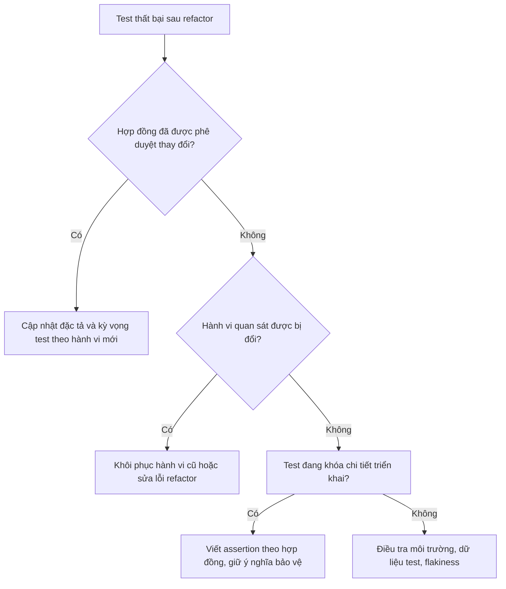

# Giữ kiểm thử ổn định khi tái cấu trúc

## 1. Mục tiêu bài học

Trong chương **Khả năng kiểm thử** của module **CODE_QUALITY_FUNDAMENTALS**, chúng ta tìm hiểu cách viết kiểm thử để có thể **thay đổi cấu trúc bên trong mã mà không phải sửa hàng loạt bài test vẫn đang kiểm tra đúng hành vi**.

Mục tiêu chung của module là hiểu những thuộc tính quyết định mã nguồn có **đáng tin cậy, dễ hiểu và dễ thay đổi** hay không. Một bộ kiểm thử tốt giúp nhóm tự tin thay đổi mã, nhưng một bộ kiểm thử phụ thuộc quá chặt vào cách cài đặt lại có thể làm quá trình tái cấu trúc tốn kém và rủi ro hơn.

Sau bài học này, bạn có thể:

- Giải thích **tái cấu trúc (refactoring)** và vì sao bộ kiểm thử cần ổn định trước thay đổi **chỉ về tổ chức mã**, nhưng vẫn phải phát hiện thay đổi hành vi không mong muốn.
- Phân biệt **hợp đồng quan sát được** với **chi tiết triển khai** mà kiểm thử không nên phụ thuộc quá mức.
- Viết kiểm thử Java/JUnit 5 bảo vệ quy tắc nghiệp vụ và điều kiện biên trước và sau khi tách phương thức hoặc lớp.
- Dùng dữ liệu kiểm thử xác định, fake phù hợp và ranh giới phụ thuộc rõ ràng để tránh kiểm thử không ổn định.
- Nhận diện lúc nào cần cập nhật test vì **yêu cầu thực sự đổi**, thay vì vì cách tổ chức mã đã đổi.

## 2. “Ổn định” không có nghĩa là kiểm thử luôn xanh

**Refactoring** là thay đổi cấu trúc nội bộ của mã trong khi **giữ nguyên hành vi có thể quan sát theo hợp đồng đang áp dụng**. Ví dụ: đổi tên biến cục bộ, tách một khối lệnh thành phương thức riêng, thay thuật toán bằng một cách cài đặt tương đương, hoặc chuyển trách nhiệm sang lớp phù hợp hơn.

Một kiểm thử **ổn định khi tái cấu trúc** có hai đặc điểm:

1. **Không dễ thất bại vô ích** khi chỉ những chi tiết không thuộc hợp đồng thay đổi, chẳng hạn tên phương thức private, thứ tự gọi helper hoặc số lớp trung gian.
2. **Phải thất bại đúng lúc** nếu kết quả, lỗi được cam kết, tác dụng phụ hoặc tính chất quan trọng của hệ thống bị đổi ngoài ý muốn.

Như vậy, một bộ test luôn xanh vì không có assertion ý nghĩa **không phải** bộ test ổn định. Ngược lại, bộ test liên tục đỏ vì đổi tên helper mà vẫn cho đúng kết quả cũng không giúp nhóm thay đổi an toàn.

Có thể diễn đạt mục tiêu bằng câu:

> **Kiểm thử nên nhạy với thay đổi hành vi, nhưng ít nhạy với thay đổi cấu trúc không ảnh hưởng đến hợp đồng.**

### Điều gì được xem là hành vi?

Hành vi không chỉ là giá trị trả về. Tùy hợp đồng API, nó có thể bao gồm:

| Thành phần quan sát được | Ví dụ cần bảo vệ | Thường không cần cố định |
| --- | --- | --- |
| Giá trị trả về | Phí phải trả, điều kiện đủ quyền, kết quả tìm kiếm | Số phương thức private dùng để tính. |
| Lỗi theo hợp đồng | Đầu vào không hợp lệ bị từ chối; lỗi nghiệp vụ có loại rõ ràng | Stack trace chứa bao nhiêu tầng helper. |
| Tác dụng phụ | Một đơn được ghi đúng một lần; email không gửi khi giao dịch thất bại | Tên biến cục bộ hoặc thứ tự gọi các helper thuần. |
| Trạng thái và tính nhất quán | Không âm kho, không trừ tiền hai lần | Cấu trúc collection nội bộ nếu kết quả tương đương. |
| Thời gian/tài nguyên có ràng buộc | Đáp ứng ngưỡng độ trễ hoặc hạn mức đã xác định | Số nano giây cố định cho một lần chạy unit test. |

Không phải mọi cách gọi nội bộ đều “vô hình”. Nếu thứ tự ghi dữ liệu rồi phát sự kiện quyết định tính nhất quán, đó có thể là hành vi quan trọng. Điều cần hỏi là **bên sử dụng có quyền trông đợi điều gì**, không phải “có thể mock điều gì”.

## 3. Vì sao kiểm thử trở nên mong manh?

Một kiểm thử **mong manh (brittle test)** dễ thất bại vì thay đổi không liên quan đến kết quả cần bảo vệ, hoặc phải sửa nhiều mỗi khi tổ chức mã được cải thiện.

Các dấu hiệu thường gặp:

- Test gọi trực tiếp phương thức private thông qua reflection, thay vì kiểm tra hành vi từ API có ý nghĩa.
- Test buộc phương thức phải gọi đúng các helper theo một thứ tự, trong khi hợp đồng chỉ yêu cầu kết quả cuối.
- Test khẳng định một đoạn văn log, nội dung exception hoặc cấu trúc JSON nội bộ không được công bố là hợp đồng.
- Test lấy `LocalDate.now()` hoặc `Instant.now()` trực tiếp và giả định ngày chạy không đổi; kết quả khác nhau khi đổi ngày, múi giờ hoặc máy CI.
- Test dựa vào thứ tự của `HashMap`/`HashSet` dù không có hợp đồng đảm bảo thứ tự.
- Test cùng dùng database, file hoặc biến static có thể sửa mà không cô lập, dẫn đến phụ thuộc thứ tự chạy.
- Test chạy thật các dịch vụ mạng không ổn định trong mọi unit test và nhầm lỗi môi trường với lỗi thuật toán.

### Một cách viết quá phụ thuộc triển khai

Giả sử một dịch vụ có `calculate()` và nội bộ gọi `loadDefaults()`, `normalize()`, `selectRule()`. Nếu unit test chỉ xác nhận “`normalize()` được gọi đúng một lần” mà không kiểm tra kết quả, việc gộp hoặc bỏ bước `normalize()` có thể làm test đỏ **dù hợp đồng nghiệp vụ giữ nguyên**.

Không phải mọi kiểm thử tương tác đều xấu: khi yêu cầu là “chỉ gửi một lệnh thu tiền” hoặc “không gọi đối tác khi yêu cầu không hợp lệ”, **số lần gọi đến ranh giới có tác dụng phụ là hành vi quan trọng**. Cần phân biệt tương tác nghiệp vụ với trình tự helper mang tính cài đặt.

## 4. Ví dụ Java 17: bảo vệ hành vi trước khi tách cấu trúc

Giả sử cửa hàng quy định quyền yêu cầu trả hàng theo các điều kiện:

- Ngày giao hàng và ngày yêu cầu trả đều là `LocalDate` hợp lệ, không được `null`.
- Hàng **chưa sử dụng** và yêu cầu được gửi **từ ngày giao đến hết ngày thứ 30** thì đủ điều kiện.
- Nếu ngày yêu cầu **trước ngày giao** hoặc **sau ngày thứ 30**, kết quả là không đủ điều kiện.
- Nếu hàng đã sử dụng thì không đủ điều kiện.
- Chúng ta chỉ xét **quy tắc ngày và tình trạng sử dụng**, chưa xét danh mục hàng không đổi trả, chứng từ hoặc khoản tiền hoàn.

Đây là ví dụ về chính sách **30 ngày bao gồm hai điểm đầu cuối**: ngày giao có số ngày chênh lệch `0`; ngày thứ 30 vẫn được chấp nhận. Tất cả ngày đều là ngày lịch theo chính sách đã thống nhất; bài toán nhiều múi giờ hoặc tính theo giờ thực tế sẽ cần hợp đồng khác.

### 4.1. Phiên bản trước refactor

```java
// ReturnEligibility.java - phiên bản ban đầu
import java.time.LocalDate;
import java.time.temporal.ChronoUnit;
import java.util.Objects;

public final class ReturnEligibility {
    private ReturnEligibility() {}

    public static boolean isEligible(
            LocalDate deliveredOn,
            LocalDate requestedOn,
            boolean used) {
        Objects.requireNonNull(deliveredOn, "deliveredOn");
        Objects.requireNonNull(requestedOn, "requestedOn");

        if (used) {
            return false;
        }

        long elapsedDays =
                ChronoUnit.DAYS.between(deliveredOn, requestedOn);
        return elapsedDays >= 0 && elapsedDays <= 30;
    }
}
```

Hàm có thể thực hiện đúng quy tắc, nhưng khi nhiều chính sách về thời hạn xuất hiện, nhóm có thể muốn đưa phép so sánh khoảng ngày vào một kiểu riêng. Đó là một **lý do tổ chức mã**, không phải thay chính sách trả hàng.

### 4.2. Viết kiểm thử theo hợp đồng công khai

Thay vì kiểm tra cách tính `elapsedDays` hoặc gọi helper riêng, test gọi `ReturnEligibility.isEligible(...)` và xác nhận kết quả đối với các điều kiện có ý nghĩa.

```java
import static org.junit.jupiter.api.Assertions.assertEquals;
import static org.junit.jupiter.api.Assertions.assertThrows;

import java.time.LocalDate;
import java.util.stream.Stream;
import org.junit.jupiter.api.Test;
import org.junit.jupiter.params.ParameterizedTest;
import org.junit.jupiter.params.provider.Arguments;
import org.junit.jupiter.params.provider.MethodSource;

class ReturnEligibilityTest {
    private static final LocalDate DELIVERED_ON =
            LocalDate.of(2026, 1, 1);

    static Stream<Arguments> returnCases() {
        return Stream.of(
                Arguments.of("2025-12-31", false, false), // trước giao
                Arguments.of("2026-01-01", false, true),  // ngày 0
                Arguments.of("2026-01-15", false, true),
                Arguments.of("2026-01-31", false, true),  // ngày 30
                Arguments.of("2026-02-01", false, false), // ngày 31
                Arguments.of("2026-01-15", true, false)   // đã dùng
        );
    }

    @ParameterizedTest
    @MethodSource("returnCases")
    void followsReturnPolicy(
            String requestDate, boolean used, boolean expected) {
        boolean result = ReturnEligibility.isEligible(
                DELIVERED_ON, LocalDate.parse(requestDate), used);
        assertEquals(expected, result);
    }

    @Test
    void rejectsNullDatesAccordingToContract() {
        assertThrows(NullPointerException.class,
                () -> ReturnEligibility.isEligible(
                        null, DELIVERED_ON, false));
        assertThrows(NullPointerException.class,
                () -> ReturnEligibility.isEligible(
                        DELIVERED_ON, null, true));
    }
}
```

Các ca kiểm thử bảo vệ **ranh giới** và những điều kiện phân biệt rõ chính sách. Nếu sau refactor có lỗi dùng `< 30` thay cho `<= 30`, ca ngày 30 sẽ phát hiện. Nếu bỏ kiểm tra ngày yêu cầu trước ngày giao, ca `2025-12-31` sẽ phát hiện.

Lưu ý: các ngày, giá trị mong đợi và việc từ chối `null` được ghi rõ trước khi thay mã. Nếu những kỳ vọng này chưa được xác nhận từ yêu cầu, test có thể đang **đóng băng một giả định sai**. Test giúp bảo vệ đặc tả đã thống nhất, không tự tạo tính đúng đắn cho đặc tả.

### 4.3. Phiên bản sau refactor: tách đối tượng biểu diễn cửa sổ ngày

Đây là **phiên bản thay thế** cho `ReturnEligibility` ở trên, không phải lớp cần thêm đồng thời với phiên bản cũ.

```java
// ReturnEligibility.java - phiên bản sau refactor
import java.time.LocalDate;
import java.time.temporal.ChronoUnit;
import java.util.Objects;

public final class ReturnEligibility {
    private ReturnEligibility() {}

    public static boolean isEligible(
            LocalDate deliveredOn,
            LocalDate requestedOn,
            boolean used) {
        Objects.requireNonNull(deliveredOn, "deliveredOn");
        Objects.requireNonNull(requestedOn, "requestedOn");

        if (used) {
            return false;
        }

        ReturnWindow window = new ReturnWindow(deliveredOn, 30);
        return window.contains(requestedOn);
    }

    private record ReturnWindow(LocalDate startsOn, int allowedDays) {
        private ReturnWindow {
            Objects.requireNonNull(startsOn, "startsOn");
            if (allowedDays < 0) {
                throw new IllegalArgumentException(
                        "allowedDays must not be negative");
            }
        }

        boolean contains(LocalDate candidate) {
            Objects.requireNonNull(candidate, "candidate");
            long elapsedDays =
                    ChronoUnit.DAYS.between(startsOn, candidate);
            return elapsedDays >= 0 && elapsedDays <= allowedDays;
        }
    }
}
```

**Điều gì thay đổi?** Quy tắc “một ngày nằm trong khoảng có thời hạn” được gom vào `ReturnWindow`, giúp nơi gọi tập trung vào điều kiện *hàng chưa sử dụng* và *nằm trong thời hạn*. Trong bài toán đang có một chính sách nhỏ, tách kiểu này có thể chưa cần thiết; ví dụ minh họa một refactor **có thể thực hiện** khi mã phát triển.

**Điều gì không thay đổi?** Tên, tham số, kết quả và xử lý `null` của phương thức công khai được giữ nguyên; với ngày hợp lệ, quy tắc ngày 0 đến ngày 30 vẫn như cũ. Cùng bộ kiểm thử trên có thể chạy lại mà **không sửa test**.

Chú ý đến tính tương đương thực sự: ta dùng lại `ChronoUnit.DAYS.between` thay vì vội chuyển thành `startsOn.plusDays(30)`. Cách thứ hai có thể phát sinh khác biệt ở những giá trị `LocalDate` cực hạn do tràn phạm vi ngày. Khi tuyên bố “không đổi hành vi”, phải xét cả dữ liệu biên hợp lệ theo hợp đồng, không chỉ dữ liệu thông thường.

## 5. Cần “khóa” điều gì để test không cản refactor?

Một bộ kiểm thử giúp tái cấu trúc an toàn nên đặt **khẳng định ở mức hợp đồng phù hợp**:

| Nên ổn định | Ví dụ | Vì sao |
| --- | --- | --- |
| Quy tắc đầu ra | Ngày thứ 30 được phép, ngày 31 bị từ chối | Đây là yêu cầu nghiệp vụ, không phải cách cài đặt. |
| Bất biến dữ liệu | Không được trả số tiền âm; giữ hàng không vượt tồn kho | Bảo vệ tính đúng đắn. |
| Lỗi đã cam kết | Tham số `null` bị từ chối theo hợp đồng API | Caller có thể phụ thuộc vào cách xử lý đó. |
| Tác dụng phụ quan trọng | Không gửi hai yêu cầu thanh toán cho một lệnh có khóa idempotency | Số lần tác động bên ngoài mang ý nghĩa. |
| Tính chất hiệu năng có ràng buộc | Đáp ứng ngân sách tài nguyên hoặc SLO ở môi trường đo thích hợp | Đó có thể là nghĩa vụ phi chức năng. |

| Không nên khóa nếu không thuộc hợp đồng | Ví dụ gây test mong manh | Thay thế |
| --- | --- | --- |
| Tên và số lần gọi helper | Kiểm tra `calculateDays()` được gọi đúng một lần | Assert kết quả điều kiện biên từ API công khai. |
| Cấu trúc collection nội bộ | Khẳng định phải dùng `HashMap` thay vì `TreeMap` | Chỉ khẳng định nội dung/thứ tự khi thứ tự có ý nghĩa. |
| Chi tiết câu log | So khớp từng dấu cách của thông điệp debug | Đo sự kiện hoặc mã lỗi ổn định nếu contract cần. |
| Đối tượng cụ thể được tạo bên trong | Mock constructor của lớp helper chỉ để xác minh việc khởi tạo | Tiêm phụ thuộc ở ranh giới thực sự có lý do thay đổi. |
| Thời gian chạy chính xác của unit test | `assertTrue(elapsedNanos < 1000)` | Benchmark hoặc kiểm thử hiệu năng riêng với ngưỡng thích hợp. |

Một sai lầm khác là **chỉ kiểm tra kết quả cuối nhưng bỏ qua tác dụng phụ quan trọng**. Với API thu tiền, việc kết quả trả về là “thành công” không đủ nếu nó đã gửi lệnh thu hai lần. Vì vậy mức kiểm thử phải bám **hợp đồng đầy đủ**, không chỉ một giá trị.

## 6. Fake, mock và spy: dùng đúng mức

Để test không phụ thuộc mạng hoặc database, ta thường thay thế phụ thuộc bên ngoài bằng một thành phần được điều khiển trong test.

| Loại công cụ | Cách sử dụng | Khi nào phù hợp | Nguy cơ |
| --- | --- | --- | --- |
| **Fake** | Hiện thực đơn giản có hành vi giống phần cần dùng, chẳng hạn kho dữ liệu trong bộ nhớ | Cần kiểm tra logic thao tác với một cổng bên ngoài | Fake có thể không phản ánh đầy đủ ràng buộc DB/dịch vụ thật. |
| **Stub** | Trả giá trị hoặc lỗi đã định trước | Muốn chủ động dựng các nhánh thành công/thất bại | Nếu stub quá nhiều chi tiết, test khó hiểu. |
| **Mock/spy** | Ghi nhận hoặc xác minh các tương tác | Khi **hành động tại ranh giới** thuộc hợp đồng, ví dụ phải gửi đúng một thông báo | Xác minh từng lời gọi helper làm test quá gắn vào triển khai. |

Ví dụ, với một service gửi yêu cầu thông báo, ta có thể dùng fake lưu các yêu cầu **đã phát ra khỏi biên**:

```java
import java.util.ArrayList;
import java.util.List;

interface NotificationGateway {
    void send(String recipientId, String message);
}

final class RecordingNotificationGateway
        implements NotificationGateway {
    final List<String> sentMessages = new ArrayList<>();

    @Override
    public void send(String recipientId, String message) {
        sentMessages.add(recipientId + ":" + message);
    }
}
```

Trong kiểm thử, nếu yêu cầu là *“khi điều kiện bị từ chối thì không gửi thông báo”*, assert danh sách `sentMessages` rỗng là kiểm tra hành vi có ý nghĩa. Nhưng nếu test khẳng định service đã gọi phương thức private `formatMessage` trước `validate`, trong khi cuối cùng không gửi gì và hợp đồng không yêu cầu thứ tự đó, test đang khóa chi tiết triển khai.

**Giữ fake đơn giản và đúng phạm vi.** Việc test xanh với fake database không thay thế kiểm thử tích hợp về transaction, uniqueness, timeout hoặc cách database xử lý đồng thời. Khi refactor tầng lưu trữ, những tính chất này cần được xác minh tại ranh giới tích hợp.

## 7. Làm chủ thời gian, ngẫu nhiên và I/O để test ổn định

Một test chạy khác nhau theo ngày giờ, thứ tự chạy hoặc mạng là **flaky test**: nó không luôn cho cùng kết quả với cùng phiên bản mã và điều kiện logic. Flakiness làm giảm niềm tin vào tín hiệu đỏ/xanh trong quá trình refactor.

### 7.1. Truyền đồng hồ thay vì đọc thời gian thật trong logic

Nếu chính sách thực sự dựa vào “hôm nay” hoặc “thời điểm hiện tại”, có thể truyền `Clock` từ ngoài để kiểm thử cố định thời gian:

```java
import java.time.Clock;
import java.time.Instant;
import java.util.Objects;

public final class TokenExpiry {
    private final Clock clock;

    public TokenExpiry(Clock clock) {
        this.clock = Objects.requireNonNull(clock);
    }

    public boolean isExpired(Instant expiresAt) {
        Objects.requireNonNull(expiresAt, "expiresAt");
        return !Instant.now(clock).isBefore(expiresAt);
    }
}
```

```java
import static org.junit.jupiter.api.Assertions.assertFalse;
import static org.junit.jupiter.api.Assertions.assertTrue;
import java.time.Clock;
import java.time.Instant;
import java.time.ZoneOffset;
import org.junit.jupiter.api.Test;

class TokenExpiryTest {
    @Test
    void expiryIsDeterministicAtBoundary() {
        Instant now = Instant.parse("2026-11-16T10:00:00Z");
        var service = new TokenExpiry(Clock.fixed(now, ZoneOffset.UTC));

        assertTrue(service.isExpired(now));
        assertFalse(service.isExpired(now.plusSeconds(1)));
    }
}
```

Test không phụ thuộc lúc được chạy. Bất biến “token hết hạn đúng tại `expiresAt`” cũng được thể hiện bằng trường hợp biên. `Clock` nên được tiêm qua ranh giới thích hợp thay vì dùng thời gian thật làm tham số giả lập rải rác ở mọi nơi.

### 7.2. Kiểm soát nguồn dữ liệu khác

- **Ngẫu nhiên:** dùng seed hoặc một nguồn sinh có thể thay thế trong test; ghi rõ khi tính không xác định là một phần của hợp đồng.
- **Database:** tạo dữ liệu độc lập; rollback hoặc dọn sau test; không để test sau dùng lại trạng thái test trước.
- **File:** dùng thư mục tạm; đảm bảo đóng tài nguyên, không phụ thuộc đường dẫn máy cá nhân.
- **Thời gian chờ:** không dùng `Thread.sleep(...)` với giả định máy CI luôn chạy nhanh; ưu tiên chờ theo điều kiện, deadline hữu hạn hoặc công cụ kiểm thử bất đồng bộ.
- **Đồng thời:** kiểm tra bất biến và tình huống race bằng thiết kế có thể điều khiển, nhưng đừng cho rằng chạy hai thread một lần đã chứng minh không có mọi lỗi đồng thời.
- **Thứ tự dữ liệu:** chỉ assert thứ tự khi API có bảo đảm, hoặc sắp xếp theo tiêu chí xác định trong test.

Những biện pháp này giảm lỗi “đỏ do môi trường” để nhóm phân biệt tốt hơn lỗi do refactor.

## 8. Khi hệ thống cũ chưa có đặc tả rõ ràng

Với mã legacy, nhiều hành vi có thể đang tồn tại mà không có tài liệu đủ tốt. Trước khi refactor, nhóm có thể viết **characterization tests**: chạy mã hiện có với dữ liệu đại diện, ghi nhận những kết quả hoặc tác dụng phụ quan sát được, rồi dùng chúng để phát hiện chỗ thay đổi.

Nhưng **characterization test không tự xác nhận hành vi cũ là đúng**. Ví dụ, mã cũ trả hàng trong 31 ngày dù chính sách là 30 ngày; nếu test ghi nhận 31 ngày là đúng mà không đối chiếu yêu cầu, refactor sẽ bảo tồn một lỗi.

Một quy trình cẩn thận:

1. **Thu thập hợp đồng đã biết:** yêu cầu, trường hợp người dùng, quy tắc API, phản hồi lỗi và phụ thuộc bên ngoài.
2. **Ghi nhận hành vi hiện tại:** thêm test cho các đầu vào điển hình, dữ liệu biên và trường hợp thất bại, chỉ rõ phần nào chưa được xác nhận.
3. **Phân loại kỳ vọng:** phần nào là quy tắc cần giữ, phần nào là hành vi tình cờ hoặc nghi ngờ sai.
4. **Xác nhận với người có trách nhiệm nghiệp vụ:** không “sửa luôn” một hành vi gây nghi ngờ trong đợt refactor thuần túy.
5. **Refactor từng bước:** giữ test cho các hợp đồng đã xác nhận; ghi riêng quyết định sửa lỗi hoặc đổi yêu cầu để dễ review.

### So sánh hai cách triển khai bằng cùng bộ dữ liệu

Khi thay thuật toán hoặc tổ chức logic đáng kể, có thể dùng **differential testing**: cùng các đầu vào được đưa vào phiên bản cũ và mới, rồi so sánh kết quả và tác dụng phụ liên quan. Ví dụ, với `ReturnEligibility`, sinh nhiều ngày trước, trong và sau cửa sổ 30 ngày; so sánh cả trường hợp `used = true` và `used = false`.

Nếu hai cách có kết quả giống nhau trên mọi đầu vào đã thử, ta có **bằng chứng bổ sung** rằng refactor không làm đổi hành vi trong phạm vi đó, chứ không phải chứng minh tương đương cho mọi đầu vào. Nếu hai cách cùng sai theo đặc tả, phép so sánh cũng có thể vẫn xanh. Do vậy vẫn cần test độc lập dựa trên yêu cầu.

## 9. Phân biệt refactor với thay đổi yêu cầu

**Refactor thuần túy:** hợp đồng giữ nguyên, ví dụ chuyển phép so sánh ngày từ phương thức lớn sang một kiểu `ReturnWindow`. Bộ test mức hợp đồng nên giữ nguyên.

**Sửa lỗi đã biết:** sửa cách tính sai ở ngày thứ 30 hoặc xử lý dữ liệu âm không đúng. Khi đó **kỳ vọng nghiệp vụ đúng** mới là nguồn sự thật; nếu test cũ đang khẳng định sai, cần sửa test kèm chứng cứ yêu cầu và ca hồi quy.

**Đổi tính năng:** cửa hàng thay thời hạn từ 30 ngày thành 14 ngày, hoặc đổi từ tính theo ngày lịch sang tính theo thời gian chính xác. Đây là thay đổi hành vi được chấp thuận: test liên quan **phải đổi**. Không nên gọi đó là refactor để che mất phạm vi tác động.

| Thay đổi | Test mức hợp đồng nên làm gì? | Điều cần review |
| --- | --- | --- |
| Tách hàm, đổi tên biến local, chuyển helper | Giữ nguyên và vẫn xanh | Không có thay đổi hành vi ngoài ý muốn. |
| Đổi thuật toán tương đương | Giữ nguyên; có thể tăng ca biên/đối chiếu | Kết quả, lỗi, tác dụng phụ, chi phí tài nguyên. |
| Sửa bug trong hành vi cũ | Bổ sung hoặc chỉnh kỳ vọng sai theo đặc tả | Chứng cứ về hợp đồng đúng và mức ảnh hưởng. |
| Đổi chính sách 30 ngày thành 14 ngày | Cập nhật ca kiểm thử liên quan | Sửa code, tài liệu và các bên dùng bị ảnh hưởng. |
| Đổi API public hoặc kiểu lỗi đã cam kết | Kiểm tra tương thích, có thể cần sửa test | Bên gọi đang phụ thuộc vào hợp đồng cũ ra sao? |

**Không sửa test chỉ để làm pipeline xanh** sau khi mã đổi. Mỗi lần đổi assertion cần trả lời: “yêu cầu nào đã đổi, và vì sao kết quả mới là điều bên dùng được quyền trông đợi?”

## 10. Quy trình refactor có kiểm thử làm lưới an toàn

Một quy trình phù hợp cho thay đổi từ nhỏ đến vừa:

1. **Khoanh vùng hợp đồng cần giữ:** đầu vào, đầu ra, lỗi, tác dụng phụ, trường hợp biên, bất biến và ràng buộc hiệu năng quan trọng.
2. **Chạy baseline:** biết các test liên quan đang xanh hay đã có lỗi từ trước; nếu đang đỏ, ghi rõ nguyên nhân thay vì quy lỗi cho refactor.
3. **Bổ sung test hành vi còn thiếu:** tập trung vào nơi dễ đổi sai, đặc biệt giá trị biên và trường hợp thất bại. Không viết test dựa trên cấu trúc định tạo sau này.
4. **Thay đổi theo bước nhỏ:** tách hàm, đổi tên hoặc chuyển trách nhiệm từng phần; ưu tiên những thay đổi có thể kiểm chứng riêng.
5. **Chạy lại kiểm thử phù hợp:** unit tests trước, sau đó kiểm thử tích hợp/contract cần thiết, và kiểm tra hồi quy cho nơi dùng chung.
6. **Review phần diff:** xác nhận không đổi kết quả hoặc tác dụng phụ ngoài ý muốn; tránh trộn refactor với đổi nghiệp vụ trong cùng một thay đổi khó theo dõi.
7. **Xóa ràng buộc test với chi tiết triển khai nếu đã xác định:** thay assertion vào helper bằng assertion theo hành vi, nhưng chỉ khi test mới giữ được tín hiệu bảo vệ cần thiết.
8. **Đo khi có tác động phi chức năng:** nếu đổi thuật toán, I/O hoặc mô hình đồng thời, đánh giá hiệu năng và độ tin cậy ở môi trường phù hợp, thay vì dựa duy nhất vào unit test.

Sơ đồ tư duy cho quyết định sửa test:



Đừng áp dụng sơ đồ theo kiểu máy móc: đôi khi một test thất bại là dấu hiệu hợp đồng chưa được mô tả đầy đủ. Khi đó cần xác nhận ý nghĩa trước khi sửa code hay test.

## 11. Đánh giá chất lượng bộ kiểm thử: ít phụ thuộc triển khai nhưng vẫn đáng tin

Không có một chỉ số đơn lẻ nói lên toàn bộ khả năng kiểm thử:

| Tín hiệu | Điều có thể suy ra | Điều không thể kết luận |
| --- | --- | --- |
| Tỷ lệ bao phủ dòng/nhánh | Phần mã nào đã được chạy qua trong test | Assertion có đúng nghiệp vụ không, test có phát hiện bug không. |
| Mutation testing | Một số lỗi mô phỏng có bị test phát hiện không | Mọi lỗi thực tế hoặc mọi rủi ro đã được kiểm tra chưa. |
| Tỷ lệ flaky | Tần suất test thất bại không ổn định dưới cùng phiên bản | Test không flaky có đang kiểm tra hợp đồng đúng không. |
| Thời gian chạy | Chi phí nhận phản hồi khi sửa code | Test nhanh có đủ kiểm thử tích hợp hoặc ca biên không. |
| Mức độ phải sửa test khi refactor | Khả năng test đang bám vào cấu trúc | Mọi sửa test đều không cần thiết; thay đổi hợp đồng có thể hợp lệ. |
| Tốc độ sửa bug và lỗi hồi quy | Tín hiệu về khả năng thay đổi an toàn qua thời gian | Nguyên nhân chỉ nằm ở bộ test; còn ảnh hưởng quy trình và yêu cầu. |

Một thiết kế thử nghiệm tốt có thể gồm nhiều tầng:

- **Unit test:** kiểm tra quy tắc thuần, bất biến và trường hợp biên với đầu vào xác định; nhanh và ít phụ thuộc môi trường.
- **Integration test:** xác minh các giao tiếp thật với database, framework, file hoặc dịch vụ liên quan, nơi fake không mô phỏng đủ.
- **Contract test:** bảo vệ kỳ vọng giữa các bên dùng và cung cấp API, nhất là khi payload, mã lỗi hoặc giao thức có thể thay đổi.
- **End-to-end test:** chứng minh một số hành trình quan trọng hoạt động xuyên các thành phần, nhưng thường tốn chi phí và dễ chịu ảnh hưởng môi trường hơn.

Khi refactor nội bộ, đa số unit test về nghiệp vụ nên giữ nguyên; kiểm thử ở ranh giới thật giúp phát hiện các thay đổi ngoài dự kiến về giao tiếp. Không cần biến mọi chi tiết triển khai thành một bài test riêng.

## 12. Những ngộ nhận cần tránh

**“Test càng bám sát code càng tốt.”** Nếu test tái hiện từng dòng triển khai, cả mã lẫn test có thể mắc chung một giả định sai. Test có giá trị nhất khi kỳ vọng dựa trên hợp đồng độc lập.

**“Mọi mock interaction đều là chi tiết nội bộ.”** Gửi đúng một lệnh thanh toán hoặc không gửi email khi từ chối giao dịch là hành vi quan trọng. Cần xác minh tác động có ý nghĩa, không kiểm tra mọi lời gọi helper.

**“Refactor mà test đỏ thì cứ sửa test.”** Đầu tiên phải kiểm tra hành vi có đổi không, kỳ vọng nào hợp lệ và liệu test có đang báo một lỗi thật.

**“Không sửa test là bằng chứng tuyệt đối rằng không đổi hành vi.”** Test chỉ bảo vệ các trường hợp và tính chất nó kiểm tra; còn có thể có đầu vào biên, lỗi đồng thời hoặc tương tác tích hợp chưa được bao phủ.

**“100% coverage là đủ để refactor an toàn.”** Có thể chạy qua toàn bộ dòng mã mà không kiểm tra đầu ra có ý nghĩa. Chất lượng assertion và sự lựa chọn trường hợp quan trọng hơn việc chỉ tăng một con số.

**“Cần mock tất cả phụ thuộc.”** Mock tràn lan khiến test buộc vào cấu trúc gọi. Với quy tắc thuần, chỉ cần đầu vào/đầu ra; chỉ giả lập phụ thuộc tại ranh giới có I/O, đồng hồ, ngẫu nhiên hoặc trách nhiệm rõ ràng.

**“Dùng test cũ để bảo tồn mọi hành vi legacy.”** Một số hành vi cũ có thể là bug. Cần xác nhận yêu cầu trước khi coi chúng là hợp đồng cần giữ.

## 13. Bài tập tự kiểm tra

**Câu 1.** Bạn tách một phương thức `private calculateDays()` thành `ReturnWindow.contains()`. Test gọi API public vẫn xanh, nhưng test dùng reflection gọi `calculateDays()` bị đỏ. Bạn cần xem xét điều gì trước khi sửa test?

**Câu 2.** Test xác nhận “hàng đã dùng không đủ điều kiện trả” nhưng không có ca ngày thứ 30. Khi chuyển từ so sánh `<= 30` sang `< 30`, liệu test có chắc phát hiện bug không?

**Câu 3.** Một service thu tiền đã được refactor thành ba lớp. Unit test xác minh số lần gọi helper tăng từ một lên hai. Đây có phải thay đổi hành vi? Nên xác minh điều gì ở ranh giới thanh toán?

**Câu 4.** Test về token hết hạn dùng `Instant.now()` trực tiếp, đôi khi thất bại trên CI. Bạn sẽ thay đổi cách thiết kế hoặc setup test như thế nào?

**Câu 5.** Trong đợt refactor, nhóm phát hiện mã cũ cho trả hàng ở ngày 31. Tài liệu chính thức ghi “tối đa 30 ngày”. Có nên giữ ca test ngày 31 kỳ vọng `true` chỉ để đảm bảo refactor không đổi hành vi?

**Gợi ý:** (1) Xác định helper có thuộc hợp đồng không; nếu chỉ là chi tiết cài đặt thì chuyển sang kiểm thử theo hành vi công khai và giữ ca biên có ý nghĩa. (2) Không; cần thêm ca ngày 30 và 31. (3) Không nhất thiết; cần kiểm tra lệnh thu tiền tại ranh giới được gửi đúng số lần và kết quả/hiệu ứng hợp lệ. (4) Tiêm `Clock` hoặc truyền thời điểm từ ngoài, dùng `Clock.fixed` cho kiểm thử xác định. (5) Không tự bảo tồn bug: xác nhận đặc tả, bổ sung ca hồi quy theo chính sách đúng, và phân tách quyết định sửa bug khỏi refactor nếu có thể.

## 14. Ghi nhớ

**Giữ kiểm thử ổn định khi tái cấu trúc** nghĩa là đặt sự tin cậy vào **hợp đồng và hành vi có thể quan sát**, không vào từng chi tiết của cách hiện thực. Kiểm thử cần đủ mạnh để phát hiện sai lệch ở trường hợp biên và tác dụng phụ quan trọng, nhưng không nên đỏ chỉ vì đổi tên helper hoặc chia lại trách nhiệm. Hãy dùng dữ liệu xác định, cô lập phụ thuộc không ổn định, kiểm tra cả đường lỗi và xác minh yêu cầu trước khi sửa assertion. Nhờ đó mã nguồn có thể được **hiểu rõ hơn, thay đổi an toàn hơn và vẫn đáng tin cậy sau mỗi lần refactor**.
