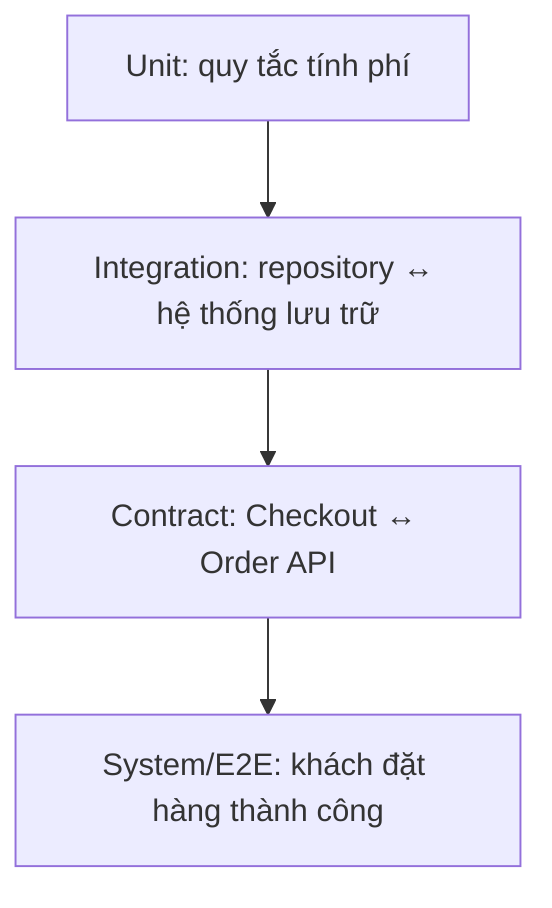
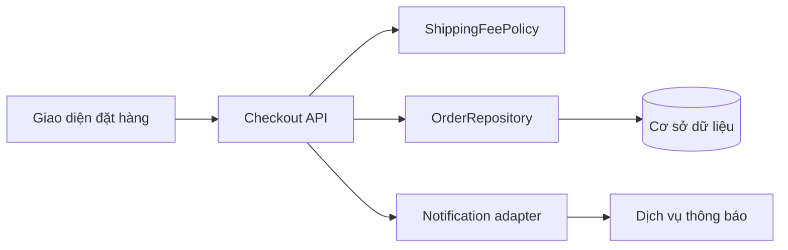
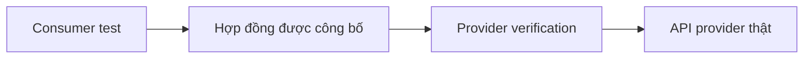
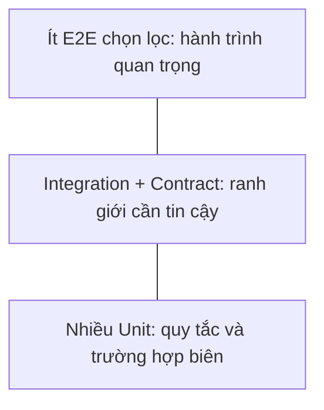

# Kiểm thử đơn vị, tích hợp, hợp đồng và toàn hệ thống

Một nhóm phát triển có thể có hàng trăm bài kiểm thử đơn vị đều xanh nhưng người dùng vẫn không đặt hàng được vì ứng dụng kết nối sai cơ sở dữ liệu, trả về JSON khác hợp đồng hoặc lỗi xuất hiện khi nhiều thành phần chạy cùng nhau. Ngược lại, một kịch bản kiểm thử giao diện chạy thành công cũng chưa chứng minh mọi trường hợp biên của thuật toán tính phí đều đúng.

Trong chương **Bằng chứng kiểm thử** thuộc `CODE_QUALITY_FUNDAMENTALS`, chúng ta phân biệt **kiểm thử đơn vị (unit test)**, **kiểm thử tích hợp (integration test)**, **kiểm thử hợp đồng (contract test)** và **kiểm thử toàn hệ thống (system/end-to-end test)**. Mục tiêu là hiểu mỗi loại tạo ra bằng chứng gì để đánh giá mã nguồn có **đáng tin cậy, dễ hiểu và dễ thay đổi** hay không, thay vì chỉ đếm số lượng test.

Sau bài học, bạn có thể xác định ranh giới của một phép kiểm thử, chọn loại phù hợp với rủi ro, xây ví dụ Java/JUnit 5 và giải thích vì sao một bộ test thành công vẫn có những điều chưa được kiểm chứng.

## 1. “Bằng chứng kiểm thử” nghĩa là gì?

**Kiểm thử** là hoạt động thực thi hoặc đánh giá một hệ thống với điều kiện và kỳ vọng xác định, rồi đối chiếu kết quả thực tế với kết quả mong đợi. Một ca kiểm thử có ý nghĩa thường phải trả lời được:

1. **Đối tượng nào được kiểm tra?** Một phương thức, một adapter, một API hay toàn bộ luồng đặt hàng?
2. **Điều kiện đầu vào và môi trường là gì?** Dữ liệu mẫu, trạng thái ban đầu, cấu hình, phiên bản phụ thuộc?
3. **Hành vi mong đợi là gì?** Giá trị trả về, lỗi, dữ liệu đã lưu hoặc tác dụng phụ quan sát được?
4. **Cách quan sát và đối chiếu là gì?** Assertion, truy vấn trạng thái, phản hồi HTTP hay dấu vết sự kiện?
5. **Điều gì vẫn nằm ngoài phạm vi?** Các thành phần thay bằng fake, tác động mạng, hiệu năng ở tải lớn, lỗi phân tán?

Ví dụ: kiểm thử xác nhận `ShippingFeePolicy.calculate(300_000, false)` trả về `0` là **bằng chứng cho quy tắc ở ngưỡng cụ thể**. Nó chưa cho biết yêu cầu HTTP có truyền đúng tổng tiền vào phương thức ấy, dữ liệu đơn hàng có được lưu hay email xác nhận có tới khách không.

> **Một ca kiểm thử chỉ chứng minh điều đã được quan sát trong những điều kiện đã thiết lập.** Kiểm thử giúp phát hiện lỗi và tăng mức tin cậy, nhưng không tự chứng minh toàn bộ hệ thống không còn lỗi.

### Bốn phạm vi kiểm thử

| Loại | Ranh giới thường được kiểm tra | Phụ thuộc thật hay thay thế? | Giá trị bằng chứng chính |
| --- | --- | --- | --- |
| **Đơn vị (unit)** | Một đơn vị hành vi nhỏ, thường là phương thức/lớp | Thường cô lập hạ tầng; có thể dùng fake/stub khi cần | Logic cụ thể hoạt động đúng với đầu vào đã chọn |
| **Tích hợp (integration)** | Sự kết nối giữa ít nhất hai thành phần hoặc với hạ tầng thật | Chạy những thành phần cần kiểm tra cùng nhau | Giao tiếp, ánh xạ dữ liệu, cấu hình và tác dụng phụ tại ranh giới đúng |
| **Hợp đồng (contract)** | Giao diện và ngữ nghĩa mà hai bên độc lập đã thống nhất | Có thể dùng mock server và kiểm chứng riêng ở phía cung cấp | Bên tiêu thụ và bên cung cấp hiểu nhất quán về một API/hợp đồng |
| **Toàn hệ thống / E2E** | Luồng nghiệp vụ từ điểm vào đến kết quả quan sát | Nhiều thành phần được lắp ghép như môi trường thực, có thể dùng sandbox cho bên ngoài | Chuỗi thành phần phối hợp để hoàn tất kịch bản đã chọn |

Đây là **cách phân loại theo mục đích và ranh giới**, không phải tên gọi tuyệt đối. Một test của một lớp nhưng kết nối cơ sở dữ liệu thật có thể được xem là integration test; một test của nhiều lớp thuần túy trong bộ nhớ vẫn có thể được coi là component/unit test theo quy ước nhóm.



Sơ đồ biểu diễn **những câu hỏi bổ sung nhau**, không bắt buộc mỗi bài test phải chạy lần lượt qua bốn bước. Kiểm thử hợp đồng có thể chạy độc lập với kiểm thử tích hợp và được đưa vào quy trình CI riêng.

## 2. Một hệ thống minh họa để so sánh

Giả sử ứng dụng đặt hàng có yêu cầu:

- Khách VIP được miễn phí giao hàng.
- Khách thường có tổng tiền hàng từ **300.000 VND** được miễn phí.
- Khách thường có tổng tiền dưới ngưỡng phải trả **30.000 VND**.
- Đơn hợp lệ được lưu và người dùng có thể xem lại chi tiết đơn.
- Dịch vụ gửi xác nhận được gọi sau khi kết quả đặt hàng đã được ghi nhận theo quy trình đã thiết kế.

Một cách tổ chức giản lược:



Các loại test khác nhau quan sát những phần khác nhau của sơ đồ:

- Test **đơn vị** đặt câu hỏi: cách tính phí theo ba quy tắc có đúng không?
- Test **tích hợp** đặt câu hỏi: `OrderRepository` có thực sự ghi và đọc đơn đúng ở hệ lưu trữ được chọn không?
- Test **hợp đồng** đặt câu hỏi: API trả trường và mã lỗi đúng như client kỳ vọng và phía server cam kết không?
- Test **toàn hệ thống** đặt câu hỏi: người dùng gửi một đơn từ giao diện và xem được kết quả xuyên qua cả chuỗi xử lý không?

Không thể lấy một câu trả lời “đúng” ở câu hỏi này làm bằng chứng mặc định cho ba câu hỏi còn lại.

## 3. Kiểm thử đơn vị: xác nhận quy tắc ở phạm vi nhỏ

**Unit test** tập trung vào một đơn vị hành vi và cố gắng giảm ảnh hưởng của những thành phần không liên quan. Vì phạm vi nhỏ, unit test thường chạy nhanh, dễ lặp lại và giúp xác định lỗi gần với nơi phát sinh.

### 3.1. Ví dụ Java 17: quy tắc phí giao hàng

```java
final class ShippingFeePolicy {
    private static final long FREE_THRESHOLD_VND = 300_000L;
    private static final long STANDARD_FEE_VND = 30_000L;

    long calculate(long subtotalVnd, boolean isVip) {
        if (subtotalVnd < 0) {
            throw new IllegalArgumentException("Subtotal must be nonnegative");
        }

        if (isVip || subtotalVnd >= FREE_THRESHOLD_VND) {
            return 0L;
        }

        return STANDARD_FEE_VND;
    }
}
```

Có thể kiểm tra các trường hợp có ý nghĩa nghiệp vụ bằng JUnit 5:

```java
import static org.junit.jupiter.api.Assertions.assertEquals;
import static org.junit.jupiter.api.Assertions.assertThrows;

import org.junit.jupiter.api.Test;

class ShippingFeePolicyTest {
    private final ShippingFeePolicy policy = new ShippingFeePolicy();

    @Test
    void appliesStandardFeeJustBelowThreshold() {
        assertEquals(30_000L, policy.calculate(299_999L, false));
    }

    @Test
    void givesFreeShippingAtThreshold() {
        assertEquals(0L, policy.calculate(300_000L, false));
    }

    @Test
    void givesVipFreeShippingBelowThreshold() {
        assertEquals(0L, policy.calculate(20_000L, true));
    }

    @Test
    void rejectsNegativeSubtotal() {
        assertThrows(IllegalArgumentException.class,
                () -> policy.calculate(-1L, false));
    }
}
```

Bộ kiểm thử này cung cấp bằng chứng về:

- **Giá trị biên:** phân biệt `299_999` với `300_000`, giúp phát hiện lỗi nhầm `>` và `>=`.
- **Nhánh nghiệp vụ:** điều kiện VIP có tác dụng ngay cả khi đơn chưa đạt ngưỡng.
- **Điều kiện đầu vào:** số âm bị từ chối rõ ràng.

Mã dùng `long` với đơn vị VND để giữ ví dụ đơn giản, không giải quyết đầy đủ bài toán tiền đa tiền tệ hoặc phép chia có làm tròn. Nếu hệ thống có nhiều loại tiền, cần một mô hình số tiền và quy tắc làm tròn phù hợp.

**Bộ test này chưa kiểm chứng** dữ liệu trong HTTP request, trạng thái cơ sở dữ liệu, cấu hình triển khai, thông báo gửi ra ngoài, hành vi nhiều luồng hoặc thay đổi chính sách trong tương lai.

### 3.2. Tác dụng của test double

Nếu một lớp cần gọi phụ thuộc ngoài, unit test có thể thay phụ thuộc bằng **test double**. Các cách gọi thường gặp:

| Loại | Vai trò | Ví dụ |
| --- | --- | --- |
| **Stub** | Cung cấp kết quả định sẵn | Kho hàng giả trả “còn 5 sản phẩm” |
| **Fake** | Có triển khai hoạt động đơn giản phục vụ test | Repository lưu dữ liệu trong một `Map` |
| **Mock** | Cho phép đặt kỳ vọng và xác nhận các lời gọi/tương tác | Xác nhận `sendReceipt` được gọi đúng một lần |
| **Spy** | Ghi nhận các lời gọi trên một đối tượng để quan sát | Ghi lại thứ tự gọi `save` và `send` |
| **Dummy** | Chỉ để điền tham số nhưng không được sử dụng trong ca test | Đối tượng placeholder trong một nhánh không liên quan |

Tên gọi có thể được dùng khác nhau giữa các thư viện và nhóm. Điều quan trọng là phân biệt **đầu vào do test điều khiển** với **hành vi thật mà test đang kiểm tra**.

Ví dụ: một test dùng `FakeOrderRepository` trong bộ nhớ có thể xác nhận `CheckoutService` gọi `save` đúng dữ liệu. Nhưng nó **không chứng minh** lớp repository JDBC tạo được bảng, thực thi SQL hoặc ghi đúng transaction ở cơ sở dữ liệu thật.

### 3.3. Tránh kiểm thử khóa chặt chi tiết triển khai

Giả sử code được cải thiện từ hai phép `if` thành một biểu thức logic, nhưng hành vi bên ngoài không thay đổi. Test chỉ kiểm tra kết quả nên vẫn xanh. Test khẳng định số lần gọi từng helper private có thể thất bại dù người dùng không thấy khác biệt.

Nên ưu tiên kiểm tra **hợp đồng quan sát được**: kết quả, lỗi, tác dụng phụ được yêu cầu và bất biến. Kiểm tra tương tác nội bộ chỉ khi **số lần gọi hoặc thứ tự gọi thực sự là một phần của hợp đồng**, chẳng hạn tránh gửi thanh toán hai lần.

## 4. Kiểm thử tích hợp: xác nhận những phần thật có làm việc cùng nhau

**Integration test** kiểm tra ranh giới giữa các thành phần, ví dụ repository với cơ sở dữ liệu, adapter với hệ thống tệp, client HTTP với server hoặc bộ mã hóa/giải mã với dữ liệu thực.

Một sai lầm thường gặp là gọi test “tích hợp” nhưng thay **mọi** thành phần có thể gây lỗi bằng mock. Khi đó test có thể chỉ xác minh rằng mock nhận đúng lời gọi, còn sự kết nối thật vẫn chưa được kiểm chứng.

### 4.1. Ví dụ: repository làm việc với hệ thống tệp thật

Để tạo ví dụ tự chứa và dễ quan sát, ta dùng một repository lưu mỗi đơn vào một tệp văn bản. Đây là **ví dụ về tích hợp với filesystem**, không phải thiết kế lưu đơn production: chưa hỗ trợ transaction nhiều bước, ghi nguyên tử hoặc nhiều tiến trình cập nhật đồng thời.

Mã Java 17 minh họa:

```java
import java.io.IOException;
import java.nio.charset.StandardCharsets;
import java.nio.file.Files;
import java.nio.file.Path;
import java.nio.file.StandardOpenOption;
import java.util.Objects;
import java.util.Optional;

record Order(String id, long totalVnd) {
    Order {
        Objects.requireNonNull(id, "id");
        if (!id.matches("[A-Za-z0-9-]+") || totalVnd < 0) {
            throw new IllegalArgumentException("Invalid order");
        }
    }
}

interface OrderRepository {
    void save(Order order) throws IOException;
    Optional<Order> findById(String id) throws IOException;
}

final class FileOrderRepository implements OrderRepository {
    private final Path directory;

    FileOrderRepository(Path directory) {
        this.directory = Objects.requireNonNull(directory);
    }

    @Override
    public void save(Order order) throws IOException {
        Objects.requireNonNull(order, "order");
        Files.createDirectories(directory);

        Files.writeString(
                fileFor(order.id()),
                Long.toString(order.totalVnd()),
                StandardCharsets.UTF_8,
                StandardOpenOption.CREATE_NEW);
    }

    @Override
    public Optional<Order> findById(String id) throws IOException {
        Path file = fileFor(id);
        if (Files.notExists(file)) {
            return Optional.empty();
        }

        long total = Long.parseLong(
                Files.readString(file, StandardCharsets.UTF_8));
        return Optional.of(new Order(id, total));
    }

    private Path fileFor(String id) {
        Objects.requireNonNull(id, "id");
        if (!id.matches("[A-Za-z0-9-]+")) {
            throw new IllegalArgumentException("Invalid order ID");
        }

        return directory.resolve(id + ".txt");
    }
}
```

`record` cần Java 16 trở lên. Ví dụ hạn chế định dạng mã đơn để tránh nhận tùy ý một đường dẫn từ người gọi. `CREATE_NEW` báo lỗi nếu tệp đã tồn tại; đây là hành vi lưu đơn được chọn cho bài học, không mặc nhiên là quy tắc cho mọi repository.

Kiểm thử tích hợp dùng thư mục tạm thật do JUnit 5 quản lý:

```java
import static org.junit.jupiter.api.Assertions.assertEquals;
import static org.junit.jupiter.api.Assertions.assertThrows;

import java.nio.file.FileAlreadyExistsException;
import java.nio.file.Path;
import org.junit.jupiter.api.Test;
import org.junit.jupiter.api.io.TempDir;

class FileOrderRepositoryIntegrationTest {
    @TempDir
    Path tempDirectory;

    @Test
    void savesAndReadsOrderUsingRealFiles() throws Exception {
        FileOrderRepository repository =
                new FileOrderRepository(tempDirectory);
        Order expected = new Order("ORD-101", 330_000L);

        repository.save(expected);

        assertEquals(expected, repository.findById("ORD-101").orElseThrow());
    }

    @Test
    void rejectsDuplicateOrderId() throws Exception {
        FileOrderRepository repository =
                new FileOrderRepository(tempDirectory);
        repository.save(new Order("ORD-101", 330_000L));

        assertThrows(FileAlreadyExistsException.class,
                () -> repository.save(new Order("ORD-101", 500_000L)));

        assertEquals(330_000L,
                repository.findById("ORD-101").orElseThrow().totalVnd());
    }
}
```

Trong test này, **`FileOrderRepository`, Java NIO và filesystem thực sự tương tác**. Nếu dùng fake repository bằng `HashMap`, những lỗi như thiếu quyền ghi tệp, đường dẫn sai hoặc cách mã hóa dữ liệu sẽ không được phát hiện.

Test vẫn có giới hạn: thư mục tạm trên máy chạy test không nhất thiết có cùng filesystem, quyền truy cập, dung lượng, hành vi sự cố hoặc tải với môi trường production. Tùy rủi ro, cần thêm kiểm thử lỗi I/O, đọc dữ liệu sai định dạng, hiệu năng hoặc khả năng phục hồi.

### 4.2. Nếu hệ thống dùng cơ sở dữ liệu

Với ứng dụng dùng PostgreSQL, MySQL hoặc cơ sở dữ liệu khác, integration test quan trọng cần chạy với **hệ lưu trữ thực và phiên bản/cấu hình phù hợp**, không chỉ thay `OrderRepository` bằng một fake. Những điều nên kiểm chứng gồm:

- Câu SQL thực thi đúng, bao gồm cú pháp riêng của hệ quản trị.
- Ràng buộc `UNIQUE`, `NOT NULL` và khóa ngoại được thực thi.
- Chuyển đổi kiểu dữ liệu, múi giờ, độ chính xác số tiền và mapping kết quả.
- Ranh giới transaction, rollback, mức cô lập hoặc cạnh tranh khi có yêu cầu.
- Migration schema có hoạt động với trạng thái dữ liệu được hỗ trợ không.

Một cơ sở dữ liệu nhúng có thể giúp test nhanh nhưng **không luôn tái hiện ngữ nghĩa của hệ production**. Với các rủi ro phụ thuộc tính năng riêng của database, chạy một instance cùng loại trong môi trường test thường đem lại bằng chứng mạnh hơn.

### 4.3. Thiết lập và dọn dẹp test tích hợp

Test tích hợp dễ bị ảnh hưởng bởi môi trường. Hãy tạo dữ liệu đầu vào có thể lặp lại, cô lập dữ liệu giữa các test và dọn tài nguyên đúng cách. Nếu test A chỉ xanh sau khi test B chạy trước, bằng chứng của từng test không đáng tin cậy.

Với repository filesystem bên trên, `@TempDir` cung cấp thư mục riêng cho test. Với cơ sở dữ liệu, có thể dùng transaction rollback, schema riêng hoặc container được khởi tạo rõ ràng. Chọn cơ chế dựa trên hành vi thật của ứng dụng: nếu test kiểm tra commit hoặc trigger sau commit, rollback toàn bộ test theo mặc định có thể che mất vấn đề.

## 5. Kiểm thử hợp đồng: hai bên có thống nhất ý nghĩa giao tiếp không?

**Contract test** kiểm tra những điều một bên **cung cấp (provider)** cam kết và bên còn lại **tiêu thụ (consumer)** dựa vào. Đây là cấp độ đặc biệt hữu ích khi các đội hoặc dịch vụ phát triển, triển khai độc lập.

Giả sử `Checkout API` công bố endpoint:

```http
GET /orders/ORD-101
Accept: application/json
```

Một phản hồi thành công trong hợp đồng minh họa:

```json
{
  "id": "ORD-101",
  "totalVnd": 330000,
  "currency": "VND",
  "status": "CREATED"
}
```

Hợp đồng cần làm rõ nhiều hơn việc JSON parse được:

| Thành phần | Quy tắc có thể được kiểm chứng |
| --- | --- |
| **Đường dẫn/phương thức** | `GET /orders/{id}` lấy đơn hiện có |
| **HTTP status** | `200` khi tìm thấy, `404` khi không tìm thấy (trong phạm vi quyền truy cập cho phép) |
| **Tên trường và kiểu** | `id` là chuỗi, `totalVnd` là số nguyên không âm |
| **Ý nghĩa dữ liệu** | `totalVnd` đã bao gồm những khoản nào? Đơn vị là VND, có làm tròn không? |
| **Trạng thái** | `status` nhận các giá trị nào và ý nghĩa chuyển trạng thái ra sao? |
| **Tính tương thích** | Trường nào bắt buộc, trường nào tùy chọn; có thể thêm trường mà không làm hỏng client? |
| **Lỗi** | Mã lỗi công khai, kiểu JSON lỗi và quyền truy cập được xử lý thế nào? |

### 5.1. Consumer test và provider verification

Một quy trình **consumer-driven contract testing** thường có hai phía:

1. **Consumer xác định kỳ vọng thực sự sử dụng.** Ví dụ client cần `id`, `totalVnd` và `status`, phản hồi `200` có đúng kiểu dữ liệu. Consumer chạy test với mock server theo hợp đồng này.
2. **Provider kiểm chứng cùng hợp đồng trên triển khai API thật.** Provider thiết lập dữ liệu/trạng thái đầu vào, thực hiện yêu cầu và xác nhận phản hồi tuân thủ kỳ vọng. Các công cụ như Pact có thể hỗ trợ chia sẻ và xác minh hợp đồng giữa hai bên.
3. **Quản lý phiên bản và quá trình phát hành.** Đội phát triển xác định phiên bản provider có tương thích với consumer đang dùng trước khi triển khai thay đổi gây ảnh hưởng.



**Chỉ chạy consumer test với mock server chưa chứng minh provider thật đáp ứng hợp đồng.** Ngược lại, chỉ kiểm tra provider trả một JSON mẫu chưa chứng minh consumer xử lý đúng những trường mà nó cần. Giá trị của contract testing là **cả hai phía cùng kiểm chứng một kỳ vọng**.

Một **API schema** (ví dụ OpenAPI/JSON Schema) hỗ trợ xác định định dạng và kiểu dữ liệu. Tuy nhiên, định dạng hợp lệ chưa tự chứng minh ngữ nghĩa nghiệp vụ. Một API trả `totalVnd: 330000` có thể đúng schema nhưng sai nếu con số không bao gồm phí giao hàng theo hợp đồng.

### 5.2. Contract test có khác integration test không?

Cả hai có thể cùng đi qua HTTP, nên tên loại không được quyết định chỉ bằng công cụ chạy test.

- Test gửi request từ client thật tới một server thật trong môi trường tích hợp để xác nhận toàn bộ đường truyền có thể xem là **integration test**.
- Test xác nhận các kỳ vọng ổn định mà consumer và provider dùng để phối hợp phát hành là **contract test**.
- Một ca test có thể cung cấp bằng chứng cho **cả hai**, nếu phạm vi được thiết kế phù hợp.

Contract test thường **không xác nhận toàn bộ quy trình nghiệp vụ**, dữ liệu đã được commit đúng ở mọi tình huống hoặc hệ thống có thể chịu tải lớn. Nó chỉ xác minh một tập điều kiện giao tiếp có chủ đích.

### 5.3. Thay đổi tương thích và thay đổi phá vỡ hợp đồng

Một thay đổi có thể trông nhỏ ở provider nhưng gây lỗi lớn phía consumer:

- Đổi tên `totalVnd` thành `amount` khi client đang yêu cầu trường cũ.
- Đổi số nguyên sang chuỗi có ký hiệu tiền tệ.
- Bỏ giá trị trạng thái mà client đang xử lý.
- Đổi ý nghĩa `200` từ “đã lưu thành công” thành “đã đưa vào hàng đợi”.
- Thay ngữ nghĩa xử lý lỗi, ví dụ trả `500` cho xung đột nghiệp vụ mà trước đây trả `409`.

Việc thêm một trường tùy chọn thường dễ tương thích hơn, nhưng còn tùy cách consumer parse: một client từ chối trường lạ có thể bị ảnh hưởng. **Khả năng tương thích phải được kiểm chứng theo hành vi consumer thực tế**, không chỉ suy đoán từ phiên bản API.

## 6. Kiểm thử toàn hệ thống và end-to-end: luồng có thực sự hoàn thành?

**System test** đánh giá hệ thống được lắp ghép như một đơn vị theo yêu cầu đặt ra. **End-to-end (E2E) test** thường đi từ điểm vào gần với người dùng hoặc hệ tích hợp đến kết quả cuối qua nhiều thành phần.

Hai thuật ngữ thường được dùng gần nhau nhưng không hoàn toàn đồng nhất. Một system test có thể kiểm tra một chức năng qua API mà không mở giao diện. Một E2E test có thể đi từ trình duyệt, qua backend và cơ sở dữ liệu, đến trang hiển thị kết quả.

Ví dụ kịch bản nghiệp vụ:

```gherkin
Feature: Đặt hàng với phí giao hàng

  Scenario: Khách thường đặt đơn đúng ngưỡng miễn phí
    Given khách hàng đã đăng nhập
    And giỏ hàng có tổng tiền hàng 300000 VND
    When khách xác nhận đặt hàng
    Then hệ thống hiển thị phí giao hàng 0 VND
    And tổng tiền đơn phản ánh đúng quy tắc đã công bố
    And đơn hàng được ghi nhận và có thể xem lại trong lịch sử
```

Đây là **đặc tả hành vi minh họa theo cú pháp Gherkin**. Để tự động chạy, dự án phải triển khai các step và thiết lập môi trường tương ứng. Một kịch bản viết bằng Gherkin chưa tự trở thành bằng chứng khi chưa được thực thi.

Nếu môi trường test dùng dịch vụ email giả hoặc cổng thanh toán sandbox, cần ghi rõ. Chạy toàn bộ ứng dụng trong môi trường test với sandbox có thể cho bằng chứng tốt về **luồng ứng dụng**, nhưng chưa chứng minh giao dịch thật và cấu hình production của nhà cung cấp bên ngoài đã được kiểm chứng.

### 6.1. E2E phát hiện điều gì mà unit test không thấy?

Ví dụ một thay đổi ở API khiến frontend gửi `subtotal` thay vì `subtotalVnd`. `ShippingFeePolicyTest` vẫn xanh vì nó gọi chính xác hàm tính phí; E2E có thể phát hiện dữ liệu không đi qua được từ giao diện đến backend.

Một luồng E2E cũng có thể phát hiện:

- Cấu hình sai địa chỉ service, routing hoặc quyền truy cập.
- Migration dữ liệu chưa chạy, schema không tương thích.
- UI hiển thị sai đơn vị tiền hoặc thông báo.
- Các thành phần riêng đều đúng nhưng quy trình nối chúng sai.
- Lỗi gắn với session, xác thực, môi trường hoặc dữ liệu thực tế của hành trình người dùng.

### 6.2. Vì sao không viết mọi kiểm thử dưới dạng E2E?

E2E thường tốn thời gian thiết lập, dễ phụ thuộc môi trường và khó định vị nguyên nhân khi thất bại. Nếu một kịch bản thất bại vì trình duyệt không tải trang, ta chưa biết lỗi ở UI, API, database hay mạng.

Một bộ E2E bao phủ mọi tổ hợp giá trị của quy tắc tính phí sẽ chậm và dễ gây nhiễu, trong khi nhiều trường hợp có thể kiểm tra bằng unit test trong vài mili giây. E2E nên tập trung vào **hành trình quan trọng, đường tích hợp có rủi ro và những lỗi chỉ xuất hiện khi ghép hệ thống**.

Nếu người dùng cần kiểm chứng một kết quả qua UI, hãy viết assertion dựa trên kết quả người dùng quan sát được, tránh buộc test phụ thuộc vào selector hoặc thời điểm chờ không ổn định. Nên chờ một **điều kiện hoàn tất cụ thể** thay vì ngủ một khoảng thời gian cố định.

## 7. Chọn loại kiểm thử dựa trên lỗi muốn phát hiện

Đặt câu hỏi: **“Nếu việc này bị sai, loại test nào cho bằng chứng trực tiếp với chi phí hợp lý?”**

| Rủi ro | Bằng chứng chính nên có | Bằng chứng bổ sung khi cần |
| --- | --- | --- |
| Nhầm `>` với `>=` ở ngưỡng miễn phí | Unit test các giá trị biên | E2E một hành trình đại diện |
| SQL lưu giá trị tiền sai cột hoặc sai độ chính xác | Integration test với database phù hợp | System test qua API |
| Đổi tên trường JSON khiến ứng dụng di động không đọc được | Contract test cả consumer và provider | E2E/API integration |
| Quy trình checkout gọi gửi xác nhận trước khi lưu | Unit/component test thứ tự điều phối có ý nghĩa nghiệp vụ | Integration hoặc E2E với phụ thuộc thật |
| Người dùng đặt hàng nhưng không thấy đơn trong lịch sử | System/E2E test | Integration test repository và API |
| Hai yêu cầu đồng thời cùng giữ một sản phẩm cuối | Concurrency/integration test tại nơi sở hữu tồn kho | Kiểm thử giao dịch và tải ở mức hệ thống |
| Client retry thanh toán gây giao dịch trùng | Contract + integration về idempotency và trạng thái lỗi | E2E với sandbox hoặc môi trường kiểm chứng phù hợp |
| Phiên bản mới không kết nối được dịch vụ ngoài | Integration test với cấu hình/phụ thuộc đại diện | Smoke test sau triển khai |

Một rủi ro quan trọng thường cần **nhiều mức bằng chứng**. Ví dụ quy tắc thanh toán đúng về công thức chưa đủ; còn cần xác định giao dịch, lưu kết quả và xử lý lỗi bên ngoài.

### 7.1. Mô hình “kim tự tháp kiểm thử” là gợi ý, không phải quota

Mô hình test pyramid thường khuyến nghị nhiều kiểm thử đơn vị nhanh, ít kiểm thử tích hợp hơn và số lượng E2E chọn lọc. Ý tưởng là nhận được phản hồi sớm, giảm chi phí chạy và thuận tiện xác định lỗi.

Tuy nhiên, **không có tỷ lệ cứng** áp dụng cho mọi dự án. Một thư viện thuật toán có thể cần rất nhiều unit test và ít E2E; một ứng dụng chủ yếu làm nhiệm vụ kết nối nhiều dịch vụ có thể cần nhiều integration/contract test hơn. Chọn cơ cấu dựa trên rủi ro, kiến trúc, khả năng kiểm soát môi trường và chi phí bảo trì test.



Sơ đồ thể hiện một **định hướng kinh tế kiểm thử**, không phải chỉ tiêu phần trăm bắt buộc.

## 8. Bằng chứng mạnh cần test đáng tin cậy

Một test xanh chỉ hữu ích nếu nó thực sự quan sát hành vi cần quan tâm và có thể chạy lặp lại trong điều kiện kiểm soát được.

### 8.1. Kiểm tra kết quả thay vì chỉ gọi cho “có chạy”

Ví dụ yếu:

```java
@Test
void checkoutDoesNotThrow() {
    service.checkout(request);
}
```

Nếu hợp đồng yêu cầu ghi đúng tổng tiền, lưu đơn và phản hồi trạng thái, việc “không ném exception” chưa đủ. Test cần assert kết quả hoặc tác dụng phụ quan sát được liên quan đến yêu cầu. Dĩ nhiên, một API **được thiết kế chỉ để không ném lỗi** vẫn có thể kiểm tra như vậy, nhưng đó phải là chủ đích.

### 8.2. Tránh test bất định (flaky)

Một test thất bại ngẫu nhiên vì phụ thuộc vào đồng hồ, thứ tự test, mạng hoặc lịch chạy luồng làm nhóm khó phân biệt lỗi sản phẩm thật với lỗi môi trường kiểm thử.

Các cách giảm bất định gồm:

- **Kiểm soát thời gian:** truyền `Clock` vào logic phụ thuộc thời gian thay vì đọc `Instant.now()` ở nhiều nơi không kiểm soát.
- **Kiểm soát dữ liệu:** dùng fixture rõ ràng, không dựa vào dữ liệu còn sót từ lần chạy trước.
- **Đợi sự kiện thực:** dùng `CountDownLatch`, future hoặc điều kiện chờ phù hợp thay vì `Thread.sleep` tùy đoán.
- **Cô lập tài nguyên:** dùng thư mục, schema hoặc dữ liệu riêng cho các test chạy song song.
- **Giới hạn phụ thuộc mạng:** thay phụ thuộc ngoài ở unit test; giữ các integration test cần mạng trong môi trường có thể kiểm soát.

Không nên giải quyết flaky test chỉ bằng cách thử chạy lại vô hạn. Việc retry có thể phục vụ phân loại sự cố tạm thời, nhưng test cần được điều tra để hiểu nguyên nhân.

### 8.3. Coverage không đồng nghĩa với chất lượng

**Code coverage** đo phần mã được thực thi trong kiểm thử theo các tiêu chí như dòng lệnh hoặc nhánh. Nó giúp chỉ ra những phần chưa được chạm tới, nhưng không đo trực tiếp chất lượng assertion.

Ví dụ:

```java
@Test
void touchesShippingPolicy() {
    policy.calculate(300_000L, false);
}
```

Test này có thể tăng coverage nhưng không kiểm tra kết quả. Trong khi đó, một test ở giá trị biên với assertion đúng thường có giá trị cao hơn dù số dòng thực thi không nhiều.

**Mutation testing** có thể hỗ trợ đánh giá sức mạnh test: công cụ cố tình thay đổi nhỏ trong mã, chẳng hạn đổi `>=` thành `>`, rồi xem bộ test có phát hiện sự thay đổi hay không. Nó cũng có giới hạn: kết quả phụ thuộc loại mutation, khả năng chạy test, chi phí thực thi và chất lượng mã được chọn. Không nên dùng một chỉ số duy nhất làm thước đo toàn bộ độ tin cậy.

### 8.4. Kết quả kiểm thử phải gắn với phiên bản và điều kiện chạy

Báo cáo “150 test xanh” thiếu thông tin nếu không biết test nào, ở commit nào, trong môi trường nào và những thành phần nào bị thay thế.

Một báo cáo hữu ích nên thể hiện:

| Thông tin | Lý do cần |
| --- | --- |
| Commit/build được kiểm tra | Kết quả gắn với phiên bản cụ thể |
| Danh sách test/suite và số lượng pass/fail/skip | Biết những kiểm chứng nào đã chạy và những gì bị bỏ qua |
| Môi trường và phiên bản phụ thuộc | Có thể tái hiện khi lỗi chỉ xuất hiện ở cấu hình nhất định |
| Dữ liệu test và phạm vi | Hiểu mức đại diện của bằng chứng |
| Cảnh báo flaky hoặc test bị vô hiệu hóa | Không nhầm kết quả xanh với kiểm tra đã hoàn chỉnh |
| Liên kết log/artifact khi thất bại | Hỗ trợ chẩn đoán và khắc phục |

Không phải mọi test cần ghi lại tất cả thông tin bằng tay; CI, công cụ test report và cấu hình môi trường có thể thu thập tự động.

## 9. Quy trình xây chiến lược kiểm thử cho một thay đổi

Giả sử đội phát triển thay quy tắc “đơn từ 300.000 VND miễn phí vận chuyển” thành “đơn từ 350.000 VND miễn phí vận chuyển”.

Một trình tự hợp lý:

1. **Làm rõ hợp đồng nghiệp vụ.** Ngưỡng áp dụng trước hay sau giảm giá? VIP có tiếp tục miễn phí không? Thời điểm hiệu lực là khi nào?
2. **Viết unit test về quy tắc mới.** Dùng `349_999`, `350_000`, `350_001`; kiểm tra VIP và đầu vào không hợp lệ.
3. **Xác định ranh giới bị ảnh hưởng.** Nếu API hoặc cơ sở dữ liệu có lưu phí và tổng tiền, chọn integration test kiểm tra mapping/ghi đọc đúng.
4. **Xem hợp đồng client/provider.** Nếu thay đổi tên trường hoặc ý nghĩa phản hồi, cập nhật và kiểm chứng contract test từ cả hai phía. Nếu chỉ đổi ngưỡng mà cấu trúc API giữ nguyên, contract test định dạng có thể không thay đổi; vẫn cần kiểm chứng quy tắc ở mức thích hợp.
5. **Chạy một hành trình quan trọng.** Đặt đơn ở ngưỡng mới và xác nhận số tiền hiển thị/lưu lại phù hợp. Không nhất thiết nhân toàn bộ bảng trường hợp biên lên E2E.
6. **Xem xét các rủi ro ngoài luồng cơ bản.** Kiểm tra cách làm tròn, xung đột đồng thời, đơn hàng đang xử lý hoặc điều kiện triển khai theo yêu cầu thực tế.
7. **Lưu bằng chứng chạy.** Gắn test result với phiên bản thay đổi; ghi rõ những phụ thuộc được giả lập và những phần chưa được kiểm chứng.

Các bước này giúp nhóm **chọn bằng chứng phù hợp cho đúng mức rủi ro**, thay vì mặc định “thêm nhiều test hơn” là giải pháp duy nhất.

### Những dấu hiệu cần xem lại chiến lược

- Unit test nhiều nhưng lỗi vẫn tập trung ở database hoặc cấu hình triển khai: tăng bằng chứng tích hợp tại nơi xảy ra lỗi.
- Mỗi lần đổi API phải họp nhiều đội và chỉ phát hiện lỗi sau khi phát hành: xem xét contract testing cùng quy trình quản lý tương thích.
- E2E rất chậm và khó xác định lỗi: tách bớt kiểm tra quy tắc xuống unit/component, giữ các hành trình hệ thống có giá trị cao.
- Test thường xuyên thất bại vì dữ liệu môi trường bị chia sẻ: sửa cách cô lập fixture, không chỉ tăng timeout.
- Có rủi ro hiệu năng hoặc bảo mật: bổ sung kiểm thử hiệu năng/bảo mật chuyên biệt; bốn loại kiểm thử trên **không tự bao phủ** mọi thuộc tính chất lượng.

## 10. Những ngộ nhận cần tránh

| Ngộ nhận | Cách hiểu đúng |
| --- | --- |
| “Unit test xanh thì chức năng chắc chắn chạy được trên production.” | Unit test thường cô lập hạ tầng và chỉ kiểm tra các điều kiện đã chọn. |
| “Dùng mock database là integration test.” | Nếu toàn bộ giao tiếp được giả lập, chưa kiểm chứng adapter với database thật. |
| “Contract test chính là test toàn bộ luồng API.” | Contract test tập trung kỳ vọng giao tiếp; chưa bảo đảm quy trình nghiệp vụ hay môi trường triển khai hoàn chỉnh. |
| “E2E xanh là không cần unit test.” | E2E có thể bỏ sót nhiều giá trị biên và khó xác định nguyên nhân khi lỗi. |
| “100% coverage nghĩa là không còn bug.” | Coverage chỉ đo phần mã được chạy; assertion và tính đại diện mới quyết định giá trị bằng chứng. |
| “Mọi dự án phải có cùng tỷ lệ unit/integration/E2E.” | Cơ cấu test phụ thuộc kiến trúc, rủi ro và chi phí chạy/bảo trì. |
| “Test tích hợp cần gọi mọi dịch vụ bên ngoài thật.” | Có thể chọn ranh giới cần thật và dùng sandbox/stub ở nơi khác; phải ghi rõ điều đã kiểm chứng. |
| “Một test xanh ở máy cá nhân chứng minh CI sẽ xanh.” | Môi trường, phiên bản phụ thuộc và dữ liệu có thể khác; cần kết quả trên hệ thống kiểm chứng mục tiêu. |

## 11. Bài tập tự kiểm tra

**Câu 1.** Một test gọi trực tiếp `ShippingFeePolicy.calculate` với `subtotalVnd = 300_000` rồi assert trả `0`. Đây là loại test nào? Nó không kiểm chứng điều gì?

*Gợi ý:* Là unit test cho quy tắc phí. Nó chưa kiểm tra cách API truyền dữ liệu, cách repository lưu đơn và luồng giao diện.

**Câu 2.** Một test cấu hình `OrderRepository` mock trả kết quả lưu thành công, sau đó xác nhận `CheckoutService` đã gọi `save`. Có thể khẳng định cơ sở dữ liệu production ghi đúng không?

*Gợi ý:* Không. Test chứng minh tương tác của mã gọi với mock. Muốn kiểm tra truy vấn, mapping và transaction cần kiểm thử với hạ tầng lưu trữ phù hợp.

**Câu 3.** Consumer test mong đợi trường `totalVnd` trong JSON, nhưng provider đổi tên trường thành `amount`. Loại kiểm thử nào giúp phát hiện vấn đề trước khi triển khai độc lập?

*Gợi ý:* Contract test được kiểm chứng ở phía provider và consumer; nó cho biết thay đổi làm vỡ kỳ vọng giao tiếp.

**Câu 4.** Một E2E test từ màn hình checkout thành công với tổng 350.000 VND. Có cần unit test các giá trị 299.999, 300.000 và VIP không?

*Gợi ý:* Tùy yêu cầu, nhưng nên dùng unit test cho những trường hợp biên quan trọng vì E2E một hành trình chưa chứng minh toàn bộ quy tắc. Hãy kiểm tra theo ngưỡng chính sách đang có hiệu lực.

**Câu 5.** Tại sao test lưu rồi đọc đơn bằng `@TempDir` được xem là tích hợp với filesystem, còn test dùng `HashMap` giả repository không cung cấp cùng bằng chứng?

*Gợi ý:* `@TempDir` khiến mã lưu/đọc thực sự sử dụng đường dẫn và API filesystem. Fake bằng `HashMap` bỏ qua các nguy cơ như file, quyền ghi, mã hóa và thao tác I/O.

**Câu 6.** Bộ kiểm thử có 100% line coverage nhưng test không có assertion. Điều gì có thể xảy ra?

*Gợi ý:* Mã được thực thi mà kết quả sai không bị phát hiện. Cần assertion theo hợp đồng và test dữ liệu có khả năng phân biệt hành vi đúng/sai.

**Câu 7.** Khi hệ thống nhiều người dùng đôi lúc bán vượt tồn kho, nên bổ sung loại bằng chứng nào?

*Gợi ý:* Kiểm thử đồng thời và tích hợp trên cơ chế sở hữu tồn kho thật (ví dụ transaction/locking tại database), có thể bổ sung kiểm thử tải và E2E. Chỉ unit test tính phí không chạm tới rủi ro này.

**Câu 8.** Contract test có thể xanh khi cả consumer và provider đồng ý `totalVnd` là một số, nhưng tổng tiền thực tế bị tính sai không?

*Gợi ý:* Có. Kiểu và tên trường đúng không chứng minh công thức nghiệp vụ đúng. Cần unit/component test quy tắc và integration/system test kiểm tra số tiền qua luồng thích hợp.

## Ghi nhớ

**Kiểm thử đơn vị, tích hợp, hợp đồng và toàn hệ thống trả lời những câu hỏi khác nhau.** Unit test làm rõ logic ở phạm vi nhỏ; integration test kiểm chứng các ranh giới với thành phần thật; contract test bảo vệ thỏa thuận giữa các bên; system/E2E test quan sát hành trình đã lắp ghép. Một loại không tự thay thế hoàn toàn cho loại còn lại.

Giá trị của kiểm thử nằm ở **hợp đồng được xác minh, dữ liệu và môi trường đại diện, assertion có ý nghĩa và khả năng tái hiện kết quả**. Để mã nguồn đáng tin cậy, dễ hiểu và dễ thay đổi, hãy bắt đầu từ rủi ro muốn phát hiện rồi chọn mức bằng chứng phù hợp; luôn ghi rõ **điều đã được kiểm chứng và điều vẫn chưa được kiểm chứng**.
