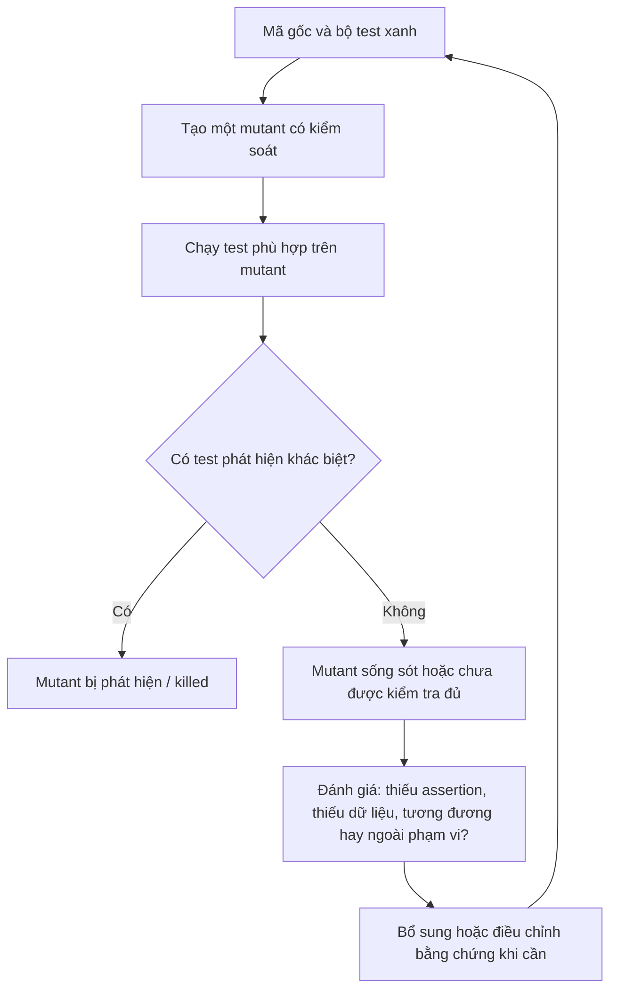

# Mutation testing và bằng chứng về sức phát hiện của bộ kiểm thử

> **Chương:** Bằng chứng kiểm thử  
> **Học phần:** CODE_QUALITY_FUNDAMENTALS — Hiểu những thuộc tính quyết định mã nguồn có đáng tin cậy, dễ hiểu và dễ thay đổi hay không.

Một bộ kiểm thử có thể chạy xanh, thực thi phần lớn dòng mã, nhưng vẫn bỏ lọt một thay đổi sai quan trọng. Ví dụ: quy tắc “được miễn phí giao hàng khi tổng tiền **từ 500.000 VND trở lên**” bị sửa nhầm từ `>=` thành `>`. Nếu các test chỉ dùng đơn 600.000 VND và 100.000 VND, cả phiên bản đúng và phiên bản sai đều có thể vượt qua.

**Mutation testing** (kiểm thử đột biến) đặt một câu hỏi thực tế hơn việc “đã chạy qua bao nhiêu dòng mã?”:

> **Nếu cố ý đưa một lỗi nhỏ, có kiểm soát vào mã sản phẩm, bộ kiểm thử có phát hiện được sự khác biệt đó không?**

Kỹ thuật này tạo ra các **mutant** (phiên bản mã bị biến đổi nhỏ), thực thi các bài kiểm thử thích hợp trên từng phiên bản và quan sát xem test có thất bại không. Nó bổ sung bằng chứng về **sức phát hiện lỗi** của bộ kiểm thử, nhưng **không chứng minh mã không còn lỗi**, cũng không thể thay thế việc hiểu yêu cầu nghiệp vụ.

Sau bài học, người học có thể:

- Giải thích mutation testing và phân biệt *mutant bị phát hiện* với *mutant sống sót*.
- Hiểu vì sao line/branch coverage cao chưa đủ để khẳng định kiểm thử mạnh.
- Viết kiểm thử Java/JUnit 5 nhằm phát hiện lỗi ở điều kiện biên, nhánh nghiệp vụ và ngoại lệ.
- Đọc báo cáo mutation testing, tính một chỉ số minh họa và nhận diện giới hạn của nó.
- Lựa chọn mutant đáng điều tra, tránh chạy theo một con số điểm số mà bỏ quên rủi ro thực tế.

## 1. Tại sao “test xanh” và “coverage cao” chưa đủ?

Xét một phương thức:

```java
long shippingFee(long subtotalAfterDiscountVnd) {
    return subtotalAfterDiscountVnd >= 500_000L ? 0L : 30_000L;
}
```

Một test:

```java
@Test
void largeOrderGetsFreeShipping() {
    assertEquals(0L, shippingFee(600_000L));
}
```

Test này chứng minh rằng **đầu vào 600.000 VND** cho kết quả bằng 0 trong cấu hình đã chạy. Nhưng nó **không chứng minh điều gì xảy ra tại 500.000 VND**, dù đó là giá trị quyết định cách hiểu cụm “từ ... trở lên”.

Nếu đổi `>=` thành `>`, test vẫn xanh. Không có mâu thuẫn: bài kiểm thử chưa từng đưa ra câu hỏi có thể phân biệt hai phiên bản.

### 1.1. Các tín hiệu kiểm thử trả lời câu hỏi khác nhau

| Tín hiệu | Câu hỏi được trả lời | Điều không thể kết luận chỉ từ tín hiệu đó |
| --- | --- | --- |
| **Test pass** | Với những ca đã định nghĩa, kết quả có khớp kỳ vọng không? | Đã kiểm tra đúng các rủi ro, nhánh và giá trị biên chưa |
| **Line coverage** | Những dòng nào đã được thực thi khi chạy test? | Test có phát hiện được kết quả sai trong dòng đã thực thi không |
| **Branch coverage** | Những nhánh nào đã được đi qua? | Điều kiện biên và giá trị trả về trong mỗi nhánh đã được kiểm chứng đủ chưa |
| **Mutation testing** | Những biến đổi lỗi nhỏ được chọn có làm test thất bại không? | Mọi lỗi thật ngoài đời có được phát hiện không |
| **Review và phân tích yêu cầu** | Điều gì được xem là hành vi đúng và trường hợp nguy hiểm? | Mã có thực thi đúng mọi tình huống chưa |

Không nên xem các kỹ thuật này là đối thủ. Coverage giúp tìm **vùng chưa được chạy**; mutation testing giúp đặt câu hỏi về **khả năng phân biệt đúng/sai** tại những vùng có thể đã được chạy; hiểu miền nghiệp vụ giúp quyết định **sự khác biệt nào là quan trọng**.

### 1.2. Một test yếu không nhất thiết thiếu bước gọi hàm

Ví dụ:

```java
@Test
void priceCalculationDoesNotCrash() {
    assertDoesNotThrow(() -> shippingFee(600_000L));
}
```

Test này chỉ yêu cầu không có ngoại lệ. Nếu phương thức luôn trả `30_000L`, test vẫn đạt. Nó có thể thực thi dòng mã nhưng hầu như không xác minh giá trị nghiệp vụ mong đợi.

Mutation testing có thể phơi bày kiểu thiếu sót này vì nhiều biến đổi làm sai kết quả nhưng không làm phát sinh ngoại lệ.

## 2. Cơ chế hoạt động của mutation testing

Một công cụ mutation testing thường thực hiện chu trình:

1. **Xác định phạm vi:** chọn lớp/phương thức mã sản phẩm và bộ kiểm thử liên quan.
2. **Tạo mutant:** áp dụng từng phép biến đổi nhỏ, ví dụ đổi toán tử so sánh, thay giá trị trả về hoặc đảo một điều kiện.
3. **Chạy kiểm thử trên mutant:** xem test nào thất bại so với khi chạy trên mã gốc.
4. **Phân loại kết quả:** mutant bị phát hiện, sống sót, không được kiểm thử chạy tới, không hợp lệ, hết thời gian hoặc một trạng thái khác theo công cụ.
5. **Phân tích phần còn lại:** chọn biến đổi đáng quan tâm để bổ sung test, xem lại hợp đồng hoặc điều chỉnh phạm vi.



Trong công cụ thực tế, mutant có thể được tạo trên mã nguồn hoặc bytecode, và công cụ có thể chỉ chạy những test được cho là liên quan để tiết kiệm thời gian. Các thuật ngữ và trạng thái báo cáo cụ thể phụ thuộc công cụ, phiên bản và cấu hình.

**Điều kiện khởi đầu quan trọng:** bộ test trên **mã gốc** phải có kết quả đáng tin cậy. Nếu test vốn thất bại hoặc không ổn định, việc quy kết một test đỏ là do mutant sẽ thiếu cơ sở.

## 3. Mutant là gì và “bị tiêu diệt” nghĩa là gì?

Mutant là một bản sửa đổi có chủ đích, thường nhỏ, nhằm mô phỏng một loại sai sót có thể xuất hiện khi lập trình. Ví dụ:

| Mã gốc | Biến đổi minh họa | Sai khác có thể tạo ra |
| --- | --- | --- |
| `amount >= threshold` | `amount > threshold` | Sai đúng tại giá trị bằng ngưỡng |
| `enabled && authorized` | `enabled || authorized` | Chấp nhận người dùng chỉ thỏa một điều kiện |
| `!cancelled` | `cancelled` | Đảo ý nghĩa trạng thái hủy |
| `return total - discount;` | `return total + discount;` | Sai phép tính tiền |
| `return true;` | `return false;` | Đổi kết quả Boolean |
| `if (quantity <= 0) throw ...` | Bỏ hoặc đảo điều kiện kiểm tra | Chấp nhận dữ liệu không hợp lệ |
| `repository.save(order);` | Bỏ lời gọi khi phép biến đổi được hỗ trợ | Không còn tác dụng phụ cần thiết |

Bảng trên mô tả **các kiểu đột biến về mặt khái niệm**. Không phải mọi công cụ hoặc cấu hình đều có sẵn từng phép biến đổi này; đặc biệt, thao tác xóa lời gọi phụ thuộc vào tập *mutator* được bật và giới hạn kỹ thuật của công cụ.

Một mutant được xem là **killed** (bị phát hiện, thường gọi là “bị tiêu diệt”) khi một bài kiểm thử liên quan **thất bại do biến đổi đó**: ví dụ, assertion không còn đúng hoặc xuất hiện ngoại lệ ngoài kỳ vọng. Điều này cung cấp bằng chứng rằng bộ test nhạy với loại sai khác mà mutant mô phỏng.

Một mutant **survived** (sống sót) khi công cụ chạy các test được chọn và không quan sát được thất bại. Đó là một tín hiệu cần điều tra, **chưa đủ để khẳng định ngay test bị viết sai**. Mutant có thể:

- Tạo ra lỗi thực nhưng test thiếu đầu vào hoặc assertion phân biệt.
- Thay đổi hành vi ở một nhánh không được chạy.
- Không thay đổi hành vi quan sát được trong phạm vi hợp đồng (*equivalent mutant*).
- Chỉ tạo khác biệt ở những điều chưa được xem là yêu cầu.
- Gặp giới hạn về lựa chọn test, cấu hình, thời gian hoặc mô hình phụ thuộc.

Một số công cụ tách riêng trạng thái **NO_COVERAGE** cho mutant không được bài kiểm thử nào thực thi tới; trạng thái này cần phân biệt với một mutant đã được chạy qua nhưng test không phát hiện.

## 4. Ví dụ Java xuyên suốt: quy tắc miễn phí vận chuyển

Giả sử hệ thống có hợp đồng nghiệp vụ minh họa:

- Phí giao hàng tiêu chuẩn là **30.000 VND**.
- Chỉ đơn hàng **chưa hủy**, thuộc **khu vực được hỗ trợ**, có tổng tiền hàng **sau giảm giá từ 500.000 VND trở lên** mới được miễn phí.
- Tổng tiền hàng sau giảm giá phải là số nguyên VND **không âm**.
- Hàm tính phí **không ghi dữ liệu và không gọi dịch vụ ngoài**.

Đây là ví dụ để học kiểm thử; các giá trị không đại diện cho chính sách thực tế của một sản phẩm cụ thể.

### 4.1. Mã sản phẩm cần kiểm tra

```java
// StandardShippingFeePolicy.java
public final class StandardShippingFeePolicy {
    private static final long STANDARD_FEE_VND = 30_000L;
    private static final long FREE_SHIPPING_THRESHOLD_VND = 500_000L;

    private StandardShippingFeePolicy() {
    }

    public static long calculateFeeVnd(
            long subtotalAfterDiscountVnd,
            boolean supportedArea,
            boolean cancelled) {

        if (subtotalAfterDiscountVnd < 0L) {
            throw new IllegalArgumentException("Negative subtotal");
        }

        boolean eligibleForFreeShipping =
                supportedArea
                && !cancelled
                && subtotalAfterDiscountVnd >= FREE_SHIPPING_THRESHOLD_VND;

        return eligibleForFreeShipping ? 0L : STANDARD_FEE_VND;
    }
}
```

Phương thức được tổ chức theo ba bước: xác thực đầu vào, đánh giá điều kiện miễn phí, trả mức phí. Điều kiện đủ miễn phí phải thỏa **đồng thời** cả ba thành phần.

### 4.2. Một bộ test khởi đầu chưa mạnh

```java
import static org.junit.jupiter.api.Assertions.assertEquals;
import org.junit.jupiter.api.Test;

class BasicStandardShippingFeePolicyTest {
    @Test
    void eligibleLargeOrderGetsFreeShipping() {
        long feeVnd = StandardShippingFeePolicy.calculateFeeVnd(
                600_000L, true, false);

        assertEquals(0L, feeVnd);
    }
}
```

Test trên có giá trị: nó xác nhận một đơn lớn, khu vực được hỗ trợ và chưa hủy được miễn phí. Nhưng nó không phản bác được nhiều bản sửa sai. Ví dụ, với mutant:

```java
// Mutant: dùng > thay cho >=
boolean eligibleForFreeShipping =
        supportedArea
        && !cancelled
        && subtotalAfterDiscountVnd > FREE_SHIPPING_THRESHOLD_VND;
```

Đơn 600.000 VND vẫn được miễn phí. Mutant này có thể **sống sót** nếu không có test nào dùng đúng ngưỡng **500.000 VND**.

### 4.3. Bổ sung test dựa trên hợp đồng, không dựa trên mẹo tăng điểm

Bộ kiểm thử cần kiểm tra các trường hợp có thể phân biệt quyết định đúng/sai:

| Trường hợp | Tổng tiền sau giảm giá | Khu vực hỗ trợ? | Đã hủy? | Kỳ vọng |
| --- | ---: | :---: | :---: | --- |
| Ngay dưới ngưỡng | 499.999 VND | Có | Không | 30.000 VND |
| **Đúng ngưỡng** | **500.000 VND** | Có | Không | **0 VND** |
| Trên ngưỡng | 600.000 VND | Có | Không | 0 VND |
| Khu vực không hỗ trợ | 600.000 VND | Không | Không | 30.000 VND |
| Đơn đã hủy | 600.000 VND | Có | Có | 30.000 VND |
| Đầu vào âm | -1 VND | Có | Không | `IllegalArgumentException` |

Ví dụ JUnit 5:

```java
import static org.junit.jupiter.api.Assertions.assertEquals;
import static org.junit.jupiter.api.Assertions.assertThrows;

import org.junit.jupiter.api.Test;

class StandardShippingFeePolicyTest {
    @Test
    void justBelowThresholdStillPaysStandardFee() {
        assertEquals(30_000L, StandardShippingFeePolicy.calculateFeeVnd(
                499_999L, true, false));
    }

    @Test
    void exactlyAtThresholdQualifiesForFreeShipping() {
        assertEquals(0L, StandardShippingFeePolicy.calculateFeeVnd(
                500_000L, true, false));
    }

    @Test
    void aboveThresholdQualifiesForFreeShipping() {
        assertEquals(0L, StandardShippingFeePolicy.calculateFeeVnd(
                600_000L, true, false));
    }

    @Test
    void unsupportedAreaDoesNotQualify() {
        assertEquals(30_000L, StandardShippingFeePolicy.calculateFeeVnd(
                600_000L, false, false));
    }

    @Test
    void cancelledOrderDoesNotQualify() {
        assertEquals(30_000L, StandardShippingFeePolicy.calculateFeeVnd(
                600_000L, true, true));
    }

    @Test
    void rejectsNegativeSubtotal() {
        assertThrows(IllegalArgumentException.class,
                () -> StandardShippingFeePolicy.calculateFeeVnd(
                        -1L, true, false));
    }
}
```

Các ca này bổ sung **bằng chứng có ý nghĩa nghiệp vụ**. Không cần biết công cụ mutation testing sẽ tạo mutant nào mới nhận ra rằng điều kiện biên, điều kiện khu vực, trạng thái đơn và đầu vào sai đều là những nơi có nguy cơ.

### 4.4. Mutant nào sẽ được bộ test mới phát hiện?

| Biến đổi giả định | Test có khả năng làm đỏ | Vì sao? |
| --- | --- | --- |
| `>=` thành `>` | `exactlyAtThresholdQualifiesForFreeShipping` | 500.000 VND bị tính phí sai |
| `supportedArea` thành `!supportedArea` | `unsupportedAreaDoesNotQualify` hoặc test khu vực hợp lệ | Đảo điều kiện khu vực |
| `!cancelled` thành `cancelled` | `cancelledOrderDoesNotQualify` hoặc test đơn hợp lệ | Đảo điều kiện trạng thái hủy |
| `&&` thành `||` theo một vị trí được hỗ trợ | Các test khi một điều kiện không thỏa | Một điều kiện riêng có thể cho miễn phí sai |
| `return eligible ? 0L : STANDARD_FEE_VND` thành giá trị khác | Các test mức phí tương ứng | Giá trị trả về không còn khớp chính sách |
| Bỏ kiểm tra đầu vào âm | `rejectsNegativeSubtotal` | Không còn ném ngoại lệ đã cam kết |

Đây là **phân tích dự đoán dựa trên hành vi của mã**, không phải kết quả thực thi một công cụ. Để khẳng định một mutant thực tế đã bị phát hiện, phải xem báo cáo sau khi chạy mutation testing trong môi trường dự án.

### 4.5. Vì sao không chỉ kiểm tra “không ném lỗi”?

Với chính sách giao hàng, một biến đổi làm trả `0L` cho mọi đơn có thể không gây ngoại lệ, nhưng làm sai doanh thu phí giao hàng. Chỉ dùng `assertDoesNotThrow(...)` sẽ không phát hiện được. **Assertion phải phản ánh hậu điều kiện quan trọng**, chẳng hạn “đơn ngay dưới ngưỡng phải chịu phí”, chứ không chỉ “phương thức kết thúc bình thường”.

## 5. Cách đọc những trạng thái trong báo cáo mutation testing

Không phải mọi mutant chưa bị killed đều tương đương nhau:

| Trạng thái thường gặp | Ý nghĩa khái quát | Hành động phù hợp |
| --- | --- | --- |
| **KILLED** | Có test thất bại do biến đổi | Kiểm tra đó là assertion có ý nghĩa hay lỗi ngẫu nhiên |
| **SURVIVED** | Các test được chạy không phát hiện khác biệt | Xem lại dữ liệu, assertion và tính tương đương của mutant |
| **NO_COVERAGE** | Không có test được chọn chạy tới mã bị biến đổi | Cân nhắc bổ sung test hoặc loại mã ngoài phạm vi |
| **NON_VIABLE / INVALID** | Mutant không thể tạo bản mã hợp lệ hoặc không thể thực thi theo điều kiện công cụ | Hiểu quy tắc loại trừ; không xem là kiểm thử mạnh |
| **TIMED_OUT** | Việc chạy mutant vượt thời hạn | Phân biệt lỗi vòng lặp do mutant với test vốn chậm hoặc hạ tầng lỗi |
| **EQUIVALENT** | Biến đổi không tạo khác biệt hành vi quan sát được theo hợp đồng đang xét | Thường cần đánh giá thủ công hoặc cơ chế công cụ hỗ trợ |

Tên trạng thái, cách tính điểm và việc một mutant timeout có được xem là “killed” có thể khác giữa các công cụ. Không nên so sánh tỷ lệ giữa hai báo cáo nếu chúng khác cấu hình, phạm vi, tập mutator hoặc quy tắc loại trừ.

### 5.1. Mutant “sống sót” có phải luôn là lỗi của test?

Không. Giả sử:

```java
int max(int a, int b) {
    return a >= b ? a : b;
}
```

Nếu mutant đổi `a >= b` thành `a > b`, hai nhánh chỉ khác nhau khi `a == b`. Nhưng trong trường hợp đó, cả hai nhánh đều trả cùng một giá trị. Với **hợp đồng chỉ quan sát số nguyên trả về và không có tác dụng phụ**, hai phiên bản là tương đương về hành vi.

Không bài test hợp lệ nào có thể phân biệt chúng qua kết quả trả về. Thêm test `max(5, 5) == 5` cũng sẽ xanh ở cả hai bản.

Đây là ví dụ một **equivalent mutant**: điểm số có thể bị giảm hoặc báo cáo cho thấy mutant chưa chết dù không có thiếu sót kiểm thử cần khắc phục. Không nên “viết test cho chết bằng được” khi không tồn tại sai khác mà người dùng có thể quan sát.

### 5.2. Phân biệt không được bao phủ và không được khẳng định

**Không được bao phủ:** test chưa chạy đến biểu thức cần xét.  
**Được bao phủ nhưng sống sót:** test có thể đã chạy tới biểu thức, nhưng không đưa ra assertion nhận biết sự khác biệt.

Với trường hợp thứ hai, bổ sung test tập trung vào điều kiện biên hoặc đầu ra thường có giá trị hơn việc chỉ tăng số dòng được thực thi.

## 6. Mutation score: đọc số liệu mà không hiểu sai

Một chỉ số thường gặp là **mutation score**, tức tỷ lệ mutant được phát hiện trên một tập mutant được đưa vào mẫu tính. Tuy nhiên, mẫu số có thể khác theo công cụ và cách báo cáo.

Để minh họa, **giả sử** một báo cáo đã chọn 20 mutant hợp lệ và phân loại như sau:

| Kết quả giả định | Số lượng |
| --- | ---: |
| Killed | 14 |
| Survived | 4 |
| No coverage | 2 |
| **Tổng trong ví dụ** | **20** |

Nếu quy ước của nhóm tính **mọi mutant hợp lệ trên** vào mẫu số:

```text
mutation score minh họa
  = số mutant bị phát hiện / tổng số mutant hợp lệ trong phạm vi
  = 14 / (14 + 4 + 2)
  = 14 / 20
  = 70%
```

Giả sử phân tích kỹ cho thấy **một trong bốn mutant survived là tương đương hành vi**, và nhóm có quy trình ghi nhận loại trừ rõ ràng. Khi **chỉ loại đúng mutant đó**, tỷ lệ minh họa thành `14 / 19 ≈ 73,7%`. Đây là phép tính theo quy ước được nêu, **không phải lời khẳng định mọi công cụ tự loại equivalent mutant hay dùng đúng công thức này**.

Điều quan trọng hơn con số tổng là **địa điểm và ý nghĩa của các mutant sống sót**:

- Hai mutant ở đoạn kiểm tra phân quyền có thể đáng ưu tiên hơn mười mutant chỉ thay đổi định dạng thông báo phụ.
- Mutant chưa có coverage ở luồng thanh toán có thể gợi ra lỗ hổng kiểm thử nghiêm trọng.
- Một mutant tương đương không đại diện cho rủi ro có thể phát hiện thêm bằng test.
- Điểm tốt ở những phép biến đổi đơn giản không bảo đảm bộ test phát hiện được race condition, lỗi liên dịch vụ hoặc sai hợp đồng nghiệp vụ.

**Không nên dùng mutation score làm mục tiêu duy nhất.** Nó hữu ích nhất khi được đọc cùng độ phủ, mức độ rủi ro, danh sách mutant và bằng chứng kiểm thử cụ thể.

## 7. Từ mutant sống sót tới kiểm thử tốt hơn

Một quy trình điều tra thực dụng:

### Bước 1: Hiểu hành vi nguyên bản

Đọc quy tắc nghiệp vụ và hợp đồng của mã bị biến đổi. Xác định kết quả nào phải được bảo đảm cho đầu vào hợp lệ, đầu vào sai và những trường hợp biên. Đừng vội viết assertion dựa trên **cách mã đang được cài đặt**, vì mã gốc cũng có thể sai.

### Bước 2: Hiểu chính xác phép biến đổi

Đổi `>=` thành `>` làm khác ở điểm nào? Bỏ lời gọi `save()` ảnh hưởng trạng thái nào? Đảo Boolean có làm nhánh lộ dữ liệu không? Việc hiểu được **tình huống có thể phân biệt** cho phép thiết kế test ngắn và có mục đích.

### Bước 3: Chọn đầu vào kích hoạt sai khác

Với ngưỡng 500.000 VND, chọn **đúng 500.000 VND**. Với quyền truy cập, thử cả người dùng có quyền và không có quyền. Với phép cộng, thử biên lớn hoặc giá trị dễ làm lộ sai phép toán.

### Bước 4: Đặt assertion về điều quan sát được

Kiểm tra **kết quả nghiệp vụ**, ngoại lệ, thay đổi dữ liệu hoặc số lần/tính chất tác dụng phụ theo hợp đồng. Không nên chỉ assert rằng một hàm nội bộ được gọi nếu điều đó không phải cam kết cần bảo vệ.

### Bước 5: Chạy test trên mã gốc, sau đó chạy mutation testing lại

Xác nhận test mới đạt với mã gốc và thực sự phát hiện mutant đã xét. Nếu không, kiểm tra lại dữ liệu, phạm vi công cụ và sự tương đương hành vi. Một test mới không nên được xem là “đã cải thiện sức phát hiện” chỉ vì nó tăng số assertion.

### Bước 6: Cân nhắc phạm vi và rủi ro

Nếu mutant thuộc đoạn mã chết, logic không còn dùng hoặc trường hợp ngoài hợp đồng, có thể cần xóa mã, thay thiết kế hoặc điều chỉnh phạm vi thay vì tăng test. Nếu mutant tương đương, ghi nhận lý do một cách có thể review.

Kết quả mong muốn không chỉ là “mutant chuyển sang killed” mà là **đã thêm một bằng chứng kiểm thử phản ánh điều hệ thống phải làm đúng**.

## 8. Đa dạng loại test để tăng sức phát hiện

Mutation testing không buộc mọi mutant phải bị một unit test riêng xử lý. Tùy kịch bản lỗi, các dạng bằng chứng bổ trợ nhau:

| Kiểu kiểm thử | Ví dụ | Mutant có thể làm lộ |
| --- | --- | --- |
| **Unit test theo ví dụ** | 499.999 / 500.000 / 500.001 VND | Sai toán tử biên, sai mức phí |
| **Parameterized test** | Nhiều chế độ giao hàng và điều kiện khu vực | Đảo một nhánh hoặc bỏ một điều kiện |
| **Property-based test** | Với mọi đầu vào hợp lệ, phí thuộc tập `{0, 30000}` | Trả giá trị ngoài miền mong đợi |
| **Kiểm thử hợp đồng API** | Kết quả rỗng khác lỗi truy vấn | Che lỗi bằng giá trị mặc định |
| **Integration test** | Phí lưu trong đơn khớp phí gửi đến thanh toán | Bỏ lời gọi lưu hoặc truyền nhầm tham số |
| **Kiểm thử phân quyền âm tính** | Người dùng A không xem được đơn của B | Điều kiện quyền bị đảo hoặc bỏ qua |

Với **property-based testing**, nên chọn thuộc tính **đủ mạnh và độc lập**. Thuộc tính “phí luôn không âm” không phát hiện được lỗi `>=` thành `>`, vì cả hai phiên bản đều chỉ trả 0 hoặc 30.000. Thuộc tính “đơn đủ điều kiện tại đúng ngưỡng có phí bằng 0” mới phân biệt được hai phiên bản.

### 8.1. Dữ liệu kiểm thử và oracle

*Test oracle* là nguồn quyết định kết quả đúng là gì. Trong ví dụ giao hàng, oracle đến từ **đặc tả miễn phí khi tổng tiền từ 500.000 VND trở lên**, không phải từ hằng số được đọc lại trong phương thức đang kiểm thử.

Một test yếu có thể viết:

```java
long expected = StandardShippingFeePolicy.calculateFeeVnd(
        500_000L, true, false);
long actual = StandardShippingFeePolicy.calculateFeeVnd(
        500_000L, true, false);
assertEquals(expected, actual);
```

Hai phía gọi cùng một thuật toán, vì vậy gần như không có khả năng phát hiện thuật toán sai. Test độc lập hơn phải dùng kỳ vọng **0L** được suy ra từ quy tắc nghiệp vụ.

### 8.2. Test kiểm tra tác dụng phụ

Với phương thức `saveOrder(...)`, một mutant bỏ lời gọi `repository.save(order)` có thể không bị phát hiện nếu test chỉ kiểm tra rằng phương thức trả về `true`. Nếu hợp đồng yêu cầu lưu thành công, bài kiểm thử cần quan sát dữ liệu đã lưu hoặc xác minh tác dụng ở ranh giới thích hợp.

Không nên thay toàn bộ kiểm thử tích hợp bằng mock xác minh từng lời gọi nội bộ. Độ sâu kiểm chứng phải phù hợp với rủi ro và điều người sử dụng có thể quan sát.

## 9. Dùng công cụ mutation testing trong dự án Java

Trong hệ sinh thái Java, **PIT (PITest)** là một ví dụ về công cụ tạo đột biến và chạy test, thường thao tác trên bytecode của JVM. Công cụ có các tập biến đổi (*mutator*) và báo cáo theo phạm vi được cấu hình. Cách dùng cụ thể phụ thuộc phiên bản Java, trình chạy test và công cụ build của dự án.

Không nên xem một lệnh đơn lẻ trên mạng là đủ cho mọi dự án. Trước khi tích hợp mutation testing vào CI, cần xác định:

1. **Mã nào được đưa vào phạm vi:** module, package hoặc lớp chứa quy tắc quan trọng.
2. **Test nào được chọn và chạy bằng cơ chế nào:** JUnit 5 hoặc framework thực tế; các thành phần tích hợp cần thiết đã được cấu hình chưa.
3. **Mutator nào được bật:** tập mặc định, tập mở rộng và các loại biến đổi có ý nghĩa với ứng dụng.
4. **Giới hạn thời gian và tài nguyên:** mutation testing có thể chạy nhiều lượt test và tốn thời gian hơn bộ test bình thường.
5. **Quy tắc xử lý báo cáo:** ai xem mutant sống sót, trường hợp tương đương được ghi nhận ra sao, có loại trừ mã sinh tự động hoặc mã không thuộc phạm vi không.
6. **Mốc so sánh:** dùng cùng phạm vi, mutator, phiên bản công cụ và cách tính điểm khi đánh giá xu hướng.

Một quy trình CI tham khảo:

```text
Biên dịch + unit test gốc
         |
         v
Kiểm tra coverage / các kiểm tra nền
         |
         v
Mutation testing trên phạm vi ưu tiên
         |
         v
Báo cáo mutant bị phát hiện / sống sót
         |
         v
Review các mutant gắn với rủi ro
         |
         v
Bổ sung test, ghi nhận tương đương hoặc điều chỉnh phạm vi
```

Đối với một codebase lớn, có thể bắt đầu từ các lớp nghiệp vụ quan trọng rồi mở rộng dần. Không cần chạy toàn bộ tập mutator nặng nhất sau mọi thay đổi nhỏ nếu chi phí cao mà giá trị kiểm chứng không tương xứng. Các cấu hình chạy trên phần mã thay đổi và lịch chạy sâu hơn định kỳ là những lựa chọn cần đánh giá trong bối cảnh dự án.

**Ghi chú thực hành:** bài học này mô tả kỹ thuật và ví dụ Java/JUnit; không khẳng định đã chạy PIT, JUnit hoặc một lệnh build nào. Các trạng thái mutant trong bài đều là minh họa cho cách đọc bằng chứng.

## 10. Những giới hạn cần hiểu trước khi dùng điểm mutation

### 10.1. Mutation testing chỉ thử một họ sai khác được tạo ra

Mutator là mô hình lỗi, không phải tập hợp đầy đủ mọi lỗi có thể xảy ra. Chúng thường hữu ích cho sai điều kiện, giá trị trả về hoặc phép toán, nhưng không tự bao phủ các vấn đề như thay đổi yêu cầu sai, trạng thái phân tán, lỗi cấu hình triển khai, hiệu năng trong tải thực hoặc rò rỉ dữ liệu theo ngữ cảnh không được mô phỏng.

### 10.2. Equivalent mutant không thể bị “giết” qua hành vi tương đương

Nếu mutant không thay đổi điều người dùng có thể quan sát, không có test hợp lệ nào chứng minh được sự khác biệt. Việc cố đạt 100% mà không xem xét equivalent mutant có thể khiến nhóm viết test gắn với chi tiết triển khai hoặc vô tình kiểm tra một điều không thuộc hợp đồng.

### 10.3. Killed không phải lúc nào cũng là một assertion tốt

Một mutant làm vòng lặp chạy vô hạn có thể bị công cụ kết luận timeout; mutant khác làm test vỡ vì `NullPointerException` trước khi tới assertion nghiệp vụ. Đây là tín hiệu có ích, nhưng không đồng nghĩa với việc đã bảo vệ đúng yêu cầu quan trọng. Hãy xem **test nào phát hiện và nó phát hiện bằng cách nào**.

### 10.4. Test không ổn định có thể làm báo cáo gây hiểu lầm

Nếu một test đôi khi thất bại với mã gốc, nó có thể tạo ra cảm giác rằng nhiều mutant đã bị phát hiện. Trước khi tin số liệu, cần xử lý flaky test, trạng thái toàn cục, thứ tự chạy, dữ liệu ngoài và timeout không đáng tin.

### 10.5. Tối ưu điểm số không đồng nghĩa tối ưu chất lượng

Ví dụ, viết nhiều test chỉ để tiêu diệt mutant trong các getter đơn giản có thể tăng điểm số tổng, nhưng chưa chắc giảm rủi ro bằng một kiểm thử phân quyền ở đường truy cập dữ liệu nhạy cảm. Mutation testing nên giúp **chọn câu hỏi kiểm thử có giá trị**, không trở thành một cuộc đua chỉ số.

## 11. Quy tắc ưu tiên mutant theo rủi ro

Một nhóm không phải lúc nào cũng đủ thời gian xử lý toàn bộ mutant sống sót trong một lần. Có thể xếp ưu tiên:

| Ưu tiên tương đối | Mutant điển hình | Vì sao cần chú ý |
| --- | --- | --- |
| **Cao** | Bỏ kiểm tra quyền, sai ngưỡng thu tiền, bỏ xác thực đầu vào có thể làm hỏng dữ liệu | Hậu quả nghiêm trọng dù lỗi chỉ một dòng |
| **Cao hoặc trung bình** | Sai trạng thái đơn hàng, sai số lần gọi dịch vụ, nuốt ngoại lệ | Có thể gây tác dụng phụ hoặc báo thành công giả |
| **Trung bình** | Sai quy tắc lọc, phân trang, định dạng có tác động tới nghiệp vụ | Có thể ảnh hưởng trải nghiệm và quyết định người dùng |
| **Xem xét theo ngữ cảnh** | Biến đổi trong mã không còn gọi, getter phụ trợ, thông báo không ảnh hưởng hợp đồng | Có thể ưu tiên thấp hơn, nhưng cần xác định phạm vi thực |
| **Không cần thêm test nếu đã chứng minh tương đương** | `a >= b ? a : b` đổi thành `a > b ? a : b` với kết quả số thuần | Không tồn tại khác biệt cần kiểm chứng |

Các nhãn trên là gợi ý thảo luận, không phải kết luận tự động cho mọi sản phẩm. Ví dụ, một chuỗi thông báo pháp lý hoặc cảnh báo an toàn có thể có tác động cao. Khi quyết định, cần xét **mức độ ảnh hưởng, khả năng xảy ra, tần suất sử dụng, khả năng phục hồi và giá trị của bằng chứng bổ sung**.

## 12. Checklist khi review bằng chứng mutation testing

| Câu hỏi | Nếu chưa trả lời được |
| --- | --- |
| Mã gốc và bộ test có chạy ổn định không? | Chưa thể tin việc mutant bị killed là do phép biến đổi |
| Phạm vi mã và mutator nào được tính? | Điểm số thiếu ngữ cảnh |
| Test có kiểm tra giá trị đúng từ đặc tả độc lập không? | Có nguy cơ chỉ tự đối chiếu mã với chính nó |
| Đã kiểm tra điều kiện biên và nhánh phủ định quan trọng chưa? | Mutant đổi `>=` hoặc bỏ điều kiện dễ sống sót |
| Mutant sống sót có thể thay đổi hành vi quan sát được không? | Cần phân biệt lỗ hổng test với equivalent mutant |
| Có mutant không được bao phủ ở đường nghiệp vụ quan trọng không? | Cần xem lại ưu tiên và phạm vi kiểm thử |
| Các trạng thái timeout/invalid được tính ra sao? | Không nên đọc nhầm score |
| Kiểm thử có xác minh ngoại lệ và tác dụng phụ khi cần không? | Chỉ test đầu ra có thể bỏ lọt lỗi trạng thái |
| Có thể tái hiện test làm killed một mutant cụ thể không? | Bằng chứng chưa đủ để review |
| Chỉ số được so sánh giữa các cấu hình tương đương không? | Tăng/giảm có thể do cấu hình thay vì chất lượng |

## 13. Bài tập áp dụng

Giả sử một hệ thống điểm thưởng có quy tắc: khách hàng nhận **hạng Bạc** khi đạt ít nhất **1.000 điểm**, tài khoản đang hoạt động và không bị khóa. Hàm kiểm tra minh họa:

```java
boolean eligibleForSilver(
        int points,
        boolean active,
        boolean locked) {
    if (points < 0) {
        throw new IllegalArgumentException("Negative points");
    }
    return points >= 1_000 && active && !locked;
}
```

Bộ test hiện có chỉ chứa:

```java
@Test
void highPointsActiveCustomerIsEligible() {
    assertTrue(eligibleForSilver(1_500, true, false));
}
```

Thực hiện các yêu cầu:

1. Nêu **ít nhất bốn phép biến đổi** có thể làm sai hành vi, chẳng hạn đổi `>=` thành `>`, đổi `&&` thành `||`, bỏ kiểm tra khóa hoặc bỏ ngoại lệ cho điểm âm.
2. Với từng mutant, xác định đầu vào nào có thể khiến **mã gốc và mã biến đổi cho kết quả khác nhau**.
3. Bổ sung các test dùng điểm **999**, **1.000**, tài khoản **không hoạt động**, tài khoản **bị khóa**, và điểm **-1**; đặt assertion cho cả giá trị trả về và ngoại lệ.
4. Giả sử báo cáo có 15 mutant: 10 killed, 3 survived, 2 no coverage. Theo quy ước mẫu số gồm toàn bộ 15 mutant hợp lệ, tính mutation score minh họa và giải thích vì sao nó chưa đủ kết luận bộ test tốt.
5. Nếu phát hiện một mutant sống sót nhưng tương đương hành vi, bạn sẽ ghi nhận lý do và điều chỉnh cách đọc chỉ số thế nào?
6. Giả sử bộ test này được dùng để quyết định cấp quyền nhận ưu đãi có giá trị tiền thật. Bạn sẽ ưu tiên kiểm tra những mutant nào trước, và có cần kiểm thử tích hợp với luồng cấp ưu đãi không? Vì sao?

**Gợi ý:** một mutant đáng quan tâm phải gắn với **sai khác có ý nghĩa đối với hợp đồng**. Thay vì thêm thật nhiều dữ liệu ngẫu nhiên, hãy chọn những trường hợp khiến kết quả đúng và sai dễ phân biệt. Khi xem báo cáo, quan tâm đến **điều test có thể phát hiện** hơn là chỉ tỷ lệ phần trăm.

## Ghi nhớ

Mutation testing cung cấp một cách thử thách bộ kiểm thử: **cố ý làm mã sai theo những phép biến đổi có kiểm soát và quan sát xem test có phát hiện không**. Mutant bị killed là một bằng chứng cụ thể, mutant sống sót là tín hiệu cần phân tích, còn equivalent mutant nhắc rằng không phải mọi biến đổi đều tạo sai khác quan sát được. Hãy kết hợp mutation testing với coverage, hiểu biết nghiệp vụ, kiểm thử biên và đánh giá rủi ro; mục tiêu là **bộ kiểm thử phát hiện được những lỗi quan trọng**, không đơn thuần đạt một điểm mutation thật cao.
