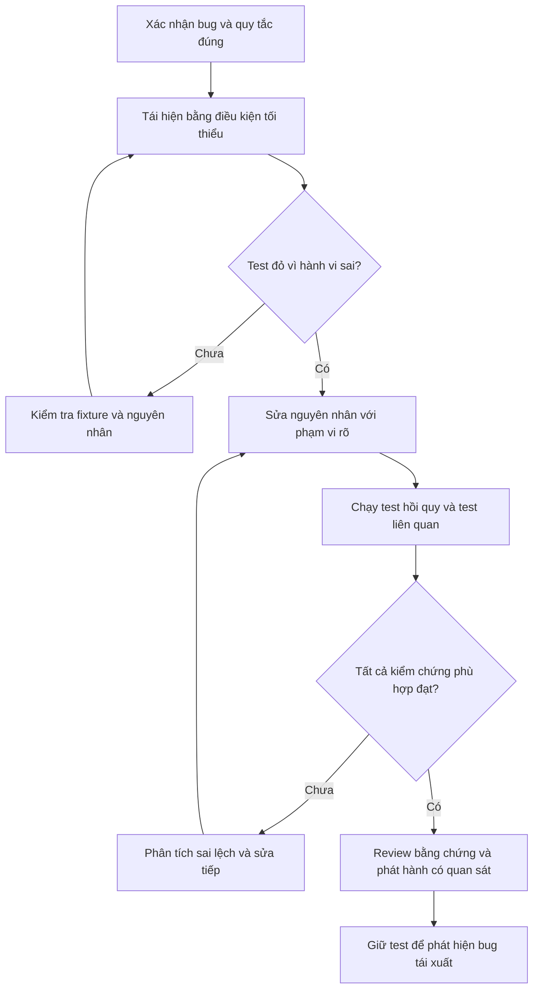

# Kiểm thử hồi quy cho lỗi đã xác nhận

## 1. Vì sao một lỗi đã sửa vẫn cần được bảo vệ?

Một lỗi phần mềm thường bộc lộ dưới một hoàn cảnh cụ thể: số tiền đúng bằng ngưỡng, một trường JSON bị thiếu, hai yêu cầu đến đồng thời, hoặc cổng thanh toán đã xử lý nhưng phản hồi bị mất. Nếu lập trình viên sửa mã rồi chỉ chạy thử một lần bằng tay, hành vi mới có thể đúng hôm nay nhưng bị phá vỡ ở lần thay đổi tiếp theo.

**Kiểm thử hồi quy cho lỗi đã xác nhận** (*bug-specific regression testing*) là quá trình chuyển một lỗi đã được xác minh thành **bằng chứng kiểm thử có thể chạy lặp lại**. Bài kiểm thử mô tả hành vi đúng đã được chấp thuận, thất bại trên phiên bản có lỗi khi điều kiện tái hiện được bảo đảm, và thành công khi bản sửa đáp ứng hợp đồng. Sau đó nó được giữ lại để phát hiện việc lỗi cũ quay trở lại.

Trong module `CODE_QUALITY_FUNDAMENTALS`, mục tiêu là **hiểu những thuộc tính quyết định mã nguồn có đáng tin cậy, dễ hiểu và dễ thay đổi hay không**. Ở chương **Bằng chứng kiểm thử**, kiểm thử hồi quy đặc biệt quan trọng vì giúp:

- **Độ tin cậy:** biến một tình huống sai đã xảy ra thành điều kiện được kiểm tra thường xuyên.
- **Khả năng đọc:** diễn đạt bằng tên test, fixture và assertion điều mà hệ thống *phải làm*, không chỉ điều mã hiện tại *đang làm*.
- **Khả năng thay đổi:** cho phép refactor hoặc thêm tính năng với tín hiệu rõ nếu hành vi từng lỗi bị phá vỡ.
- **Khả năng vận hành:** liên kết sự cố thực tế, biện pháp sửa và cách giám sát sau phát hành thành một chuỗi bằng chứng.

Ví dụ: chính sách phí giao hàng quy định **miễn phí khi tổng tiền hàng từ 200.00 trở lên**. Trong code có điều kiện `subtotal > 200.00`, nên đúng 200.00 vẫn bị tính phí. Nếu chỉ đổi dấu `>` thành `>=` mà không có test, một lần refactor sau có thể đưa lỗi trở lại. Nếu có test mang tên `makesShippingFreeAtExactThreshold`, quy tắc biên trở thành hợp đồng dễ thấy.

Sau bài này, bạn có thể xác nhận một bug đủ cơ sở, tạo ca tái hiện tối thiểu, áp dụng quy trình *red → green → regression*, chọn cấp kiểm thử phù hợp, tránh bài test không ổn định, và đánh giá bằng chứng trước khi kết luận lỗi đã được sửa.

## 2. Phân biệt phát hiện lỗi, sửa lỗi và bằng chứng hồi quy

Những hoạt động này liên quan nhưng không tương đương:

| Hoạt động | Câu hỏi được trả lời | Bằng chứng điển hình |
| --- | --- | --- |
| **Phát hiện sự cố** | Có hiện tượng sai nào đang diễn ra? | Báo cáo người dùng, log, cảnh báo, dữ liệu bất thường |
| **Xác nhận lỗi** | Hành vi đó có vi phạm hợp đồng đã được xác định không? | Yêu cầu nghiệp vụ, ví dụ đầu vào/đầu ra kỳ vọng, quyết định được chấp thuận |
| **Tái hiện lỗi** | Có thể tạo lại tình huống đủ để quan sát lỗi không? | Bước tái hiện, test thất bại, môi trường và dữ liệu liên quan |
| **Phân tích nguyên nhân** | Điều kiện hoặc cơ chế nào gây ra lỗi? | Phân tích code, trace, sơ đồ sự kiện, giả thuyết được kiểm chứng |
| **Sửa lỗi** | Thay đổi nào khôi phục hành vi đúng? | Diff, review, giải thích nguyên nhân được loại bỏ |
| **Kiểm thử hồi quy** | Cách nào giúp phát hiện lỗi quay lại? | Test tự động bảo vệ quy tắc đã được xác nhận |
| **Xác minh sau triển khai** | Bản chạy thực tế đã khắc phục ảnh hưởng chưa? | Chỉ số nghiệp vụ, log, kết quả đối soát, theo dõi sau phát hành |

Một test mới chạy xanh sau khi sửa là tín hiệu hữu ích, nhưng **chưa tự chứng minh** test sẽ phát hiện lỗi cũ. Có thể assertion quá yếu, fixture không đi qua nhánh gây lỗi hoặc test vô tình dùng lại chính logic sai để tính kết quả kỳ vọng.

Điểm mạnh của một ca hồi quy là nó trả lời được ba câu hỏi độc lập:

1. **Vì sao đây là hành vi đúng?** Dựa trên một hợp đồng hoặc yêu cầu đã xác nhận.
2. **Tại sao ca kiểm thử thật sự bắt được lỗi cũ?** Trên mã có lỗi, nó phải thất bại vì lý do dự kiến.
3. **Tại sao bản sửa được coi là đạt?** Trên mã đã sửa, ca đó và các kiểm tra liên quan phải thành công mà không tạo tác dụng phụ ngoài ý muốn.

### Kiểm thử hồi quy rộng và kiểm thử riêng cho bug

**Regression testing** theo nghĩa rộng là kiểm tra những hành vi đã có sau một thay đổi. **Bug-specific regression test** nhắm đến một lỗi cụ thể đã xảy ra hoặc đã được tái hiện đáng tin cậy. Nó thường có dữ liệu, điều kiện biên và tên mô tả trực tiếp lỗi đó.

Không nhất thiết mỗi bug phải có đúng một phương thức `@Test`: một lỗi đồng thời có thể cần một integration test với nhiều request; một lỗi chuyển đổi dữ liệu có thể cần test nhiều bản ghi. Điều quan trọng là **bằng chứng có thể nhận diện rõ điều kiện gây lỗi** và đủ ổn định để duy trì.

## 3. Xác nhận bug trước khi viết test

Người báo sự cố có thể mô tả “đơn hàng bị tính sai” nhưng chưa chỉ rõ số tiền nào, phiên bản nào và kỳ vọng nào. Nếu test được viết dựa trên phỏng đoán, nhóm có thể bảo vệ một hành vi không đúng nghiệp vụ.

### 3.1. Một hồ sơ lỗi đủ thông tin

| Trường | Nội dung cần thu thập |
| --- | --- |
| Mô tả | Điều người dùng thấy sai, tránh chỉ ghi “không hoạt động” |
| Kỳ vọng | Hành vi đúng theo quy tắc được chấp thuận |
| Thực tế | Hành vi đã quan sát, gồm giá trị hoặc trạng thái cụ thể |
| Đầu vào | Những giá trị tối thiểu để tái hiện, đã loại bỏ dữ liệu nhạy cảm |
| Môi trường | Phiên bản ứng dụng, runtime, cấu hình, dữ liệu đặc thù nếu có |
| Điều kiện kích hoạt | Giá trị biên, thời điểm, thứ tự thao tác, xử lý đồng thời, timeout... |
| Tác động | Mức độ ảnh hưởng, có mất tiền/dữ liệu hay sai hiển thị không |
| Bằng chứng | Log, request ID, trace, bước tái hiện, test hoặc mã phiên bản |
| Tiêu chí kết thúc | Cách xác nhận bản sửa và quan sát sau phát hành |

Đừng đưa token, mật khẩu hoặc dữ liệu cá nhân thật vào fixture kiểm thử. Tái tạo dữ liệu tối thiểu đủ thể hiện lỗi, sử dụng mã giả hoặc dữ liệu tổng hợp.

### 3.2. Xác định nguồn kỳ vọng độc lập với code

Khi bug là “ứng dụng tính phí 30.00 tại đúng 200.00”, nếu người viết test đọc code cũ rồi cũng đặt expected là 30.00, test sẽ xác nhận chính hành vi sai. Kỳ vọng phải đến từ **quy tắc nghiệp vụ đã xác nhận**, thí dụ: “Tổng tiền hàng lớn hơn **hoặc bằng** 200.00 được miễn phí”.

Nếu tài liệu và hành vi hiện tại mâu thuẫn, hoặc nhiều bên bất đồng về quy tắc, cần làm rõ trước khi đóng bug. Việc “đã tạo test xanh” không biến một giả định chưa được duyệt thành hợp đồng.

### 3.3. Thu nhỏ ca tái hiện

Tình huống thực tế có thể chứa 50 dòng hàng và nhiều cấu hình. Hãy tìm đầu vào nhỏ nhất vẫn kích hoạt lỗi. Với bug ngưỡng miễn phí, ca tối thiểu có thể chỉ là:

```text
Điều kiện: phí giao tiêu chuẩn = 30.00, miễn phí từ 200.00
Đầu vào: merchandiseSubtotal = 200.00
Kỳ vọng: shippingFee = 0
Thực tế: shippingFee = 30.00
```

Một ca tái hiện nhỏ làm rõ nguyên nhân và giảm khả năng test thất bại vì yếu tố không liên quan. Tuy nhiên, **đừng loại bỏ bối cảnh gây ra lỗi**: với bug chỉ xuất hiện khi hai request chạy đồng thời, một test tuần tự dù nhỏ hơn sẽ không còn tái hiện đúng vấn đề.

## 4. Ví dụ Java: bắt lỗi so sánh sai ở đúng ngưỡng

Đây là một ví dụ thống nhất cho toàn bộ quá trình **xác nhận → test đỏ → sửa → test xanh → giữ làm hồi quy**.

### 4.1. Hợp đồng và phiên bản đang có lỗi

Giả định quy tắc đã được xác nhận:

- Tổng tiền hàng là số không âm, cùng đơn vị tiền tệ với ngưỡng.
- Khi tổng tiền hàng **từ 200.00 trở lên**, phí giao tiêu chuẩn là 0.
- Khi tổng tiền hàng **nhỏ hơn 200.00**, phí là 30.00.
- `null` hoặc tổng tiền hàng âm phải bị từ chối; không coi đó là số tiền 0.
- Không cần gọi database, mạng hay đồng hồ để tính.

Phiên bản Java 17+ **cố ý chứa lỗi** ở dấu so sánh:

```java
import java.math.BigDecimal;
import java.util.Objects;

public final class StandardDeliveryFee {
    private static final BigDecimal FREE_THRESHOLD =
            new BigDecimal("200.00");
    private static final BigDecimal DELIVERY_FEE =
            new BigDecimal("30.00");

    private StandardDeliveryFee() {}

    public static BigDecimal calculate(BigDecimal merchandiseSubtotal) {
        Objects.requireNonNull(merchandiseSubtotal, "merchandiseSubtotal");
        if (merchandiseSubtotal.signum() < 0) {
            throw new IllegalArgumentException("Subtotal must not be negative");
        }

        // BUG: đúng ngưỡng 200.00 vẫn bị tính phí.
        if (merchandiseSubtotal.compareTo(FREE_THRESHOLD) > 0) {
            return BigDecimal.ZERO;
        }
        return DELIVERY_FEE;
    }
}
```

`BigDecimal.compareTo` trả giá trị âm, 0 hoặc dương tùy kết quả so sánh số học. Khi tổng tiền bằng ngưỡng, `compareTo` trả `0`; biểu thức `> 0` là `false`, nên trả 30.00 thay vì 0.

Dùng `BigDecimal` ở đây giúp minh họa phép so sánh tiền thập phân; ví dụ giả định đồng tiền và chính sách làm tròn đã được xác định ở ranh giới khác. Không được hiểu một lớp tính phí nhỏ là đã giải quyết đầy đủ nghiệp vụ tiền tệ.

### 4.2. Viết kiểm thử đỏ trước khi sửa

Tạo test JUnit 5. Trong dự án thực, đặt trong `StandardDeliveryFeeTest.java`.

```java
import static org.junit.jupiter.api.Assertions.*;
import java.math.BigDecimal;
import org.junit.jupiter.api.Test;

class StandardDeliveryFeeTest {
    @Test
    void makesShippingFreeAtExactThreshold() {
        BigDecimal subtotal = new BigDecimal("200.00");

        BigDecimal actualFee = StandardDeliveryFee.calculate(subtotal);

        assertEquals(0, actualFee.compareTo(BigDecimal.ZERO));
    }

    @Test
    void chargesDeliveryFeeJustBelowThreshold() {
        BigDecimal subtotal = new BigDecimal("199.99");

        BigDecimal actualFee = StandardDeliveryFee.calculate(subtotal);

        assertEquals(0, actualFee.compareTo(new BigDecimal("30.00")));
    }

    @Test
    void makesShippingFreeAboveThreshold() {
        BigDecimal subtotal = new BigDecimal("200.01");

        BigDecimal actualFee = StandardDeliveryFee.calculate(subtotal);

        assertEquals(0, actualFee.compareTo(BigDecimal.ZERO));
    }

    @Test
    void rejectsNegativeSubtotal() {
        assertThrows(IllegalArgumentException.class,
                () -> StandardDeliveryFee.calculate(new BigDecimal("-0.01")));
    }

    @Test
    void rejectsNullSubtotal() {
        assertThrows(NullPointerException.class,
                () -> StandardDeliveryFee.calculate(null));
    }
}
```

Trong các assertion về số tiền, `compareTo(...) == 0` xác nhận **bằng nhau về giá trị số học** mà không yêu cầu hai đối tượng `BigDecimal` có cùng `scale`. Ngược lại, `BigDecimal.equals(...)` xét cả giá trị và scale; `new BigDecimal("0.00").equals(BigDecimal.ZERO)` trả false. Nếu hợp đồng còn yêu cầu định dạng/scale, phải có kiểm tra riêng, không bỏ qua yêu cầu đó.

Ở phiên bản có lỗi, test `makesShippingFreeAtExactThreshold` **dự kiến thất bại** vì thực tế là 30.00. Các ca dưới và trên ngưỡng vẫn có thể thành công. Phân biệt này quan trọng: test mới không chỉ khiến suite “có thêm coverage” mà định vị đúng **biên bị sai**.

### 4.3. Xác minh RED đúng nguyên nhân

Khi test đỏ, cần đọc thông báo thất bại. Nếu lỗi là `ClassNotFoundException`, thiếu dependency JUnit hoặc cấu hình kết nối database sai, đó **không phải bằng chứng** rằng test tái hiện bug logic.

Một bằng chứng RED có giá trị trong ví dụ cần thỏa:

1. Test chạy được đến lời gọi `StandardDeliveryFee.calculate`.
2. Đầu vào đúng bằng 200.00.
3. Expected là 0 theo hợp đồng.
4. Actual là 30.00 ở phiên bản có lỗi.
5. Những ca đối chứng, như 199.99 và 200.01, phản ánh đúng ranh giới kỳ vọng.

Nếu đã sửa bug trước khi kịp tạo test, có thể xác minh hiệu lực phát hiện bằng cách kiểm tra test trên phiên bản trước **trong môi trường kiểm thử an toàn**, hoặc tạm hoàn nguyên riêng điều kiện lỗi trong nhánh tách biệt để quan sát test đỏ rồi phục hồi bản sửa. Không làm việc đó trực tiếp trên production.

### 4.4. Sửa tối thiểu và xác minh GREEN

Thay đổi cần thiết:

```diff
- if (merchandiseSubtotal.compareTo(FREE_THRESHOLD) > 0) {
+ if (merchandiseSubtotal.compareTo(FREE_THRESHOLD) >= 0) {
      return BigDecimal.ZERO;
  }
```

Sau khi sửa, test tại đúng ngưỡng **dự kiến chuyển sang xanh** và các ca dưới/trên ngưỡng tiếp tục xanh. Đừng sửa test thành expected 30.00 chỉ để có build thành công: việc đó hợp thức hóa bug.

Tiếp theo, chạy các kiểm thử liên quan đến tính phí, ưu đãi, đơn hàng và tích hợp nếu chức năng được sử dụng rộng. Một điều kiện đổi từ `>` sang `>=` rất nhỏ nhưng có thể ảnh hưởng số tiền tại đúng ngưỡng; cần kiểm tra xem điều kiện này có xuất hiện ở API khác hay một nơi sao chép logic không.

### 4.5. Vì sao cần giữ test sau khi bug đã sửa?

Nếu test bị xóa sau khi PR được merge, dự án mất đi bằng chứng tự động cho một quy tắc đã từng bị sai. Giữ test giúp:

- Người sửa sau này biết **đúng ngưỡng được miễn phí** là chủ đích.
- Refactor cách tính phí được kiểm tra lại.
- Một phiên bản vô tình đổi dấu so sánh trở lại có thể bị phát hiện trước khi phát hành.

Test có giá trị vì bảo vệ **hành vi**, không phải vì nó xác nhận chính xác dòng `if` nào đang dùng. Nếu tương lai thay logic bằng bảng chính sách nhưng vẫn giữ đúng mức phí ở ranh giới, test nên tiếp tục xanh.

## 5. Một ca hồi quy tốt phải hỏng khi hành vi sai quay lại

Không phải mọi test có tên “regression” đều có khả năng phát hiện regression. Cần thiết kế test có **sức phân biệt** giữa hành vi đúng và hành vi lỗi.

### 5.1. Dựa trên hợp đồng, không dựng expected từ cùng code

Ví dụ phản tác dụng:

```java
BigDecimal expected = StandardDeliveryFee.calculate(subtotal);
BigDecimal actual = StandardDeliveryFee.calculate(subtotal);
assertEquals(expected, actual);
```

Cả hai vế gọi cùng implementation, nên lỗi so sánh vẫn cho kết quả bằng nhau. Test chạy xanh nhưng gần như không cung cấp bằng chứng nghiệp vụ.

Đúng hơn, expected phải là giá trị độc lập, từ quy tắc đã chấp thuận:

```java
assertEquals(0, StandardDeliveryFee
        .calculate(new BigDecimal("200.00"))
        .compareTo(BigDecimal.ZERO));
```

### 5.2. Assertion phải đủ mạnh

| Assertion yếu | Vì sao yếu | Assertion liên quan hơn |
| --- | --- | --- |
| `assertNotNull(result)` | Kết quả sai vẫn khác null | Kiểm tra status, số tiền và dữ liệu phải trả |
| `assertTrue(service.call() != null)` | Không kiểm tra nghiệp vụ | So sánh cụ thể với kết quả đã xác nhận |
| Chỉ kiểm tra HTTP 200 | Body hoặc trạng thái nghiệp vụ vẫn sai | Kiểm tra contract response và tác dụng phụ |
| Chỉ xác nhận mock đã được gọi | Cùng lời gọi có thể mang sai dữ liệu | Kiểm tra tham số, kết quả và tác dụng phụ có nghĩa |
| Chỉ kiểm tra “không ném exception” | Hệ thống có thể âm thầm nuốt lỗi | Xác nhận giá trị và thông tin lỗi phù hợp |

Đồng thời, tránh assertion kiểm tra chi tiết triển khai không thuộc hợp đồng. Ví dụ, test việc `calculate` gọi `validate` đúng một lần có thể hỏng khi refactor hợp lệ; test yêu cầu phí ở đúng ngưỡng bằng 0 mới bảo vệ nghiệp vụ.

### 5.3. Ca dương, ca âm và ca sát biên

Với lỗi ranh giới, ba giá trị **ngay dưới – đúng bằng – ngay trên** thường cung cấp nhiều thông tin hơn các giá trị xa ngưỡng. Với bug `null`, cần ca dữ liệu vắng; với bug thứ tự ưu tiên, cần ca **hai điều kiện cùng đúng**; với bug concurrency, cần ca xung đột đồng thời.

Không biến mọi bug thành hàng trăm test tổ hợp. Hãy chọn dữ liệu làm lộ điều kiện sai, rồi bổ sung vài đối chứng để chắc chắn bản sửa không phá các nhánh lân cận.

### 5.4. Một test phải tự báo rõ sai lệch

Tên kiểu `bug1234` có thể giúp truy lại ticket nhưng không diễn đạt điều cần giữ. Tên `doesNotChargeDeliveryAtFreeShippingThreshold` nói ngay về hợp đồng. Có thể gắn mã issue ở chú thích ngắn nếu điều đó hữu ích, nhưng tên và assertion cần đứng độc lập khi người khác chỉ nhìn thấy test sau nhiều năm.

## 6. Chọn tầng kiểm thử thấp nhất có thể tái hiện lỗi thật

Nên viết test nhanh, ổn định và đủ gần hành vi lỗi, **không phải luôn mặc định unit test**.

| Loại lỗi đã xác nhận | Tầng kiểm thử thường phù hợp | Vì sao |
| --- | --- | --- |
| So sánh sai tại ngưỡng | Unit test của policy thuần | Đủ tái hiện và chạy nhanh |
| Chuẩn hóa/parse sai giá trị | Unit/contract test của parser | Kiểm tra input và schema |
| API trả mã lỗi sai hoặc thiếu field JSON | API/contract test | Lỗi ở ranh giới giao tiếp |
| Repository lưu sai do unique constraint hoặc transaction | Integration test với database phù hợp | Fake không phản ánh ràng buộc DB |
| Hai request cùng giữ một ghế | Concurrency + integration test | Cần kiểm chứng cập nhật nguyên tử thật |
| Timeout làm tạo hai giao dịch | Integration/failure test với idempotency và đối soát | Lỗi do tương tác nhiều thành phần |
| Scheduler chạy lệch múi giờ | Test với Clock/ZoneId và integration nếu scheduling ngoài | Phụ thuộc thời gian và môi trường |
| Frontend không hiển thị lỗi đã có | UI/component hoặc end-to-end test phù hợp | Lỗi xảy ra trong hành vi người dùng |

### 6.1. Unit test: khoanh vùng quy tắc đã sai

Nếu lỗi ở một phép so sánh thời gian hoặc quy tắc điều kiện, unit test có thể cung cấp tín hiệu rõ trong vài mili giây và không cần hạ tầng. Đây thường là lựa chọn ưu tiên khi tái hiện được bằng logic thuần.

### 6.2. Integration test: bắt lỗi ở ranh giới thật

Một bug chỉ xuất hiện khi ghi database, gọi HTTP hoặc xử lý sự kiện cần test thực hiện gần nơi gây lỗi. Thí dụ, nếu hai request cùng đọc tồn kho trước khi ghi lại, một fake `HashMap` trong unit test có thể không phản ánh isolation hoặc constraint của database. Test cần xác nhận bất biến trên kho dữ liệu sau các thao tác đồng thời.

### 6.3. End-to-end test: kiểm chứng luồng có ý nghĩa

Với lỗi liên quan cách người dùng tương tác qua nhiều thành phần, một test luồng tổng thể có thể cần thiết. Nhưng chỉ dựa vào E2E cho mọi bug thường khiến phản hồi chậm và lỗi khó khoanh vùng. Một phương án cân bằng là giữ **test hẹp nhất bắt được lỗi** và bổ sung test ở tầng khác khi cơ chế lỗi đòi hỏi.

## 7. Những tình huống hồi quy khó hơn phép so sánh đơn giản

### 7.1. Lỗi thời gian và múi giờ

Một lỗi có thể chỉ xuất hiện đúng nửa đêm hoặc khi máy CI sử dụng múi giờ khác. Test gọi `LocalDate.now()` trực tiếp sẽ thay đổi theo thời gian và môi trường, dễ trở thành flaky.

Khi hợp đồng dùng ngày lịch theo múi giờ được chỉ định, có thể dùng `Clock.fixed`:

```java
import java.time.Clock;
import java.time.Instant;
import java.time.LocalDate;
import java.time.ZoneId;

ZoneId businessZone = ZoneId.of("Asia/Ho_Chi_Minh");
Clock clock = Clock.fixed(
        Instant.parse("2026-11-16T16:59:59Z"),
        businessZone);

LocalDate businessDate = LocalDate.now(clock);
// businessDate được quyết định bởi instant và businessZone cố định.
```

Trong ví dụ, `16:59:59Z` tương ứng `23:59:59` tại múi giờ +07:00. Nếu lỗi xảy ra khi sang ngày kế tiếp, cần thêm ca ngay sau ranh giới để xác nhận hợp đồng ngày địa phương. Tránh dùng múi giờ mặc định của máy khi nghiệp vụ đòi một múi giờ cụ thể.

### 7.2. Lỗi xử lý đồng thời

Một lỗi “cùng một ghế được xác nhận hai lần” thường đòi hỏi hai thao tác cùng tranh chấp một tài nguyên. Test chạy hai lời gọi tuần tự chưa đủ. Cần:

- Tạo dữ liệu cùng một ghế hoặc cùng khóa nghiệp vụ.
- Đồng bộ điểm bắt đầu hoặc kiểm soát thời điểm tranh chấp bằng cơ chế phù hợp; không chỉ dựa vào `Thread.sleep`.
- Thực hiện lời gọi qua lớp lưu trữ thật trong môi trường test, với isolation/constraint đại diện cho production.
- Kiểm tra **bất biến cuối cùng**: không quá một đặt chỗ được xác nhận cho cùng ghế, dữ liệu không bị âm hoặc thất lạc.
- Lặp thử và bổ sung test ở mức thấp hơn nếu đã định vị được một race cụ thể.

Một test cạnh tranh đôi khi vẫn không tái hiện mọi interleaving; vì vậy cần thiết kế bất biến và constraint ở mức lưu trữ, không coi vài lần chạy xanh là bằng chứng toán học rằng mọi thứ đã an toàn.

### 7.3. Lỗi timeout và tác dụng phụ lặp

Giả sử một khách nhấn thanh toán. Cổng thanh toán đã thu tiền nhưng phản hồi không đến; hệ thống ghi nhận `FAILED` rồi gửi lại một yêu cầu mới, gây thu hai lần. Ca hồi quy phải bảo vệ **hành vi khi kết quả chưa xác định**, không chỉ mô phỏng một exception.

Một ma trận tình huống:

| Phản hồi/điều kiện | Điều cần bảo vệ |
| --- | --- |
| Thành công đã xác nhận | Hệ thống ghi nhận thành công một lần |
| Từ chối đã xác nhận | Không báo đã thu tiền |
| Timeout trước khi biết kết quả | Không tự kết luận chắc chắn thất bại; lưu trạng thái đối soát |
| Yêu cầu gửi lại với cùng khóa | Phía thực thi khử trùng lặp theo hợp đồng |
| Hai yêu cầu dùng cùng khóa nhưng nội dung khác | Phải có chính sách từ chối/xử lý xung đột rõ |
| Tiến trình dừng giữa các bước | Có đường phục hồi dựa trên trạng thái bền vững |

Unit test có thể xác nhận caller không biến timeout thành `DECLINED`. Nhưng chỉ integration/failure test với adapter và dữ liệu lưu trữ phù hợp mới có thể đánh giá tính bền vững của khóa idempotency, transaction, cơ chế đối soát và khả năng xử lý lại khi restart.

**Đừng gọi một hệ thống “đã được kiểm thử chống thu trùng” nếu test chỉ xác nhận số lần gọi của mock ở một tiến trình.**

### 7.4. Lỗi dữ liệu lịch sử và tương thích phiên bản

Một bug có thể chỉ xảy ra với bản ghi cũ thiếu trường, enum mới mà client cũ không hiểu, hoặc schema đang trong giai đoạn hai phiên bản chạy song song. Test cần dùng fixture tái tạo dữ liệu **trước và sau thay đổi schema**, cùng contract của caller cũ nếu còn được hỗ trợ.

Có thể dùng dữ liệu tổng hợp phản ánh cấu trúc cũ, không đưa thẳng dữ liệu khách hàng thật vào repository kiểm thử. Với migration có nguy cơ mất dữ liệu, cần kế hoạch thử migration, backup và rollback riêng.

## 8. Làm test hồi quy ổn định và có thể duy trì

Một test lúc xanh lúc đỏ mà không có thay đổi liên quan gây **mất niềm tin**. Nhóm có thể tắt test hoặc bỏ qua cảnh báo, khiến lỗi quan trọng không còn được phát hiện.

### 8.1. Những nguyên nhân phổ biến gây flaky

| Nguyên nhân | Dấu hiệu | Giải pháp |
| --- | --- | --- |
| Dùng thời gian thực | Test sai gần nửa đêm, deadline | Truyền `Clock` hoặc mốc thời gian cố định |
| Phụ thuộc múi giờ hệ thống | Chạy đúng cục bộ, sai trên CI | Chỉ định `ZoneId` theo nghiệp vụ |
| `Thread.sleep` đoán thời điểm xong | Test lúc đủ thời gian, lúc không | Dùng latch, future, tín hiệu hoàn tất có timeout |
| Gọi mạng thật không kiểm soát | Timeout, rate limit, dữ liệu thay đổi | Adapter test với sandbox; unit test dùng double |
| Trạng thái chia sẻ giữa test | Chạy riêng xanh, chạy cả suite đỏ | Cô lập fixture, transaction rollback, tránh static mutable |
| Thứ tự thực thi | Kết quả thay theo test chạy trước | Mỗi test tự chuẩn bị và dọn dữ liệu cần thiết |
| Dữ liệu quá “thật” và động | Test phụ thuộc đơn hàng/tài khoản bên ngoài | Dữ liệu tổng hợp cố định và có chủ đích |
| Assertion quá chặt vào chi tiết | Refactor hợp lệ vẫn khiến test đỏ | Kiểm tra hành vi công khai, không kiểm tra thứ tự helper vô nghĩa |

Một test dùng fixed time nhưng lại so sánh với `Instant.now()` ở nơi khác trong code vẫn có dependency ẩn; cần kiểm soát **toàn bộ** nguồn thời gian ảnh hưởng trực tiếp đến kết quả đang kiểm tra.

### 8.2. Cô lập dữ liệu và tác dụng phụ

- Mỗi test nên có fixture riêng hoặc cơ chế reset đáng tin cậy.
- Dùng database test, queue test và địa chỉ nhận thông báo giả hoặc sandbox; không gửi tiền/email thật.
- Không để test phụ thuộc dữ liệu đã được tạo bởi test khác.
- Nếu thay đổi trạng thái toàn cục, phải phục hồi và tránh ảnh hưởng khi chạy song song.
- Khi kiểm thử concurrency, dùng công cụ đồng bộ thích hợp và đặt timeout để test không treo vô hạn.

### 8.3. Không “chữa” flaky bằng cách retry vô hạn

Retry một test thất bại có thể cung cấp thông tin xem lỗi không ổn định, nhưng nếu pipeline chỉ chạy lại đến lúc xanh rồi coi như không có vấn đề, bug thực có thể bị che giấu. Hãy xác định nguồn bất định, tái hiện có kiểm soát và sửa harness hoặc mã production nếu cần.

Test hồi quy có giá trị khi **một thất bại mang thông tin đủ đáng tin** để nhóm hành động.

## 9. Đọc kết quả kiểm thử đúng mức: test xanh chứng minh điều gì?

Một bài test xanh cung cấp bằng chứng rằng **trong những điều kiện đã thiết lập**, đoạn mã trả kết quả phù hợp với assertion đã viết. Nó không tự chứng minh các môi trường khác, dữ liệu khác hoặc mọi đường thực thi đều đúng.

### 9.1. Những giới hạn quan trọng

- **Coverage cao không bảo đảm test mạnh.** Test có thể đi qua nhánh nhưng không kiểm tra kết quả đúng.
- **Số test nhiều không chứng minh đã bao phủ hành vi nguy hiểm.** Một test sát ngưỡng có thể hữu ích hơn mười test ở giá trị trung bình.
- **Test double có giới hạn.** Mock trả `SUCCESS` không chứng minh adapter đã ghi thành công vào hệ thống ngoài.
- **Một bug có thể có nhiều nguyên nhân.** Sửa phép so sánh có thể giải quyết một đường đi nhưng bug vẫn tồn tại ở đường nhập liệu hoặc API khác.
- **Test đỏ không luôn là bug product.** Có thể do môi trường CI, dữ liệu fixture lỗi hoặc expected viết sai.
- **Test xanh không thay thế quan sát production.** Sau deploy, cần xác minh hành vi thực và dữ liệu bị ảnh hưởng đã được xử lý đúng.

### 9.2. Mutation testing có thể kiểm tra độ nhạy của test

Một cách đánh giá bổ sung là **mutation testing**: công cụ cố ý thay đổi một toán tử hoặc điều kiện trong mã rồi quan sát test có phát hiện sai lệch hay không. Với ví dụ phí giao hàng, thay `>=` thành `>` phải khiến test tại đúng ngưỡng thất bại.

Đây là chỉ báo **test có nhạy với một loại lỗi nhất định**, không phải phép chứng minh tổng quát về độ đúng. Có mutant tương đương về hành vi hoặc không thể tới trong điều kiện đang xét; cần diễn giải kết quả trong bối cảnh nghiệp vụ.

### 9.3. Liên kết bằng chứng với thay đổi thật

Một bộ bằng chứng hữu ích cho bug đã sửa có thể gồm:

```text
Mã sự cố: BUG-DELIVERY-BOUNDARY
Hợp đồng: đơn >= 200.00 được miễn phí giao tiêu chuẩn
Tái hiện: subtotal=200.00 => actual=30.00 (trước sửa)
Test hồi quy: StandardDeliveryFeeTest.makesShippingFreeAtExactThreshold
Sửa: so sánh compareTo(FREE_THRESHOLD) >= 0
Kiểm chứng: test đỏ ở bản lỗi, xanh ở bản sửa; ca 199.99/200.01 xanh
Kiểm tra liên quan: phí giao/đơn hàng/API tùy phạm vi ảnh hưởng
Sau deploy: theo dõi khoản phí tại ngưỡng và phản hồi người dùng
```

Ví dụ là mô hình hồ sơ bằng chứng, không phải kết quả CI của bài học này. Khi triển khai dự án thật, ghi **kết quả kiểm thử thực tế** và liên kết với commit/build cụ thể, không đánh dấu PASS nếu chưa chạy.

## 10. Quy trình sửa lỗi có kiểm thử hồi quy: từ sự cố đến phòng ngừa

### Bước 1 — Xác nhận triệu chứng và hợp đồng

Thu thập đầu vào, kết quả thực, kỳ vọng được duyệt và phiên bản xảy ra lỗi. Phân biệt bug với yêu cầu mới hoặc thay đổi chủ đích. Nếu hành vi đúng còn tranh luận, chưa nên “đóng” một test theo giả định.

### Bước 2 — Tạo ca tái hiện đáng tin cậy

Chọn dữ liệu nhỏ nhất còn kích hoạt lỗi và giữ lại điều kiện đặc thù như timezone, phiên bản schema, concurrency hoặc network timeout. Ưu tiên viết test ở **tầng thấp nhất vẫn bộc lộ được nguyên nhân thực**.

### Bước 3 — Xác nhận RED có ý nghĩa

Trên phiên bản có lỗi, test cần thất bại ở assertion liên quan đúng hành vi đã xác nhận. Nếu test đỏ do compilation hay môi trường, sửa harness trước khi coi đó là bằng chứng tái hiện.

### Bước 4 — Phân tích nguyên nhân và sửa có phạm vi kiểm soát

Dựa trên log, trace, điều kiện biên, đường dữ liệu hoặc ranh giới giao dịch để tìm cơ chế lỗi. Tránh thay nhiều hành vi không liên quan trong cùng lần sửa khi chưa cần thiết; như vậy dễ đánh giá tác động và rollback hơn.

### Bước 5 — Xác nhận GREEN và kiểm tra lân cận

Chạy test hồi quy, những test liên quan và test tích hợp phù hợp với phạm vi thay đổi. Xác minh không có nhánh lân cận bị phá, không chỉ rằng ca ban đầu đã xanh.

### Bước 6 — Review bằng bằng chứng

Reviewer nên biết hợp đồng nào bị vi phạm, ca tái hiện phản ánh lỗi thế nào, vì sao bản sửa giải quyết nguyên nhân, test bảo vệ trường hợp biên ra sao và còn rủi ro nào chưa được kiểm chứng.

### Bước 7 — Phát hành và theo dõi

Tùy hậu quả, chuẩn bị canary/rollout từng bước, dashboard, log có correlation ID, cách đối soát dữ liệu bị ảnh hưởng và đường rollback. Với lỗi tiền hoặc dữ liệu, sửa code không tự phục hồi những bản ghi đã sai trong quá khứ.

### Bước 8 — Giữ bài kiểm thử và tri thức

Giữ test trong suite phù hợp và liên kết ngữ nghĩa với quy tắc nghiệp vụ. Nếu đặc tả thay đổi có chủ đích, cập nhật test theo hợp đồng mới và ghi lý do; không xóa test chỉ vì nó bắt đầu thất bại sau refactor.



## 11. Tối ưu chi phí của bộ kiểm thử hồi quy

Một dự án có nhiều lỗi được sửa sẽ dần có nhiều test. Chạy mọi bài E2E trong mỗi lần đổi tên biến có thể quá tốn thời gian, nhưng loại bỏ test quan trọng để tăng tốc lại làm giảm độ tin cậy. Cần tổ chức bộ kiểm thử theo **mức phản hồi và hậu quả khi sai**.

| Phương án | Lợi ích | Hạn chế cần quản lý |
| --- | --- | --- |
| Unit test chạy ở mọi PR | Nhanh, phát hiện bug logic sớm | Không phản ánh vấn đề tích hợp |
| Contract/integration test ở CI | Bảo vệ ranh giới dữ liệu và API | Tốn thời gian dựng môi trường |
| Failure/concurrency test có lịch phù hợp | Phát hiện lỗi hiếm và bất biến khó | Phải kiểm soát tính ổn định và thời gian chạy |
| End-to-end test cho luồng trọng yếu | Đánh giá hành vi người dùng từ đầu tới cuối | Dễ khó khoanh vùng lỗi nếu dùng quá nhiều |
| Kiểm tra sau triển khai | Quan sát được hành vi thật | Không thay thế phòng ngừa trước release |

Khi cần tối ưu thời gian, nên **chuyển một test nặng thành test hẹp hơn nếu vẫn giữ được khả năng phát hiện lỗi**, hoặc phân nhóm chạy theo tầng. Không nên âm thầm bỏ test khiến một bug tài chính nguy hiểm không còn được kiểm soát.

### Test cũ có nên bị xóa không?

Một test hồi quy có thể trở nên dư thừa nếu tính năng đã bị loại bỏ hoặc một test khác bảo vệ đầy đủ cùng hợp đồng ở tầng phù hợp. Trước khi xóa, hãy kiểm tra:

1. Quy tắc được bảo vệ còn tồn tại không?
2. Test khác có thật sự thất bại khi lỗi cũ quay lại không?
3. Test cần chuyển tầng hoặc thay dữ liệu thay vì xóa không?
4. Có đang bỏ mất bằng chứng cho một lỗ hổng, lỗi dữ liệu hoặc điều kiện đồng thời quan trọng không?

Việc tinh gọn suite có căn cứ không mâu thuẫn với mục tiêu giữ hồi quy; nó nhằm bảo vệ hành vi bằng bằng chứng **ít giòn và có giá trị nhất**.

## 12. Checklist review một kiểm thử hồi quy cho bug đã xác nhận

Dùng checklist sau khi review bản sửa hoặc khi quyết định lỗi đã đủ điều kiện đóng:

1. **Lỗi đã được xác nhận?** Có mô tả hành vi đúng độc lập với code cũ, không chỉ lời phỏng đoán?
2. **Có đầu vào tái hiện cụ thể?** Dữ liệu, phiên bản, thời gian hoặc thứ tự sự kiện có đủ rõ?
3. **Test có đỏ trên phiên bản lỗi?** Đỏ do assertion nghiệp vụ, không phải thiếu dependency hay môi trường?
4. **Expected có độc lập?** Không gọi lại chính hàm đang kiểm thử để tạo expected?
5. **Assertion đủ mạnh?** Kiểm tra số tiền, trạng thái, thông điệp hoặc tác dụng phụ quan trọng thay vì chỉ khác null?
6. **Đã kiểm tra lân cận?** Với ngưỡng: dưới, bằng, trên; với điều kiện: các trường hợp giao nhau?
7. **Đã dùng đúng tầng kiểm thử?** Test đơn vị cho logic, tích hợp cho transaction/giao thức, concurrency cho xung đột?
8. **Test có ổn định?** Không phụ thuộc giờ thật, dữ liệu production, sleep cảm tính hoặc thứ tự chạy?
9. **Test có dễ đọc?** Tên chỉ ra hành vi, fixture ngắn, lỗi thất bại dễ giải thích?
10. **Có phá hợp đồng khác?** Cần chạy thêm test về API, dữ liệu cũ, caller hiện hữu, khả năng rollback không?
11. **Đã bảo vệ tác dụng phụ?** Không gửi trùng, không ghi dữ liệu sai, không “nuốt lỗi” nếu đây là trọng tâm bug?
12. **Có giới hạn nào chưa kiểm chứng?** Mock khác adapter thật; môi trường test khác production ở đâu?
13. **Có kế hoạch sau deploy?** Dữ liệu sai trước đó, cảnh báo, đối soát hoặc hỗ trợ người dùng được xử lý ra sao?
14. **Test được giữ ở nơi phù hợp?** Có cơ hội chạy tự động trong quy trình phát triển và dễ tìm lại không?

## 13. Bài tập thực hành

### Bài 1 — Lỗi điều kiện biên

Một hệ thống cấp điểm thưởng khi số tiền đơn hàng **từ 500.00 trở lên**. Code dùng `amount.compareTo(threshold) > 0`. Hãy viết một kiểm thử hồi quy đỏ với giá trị 500.00, thêm hai test đối chứng 499.99 và 500.01, rồi nêu thay đổi tối thiểu giúp test xanh.

### Bài 2 — Lỗi múi giờ khó tái hiện

Khách tại Việt Nam nhận thông báo “đơn hết hạn” sớm một ngày. Code dùng `LocalDate.now()` trên máy chủ có timezone khác. Hãy nêu cách xác nhận múi giờ nghiệp vụ, chọn `Clock.fixed` và dữ liệu sát mốc chuyển ngày, rồi phân biệt test đơn vị với test tích hợp scheduler.

### Bài 3 — Test xanh nhưng không bắt được lỗi

Một test làm như sau: gọi `calculateTotal(order)` hai lần và dùng `assertEquals(first, second)`. Trong production, khách bị tính sai thuế. Hãy giải thích test trên có thể vẫn xanh, đề xuất expected độc lập từ hợp đồng thuế, rồi chọn giá trị biên giúp phân biệt hai cách làm tròn.

### Bài 4 — Lỗi mất phản hồi thanh toán

Cổng thanh toán thu tiền nhưng response bị mất, ứng dụng gửi lại và thu lần hai. Hãy thiết kế ma trận hồi quy gồm thành công, từ chối, timeout, gọi lại với cùng idempotency key và hai request đồng thời. Nêu phần nào chỉ có thể test bằng mock và phần nào cần integration/failure test với trạng thái bền vững.

### Bài 5 — Lỗi chỉ xuất hiện với dữ liệu cũ

Sau khi thêm cột mới, API đọc bản ghi tạo trước migration và ném lỗi `NullPointerException`. Hãy nêu fixture tối thiểu cho dữ liệu cũ, kết quả đúng theo hợp đồng, test ở tầng dữ liệu và kế hoạch kiểm tra đường rollback khi có hai phiên bản cùng chạy.

### Bài 6 — Flaky regression test

Một test sử dụng `Thread.sleep(50)` rồi assert job nền đã hoàn tất. Trên máy tác giả test xanh nhưng CI lúc xanh lúc đỏ. Hãy thay cách chờ bằng cơ chế tín hiệu hoàn tất có timeout, mô tả cách cô lập dữ liệu và giải thích vì sao retry test đến lúc xanh không chứng minh code đúng.

### Bài 7 — Đánh giá bằng chứng trước khi đóng bug

Một PR đổi `>=` thành `>`, sửa expected trong test để pipeline xanh và ghi “bug fixed”. Hãy xác định bằng chứng đang thiếu, câu hỏi reviewer cần đặt ra về hợp đồng nghiệp vụ, và quy trình RED/GREEN hợp lệ để xác nhận sửa lỗi.

Với mỗi bài tập, hãy trả lời theo cấu trúc **hợp đồng đúng → ca tái hiện → mức kiểm thử → assertion → rủi ro và kiểm chứng còn lại**.

## 14. Ghi nhớ

- **Kiểm thử hồi quy cho lỗi đã xác nhận** chuyển một sự cố cụ thể thành bằng chứng hành vi có thể chạy lại, giúp giảm khả năng lỗi quay trở lại khi code thay đổi.
- **Trước khi test, phải biết thế nào là đúng.** Kỳ vọng đến từ yêu cầu/hợp đồng đã được xác nhận, không phải từ implementation đang lỗi.
- **RED phải có ý nghĩa:** test thất bại trên phiên bản lỗi vì đúng hành vi sai đã báo. Một lỗi môi trường hoặc build không phải bằng chứng tái hiện bug.
- **GREEN chưa phải kết thúc:** cần kiểm tra các trường hợp lân cận, tầng tích hợp phù hợp và tác động sau triển khai.
- **Chọn tầng test theo cơ chế lỗi.** Bug logic thường có thể unit test; transaction, concurrency, timeout và tương thích giao thức thường cần bằng chứng từ ranh giới thật.
- **Test mạnh nhưng không giòn:** kiểm tra kết quả nghiệp vụ, bất biến và tác dụng phụ có ý nghĩa; tránh khóa chặt chi tiết nội bộ hoặc dùng nguồn dữ liệu không xác định.
- **Giữ test và hiểu giới hạn của nó.** Unit test với fake không chứng minh hạ tầng thật đúng; coverage cao không chứng minh mọi kết quả đúng; sửa code không tự khắc phục dữ liệu đã sai.
- **Bằng chứng là một chuỗi liên tục:** báo cáo lỗi, tái hiện, test đỏ, bản sửa, test xanh, kiểm tra hồi quy và quan sát production bổ sung cho nhau.

Một bản sửa chất lượng không chỉ khiến triệu chứng biến mất ở lần chạy hiện tại. Nó còn giúp người kế tiếp hiểu **đã sai ở đâu, vì sao đó là sai, điều kiện nào từng kích hoạt lỗi và phép kiểm tra nào sẽ cảnh báo nếu lỗi lặp lại**. Đó là giá trị lâu dài của kiểm thử hồi quy đối với mã nguồn đáng tin cậy, dễ hiểu và dễ thay đổi.
