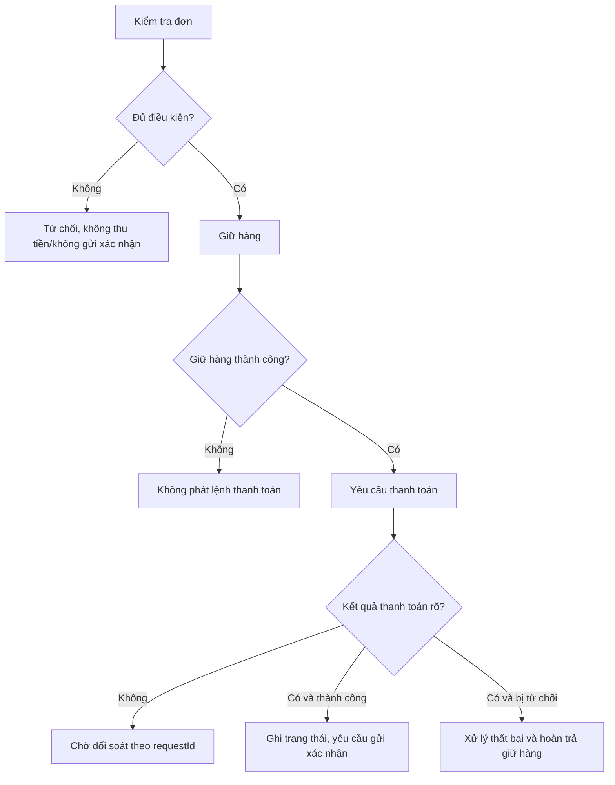

# Kiểm tra đồng thời, tài nguyên và tác dụng phụ

Một bộ kiểm thử có thể xác nhận “đặt hàng thành công” hàng trăm lần, nhưng hệ thống vẫn bán quá số lượng còn lại khi hai người cùng đặt. Một tác vụ ghi tệp trả kết quả đúng, nhưng quên đóng luồng và dần làm cạn tài nguyên. Một đơn hàng bị từ chối đúng như mong đợi, nhưng hệ thống đã gửi email xác nhận trước khi từ chối.

Ba tình huống này có điểm chung: chỉ kiểm tra **giá trị trả về** không đủ để kết luận phần mềm đáng tin cậy. Trong chương **Bằng chứng kiểm thử** của module **CODE_QUALITY_FUNDAMENTALS**, chúng ta học cách thu thập bằng chứng cho **đồng thời** (*concurrency*), **vòng đời tài nguyên** (*resource lifecycle*) và **tác dụng phụ** (*side effects*). Những bằng chứng này giúp đánh giá mã có đúng, dễ hiểu và an toàn khi thay đổi hay không.

## 1. Bằng chứng cần bao phủ nhiều hơn một kết quả

Hãy đặt một hợp đồng quan sát được trước khi thiết kế kiểm thử. Ví dụ, với thao tác đặt giữ một đơn vị hàng:

- Nếu hàng còn, thao tác thành công và tồn kho giảm **đúng một**.
- Nếu hết hàng, thao tác thất bại theo cách đã định nghĩa và tồn kho **không âm**.
- Với nhiều lời gọi đồng thời, tổng số lời gọi thành công **không vượt** tồn kho ban đầu.
- Tài nguyên phục vụ thao tác như kết nối cơ sở dữ liệu phải được quản lý, kể cả khi có ngoại lệ.
- Khi đặt hàng bị từ chối, không được phát sự kiện xác nhận đơn thành công.

Ta có thể chia bằng chứng theo các trục sau:

| Trục kiểm chứng | Đối tượng quan sát | Ví dụ assertion | Sai sót thường lọt qua nếu bỏ trục |
| --- | --- | --- | --- |
| **Kết quả** | Giá trị trả về hoặc lỗi được công bố | Số lần đặt giữ thành công bằng số suất có thể cấp | Mã trả sai quy tắc nghiệp vụ |
| **Trạng thái** | Dữ liệu và bất biến sau lời gọi | `remaining >= 0` và `successes + remaining == initial` | Lost update, cập nhật dở dang |
| **Đồng thời** | Nhiều tác nhân cùng truy cập trạng thái | Không có hai người cùng lấy một suất cuối | Race condition, check-then-act |
| **Tài nguyên** | Đối tượng có vòng đời phải kết thúc | Luồng được đóng cả khi ghi lỗi | Rò rỉ stream, connection, lock |
| **Tác dụng phụ** | Gọi ra môi trường ngoài hoặc thay đổi hệ thống khác | Đơn bị từ chối không phát email xác nhận | Gửi lệnh thanh toán, email, sự kiện nhầm |
| **Khả năng phục hồi** | Hành vi sau timeout, retry hoặc lỗi giữa chừng | Cùng mã yêu cầu không áp dụng tác dụng phụ lần hai | Xử lý trùng, kết quả không chắc chắn |

**Đơn vị kiểm thử** (*unit test*), **kiểm thử tích hợp** (*integration test*) và **kiểm thử toàn luồng** (*end-to-end test*) có thể thu thập những loại bằng chứng khác nhau. Không có một cấp kiểm thử nào thay thế được toàn bộ phần còn lại.

### 1.1. Bằng chứng phải gắn với một tuyên bố có phạm vi

Phát biểu “đã test concurrency” quá rộng. Cụ thể hơn:

> Với `Inventory` trong **một JVM**, 20 tác vụ cùng yêu cầu giữ một đơn vị khi tồn kho bắt đầu bằng 7; cả 20 lời gọi đều kết thúc, có đúng 7 lời gọi thành công và tồn kho còn 0 trong lần chạy được quan sát.

Tuyên bố trên nêu được **điều kiện**, **phạm vi**, **đại lượng cần quan sát** và **kết quả mong đợi**. Nó vẫn chưa chứng minh hệ thống an toàn với mọi lịch xen kẽ, mọi số luồng hoặc nhiều JVM. Khi báo cáo, cần phân biệt **điều kiểm thử đã quan sát được** với **điều thiết kế và lập luận có thể bảo đảm**.

## 2. Kiểm thử đồng thời: tìm lỗi không xuất hiện ở đường tuần tự

**Race condition** xuất hiện khi kết quả phụ thuộc vào thời điểm hoặc thứ tự xen kẽ của các thao tác mà chương trình chưa kiểm soát đúng. Những lỗi phổ biến:

- **Check-then-act:** đọc “còn hàng” rồi mới trừ, trong lúc một tác nhân khác cũng đã đọc cùng giá trị.
- **Lost update:** hai luồng cùng đọc giá trị cũ, tính hai giá trị mới, một phép ghi ghi đè phép ghi còn lại.
- **Không nhìn thấy cập nhật:** một luồng không quan sát được thay đổi của luồng khác do thiếu quan hệ đồng bộ phù hợp.
- **Thao tác nhiều bước không nguyên tử:** cập nhật một trường trước rồi một trường sau, luồng khác quan sát trạng thái không hợp lệ.
- **Deadlock hoặc không tiến triển:** các tác vụ chờ lẫn nhau hoặc giữ khóa khiến thao tác không kết thúc.

### 2.1. Mã sai: kiểm tra rồi trừ không nguyên tử

Ví dụ Java sau **không an toàn dưới đồng thời**:

```java
// Ví dụ minh họa lỗi, không sử dụng trong sản phẩm.
final class UnsafeStock {
    private volatile int available;

    UnsafeStock(int available) {
        this.available = available;
    }

    boolean reserveOne() {
        if (available <= 0) {
            return false;
        }
        available--;
        return true;
    }
}
```

`volatile` giúp bảo đảm một số quy tắc về khả năng nhìn thấy bộ nhớ, nhưng **không làm phép kiểm tra rồi giảm trở thành một thao tác nguyên tử**. Với `available = 1`:

```text
Luồng A: đọc available == 1, vượt qua điều kiện.
Luồng B: đọc available == 1, vượt qua điều kiện.
Luồng A: giảm available, trả true.
Luồng B: giảm available, trả true.
```

Cả hai khách có thể nhận kết quả thành công dù chỉ có một suất. Tồn kho cuối cùng có thể bằng 0 hoặc -1 tùy cách xen kẽ của các phép đọc/ghi. Chỉ kiểm tra một luồng chạy đúng không đủ phát hiện loại lỗi này.

### 2.2. Thiết kế có thao tác nguyên tử trong một JVM

Với bài học này, sử dụng `AtomicInteger` và vòng lặp **compare-and-set (CAS)** để bảo vệ thao tác giảm tồn kho:

```java
package com.example.evidence;

import java.util.concurrent.atomic.AtomicInteger;

public final class Inventory {
    private final AtomicInteger available;

    public Inventory(int initialQuantity) {
        if (initialQuantity < 0) {
            throw new IllegalArgumentException("initialQuantity must be non-negative");
        }
        this.available = new AtomicInteger(initialQuantity);
    }

    public boolean reserveOne() {
        while (true) {
            int current = available.get();
            if (current == 0) {
                return false;
            }
            if (available.compareAndSet(current, current - 1)) {
                return true;
            }
            // Giá trị đã đổi: đọc lại và thử với trạng thái mới.
        }
    }

    public int remaining() {
        return available.get();
    }
}
```

**Hợp đồng:** `reserveOne()` trả `true` thì tồn kho giảm đúng một lần; nếu không còn suất, trả `false` và không làm tồn kho âm. CAS chỉ cập nhật khi giá trị vẫn bằng `current`, nên một tác vụ không thể dựa trên số lượng cũ đã bị tác vụ khác thay đổi.

Đây là **bảo đảm cục bộ** cho một `Inventory` trong một tiến trình JVM. Nếu nhiều máy chủ cùng truy cập tồn kho nằm trong cơ sở dữ liệu, cần bảo vệ tính nguyên tử **tại kho dữ liệu hoặc dịch vụ sở hữu tồn kho**, không dựa vào `AtomicInteger` của từng máy.

### 2.3. JUnit 5: tạo tranh chấp có kiểm soát

Một cách tăng khả năng quan sát lỗi đồng thời là cho nhiều tác vụ chuẩn bị trước, rồi cùng được phép bắt đầu. Dùng `CountDownLatch` thay vì `Thread.sleep(...)` để điều phối điểm khởi đầu:

```java
package com.example.evidence;

import static org.junit.jupiter.api.Assertions.assertEquals;
import static org.junit.jupiter.api.Assertions.assertTrue;
import static java.util.concurrent.TimeUnit.SECONDS;

import java.util.ArrayList;
import java.util.List;
import java.util.concurrent.CountDownLatch;
import java.util.concurrent.ExecutorService;
import java.util.concurrent.Executors;
import java.util.concurrent.Future;
import org.junit.jupiter.api.Test;

class InventoryTest {
    @Test
    void concurrentReservationsNeverExceedInitialStock() throws Exception {
        int workers = 20;
        int initialStock = 7;
        Inventory stock = new Inventory(initialStock);

        ExecutorService executor = Executors.newFixedThreadPool(workers);
        CountDownLatch ready = new CountDownLatch(workers);
        CountDownLatch start = new CountDownLatch(1);

        try {
            List<Future<Boolean>> futures = new ArrayList<>();
            for (int i = 0; i < workers; i++) {
                futures.add(executor.submit(() -> {
                    ready.countDown();
                    start.await();
                    return stock.reserveOne();
                }));
            }

            assertTrue(ready.await(10, SECONDS),
                    "All tasks should be ready");
            start.countDown();

            int successes = 0;
            for (Future<Boolean> result : futures) {
                if (result.get(10, SECONDS)) {
                    successes++;
                }
            }

            assertEquals(initialStock, successes);
            assertEquals(0, stock.remaining());
            assertEquals(initialStock,
                    successes + stock.remaining());
        } finally {
            // Nhả mọi tác vụ đang chờ ngay cả khi assertion thất bại.
            start.countDown();
            executor.shutdownNow();
            executor.awaitTermination(10, SECONDS);
        }
    }
}
```

**Điểm chính của bài kiểm thử:**

1. `ready` làm các tác vụ tới được điểm chờ trước khi `start` được mở. Điều này tăng cơ hội tranh chấp, nhưng **không bảo đảm tất cả lời gọi cùng chạy đúng một thời điểm**.
2. `Future.get(timeout)` giúp phát hiện tác vụ không hoàn tất trong thời gian thử nghiệm thay vì treo vô hạn. Timeout là **ngưỡng phát hiện vấn đề**, không chứng minh deadlock là nguyên nhân duy nhất.
3. Kiểm tra **cả số kết quả thành công lẫn tồn kho còn lại**. Chỉ kiểm tra `remaining >= 0` vẫn có thể bỏ sót lỗi hai khách được báo thành công trong khi số dư không âm vì lost update.
4. Khối `finally` giải phóng điểm chờ và dừng executor nếu có lỗi assertion hoặc timeout, tránh để tác vụ nền tồn tại sau kiểm thử.

Không nên dựa vào việc thử một lần thấy test xanh để kết luận “đã chứng minh không có race condition”. Có thể chạy lặp lại nhiều lần, thay đổi số tác vụ, thêm kiểm thử ở tầng cơ sở dữ liệu và kết hợp phân tích về tính nguyên tử. **Kiểm thử đồng thời lấy mẫu một số lịch xen kẽ**, không duyệt hết mọi lịch có thể có.

### 2.4. Thiết kế các ca đồng thời theo bất biến

| Tình huống | Bất biến/hợp đồng cần xác nhận | Lỗi có thể bộc lộ |
| --- | --- | --- |
| Hai yêu cầu cùng đặt một suất cuối | Tối đa một thành công | Check-then-act và lost update |
| Nhiều yêu cầu cùng cập nhật số dư | Tổng biến động đúng theo những lời gọi thành công | Ghi đè hoặc mất cập nhật |
| Một luồng đọc khi luồng khác cập nhật nhiều trường | Người đọc không thấy trạng thái trung gian bị cấm | Không đồng bộ, thao tác nhiều bước không nguyên tử |
| Hai yêu cầu cùng một mã idempotency | Chỉ thực hiện tác dụng phụ nghiệp vụ một lần | Kiểm tra trùng không nguyên tử |
| Hai tác vụ lấy khóa theo thứ tự khác nhau | Kết thúc hoặc báo trạng thái chờ/timeout theo chính sách | Deadlock |
| Yêu cầu bị hủy giữa chừng | Không để lại tài nguyên hoặc trạng thái chưa xử lý theo hợp đồng | Thiếu cleanup, bỏ qua interruption |

Đặc biệt, test cần kiểm tra **kết quả bất biến toàn cục** chứ không chỉ đếm lời gọi tới các helper đồng bộ hóa. Một triển khai mới có thể thay `synchronized` bằng CAS hoặc transaction mà vẫn đáp ứng cùng hợp đồng.

## 3. Giới hạn bằng chứng đồng thời: từ bộ nhớ đến cơ sở dữ liệu

Tính nguyên tử của `AtomicInteger` không tự mở rộng sang hai bảng dữ liệu, nhiều JVM hoặc một chuỗi gọi HTTP.

Ví dụ, hai tiến trình cùng xử lý đơn đặt chỗ cuối:

```text
Tiến trình A: SELECT remaining = 1
Tiến trình B: SELECT remaining = 1
Tiến trình A: INSERT reservation
Tiến trình B: INSERT reservation
```

Nếu chỉ kiểm tra “còn chỗ” bằng Java rồi ghi trong hai thao tác rời rạc, có thể cấp hai chỗ. Một cách khắc phục là dùng **cập nhật có điều kiện** tại cơ sở dữ liệu và xác nhận số dòng được cập nhật, kết hợp giao dịch/ràng buộc dữ liệu phù hợp.

Ví dụ SQL mang tính ý tưởng:

```sql
-- Thực thi trong transaction phù hợp với thiết kế lưu trữ:
UPDATE course_capacity
SET remaining = remaining - 1
WHERE course_id = :courseId
  AND remaining > 0;

-- Chỉ tiếp tục tạo enrollment khi có đúng 1 dòng được cập nhật.
-- Khi lỗi tạo enrollment: rollback cả hai cập nhật cùng transaction.
-- Ràng buộc UNIQUE(course_id, student_id) bảo vệ đăng ký trùng.
```

Đây **không phải câu SQL độc lập đã đủ để triển khai**: cần xác định mức cô lập, giới hạn kiểu số, trùng yêu cầu, hành vi trên từng DBMS và việc tạo đăng ký nằm trong cùng giao dịch. Bài kiểm thử tích hợp cần cho thấy **hai yêu cầu cạnh tranh ở adapter thật** không vi phạm số chỗ và ràng buộc duy nhất.

Nếu hệ thống lưu trữ phân tán hoặc gồm nhiều dịch vụ, cần xem lại hợp đồng trạng thái cuối cùng, retry và đối soát. Không được suy ra “toàn luồng nguyên tử” từ việc một phương thức Java đã dùng khóa.

## 4. Kiểm tra tài nguyên: đóng đúng lúc, kể cả khi có lỗi

Tài nguyên như **file stream, database connection, socket, executor, lock hoặc giao dịch** có vòng đời cần quản lý. Lỗi rò rỉ có thể không xuất hiện ngay trong một unit test đơn lẻ: hệ thống vẫn trả kết quả đúng nhưng dần hết file descriptor, connection trong pool hoặc thread.

Một **hợp đồng quản lý tài nguyên** nên nêu:

- Ai **sở hữu** tài nguyên và có trách nhiệm đóng?
- Tài nguyên được **mở khi nào, đóng khi nào**, kể cả khi thao tác ném ngoại lệ?
- Tài nguyên có được **chuyển quyền sở hữu** sang bên khác không?
- Nếu đóng thất bại, lỗi được xử lý hoặc ghi nhận thế nào?
- Nếu tài nguyên được dùng đồng thời, cơ chế đồng bộ và giới hạn sử dụng là gì?

### 4.1. Dùng try-with-resources để diễn đạt vòng đời

Ví dụ một thành phần ghi nội dung kiểm toán vào `OutputStream` được tạo cho mỗi lời gọi:

```java
package com.example.evidence;

import java.io.IOException;
import java.io.OutputStream;
import java.nio.charset.StandardCharsets;
import java.util.Objects;
import java.util.function.Supplier;

public final class AuditWriter {
    private final Supplier<OutputStream> newStream;

    public AuditWriter(Supplier<OutputStream> newStream) {
        this.newStream = Objects.requireNonNull(newStream, "newStream");
    }

    public void write(String event) throws IOException {
        Objects.requireNonNull(event, "event");
        try (OutputStream stream =
                     Objects.requireNonNull(newStream.get(), "stream")) {
            stream.write(event.getBytes(StandardCharsets.UTF_8));
        }
    }
}
```

`try-with-resources` gọi `close()` khi rời khối, kể cả khi `write(...)` ném ngoại lệ. Ví dụ giả định **mỗi lời gọi sở hữu luồng mới**, không được đóng một luồng do nơi khác sở hữu hoặc một luồng còn được dùng chung.

Nếu thao tác ghi và thao tác đóng **đều** ném ngoại lệ, Java giữ ngoại lệ chính từ phần thân và gắn ngoại lệ đóng vào danh sách **suppressed exceptions**. Khi điều tra lỗi I/O, không nên bỏ qua thông tin suppressed.

### 4.2. Unit test kiểm tra giải phóng tài nguyên

Tệp `AuditWriterTest.java`, cùng package, dùng JUnit 5:

```java
package com.example.evidence;

import static org.junit.jupiter.api.Assertions.assertEquals;
import static org.junit.jupiter.api.Assertions.assertThrows;
import static org.junit.jupiter.api.Assertions.assertTrue;

import java.io.ByteArrayOutputStream;
import java.io.IOException;
import java.io.OutputStream;
import java.nio.charset.StandardCharsets;
import org.junit.jupiter.api.Test;

class AuditWriterTest {
    static final class TrackingStream extends ByteArrayOutputStream {
        boolean closed;

        @Override
        public void close() throws IOException {
            closed = true;
            super.close();
        }
    }

    static final class FailingStream extends OutputStream {
        boolean closed;

        @Override
        public void write(int value) throws IOException {
            throw new IOException("simulated write failure");
        }

        @Override
        public void close() {
            closed = true;
        }
    }

    @Test
    void writesExpectedBytesAndClosesStream() throws IOException {
        TrackingStream stream = new TrackingStream();
        AuditWriter writer = new AuditWriter(() -> stream);

        writer.write("ORDER_CONFIRMED");

        assertEquals("ORDER_CONFIRMED",
                stream.toString(StandardCharsets.UTF_8));
        assertTrue(stream.closed);
    }

    @Test
    void closesStreamEvenWhenWriteFails() {
        FailingStream stream = new FailingStream();
        AuditWriter writer = new AuditWriter(() -> stream);

        assertThrows(IOException.class,
                () -> writer.write("ORDER_CONFIRMED"));

        assertTrue(stream.closed);
    }
}
```

Hai ca kiểm tra **đường thành công** và **đường thất bại**, không chỉ kiểm tra chuỗi đã ghi. Chúng không mô phỏng đầy đủ file system, file descriptor hoặc lỗi đóng ngoài thực tế; đó là phần nên bổ sung bằng kiểm thử tích hợp khi mức độ rủi ro yêu cầu.

### 4.3. Những tài nguyên có cách quản lý khác nhau

| Tài nguyên | Cách bảo vệ trong mã | Bằng chứng kiểm thử hữu ích |
| --- | --- | --- |
| `InputStream` / `OutputStream` | `try-with-resources` khi phương thức sở hữu luồng | Đóng sau thành công và sau lỗi đọc/ghi |
| JDBC `Connection` / `Statement` / `ResultSet` | Quản lý rõ phạm vi, transaction và đóng/trả về pool | Không cạn connection pool; rollback/commit đúng |
| `ExecutorService` | `shutdown()`, chờ hoàn tất hoặc `shutdownNow()` theo hợp đồng | Test không để thread treo; tác vụ bị hủy có xử lý |
| `Lock` | `lock()` và `unlock()` trong `finally` | Không giữ khóa khi đoạn bảo vệ ném ngoại lệ |
| File tạm | Xóa khi không cần; xác định người chịu trách nhiệm cleanup | File tạm không còn sau lỗi theo chính sách |
| Giao dịch | Commit đúng trường hợp; rollback khi cần | Không commit cập nhật dở dang khi lỗi |

Ví dụ dùng lock:

```java
lock.lock();
try {
    updateSharedState();
} finally {
    lock.unlock();
}
```

Đoạn trên giả định `lock` là một `java.util.concurrent.locks.Lock` và `updateSharedState()` đã được định nghĩa. Điều đáng kiểm chứng là **mọi đường ra khỏi vùng bảo vệ đều nhả khóa**, không phải tên helper được dùng.

## 5. Kiểm tra tác dụng phụ: quan sát điều đã xảy ra bên ngoài

**Side effect** là thay đổi ngoài giá trị trả về thuần: lưu dữ liệu, gọi cổng thanh toán, gửi email, phát sự kiện, ghi tệp, cập nhật cache hoặc tạo tác vụ nền. Nhiều lỗi nghiêm trọng nằm ở **số lần**, **thứ tự** và **điều kiện** phát sinh tác dụng phụ.

Ví dụ hợp đồng xác nhận đơn:

> Chỉ khi đơn đã đủ điều kiện xác nhận, hệ thống mới yêu cầu gửi thông báo xác nhận. Nếu đơn bị từ chối, không gửi thông báo thành công. Khi thao tác gửi thất bại, cách thử lại và trạng thái đơn được xác định riêng.

Không cần kiểm tra từng helper nội bộ để biết hợp đồng này đúng hay sai. Ta cần **quan sát thông điệp tại ranh giới gửi**.

### 5.1. Dùng recording fake cho ranh giới bên ngoài

Tệp `ConfirmationService.java`:

```java
package com.example.evidence;

import java.util.Objects;

public final class ConfirmationService {
    public interface NotificationPort {
        void sendConfirmation(String orderId);
    }

    private final NotificationPort notifications;

    public ConfirmationService(NotificationPort notifications) {
        this.notifications = Objects.requireNonNull(
                notifications, "notifications");
    }

    public boolean confirm(String orderId, boolean eligible) {
        if (orderId == null || orderId.isBlank()) {
            throw new IllegalArgumentException("orderId must not be blank");
        }
        if (!eligible) {
            return false;
        }

        notifications.sendConfirmation(orderId);
        return true;
    }
}
```

Tệp `ConfirmationServiceTest.java`:

```java
package com.example.evidence;

import static org.junit.jupiter.api.Assertions.assertEquals;
import static org.junit.jupiter.api.Assertions.assertFalse;
import static org.junit.jupiter.api.Assertions.assertThrows;
import static org.junit.jupiter.api.Assertions.assertTrue;

import java.util.ArrayList;
import java.util.List;
import org.junit.jupiter.api.Test;

class ConfirmationServiceTest {
    @Test
    void rejectedOrderDoesNotSendConfirmation() {
        List<String> sent = new ArrayList<>();
        ConfirmationService service = new ConfirmationService(sent::add);

        assertFalse(service.confirm("ORDER-1", false));
        assertEquals(List.of(), sent);
    }

    @Test
    void eligibleOrderSendsOneConfirmationRequest() {
        List<String> sent = new ArrayList<>();
        ConfirmationService service = new ConfirmationService(sent::add);

        assertTrue(service.confirm("ORDER-2", true));
        assertEquals(List.of("ORDER-2"), sent);
    }

    @Test
    void invalidOrderIdDoesNotSendAnything() {
        List<String> sent = new ArrayList<>();
        ConfirmationService service = new ConfirmationService(sent::add);

        assertThrows(IllegalArgumentException.class,
                () -> service.confirm(" ", true));
        assertEquals(List.of(), sent);
    }
}
```

Kiểm thử xác nhận **tác dụng phụ ở ranh giới được định nghĩa**: đúng nội dung, đúng điều kiện và đúng số yêu cầu gửi **cho mỗi lời gọi minh họa**. Nó không chứng minh email đã được giao đến hộp thư người nhận; port chỉ thể hiện thao tác yêu cầu gửi.

**Giới hạn có chủ ý:** `ConfirmationService` không chứa trạng thái lưu trữ hay idempotency. Nếu gọi `confirm("ORDER-2", true)` hai lần, nó có thể gửi hai yêu cầu. Việc bảo đảm “một thông báo trên toàn bộ vòng đời đơn hàng”, xử lý timeout hoặc việc gửi thật là **hợp đồng bổ sung** cần cơ chế ghi nhận bền vững và kiểm thử ở cấp cao hơn.

### 5.2. Kiểm tra thứ tự chỉ khi thứ tự là một phần của hợp đồng

Trong quy trình đặt hàng:



**Thứ tự giữ hàng trước thanh toán** có thể là hợp đồng quan trọng của luồng này. Ngược lại, thứ tự gọi hai hàm tính tiền thuần độc lập có thể không ảnh hưởng hành vi. Chỉ kiểm tra trình tự tương tác khi thay đổi thứ tự **có ý nghĩa nghiệp vụ hoặc an toàn**.

### 5.3. Kiểm tra tác dụng phụ khi thất bại ở giữa

| Điểm thất bại | Bằng chứng cần tìm | Điều không nên suy đoán |
| --- | --- | --- |
| Input không hợp lệ | Không ghi DB, không gửi sự kiện | “Ném lỗi là đủ để đảm bảo mọi side effect chưa xảy ra” |
| DB ghi một phần rồi lỗi | Các cập nhật trong transaction được rollback theo hợp đồng | “Rollback DB cũng thu hồi được email” |
| Cổng thanh toán timeout | Có mã yêu cầu để đối soát trạng thái | “Timeout chắc chắn nghĩa là chưa trừ tiền” |
| Sự kiện đã publish nhưng ack bị mất | Consumer có cơ chế xử lý trùng theo ID | “Publish lại không bao giờ làm tác dụng phụ lặp” |
| Email thất bại sau khi đơn đã xác nhận | Cơ chế gửi lại và trạng thái đơn được quy định | “Mọi lỗi gửi email phải hủy đơn” |

Với các tác dụng phụ ngoài một giao dịch cục bộ, có thể cân nhắc **transactional outbox**, **idempotency key** và quá trình **đối soát**. Nhưng tên kỹ thuật không thay thế bằng chứng: cần kiểm thử việc ghi nhận sự kiện, gửi lại, xử lý trùng và hồi phục sau crash.

## 6. Thiết kế test không phụ thuộc vào may rủi thời gian

Kiểm thử đồng thời, tài nguyên và tác dụng phụ dễ bị **flaky**: lúc xanh, lúc đỏ vì thời điểm chạy, máy CI hoặc dịch vụ ngoài. Cách cải thiện là **kiểm soát các điểm không xác định** mà không làm mất hành vi đang kiểm thử.

| Nguồn bất định | Cách kiểm soát phù hợp | Lưu ý |
| --- | --- | --- |
| Nhiều luồng xuất phát lệch nhau | `CountDownLatch`, barrier và executor được cấu hình | Chỉ tăng mức tranh chấp, không duyệt mọi lịch xen kẽ |
| Thời gian hiện tại | Inject `Clock` hoặc đồng hồ giả | Chỉ dùng đồng hồ thật khi chính nó là đối tượng kiểm thử |
| Sự kiện bất đồng bộ | Chờ một điều kiện/sự kiện có giới hạn thời gian | Tránh `Thread.sleep` làm “đồng bộ hóa” |
| Dịch vụ bên ngoài | Stub/fake cho unit, môi trường thử nghiệm cho integration | Fake không thay thế kiểm tra giao thức thật |
| Lỗi ngẫu nhiên | Failure injection tại điểm xác định | Cần kiểm tra cả phản hồi và trạng thái còn lại |
| Số lượng tác vụ lớn | Giới hạn worker, timeout, cleanup trong `finally` | Tránh test tự tạo cạn tài nguyên CI |

Không nên giải quyết flaky test bằng cách tăng `sleep` lên vài giây. Giải pháp đó chỉ làm test chậm hơn và vẫn có thể sai dưới máy yếu hơn. Tốt hơn là đợi **một sự kiện hoặc điều kiện có thể quan sát**, kèm timeout để phát hiện việc không tiến triển.

### 6.1. Test chứng minh được gì và không chứng minh được gì?

Một test với `CountDownLatch` chứng minh **những lần chạy được quan sát** không vi phạm assertion. Lập luận về CAS giải thích vì sao nhiều luồng trên cùng đối tượng không thể cùng giảm một số lượng đã cũ. Kiểm thử tích hợp với DB kiểm tra giả định về kho dữ liệu thực. Ba loại bằng chứng **bổ sung cho nhau**, không nên biến một kết quả xanh thành tuyên bố tuyệt đối.

Khi một test đồng thời thất bại, nên lưu được ít nhất: số tác vụ, lượng hàng ban đầu, số thành công, trạng thái còn lại, ngoại lệ và điều kiện thời gian. Với hệ thống nhiều dịch vụ, thêm correlation ID, request ID và dấu vết theo từng bước.

## 7. Ma trận kiểm chứng: hành vi × môi trường × điểm lỗi

Để tránh thiếu đường kiểm thử, lập một ma trận nhỏ cho chức năng quan trọng:

| Trục hành vi | Unit test | Integration test | End-to-end hoặc failure test |
| --- | --- | --- | --- |
| **Thành công tuần tự** | Giá trị trả về và bất biến | Ghi/đọc dữ liệu thật | Luồng người dùng hoàn tất |
| **Đồng thời** | Nhiều tác vụ trên trạng thái in-memory | Hai giao dịch cạnh tranh tại DB thật | Nhiều yêu cầu từ nhiều node |
| **Lỗi trước cập nhật** | Không đổi trạng thái, không gọi port | Không có dữ liệu thừa | Client nhận kết quả phù hợp |
| **Lỗi giữa cập nhật** | Fake ném lỗi để kiểm tra đường cleanup | Rollback/constraint tại DB | Recovery, compensation khi có dịch vụ ngoài |
| **Rò rỉ tài nguyên** | Stream/lock/executor được đóng hoặc nhả | Pool không bị cạn sau nhiều lần lỗi | Theo dõi resource metric dưới tải |
| **Tác dụng phụ lặp** | Recording fake kiểm tra số lệnh | Ràng buộc unique/idempotency | Retry sau mất phản hồi không nhân đôi kết quả |

Không phải mỗi ô đều cần một test độc lập. Có thể chọn các tình huống rủi ro cao và nhóm assertion hợp lý, nhưng nên chỉ rõ **ô nào chưa có bằng chứng**. Đặc biệt, unit test với fake không chứng minh transaction thật, và integration test JDBC không chứng minh đã gửi email tới người nhận.

### 7.1. Ví dụ mô tả một bằng chứng đủ để review

```text
Chức năng: reserveOne()
Hợp đồng: Không cấp vượt quá initialStock;
          mỗi thành công giảm một; tồn kho không âm.

Thiết lập: Inventory(7), 20 tác vụ cùng chờ điểm start.
Quan sát cần có: 7 true, 13 false, remaining=0,
                 tất cả tác vụ hoàn tất trong timeout.
Phạm vi: Một đối tượng Inventory trong một JVM.
Giới hạn: Không xác nhận nhiều node hoặc database.

Kiểm chứng bổ sung cần thiết nếu đưa vào sản xuất:
- Tính nguyên tử/ràng buộc của adapter database.
- Retry/idempotency của API và nhiều request cạnh tranh.
- Quan sát trạng thái và log khi giao dịch thất bại.
```

Mẫu này là **thiết kế kiểm thử và điều kiện mong đợi**, không phải báo cáo rằng mã minh họa đã được chạy. Một báo cáo kết quả thật cần ghi phiên bản mã, môi trường, lệnh chạy, lần chạy, kết quả và đường dẫn log phù hợp.

## 8. Những ngộ nhận thường gặp

| Ngộ nhận | Vì sao không đủ | Cách kiểm chứng tốt hơn |
| --- | --- | --- |
| “Test đơn luồng xanh, nên nhiều luồng cũng an toàn.” | Các lần đọc/ghi có thể xen kẽ | Kiểm tra các thao tác cạnh tranh và bất biến |
| “`volatile` làm mọi thao tác nguyên tử.” | Check-then-act và `++` vẫn gồm nhiều bước | Dùng đồng bộ hóa/CAS/transaction theo phạm vi |
| “Chạy 100 lần không lỗi nghĩa là hết race.” | Không thể duyệt mọi lịch xen kẽ bằng số lần cố định | Kết hợp thiết kế đúng, lập luận và test cạnh tranh |
| “Có `close()` trên đường thành công là đủ.” | Đường exception có thể bỏ qua cleanup | Kiểm tra đóng khi thành công và thất bại |
| “Kiểm tra return value là đủ.” | Side effect có thể đã xảy ra sai | Kiểm tra trạng thái và lệnh ra biên |
| “Mock email gửi thành công chứng minh người dùng đã nhận.” | Fake chỉ quan sát lệnh gửi | Kiểm thử tích hợp và theo dõi trạng thái giao hàng phù hợp |
| “Timeout là thất bại chắc chắn.” | Dịch vụ có thể đã commit | Đối soát bằng ID trước khi thử lại |
| “Rollback một transaction hoàn tác tất cả tác dụng phụ.” | Gọi HTTP, email ở ngoài transaction | Định nghĩa phạm vi và cơ chế phục hồi |
| “Càng nhiều thread càng tốt.” | Test có thể trở nên chậm và thiếu ổn định, mất mục tiêu | Chọn số luồng đủ tạo cạnh tranh, thiết kế điểm đồng bộ |

## 9. Bài tập vận dụng

**Bối cảnh:** API đăng ký một lớp học có giới hạn 30 chỗ. Một học viên chỉ được đăng ký một lần. Hệ thống dùng cơ sở dữ liệu, sau khi tạo đăng ký sẽ phát sự kiện `EnrollmentCreated` để gửi email xác nhận.

Các sự cố cần chuẩn bị: hai người tranh suất cuối, một người nhấn đăng ký hai lần, kết nối DB mất lúc commit, publisher thất bại sau commit, worker email xử lý lại cùng sự kiện, và application shutdown khi còn request.

Hãy tự hoàn thành:

1. **Đồng thời:** viết ít nhất ba bất biến về sức chứa, đăng ký duy nhất và số lượt thành công. Đề xuất một test hai người tranh suất cuối. Vì sao chỉ dùng `synchronized` trong một instance service chưa đủ khi triển khai nhiều node?
2. **Tài nguyên:** liệt kê chủ sở hữu và điểm cleanup của connection/transaction, executor xử lý sự kiện và socket tới broker. Viết một ca failure injection xác nhận không rò rỉ connection khi transaction ném ngoại lệ.
3. **Tác dụng phụ:** lập bảng kết quả khi đăng ký thành công, hết chỗ, input sai, timeout sau commit, publish thất bại và sự kiện bị gửi lặp. Với mỗi trường hợp, nêu phải kiểm tra **có/không có** tác dụng phụ nào.
4. **Idempotency:** chọn nơi lưu request ID và trạng thái xử lý, cách xử lý hai yêu cầu trùng đến cùng lúc, cách đối soát khi chưa biết commit thành công hay chưa.
5. **Phân tầng kiểm thử:** phân loại test nào có thể dùng fake và test nào bắt buộc dùng database/broker thật hoặc môi trường tích hợp. Nêu bằng chứng còn thiếu sau khi tất cả unit test xanh.

**Hướng tự đối chiếu:** ràng buộc duy nhất cho `(course_id, student_id)` và cập nhật số chỗ có điều kiện trong transaction thích hợp giúp bảo vệ dữ liệu dưới cạnh tranh; cần kiểm thử tích hợp các ràng buộc đó. Kết nối và transaction phải được cleanup cả khi lỗi. Nếu DB commit nhưng publish sự kiện lỗi, một cơ chế như transactional outbox có thể ghi ý định phát sự kiện cùng transaction và cho phép retry; consumer cần xử lý trùng phù hợp. Sau timeout, client tra trạng thái theo mã yêu cầu, không tự tạo một đăng ký mới với mã mới.

## 10. Ghi nhớ

- **Kiểm tra đồng thời:** dùng điều phối có kiểm soát và đo bất biến sau nhiều lời gọi, không chỉ chạy cùng mã nhiều lần rồi kỳ vọng bắt được race.
- **Kiểm tra tài nguyên:** quan sát vòng đời và trách nhiệm cleanup ở cả đường thành công lẫn đường lỗi.
- **Kiểm tra tác dụng phụ:** xác nhận đúng hành động, đúng số lần và đúng điều kiện tại ranh giới bên ngoài.
- **Chọn cấp kiểm thử phù hợp:** logic in-memory, database thật, dịch vụ ngoài và quy trình phục hồi cần những loại bằng chứng khác nhau.
- **Nói đúng phạm vi bằng chứng:** test xanh là quan sát có giá trị, không phải bằng chứng tuyệt đối rằng mọi lịch xen kẽ và mọi hạ tầng sẽ an toàn.

Một chức năng đáng tin cậy không chỉ **trả đúng kết quả khi mọi thứ thuận lợi**. Nó còn duy trì được những điều đã hứa khi nhiều tác nhân cùng hành động, khi tài nguyên gặp lỗi và khi tác dụng phụ xảy ra ở một hệ thống khác. Đó là những gì bằng chứng kiểm thử cần chủ động làm rõ.
