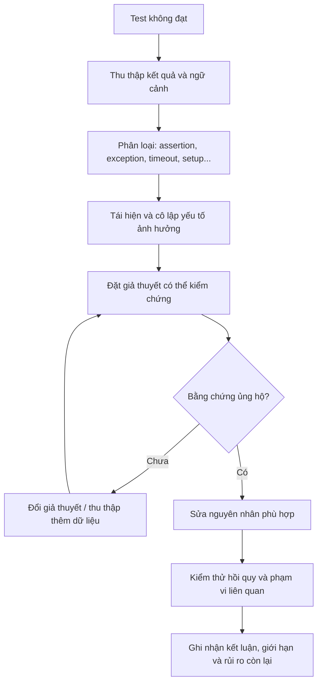

# Đọc kết quả thất bại như bằng chứng cần giải thích

Trong module `CODE_QUALITY_FUNDAMENTALS`, mục tiêu là hiểu những thuộc tính làm mã nguồn **đáng tin cậy, dễ hiểu và dễ thay đổi**. Ở chương **Bằng chứng kiểm thử**, kiểm thử không chỉ là một bước chạy để nhận dấu xanh hay đỏ. Mỗi kết quả là một phần thông tin về **một hành vi đã được quan sát trong những điều kiện cụ thể**. Khi bài kiểm thử thất bại, thông tin đó cần được giải thích trước khi kết luận mã sản phẩm có lỗi.

Ví dụ, màn hình CI hiển thị:

```text
OrderPricingTest.appliesDiscountAtThreshold FAILED
org.opentest4j.AssertionFailedError:
expected: <450000> but was: <500000>
    at ... OrderPricingTest.java:24
```

Từ thông báo này ta biết **một kỳ vọng trong bài kiểm thử không khớp với giá trị thu được**. Ta *chưa* biết nguyên nhân chắc chắn: quy tắc chiết khấu được triển khai sai, kỳ vọng đã lỗi thời, dữ liệu đầu vào không đúng, test chạy với cấu hình khác hay có lỗi ở phụ thuộc bên ngoài. Nhiệm vụ của người đọc kết quả thất bại là biến dấu hiệu ban đầu thành **giả thuyết có thể kiểm chứng**, tìm bằng chứng hỗ trợ hoặc bác bỏ từng giả thuyết, rồi sửa đúng nguyên nhân.

Sau bài học, người học có thể:

- Phân biệt **quan sát**, **kỳ vọng**, **kết luận** và **giả thuyết nguyên nhân**.
- Đọc tên test, assertion, stack trace, dữ liệu đầu vào, log và ngữ cảnh CI một cách có hệ thống.
- Phân loại thất bại do hành vi sản phẩm, hợp đồng kiểm thử, môi trường, dữ liệu, thứ tự chạy và đồng thời.
- Xây dựng cách tái hiện tối thiểu, xác định phạm vi ảnh hưởng và kiểm chứng bản sửa.
- Tránh các phản ứng làm mất bằng chứng như bỏ qua test, nới assertion hoặc retry vô hạn.
- Viết báo cáo thất bại đủ thông tin để người khác có thể xác minh.

## 1. Kết quả kiểm thử là bằng chứng có phạm vi

Một bài kiểm thử thường gồm các thành phần sau:

| Thành phần | Câu hỏi cần trả lời | Ví dụ |
| --- | --- | --- |
| **Hệ thống được kiểm tra (SUT)** | Thành phần nào đang được đánh giá? | Hàm `discountedTotal` trong dịch vụ tính tiền |
| **Điều kiện và đầu vào** | Test đã đặt hệ thống vào trạng thái nào? | Đơn 500.000 đồng, loại khách `REGULAR` |
| **Thao tác** | Hành vi nào đã được kích hoạt? | Gọi tính tổng tiền sau ưu đãi |
| **Oracle/kỳ vọng** | Ai hoặc điều gì quyết định kết quả đúng? | Quy tắc “giảm 10% từ 500.000 đồng trở lên” |
| **Quan sát thực tế** | Kết quả hoặc lỗi nào thật sự xảy ra? | Nhận 500.000 đồng thay vì 450.000 đồng |
| **Ngữ cảnh chạy** | Điều kiện nào có thể ảnh hưởng quan sát? | JDK, cấu hình, cơ sở dữ liệu, múi giờ, phiên bản mã |

Từ đó cần tách ba mệnh đề:

1. **Quan sát:** “Với đầu vào X, test `appliesDiscountAtThreshold` nhận 500.000 đồng”.
2. **Kỳ vọng:** “Theo quy tắc đã được xác nhận, giá trị phải là 450.000 đồng”.
3. **Giả thuyết:** “Có thể điều kiện đang dùng `>` thay cho `>=`”.

Chỉ mệnh đề thứ ba là giả thuyết về **nguyên nhân**. Nếu chưa xem mã hoặc chưa thử các giá trị biên, không nên báo nguyên nhân như một sự thật đã chứng minh.

### Khi test xanh, nó cũng chỉ chứng minh điều đã kiểm tra

Một test pass có nghĩa các assertion của test đã thỏa trong lần chạy đó. Nó **không** chứng minh mọi đầu vào, mọi lịch xen kẽ hoặc mọi môi trường đều đúng. Tương tự, một test fail không tự động chứng minh sản phẩm sai: test có thể đặt kỳ vọng sai, chưa được cập nhật sau một thay đổi yêu cầu hợp lệ, hoặc dựa vào môi trường thiếu ổn định.

Do đó, đọc kết quả phải đi cùng **mô tả phạm vi của bằng chứng**. “Bộ test xanh” là tín hiệu tốt nhưng chưa thay thế được kiểm tra tính phù hợp của ca thử; “một test đỏ” là tín hiệu cần điều tra, không phải phán quyết về toàn bộ hệ thống.

## 2. Phân biệt các trạng thái và dạng thất bại

Không nên gom tất cả kết quả không xanh vào một nhóm:

| Trạng thái/hiện tượng | Điều thực sự biết | Bước tiếp theo có ích |
| --- | --- | --- |
| **Assertion failure** | Giá trị quan sát không thỏa điều test khẳng định | Kiểm tra kỳ vọng, đầu vào, hành vi SUT, cách tính |
| **Exception trước assertion** | Test không đi tới bước so sánh hoặc một thao tác ném lỗi | Xem loại exception, stack trace, điều kiện tạo lỗi |
| **Timeout** | Tác vụ không hoàn tất trong giới hạn đã cấu hình | Xem thao tác đang chờ gì, thời gian, khóa, mạng, mức tải |
| **Test bị skip/disabled** | Hành vi thường không được kiểm chứng trong lần chạy này | Xem lý do loại bỏ và phạm vi cần khôi phục kiểm chứng |
| **Compilation/setup failure** | Mã hoặc bộ kiểm thử chưa chạy tới giai đoạn thực thi dự kiến | Xử lý lỗi build, khởi tạo dữ liệu hoặc dependency trước |
| **Flaky/intermittent** | Cùng test có thể cho kết quả khác nhau khi không có thay đổi có chủ đích | Điều tra thời gian, thứ tự test, dữ liệu chia sẻ, đồng thời |
| **Quá trình test bị hủy hoặc CI agent mất kết nối** | Chưa chắc test đã có kết luận thực thi | Kiểm tra log runner, trạng thái môi trường, lệnh đã chạy |

Các khái niệm “failure” và “error” đôi khi được công cụ trình bày khác nhau. Chẳng hạn, một framework có thể nhóm assertion thất bại và exception không mong muốn dưới cùng nhãn `FAILED`. Hãy dựa vào **nguyên nhân cụ thể trong trace**, không chỉ nhãn màu trên dashboard.

### Thất bại của assertion khác với nguyên nhân gốc

Lỗi như:

```text
expected: <PAID> but was: <PENDING>
```

có thể bắt nguồn từ việc trạng thái chưa được cập nhật, nhưng cũng có thể do test **đọc quá sớm** khi tác vụ xử lý bất đồng bộ chưa hoàn thành. Nếu chỉ sửa assertion thành `assertNotEquals(FAILED, status)` thì test dễ xanh trở lại nhưng mất khả năng kiểm tra rằng đơn thật sự đã thanh toán.

Nguyên tắc quan trọng: **không làm yếu kỳ vọng chỉ để che đi bằng chứng chưa được giải thích**.

## 3. Đọc một báo cáo thất bại theo thứ tự

Một báo cáo test tốt thường có nhiều tín hiệu hơn dòng thông báo đầu tiên. Có thể đọc theo trình tự sau.

### Bước 1 — Xác định chính xác test, bản mã và phạm vi chạy

Ghi lại tên suite/test, commit hoặc phiên bản đang chạy, hệ điều hành/JDK, cấu hình profile, tập dữ liệu, cách gọi test và thời điểm xuất hiện. Xem thất bại xảy ra ở **test đơn lẻ**, **một nhóm test**, hay **cả pipeline**.

Ví dụ: “`OrderPricingTest.appliesDiscountAtThreshold` fail tại commit A khi chạy trên JDK 21, nhưng pass ở commit trước” là một gợi ý điều tra phạm vi thay đổi; nó chưa chứng minh commit A là nguyên nhân duy nhất. Cấu hình CI, thư viện hoặc dữ liệu test có thể đã thay đổi cùng lúc.

### Bước 2 — Đọc thông báo assertion hoặc exception đầu tiên có ý nghĩa

Với assertion, đọc đủ:

- **Expected:** kỳ vọng từ test hoặc hợp đồng.
- **Actual:** quan sát do SUT trả về.
- **Sai khác:** đơn vị, kiểu, độ chính xác, giá trị biên, thứ tự phần tử hay trạng thái?

Với exception, cần xem cả **loại**, **message** và chuỗi **caused by**. Một lỗi `CompletionException` hoặc `ExecutionException` có thể chỉ bao lỗi gốc bên trong; dừng ở wrapper sẽ bỏ sót nguyên nhân.

### Bước 3 — Dùng stack trace để tìm vị trí quan sát, không mặc định đó là nơi gây lỗi

Stack trace thường chỉ tới dòng assertion trong test, nơi lỗi được *phát hiện*. Điều đó **không** nhất thiết là vị trí mã sản phẩm phát sinh sai. Với exception, khung gọi gần mã ứng dụng hoặc một `Caused by` thường giúp khoanh vùng hơn.

```text
org.opentest4j.AssertionFailedError:
  expected: <450000> but was: <500000>
    at ... Assertions.assertEquals(...)
    at ... OrderPricingTest.appliesDiscountAtThreshold(OrderPricingTest.java:24)
```

Đọc trace cùng dữ liệu test, rồi theo lời gọi đến quy tắc tính giá. Tránh kết luận “sửa dòng 24” chỉ vì trace trỏ tới dòng kiểm thử đó.

### Bước 4 — Xem setup, phụ thuộc và sự kiện trước khi thất bại

Kiểm tra dữ liệu được dựng trong `@BeforeEach` hoặc fixture, mock/stub trả gì, đồng hồ và random nào đang được sử dụng, DB có được reset, transaction có commit hay rollback chưa, các tác vụ bất đồng bộ đã kết thúc chưa.

Với log, ưu tiên dòng liên quan cùng một **mã yêu cầu, mã giao dịch hoặc trace ID**. Log “HTTP 200” chỉ chứng minh phản hồi có mã thành công theo giao thức, không bảo đảm nội dung nghiệp vụ đúng. Nhiều lỗi đòi ghép điều đã gửi, điều đã nhận và trạng thái đã lưu.

### Bước 5 — Xác định mức chắc chắn và ghi nhận khoảng trống

Nếu đã xác minh điều kiện sai bằng cách kiểm tra mã và thử giá trị biên, có thể báo “đã xác định nguyên nhân”. Nếu mới thấy sự khác nhau giữa expected và actual, nên báo “nghi ngờ” kèm kiểm tra tiếp theo. Những gì không có trong log hoặc không được test đo không nên được suy diễn thành đã xảy ra.



Đây là một chu trình điều tra, không phải yêu cầu luôn phải trải qua tất cả các bước với mọi lỗi nhỏ. Khi lỗi rất rõ và có kiểm thử trực tiếp, việc xử lý có thể nhanh; khi lỗi không tái hiện hoặc liên quan nhiều dịch vụ, cần nhiều vòng chứng cứ hơn.

## 4. Ví dụ Java: từ assertion thất bại đến nguyên nhân

Giả sử yêu cầu đã được xác nhận của cửa hàng là: **đơn hàng có tổng trước giảm giá từ 500.000 đồng trở lên được giảm 10%; đơn dưới ngưỡng không giảm; số tiền có đơn vị đồng và không có phần lẻ**.

### 4.1. Mã có lỗi ở giá trị biên

```java
import java.math.BigDecimal;
import java.math.RoundingMode;

final class OrderPricing {
    private static final BigDecimal THRESHOLD =
            new BigDecimal("500000");
    private static final BigDecimal RATE =
            new BigDecimal("0.10");

    BigDecimal discountedTotal(BigDecimal subtotal) {
        if (subtotal == null || subtotal.signum() < 0
                || subtotal.stripTrailingZeros().scale() > 0) {
            throw new IllegalArgumentException("Invalid subtotal");
        }

        // Lỗi: trường hợp đúng ngưỡng 500000 chưa được giảm.
        if (subtotal.compareTo(THRESHOLD) > 0) {
            BigDecimal discount = subtotal.multiply(RATE)
                    .setScale(0, RoundingMode.DOWN);
            return subtotal.subtract(discount);
        }
        return subtotal;
    }
}
```

### 4.2. Test cho thấy một sai khác cụ thể

```java
import static org.junit.jupiter.api.Assertions.assertEquals;

import java.math.BigDecimal;
import org.junit.jupiter.api.Test;

class OrderPricingTest {
    private final OrderPricing pricing = new OrderPricing();

    @Test
    void appliesDiscountAtThreshold() {
        BigDecimal actual =
                pricing.discountedTotal(new BigDecimal("500000"));

        assertEquals(new BigDecimal("450000"), actual);
    }
}
```

Kết quả quan sát là **500.000**; test kỳ vọng **450.000**. Sau khi kiểm tra quy tắc nghiệp vụ, điều kiện `> 0` là một giả thuyết rất cụ thể. Ta có thể kiểm chứng giả thuyết bằng các ca:

| `subtotal` | Kết quả đúng theo yêu cầu | Kết quả từ mã lỗi | Điều rút ra |
| ---: | ---: | ---: | --- |
| 499.999 | 499.999 | 499.999 | Dưới ngưỡng vẫn đúng |
| 500.000 | 450.000 | 500.000 | Sai chính xác tại biên |
| 500.001 | 450.001 | 450.001 | Trên ngưỡng vẫn đúng với làm tròn xuống |

Trong trường hợp này, thay `subtotal.compareTo(THRESHOLD) > 0` bằng `subtotal.compareTo(THRESHOLD) >= 0` làm điều kiện bao gồm điểm biên. Nhưng **không nên chỉ dựa vào một test sau khi sửa**: phải giữ ca sát ngưỡng để bảo vệ cả phía dưới và phía trên. Đây là cách chuyển từ bằng chứng thất bại sang kiểm thử hồi quy hữu ích.

### 4.3. Khi kỳ vọng trong test mới là vấn đề

Giả sử tài liệu nghiệp vụ mới xác nhận: “Chỉ giảm khi đơn **lớn hơn** 500.000 đồng”. Khi đó mã ở mục 4.1 lại phù hợp với yêu cầu mới; test kỳ vọng 450.000 ở đúng ngưỡng là không chính xác. Cùng một output `expected: 450000, actual: 500000`, nhưng quyết định sửa **hoàn toàn khác**.

Đây là lý do phải kiểm tra *oracle* — nguồn xác định điều gì đúng — thay vì “sửa mã cho giống test” một cách máy móc. Nếu yêu cầu còn mâu thuẫn, hãy ghi lại khác biệt và xác nhận hợp đồng trước khi thay cả mã lẫn test.

### 4.4. Không đổi kết quả sai thành kết quả được chấp nhận

Các cách phản ứng dễ làm mất bằng chứng:

- Xóa `assertEquals` hoặc thay bằng `assertNotNull` chỉ vì kết quả thực không khớp.
- Chèn `Thread.sleep` vào một test tính toán thuần dù không có bằng chứng lỗi đến từ bất đồng bộ.
- Bắt mọi exception rồi bỏ qua để test luôn pass.
- Thay `expected` bằng `actual` mà chưa kiểm tra hợp đồng nghiệp vụ.

Chúng có thể biến pipeline thành màu xanh nhưng **không** chứng minh hệ thống đáp ứng yêu cầu. Thay vào đó, mỗi thay đổi kỳ vọng cần có lý do nghiệp vụ hoặc kỹ thuật được ghi nhận và kiểm chứng.

## 5. Phân biệt lỗi sản phẩm với lỗi kiểm thử và môi trường

Một lần test thất bại thường có nhiều nguyên nhân ứng viên. Hãy lập **giả thuyết**, tìm phép thử phân biệt và cập nhật mức tin cậy khi có thêm bằng chứng:

| Nhóm giả thuyết | Dấu hiệu thường gặp | Phép kiểm tra giúp phân biệt |
| --- | --- | --- |
| **Lỗi hành vi sản phẩm** | Expected và actual khác nhau dưới điều kiện đầu vào đã xác định | Đối chiếu đặc tả, thử biên, kiểm tra các bước tính và trạng thái |
| **Oracle/kỳ vọng sai** | Test cũ không phản ánh yêu cầu mới hoặc giả định sai về làm tròn, kiểu dữ liệu | Tra hợp đồng đã thống nhất, kiểm tra lịch sử thay đổi yêu cầu |
| **Thiết lập test sai** | Thiếu seed dữ liệu, mock trả khác dự kiến, fixture không dựng đủ trạng thái | Kiểm tra setup, ranh giới transaction, vòng đời đối tượng test |
| **Thứ tự chạy hoặc trạng thái chia sẻ** | Test pass khi chạy riêng, fail khi chạy cả suite hoặc chạy song song | Chạy lại có kiểm soát, đảo thứ tự, kiểm tra biến `static`/DB/cache dùng chung |
| **Phụ thuộc thời gian và ngẫu nhiên** | Lỗi chỉ xuất hiện tại giờ, ngày, múi giờ, hoặc một nhánh lựa chọn hiếm | Dùng `Clock.fixed`, nguồn random kiểm soát, ghi rõ seed khi thích hợp |
| **Môi trường hạ tầng** | CI fail nhưng máy cá nhân pass; timeout khi tài nguyên thiếu, dịch vụ tạm ngừng | So sánh JDK, OS, phiên bản dependency, cấu hình, CPU, log dịch vụ |
| **Lỗi bất đồng bộ/đồng thời** | Kết quả thay đổi theo lịch thực thi, số luồng hoặc tải | Xác định ranh giới chờ, bất biến, log tương quan, kiểm thử cạnh tranh |
| **Flaky test** | Nhiều lần chạy không đổi mã cho kết quả khác nhau | Ghi nhận tỷ lệ, điều kiện, sự khác biệt; điều tra các nguyên nhân phía trên |

Các nhóm này **không loại trừ lẫn nhau**: một test có thể không chờ đúng một tác vụ bất đồng bộ và lại chạy trên CI chậm hơn. Khi đó, máy CI không phải “nguyên nhân gốc” duy nhất; test đã thiếu một hợp đồng đồng bộ rõ ràng.

### Flaky là một biểu hiện, chưa phải chẩn đoán

**Flaky test** thường chỉ một bài kiểm thử có kết quả không ổn định khi mã và các đầu vào đã biết không thay đổi một cách có chủ đích. Việc test pass ở lần chạy lại là **bằng chứng về khả năng biến động**, không phải bằng chứng rằng thất bại đầu tiên vô nghĩa.

Ví dụ:

```java
@Test
void exportEventuallyFinishes() throws Exception {
    exportService.startExport();
    Thread.sleep(200);
    assertEquals("DONE", exportService.status());
}
```

Nếu tác vụ thường kết thúc dưới 200 ms nhưng đôi khi cần 250 ms, test fail ngẫu nhiên theo tải máy. Kỳ vọng “tác vụ phải hoàn thành trước 200 ms” có phải yêu cầu sản phẩm không? Nếu **không**, chờ cứng theo thời gian là cách quan sát sai. Bài kiểm thử nên dùng tín hiệu hoàn thành có thể chờ theo điều kiện, như `Future`/`CompletionStage`, latch hoặc một cơ chế polling có timeout tổng và điều kiện dừng rõ ràng. Giới hạn thời gian vẫn hữu ích để test không treo mãi, nhưng không nên biến chênh lệch tốc độ máy thành kết luận sai về nghiệp vụ.

Một hướng kiểm thử tốt hơn khi API cung cấp `CompletionStage`:

```java
import java.util.concurrent.CompletionStage;
import java.util.concurrent.TimeUnit;

CompletionStage<String> completed = exportService.startExportAsync();
String result = completed.toCompletableFuture()
        .get(5, TimeUnit.SECONDS);
assertEquals("DONE", result);
```

Trong ví dụ này, `startExportAsync()` là API minh họa; không phải phương thức tự có trong một thư viện chuẩn bất kỳ. Test chờ **kết quả thực sự hoàn tất**, với giới hạn 5 giây để phát hiện treo hoặc chậm vượt ngưỡng test. Nếu yêu cầu hiệu năng đặt một SLA nhỏ hơn, cần kiểm thử hiệu năng riêng và điều kiện đo đủ ổn định.

### Khi lỗi không tái hiện

“Không tái hiện trên máy tôi” là một kết quả cần ghi nhận, không phải lý do bỏ qua. Có thể thiếu:

- Dữ liệu, phiên bản schema hoặc trạng thái trước khi chạy.
- Seed ngẫu nhiên và múi giờ/đồng hồ tại thời điểm lỗi.
- Số worker, cấu hình chạy song song, lịch sắp thứ tự test hoặc tốc độ tài nguyên.
- Cấu hình kết nối/timeout, trạng thái dịch vụ phụ thuộc.
- Chuỗi sự kiện phân tán: ai ghi trước, dữ liệu nào đã commit và thông báo nào bị phát lại.

Khi chưa tái hiện, hãy giữ log và hiện vật kiểm thử cần thiết, cô lập yếu tố thay đổi, bổ sung khả năng quan sát, và báo mức độ chưa chắc chắn. Không nên tuyên bố “không có bug” chỉ vì một số lần chạy lại đã xanh.

## 6. Dùng bằng chứng để phân biệt lỗi đồng thời, thời gian và phụ thuộc ngoài

### 6.1. Phụ thuộc thời gian

Một bài kiểm thử dựa vào `LocalDate.now()` có thể chỉ fail vào ngày đầu tháng hoặc khi CI chạy theo UTC còn máy cá nhân theo múi giờ địa phương. Bằng chứng quan trọng là **mốc thời gian được dùng**, **múi giờ**, cách chuyển từ ngày địa phương sang `Instant` và điều kiện biên.

Ví dụ: quy tắc “hết hạn khi tới 00:00 ngày 1/2 ở múi giờ Việt Nam” không tương đương với “hết hạn khi tới 00:00 UTC ngày 1/2”. Khi xác minh, dùng `Clock.fixed` với `ZoneId` và ngày giờ được xác định rõ. Một test chỉ đặt `Clock.fixed` nhưng logic bên trong vẫn gọi `Instant.now()` trực tiếp vẫn chưa kiểm soát được phụ thuộc thời gian.

### 6.2. Ngẫu nhiên

Một lỗi “thỉnh thoảng chọn ưu đãi không hợp lệ” có thể xuất hiện khi generator trả tới một giá trị hiếm gặp, nhưng cũng có thể do dữ liệu danh sách thay đổi giữa lúc đếm phần tử và lúc truy cập. Ghi seed giúp tái hiện một số bài kiểm thử mô phỏng, còn **fake trả chỉ số chỉ định** giúp kiểm tra các ranh giới 0 và `size-1`. Seed cố định không tự chứng minh thuật toán luôn đúng hoặc nguồn ngẫu nhiên phù hợp về bảo mật.

### 6.3. Trạng thái dùng chung và thứ tự chạy

Một test thiết lập `System.setProperty(...)` nhưng không khôi phục giá trị cũ, hoặc sửa dữ liệu dùng chung trong DB mà không dọn sau test, có thể làm test khác fail khi chạy sau. Nếu chạy riêng test bị lỗi thì pass, hãy thử kiểm tra **test chạy trước đó đã thay đổi gì** thay vì chỉ sửa test bị phát hiện sai.

Test có thể fail vì mã sản phẩm thực sự dùng biến toàn cục không an toàn, hoặc do fixture kiểm thử chia sẻ trạng thái không đúng. Cần xác định **ai sở hữu trạng thái** và **ai có trách nhiệm cô lập test**.

### 6.4. Dịch vụ ngoài và timeout

Khi một bài test tích hợp fail với HTTP 503, đó là bằng chứng đã quan sát lỗi từ bên ngoài trong lần gọi cụ thể. Nó chưa chứng minh lỗi nằm ở ứng dụng gọi hay nhà cung cấp; cần xem request, thời điểm, cấu hình mạng, chính sách retry và phản hồi ở cả hai phía khi có quyền truy cập.

Với thao tác có tác dụng phụ, **timeout không chứng minh thao tác phía bên kia chưa thành công**. Trước khi chạy lại một lệnh tạo thanh toán hoặc ghi đơn, cần idempotency key hoặc cơ chế tra cứu kết quả đã commit để tránh tạo hành động trùng.

### 6.5. Một test fail dưới tải cao

Giả sử hai luồng cùng đặt sản phẩm cuối cùng. Test kỳ vọng có **đúng một** yêu cầu thành công nhưng quan sát **hai** kết quả thành công. Bằng chứng trực tiếp là bất biến bị vi phạm ở kịch bản được thử; phần nguyên nhân vẫn phải tìm: thao tác check-then-act, khóa sai phạm vi, hai JVM dùng khóa riêng, hay giao dịch DB không giữ được điều kiện cấp phát.

Để điều tra, ghi lại mã sản phẩm, số lượng ban đầu, các request ID, số lượng được xác nhận, số bản ghi sau commit và luồng/instance xử lý. Không chỉ ghi `available >= 0` vì giá trị cuối có thể bằng 0 dù đã chấp nhận quá số đơn vị hàng có thể cấp.

## 7. Tái hiện có kiểm soát và kiểm chứng giả thuyết

Một cách điều tra hiệu quả là thay đổi **một nhóm yếu tố mỗi lần** và quan sát xem kết quả có thay đổi theo giả thuyết hay không.

### Bước 1 — Tái hiện bằng điều kiện gốc

Ghi lệnh gọi test, đầu vào, cấu hình và phiên bản chính xác. Nếu lỗi chỉ xảy ra trong CI, cố gắng giữ lại log đủ chi tiết và thông tin môi trường. Một “lệnh tái hiện” phải thực sự chọn đúng test và dùng cấu hình tương đương; đừng giả định test chạy riêng sử dụng cùng cơ sở dữ liệu hoặc các service như lúc chạy trong suite.

### Bước 2 — Thu nhỏ trường hợp thất bại

Giảm dữ liệu và số bước tới mức tối thiểu nhưng **vẫn còn lỗi**. Ví dụ, từ 100 dòng đơn hàng rút xuống đúng hai dòng có điều kiện cạnh tranh; từ danh sách 1.000 phần tử rút xuống hai phần tử khiến code xử lý sai biên.

Thu nhỏ không có nghĩa bỏ qua những yếu tố quan trọng. Nếu race chỉ xảy ra khi có hai luồng, rút xuống một luồng sẽ làm mất chính hiện tượng cần điều tra.

### Bước 3 — Tạo phép thử phân biệt giả thuyết

| Giả thuyết | Phép thử phân biệt | Bằng chứng ủng hộ |
| --- | --- | --- |
| Dùng `>` thay cho `>=` | Chạy giá trị dưới, bằng và trên ngưỡng | Chỉ giá trị đúng bằng ngưỡng sai |
| Test phụ thuộc múi giờ | Chạy cùng mốc `Instant` với múi giờ xác định | Kết quả khác theo cách diễn giải ngày địa phương |
| Lỗi do thứ tự test | Chạy test riêng, ghép với test nghi vấn trước nó | Kết quả thay đổi theo trạng thái để lại |
| Lỗi do đồng thời | Chạy hai thao tác đồng thời, kiểm tra số lần thành công và bất biến | Vi phạm chỉ khi các thao tác xen kẽ |
| Adapter che giấu lỗi mạng thành dữ liệu rỗng | Dùng stub trả 503, kiểm tra kết quả và log | Hệ thống báo “không có dữ liệu” thay vì lỗi hạ tầng |
| Kỳ vọng test lỗi thời | Đối chiếu tiêu chí chấp nhận mới và kiểm tra input | Yêu cầu hợp lệ đã thay đổi nghĩa của kết quả |

Một phép thử hữu ích phải có khả năng **bác bỏ** giả thuyết. Nếu mọi kết quả đều được giải thích theo cùng một nhận định, giả thuyết đó quá mơ hồ.

### Bước 4 — Xác nhận nguyên nhân bằng sửa đổi nhỏ

Khi đã có bằng chứng mạnh, tạo một thay đổi hẹp nhằm loại bỏ nguyên nhân. Giữ ca test gốc và thêm những ca biên/điều kiện cùng nhóm rủi ro. Chạy lại theo cùng điều kiện tái hiện, sau đó chạy thêm bộ test liên quan để phát hiện tác động ngoài ý muốn.

Một thay đổi làm test pass nhưng không thể giải thích **vì sao** nó ngăn lỗi chưa chắc là bản sửa đáng tin cậy. Ví dụ, tăng timeout từ 100 ms lên 10 giây có thể che một vấn đề hiệu năng hoặc đồng bộ, chứ chưa chứng minh sự kiện được chờ đúng.

### Bước 5 — Ghi rõ bằng chứng phủ định và phần chưa biết

Nếu test thất bại 1/100 lần chạy trước sửa và chưa fail trong 100 lần sau sửa, đó là tín hiệu tích cực nhưng **không chứng minh xác suất thất bại bằng 0**. Khi nguy cơ cao, cần kết hợp lập luận về cơ chế gây lỗi, kiểm thử có khả năng ép đúng điều kiện cạnh tranh và giám sát sau thay đổi.

Với test không tái hiện hoặc lỗi hạ tầng bên ngoài, báo rõ những điều đã quan sát, những điều mới suy đoán và kế hoạch thu thập bằng chứng tiếp. Đây là cách bảo toàn độ tin cậy của báo cáo kỹ thuật.

## 8. Đọc kết quả của nhiều tầng kiểm thử

Ý nghĩa của một thất bại phụ thuộc vào **ranh giới hệ thống mà test đang đo**. Cùng một hành vi “không tạo được đơn hàng” có thể bị phát hiện ở các tầng khác nhau:

| Tầng kiểm thử | Bằng chứng khi fail | Giới hạn của kết luận |
| --- | --- | --- |
| **Unit test** | Quy tắc tính toán hoặc xử lý dữ liệu không đúng với đầu vào và fake đã cấu hình | Không chứng minh adapter mạng, DB hay cấu hình triển khai hoạt động |
| **Integration test** | Tương tác giữa một nhóm thành phần không đạt kỳ vọng | Chưa chắc mô tả được toàn bộ hành trình người dùng |
| **Contract test** | Phía cung cấp hoặc tiêu thụ không giữ cấu trúc và hành vi giao tiếp đã cam kết | Hợp đồng có thể thiếu một quy tắc nghiệp vụ quan trọng |
| **End-to-end test** | Một hành trình từ đầu đến cuối không cho kết quả mong đợi | Có nhiều nguyên nhân ứng viên, thường cần cô lập bằng tín hiệu từ tầng thấp hơn |
| **Performance test** | Độ trễ, throughput hoặc tài nguyên vượt giới hạn đo dưới điều kiện tải cụ thể | Không tự chỉ ra nguyên nhân hay bảo đảm cùng kết quả ở mọi môi trường |
| **Security test** | Một yêu cầu hoặc trạng thái thử vi phạm thuộc tính bảo mật được kiểm tra | Phạm vi kiểm tra không đồng nghĩa đã loại bỏ mọi lỗ hổng |

Ví dụ, unit test `discountedTotal` fail tại đúng ngưỡng là bằng chứng tương đối hẹp để điều tra biểu thức so sánh. Ngược lại, end-to-end test “người dùng không nhận email xác nhận” có thể liên quan quy tắc gửi, outbox, hàng đợi, dịch vụ email, dữ liệu địa chỉ, thời gian chờ hoặc chính assertion trong test. **Test ở tầng càng rộng thường càng cần thông tin để khoanh vùng nguyên nhân**.

Không nên biến một end-to-end test thất bại thành “lỗi frontend” chỉ vì browser là nơi cuối cùng quan sát khác biệt. Cũng không nên sửa một mock để unit test pass nếu kết quả dịch vụ ngoài thực tế đang không tương thích với hợp đồng.

### Build đỏ không đồng nghĩa toàn bộ test đã chạy

Khi pipeline dừng ở bước compile, cài dependency hoặc dựng môi trường, **không thể kết luận** các bài kiểm thử chưa được thực thi là pass hay fail. Ghi rõ trạng thái:

- `FAIL`: bài kiểm thử đã chạy và kết quả không đạt.
- `PASS`: bài kiểm thử đã chạy và các kiểm tra của nó đạt.
- `SKIPPED`: bài kiểm thử không chạy vì điều kiện hoặc cấu hình.
- `NOT RUN / BLOCKED`: giai đoạn trước ngăn việc chạy hoặc thu thập kết quả.

Tùy framework, tên hiển thị có thể khác. Điều quan trọng là tách được **kết quả đã quan sát** khỏi **phần chưa được quan sát**.

## 9. Báo cáo thất bại sao cho người khác có thể xác minh

Một báo cáo tốt nên đủ ngắn để đọc nhanh và đủ chi tiết để người khác tái hiện hoặc kiểm tra bằng chứng. Không cần dán toàn bộ log dài nếu chỉ có một phần liên quan; có thể đính kèm hiện vật và trích đúng đoạn quan trọng.

Mẫu ghi nhận:

| Trường | Nội dung cần điền |
| --- | --- |
| **Định danh** | Tên test/suite, bản mã, thời điểm, CI run hoặc môi trường |
| **Tình huống** | Đầu vào, fixture, dữ liệu và điều kiện kích hoạt |
| **Expected (nguồn)** | Kỳ vọng cụ thể cùng tài liệu/hợp đồng hoặc tiêu chí chấp nhận |
| **Actual (bằng chứng)** | Giá trị/exception/trace, hình ảnh hoặc sự kiện quan sát được |
| **Tần suất và phạm vi** | Một lần hay lặp lại; một test hay nhiều test; môi trường nào |
| **Giả thuyết** | Những nguyên nhân ứng viên, ghi rõ đã/ chưa xác minh |
| **Phép thử phân biệt** | Điều kiện sẽ chạy tiếp để loại trừ hoặc xác nhận giả thuyết |
| **Kết luận và sửa đổi** | Nguyên nhân được chứng minh, mã hoặc cấu hình thay đổi |
| **Xác minh sau sửa** | Ca hồi quy, test liên quan, kết quả và giới hạn kiểm chứng |

### Ví dụ báo cáo ngắn cho lỗi ngưỡng

> **Quan sát:** `OrderPricingTest.appliesDiscountAtThreshold` nhận 500.000 đồng khi truyền tổng 500.000 đồng; assertion mong 450.000 đồng.  
> **Hợp đồng:** Đã xác nhận đơn *từ 500.000 đồng trở lên* được giảm 10%.  
> **Tái hiện:** Ca 499.999 và 500.001 đồng đúng, riêng ca 500.000 đồng sai.  
> **Nguyên nhân đã xác minh:** Điều kiện sử dụng `compareTo(THRESHOLD) > 0`, bỏ qua giá trị bằng ngưỡng.  
> **Thay đổi:** Dùng `>= 0`, thêm kiểm thử cả ba phía của ngưỡng.  
> **Giới hạn:** Kết quả này chứng minh quy tắc ở những ca đã thử; chưa đánh giá tích hợp với thanh toán, khuyến mãi khác hoặc cấu hình triển khai.

Ví dụ báo cáo trên là tình huống học tập; trong hệ thống thật còn cần ghi phiên bản mã và bằng chứng của lần chạy cụ thể. Nếu nguyên nhân chưa được xác minh, hãy thay câu “nguyên nhân đã xác minh” bằng “giả thuyết đang điều tra”.

### Giữ bằng chứng mà không làm lộ dữ liệu nhạy cảm

Khi lưu log, ảnh chụp lỗi hoặc request/response, tránh đưa vào báo cáo những bí mật như API key, token xác thực, thông tin thẻ thanh toán hoặc dữ liệu cá nhân không cần thiết. Thay bằng định danh đã làm mờ hoặc dữ liệu tổng hợp phù hợp. Mục đích là bảo tồn **sự kiện kỹ thuật đủ để chẩn đoán**, không phải sao chép toàn bộ dữ liệu sản xuất.

Đối với sự cố phân tán, các trường thường hữu ích là mã yêu cầu/trace ID, phiên bản ứng dụng, thời gian có múi giờ rõ, trạng thái giao dịch, số lần retry và nơi phát hiện lỗi. Khi ghép log từ nhiều máy, không tự giả định đồng hồ hoàn toàn đồng bộ; thứ tự của các sự kiện còn phải xét quan hệ nhân quả và dữ liệu giao dịch.

## 10. Quyết định sửa chữa và xác minh theo mức rủi ro

Không phải test đỏ nào cũng có cùng hậu quả. Mức ưu tiên cần dựa trên **hành vi bị ảnh hưởng**, **khả năng tái hiện**, **khả năng xảy ra**, **mức độ nghiêm trọng** và **phạm vi lan rộng**.

Ví dụ:

- Thất bại xác định rằng có thể thu tiền hai lần hoặc bỏ qua kiểm tra phân quyền: cần xử lý với mức ưu tiên cao ngay cả khi chỉ tái hiện dưới tải hoặc một cấu hình hiếm.
- Test hiển thị nhãn giao diện bị sai nhưng chức năng cốt lõi vẫn đúng: cần sửa, nhưng cách phân loại tác động khác một lỗi mất dữ liệu.
- Lỗi CI worker mất kết nối làm giai đoạn test không chạy: cần sửa pipeline hoặc môi trường để khôi phục bằng chứng; không được mặc định sản phẩm đúng hoặc sai.
- Test flaky bị quarantine có thể là biện pháp tạm thời để tránh chặn mọi thay đổi, **nhưng phải có lý do, chủ sở hữu và kế hoạch xử lý**; không xóa nó khỏi phạm vi kiểm chứng mà không ghi nhận khoảng trống.

Sau khi sửa, nên xác minh nhiều lớp bằng chứng:

1. **Ca gốc chuyển từ fail sang pass** dưới điều kiện có thể tái hiện.
2. **Ca biên và trường hợp đối chứng** vẫn đúng; không chỉ một đầu vào được “vá” riêng.
3. **Những test liên quan** không bị ảnh hưởng ngoài ý muốn.
4. **Tình huống tích hợp hoặc vận hành** được kiểm tra khi bản sửa liên quan mạng, dữ liệu, đồng thời hoặc quyền truy cập.
5. **Nguyên nhân khớp với bằng chứng:** giải thích được cả hiện tượng trước và sau sửa; không chỉ dựa vào việc test đổi màu.

Với lỗi hiếm và không tất định, cần bổ sung theo dõi để biết cơ chế sửa có tiếp tục bảo vệ bất biến sau khi phát hành không. Việc test pass trong 100 lần chỉ nói về 100 lần đo trong điều kiện đó; nó không chứng minh rằng lỗi không thể xảy ra.

### Những phản ứng nên tránh

| Phản ứng | Vì sao nguy hiểm | Thay thế |
| --- | --- | --- |
| “CI lỗi ngẫu nhiên, bấm rerun là xong” | Mất dữ liệu của lần thất bại đầu và bỏ qua dấu hiệu flaky hoặc race | Giữ log lần lỗi, ghi tần suất, phân tích tác nhân không ổn định |
| “Thay expected bằng actual” | Có thể hợp thức hóa hành vi sai | Đối chiếu hợp đồng và cập nhật kỳ vọng có căn cứ |
| “Thêm sleep để ổn định” | Phụ thuộc tốc độ máy, không thiết lập điều kiện chờ đúng | Chờ sự kiện/điều kiện hoàn tất với timeout rõ |
| “Bỏ test đỏ khỏi pipeline” | Che mất vùng chưa được kiểm chứng | Cô lập tạm thời có ghi nhận, ưu tiên sửa và khôi phục |
| “Log có HTTP 200 nên hệ thống đúng” | Giao thức thành công không bảo đảm đúng nghiệp vụ | Kiểm tra payload, trạng thái đã lưu và kết quả đầu cuối |
| “Test fail nên chắc chắn lỗi ở dòng assertion” | Dòng assertion thường là nơi phát hiện | Lần theo dữ liệu và luồng xử lý tới nguyên nhân |
| “Tăng timeout là đã sửa lỗi” | Có thể che nghẽn, deadlock hoặc thiếu đồng bộ | Xác định nhu cầu hiệu năng và cơ chế chờ phù hợp |
| “Test pass nên mọi thay đổi đều an toàn” | Bộ test có phạm vi hữu hạn và có thể thiếu ca quan trọng | Kết hợp review, kiểm thử liên quan, giám sát vận hành |

## 11. Tình huống thực hành

### Bài 1 — Phân biệt quan sát và giả thuyết

Cho log `expected: <10>, actual: <9>` của một phép tính điểm thưởng. Viết ba câu riêng: **điều đã quan sát**, **hợp đồng cần xác nhận**, **hai giả thuyết nguyên nhân**. Đề xuất một phép thử để phân biệt mỗi giả thuyết.

### Bài 2 — Xác định lỗi ở điểm biên

Dựa trên `OrderPricing` ở mục 4, tự viết test cho 499.999, 500.000 và 500.001 đồng. Chỉ ra trường hợp nào sai khi dùng `> 0`. Đề xuất một bản sửa nhỏ giữ nguyên quy tắc làm tròn và phân biệt phần refactor với phần thay đổi hành vi.

### Bài 3 — CI đỏ nhưng chưa có test nào fail

Một job CI dừng ở bước tải dependency, báo lỗi timeout kết nối tới kho thư viện, không chạy JUnit. Hãy mô tả trạng thái chứng cứ của lần chạy này. Có thể khẳng định sản phẩm bị lỗi nghiệp vụ không? Những thông tin nào cần thu thập để xử lý môi trường mà không che mất việc kiểm thử chưa được thực hiện?

### Bài 4 — Test pass riêng, fail trong suite

Test `B` chỉ fail khi chạy sau `A`. `A` đặt một thuộc tính JVM toàn cục và không khôi phục. Hãy đề xuất cách chứng minh quan hệ giữa hai test, cách cô lập dữ liệu và cách xác minh test chạy độc lập với thứ tự.

### Bài 5 — Test bất đồng bộ thất thường

Test khởi động export, ngủ 200 ms và khẳng định trạng thái `DONE`. Nó fail trên CI chậm nhưng thường pass cục bộ. Hãy viết lại cách kiểm chứng dựa trên tín hiệu hoàn tất; làm rõ trường hợp nào timeout mới là lỗi sản phẩm và trường hợp nào là điều kiện của môi trường kiểm thử.

### Bài 6 — Cạnh tranh dữ liệu

Kho có một sản phẩm, hai lệnh đặt hàng chạy đồng thời. Test ghi nhận hai kết quả thành công, nhưng tồn kho cuối bằng 0. Hãy nêu **bất biến bị vi phạm**, những dữ liệu cần ghi để chẩn đoán và các giả thuyết về nguyên nhân ở khóa JVM, truy vấn DB hoặc xử lý trùng request.

### Bài 7 — Bằng chứng lỗi dịch vụ ngoài

Một kiểm thử tích hợp đôi khi nhận HTTP 503 từ đối tác. Hãy phân biệt lỗi kỹ thuật đã quan sát với kết luận về nguyên nhân; đề xuất cách stub phản hồi, kiểm tra retry, xác định giới hạn thời gian và ghi nhận trạng thái không chắc chắn nếu request có tác dụng phụ.

### Bài 8 — Viết báo cáo có thể kiểm chứng

Chọn một bài trên và viết báo cáo theo mẫu mục 9: test, môi trường, đầu vào, expected, actual, tần suất, giả thuyết, phép thử phân biệt, kết quả xác minh, giới hạn còn lại. Người khác có thể dùng báo cáo để tái hiện mà không cần hỏi lại bối cảnh nào?

**Tiêu chí tự đánh giá:** người học phải phân biệt được sự kiện với suy luận; chọn phép thử có khả năng bác bỏ giả thuyết; biết vì sao một kết quả fail không mặc nhiên chứng minh lỗi sản phẩm; và giữ được bằng chứng đủ để đánh giá bản sửa cùng rủi ro còn lại.

## Ghi nhớ

**Thất bại của bài kiểm thử là một tín hiệu cần giải thích, không phải một bản án tự động.** Hãy đọc chính xác quan sát, xác nhận kỳ vọng từ hợp đồng, ghi lại điều kiện chạy, tái hiện và thu nhỏ tình huống, rồi kiểm chứng nguyên nhân bằng phép thử phân biệt. Đừng xóa assertion, rerun mù quáng hoặc sửa expected chỉ để pipeline xanh. Một kết luận đáng tin cậy phải giải thích được **vì sao test thất bại**, **vì sao bản sửa giải quyết nguyên nhân**, **điều gì đã được kiểm chứng** và **điều gì vẫn chưa biết**. Cách tư duy này giúp mỗi lần kiểm thử đóng góp vào độ tin cậy, khả năng hiểu và khả năng thay đổi an toàn của mã nguồn.
