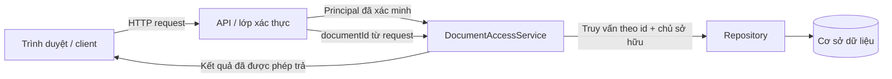
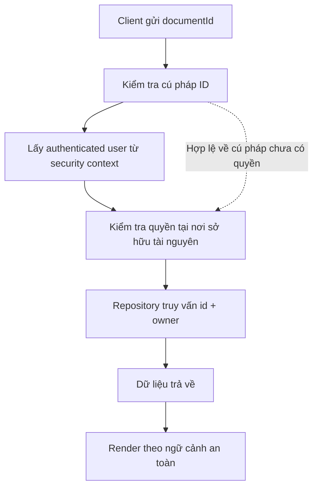

# Ranh giới tin cậy và nguồn dữ liệu đầu vào

Một API nhận mã tài liệu từ người dùng rồi đọc đúng bản ghi trong cơ sở dữ liệu. Truy vấn có thể chạy nhanh, câu lệnh SQL có thể được tham số hóa đúng và mã Java có thể dễ đọc. Tuy nhiên, nếu API không kiểm tra **người đang yêu cầu có quyền xem tài liệu đó hay không**, nó vẫn có thể để lộ tài liệu của khách hàng khác.

Trong chương **Bảo mật** của `CODE_QUALITY_FUNDAMENTALS`, chúng ta tìm hiểu **ranh giới tin cậy (trust boundary)** và cách nhận diện **nguồn dữ liệu đầu vào**. Đây là một phần quan trọng khi đánh giá chất lượng mã: mã nguồn đáng tin cậy, dễ hiểu và dễ thay đổi cần thể hiện rõ **dữ liệu đến từ đâu, ai có quyền quyết định điều gì, khi nào phải kiểm tra và dữ liệu được phép đi tiếp đến đâu**.

Sau bài này, bạn có thể lập sơ đồ dữ liệu qua ranh giới tin cậy; phân biệt xác thực danh tính, kiểm tra quyền, kiểm tra đầu vào và mã hóa đầu ra; viết một ví dụ Java bảo vệ truy cập tài nguyên; và chọn các phép kiểm thử để phát hiện lỗi ở những điểm giao tiếp nhạy cảm.

## 1. Ranh giới tin cậy là gì?

**Ranh giới tin cậy** là điểm mà dữ liệu hoặc một yêu cầu chuyển từ một vùng có mức bảo đảm hoặc quyền kiểm soát nhất định sang một vùng khác. Bên nhận không nên mặc định dữ liệu bên gửi là đúng, an toàn hoặc có thẩm quyền chỉ vì lời gọi đã đến được bên trong hệ thống.

Ví dụ một luồng xem tài liệu:



Trong luồng này, `documentId` do client gửi là dữ liệu **do bên ngoài kiểm soát**. Thông tin danh tính `authenticatedUserId` chỉ được coi là đã xác minh nếu được tạo từ **quá trình xác thực đáng tin cậy của server**. Khi chuyển từ dữ liệu yêu cầu sang thao tác đọc tài liệu, hệ thống phải áp dụng những điều kiện phù hợp.

Cần phân biệt hai ý:

- **Tin tưởng nguồn gốc:** Server có cơ sở nào để khẳng định người dùng đã xác thực là ai? Ví dụ, hệ thống xác thực đã xác minh phiên hoặc token theo chính sách thích hợp.
- **Tin tưởng giá trị và quyền sử dụng:** Dù danh tính có thật, người dùng đó có quyền truy cập bản ghi cụ thể không? Mã tài liệu có hợp lệ không? Dữ liệu có thể được dùng trong truy vấn hoặc phản hồi theo cách nào?

Một người dùng đăng nhập thành công **không tự động có quyền** đọc mọi tài liệu trong cơ sở dữ liệu. Một bản ghi lấy từ database **không tự động an toàn** để chèn vào HTML, câu lệnh shell hoặc URL gọi đến dịch vụ nội bộ.

### 1.1. Trust boundary khác gì với ranh giới module?

Ranh giới module xác định trách nhiệm và API giữa các phần mã. Ranh giới tin cậy xác định **sự khác nhau về mức thẩm quyền, khả năng kiểm soát và bảo đảm an ninh**. Chúng có thể trùng nhau nhưng không phải lúc nào cũng vậy.

Hai lớp cùng trong một package có thể vẫn xử lý dữ liệu với mức tin cậy khác nhau: controller nhận chuỗi do client nhập; service nhận danh tính do hệ thống xác thực cung cấp. Ngược lại, hai service ở hai tiến trình có thể dùng một cơ chế xác thực chung nhưng vẫn cần kiểm tra thông điệp và quyền với tài nguyên mà mỗi service sở hữu.

**Nguyên tắc:** Quyết định bảo mật phải được kiểm tra tại nơi có đủ ngữ cảnh và có thẩm quyền, thay vì dựa vào giả định rằng “dữ liệu đã đi qua lớp trước nên chắc chắn an toàn”.

## 2. Nguồn dữ liệu đầu vào không chỉ là ô nhập trên giao diện

Dữ liệu có thể được bên ngoài kiểm soát bằng nhiều đường. Khi review, đừng chỉ tìm `request.getParameter()` rồi kết luận các nguồn còn lại an toàn.

| Nguồn | Ví dụ | Điều cần xem xét |
| --- | --- | --- |
| **HTTP body, query, path** | `documentId`, số lượng, từ khóa | Kiểu, độ dài, phạm vi giá trị, quyền thao tác, giới hạn tải |
| **HTTP header, cookie** | `X-User-Id`, `Authorization`, `Host` | Nguồn nào được phép quyết định danh tính, chống giả mạo, xử lý giá trị bất thường |
| **Tệp tải lên** | CSV, hình ảnh, PDF | Kích thước, loại nội dung, parser, quyền truy cập, nơi lưu |
| **Cơ sở dữ liệu** | Tên hiển thị do người dùng nhập trước đó | Dữ liệu lưu trữ vẫn có thể là đầu vào không đáng tin đối với bước render hoặc gọi dịch vụ khác |
| **Message queue / event** | `order-created` từ hệ thống đối tác | Xác thực nguồn gửi, schema, version, chống phát lại nếu yêu cầu |
| **API bên ngoài** | Kết quả tra cứu địa chỉ, thông tin giá | Tính hợp lệ, độ mới, lỗi, giá trị bất ngờ, giới hạn kích thước |
| **Cấu hình hoặc biến môi trường** | URL dịch vụ, tên bucket, thư mục | Nguồn cấu hình, thẩm quyền thay đổi, validation ở lúc khởi động |
| **Cache hoặc dữ liệu nội bộ** | JSON đã cache từ request cũ | Dữ liệu có thể vẫn mang nguồn gốc không đáng tin; cache không biến nó thành dữ liệu đã được ủy quyền |

**Độ tin cậy phụ thuộc vào ngữ cảnh sử dụng.** Chuỗi tên sản phẩm có thể hợp lệ để lưu trong database nhưng cần mã hóa khi xuất ra HTML. Một URL có thể là chuỗi hợp lệ nhưng không được phép dùng làm đích truy cập mạng từ server.

### 2.1. Dữ liệu từ một tầng “nội bộ” vẫn có thể bị ảnh hưởng bởi client

Ví dụ, controller nhận `userId` trong JSON rồi truyền cho service. Service nhìn thấy tham số có tên `userId` và tưởng nó đã được xác thực vì được một lớp khác gọi. Đó là lỗi phổ biến về **mất dấu nguồn gốc dữ liệu**.

Một cách phân tách tốt là không dùng cùng một biến cho cả:

- `requestedUserId`: mã người dùng được client yêu cầu tra cứu, **chưa có thẩm quyền**.
- `authenticatedUserId`: danh tính server đã xác minh, **dùng làm cơ sở kiểm tra quyền**.

Ngay cả với `authenticatedUserId`, server vẫn cần quyết định người dùng đó có quyền thực hiện thao tác cụ thể, trên tài nguyên cụ thể, tại thời điểm cụ thể hay không.

## 3. Bốn phép kiểm tra cần phân biệt

Khi dữ liệu đi qua một ranh giới tin cậy, có ít nhất bốn câu hỏi khác nhau:

| Cơ chế | Câu hỏi | Ví dụ |
| --- | --- | --- |
| **Xác thực danh tính (authentication)** | Người gọi được xác minh là ai? | Kiểm tra phiên hoặc token do hệ thống xác thực tin cậy |
| **Kiểm tra quyền (authorization)** | Người này được phép làm gì với tài nguyên nào? | Người A không được đọc tài liệu riêng của người B |
| **Kiểm tra dữ liệu (input validation)** | Giá trị có thuộc miền hợp lệ theo hợp đồng không? | `documentId` chỉ gồm ký tự cho phép và không quá 64 ký tự |
| **Biểu diễn an toàn tại đích (safe use/output encoding)** | Dữ liệu được sử dụng thế nào để không bị hiểu thành lệnh hoặc cú pháp điều khiển? | Bind tham số SQL, encode text khi đặt vào HTML |

Các cơ chế **bổ sung nhau**, không thay thế nhau.

Ví dụ: mã tài liệu `DOC-123` hợp lệ về cú pháp không có nghĩa người dùng có quyền đọc nó. Dù đã kiểm tra quyền, nếu chương trình nối giá trị động vào SQL, dữ liệu có thể bị diễn giải như cú pháp truy vấn. Dù được lưu an toàn, nội dung tài liệu vẫn cần xử lý đúng ngữ cảnh khi hiển thị trên trình duyệt.

### 3.1. Validation kiểm tra điều kiện nào?

Một dữ liệu hợp lệ nên được xác định theo **hợp đồng thật**, không chỉ dựa vào mẫu regex chung:

1. **Cấu trúc:** Có đúng kiểu, trường bắt buộc, schema, tên trường và phiên bản không?
2. **Phạm vi:** Độ dài, kích thước, giá trị min/max và số phần tử có hợp lý không?
3. **Ngữ nghĩa:** Số lượng phải dương; ngày kết thúc không trước ngày bắt đầu.
4. **Quan hệ với trạng thái:** Mã sản phẩm có tồn tại, đơn còn được sửa, phiên bản dữ liệu còn hợp lệ không?
5. **Quyền:** Người gọi có quyền sử dụng hoặc thay đổi tài nguyên đó không?

Không phải mọi bước cần thực hiện ở controller. **Controller/adapter** có thể kiểm tra định dạng và kích thước trước khi sử dụng tài nguyên; **service nghiệp vụ** kiểm tra quy tắc và quyền; **database** bảo vệ thêm bằng các ràng buộc dữ liệu. Quan trọng là mỗi điều kiện có nơi chịu trách nhiệm rõ ràng và không thể bị bỏ qua bởi một đường gọi khác.

### 3.2. Validate đầu vào không phải xóa mọi ký tự “đáng ngờ”

Cấm tất cả dấu nháy đơn, dấu ngoặc hay ký tự Unicode có thể phá dữ liệu hợp lệ mà chưa chắc ngăn được mọi cuộc tấn công. Tên người và nội dung văn bản có thể chứa những ký tự này hoàn toàn bình thường.

Đối với dữ liệu là **nội dung văn bản tự do**, hãy kiểm tra độ dài, quy tắc nghiệp vụ và dùng **API an toàn tại đích**. Ví dụ, không cần cấm dấu nháy đơn trong tên khách hàng để chống SQL injection; cần bind tham số truy vấn.

Đối với dữ liệu là **định danh có định dạng được công bố**, allowlist ký tự có thể hợp lý. Nhưng regex chỉ phù hợp khi hợp đồng thật sự yêu cầu kiểu định danh như vậy.

## 4. Ví dụ Java: dữ liệu client khác với danh tính đã xác thực

Giả sử ứng dụng có tài liệu riêng cho từng tài khoản. API nhận mã tài liệu từ URL:

```http
GET /documents/DOC-123
```

Một lời gọi nguy hiểm có thể đưa ID do client cung cấp trực tiếp vào repository mà **không ràng buộc người sở hữu**:

```java
// Ví dụ thiếu kiểm tra quyền; không dùng như triển khai production.
DocumentInfo findDocument(String requestedId) {
    return repository.findById(requestedId).orElseThrow();
}
```

Ngay cả khi mã được kiểm tra là hợp lệ và câu SQL được tham số hóa, cách triển khai trên vẫn có thể trả tài liệu của người khác.

### 4.1. Tạo hợp đồng rõ ở ranh giới nghiệp vụ

Ví dụ Java 17 sau phân biệt rõ mã tài liệu do người dùng yêu cầu và danh tính do hệ thống xác thực cung cấp:

```java
import java.util.Objects;
import java.util.Optional;
import java.util.regex.Pattern;

record AuthenticatedUser(String userId) {
    AuthenticatedUser {
        Objects.requireNonNull(userId, "userId");
        if (userId.isBlank()) {
            throw new IllegalArgumentException("User ID must not be blank");
        }
    }
}

record DocumentInfo(String id, String ownerId, String title) {}

interface DocumentReader {
    Optional<DocumentInfo> findOwnedDocument(
            String documentId, String ownerUserId);
}

final class DocumentNotFoundException extends RuntimeException {}

final class DocumentViewService {
    private static final Pattern DOCUMENT_ID =
            Pattern.compile("[A-Za-z0-9-]{1,64}");

    private final DocumentReader documents;

    DocumentViewService(DocumentReader documents) {
        this.documents = Objects.requireNonNull(documents, "documents");
    }

    DocumentInfo view(
            String requestedDocumentId,
            AuthenticatedUser authenticatedUser) {
        Objects.requireNonNull(authenticatedUser, "authenticatedUser");

        if (requestedDocumentId == null
                || !DOCUMENT_ID.matcher(requestedDocumentId).matches()) {
            throw new IllegalArgumentException("Invalid document ID");
        }

        // ID do client yêu cầu không cấp quyền truy cập. Repository chỉ
        // được trả tài liệu thuộc danh tính đã xác thực.
        return documents.findOwnedDocument(
                        requestedDocumentId, authenticatedUser.userId())
                .orElseThrow(DocumentNotFoundException::new);
    }
}
```

Trong ví dụ này, `DocumentViewService` thực hiện hai kiểm tra tách biệt:

- `requestedDocumentId` phải thuộc định dạng ID công bố: tối đa 64 ký tự trong tập ký tự cho phép.
- Truy vấn phải giới hạn tài liệu theo **ID và chủ sở hữu đã xác thực**.

Một điều kiện bắt buộc ở tầng giao tiếp: `AuthenticatedUser` **phải được tạo từ identity đã được server xác thực và kiểm tra**, chẳng hạn từ security context do middleware đáng tin cậy cung cấp. `record AuthenticatedUser` tự nó không chống giả mạo; nếu controller tạo nó từ trường `userId` trong JSON do client gửi thì bảo đảm bảo mật **không còn đúng**.

### 4.2. Không tiết lộ tài nguyên không được phép xem

Trong ví dụ, `DocumentReader.findOwnedDocument` không tìm thấy tài liệu theo cả hai điều kiện thì trả `Optional.empty()`. API có thể ánh xạ trường hợp ấy thành HTTP `404` cho cả tài liệu không tồn tại và tài liệu không thuộc người dùng, nhằm không cung cấp thông tin tồn tại của tài liệu riêng.

Đây là **một chính sách minh họa**, không phải quy tắc bắt buộc cho mọi API. Có hệ thống dùng `403 Forbidden` khi người gọi đã được xác thực nhưng thiếu quyền. Việc chọn `403` hay `404` cần phù hợp với mục tiêu bảo vệ thông tin, quy ước API và tài liệu công khai.

Không được giải quyết việc giấu tồn tại tài nguyên bằng cách bỏ kiểm tra quyền. **Phản hồi công khai và quyết định ủy quyền là hai trách nhiệm khác nhau**.

### 4.3. Kiểm thử điều kiện truy cập bằng JUnit 5

```java
import static org.junit.jupiter.api.Assertions.assertEquals;
import static org.junit.jupiter.api.Assertions.assertThrows;

import java.util.Optional;
import org.junit.jupiter.api.Test;

class DocumentViewServiceTest {
    private final DocumentReader fakeReader = (docId, ownerId) -> {
        if ("DOC-123".equals(docId) && "alice".equals(ownerId)) {
            return Optional.of(
                    new DocumentInfo("DOC-123", "alice", "Private document"));
        }
        return Optional.empty();
    };

    private final DocumentViewService service =
            new DocumentViewService(fakeReader);

    @Test
    void ownerCanReadDocument() {
        DocumentInfo document =
                service.view("DOC-123", new AuthenticatedUser("alice"));

        assertEquals("DOC-123", document.id());
        assertEquals("alice", document.ownerId());
    }

    @Test
    void anotherUserCannotReadDocument() {
        assertThrows(DocumentNotFoundException.class,
                () -> service.view(
                        "DOC-123", new AuthenticatedUser("bob")));
    }

    @Test
    void rejectsInvalidDocumentId() {
        assertThrows(IllegalArgumentException.class,
                () -> service.view(
                        "../DOC-123", new AuthenticatedUser("alice")));
    }
}
```

Test xác nhận hợp đồng của `DocumentViewService` khi repository **tuân thủ điều kiện chủ sở hữu**. Tuy nhiên, fake chỉ là một thay thế trong bộ nhớ. Để chứng minh hệ thống thật không bỏ qua `ownerUserId`, cần **integration test đối với repository thực** và kiểm tra controller tạo `AuthenticatedUser` từ security context đáng tin cậy. Một test xanh với fake không tự chứng minh toàn bộ ranh giới bảo mật đã được thực thi đúng.

### 4.4. Bind cả tài nguyên và chủ sở hữu vào SQL

Với JDBC, repository thực có thể dùng **truy vấn được tham số hóa**:

```java
import java.sql.Connection;
import java.sql.PreparedStatement;
import java.sql.ResultSet;
import java.sql.SQLException;
import java.util.Optional;

final class JdbcDocumentQueries {
    static Optional<DocumentInfo> findOwnedDocument(
            Connection connection,
            String requestedDocumentId,
            String authenticatedUserId) throws SQLException {

        String sql = """
                SELECT id, owner_id, title
                FROM documents
                WHERE id = ? AND owner_id = ?
                """;

        try (PreparedStatement statement =
                     connection.prepareStatement(sql)) {
            statement.setString(1, requestedDocumentId);
            statement.setString(2, authenticatedUserId);

            try (ResultSet result = statement.executeQuery()) {
                if (!result.next()) {
                    return Optional.empty();
                }

                return Optional.of(new DocumentInfo(
                        result.getString("id"),
                        result.getString("owner_id"),
                        result.getString("title")));
            }
        }
    }
}
```

Dùng `PreparedStatement` cùng `?` và `setString` giúp **giá trị dữ liệu không bị ghép thành cú pháp SQL**. Điều kiện `owner_id = ?` đưa giới hạn người sở hữu vào chính thao tác truy vấn.

Ví dụ này giả định bảng `documents` có cột phù hợp và tầng gọi sở hữu vòng đời `Connection`. Trong hệ thống thật, nên kiểm tra thêm quyền truy cập của tài khoản database, transaction và khả năng các đường truy cập khác bỏ qua chính sách. Một số hệ quản trị còn hỗ trợ **row-level security (RLS)** để đặt thêm lớp kiểm soát tại database khi được cấu hình đúng.

**Phân biệt hai lớp bảo vệ:** Bind tham số chống nguy cơ diễn giải giá trị thành SQL. Ràng buộc `owner_id` thực thi chính sách đọc theo chủ sở hữu. **Một lớp không thay thế lớp kia**.

## 5. Những nơi dễ “nâng cấp” dữ liệu thành lệnh hoặc quyền

Một ranh giới tin cậy bị vượt qua khi dữ liệu ban đầu chỉ nên là **giá trị** lại được hệ thống diễn giải như **mệnh lệnh, đường dẫn có đặc quyền, mã hoặc danh tính có quyền**.

### 5.1. SQL: giá trị phải là dữ liệu

Không nên ghép trực tiếp chuỗi đầu vào vào SQL:

```java
// Sai: input có thể bị diễn giải như một phần câu SQL.
String sql = "SELECT * FROM documents WHERE id = '" + requestedId + "'";
```

Thay vào đó, dùng `PreparedStatement` hoặc cơ chế bind tham số đáng tin cậy của thư viện truy cập dữ liệu. Không cần tự viết hàm escape toàn bộ ký tự để thay thế việc bind.

**Ngoại lệ cần hiểu:** Placeholder `?` dùng cho **giá trị**, không dùng để thay thế tên bảng, tên cột hoặc hướng sắp xếp. Nếu API cho phép sắp xếp theo trường được chọn, hãy ánh xạ lựa chọn hữu hạn sang các tên cột cố định do server định nghĩa:

```java
String orderBy = switch (sortField) {
    case "createdAt" -> "created_at";
    case "title" -> "title";
    default -> throw new IllegalArgumentException("Unsupported sort field");
};

// orderBy chỉ nhận giá trị từ tập hằng do server định nghĩa.
String sql = "SELECT id, title FROM documents ORDER BY " + orderBy;
```

Đoạn mã minh họa sử dụng `switch` expression của Java 17. Nếu yêu cầu còn cho chọn tăng/giảm, cần kiểm soát riêng hướng sắp xếp bằng allowlist, không nối giá trị bất kỳ do client đưa vào.

### 5.2. HTML: dữ liệu lưu trữ không tự an toàn để hiển thị

Một nội dung do người dùng nhập rồi lưu vào database vẫn có thể chứa các ký tự được trình duyệt hiểu như cú pháp HTML. Khi đưa vào trang web, cần **mã hóa đầu ra theo đúng ngữ cảnh (contextual output encoding)** hoặc dùng cơ chế render text an toàn của framework.

Ví dụ, trong giao diện web, chèn tên tài liệu bằng API đặt **text content** giúp trình duyệt hiển thị nó như văn bản. Dùng một API cho phép diễn giải chuỗi thành HTML cần cơ chế làm sạch/mã hóa thích hợp, tùy ngữ cảnh cụ thể.

Không có **một hàm escape dùng chung cho HTML, JavaScript, URL, CSS và SQL**. Cách xử lý phải phù hợp với nơi dữ liệu sẽ được diễn giải. **Content Security Policy (CSP)** có thể giảm tác động một số tình huống XSS, nhưng không thay thế việc render dữ liệu đúng cách.

### 5.3. Đường dẫn tệp: tránh dùng chuỗi tùy ý như đường dẫn có quyền

Một dịch vụ lưu ảnh không nên cho client gửi bất kỳ đường dẫn nào rồi gọi `Files.readString(base.resolve(input))` mà không có chính sách. Các chuỗi đường dẫn có thể chứa `..`, dạng tuyệt đối, mã hóa khác nhau hoặc liên quan đến symbolic link, khiến thao tác truy cập ra ngoài thư mục được phép.

Thiết kế an toàn hơn là:

1. Dùng **định danh tệp do server quản lý** thay cho đường dẫn do client tùy ý quyết định.
2. Ánh xạ ID tới đường dẫn thuộc vùng lưu trữ được quản lý.
3. Kiểm tra quyền truy cập tài nguyên và giới hạn loại thao tác.
4. Nếu phải nhận đường dẫn tương đối, xác định quy tắc chuẩn hóa, kiểm tra containment và xử lý symbolic link cùng các trường hợp thay đổi filesystem giữa lúc kiểm tra và lúc sử dụng.

**Chỉ gọi `Path.normalize()` không tự bảo vệ đủ mọi trường hợp**, nhất là khi symlink và điều kiện cạnh tranh trong filesystem có mặt. Chiến lược cụ thể cần dựa trên API filesystem và mô hình triển khai thực tế.

### 5.4. URL: server được yêu cầu gọi đến đâu?

Nếu một API nhận URL rồi server tải nội dung, client có thể cố khiến server truy cập đích mạng ngoài phạm vi được phép, bao gồm dịch vụ nội bộ. Đây là nhóm rủi ro thường được gọi là **Server-Side Request Forgery (SSRF)**.

Không nên dựa vào việc “URL parse thành công” để quyết định nó được phép gọi. Hãy cân nhắc:

- Có thật sự cần nhận URL bất kỳ hay chỉ cần **chọn một nguồn đã định nghĩa**?
- Cho phép scheme, host và cổng nào theo chính sách?
- Sau DNS resolution, địa chỉ mạng có còn nằm trong phạm vi cho phép không?
- Redirect có thể dẫn sang đích không được phép không?
- Quy tắc mạng, timeout, kích thước phản hồi và quyền của tiến trình có hạn chế thiệt hại không?

Lọc bằng chuỗi kiểu `url.contains("trusted.com")` không phải cách xác thực host đáng tin cậy. Trong hệ thống có rủi ro cao, cần kết hợp kiểm soát đích, xác minh DNS/redirect phù hợp và **giới hạn kết nối outbound ở tầng mạng**.

### 5.5. Lệnh hệ điều hành: không biến dữ liệu thành cú pháp shell

Nếu cần chạy chương trình hệ điều hành, tránh ghép input vào chuỗi lệnh shell. Ưu tiên API nhận **tên chương trình và danh sách tham số tách biệt** như `ProcessBuilder` khi thật sự cần thiết, kết hợp giới hạn tập lệnh được phép gọi và quyền của tiến trình.

Việc tách tham số không tự cho phép gọi **bất kỳ chương trình hoặc đường dẫn nào**. Người dùng không được quyền chọn một binary tùy ý chỉ vì ta đã tránh ghép chuỗi shell.

## 6. Nhận diện và duy trì nguồn gốc dữ liệu khi qua nhiều tầng

Trong một ứng dụng lớn, cùng một giá trị có thể đi qua controller, mapper, service, queue, cache và database. Tại mỗi bước, cần biết **điều gì đã được xác minh** và **điều gì vẫn chưa**.



Một giá trị đi qua bước validation không trở thành “tin cậy cho mọi mục đích”:

- `documentId` đã hợp lệ về cú pháp vẫn cần kiểm tra quyền.
- `title` được trả từ database vẫn cần encoding đúng khi hiển thị trong HTML.
- `userId` từ một token chỉ có giá trị xác thực khi **quy trình xác minh token** đáng tin cậy và có áp dụng đúng các điều kiện liên quan.
- Một JSON đã qua schema validation vẫn có thể chứa hành vi nghiệp vụ không hợp lệ hoặc giá trị dùng sai ở một hệ thống đích khác.

### 6.1. Tách kiểu dữ liệu hoặc API theo mức bảo đảm

Một ứng dụng có thể dùng những kiểu có tên rõ hơn để biểu thị giai đoạn xử lý:

```java
record CreateDocumentRequest(String title) {}

record AuthenticatedUserId(String value) {}

record ValidatedDocumentTitle(String value) {}
```

Tuy nhiên, **đặt tên kiểu là `Validated...` chưa đủ để bảo đảm đã validate**. Việc tạo đối tượng cần đi qua nơi thực thi quy tắc và không cho đường khác tạo giá trị giả định đã kiểm tra. Với Java, có thể cân nhắc constructor hoặc factory hạn chế phạm vi truy cập, kiểu bất biến và quy ước module.

Mục tiêu không phải tạo lớp bao bọc cho mọi chuỗi, mà là làm rõ những phân biệt **quan trọng về quyền và bất biến**. Ví dụ, tách kiểu `AuthenticatedUserId` khỏi tham số `requestedUserId` có thể giúp giảm nguy cơ vô tình dùng nguồn không đúng trong một thao tác có quyền.

### 6.2. Không để dữ liệu client quyết định quyền nội bộ

Các ví dụ cần cảnh giác:

- Header `X-Admin: true` không được tự biến người gọi thành quản trị viên.
- Trường JSON `ownerId` không được mặc nhiên quyết định chủ sở hữu khi tạo tài nguyên mà chính sách yêu cầu lấy từ người đã đăng nhập.
- `tenantId` từ đường dẫn không được tự mở quyền truy cập tenant đó; cần đối chiếu với quyền của principal.
- `isPaid` trong request không được tự cho phép giao hàng khi trạng thái thanh toán phải do hệ thống có thẩm quyền xác nhận.

Các giá trị này **có thể được nhận như một yêu cầu hoặc lựa chọn**, nhưng quyết định cuối cùng phải được đưa ra tại nơi có đủ thông tin và thẩm quyền.

## 7. Xác thực danh tính đúng nguồn, kiểm tra quyền đúng tài nguyên

### 7.1. Danh tính không nằm ở tên trường trong request

Giả sử client gửi:

```json
{
  "documentId": "DOC-123",
  "userId": "alice"
}
```

Nếu server dùng `userId` này làm chủ sở hữu khi truy vấn tài liệu, bất kỳ client nào có thể **tự khai mình là người khác**. Đó không phải xác thực danh tính.

Trong ứng dụng dùng session hoặc bearer token, lớp xác thực cần xác minh bằng cơ chế đáng tin cậy rồi tạo **principal**. Với token có chữ ký, việc kiểm tra phù hợp có thể bao gồm chữ ký, thuật toán được phép, issuer, audience, thời hạn và các điều kiện bảo mật của hệ thống. Không được chỉ giải mã payload rồi tin ngay vào trường `sub`.

Dữ liệu trong token đã xác minh vẫn là **thông tin danh tính/claims**, không tự động là quyền đối với mọi tài nguyên. Việc phân quyền còn phụ thuộc chính sách cụ thể.

### 7.2. Kiểm tra quyền phía server ở đúng điểm thao tác

Một ứng dụng có thể ẩn nút “Xóa” trên giao diện với người thiếu quyền. Điều này tốt cho trải nghiệm nhưng không bảo vệ API nếu người gọi vẫn gửi request trực tiếp.

**Kiểm tra quyền phải được thực hiện ở phía có thẩm quyền**, trước khi thao tác nhạy cảm được chấp nhận. Với hệ thống có nhiều controller, job hoặc consumer queue cùng gọi nghiệp vụ, kiểm tra ở một màn hình duy nhất sẽ để lại đường truy cập khác.

Nếu quyền phụ thuộc trạng thái có thể thay đổi đồng thời, cần cân nhắc **độ nguyên tử** giữa kiểm tra quyền, kiểm tra trạng thái và cập nhật. Ví dụ, kiểm tra đơn “chưa hủy” rồi cập nhật nhiều giây sau có thể sai khi một tiến trình khác đã hủy đơn trong khoảng đó. Khi cần, dùng transaction, cập nhật có điều kiện hoặc cơ chế cạnh tranh tại nơi sở hữu dữ liệu.

### 7.3. Nguyên tắc quyền tối thiểu

Một thành phần chỉ nên có các quyền nó cần để hoàn thành trách nhiệm. Ví dụ, tài khoản database chỉ đọc tài liệu không nên có quyền sửa cấu trúc mọi bảng; dịch vụ chỉ cần đọc một bucket không nên có quyền xóa mọi đối tượng.

**Least privilege** giúp giảm thiệt hại khi một lỗi validation hoặc authorization vẫn lọt qua. Kiểm tra quyền trong mã ứng dụng và giới hạn quyền ở cơ sở dữ liệu, storage hoặc tầng mạng có thể tạo **nhiều lớp bảo vệ bổ sung**.

## 8. Khi nào dữ liệu đầu vào cần giới hạn tài nguyên?

Một đầu vào có thể hợp lệ về cú pháp nhưng **quá lớn hoặc quá tốn chi phí**. Ví dụ một API chấp nhận `pageSize = 1_000_000` hoặc cho phép người dùng gửi một JSON lồng sâu không giới hạn. Ngay cả khi không có ký tự nguy hiểm, việc xử lý vẫn có thể gây nghẽn CPU, bộ nhớ hoặc database.

Các ranh giới thực tế nên xem xét:

| Nguồn/khả năng | Giới hạn hữu ích | Vì sao |
| --- | --- | --- |
| Danh sách trong request | Số phần tử tối đa | Tránh cấp phát và lặp quá lớn |
| Trường văn bản | Độ dài và encoding hợp lệ | Tránh chi phí lưu trữ/xử lý không mong đợi |
| JSON/XML | Tổng kích thước, độ sâu, cấu trúc | Hạn chế đầu vào gây tiêu tốn tài nguyên bất thường |
| Truy vấn phân trang | `pageSize` tối đa, thứ tự sắp xếp rõ | Tránh quét/trả khối dữ liệu quá lớn |
| Tải tệp | Kích thước, loại nội dung được phép, giới hạn giải nén | Giảm rủi ro xử lý tệp độc hại hoặc quá lớn |
| Gọi API ngoài | Timeout, số lần thử, số redirect, kích thước phản hồi | Ngăn phụ thuộc bên ngoài giữ tài nguyên quá lâu |

Giới hạn phải dựa trên **nhu cầu sản phẩm và khả năng hệ thống**, không có một giá trị cố định áp dụng cho mọi API. Đặt giới hạn ở tầng nhận request có ích để từ chối sớm; tầng nghiệp vụ và hạ tầng vẫn cần bảo vệ các bất biến quan trọng.

## 9. Ghi log và phản hồi lỗi khi gặp dữ liệu không tin cậy

Khi đầu vào bị từ chối, phản hồi phải đủ rõ để client sửa yêu cầu nhưng không tiết lộ chi tiết nội bộ hoặc dữ liệu của người khác.

Ví dụ:

```json
{
  "code": "INVALID_DOCUMENT_ID",
  "message": "Mã tài liệu không hợp lệ.",
  "correlationId": "req-921"
}
```

Với tài liệu người dùng không có quyền đọc, API có thể trả lỗi `DOCUMENT_NOT_FOUND` theo chính sách đã chọn, thay vì xác nhận tài liệu của người khác tồn tại.

Trong log nội bộ:

- Ghi loại lỗi, thao tác, thành phần và mã truy vết hữu ích cho chẩn đoán.
- Tránh ghi token, mật khẩu, secret, dữ liệu cá nhân hoặc toàn bộ payload nếu không cần.
- Nếu ghi giá trị do client gửi, phải kiểm soát định dạng, độ dài và ký tự điều khiển để giảm rủi ro **log injection** hoặc nhiễu bản ghi.
- Không trả stack trace hoặc chuỗi SQL nội bộ trực tiếp cho người dùng.

Một `correlationId` cũng cần được tạo hoặc kiểm tra bởi tầng tin cậy, thay vì tin và ghi nguyên văn bất kỳ header nào do client cung cấp.

**Lỗi đầu vào không tự động là một cuộc tấn công.** Người dùng có thể nhập sai hoàn toàn bình thường. Hệ thống nên từ chối nhất quán, ghi nhận có chọn lọc, không gây lộ dữ liệu và tránh tạo hàng loạt cảnh báo vô ích.

## 10. Kiểm thử ranh giới tin cậy ở nhiều mức

Một vài unit test kiểm tra regex không thể chứng minh API đã an toàn. Hãy chọn kiểm thử theo **quyết định bảo mật cần chứng minh**.

| Quyết định cần kiểm chứng | Bằng chứng phù hợp |
| --- | --- |
| Mã tài liệu phải đúng định dạng | Unit test validation với giá trị hợp lệ, rỗng, quá dài, ký tự không cho phép |
| Không đọc tài liệu của chủ sở hữu khác | Unit test service với fake, thêm integration test repository thực |
| Danh tính phải lấy từ security context | API/security integration test với principal đã xác thực và request giả mạo trường userId |
| Truy vấn phải ràng buộc theo owner | Integration test ở database với dữ liệu nhiều chủ sở hữu |
| Nội dung tài liệu hiển thị thành văn bản, không thành HTML thực thi | Test ở tầng render/web với dữ liệu đầu vào đại diện |
| Gọi URL/tệp chỉ tới vùng được phép | Test chính sách đích và integration test với môi trường cô lập phù hợp |
| Quyền không bị vượt khi hai thao tác chạy đồng thời | Test concurrency/transaction theo rủi ro và hạ tầng thực |
| Dữ liệu lỗi không lộ bí mật | Test phản hồi công khai, review cấu hình log và quy tắc lọc dữ liệu |

### 10.1. Một tình huống integration test đáng làm

Tạo hai tài liệu trong database test:

- `DOC-1` thuộc `alice`.
- `DOC-2` thuộc `bob`.

Sau đó xác nhận truy vấn repository với `requestedDocumentId = "DOC-2"` và `authenticatedUserId = "alice"` **không trả tài liệu**, trong khi truy vấn cùng ID với `bob` trả đúng bản ghi. Test này giúp phát hiện lỗi nếu triển khai repository vô tình bỏ điều kiện `owner_id`, điều mà fake trong unit test có thể che giấu.

Cần chuẩn bị dữ liệu và xóa/cô lập state test nhất quán. Nếu quyền truy cập dựa vào tenant hoặc role phức tạp hơn, hãy đưa những điều kiện đó vào trường hợp kiểm chứng tương ứng.

### 10.2. Tự hỏi “nếu attacker kiểm soát được trường này thì sao?”

Đây là cách đơn giản để bắt đầu tư duy **threat modeling** mà không cần mô hình phức tạp:

1. Đánh dấu điểm vào của dữ liệu: request, tệp, queue, API, database.
2. Xác định hành vi có quyền: đọc tài liệu, ghi tiền, gọi mạng nội bộ, thực thi truy vấn.
3. Xác định giá trị nào do client hoặc nguồn kém tin cậy điều khiển.
4. Tìm điểm dữ liệu được **chuyển thành quyền hoặc cú pháp điều khiển**.
5. Kiểm tra xem có cơ chế bảo vệ phù hợp ngay tại ranh giới đó không.
6. Viết test hoặc cách kiểm chứng cho điều kiện quan trọng.
7. Ghi rõ giả thiết và phạm vi bảo đảm để người bảo trì biết khi nào phải xem lại.

Ví dụ, một endpoint trả dữ liệu của user hiện tại không nên có đường đi mã cho phép client đổi `userId` thành người khác rồi được đọc thêm dữ liệu. Câu hỏi đặt ra không chỉ là “đã có validation chưa?”, mà là **“ai được phép quyết định giá trị dùng để phân quyền?”**.

## 11. Những ngộ nhận phổ biến

| Ngộ nhận | Cách hiểu đúng hơn |
| --- | --- |
| “Đã đăng nhập nên mọi dữ liệu request đều đáng tin.” | Xác thực danh tính không xác thực mọi giá trị và không cấp quyền với mọi tài nguyên. |
| “Đã validate regex nên không thể SQL injection.” | SQL cần bind tham số; regex không thay thế cơ chế sử dụng dữ liệu an toàn tại đích. |
| “Truy vấn dùng `PreparedStatement` thì không cần phân quyền.” | Tham số hóa SQL và kiểm tra quyền giải quyết hai rủi ro khác nhau. |
| “Dữ liệu lấy từ database là an toàn.” | Dữ liệu lưu có thể do người dùng nhập; phải xử lý đúng ngữ cảnh khi đưa đến đích mới. |
| “Ẩn nút trên UI là đã chặn quyền.” | Cần phân quyền phía server tại nơi chấp nhận thao tác. |
| “Tất cả lỗi xác thực đều nên trả thông tin chi tiết.” | Chi tiết không cần thiết có thể làm lộ sự tồn tại tài khoản/tài nguyên hoặc thông tin nội bộ. |
| “`Path.normalize()` đủ ngăn mọi truy cập ngoài thư mục.” | Symlink, đường dẫn, và điều kiện cạnh tranh cần được xử lý theo chính sách và API filesystem phù hợp. |
| “Chặn URL có chữ `localhost` là đủ chống SSRF.” | Quy tắc đích phải xét host, IP, DNS, redirect, mạng và quyền outbound. |
| “Nội bộ gọi nhau nên không cần hợp đồng.” | Mỗi dịch vụ vẫn cần xác định quyền, ngữ nghĩa dữ liệu và tin cậy theo mô hình triển khai. |
| “Một unit test service xanh chứng minh bảo mật hoàn chỉnh.” | Cần kiểm tra cả integration, đường đi xác thực/ủy quyền và điểm sử dụng dữ liệu thật. |

## 12. Câu hỏi tự kiểm tra

**Câu 1.** API nhận `userId` từ JSON và `documentId` từ URL. Cả hai đều đúng định dạng. Có đủ điều kiện cho phép đọc tài liệu chưa?

*Gợi ý:* Chưa. Phải lấy danh tính đã xác thực từ nguồn tin cậy của server và kiểm tra quyền với tài liệu. Giá trị `userId` trong JSON không chứng minh ai đang gọi.

**Câu 2.** Repository dùng `PreparedStatement` để tìm tài liệu theo ID, nhưng không ràng buộc người sở hữu. Nguy cơ còn tồn tại là gì?

*Gợi ý:* Truy vấn có thể được bảo vệ khỏi việc diễn giải giá trị thành cú pháp SQL, nhưng vẫn có nguy cơ **truy cập trái phép tài nguyên** nếu bất kỳ người dùng nào cũng đọc được tài liệu theo ID.

**Câu 3.** Vì sao tên sản phẩm lấy từ database vẫn phải xử lý an toàn khi hiển thị trong HTML?

*Gợi ý:* Nội dung có thể có nguồn gốc từ người dùng. Lưu được vào database không biến nó thành chuỗi an toàn ở mọi ngữ cảnh. Cần render như text hoặc encoding đúng ngữ cảnh hiển thị.

**Câu 4.** Một API nhận URL để server tải tệp. URL hợp lệ về cú pháp nhưng trỏ đến địa chỉ nội bộ. Cần kiểm tra gì thêm?

*Gợi ý:* Chính sách đích được phép, scheme/host/IP, DNS/redirect, mạng outbound, timeout, giới hạn tài nguyên và quyền của tiến trình. Parse URL thành công không đồng nghĩa được quyền kết nối.

**Câu 5.** Nếu client gửi `X-Admin: true`, server có thể coi đó là quyền quản trị không?

*Gợi ý:* Không. Phải lấy quyền từ cơ chế xác thực/ủy quyền đáng tin cậy của hệ thống. Header không đáng tin chỉ có thể được xem như dữ liệu đầu vào, trừ một kiến trúc có gateway tin cậy và cơ chế xác minh rõ ràng.

**Câu 6.** Tại sao dùng fake repository với điều kiện owner đúng chưa đủ chứng minh an toàn?

*Gợi ý:* Triển khai JDBC thật có thể vô tình bỏ điều kiện `owner_id`. Cần integration test với nhiều người sở hữu và kiểm tra tầng API lấy principal từ security context.

**Câu 7.** Một endpoint chỉ trả `pageSize` dòng dữ liệu nhưng cho phép client yêu cầu `pageSize = 10_000_000`. Đây có phải vấn đề bảo mật dù giá trị là số nguyên hợp lệ?

*Gợi ý:* Có thể có rủi ro tiêu tốn tài nguyên/khả năng phục vụ. Cần giới hạn theo yêu cầu và năng lực hệ thống, cùng cơ chế phân trang và điều tiết phù hợp.

**Câu 8.** Một lớp có kiểu `ValidatedDocumentId` nhưng constructor công khai nhận chuỗi bất kỳ. Có thể tin rằng mọi instance của kiểu này đã được validate không?

*Gợi ý:* Không. Tên kiểu không tự bảo đảm bất biến. Cần cơ chế tạo đối tượng thực thi kiểm tra, hạn chế đường tạo không hợp lệ và có test phù hợp.

## Ghi nhớ

**Ranh giới tin cậy là nơi phải xác định lại những gì dữ liệu và bên gửi thực sự được phép quyết định.** Một request hợp lệ về cú pháp không tự được ủy quyền; một người dùng đã xác thực không tự có quyền với mọi tài nguyên; một chuỗi đã lưu hoặc truyền qua module nội bộ không tự an toàn tại mọi đích.

Trong Java, hãy làm rõ nguồn gốc input, kiểm tra định dạng và giới hạn theo hợp đồng, lấy danh tính từ lớp xác thực đáng tin cậy, thực thi phân quyền ở nơi sở hữu tài nguyên và dùng các API an toàn khi đưa dữ liệu vào SQL, HTML, đường dẫn, lệnh hệ điều hành hoặc kết nối mạng. Kết hợp test đơn vị với kiểm thử tích hợp tại các ranh giới quan trọng. Khi các quyết định tin cậy được thể hiện rõ trong mã và kiểm chứng, hệ thống **đáng tin cậy, dễ hiểu và dễ thay đổi an toàn hơn**.
