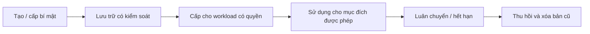

# Bảo vệ bí mật trong mã, cấu hình và thông báo lỗi

Một hệ thống có thể dùng HTTPS, xác thực đầy đủ và kiểm tra quyền truy cập cẩn thận nhưng vẫn làm lộ bí mật qua một dòng log:

```java
logger.info("Calling payment provider with token {}", apiToken);
```

Hoặc một lần xử lý lỗi:

```java
return ResponseEntity.internalServerError()
        .body(exception.getMessage());
```

Nếu thông điệp ngoại lệ chứa chuỗi kết nối cơ sở dữ liệu, token hoặc dữ liệu nhạy cảm, API có thể gửi chúng cho người không được phép xem. Bí mật còn có thể xuất hiện trong file cấu hình được commit, lịch sử Git, log của hệ thống build hoặc bản sao cấu hình dùng trong môi trường kiểm thử.

Trong chương **Bảo mật** của **CODE_QUALITY_FUNDAMENTALS**, bài học này tập trung vào việc bảo vệ bí mật (*secrets*) ở ba bề mặt thường bị bỏ sót: **mã nguồn, cấu hình và thông báo lỗi**. Chủ đề gắn trực tiếp với mục tiêu của học phần: hiểu các thuộc tính làm mã nguồn **đáng tin cậy, dễ hiểu và dễ thay đổi**. Mã đáng tin cậy không chỉ thực hiện đúng chức năng; nó còn tránh để thông tin có thể cấp quyền truy cập bị lộ qua những đường phụ.

## Mục tiêu học tập

Sau bài này, bạn có thể:

1. Phân biệt bí mật cần bảo vệ với cấu hình công khai và những dữ liệu nhạy cảm khác.
2. Nhận diện các đường lộ bí mật qua mã nguồn, Git, môi trường chạy, log, exception và response HTTP.
3. Thiết kế cách cung cấp bí mật khi chạy thay vì nhúng trực tiếp vào mã hoặc file cấu hình theo dõi bằng Git.
4. Áp dụng nguyên tắc **ít quyền nhất**, phạm vi sử dụng, luân chuyển và thu hồi thông tin xác thực.
5. Viết mã Java có lỗi công khai an toàn, giữ khả năng chẩn đoán mà không tiết lộ bí mật.
6. Thiết kế kiểm thử và quy trình xử lý khi một bí mật có nguy cơ đã bị lộ.

## 1. Bí mật là gì và vì sao phải phân loại?

**Bí mật** là dữ liệu mà khi bị người không có quyền biết hoặc sử dụng có thể cho phép họ truy cập tài nguyên, giả mạo danh tính, ký yêu cầu hoặc giải mã thông tin. Ví dụ:

| Loại dữ liệu | Ví dụ | Cách xử lý |
| --- | --- | --- |
| **Bí mật xác thực** | Mật khẩu dịch vụ, API key, access token, refresh token. | Không đưa vào mã, log, response; quản lý quyền đọc và thời hạn. |
| **Khóa mật mã riêng** | Private key dùng ký JWT hoặc kết nối TLS. | Giữ ở hệ thống quản lý khóa/bí mật phù hợp, giới hạn quyền sử dụng và hỗ trợ luân chuyển. |
| **Thông tin kết nối chứa quyền** | Database URL có username/password, connection string tích hợp. | Tách thông tin xác thực khỏi phần cấu hình không nhạy cảm khi có thể. |
| **Cấu hình thông thường** | Timeout, số lần retry, tên tính năng, endpoint công khai. | Có thể lưu theo cấu hình được kiểm soát; không mặc nhiên là bí mật. |
| **Dữ liệu nhạy cảm** | Số giấy tờ, địa chỉ, hồ sơ khách hàng, dữ liệu cá nhân. | Bảo vệ bằng kiểm soát truy cập và nguyên tắc tối thiểu hóa dữ liệu, dù chúng không phải “secret” dùng để xác thực. |

Một **secret reference** như `billing-api-token` là **tên để tra cứu bí mật**, không phải bản thân giá trị bí mật. Việc lưu tên tham chiếu trong cấu hình thường an toàn hơn lưu giá trị; tuy nhiên tên tài nguyên hoặc endpoint nội bộ vẫn có thể là thông tin cần hạn chế công bố theo bối cảnh triển khai.

Không phải mọi chuỗi mang tên `token` đều là bí mật. Ví dụ mã định danh request công khai và access token thực hiện xác thực có vai trò khác nhau. Phân loại theo **khả năng gây hại khi tiết lộ**, không chỉ theo tên biến.

### Một bí mật có vòng đời



Mỗi giai đoạn đều có rủi ro. Chỉ giấu giá trị khỏi repository chưa đủ nếu tiến trình có quyền đọc bí mật lại đưa nó vào log, hoặc token bị cấp quyền quá rộng và không bao giờ hết hạn.

## 2. Lập bản đồ đường đi của bí mật

Hãy xét một dịch vụ Java gọi API thanh toán bằng access token. Giá trị token đi qua nhiều ranh giới:

```text
Hệ thống cấp bí mật
         |
         v
Secret manager / môi trường triển khai
         |
         v
Tiến trình Java (bộ nhớ)
         |
         v
HTTP client tạo header Authorization
         |
         v
Provider được tin cậy qua kênh bảo mật
```

Các nhánh không mong muốn có thể là:

```text
source code -------> Git history / code review / fork
configuration -----> CI log / artifact / backup
HTTP client -------> debug log / proxy / tracing header
exception --------> server log / API error response
process memory ----> heap dump / debugger / crash report
```

Mỗi nhánh này là một **bề mặt có thể rò rỉ**. Khi review mã, đừng chỉ tìm literal mật khẩu trong file `.java`; hãy hỏi giá trị được truyền vào đâu và những công cụ nào có thể tự động ghi lại nó.

### Mô hình đe dọa ngắn

Đối với mỗi bí mật, cần trả lời:

1. Bí mật cấp quyền gì và tới hệ thống nào?
2. Thành phần hoặc người nào thực sự cần được truy cập?
3. Bí mật được tạo, lấy về, giữ trong bộ nhớ và truyền đi bằng đường nào?
4. Những log, exception, metric, trace, file build hoặc backup nào có thể chứa giá trị đó?
5. Nếu bí mật bị lộ, mất bao lâu để thu hồi và phát hành giá trị thay thế?

Một token chỉ được phép **đọc giá** nhưng bị lộ thường có tác động khác token có thể **chuyển tiền**. Phạm vi quyền, thời hạn và khả năng thu hồi quan trọng không kém nơi lưu trữ.

## 3. Không nhúng bí mật vào mã nguồn

Một anti-pattern rõ ràng:

```java
// Ví dụ KHÔNG AN TOÀN: chuỗi dưới đây chỉ là dữ liệu giả minh họa.
final class PaymentClient {
    private static final String API_TOKEN = "DEMO-DO-NOT-USE";
}
```

Dù giá trị là thật hay bị thay bằng bản demo khi viết bài, cấu trúc trên cho thấy rủi ro: secret thật có thể được copy vào source, commit, build thành bytecode, nhân bản qua fork và tồn tại trong lịch sử Git sau khi dòng code hiện tại bị xóa.

Các cách “che” thông dụng không giải quyết gốc vấn đề:

- **Đổi tên biến** `password` thành `p` không bảo vệ giá trị.
- **Base64** chỉ là mã hóa biểu diễn, không phải mã hóa bảo mật; bất kỳ ai đọc source đều có thể giải mã.
- **Chia chuỗi thành nhiều đoạn** rồi nối khi chạy vẫn để lại các thành phần trong source.
- **Đưa vào file `.env` và thêm `.gitignore`** giúp tránh commit về sau nếu tệp chưa được Git theo dõi, nhưng không xóa bản đã commit trước đó; cũng không ngăn sao chép, đọc tệp hoặc lộ qua tiến trình.
- **Đổi sang repository riêng** chỉ giảm phạm vi truy cập nếu quyền được cấu hình đúng; không giải quyết việc mã dùng secret quá rộng hoặc đưa ra log.

### Cấu hình nên lưu điều gì?

Một file cấu hình được theo dõi trong Git có thể chứa tên tham chiếu và thông tin không nhạy cảm:

```yaml
billing:
  base-url: https://api.example.invalid
  connect-timeout-ms: 2000
  secret-reference: billing-api-token
```

`api.example.invalid` là host ví dụ, không phải endpoint thật. Cấu hình **không chứa** token. Môi trường triển khai có trách nhiệm ánh xạ `billing-api-token` tới giá trị bí mật được cấp cho đúng workload.

Khi cấu hình được sinh động tại runtime, một nguyên tắc hữu ích là: **artifact ứng dụng có thể được dùng ở nhiều môi trường mà không phải đóng gói một secret riêng vào artifact**. Môi trường chạy sẽ cấp danh tính workload, quyền tra cứu secret và những tham số phù hợp cho môi trường đó.

## 4. Đưa bí mật vào ứng dụng ở thời điểm chạy

Có nhiều cơ chế:

| Cách cấp | Phù hợp khi | Rủi ro / giới hạn |
| --- | --- | --- |
| **Secret manager / key-management service** | Nhiều môi trường, cần audit, phân quyền, luân chuyển. | Cần cấu hình danh tính workload, quyền truy cập và xử lý lỗi khi dịch vụ quản lý không sẵn sàng. |
| **Biến môi trường** | Môi trường đơn giản, container, tích hợp với nền tảng triển khai. | Có thể bị lộ qua cấu hình môi trường, crash dump, công cụ chẩn đoán hoặc người có quyền đọc môi trường tiến trình. |
| **File bí mật được mount có kiểm soát** | Nền tảng cấp secret qua volume/file, ứng dụng cần đọc local. | Cần quyền file, vòng đời, cơ chế cập nhật và tránh ghi bản sao ra ổ đĩa khác. |
| **Danh tính workload / token ngắn hạn** | Hạ tầng hỗ trợ xác thực máy với máy không dùng mật khẩu dài hạn. | Cần quản lý quyền, giới hạn đối tượng nhận và làm mới token đúng cách. |

Một secret manager có thể giảm việc lưu bí mật lâu dài trong ứng dụng, nhưng **không miễn trừ trách nhiệm bảo vệ bí mật khi đã lấy vào bộ nhớ**. Nếu mã in token ra console thì nguồn cung cấp token an toàn đến đâu cũng không giúp.

### Tránh cấu hình mặc định là secret thật

Đừng viết:

```java
// KHÔNG AN TOÀN: sẽ dùng giá trị dự phòng nếu thiếu cấu hình.
String apiToken = System.getenv()
        .getOrDefault("BILLING_API_TOKEN", "DEMO-DO-NOT-USE");
```

Ở đây chuỗi dự phòng là giả, nhưng nếu ứng dụng thực tế để một token dùng chung làm giá trị mặc định, môi trường thiếu cấu hình vẫn có thể gọi hệ thống ngoài bằng quyền không mong muốn. **Fail closed**: thiếu secret bắt buộc phải dẫn đến lỗi cấu hình hoặc không khởi động được phần chức năng phụ thuộc vào secret.

Với một ứng dụng đơn giản, minh họa cách đọc từ môi trường:

```java
final class EnvSecrets implements SecretProvider {
    @Override
    public String require(String reference) {
        if (!"billing-api-token".equals(reference)) {
            throw new IllegalArgumentException("Unknown secret reference");
        }
        String value = System.getenv("BILLING_API_TOKEN");
        if (value == null || value.isBlank()) {
            throw new IllegalStateException(
                    "Required billing credential is unavailable");
        }
        return value;
    }
}
```

`SecretProvider` là interface sẽ được định nghĩa ở ví dụ sau. Đoạn này chỉ minh họa **lấy secret lúc chạy**, không nói rằng biến môi trường là cơ chế an toàn nhất cho mọi hệ thống. Trong môi trường production, có thể thay `EnvSecrets` bằng adapter của secret manager mà không sửa chính sách gọi API.

## 5. Java: tránh để bí mật nằm trong đối tượng dữ liệu dễ bị in ra

Java `record` tự sinh `toString()` chứa các thành phần. Nếu một record giữ trực tiếp API token, việc ghi log đối tượng có thể làm lộ token mà người gọi không nhận ra.

```java
// Không nên lưu secret trực tiếp trong DTO dễ bị log.
record BillingConfig(String endpoint, String apiToken) {}

// Lời gọi như sau có thể in luôn apiToken:
// logger.info("Billing config: {}", config);
```

Thay vào đó, lưu **tham chiếu** trong cấu hình nghiệp vụ:

```java
import java.net.URI;
import java.util.Objects;

record BillingConfig(URI endpoint, String secretReference) {
    public BillingConfig {
        Objects.requireNonNull(endpoint, "endpoint");
        if (!"https".equalsIgnoreCase(endpoint.getScheme())) {
            throw new IllegalArgumentException(
                    "Billing endpoint must use HTTPS");
        }
        if (secretReference == null || secretReference.isBlank()) {
            throw new IllegalArgumentException(
                    "Secret reference is required");
        }
    }
}
```

Đây là cải thiện về bề mặt log và trách nhiệm: `BillingConfig` chỉ chứa nơi cần gọi và tên tham chiếu, còn nguồn cấp secret nằm ở thành phần khác. **Không được xem `toString()` của mọi đối tượng cấu hình là an toàn chỉ vì record này không có token**: endpoint, tên tài nguyên và metadata cũng có thể nhạy cảm trong một số môi trường.

### Interface cung cấp bí mật

```java
interface SecretProvider {
    String require(String reference);
}
```

Với interface nhỏ này, phía gọi chỉ biết “cần secret theo tên”, không phụ thuộc cách nó được cấp (env, file hoặc secret manager). Việc tách lớp cũng làm rõ **điểm bí mật đi vào bộ nhớ ứng dụng**.

### Chuỗi `String` và việc xóa khỏi bộ nhớ

Trong Java, `String` là immutable và không thể xóa nội dung tại chỗ. Một `char[]` có thể được ghi đè sau sử dụng, nhưng điều đó **không bảo đảm toàn bộ bản sao đã biến mất**: thư viện có thể chuyển nó thành `String`, tạo bản sao trong heap hoặc lưu trong bộ nhớ native. Nhiều Java HTTP API yêu cầu giá trị header dưới dạng `String`.

Vì vậy, không nên tuyên bố “dùng `char[]` là đã giải quyết memory secrecy”. Chọn API an toàn, giới hạn thời gian và phạm vi tồn tại của credential, tránh log/dump tùy tiện, bảo vệ quyền debug và ưu tiên token có thời hạn ngắn khi nền tảng hỗ trợ.

## 6. Tách sử dụng bí mật khỏi lỗi công khai

Ví dụ sau tập trung vào cách một Java HTTP client sử dụng token **mà không đưa token vào exception hoặc thông báo API**. Mọi loại dữ liệu trong ví dụ là giả định: endpoint do phía triển khai tin cậy cấu hình; nhà cung cấp chấp nhận token trong header `Authorization`; lời gọi gửi hóa đơn có quyền phù hợp.

```java
import java.io.IOException;
import java.net.URI;
import java.net.http.HttpClient;
import java.net.http.HttpRequest;
import java.net.http.HttpResponse;
import java.nio.charset.StandardCharsets;
import java.time.Duration;
import java.util.Objects;

final class BillingGateway {
    private final HttpClient client;
    private final BillingConfig config;
    private final SecretProvider secrets;

    BillingGateway(
            HttpClient client,
            BillingConfig config,
            SecretProvider secrets) {
        this.client = Objects.requireNonNull(client);
        this.config = Objects.requireNonNull(config);
        this.secrets = Objects.requireNonNull(secrets);
    }

    void submitInvoice(String invoiceJson) {
        if (invoiceJson == null || invoiceJson.isBlank()) {
            throw new IllegalArgumentException("Invoice payload is required");
        }

        String token = secrets.require(config.secretReference());
        if (token == null || token.isBlank()) {
            throw new IllegalStateException(
                    "Required billing credential is unavailable");
        }

        HttpRequest request = HttpRequest.newBuilder(config.endpoint())
                .timeout(Duration.ofSeconds(5))
                .header("Content-Type", "application/json")
                .header("Authorization", "Bearer " + token)
                .POST(HttpRequest.BodyPublishers.ofString(
                        invoiceJson, StandardCharsets.UTF_8))
                .build();

        try {
            HttpResponse<Void> response = client.send(
                    request, HttpResponse.BodyHandlers.discarding());
            if (response.statusCode() < 200
                    || response.statusCode() >= 300) {
                throw new BillingFailure("BILLING_UPSTREAM_REJECTED");
            }
        } catch (InterruptedException interrupted) {
            Thread.currentThread().interrupt();
            throw new BillingFailure("BILLING_INTERRUPTED");
        } catch (IOException io) {
            throw new BillingFailure("BILLING_UNAVAILABLE");
        }
    }
}

final class BillingFailure extends RuntimeException {
    BillingFailure(String stableCode) {
        super(stableCode);
    }
}
```

Các điểm cần lưu ý:

- `BillingGateway` **không tự chứa literal token**. Nó lấy secret từ `SecretProvider` tại thời điểm thực hiện.
- Không gọi `logger.info(request.toString())`, không log header `Authorization`, không log JSON hóa đơn khi JSON chứa dữ liệu nhạy cảm.
- Khi HTTP thất bại, lỗi được biểu diễn bằng **mã ổn định**, không lấy nguyên body do provider trả hoặc toàn bộ thông điệp `IOException` chuyển cho client.
- Việc `HttpResponse.BodyHandlers.discarding()` giúp ví dụ không lưu nội dung response không cần thiết, nhưng code production có thể phải parse biên nhận **theo hợp đồng**; không nên bỏ response nếu cần biết kết quả.
- Khi bị interrupt, luồng được khôi phục cờ ngắt trước khi chuyển thành lỗi nghiệp vụ.

**Giới hạn về bảo mật và độ tin cậy:** ví dụ chưa cấu hình danh sách host được phép gọi, giới hạn chuyển hướng, xác thực chứng chỉ tùy theo hạ tầng, timeout kết nối, idempotency cho POST và xử lý phản hồi chi tiết. HTTPS bảo vệ dữ liệu trên đường truyền khi được kiểm chứng đúng, nhưng token vẫn có thể bị gửi đến nơi không đáng tin nếu `endpoint` bị cấu hình sai hoặc bị người không có quyền sửa thành giá trị khác. Production cần kiểm soát nguồn cấu hình, host đích và quyền gọi ra ngoài; một phép kiểm tra scheme `https` **không đủ** để ngăn gửi secret tới server do kẻ tấn công kiểm soát.

### Không nhúng bí mật vào URL

Tránh mẫu:

```text
https://api.example.invalid/charge?apiKey=DEMO-DO-NOT-USE
```

Đây là URL giả. Query string dễ xuất hiện trong access log, proxy log, lịch sử request, trace và công cụ giám sát. Nếu provider hỗ trợ, hãy dùng phương thức xác thực được công bố như header `Authorization` và bảo đảm các hệ thống trung gian không log header nhạy cảm. Không tự đổi cơ chế xác thực nếu provider yêu cầu giao thức khác; khi đó phải kiểm tra rõ rủi ro và biện pháp giảm thiểu tương ứng.

## 7. Thông báo lỗi công khai không được tiết lộ thông tin nội bộ

Một thông báo lỗi phục vụ người dùng cần đủ để họ biết yêu cầu có thành công hay không, nhưng **không cần** biết token, password, query SQL, file path nội bộ hoặc toàn bộ stack trace.

Ví dụ không an toàn:

```java
// KHÔNG AN TOÀN: phản hồi có thể chứa thông điệp từ DB, SDK,
// proxy hoặc provider do bên ngoài kiểm soát.
catch (Exception error) {
    return error.getMessage();
}
```

Một API nên dùng **mã lỗi ổn định và thông điệp đã chọn trước**, chẳng hạn:

```json
{
  "code": "UPSTREAM_UNAVAILABLE",
  "message": "Không thể xử lý yêu cầu lúc này.",
  "requestId": "req-8f52"
}
```

`requestId` phải do ứng dụng hoặc hạ tầng tin cậy tạo/kiểm tra định dạng; không được dùng nguyên một chuỗi do người gọi cung cấp để ghi vào log hay trả về như một ID đã được xác minh.

### Ví dụ Java tách lỗi nội bộ và lỗi trả ra

```java
record ApiError(String code, String message, String requestId) {}

final class PublicErrorMapper {
    private PublicErrorMapper() {}

    static ApiError map(Throwable error, String requestId) {
        if (error instanceof IllegalArgumentException) {
            return new ApiError(
                    "INVALID_REQUEST",
                    "Dữ liệu yêu cầu không hợp lệ.",
                    requestId);
        }

        if (error instanceof BillingFailure) {
            return new ApiError(
                    "UPSTREAM_UNAVAILABLE",
                    "Không thể xử lý yêu cầu lúc này.",
                    requestId);
        }

        return new ApiError(
                "INTERNAL_ERROR",
                "Đã xảy ra lỗi trong quá trình xử lý.",
                requestId);
    }
}
```

Đây là **ví dụ ánh xạ nội dung lỗi**, không phải một controller hoàn chỉnh. Phần web phải chọn HTTP status và cấu trúc response đúng với hợp đồng, ví dụ `400` cho đầu vào không hợp lệ, `502` hoặc `503` cho sự cố liên hệ upstream theo trường hợp, `500` cho lỗi nội bộ. Phân loại bảo mật, xác thực và phân quyền nên có nhánh riêng: tuyệt đối không mặc định `401`, `403` hoặc dữ liệu “không tồn tại” đều được xử lý như lỗi hạ tầng.

**Không trả `error.getMessage()` của một exception bất kỳ ra ngoài.** Thông điệp có thể chứa:

- Host, user, chuỗi kết nối DB hoặc đường dẫn file cục bộ.
- URL có query chứa key hoặc thông tin phiên.
- Tên bảng, cấu trúc SQL, cấu hình mạng.
- Các phần của request/response do provider phản hồi hoặc do người dùng nhập.
- Giá trị bí mật bị gắn vào chuỗi bởi một thành phần khác.

Ánh xạ sang mã cố định còn làm API dễ bảo trì: bên gọi xử lý theo `code` thay vì phải phân tích những câu lỗi thay đổi theo thư viện.

### Cân bằng giữa che giấu và chẩn đoán

Không phải vì không trả stack trace cho client mà xóa toàn bộ khả năng tìm lỗi. Hãy tách hai kênh:

| Kênh | Nên chứa | Tránh chứa |
| --- | --- | --- |
| **API response** | Mã lỗi công khai, thông điệp thân thiện, request ID. | Secret, stack trace, câu SQL, thông điệp thô từ SDK. |
| **Application log** | Request ID, loại thao tác, mã lỗi nội bộ, thời điểm, kết quả. | Token, password, dữ liệu cá nhân không cần thiết, toàn bộ request/header. |
| **Trace/metric** | Tên operation, thời gian, phân loại lỗi, định danh tương quan đã kiểm soát. | Secret làm tag/attribute, payload nhạy cảm, thông tin có cardinality quá lớn. |
| **Kho chẩn đoán hạn chế quyền** | Chi tiết kỹ thuật cần thiết để khắc phục, lưu giữ có thời hạn. | Bất kỳ dữ liệu bí mật nào không thật sự cần; cũng phải áp dụng kiểm soát truy cập và rà soát. |

Nhiều logger hỗ trợ ghi exception kèm stack trace. Điều đó hữu ích cho xử lý lỗi, nhưng **không thể mặc định stack trace vô hại**: thông điệp của exception, cause và suppressed exception có thể chứa dữ liệu nhạy cảm. Khi dùng log ngoại lệ thô, cần chính sách lọc và giới hạn quyền truy cập phù hợp; đối với một số ranh giới tích hợp, chỉ ghi loại lỗi đã phân loại và ID để đối soát an toàn hơn.

## 8. Ghi log theo danh sách cho phép, không chỉ dựa vào che chuỗi

Một phương án nguy hiểm là log toàn bộ đối tượng rồi cố che token bằng thay thế chuỗi:

```java
// Không nên xem đây là cơ chế bảo vệ đủ mạnh:
String safe = rawMessage.replace(apiToken, "[REDACTED]");
logger.info(safe);
```

Biến thể khác của secret có thể xuất hiện sau khi mã hóa URL, Base64, cắt ngắn, thêm tiền tố hoặc đi qua framework. Nếu `apiToken` rỗng, cách thay thế chuỗi cũng có thể tạo kết quả bất ngờ. **Redaction theo mẫu là tuyến phòng thủ bổ sung**, không phải thay thế cho việc tránh tạo log nhạy cảm ngay từ đầu.

Ưu tiên xây dựng log từ **các trường đã được chọn là an toàn**:

```java
// requestId và operation được tạo/kiểm soát bởi ứng dụng.
logger.info(
        "Billing call result: operation={}, outcome={}, requestId={}",
        "submitInvoice", "UPSTREAM_UNAVAILABLE", requestId);
```

Không tự động đưa các object `request`, `response`, `config`, `headers` hoặc `exception` vào log chỉ vì muốn có thêm thông tin. Nếu cần ghi thông tin HTTP, dùng một bộ lọc đã xác định **danh sách header được phép** và từ chối ghi `Authorization`, `Cookie`, `Set-Cookie` và các header chứa credential khác.

### Dữ liệu do người dùng cung cấp còn có rủi ro chèn log

Một chuỗi do người dùng gửi có thể chứa ký tự xuống dòng hoặc nội dung khiến log khó phân tích. Chỉ nên ghi trường thật sự cần, giới hạn độ dài, dùng structured logging và mã hóa/chuẩn hóa phù hợp cho định dạng log. Không đưa trực tiếp thông báo lỗi hoặc ID tùy ý của người dùng vào vị trí điều khiển cấu trúc log.

## 9. Kiểm soát quyền, thời hạn và luân chuyển bí mật

Không có cách lưu secret nào giúp giảm hậu quả rò rỉ tốt bằng việc **cấp ít quyền và thời gian sử dụng vừa đủ**.

### Nguyên tắc ít quyền nhất

Ví dụ một dịch vụ chỉ cần gửi hóa đơn đến provider:

- Cấp credential chỉ có quyền tương ứng; không dùng token quản trị có toàn quyền.
- Tách credential của development, test và production.
- Tách credential cho các workload hoặc miền dữ liệu cần phân quyền khác nhau.
- Chỉ workload cần gọi provider mới được đọc secret.
- Không để pipeline build thông thường tự động có quyền đọc secret production nếu công việc không cần.

Hãy xem quyền truy cập secret manager và quyền do **bản thân secret cấp** là hai lớp khác nhau. Chặn việc đọc secret không thay thế cho việc giảm quyền của token khi token đã bị lộ.

### Luân chuyển (*rotation*)

Quy trình minh họa:

1. Tạo credential mới với quyền tối thiểu tương đương.
2. Cấp credential mới cho workload qua kênh bảo mật.
3. Chuyển workload sang credential mới, xác minh các thao tác cần thiết còn hoạt động.
4. Thu hồi credential cũ và kiểm tra không còn phụ thuộc.
5. Ghi nhận kết quả và cách thực hiện để có thể xử lý lần tiếp theo.

Không phải mọi provider đều hỗ trợ **hai credential cùng hiệu lực**; nếu không, phải có kế hoạch chuyển đổi và thời gian gián đoạn phù hợp. Secret manager cũng có thể cache giá trị: nếu ứng dụng chỉ đọc khi khởi động, rotation sẽ không có hiệu lực cho đến khi reload/restart. Mô hình phải chỉ rõ cơ chế làm mới và trường hợp giá trị cũ hết hạn.

### Ràng buộc môi trường chạy

Nếu dùng file mount, kiểm soát quyền đọc ở mức hệ điều hành, không vô tình đóng gói file vào artifact hay backup thiếu bảo vệ. Nếu dùng biến môi trường, tránh in toàn bộ môi trường qua lệnh debug hoặc gửi crash report cho bên không đáng tin. Nếu dùng công cụ CI/CD, hạn chế thời gian job tiếp cận secret và **không in biến** dù hệ thống có tính năng mask.

## 10. Kiểm thử không rò rỉ bí mật

Các test bảo mật có thể kiểm tra hợp đồng **không công bố dữ liệu nhạy cảm** bên cạnh việc kiểm tra chức năng.

### 10.1. Kiểm thử lỗi công khai bằng giá trị giả

Ví dụ JUnit 5 cho `PublicErrorMapper`:

```java
import static org.junit.jupiter.api.Assertions.*;

import org.junit.jupiter.api.Test;

class PublicErrorMapperTest {
    private static final String FAKE_SECRET =
            "FAKE-TEST-TOKEN-NOT-VALID";

    @Test
    void neverReturnsInternalExceptionMessageToCaller() {
        RuntimeException internal = new RuntimeException(
                "Authorization header: Bearer " + FAKE_SECRET);

        ApiError response = PublicErrorMapper.map(
                internal, "req-test-01");

        assertEquals("INTERNAL_ERROR", response.code());
        assertEquals("req-test-01", response.requestId());
        assertFalse(response.message().contains(FAKE_SECRET));
        assertFalse(response.message().contains("Authorization"));
    }

    @Test
    void translatesKnownFailureToStablePublicCode() {
        ApiError response = PublicErrorMapper.map(
                new BillingFailure("BILLING_UPSTREAM_REJECTED"),
                "req-test-02");

        assertEquals("UPSTREAM_UNAVAILABLE", response.code());
        assertFalse(response.message().contains("BILLING_UPSTREAM"));
    }
}
```

Test dùng **credential hoàn toàn giả**, không lấy secret thực từ môi trường. Nó kiểm tra chỉ một kênh: nội dung `ApiError`. Để có bằng chứng tốt hơn, cần test thêm **HTTP serialization**: response JSON thật có đúng field an toàn, status đúng và không lộ stack trace hay exception gốc.

### 10.2. Kiểm thử log và tracing

Ở kiểm thử tích hợp, có thể gắn một logger sink/append giả hoặc công cụ capture log, thực hiện các kịch bản lỗi, rồi xác nhận:

```text
Given token giả "FAKE-TEST-TOKEN-NOT-VALID"
When  provider trả lỗi hoặc ném exception có chứa token giả
Then  response công khai không chứa token giả
And   application log không chứa token giả
And   trace không chứa token giả
And   vẫn có requestId và mã lỗi để điều tra
```

Không dùng credential production cho test rò rỉ. Token giả được đánh dấu rõ có thể đóng vai trò **canary** trong môi trường test để bắt dữ liệu bị ghi ngoài dự kiến.

Một log sạch trong một kịch bản chưa chứng minh mọi đường lỗi đều an toàn. Hãy thử các vị trí thất bại: lỗi cấu hình thiếu secret, HTTP timeout, provider trả `4xx/5xx`, parse response lỗi, exception có cause và dữ liệu đầu vào bất thường.

### 10.3. Kiểm tra repository và pipeline

Nên có các lớp kiểm tra:

| Cơ chế | Mục đích | Giới hạn |
| --- | --- | --- |
| **Secret scanning trước commit/PR** | Phát hiện token, khóa và mẫu credential có khả năng bị đưa vào source. | Có false positive/false negative; không tìm hết bí mật tự tạo hoặc đã biến đổi. |
| **Rà soát Git history và artifact** | Tìm dữ liệu đã từng được commit hay đóng gói. | Việc xóa file hiện tại không xóa bản sao và lịch sử nơi khác. |
| **Kiểm thử response/log/tracing** | Phát hiện đường rò rỉ lúc chạy. | Chỉ bao phủ kịch bản đã kiểm thử. |
| **Kiểm tra quyền truy cập** | Xác minh workload chỉ được đọc secret cần thiết. | Cần thực hiện lại khi môi trường và role thay đổi. |
| **Diễn tập rotation và revoke** | Biết có thể thay credential khi sự cố xảy ra. | Phụ thuộc nhà cung cấp và các workload sử dụng secret. |

Secret scanning nên chạy ở điểm mà thay đổi chưa được phát hành, nhưng không thay cho kiểm soát cấp quyền. Một secret đã bị commit rồi bị công cụ phát hiện cần được **thu hồi/luân chuyển**, không chỉ xóa dòng gây cảnh báo.

## 11. Nếu nghi ngờ bí mật đã bị lộ, làm gì?

Ví dụ một developer phát hiện access token thật trong repository hoặc trong log của môi trường staging. Cách xử lý phù hợp phụ thuộc mức độ quyền và kênh bị lộ, nhưng thứ tự ưu tiên thường là:

1. **Giới hạn sự lan truyền:** không chép token vào issue, chat, tài liệu hoặc báo cáo lỗi mới; giới hạn quyền xem những nơi đã bị lộ.
2. **Thông báo theo quy trình ứng phó sự cố** của tổ chức; xác định chủ sở hữu credential và phạm vi hệ thống bị ảnh hưởng.
3. **Thu hồi hoặc luân chuyển credential** càng sớm càng phù hợp với mức rủi ro, đồng thời thay giá trị tại các workload cần hoạt động tiếp.
4. **Rà soát phạm vi và dấu hiệu sử dụng bất thường:** token cấp quyền gì, đã xuất hiện ở repository, artifact, log, cache hay bản sao nào, và có truy cập trái phép không.
5. **Làm sạch vị trí rò rỉ:** xóa khỏi cấu hình, log/artefact/bản sao theo quy trình giữ bằng chứng và lưu trữ; nếu cần thay đổi Git history, phối hợp người quản trị repo vì việc rewrite có thể ảnh hưởng người dùng khác.
6. **Sửa nguyên nhân gốc và tạo hàng rào kiểm thử:** tránh hardcode, không log header, lọc exception, bổ sung scan và test phù hợp.

**Đặc biệt:** xóa commit hiện tại, thêm `.gitignore` hoặc làm sạch log **không khiến token cũ tự mất hiệu lực**. Khi đã có khả năng bị lộ, cần đánh giá và thực hiện **revoke/rotate** theo mức độ khẩn cấp và chính sách sự cố.

## 12. Những sai lầm phổ biến

**“Để token trong file `.env` là an toàn tuyệt đối.”** File không được commit có thể vẫn bị backup, đọc nhầm, đồng bộ hoặc in trong log. Cần quyền file, phân quyền triển khai và vòng đời credential.

**“Mã hóa Base64 giúp không ai đọc được secret.”** Base64 không cung cấp bảo mật; ai có chuỗi đều giải mã được.

**“Secret manager tự giải quyết mọi rò rỉ.”** Ứng dụng lấy secret rồi log toàn bộ header vẫn làm lộ giá trị. Secret manager bảo vệ cấp phát và lưu trữ; mã phải kiểm soát luồng sử dụng.

**“Exception chỉ ở server nên có thể ghi nguyên văn.”** Server log có thể bị xuất sang hệ thống giám sát, dashboard hoặc bên hỗ trợ khác. Thông điệp từ thư viện hay provider có thể chứa dữ liệu nhạy cảm.

**“Trả lỗi chi tiết sẽ giúp người dùng dễ sửa.”** Người dùng cần mã lỗi và hướng xử lý phù hợp, không cần đường dẫn, mật khẩu, stack trace hoặc cấu trúc nội bộ.

**“Redaction một chuỗi token là đủ.”** Secret có thể xuất hiện ở các dạng đã chuyển đổi, hoặc trong payload khác. Tạo log theo allowlist và hạn chế ghi dữ liệu ngay từ đầu an toàn hơn.

**“HTTPS là đủ để gửi token.”** HTTPS cần xác thực endpoint đúng; nếu URL do người không đáng tin kiểm soát, ứng dụng vẫn có thể gửi credential tới sai đích qua một kết nối mã hóa.

**“Token đọc được thì cấp quyền càng rộng càng tiện.”** Quyền rộng làm tăng thiệt hại nếu lộ. Chỉ cấp đúng hành động, tài nguyên và thời hạn cần thiết.

**“Xóa secret khỏi Git là hoàn tất.”** Lịch sử và bản sao có thể còn; credential phải được xem xét thu hồi và điều tra tác động.

## 13. Quy trình thực hành khi thêm một tích hợp có credential

1. **Phân loại bí mật và phạm vi quyền.** Token dùng để làm gì, quyền nào thực sự cần, có thời hạn hay có thể thu hồi không?
2. **Chọn nguồn cấp bí mật.** Ưu tiên cơ chế quản lý tập trung/danh tính workload phù hợp; tách reference khỏi giá trị.
3. **Không đưa secret vào mã, cấu hình theo dõi bằng Git, artifact hoặc giá trị mặc định.** Đảm bảo ứng dụng xử lý an toàn khi thiếu secret.
4. **Giới hạn nơi sử dụng.** Thành phần nào có quyền lấy token, endpoint nào được nhận, giao thức nào cần bảo vệ?
5. **Thiết kế log và thông báo lỗi.** Tạo response bằng mã lỗi cố định; log allowlist và ID tương quan; không chuyển nguyên thông điệp lỗi hoặc header ra ngoài.
6. **Kiểm thử với secret giả.** Bao phủ trường hợp thành công, cấu hình sai, timeout, provider lỗi, serialize response và log/trace.
7. **Thêm kiểm tra vào pipeline.** Secret scanning, quyền truy cập CI, quản lý artifact và chính sách backup.
8. **Chuẩn bị luân chuyển và ứng phó sự cố.** Biết cách thay/revoke token, refresh cấu hình, điều tra sử dụng bất thường và cập nhật các workload liên quan.
9. **Review lại định kỳ.** Quyền, thời gian sống và nơi secret xuất hiện có thể đổi theo chức năng, nhà cung cấp và môi trường chạy.

## 14. Câu hỏi tự kiểm tra

**Câu 1.** Một token thật từng được commit vào Git, sau đó developer xóa dòng mã và thêm `.env` vào `.gitignore`. Bí mật đã an toàn chưa?

*Gợi ý:* Chưa. Lịch sử Git và bản sao có thể vẫn chứa token. Cần đánh giá mức lộ, thu hồi/luân chuyển token và sửa quy trình phát hành.

**Câu 2.** Vì sao không nên trả `exception.getMessage()` cho client ngay cả khi phần lớn lỗi chỉ chứa câu tiếng Anh vô hại?

*Gợi ý:* Một đường lỗi hiếm có thể chứa URL, SQL, token hoặc dữ liệu nhạy cảm từ SDK/DB/provider. Dùng mã lỗi và thông báo công khai đã kiểm soát.

**Câu 3.** Đưa token từ source sang biến môi trường đã loại bỏ mọi nguy cơ chưa?

*Gợi ý:* Chưa. Biến môi trường vẫn có thể bị đọc bởi tiến trình/người có quyền, in qua debug hoặc nằm trong dump. Cần kiểm soát cấp phát, quyền và nơi sử dụng.

**Câu 4.** Một gateway gửi header `Authorization` qua HTTPS, nhưng endpoint lấy trực tiếp từ request của người dùng. Vấn đề là gì?

*Gợi ý:* HTTPS không bảo đảm đó là endpoint đáng tin. Cần giới hạn/kiểm soát host và nguồn cấu hình để tránh gửi credential tới nơi không được phép.

**Câu 5.** Nếu API trả thông điệp an toàn nhưng log lại chứa access token, bài toán đã được giải quyết chưa?

*Gợi ý:* Chưa. Log cũng là một kênh phát tán. Cần kiểm thử và chính sách allowlist/redaction đối với logger, trace và pipeline thu thập.

**Câu 6.** Secret manager đã hỗ trợ rotation tự động nhưng ứng dụng chỉ đọc secret khi khởi động và cache mãi. Rủi ro gì còn lại?

*Gợi ý:* Ứng dụng có thể tiếp tục dùng token cũ sau khi hết hạn/thu hồi. Cần cơ chế làm mới hoặc khởi động lại có kiểm soát và thử nghiệm rotation.

## Ghi nhớ

- **Secret phải được bảo vệ trên toàn bộ đường đi**, từ nơi cấp, file cấu hình, bộ nhớ đến HTTP client, log, error response và bản sao vận hành.
- **Không hardcode, không commit, không để secret trong cấu hình mẫu hoặc fallback.** Lưu reference và cấp giá trị lúc chạy bằng kênh phù hợp.
- **Tách lỗi công khai khỏi chẩn đoán nội bộ.** API dùng mã lỗi ổn định; log/tracing theo allowlist và giới hạn quyền đọc.
- **HTTPS cần đi kèm đúng endpoint và quyền truy cập tối thiểu.** Token không nên xuất hiện trong URL, log hay dữ liệu có thể in tự động.
- **Rotation, revoke và kiểm thử rò rỉ** là một phần của thiết kế, không phải công việc chỉ làm sau khi có sự cố.

**Câu hỏi khi review:** “Nếu người khác xem được source code, artifact, log hoặc thông báo lỗi này, họ có lấy được thông tin cho phép truy cập hệ thống hay không? Nếu có, phải thay đổi cách cấp, sử dụng hoặc công bố thông tin đó ở ranh giới nào?”
