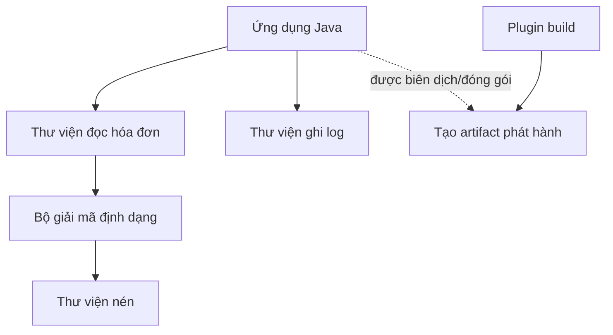
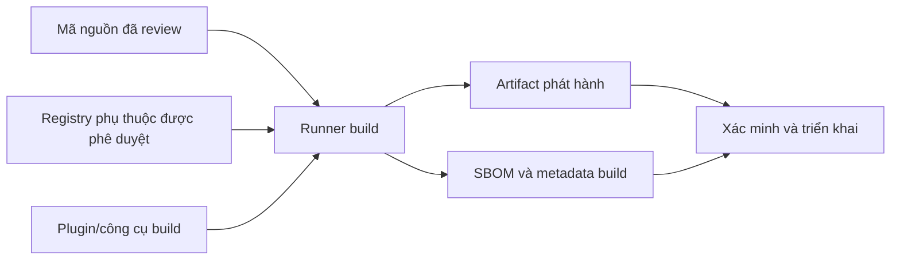

# Phụ thuộc bên ngoài và nguồn gốc thành phần sử dụng

> **Chương:** Bảo mật  
> **Học phần:** CODE_QUALITY_FUNDAMENTALS — Hiểu những thuộc tính quyết định mã nguồn có đáng tin cậy, dễ hiểu và dễ thay đổi hay không.

Một ứng dụng Java hiếm khi chỉ chạy mã do nhóm tự viết. Nó có thể dùng thư viện xử lý JSON, framework web, trình điều khiển cơ sở dữ liệu, công cụ tạo mã, plugin build và cả những thành phần mà các thư viện đó tiếp tục kéo vào. Các thành phần bên ngoài giúp giảm công sức phát triển, nhưng cũng trở thành **một phần của hệ thống được thực thi, đóng gói hoặc dùng để tạo bản phát hành**.

Ví dụ, nhóm thêm một thư viện đọc hóa đơn để tiết kiệm thời gian. Thư viện ấy lại phụ thuộc vào một bộ giải mã định dạng tệp khác. Nếu bộ giải mã có lỗ hổng khi xử lý đầu vào do người dùng cung cấp, ứng dụng có thể bị ảnh hưởng dù mã của nhóm không trực tiếp gọi API nguy hiểm đó. Nếu tệp thư viện tải về không phải bản phát hành mà nhóm dự định sử dụng, việc code review chính ứng dụng cũng chưa đủ để nhận diện thay đổi.

Vì vậy, **chất lượng và bảo mật mã nguồn** còn phụ thuộc vào khả năng trả lời: **đang sử dụng thành phần nào, ai phát hành, lấy từ đâu, có đúng hiện vật đã được chấp nhận không, và sẽ làm gì khi thành phần đó có vấn đề?**

Sau bài học, bạn có thể:

- Nhận diện phụ thuộc trực tiếp, phụ thuộc bắc cầu và các công cụ chạy trong quá trình build.
- Phân biệt danh tính gói, nguồn phát hành, tính toàn vẹn, *provenance* và tình trạng lỗ hổng.
- Dùng danh sách thành phần và đồ thị phụ thuộc để xác định phạm vi ảnh hưởng.
- Đề xuất cách kiểm soát phiên bản, nguồn tải, plugin, quyền CI và quá trình cập nhật.
- Thiết kế một ranh giới Java hạn chế tác động khi dùng thư viện bên thứ ba, kèm kiểm thử phù hợp.

## 1. Phụ thuộc bên ngoài là một phần của bề mặt rủi ro

**Phụ thuộc** (*dependency*) là thành phần mà mã, quá trình build hoặc vận hành cần để hoạt động. Không phải phụ thuộc nào cũng chạy trong ứng dụng sau khi phát hành; một plugin hoặc công cụ sinh mã có thể chỉ chạy trên máy build nhưng vẫn được cấp quyền đọc nguồn, biến môi trường và tạo ra sản phẩm cuối.

Giả sử một ứng dụng xử lý hóa đơn có đồ thị:



Trong sơ đồ:

- `A -> B` là **phụ thuộc trực tiếp**: nhóm khai báo hoặc lựa chọn thư viện đọc hóa đơn.
- `B -> D -> E` là **phụ thuộc bắc cầu** (*transitive dependency*): các thành phần gián tiếp trở thành một phần của đồ thị đã giải quyết.
- `F` là công cụ thuộc **chuỗi build**: nó có thể tác động đến hiện vật phát hành, dù không được đóng gói vào runtime.

**Hệ quả:** danh sách vài thư viện trong tệp build chưa chắc là danh sách đầy đủ những thứ được tải, chạy hoặc đóng gói. Phải xem **đồ thị phụ thuộc thực tế theo từng cấu hình và từng loại artifact**, bao gồm cả đường đi build.

### 1.1. Các nhóm phụ thuộc cần phân biệt

| Nhóm | Ví dụ | Câu hỏi bảo mật đặc biệt |
| --- | --- | --- |
| **Runtime** | Thư viện JSON, bộ xử lý tài liệu, HTTP client | Dữ liệu nào được đưa vào thư viện; thư viện chạy với quyền gì? |
| **Compile-time** | Thư viện API, annotation processor | Có chạy mã trong giai đoạn biên dịch không; nó tạo ra những gì? |
| **Test** | Framework test, mock library, dữ liệu test | Có truy cập bí mật hoặc dịch vụ thật trong CI không? |
| **Build plugin / tool** | Plugin Gradle/Maven, công cụ sinh mã | Ai kiểm soát plugin; nó có thể đọc secrets và sửa artifact không? |
| **Nền tảng và môi trường** | JDK, base image, hệ điều hành, công cụ CI | Bản phát hành và nguồn gốc môi trường build/deploy được quản lý ra sao? |

Các nhóm có cách thực thi và mức phơi nhiễm khác nhau. Tuy nhiên, một phụ thuộc “chỉ dùng khi test” cũng có thể gây tác động nếu runner CI cho phép nó tiếp cận thông tin nhạy cảm. **Không được đồng nhất “không chạy trong production” với “không có rủi ro”.**

## 2. Nguồn gốc thành phần gồm những lớp thông tin nào?

Khi nói “thư viện này đến từ đâu”, cần tách nhiều câu hỏi:

| Lớp kiểm chứng | Câu hỏi | Bằng chứng điển hình |
| --- | --- | --- |
| **Danh tính** | Ta muốn sử dụng gói và phiên bản nào? | Tên nhóm/tên artifact/phiên bản, tọa độ Maven hoặc tên package |
| **Nguồn phân phối** | Hiện vật được tải từ kho nào? | Kho nội bộ, registry được phê duyệt, địa chỉ nguồn phân phối |
| **Tính toàn vẹn** (*integrity*) | Byte nhận được có khớp bản được mong đợi không? | Digest/checksum đáng tin, thông tin xác minh artifact |
| **Tính xác thực** (*authenticity*) | Có bằng chứng đáng tin về bên ký hoặc công bố không? | Chữ ký và danh tính người/khóa ký được xác minh |
| **Nguồn gốc build** (*build provenance*) | Hiện vật được tạo từ nguồn nào, theo quy trình nào? | Attestation hoặc metadata build được xác thực và đối chiếu |
| **Tình trạng an toàn** | Thành phần có vấn đề đã biết hoặc không phù hợp không? | Advisory, kết quả SCA, đánh giá phạm vi sử dụng, thử nghiệm |

Một gói có checksum đúng **không mặc nhiên an toàn**. Checksum chỉ giúp xác định byte có khớp giá trị chuẩn được tin cậy hay không. Nếu giá trị chuẩn được lấy từ chính nguồn đã bị xâm nhập mà không có xác minh độc lập, nó không chứng minh nguồn phân phối đáng tin.

Tương tự, chữ ký hợp lệ hoặc bằng chứng build có thể giúp kiểm tra **ai/cái gì đã ký và quy trình được khai báo**, nhưng không tự chứng minh mã không chứa lỗ hổng hay hành vi độc hại. Nguồn gốc tốt giúp truy vết và tăng độ tin cậy của chuỗi phát hành; **kiểm thử, review và quản lý lỗ hổng vẫn cần thiết**.

### 2.1. Cùng một tên gói không luôn là cùng một hiện vật

Trong hệ sinh thái Maven, một tọa độ thường có dạng:

```text
groupId : artifactId : version
```

Ví dụ giả định:

```text
com.example.docs : receipt-reader : 1.4.2
```

Tọa độ trên chỉ dùng để minh họa; **không phải lời giới thiệu một thư viện có thật**. Để nhận diện hiện vật được sử dụng, còn cần biết nguồn phân phối, biến thể/artifact được chọn, nội dung byte và cách dependency resolver giải quyết xung đột phiên bản.

Giữ một chuỗi phiên bản cố định có ích, nhưng **không tự bảo đảm tính bất biến ở mọi kho**. Việc có thể thay thế artifact đã công bố hay không phụ thuộc chính sách và kiểm soát của kho. Bởi vậy, cố định phiên bản nên đi cùng cơ chế xác minh hiện vật và kiểm soát nguồn tải.

## 3. Các kiểu rủi ro chuỗi cung ứng cần nhận diện

### 3.1. Gói trùng hoặc gần giống tên (*typosquatting*)

Kẻ xấu có thể công bố một gói mang tên gần giống một thư viện được tin dùng, chờ người phát triển gõ sai hoặc sao chép nhầm tên. Trong Java, cần đối chiếu **đầy đủ group ID, artifact ID, repository và chủ thể dự kiến**, không dựa vào một từ khóa quen thuộc trong tên.

**Biện pháp:** lấy tọa độ từ tài liệu nguồn có thẩm quyền, review thay đổi phụ thuộc và tránh thêm thư viện chỉ vì gói đứng đầu kết quả tìm kiếm.

### 3.2. Nhầm lẫn giữa gói nội bộ và gói công khai (*dependency confusion*)

Nếu dự án có một gói nội bộ và quá trình resolve cho phép chọn một gói cùng danh tính từ kho công khai theo quy tắc không được kiểm soát, một hiện vật ngoài ý muốn có thể được tải. Cách xảy ra cụ thể phụ thuộc cơ chế repository và resolver; không phải mọi cấu hình đều dễ bị như nhau.

**Biện pháp:** định rõ kho có thẩm quyền cho từng nhóm gói, cấu hình chính sách repository và quy tắc đối chiếu danh tính, kiểm tra đồ thị resolved từ môi trường CI thay vì chỉ đọc khai báo.

### 3.3. Tài khoản phát hành hoặc quy trình build bị xâm nhập

Một gói có tên đúng vẫn có thể nguy hiểm nếu tài khoản maintainer, khóa ký, hệ thống phát hành hoặc kho lưu trữ bị xâm nhập. Khi đó, “đúng dự án” chưa chắc đồng nghĩa “đúng mã và quy trình mà nhóm đã đánh giá”.

**Biện pháp:** đánh giá kênh phát hành, xác minh metadata/chữ ký/provenance khi có, kiểm soát khóa và quyền truy cập trong chuỗi build, giám sát các thay đổi bất thường của artifact.

### 3.4. Phụ thuộc bắc cầu có lỗ hổng hoặc bị thay đổi

Nhóm có thể không trực tiếp khai báo thư viện bị ảnh hưởng, nhưng nó được kéo vào bởi thành phần khác. Rủi ro phụ thuộc vào **phiên bản thật sự được chọn, đường đi gọi đến chức năng có vấn đề, dữ liệu không tin cậy và các biện pháp bảo vệ hiện có**.

**Biện pháp:** kiểm tra cây phụ thuộc, dùng phân tích thành phần (*Software Composition Analysis — SCA*), xem thông báo bảo mật và xác định mức độ có thể khai thác trong ngữ cảnh ứng dụng.

### 3.5. Plugin build hoặc tác vụ CI chạy mã ngoài ý muốn

Một plugin có thể chạy khi cấu hình, biên dịch, kiểm thử hoặc đóng gói. Nếu nó được cấp quyền đọc secrets, gửi request ra mạng hoặc sửa nội dung artifact, rủi ro không nằm trong đường chạy ứng dụng mà nằm ở **đường tạo ra ứng dụng**.

**Biện pháp:** quản lý plugin như phụ thuộc mã, review phiên bản và nguồn phát hành, hạn chế quyền của runner, tách secrets cần thiết khỏi những job không cần, bảo vệ quy trình xuất bản.

### 3.6. Thư viện không còn được bảo trì

Một thư viện không có bản cập nhật lâu ngày **không tự động có lỗ hổng**, nhưng khi phát sinh lỗi hoặc thay đổi nền tảng, nhóm có thể thiếu người chịu trách nhiệm sửa chữa, thiếu bản phát hành đáng tin hoặc phải tự duy trì bản vá.

**Biện pháp:** đánh giá mức độ bảo trì và khả năng thay thế, không chỉ nhìn số lượt tải hoặc số sao; cân nhắc giảm phạm vi sử dụng, duy trì fork có kiểm soát hay chuyển sang thành phần khác nếu có lý do rõ.

## 4. Phân biệt “có lỗ hổng đã biết” với “có thể khai thác ở đây”

Kết quả SCA có thể phát hiện một phiên bản thư viện liên quan đến advisory. Đó là **tín hiệu điều tra**, không phải kết luận rằng mọi ứng dụng chứa thư viện này đều có cùng mức rủi ro.

Một đánh giá có trách nhiệm phải xác định:

1. **Phiên bản hiện vật được giải quyết thực tế** có nằm trong phạm vi ảnh hưởng không?
2. Mã có chứa **tính năng hoặc đường gọi bị ảnh hưởng** không?
3. Kẻ tấn công có khả năng cung cấp **đầu vào hoặc điều kiện kích hoạt** không?
4. Thư viện chạy trong **môi trường và quyền** nào?
5. Có **bản vá, bản thay thế, giảm thiểu** hoặc cách vô hiệu hóa đường đi nguy hiểm không?
6. Điều gì còn **chưa được xác minh** và ai chấp nhận rủi ro còn lại?

| Tình huống | Đánh giá nên làm |
| --- | --- |
| Thư viện xử lý tài liệu nhận trực tiếp tệp người dùng | Ưu tiên kiểm tra đường xử lý dữ liệu không tin cậy, giới hạn tài nguyên và bản vá |
| Một thư viện có mặt trong classpath nhưng tính năng lỗi không được dùng | Xác minh điều kiện ảnh hưởng; không tự tuyên bố an toàn tuyệt đối |
| Plugin chỉ chạy khi build nhưng có quyền truy cập token phát hành | Xem xét rủi ro chiếm quyền CI và nguồn gốc artifact, không chỉ runtime |
| Kết quả scanner ghi một phiên bản không khớp thực tế | Kiểm tra lockfile/đồ thị resolved, phạm vi scanner và quy tắc chọn phiên bản |

Tài liệu đánh giá khả năng khai thác như VEX (*Vulnerability Exploitability eXchange*) có thể truyền đạt nhận định “có ảnh hưởng hay không” trong ngữ cảnh sản phẩm. Tuy nhiên, một tuyên bố như vậy phải có **căn cứ, thời điểm, phạm vi phiên bản và trách nhiệm cập nhật**; nó không thay thế kiểm tra thực tế.

## 5. Quy trình xem xét trước khi thêm thư viện Java

Thêm một dependency không chỉ là chèn một dòng build file. Có thể sử dụng các câu hỏi sau làm checklist kỹ thuật:

| Câu hỏi | Bằng chứng hoặc hành động mong đợi |
| --- | --- |
| Có thực sự cần phụ thuộc ngoài không? | So sánh với API chuẩn của JDK hoặc thành phần đã có |
| Thư viện làm gì, cần quyền và dữ liệu nào? | Ranh giới xử lý, dữ liệu nhạy cảm, I/O, mạng, file, native code nếu có |
| Tọa độ và nguồn tải có chính xác không? | Đối chiếu với nguồn có thẩm quyền; cấu hình repository được phê duyệt |
| Phiên bản nào được chọn? | Không chỉ phiên bản khai báo mà cả phiên bản resolved trong đồ thị |
| Kéo vào những phụ thuộc bắc cầu nào? | Xem cây phụ thuộc theo compile/runtime/test/build |
| Có advisory hoặc vấn đề bảo trì đáng chú ý không? | SCA, thông tin phát hành, lịch sử bảo trì và đánh giá tác động |
| Hiện vật có được xác minh tính toàn vẹn/nguồn gốc không? | Digest, chữ ký hoặc provenance có chuỗi tin cậy phù hợp |
| Có hợp đồng ổn định để thay thế thư viện sau này không? | Adapter, DTO/kiểu miền nghiệp vụ, kiểm thử tại ranh giới |
| Nếu xảy ra sự cố, ai chịu trách nhiệm nâng cấp hoặc cô lập? | Chủ sở hữu, quy trình phản ứng, kế hoạch kiểm thử hồi quy |

Không nên dùng **số lượng sao, độ nổi tiếng, tên công ty hoặc một báo cáo quét xanh** làm bằng chứng duy nhất. Các tín hiệu ấy có thể hỗ trợ lựa chọn, nhưng không thay cho đánh giá đường sử dụng và chính sách tin cậy của dự án.

### 5.1. Tối thiểu hóa đặc quyền ngay từ lúc chọn thư viện

Nếu mục tiêu chỉ là phân tích một định dạng văn bản, hãy hỏi liệu thư viện có cần:

- Tải mã hoặc cấu hình từ mạng khi chạy?
- Ghi tệp ngoài thư mục xử lý dự kiến?
- Thực thi tiến trình hệ điều hành?
- Truy cập dữ liệu môi trường hoặc secrets?
- Tạo các thread nền, dùng native code hoặc tải plugin động?

Câu trả lời “không cần” giúp thiết kế ranh giới hạn chế khả năng tác động khi thành phần lỗi. Tuy nhiên, những quyền được thực thi bởi tiến trình Java thường **không tự động tách riêng theo từng thư viện**; muốn giới hạn ở mức hệ điều hành/tiến trình có thể cần cô lập runtime phù hợp thay vì chỉ tạo một interface Java.

## 6. Ví dụ Gradle: biết mình khai báo gì và thực sự dùng gì

Giả sử dự án Java cần thư viện phân tích hóa đơn. Một khai báo *minh họa* trong `build.gradle.kts`:

```kotlin
plugins {
    java
}

repositories {
    mavenCentral()
}

dependencies {
    // Tọa độ giả định, chỉ để minh họa; không phải package đã xác minh.
    implementation("com.example.docs:receipt-reader:1.4.2")
}

dependencyLocking {
    lockAllConfigurations()
}
```

Đừng chạy nguyên mẫu trên và kỳ vọng tải được gói `com.example.docs`: **tọa độ và phiên bản là giả định**. Trong dự án thật, thay bằng gói đã được xác minh, chọn repository được phê duyệt và kiểm tra phiên bản Gradle/Java phù hợp.

Khai báo phiên bản cụ thể giúp giảm thay đổi ngoài dự kiến so với các phiên bản động như `1.+` hoặc `latest.release`. Nhưng **phiên bản khai báo** và **phiên bản được chọn cuối cùng** có thể khác khi có phụ thuộc bắc cầu, constraint hoặc quy tắc giải quyết xung đột.

### 6.1. Kiểm tra đồ thị phụ thuộc

Trong một dự án có Java plugin và cấu hình `runtimeClasspath`, các lệnh tham khảo:

```bash
./gradlew dependencies --configuration runtimeClasspath
./gradlew dependencyInsight --dependency receipt-reader --configuration runtimeClasspath
```

Các lệnh trên chỉ mang tính hướng dẫn; **không được thực thi trong bài học này**. Trong một dự án nhiều module, có thể cần chỉ rõ đường dẫn task của module, chẳng hạn `:app:dependencies`. Nếu thư viện nằm ở cấu hình test, compiler hoặc plugin build, phải kiểm tra cấu hình tương ứng; chỉ nhìn `runtimeClasspath` sẽ bỏ sót.

Đồ thị có thể cho biết một bản phụ thuộc bắc cầu xuất hiện qua đường nào và lý do một phiên bản được chọn. Nó chưa tự xác minh artifact tải từ nguồn nào có được phép, được ký đúng hay có chứa mã an toàn.

### 6.2. Khóa phiên bản không đồng nghĩa xác minh byte

**Dependency locking** nhằm cố định các phiên bản được chọn trong cấu hình được quản lý. Muốn sử dụng hiệu quả, nhóm cần tạo và quản lý dữ liệu khóa theo quy trình build, lưu cùng mã nguồn khi phù hợp, và chủ động review thay đổi lockfile.

**Dependency verification** là lớp kiểm soát khác: kiểm tra hiện vật tải về dựa trên metadata xác minh, chẳng hạn checksum hoặc chữ ký khi được cấu hình. Với Gradle, việc tạo metadata lần đầu phải được thực hiện trên một **tập artifact và nguồn tin đã được kiểm tra**. Nếu tạo checksum từ chính một artifact độc hại rồi chấp nhận ngay, công cụ có thể lặp lại sự tin nhầm đó ở các lần sau.

| Kiểm soát | Giúp bảo vệ điều gì? | Không tự giải quyết |
| --- | --- | --- |
| Phiên bản cố định | Hạn chế phụ thuộc tự đổi phiên bản | Nội dung hiện vật bị thay thế ở cùng phiên bản |
| Lockfile | Ghi nhận phiên bản đã resolve theo phạm vi | Nguồn gốc, chữ ký, tính an toàn của mã |
| Kiểm tra checksum/chữ ký | Phát hiện hiện vật không khớp metadata tin cậy | Lỗ hổng có trong artifact được xác minh |
| Repository được phê duyệt | Giảm nguồn tải ngoài ý muốn | Tài khoản phát hành trong kho bị xâm nhập |
| SCA | Phát hiện vấn đề được biết tới trong phạm vi scanner | Lỗi chưa công bố và mọi điều kiện khai thác thực tế |

Không nhất thiết một dự án phải dùng đúng các công cụ hay định dạng trên. Ý tưởng quan trọng là **quản lý cả việc chọn phiên bản lẫn nguồn và byte thực sự được đưa vào build**.

## 7. SBOM: biết sản phẩm được tạo từ những thành phần nào

*Software Bill of Materials* (**SBOM**) là danh mục thành phần phần mềm sử dụng trong một sản phẩm hoặc bản build, thường kèm danh tính và phiên bản. Các định dạng phổ biến gồm **CycloneDX** và **SPDX**.

Một bản SBOM có thể giúp trả lời:

- Bản phát hành đang chứa những thư viện trực tiếp và bắc cầu nào?
- Một thành phần được cảnh báo có xuất hiện trong những phiên bản ứng dụng nào?
- Có phiên bản hoặc nguồn thành phần chưa được xác định rõ không?
- Khi nâng cấp, danh sách thành phần thực sự thay đổi ra sao?

Ví dụ bảng thành phần đơn giản hóa:

| Thành phần (giả định) | Phiên bản | Quan hệ | Nguồn/điểm cần truy vết |
| --- | --- | --- | --- |
| Ứng dụng xử lý hóa đơn | `2.3.0` | Sản phẩm chính | Commit, build ID, artifact phát hành |
| `com.example.docs:receipt-reader` | `1.4.2` | Phụ thuộc trực tiếp | Repository và digest hiện vật đã được phê duyệt |
| `com.example.codec:format-decoder` | `3.1.0` | Phụ thuộc bắc cầu | Đường phụ thuộc từ `receipt-reader` |

Các tọa độ trong bảng **chỉ là dữ liệu mẫu**. SBOM phải phản ánh **thành phần thực sự có trong phạm vi bản phát hành được mô tả**, không chỉ sao chép nội dung khai báo ban đầu. Cần nêu phạm vi rõ: SBOM runtime không nhất thiết bao gồm công cụ CI, plugin build hoặc toàn bộ thành phần của base image; có thể phải tạo các danh mục khác nhau tùy mục tiêu truy vết.

**SBOM không phải chứng nhận an toàn.** Nó tăng khả năng nhìn thấy thành phần và truy vấn phạm vi ảnh hưởng khi có sự cố. Chất lượng SBOM phụ thuộc vào độ đầy đủ, độ chính xác của metadata và khả năng liên kết nó với đúng phiên bản artifact đang chạy.

## 8. Kiểm soát nguồn gốc trong pipeline build và phát hành

Đường tạo artifact có thể được hình dung:



Một chuỗi kiểm soát thực dụng cần xử lý:

1. **Nguồn mã:** xác định commit và thay đổi được chấp nhận; hạn chế sửa trực tiếp nhánh phát hành.
2. **Phụ thuộc:** tải qua các repository được quản lý, xác minh danh tính và hiện vật, review thay đổi graph/lockfile.
3. **Công cụ build:** quản lý phiên bản plugin, task và runner; xem chúng như mã có thể thực thi.
4. **Quyền CI:** chỉ cấp token, khóa và quyền phát hành cho job thật sự cần; tránh để tác vụ từ nguồn chưa tin cậy tiếp cận secrets.
5. **Artifact:** lưu digest, định danh bản build và metadata nguồn gốc; bảo vệ khỏi thay thế sau khi đã phê duyệt.
6. **Triển khai:** xác minh artifact đang triển khai khớp bản đã được chấp nhận, thay vì chỉ tin tên tệp hoặc nhãn phiên bản.

Những hệ thống có yêu cầu cao có thể dùng **attestation** hoặc mô hình như **SLSA** để mô tả và tăng khả năng xác minh nguồn gốc build. Cần kiểm tra **bên tạo bằng chứng có đáng tin, dữ liệu gì đã được xác minh và mức bảo đảm thực sự đạt được**, không chỉ nhìn thấy một tệp provenance.

### 8.1. Quyền chạy build là một ranh giới bảo mật

Nếu một pull request chưa được review có thể khiến job chạy plugin mới với quyền đọc token xuất bản, kẻ tấn công không cần tìm lỗ hổng trong ứng dụng. Họ có thể tấn công trực tiếp chuỗi tạo artifact.

Giảm rủi ro bằng cách tách job build/kiểm thử không tin cậy khỏi job có quyền phát hành, bảo vệ thay đổi cấu hình CI, giới hạn secrets và dùng cơ chế phê duyệt phù hợp. Cách triển khai cụ thể phụ thuộc hệ thống CI và mô hình tin cậy của tổ chức.

## 9. Bọc thư viện ngoài sau một ranh giới Java có ý nghĩa

Kiểm tra nguồn gốc không khiến mọi thư viện trở nên vô hại. Khi ứng dụng phải dùng thư viện phân tích dữ liệu do người dùng cung cấp, nên giới hạn những gì đưa qua ranh giới, làm rõ hợp đồng và không phát tán kiểu dữ liệu riêng của vendor khắp hệ thống.

Ví dụ dùng một adapter để kết nối bộ giải mã hóa đơn bên ngoài:

```java
// ReceiptDecoder.java
@FunctionalInterface
public interface ReceiptDecoder {
    ParsedReceipt decode(byte[] bytes);
}
```

```java
// ParsedReceipt.java
import java.util.Objects;

public final class ParsedReceipt {
    private final String receiptId;
    private final long amountVnd;

    public ParsedReceipt(String receiptId, long amountVnd) {
        this.receiptId = Objects.requireNonNull(receiptId, "receiptId");
        this.amountVnd = amountVnd;
    }

    public String getReceiptId() {
        return receiptId;
    }

    public long getAmountVnd() {
        return amountVnd;
    }
}
```

```java
// ReceiptImportService.java
import java.util.Objects;

public final class ReceiptImportService {
    private static final int MAX_INPUT_BYTES = 1_048_576;
    private final ReceiptDecoder decoder;

    public ReceiptImportService(ReceiptDecoder decoder) {
        this.decoder = Objects.requireNonNull(decoder, "decoder");
    }

    public ParsedReceipt importReceipt(byte[] input) {
        if (input == null || input.length == 0
                || input.length > MAX_INPUT_BYTES) {
            throw new IllegalArgumentException("Invalid receipt size");
        }

        ParsedReceipt receipt = decoder.decode(input.clone());
        if (receipt == null || receipt.getReceiptId().isBlank()
                || receipt.getAmountVnd() < 0L) {
            throw new IllegalStateException("Invalid decoded receipt");
        }
        return receipt;
    }
}
```

Ví dụ này dùng `String.isBlank()` (Java 11 trở lên). `ReceiptDecoder` là **hợp đồng nội bộ**; adapter thật sẽ gọi API của một thư viện đã được đánh giá. Không có câu lệnh nào trong ví dụ giả định rằng thư viện mang tọa độ ở phần trước thực sự tồn tại.

Lợi ích của ranh giới:

- **Tên và kiểu miền nghiệp vụ** nằm trong mã ứng dụng, hạn chế việc nhiều module phụ thuộc trực tiếp vào kiểu của vendor.
- **Giới hạn kích thước đầu vào** được kiểm tra trước khi truyền sang bộ giải mã. Việc `clone()` tránh để decoder trực tiếp sửa mảng gốc của bên gọi, dù không loại bỏ mọi tác dụng phụ của thư viện.
- **Kết quả được xác minh** theo hợp đồng ứng dụng: có mã hóa đơn và số tiền không âm.
- **Thay thế thư viện** có thể tập trung trong adapter nếu hợp đồng nội bộ được giữ.
- **Kiểm thử đơn vị** có thể dùng một fake decoder để xác minh logic ranh giới độc lập với bộ phân tích ngoài.

Điểm giới hạn quan trọng: **giới hạn độ dài đầu vào không bảo đảm decoder không tiêu tốn CPU/bộ nhớ quá mức**, và một interface Java **không phải sandbox**. Nếu thư viện phân tích dữ liệu nguy hiểm chạy cùng tiến trình và quyền với ứng dụng, nó vẫn có thể truy cập các tài nguyên mà tiến trình được phép dùng. Với rủi ro cao, cần cân nhắc cô lập tiến trình/container, giới hạn tài nguyên, timeout, quyền tối thiểu và những biện pháp phù hợp môi trường.

### 9.1. JUnit 5 kiểm tra ranh giới mà không cần thư viện vendor

```java
import static org.junit.jupiter.api.Assertions.assertEquals;
import static org.junit.jupiter.api.Assertions.assertThrows;

import org.junit.jupiter.api.Test;

class ReceiptImportServiceTest {
    @Test
    void acceptsValidDecodedReceipt() {
        ReceiptDecoder decoder = bytes ->
                new ParsedReceipt("REC-1", 200_000L);
        ReceiptImportService service = new ReceiptImportService(decoder);

        ParsedReceipt actual = service.importReceipt(new byte[] {1, 2});

        assertEquals("REC-1", actual.getReceiptId());
        assertEquals(200_000L, actual.getAmountVnd());
    }

    @Test
    void rejectsEmptyInputBeforeCallingDecoder() {
        ReceiptDecoder mustNotRun = bytes -> {
            throw new AssertionError("Decoder must not be called");
        };
        ReceiptImportService service = new ReceiptImportService(mustNotRun);

        assertThrows(IllegalArgumentException.class,
                () -> service.importReceipt(new byte[0]));
    }

    @Test
    void rejectsInvalidDecodedData() {
        ReceiptImportService service = new ReceiptImportService(
                bytes -> new ParsedReceipt("REC-2", -1L));

        assertThrows(IllegalStateException.class,
                () -> service.importReceipt(new byte[] {5}));
    }
}
```

Các test này chứng minh **hợp đồng của adapter ở những tình huống đã nêu**, không chứng minh thư viện thực tế an toàn khi xử lý tệp độc hại. Cần bổ sung kiểm thử tích hợp với phiên bản thư viện thật, các mẫu dữ liệu hợp lệ/không hợp lệ, giới hạn tài nguyên và luồng lỗi phù hợp với rủi ro sản phẩm.

### 9.2. Tránh để phụ thuộc bên ngoài quyết định toàn bộ miền nghiệp vụ

Một API như:

```java
VendorReceiptDocument loadReceipt(byte[] input);
```

được công bố xuyên qua nhiều module sẽ khiến các nơi gọi hiểu cấu trúc và hành vi của `VendorReceiptDocument`. Khi thay vendor hoặc nâng cấp major version, phạm vi chỉnh sửa có thể rất lớn. Thay vì vậy, `ParsedReceipt` chỉ công bố thông tin ứng dụng cần.

Không nhất thiết phải có một adapter cho mọi thư viện nhỏ. Nên tạo ranh giới khi thư viện xử lý dữ liệu có rủi ro, chứa hợp đồng phức tạp, thường thay đổi hoặc là chi tiết triển khai không nên lan rộng.

## 10. Cập nhật phụ thuộc mà vẫn bảo vệ hành vi

“Nâng phiên bản mới nhất” không phải quy trình đầy đủ. Một bản phát hành mới có thể chứa bản vá bảo mật, đồng thời đổi API, điều kiện lỗi, phụ thuộc bắc cầu hoặc hành vi với dữ liệu đầu vào. Cần vừa **giảm thời gian phơi nhiễm với vấn đề đã biết**, vừa có bằng chứng rằng ứng dụng vẫn đáp ứng hợp đồng.

Một quy trình cập nhật có thể gồm:

1. **Xác định lý do:** bản vá bảo mật, hết hỗ trợ, cải thiện tương thích hay yêu cầu tính năng.
2. **Xác nhận nguồn phát hành:** tọa độ, repository, chủ thể phát hành, metadata và tính toàn vẹn của artifact mới.
3. **So sánh thay đổi:** phiên bản trực tiếp, đồ thị bắc cầu, plugin/build tool và những file lock/metadata liên quan.
4. **Đọc tác động:** release notes, advisory, thay đổi API/behavior, yêu cầu Java/runtime hoặc cấu hình mới.
5. **Kiểm thử theo rủi ro:** unit, integration, negative test, dữ liệu không tin cậy, hiệu năng hoặc khả năng tương thích nếu liên quan.
6. **Phát hành có kiểm soát:** xác minh artifact và quan sát lỗi, độ trễ, tính toàn vẹn dữ liệu sau triển khai.
7. **Ghi lại bằng chứng:** phạm vi đã kiểm tra, kết quả, rủi ro còn lại và người phụ trách theo dõi.

Khi có lỗ hổng nghiêm trọng, không nhất thiết chờ một đợt nâng cấp lớn với tất cả thay đổi khác. Có thể ưu tiên bản vá nhỏ, cô lập đường đi nguy hiểm hoặc áp dụng giảm thiểu ngắn hạn có kiểm chứng. **Giảm thiểu** không mặc nhiên tương đương **đã vá triệt để**; cần ghi rõ thời hạn và giới hạn.

### 10.1. Cập nhật một phụ thuộc có thể thay đổi nhiều thành phần

Giả sử nâng `receipt-reader` từ `1.4.2` lên `1.5.0` khiến resolver chọn một phiên bản `format-decoder` khác. Một test chỉ kiểm tra chức năng thường gặp có thể không phát hiện thay đổi khi xử lý tệp hỏng hoặc dữ liệu lớn.

Vì thế, nên review **dependency graph diff** và các tình huống lỗi gắn với phiên bản mới. Lockfile và SBOM của bản build mới giúp ghi nhận những thành phần thực sự thay đổi.

### 10.2. Rollback không hoàn tác mọi hậu quả

Nếu phiên bản phụ thuộc đã ghi dữ liệu sai hoặc để lộ thông tin, quay lại artifact cũ có thể ngăn lỗi tiếp tục nhưng **không tự khôi phục dữ liệu hoặc thu hồi thông tin đã lộ**. Quy trình ứng phó còn cần xác định ảnh hưởng, đối soát, sửa dữ liệu, xử lý thông tin bí mật và thông báo khi có nghĩa vụ.

## 11. Khi một phụ thuộc bị nghi ngờ bị xâm nhập

Không nên tiếp tục tải hoặc phát hành một thành phần đang bị nghi ngờ chỉ để “chạy thử xem có sao không” trên máy có quyền truy cập dữ liệu nhạy cảm. Quy trình phản ứng cần phù hợp mức độ nghiêm trọng, nhưng thường gồm:

1. **Xác định hiện vật:** tọa độ, phiên bản, digest, nguồn tải, thời điểm build và danh sách sản phẩm/bản phát hành đã dùng nó.
2. **Ngăn lan rộng:** tạm dừng các lần cập nhật hoặc phát hành có rủi ro, khóa/quarantine hiện vật theo quy trình nội bộ, giới hạn secrets và quyền liên quan.
3. **Đánh giá phạm vi:** runtime, build, CI, người dùng, dữ liệu và các hệ thống được kết nối.
4. **Đối chiếu bằng chứng:** log build, SBOM, metadata phát hành, cảnh báo và thông tin từ nguồn có thẩm quyền; tránh tự suy đoán rằng tên gói đúng là đủ.
5. **Khôi phục an toàn:** lựa chọn phiên bản đã xác minh, rebuild theo chuỗi tin cậy, thay/thu hồi credentials nếu cần, triển khai và theo dõi.
6. **Ghi nhận sự cố:** bài học, lỗ hổng trong quy trình phê duyệt, cách cải thiện xác minh phụ thuộc và phản ứng lần sau.

Nếu nghi ngờ runner hoặc chuỗi build đã bị xâm nhập, chỉ thay version trong `build.gradle` có thể chưa đủ. Cần xem xét **tính tin cậy của môi trường tạo artifact**; một build mới chạy trên nền đã bị xâm nhập không tự tạo ra sản phẩm đáng tin.

## 12. Những ngộ nhận và đánh đổi thường gặp

### “Gói nổi tiếng chắc chắn an toàn”

Mức phổ biến có thể cho thấy cộng đồng sử dụng lớn, nhưng không bảo đảm mọi phiên bản đều không có lỗ hổng hoặc tài khoản phát hành không thể bị xâm nhập. Cần đánh giá hiện vật và đường sử dụng cụ thể.

### “Chỉ cần cố định version là xong”

Phiên bản cố định hạn chế thay đổi ngoài ý muốn của lựa chọn phiên bản, nhưng chưa xác nhận byte tải về, nguồn phát hành hoặc tình trạng lỗ hổng. Nên kết hợp lockfile, repository policy và verification phù hợp.

### “Có checksum nghĩa là thư viện không có mã độc”

Checksum từ nguồn đáng tin giúp xác minh một tập byte, không đánh giá ý định của mã. Nếu hiện vật gốc đã bị cài mã độc, checksum của chính nó vẫn đúng. Cần phân biệt **tính toàn vẹn** với **mức độ an toàn của nội dung**.

### “Không thấy CVE nghĩa là không có rủi ro”

Advisory và SCA chỉ phản ánh những vấn đề được biết, có dữ liệu và được công cụ hỗ trợ. Lỗ hổng chưa được công bố, lỗi tích hợp hoặc chuỗi build bị xâm nhập vẫn có thể tồn tại.

### “Thư viện chỉ dùng khi build hoặc test thì không quan trọng”

Những thành phần ấy có thể chạy trong CI và ảnh hưởng artifact hoặc secrets. Cần đánh giá theo **quyền thực thi và phạm vi ảnh hưởng**, không chỉ theo việc có đóng gói vào ứng dụng hay không.

### “SBOM là bằng chứng sản phẩm bảo mật”

SBOM là danh mục để truy vết và phân tích; nó không tự chứng minh đã review mã, đã kiểm soát mọi nguồn tải hoặc mọi lỗi đã được xử lý. Giá trị phụ thuộc vào tính chính xác và khả năng liên kết với bản phát hành thật.

### “Interface Java có thể sandbox thư viện nguy hiểm”

Interface giúp kiểm soát **hợp đồng và coupling**, nhưng mã trong cùng tiến trình thường vẫn có cùng quyền hệ điều hành. Với đầu vào không tin cậy và rủi ro cao, cần thêm giới hạn tài nguyên và cô lập thực thi thích hợp.

### “Càng ít thư viện càng tốt, không cần xem chất lượng”

Loại phụ thuộc không cần thiết giúp giảm phạm vi rủi ro và chi phí bảo trì, nhưng tự viết một bộ xử lý tài liệu phức tạp hoặc thuật toán mật mã không được kiểm chứng có thể nguy hiểm hơn dùng một thành phần phù hợp, được duy trì và đánh giá tốt. Cần cân bằng **rủi ro phụ thuộc** với **rủi ro tự xây dựng**.

## 13. Checklist dành cho người review và phát hành

| Câu hỏi | Nếu chưa trả lời được |
| --- | --- |
| Ta biết tất cả phụ thuộc trực tiếp và bắc cầu trong bản build chưa? | Kiểm tra resolved graph và phạm vi SBOM |
| Tọa độ, version và repository có được phê duyệt không? | Đối chiếu nguồn phát hành, tránh nhầm tên/kho |
| Có kiểm soát tính toàn vẹn và bằng chứng nguồn gốc phù hợp không? | Xây dựng chuỗi metadata đáng tin, không lấy checksum từ nguồn nghi vấn |
| Có theo dõi vấn đề bảo mật đã biết không? | Bổ sung SCA/advisory và đánh giá đường sử dụng |
| Các plugin build và runner CI có được coi là thành phần tin cậy cần kiểm soát không? | Kiểm tra quyền, secrets, bản phát hành và cấu hình pipeline |
| Thư viện có nhận dữ liệu không tin cậy không? | Kiểm tra giới hạn, mẫu dữ liệu lỗi, tài nguyên và sandbox khi cần |
| Các kiểu và chi tiết vendor có lan khắp codebase không? | Xem xét adapter và API miền nghiệp vụ |
| Có thể truy vết chính xác thành phần tới artifact đang chạy không? | Liên kết SBOM, commit, build ID, digest và phiên bản triển khai |
| Khi cập nhật, có xem lại các phụ thuộc bắc cầu không? | So sánh lockfile/graph và kết quả kiểm thử |
| Nếu phát hiện phụ thuộc bị xâm nhập, có biết dừng, kiểm tra và khôi phục thế nào không? | Xác định người phụ trách và quy trình phản ứng |

## 14. Bài tập áp dụng

Một nhóm phát triển dịch vụ Java nhận tệp hóa đơn do khách hàng tải lên. Nhóm dự định thêm:

```kotlin
dependencies {
    // Hai tọa độ hoàn toàn giả định cho bài tập.
    implementation("com.example.docs:receipt-reader:1.4.2")
    implementation("com.example.tools:report-helper:2.0.0")
}
```

Khi review, nhóm phát hiện:

- `receipt-reader` kéo thêm `format-decoder` và `compression-core` dưới dạng phụ thuộc bắc cầu.
- Có một cảnh báo bảo mật dành cho một số phiên bản `format-decoder`, nhưng chưa xác định phiên bản mà bản build này thực sự chọn.
- `report-helper` đến từ một repository chưa có trong danh sách được phê duyệt.
- Pipeline CI chạy plugin đóng gói có quyền truy cập token phát hành.
- Ứng dụng hiện trả về mã lỗi chung khi phân tích thất bại và chưa giới hạn kích thước tệp tải lên.

Hãy trả lời các câu hỏi:

1. Vẽ đồ thị phụ thuộc, chỉ rõ phần trực tiếp, phần bắc cầu và công cụ chỉ chạy khi build.
2. Những thông tin nào cần thu thập trước khi quyết định có dùng `receipt-reader`? Phân biệt **tên gói**, **nguồn tải**, **phiên bản được resolve**, **checksum** và **tình trạng lỗ hổng**.
3. Nếu một phiên bản bị cảnh báo xuất hiện trong classpath, điều gì cần xác minh để đánh giá mức rủi ro của dịch vụ xử lý tệp người dùng?
4. Với `report-helper` đến từ nguồn chưa phê duyệt, bạn sẽ kiểm tra và kiểm soát những gì trước khi cho phép build tải về?
5. Hãy đề xuất cách phân biệt dữ liệu đầu vào không hợp lệ, lỗi parser và thành công, thay vì nuốt lỗi rồi trả một hóa đơn rỗng.
6. Vẽ ranh giới Java tối thiểu giữa ứng dụng và thư viện đọc hóa đơn. Nêu nơi giới hạn kích thước tệp, xác minh kết quả và nơi cần chạy kiểm thử tích hợp.
7. Nếu `format-decoder` được cập nhật, cần xem những bằng chứng nào để xác nhận bản build mới dùng đúng artifact đã duyệt và vẫn xử lý các tệp cũ hợp lệ?
8. Nếu nghi ngờ plugin CI bị xâm nhập, tại sao chỉ nâng cấp thư viện runtime có thể chưa đủ? Trình bày cách giảm ảnh hưởng tới secrets và artifact phát hành.

**Gợi ý:** đừng dừng ở câu “chạy công cụ quét và nếu xanh thì chấp nhận”. Một lời giải tốt phải chỉ rõ **thành phần thực sự được dùng, từ nguồn nào, với quyền nào, trong đường đi nào và bằng chứng nào giúp nhóm tự tin rằng việc sử dụng đó đáp ứng hợp đồng và mức rủi ro được chấp nhận**.

## Ghi nhớ

Phụ thuộc bên ngoài đem lại khả năng tái sử dụng nhưng cũng mở rộng **ranh giới tin cậy** của sản phẩm và quá trình build. Để quản lý chúng, cần nhìn thấy cả phụ thuộc trực tiếp lẫn bắc cầu, xác minh danh tính/nguồn phát hành/hiện vật, theo dõi lỗ hổng, bảo vệ CI và giữ khả năng truy vết đến đúng bản phát hành. Checksum, chữ ký, SBOM và SCA mỗi công cụ trả lời một câu hỏi khác nhau; không công cụ nào tự chứng minh an toàn tuyệt đối. Chất lượng mã đáng tin cậy đến từ **quyết định dùng thành phần có căn cứ, ranh giới rõ, kiểm thử phù hợp và khả năng phản ứng khi nguồn tin cậy thay đổi**.
