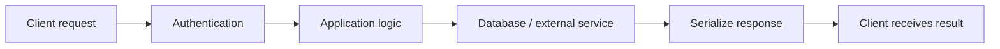
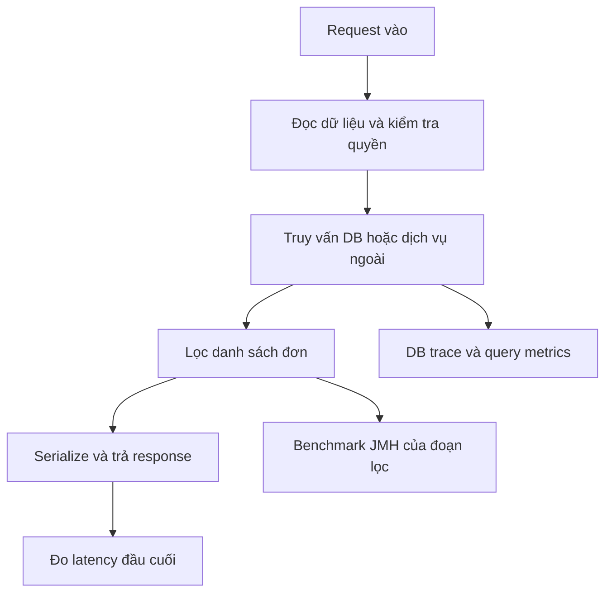

# Đo trước khi tối ưu phần mã có ảnh hưởng

## 1. Tại sao hiệu năng cần bằng chứng thay vì trực giác?

Một đoạn Java có nhiều vòng lặp hoặc một truy vấn trông dài chưa chắc là nguyên nhân khiến người dùng chờ lâu. Ngược lại, một dòng mã đơn giản gọi dịch vụ bên ngoài có thể chiếm phần lớn thời gian phản hồi. Nếu tối ưu dựa trên cảm giác, nhóm có thể làm code khó đọc hơn mà người dùng hầu như không nhận được lợi ích.

Trong module `CODE_QUALITY_FUNDAMENTALS`, người học tìm hiểu **những thuộc tính quyết định mã nguồn có đáng tin cậy, dễ hiểu và dễ thay đổi hay không**. Chủ đề thuộc chương **Hiệu năng và tài nguyên** này là: **đo trước khi tối ưu phần mã có ảnh hưởng**. Đây không chỉ là kỹ năng tăng tốc chương trình, mà còn là cách giữ chất lượng thiết kế: dựa vào dữ liệu để tránh thêm độ phức tạp không cần thiết và không đánh đổi tính đúng đắn lấy một kết quả đo chưa đáng tin.

Giả sử API xem đơn hàng phản hồi chậm. Nhóm dự định thay `ArrayList` bằng `HashMap` trong một đoạn tìm kiếm, vì cho rằng tra cứu bằng map luôn nhanh hơn. Tuy nhiên, đo thực tế có thể cho thấy thời gian chủ yếu nằm ở truy vấn database, trong khi đoạn tìm kiếm chỉ chiếm phần rất nhỏ. Nếu vậy, tối ưu cấu trúc dữ liệu chưa chắc thay đổi được thời gian người dùng thấy.

Ngược lại, nếu profiling cho thấy việc so khớp hàng nghìn mã khách hàng diễn ra lặp lại trong đường xử lý nóng, thay đổi cấu trúc dữ liệu có thể hợp lý. Điều kiện là **phải đo đúng đường đi**, kiểm chứng hai cách xử lý cho kết quả giống nhau và xem cả chi phí bộ nhớ.

### Mục tiêu sau bài học

- Phân biệt **mục tiêu người dùng** với chỉ số kỹ thuật như CPU, allocation, latency, throughput và GC.
- Biết lập đường đo ban đầu (*baseline*) trước khi thay mã.
- Dùng quan sát hệ thống, profiling và benchmark đúng cấp độ để tìm phần mã có ảnh hưởng.
- Hiểu ví dụ Java so sánh tra cứu danh sách và tập hợp, bao gồm tính đúng đắn và đánh đổi bộ nhớ.
- Nhận diện sai lầm phổ biến khi đo hiệu năng JVM: cold start, JIT, GC, dữ liệu không đại diện, đo lẫn I/O và benchmark bị loại bỏ công việc.
- Đánh giá kết quả tối ưu có đáng giữ khi tính cả độ phức tạp, độ tin cậy và chi phí vận hành.

## 2. Trước khi đo: xác định vấn đề và kết quả cần cải thiện

Một yêu cầu chung chung như “làm API nhanh hơn” chưa đủ để chọn vị trí tối ưu. Trước tiên, cần biết **ai đang bị ảnh hưởng**, **thao tác nào chậm**, **trong điều kiện nào** và **mức thay đổi nào được coi là hữu ích**.

| Câu hỏi | Ví dụ câu trả lời cần xác minh |
| --- | --- |
| Người dùng gặp vấn đề gì? | Danh sách đơn hàng tải chậm khi lọc theo mã khách hàng |
| Phạm vi ảnh hưởng? | Endpoint đọc đơn hàng trong giờ cao điểm |
| Điều kiện tái hiện? | Khoảng 10.000 đơn và 5.000 mã khách hàng bị loại khỏi bộ lọc |
| Tiêu chí chính? | Thời gian phản hồi p95 của endpoint ở mức tải đã định |
| Tiêu chí bảo vệ? | Tỷ lệ lỗi, kết quả lọc, CPU, bộ nhớ và thời gian GC không xấu đi quá giới hạn |
| Giới hạn nguồn lực? | Ngân sách bộ nhớ hiện tại, số instance, thời gian review và kiểm thử |
| Mục tiêu phát hành? | Có bằng chứng đo trước/sau và phương án rollback nếu tải tăng |

Các con số trong bảng chỉ là **dữ liệu giả định cho tình huống học tập**, không phải số liệu của một hệ thống thực tế.

### 2.1. Phân biệt mục tiêu và chỉ số đại diện

Nếu mục tiêu là người dùng nhận kết quả sớm hơn, hãy ưu tiên đo thời gian phản hồi đầu cuối và tỷ lệ thành công của hành vi liên quan. CPU hay allocation là các chỉ số **giải thích hoặc cảnh báo**, nhưng CPU giảm không mặc nhiên đồng nghĩa giao diện nhanh hơn.

Nếu mục tiêu là giảm chi phí vận hành, cần đo throughput trên mỗi instance, mức dùng CPU/bộ nhớ ở cùng tải, số instance cần để giữ SLO và chi phí hạ tầng. Một hàm chạy nhanh hơn trong microbenchmark có thể không làm giảm chi phí nếu dịch vụ chủ yếu chờ I/O.

Nếu mục tiêu là tránh hết bộ nhớ, chỉ đo thời gian trung bình chưa đủ: cần theo dõi heap, allocation rate, bộ nhớ ngoài heap khi liên quan, số lần GC và các giới hạn tài nguyên trong container.

### 2.2. Mục tiêu đo phải đủ cụ thể

Một mục tiêu tốt có dạng:

> Với bộ dữ liệu và mức tải đại diện đã xác định, giảm latency p95 của endpoint lọc đơn hàng mà không thay đổi thứ tự và tập kết quả; đồng thời không làm tăng lỗi hoặc vượt ngân sách bộ nhớ cho phép.

Mục tiêu này không ấn định một kỹ thuật như “phải dùng cache” hay “phải thêm thread”. Nó để phép đo quyết định giải pháp.

## 3. Đo đúng đại lượng: latency, throughput và tài nguyên

| Đại lượng | Ý nghĩa | Rủi ro khi diễn giải |
| --- | --- | --- |
| **Latency** | Thời gian một thao tác hoàn tất | Trung bình tốt vẫn có thể che request rất chậm |
| **p50 / p95 / p99** | Phân vị thời gian phản hồi: lần lượt khoảng 50%, 95%, 99% số quan sát không vượt giá trị đó | Cần đủ mẫu, cửa sổ đo phù hợp; p99 dễ dao động nếu ít dữ liệu |
| **Throughput** | Số thao tác xử lý mỗi đơn vị thời gian | Tăng throughput có thể đi kèm latency và lỗi tăng |
| **CPU utilization** | Tỷ lệ tài nguyên CPU được sử dụng trong khoảng đo | CPU thấp có thể do chờ I/O, khóa hoặc thiếu tải |
| **Heap / RSS / native memory** | Các cách nhìn khác nhau về mức dùng bộ nhớ | Heap nhỏ không đồng nghĩa bộ nhớ tiến trình nhỏ |
| **Allocation rate** | Tốc độ cấp phát đối tượng/bộ nhớ | Allocation cao có thể kéo theo áp lực GC nhưng không tự động là lỗi |
| **GC pause / GC time** | Thời gian ứng dụng dành hoặc bị tạm dừng bởi GC | Cần xét collector, phiên bản JVM và đặc điểm tải |
| **Error / timeout rate** | Tỷ lệ yêu cầu thất bại hoặc quá hạn | “Nhanh hơn” nhờ bỏ qua xử lý hoặc trả lỗi sớm không phải cải thiện hữu ích |
| **Queue depth / saturation** | Mức tồn đọng hoặc nghẽn tài nguyên | Có thể chỉ ra bottleneck ngoài phần mã đang được chú ý |

**p95** không có nghĩa “95% request đều mất đúng bằng thời gian đó”. Nó là ngưỡng phân vị của một tập quan sát theo quy tắc tính cụ thể. Cũng không thể lấy trung bình số học p95 của từng instance rồi tuyên bố đó là p95 toàn hệ thống; cần tổng hợp từ phân phối hoặc histogram tương thích.

### 3.1. Chọn đường đo tương ứng với hành vi

Một yêu cầu HTTP có thể đi qua:



Đo tổng latency từ B đến E cho biết backend mất bao lâu; đo từ A đến F có thể bao gồm cả mạng và client. **Hai con số trả lời hai câu hỏi khác nhau.** Nếu vấn đề là người dùng thấy chậm, dữ liệu từ client hoặc synthetic end-to-end có thể cần thiết. Nếu muốn tìm nguyên nhân tại backend, cần trace và số đo theo thành phần.

### 3.2. Không tối ưu riêng tốc độ mà quên tính đúng đắn

Một bản sửa khiến API trả nhanh hơn vì bỏ kiểm tra quyền, không truy vấn đủ dữ liệu, không đợi giao dịch hoàn tất hoặc bỏ qua trạng thái lỗi là **giảm chất lượng**, không phải tối ưu thành công. Số liệu hiệu năng nên đi cùng chỉ số đúng nghiệp vụ: số bản ghi trả về, trạng thái giao dịch, tính duy nhất, độ chính xác của tiền và tỷ lệ lỗi.

## 4. Tìm điểm nghẽn trước khi sửa mã

Các bước chẩn đoán thường đi từ rộng đến hẹp:

1. **Nhìn toàn hệ thống:** endpoint nào vi phạm mục tiêu? Chậm theo thời điểm, kích thước dữ liệu hay tải đồng thời?
2. **Đọc metrics:** CPU có bão hòa không, hàng đợi tăng không, pool kết nối còn chỗ không, GC có tăng không?
3. **Đối chiếu tracing:** thời gian tập trung ở logic Java, SQL, HTTP ngoài hay serialization?
4. **Profile tiến trình đúng tải:** phương thức nào tiêu thụ CPU hoặc cấp phát nhiều? Có chờ lock, I/O hoặc thread pool không?
5. **Tạo giả thuyết kiểm chứng được:** “Danh sách mã bị loại được duyệt tuyến tính cho từng đơn hàng, gây tăng CPU khi kích thước danh sách lớn.”
6. **Chỉ sau đó mới đề xuất thay đổi:** đổi cấu trúc dữ liệu, tối ưu truy vấn, điều chỉnh batching, giới hạn số lượng hay cache theo nhu cầu.

### 4.1. Những công cụ và nguồn bằng chứng trong Java

| Phương pháp | Dùng để trả lời | Lưu ý |
| --- | --- | --- |
| Metrics ứng dụng (ví dụ Micrometer/OpenTelemetry) | Endpoint chậm, tỷ lệ lỗi, phân vị, throughput | Nhãn metric phải kiểm soát cardinality, không gắn ID người dùng |
| Distributed tracing | Request nào chờ DB/HTTP hay gọi lặp nhiều lần | Sampling và instrumentation có overhead; không phải mọi request đều có trace |
| Java Flight Recorder (JFR) | CPU, allocation, GC, lock và một số hành vi JVM | Chọn cấu hình phù hợp; sự kiện và mức chi tiết tùy JDK |
| Java Mission Control / công cụ đọc JFR | Điều tra bản ghi JFR | Cần hiểu bộ lọc và điều kiện tải |
| CPU / allocation profiler | Hàm nóng, nguồn cấp phát nhiều | Sampling và instrumentation có giới hạn; đo lại trong điều kiện đại diện |
| DB query plan / query metrics | SQL chậm, scan, index, N+1 query | Phải đo trong dữ liệu và thống kê phù hợp; cache ảnh hưởng kết quả |
| Load test ở môi trường kiểm soát | Latency, throughput, saturation khi số user tăng | Cần giới hạn an toàn, xác định mô hình tải và dữ liệu |
| JMH | So sánh đoạn mã Java nhỏ, in-process | Không thay thế đo API, DB, network hoặc toàn hệ thống |

Tại thời điểm cần đo thực tế, chọn công cụ dựa trên JDK, framework và quyền vận hành đang có. **Không phải cứ bật profiler ở production với cấu hình thu thập tối đa là an toàn**: overhead, dữ liệu nhạy cảm và giới hạn CPU/đĩa cần được kiểm soát.

### 4.2. CPU hotspot không đồng nghĩa toàn bộ nguyên nhân

Một hàm chiếm 70% CPU của thread đang chạy có thể là nơi đáng nghiên cứu, nhưng nếu request dành 90% thời gian để đợi mạng, giảm CPU ở hàm đó chưa chắc cải thiện nhiều latency đầu cuối.

Tương tự, nếu 90% thời gian CPU thuộc một job nền không nằm trên đường xử lý người dùng đang phàn nàn, tối ưu job đó có thể giảm chi phí tài nguyên nhưng chưa giải quyết được mục tiêu của endpoint. Phải nối **bottleneck với tác động cần cải thiện**.

## 5. Một mô hình đơn giản: giới hạn lợi ích khi chỉ tối ưu một phần

Định luật Amdahl giúp kiểm tra kỳ vọng trong trường hợp một phần thời gian có thể tăng tốc và phần còn lại không đổi:

\[
S = \frac{1}{(1-f) + f/s}
\]

Trong đó:

- \(f\) là **tỷ phần thời gian** của phần được tối ưu trong thời gian ban đầu;
- \(s\) là hệ số tăng tốc của phần đó;
- \(S\) là hệ số tăng tốc tối đa của toàn thao tác theo mô hình này.

**Ví dụ giả định:** nếu 20% thời gian xử lý nằm trong logic Java đang tối ưu và 80% còn lại là công việc không đổi, làm logic Java nhanh gấp đôi (\(s=2\)) chỉ cho:

\[
S = \frac{1}{0.8 + 0.2/2}
  = \frac{1}{0.9}
  \approx 1.11
\]

Nghĩa là toàn thao tác nhanh hơn khoảng **1,11 lần**, tương ứng thời gian tổng giảm khoảng **10%** trong giả định lý tưởng. Đây không phải kết quả benchmark thực, và thực tế còn bị ảnh hưởng bởi tải đồng thời, phân bổ tài nguyên, cache, GC và những phần tương tác với nhau.

Bài học: **đừng chỉ nhìn “hàm nhanh hơn 2 lần”**; cần biết hàm đó chiếm bao nhiêu thời gian trên đường đi quan trọng.

## 6. Ví dụ Java: tối ưu vòng lọc có ảnh hưởng, giữ nguyên kết quả

### 6.1. Bối cảnh và giả thuyết

Một API cần giữ lại các đơn hàng có mã khách hàng **không nằm trong danh sách bị chặn**. Với dữ liệu giả định, mỗi request có thể xử lý hàng nghìn đơn và hàng nghìn mã bị chặn.

Yêu cầu nghiệp vụ:

- Giữ nguyên **thứ tự tương đối** của các đơn được phép.
- Không làm mất hoặc tạo thêm đơn.
- So khớp mã khách hàng chính xác theo `String.equals`; không tự đổi chữ hoa/thường.
- Danh sách mã bị chặn có thể trùng lặp; trùng lặp không thay đổi ý nghĩa kiểm tra.
- Dữ liệu đầu vào đã được kiểm tra theo hợp đồng, `Order` không được null và mã khách hàng không rỗng.
- Phương thức không được sửa dữ liệu đầu vào.

**Giả thuyết:** nếu mỗi đơn đều gọi `List.contains` trên một danh sách bị chặn dài, tổng số phép so sánh có thể tăng mạnh. Việc tạo `HashSet` một lần cho request có thể có lợi khi danh sách đủ lớn.

### 6.2. Cách hiện tại: tra cứu tuyến tính

Đặt ví dụ Java 17 trong tệp `OrderFilters.java`:

```java
import java.util.ArrayList;
import java.util.HashSet;
import java.util.List;
import java.util.Objects;
import java.util.Set;

public final class OrderFilters {
    private OrderFilters() {}

    public record Order(String orderId, String customerId) {
        public Order {
            if (orderId == null || orderId.isBlank()) {
                throw new IllegalArgumentException("orderId must not be blank");
            }
            if (customerId == null || customerId.isBlank()) {
                throw new IllegalArgumentException("customerId must not be blank");
            }
        }
    }

    public static List<Order> filterUsingList(
            List<Order> orders, List<String> blockedCustomerIds) {

        Objects.requireNonNull(orders, "orders");
        Objects.requireNonNull(blockedCustomerIds, "blockedCustomerIds");

        List<Order> allowed = new ArrayList<>();
        for (Order order : orders) {
            if (!blockedCustomerIds.contains(order.customerId())) {
                allowed.add(order);
            }
        }
        return List.copyOf(allowed);
    }

    public static List<Order> filterUsingSet(
            List<Order> orders, List<String> blockedCustomerIds) {

        Objects.requireNonNull(orders, "orders");
        Objects.requireNonNull(blockedCustomerIds, "blockedCustomerIds");

        Set<String> blockedLookup = new HashSet<>(blockedCustomerIds);
        List<Order> allowed = new ArrayList<>();
        for (Order order : orders) {
            if (!blockedLookup.contains(order.customerId())) {
                allowed.add(order);
            }
        }
        return List.copyOf(allowed);
    }
}
```

Hai phương thức cùng trả danh sách mới, giữ thứ tự đơn ban đầu và dùng so sánh chuỗi với cùng ngữ nghĩa cho dữ liệu hợp lệ. Nếu danh sách `orders` có phần tử null, cả hai đều có thể ném lỗi tại `order.customerId()`; ví dụ đặt điều kiện dữ liệu đã được kiểm tra, không coi null order là đầu vào được chấp nhận.

### 6.3. Phân tích độ phức tạp chỉ là giả thuyết ban đầu

Ký hiệu:

- \(n\): số đơn hàng cần lọc;
- \(m\): số mã khách hàng bị chặn.

Với danh sách thông thường, `contains` cần duyệt tối đa \(m\) phần tử mỗi lần, nên chi phí tìm kiếm có thể ở bậc **\(O(nm)\)**. Với `HashSet`, xây tập hợp thường tốn khoảng **\(O(m)\)**, còn tra cứu kỳ vọng gần **\(O(1)\)** mỗi lần, nên tổng chi phí trung bình khoảng **\(O(n+m)\)**, chưa kể tạo danh sách kết quả.

Đây là phân tích **theo mô hình trung bình**; hiệu năng `HashSet` thực tế chịu ảnh hưởng phân bố hash, so sánh chuỗi, kích thước dữ liệu, JVM và cache. Đặc biệt, phiên bản dùng set thêm bộ nhớ cỡ **\(O(m)\)** cho cấu trúc tra cứu, bên cạnh vùng nhớ cho danh sách kết quả.

**Quan trọng:** nếu \(m\) chỉ có 2 hoặc 3, chi phí cấp phát `HashSet` có thể lớn hơn lợi ích của việc tra cứu. Nếu danh sách bị chặn được chia sẻ và tái sử dụng qua nhiều request, xây lại tập hợp mỗi lần có thể không tối ưu; nhưng cache/tái sử dụng lại cần quy tắc làm mới, bất biến dữ liệu và an toàn đồng thời. Chỉ phép đo mới quyết định phương án nào phù hợp với tải thật.

### 6.4. Kiểm thử tương đương hành vi trước khi benchmark

```java
import static org.junit.jupiter.api.Assertions.*;
import java.util.List;
import org.junit.jupiter.api.Test;

class OrderFiltersTest {
    @Test
    void keepsOrderAndIgnoresDuplicateBlockedIds() {
        var orders = List.of(
                new OrderFilters.Order("o1", "c1"),
                new OrderFilters.Order("o2", "c2"),
                new OrderFilters.Order("o3", "c3"),
                new OrderFilters.Order("o4", "c1"));

        var blockedIds = List.of("c2", "c2", "other");

        var expected = List.of(
                new OrderFilters.Order("o1", "c1"),
                new OrderFilters.Order("o3", "c3"),
                new OrderFilters.Order("o4", "c1"));

        assertEquals(expected,
                OrderFilters.filterUsingList(orders, blockedIds));
        assertEquals(expected,
                OrderFilters.filterUsingSet(orders, blockedIds));
    }

    @Test
    void preservesAllOrdersWhenBlockedListIsEmpty() {
        var orders = List.of(new OrderFilters.Order("o1", "c1"));

        assertEquals(orders, OrderFilters.filterUsingList(orders, List.of()));
        assertEquals(orders, OrderFilters.filterUsingSet(orders, List.of()));
    }

    @Test
    void doesNotIgnoreCaseWithoutBusinessRequirement() {
        var orders = List.of(new OrderFilters.Order("o1", "ABC"));

        assertEquals(orders, OrderFilters.filterUsingList(orders, List.of("abc")));
        assertEquals(orders, OrderFilters.filterUsingSet(orders, List.of("abc")));
    }
}
```

Những kiểm thử này bảo vệ **hợp đồng lọc**, không xác nhận bên nào chạy nhanh hơn. Cần thêm test về null/giá trị không hợp lệ nếu ranh giới ứng dụng cho phép nhận đầu vào chưa kiểm tra. Với dữ liệu lớn hoặc ngẫu nhiên, có thể dùng **property-based testing** để so sánh hai implementation trên nhiều danh sách hợp lệ, song kết quả thử nghiệm vẫn phải được diễn giải đúng phạm vi.

Không bắt đầu tối ưu bằng việc thay đổi nghĩa của `customerId` hoặc lọc bỏ đơn trùng nếu điều đó không thuộc yêu cầu.

## 7. Đo đoạn mã Java đúng cách: tại sao nên dùng JMH cho microbenchmark?

Một cách đo thủ công phổ biến là:

```java
long started = System.nanoTime();
for (int i = 0; i < 1000; i++) {
    OrderFilters.filterUsingSet(orders, blockedIds);
}
long elapsedNanos = System.nanoTime() - started;
```

Đoạn này có thể hữu ích để thử nghiệm nhanh, nhưng **không đủ để công bố kết luận benchmark đáng tin** vì kết quả bị ảnh hưởng bởi warmup, JIT compiler, dead-code elimination, garbage collection, thứ tự chạy, nhiệt độ CPU, mức tải nền và cách chuẩn bị dữ liệu.

**Java Microbenchmark Harness (JMH)** là một công cụ chuyên dụng để đo các thao tác Java nhỏ trên JVM. Nó cung cấp warmup, measurement iterations, fork và cách tiêu thụ kết quả nhằm giảm một số cạm bẫy thường gặp. Dùng JMH khi muốn kiểm tra **đúng giả thuyết về đoạn mã**; sau đó vẫn phải xác nhận tác động ở API hoặc workload thực tế.

### 7.1. Ví dụ JMH so sánh hai phương án

Đoạn sau là benchmark Java 17 minh họa, yêu cầu dự án đã cấu hình **dependency JMH** và plugin hoặc cách chạy benchmark tương ứng. Không phải một unit test JUnit và không được biên dịch chỉ với JDK tiêu chuẩn nếu thiếu thư viện JMH.

```java
import java.util.ArrayList;
import java.util.List;
import java.util.concurrent.TimeUnit;
import org.openjdk.jmh.annotations.*;

@State(Scope.Thread)
@BenchmarkMode(Mode.AverageTime)
@OutputTimeUnit(TimeUnit.MICROSECONDS)
@Warmup(iterations = 5, time = 1)
@Measurement(iterations = 5, time = 1)
@Fork(2)
public class OrderFilterBenchmark {
    @Param({"100", "10000"})
    public int orderCount;

    @Param({"10", "5000"})
    public int blockedCount;

    private List<OrderFilters.Order> orders;
    private List<String> blockedIds;

    @Setup(Level.Trial)
    public void prepareData() {
        List<OrderFilters.Order> generatedOrders = new ArrayList<>();
        for (int i = 0; i < orderCount; i++) {
            generatedOrders.add(
                    new OrderFilters.Order("o-" + i, "c-" + (i % 20000)));
        }
        orders = List.copyOf(generatedOrders);

        List<String> generatedBlocked = new ArrayList<>();
        for (int i = 0; i < blockedCount; i++) {
            generatedBlocked.add("c-" + (i * 2));
        }
        blockedIds = List.copyOf(generatedBlocked);
    }

    @Benchmark
    public List<OrderFilters.Order> listLookup() {
        return OrderFilters.filterUsingList(orders, blockedIds);
    }

    @Benchmark
    public List<OrderFilters.Order> setLookup() {
        return OrderFilters.filterUsingSet(orders, blockedIds);
    }
}
```

Trong JMH, giá trị trả về của một benchmark method được harness tiêu thụ theo cách phù hợp nhằm giảm nguy cơ công việc bị JVM loại bỏ vì kết quả không dùng. Hai phương án đo cùng tập dữ liệu chuẩn bị ở `@Setup`, nên không tính thời gian tạo fixture vào mỗi lượt. Tuy vậy, **việc xây `HashSet` bên trong `filterUsingSet` được đo**, vì đó là chi phí thật của phương án mỗi-request.

Lựa chọn `@Param` tạo ra các tổ hợp dữ liệu khác nhau: tập nhỏ và tập lớn. Đây là minh họa phương pháp, không phải mô hình workload của một doanh nghiệp cụ thể. Trong dự án thật, cần chọn thêm phân bố trùng lặp, tỷ lệ mã bị chặn, độ dài chuỗi và kích thước dữ liệu dựa trên thông tin đã được phép thu thập từ hệ thống.

### 7.2. Những gì phải ghi cùng kết quả

Một báo cáo microbenchmark có thể tái hiện cần nêu:

- Phiên bản JDK, JVM flags quan trọng và garbage collector.
- Thông số CPU, hệ điều hành, cấp phát tài nguyên cho tiến trình và điều kiện tải nền.
- Phiên bản JMH, mode, forks, warmup, measurement, số lần lặp và cách chọn tham số.
- Kiểu và phân bố dữ liệu, tỷ lệ match, dữ liệu có được xây trong pha đo hay không.
- Giá trị đo, đơn vị, độ dao động và độ bất định phù hợp (không chỉ một con số đẹp nhất).
- Phiên bản/commit của mã trước và sau thay đổi.
- Kiểm thử chức năng chứng minh hai giải pháp giữ cùng hành vi.

JMH có thể đo cả hoạt động cấp phát qua công cụ hỗ trợ profiling phù hợp, chẳng hạn cơ chế GC profiler của JMH khi phiên bản đó hỗ trợ. Nhưng **số byte cấp phát trong microbenchmark không phải tự động là footprint của cả dịch vụ**; cần quan sát heap/RSS và GC dưới tải thực.

### 7.3. Không được kết luận trước khi chạy

Từ phân tích độ phức tạp, ta **dự đoán** phiên bản dùng `HashSet` có thể tốt hơn khi cả \(n\) và \(m\) lớn. Ta **không được báo** “tối ưu nhanh hơn X lần” hay “giảm Y MB” khi chưa chạy benchmark và đo tài nguyên. Những con số ấy còn có thể thay đổi khi đổi JDK hoặc phân bố dữ liệu.

Chỉ khi có số đo thực và bảo vệ tính đúng đắn mới quyết định giữ phương án tối ưu.

## 8. Microbenchmark không thay thế load test và quan sát đầu cuối

Giả sử benchmark chứng minh lọc bằng set nhanh hơn trên bộ dữ liệu lớn. Khi chạy API thật, còn có các chi phí:



Nếu đoạn lọc chỉ chiếm một phần nhỏ tổng latency, tốc độ của JMH không tương đương tốc độ endpoint. Nếu set tăng allocation và kích hoạt GC nhiều hơn ở tải đồng thời cao, lợi ích CPU cục bộ có thể bị triệt tiêu hoặc đảo chiều.

Vì vậy, một kế hoạch đo đầy đủ nên gồm ba tầng:

1. **Chẩn đoán hệ thống:** xác định endpoint, lượng tải và thành phần đang gây chậm.
2. **Đo thay đổi cục bộ:** dùng test và benchmark phù hợp để kiểm tra giả thuyết.
3. **Đo tích hợp / tải đại diện:** xác nhận latency, throughput, CPU, memory, GC và error rate trước/sau.

Nếu kết quả JMH tốt nhưng p95 endpoint không đổi, điều đó không nhất thiết nghĩa JMH sai; có thể phần mã vừa tối ưu **không phải nút thắt đủ lớn**.

## 9. Thiết kế phép đo trước và sau sao cho công bằng

Một phép so sánh không có kiểm soát dễ tạo kết luận sai. Ví dụ chạy phiên bản A lúc hệ thống nhàn rỗi, phiên bản B lúc database quá tải rồi khẳng định B chậm hơn là thiếu cơ sở.

### 9.1. Giữ các điều kiện quan trọng tương đương

| Thành phần | Cần kiểm soát hoặc ghi nhận |
| --- | --- |
| Workload | Cùng tập thao tác, tần suất và phân bố kích thước dữ liệu |
| Dataset | Kích thước, mức trùng lặp, độ chọn lọc và phiên bản dữ liệu |
| Runtime | JDK, JVM args, cấu hình thread pool và GC |
| Hạ tầng | CPU, RAM, mức giới hạn container, database và mạng |
| Cách đo | Cùng vị trí đo, cách tính phân vị, cửa sổ và số lượng mẫu |
| Warmup | Đảm bảo hai bên đạt trạng thái vận hành phù hợp trước khi đo steady-state |
| Môi trường | Tránh nhiễu từ tác vụ nền; ghi lại nhiễu khi không loại bỏ được |
| Tính đúng đắn | Cùng kết quả nghiệp vụ, dữ liệu và tỷ lệ lỗi |
| Tải đồng thời | Cùng mô hình số client/arrival rate; quan sát saturation |

Nên thực hiện nhiều lượt đo hoặc phép đo độc lập và xem **độ dao động**, không chọn ngẫu nhiên một lượt nhanh nhất. Chỉ nhìn trung bình có thể bỏ qua tail latency; nhưng chỉ nhìn p99 với rất ít mẫu cũng dễ gây hiểu lầm.

### 9.2. Hiểu warmup và cold start

Trên JVM, các đoạn mã có thể được diễn dịch trước khi JIT biên dịch và tối ưu các đường đi nóng. Class loading, cache, tạo connection pool và khởi tạo dependency cũng ảnh hưởng thời gian đầu tiên.

Cần phân biệt hai mục tiêu:

- **Steady-state performance:** ứng dụng đã ổn định sau warmup; đo dưới tải đại diện.
- **Startup/cold-path latency:** thời gian khởi động, scale-from-zero hoặc request đầu tiên cũng là mục tiêu sản phẩm.

Không được làm nóng trước rồi tuyên bố startup nhanh; cũng không được dùng một phép đo cold start để so sánh hiệu năng steady-state của hai thuật toán.

### 9.3. Đo allocation và GC cùng latency

Một tối ưu giảm thời gian CPU nhưng tăng số đối tượng cấp phát có thể ảnh hưởng GC khi hệ thống xử lý nhiều request đồng thời. Với ví dụ lọc đơn, phương án set cấp phát thêm bảng hash. Khi tải cao và heap hạn chế, cần quan sát:

- Allocation rate hoặc byte cấp phát mỗi thao tác (nếu công cụ đo cho phép).
- Bộ nhớ heap và RSS theo thời gian, đặc biệt khi có áp lực tài nguyên.
- Tần suất và thời lượng GC pause.
- Tỷ lệ lỗi, timeout và throughput ở cùng mức tải.

Không tự động loại bỏ phương án set chỉ vì cấp phát thêm; mục tiêu là kiểm tra chi phí đó có làm xấu **hành vi hệ thống** vượt mức chấp nhận được hay không.

## 10. Những tối ưu dễ làm sai vì không đo đúng bottleneck

### 10.1. Cache quá sớm

Cache có thể giảm thời gian truy vấn nhưng làm phức tạp tính mới của dữ liệu, invalidation và sử dụng bộ nhớ. Cần biết tỷ lệ truy cập lặp, chi phí miss, TTL và hậu quả của dữ liệu cũ. Với tồn kho hoặc trạng thái thanh toán, trả dữ liệu cũ có thể làm sai nghiệp vụ.

Trước khi thêm cache, đo xem truy vấn thật chiếm bao nhiêu thời gian và đánh giá có thể cải thiện chỉ mục, batching hoặc mô hình truy vấn hay không.

### 10.2. Thêm thread hoặc xử lý song song

Song song có thể giúp tác vụ CPU phù hợp và phần việc độc lập, nhưng cũng tăng overhead, cạnh tranh CPU, allocation và rủi ro race condition. Nếu bottleneck nằm ở pool kết nối database đã bão hòa, thêm thread có thể chỉ làm hàng đợi dài hơn.

Đo CPU, khả năng song song, thread pool, khóa, tài nguyên phụ thuộc và tỷ lệ lỗi trước khi mở rộng concurrency.

### 10.3. Thay cấu trúc dữ liệu theo lý thuyết mà không xét đầu vào

`HashMap` hoặc `HashSet` có kỳ vọng tra cứu tốt nhưng đi kèm chi phí hash, bảng và bộ nhớ. Với tập dữ liệu rất nhỏ hoặc ít lần tra cứu, `ArrayList` có thể đơn giản và đủ nhanh. Với nhiều lần tra cứu, set có thể có lợi. Cần đo kích thước điển hình, kích thước cực đại và tỷ lệ match.

### 10.4. Tối ưu Java trong khi SQL gây N+1

Một vòng lặp Java gọi repository cho từng dòng hàng có thể kích hoạt hàng nghìn truy vấn. Thay `for` bằng stream không giảm số chuyến đi tới database. Dùng trace/query metrics để phát hiện N+1; nếu xác nhận, cân nhắc batch query hoặc cách tải dữ liệu phù hợp, đồng thời kiểm tra kích thước dữ liệu, phân trang, transaction và giới hạn tham số SQL.

### 10.5. Bỏ validation hoặc xử lý lỗi để “nhanh hơn”

Nếu bỏ kiểm tra quyền, dùng dữ liệu chưa xác thực hoặc trả thành công trước khi giao dịch hoàn tất, số đo có thể đẹp lên vì làm **ít việc hơn yêu cầu**. Khi so sánh, cả hai phiên bản phải đáp ứng **cùng hợp đồng** và trường hợp lỗi.

### 10.6. Tối ưu chỉ vì code trông “nặng”

Một phương thức có nhiều lớp nhưng không nằm trên đường nóng có thể không đáng ưu tiên. Một đoạn code ngắn gọi HTTP liên tục lại có thể chiếm phần lớn latency. **Profiler và tracing**, không phải độ dài hàm hoặc sở thích cú pháp, mới giúp định vị.

## 11. Đưa tối ưu vào production mà không đánh mất khả năng phục hồi

Kết quả tốt trong môi trường thử nghiệm chưa chắc giữ nguyên ở production, nơi dữ liệu khác, tải biến động và nhiều phiên bản có thể chạy song song.

Quy trình phát hành có kiểm soát:

1. **Giữ baseline** của phiên bản đang chạy, bao gồm chỉ số nghiệp vụ và lỗi.
2. **Bảo vệ hành vi** bằng test đơn vị, test tích hợp và các bất biến chịu ảnh hưởng.
3. **Triển khai giới hạn** qua canary, feature flag hoặc rollout theo tỷ lệ khi hệ thống cho phép.
4. **So sánh các nhóm tương đương** về lưu lượng, dữ liệu và thời gian; tránh khẳng định nhân quả từ hai tập tải khác nhau.
5. **Quan sát latency p95/p99, throughput, CPU, memory, GC và error rate** trong cửa sổ đủ ý nghĩa.
6. **Có điều kiện rollback rõ** nếu tính đúng đắn, lỗi hoặc dùng tài nguyên vượt ngưỡng.
7. **Kiểm tra dữ liệu và tương thích** nếu tối ưu thay cache, thứ tự kết quả, thuật toán phân trang hoặc giao thức.
8. **Cập nhật tài liệu quyết định**: đo gì, vì sao chọn giải pháp và giả định nào cần xem lại.

Một cải tiến cục bộ chỉ nên được coi là thành công khi **kết quả đo đầu cuối và hợp đồng nghiệp vụ** phù hợp mục tiêu đã đặt.

### Chú ý tới khả năng quan sát và dữ liệu nhạy cảm

Khi thêm metrics/tracing để chẩn đoán, không gắn `customerId`, token hoặc toàn bộ URL chứa dữ liệu nhạy cảm làm nhãn metric có cardinality lớn. Dùng nhóm route, loại thao tác hoặc mã lỗi ổn định; correlation ID dành cho log/trace theo chính sách bảo mật phù hợp. Đo lường cũng có overhead, nên chọn sampling và mức chi tiết phù hợp.

## 12. Một mẫu báo cáo quyết định tối ưu

Khi review một đề xuất performance, hãy yêu cầu bằng chứng theo cấu trúc ngắn sau:

```text
Vấn đề:
  Endpoint lọc đơn chậm ở workload lớn (giả định đã xác minh).

Hợp đồng không được phá:
  Giữ đúng tập đơn và thứ tự, không thay đổi quy tắc so khớp mã.

Baseline:
  [Chỉ điền số đo thật] p50/p95, throughput, CPU, heap, GC, error rate.
  Ghi JDK, môi trường, khối lượng dữ liệu, tải và cửa sổ đo.

Giả thuyết:
  List.contains được gọi n lần trên danh sách dài m phần tử.

Bằng chứng định vị:
  Tracing/profiler xác nhận đoạn lọc chiếm phần đáng kể trên đường nóng.

Phương án:
  Dựng HashSet một lần mỗi request trước khi lọc.

Kiểm tra đúng đắn:
  Test thứ tự, duplicate IDs, case sensitivity, tập rỗng, dữ liệu sai.

Microbenchmark:
  [Số đo JMH thực], nhiều kích thước n và m; đo allocation khi cần.

Đánh giá tích hợp:
  [Số đo thực] latency endpoint, CPU/memory/GC dưới cùng workload.

Đánh đổi:
  Chi phí HashSet O(m) bộ nhớ; có thể chậm hơn với m rất nhỏ.

Quyết định:
  Giữ/không giữ tối ưu dựa trên mục tiêu và số đo thực.

Giám sát sau phát hành:
  Chỉ số, ngưỡng rollback và người chịu trách nhiệm.
```

Không cần một tài liệu dài cho mọi sửa đổi nhỏ, nhưng các dữ kiện này giúp tránh “tối ưu thành công” chỉ vì ai đó chụp một ảnh benchmark nhanh hơn.

## 13. Checklist khi đánh giá một thay đổi hiệu năng

- [ ] Vấn đề có tác động tới người dùng hoặc tài nguyên vận hành đã được mô tả cụ thể?
- [ ] Có baseline từ cùng đường xử lý và điều kiện đo phù hợp?
- [ ] Đã xác định bottleneck bằng số đo, profiling, trace hoặc query metrics?
- [ ] Có giả thuyết về nguyên nhân và dự đoán có thể bác bỏ được?
- [ ] Đã phân biệt CPU time, wall-clock latency, chờ I/O và GC?
- [ ] Dữ liệu benchmark phản ánh kích thước, phân bố và tỷ lệ match quan trọng?
- [ ] Với Java, đã tính đến warmup, JIT, fork, GC và cách tiêu thụ kết quả?
- [ ] Có test chứng minh hành vi cũ và mới tương đương trong các ca quan trọng?
- [ ] Đã đo cả CPU, bộ nhớ/allocation và tỷ lệ lỗi khi thay đổi có thể ảnh hưởng chúng?
- [ ] Đã xác nhận lợi ích đầu cuối, không chỉ dựa vào microbenchmark?
- [ ] Có kiểm soát nhiễu, số lần chạy và độ dao động của kết quả?
- [ ] Đã cân nhắc chi phí phức tạp thêm và cách rollback?
- [ ] Có kế hoạch quan sát sau triển khai để biết giả thuyết còn đúng không?

Một checklist được đánh dấu đầy đủ **không tự thay thế dữ liệu thực**. Giá trị của nó là buộc người thực hiện chỉ ra bằng chứng cần thu thập và giới hạn của kết luận.

## 14. Bài tập thực hành và câu hỏi tự đánh giá

### Bài 1 — Tối ưu sai chỗ

Một API trả phản hồi sau 900 ms. Trace giả định cho biết khoảng 760 ms là thời gian chờ dịch vụ ngoài, 100 ms là database, 40 ms là logic Java. Một lập trình viên đề xuất tối ưu logic Java nhanh gấp đôi.

Hãy ước tính **giới hạn lợi ích lý tưởng** khi chỉ cải thiện phần Java, chỉ ra chỉ số nên đo thêm và đề xuất nơi chẩn đoán tiếp. Phân biệt tối ưu latency với tối ưu chi phí CPU.

### Bài 2 — HashSet luôn nhanh hơn?

Hai tập dữ liệu: (A) 20 đơn, 3 mã khách hàng bị chặn; (B) 50.000 đơn, 10.000 mã bị chặn. Cả hai dùng phép lọc cùng nghĩa với bài. Hãy dự đoán đánh đổi CPU và bộ nhớ, chọn các `@Param` hợp lý trong JMH và mô tả cách xác nhận ngoài microbenchmark.

### Bài 3 — JMH chạy “quá nhanh”

Một benchmark tạo đối tượng nhưng không dùng kết quả, chạy một vòng lặp trên máy tác giả và công bố tốc độ “nhanh gấp 100 lần” mà không có warmup hoặc fork.

Hãy nêu các nguồn sai lệch, đề xuất cách thiết kế benchmark tránh dead-code elimination và yêu cầu dữ kiện tối thiểu trước khi chấp nhận kết luận.

### Bài 4 — Cache làm sai dữ liệu

Tối ưu endpoint tồn kho bằng cache khiến p95 giảm, nhưng lượng hàng còn lại đôi lúc sai sau khi nhiều request mua cùng lúc. Hãy xác định thuộc tính chất lượng đã bị phá, mức nhất quán cần làm rõ, các test concurrency và tín hiệu quan sát phải bổ sung.

### Bài 5 — CPU thấp nhưng latency cao

Một service có CPU 25%, p99 tăng mạnh và queue request dài. Hãy đề xuất phép đo để phân biệt nghẽn database, thread pool, lock, I/O ngoài hoặc GC. Giải thích vì sao thêm nhiều thread có thể làm hệ thống tệ hơn.

### Bài 6 — Benchmark tốt, người dùng không thấy cải thiện

JMH cho thấy một hàm nhanh hơn đáng kể trên tập dữ liệu lớn, nhưng latency đầu cuối của API gần như không đổi. Hãy vận dụng mô hình phần thời gian bị tối ưu, so sánh thời gian cục bộ với thời gian chờ I/O và đề xuất liệu nên giữ tối ưu có thêm bộ nhớ hay không.

### Bài 7 — Kiểm tra tương đương hành vi

Hai phiên bản lọc đơn hàng cùng trả đúng số phần tử trong một fixture, nhưng bản mới tự chuyển mã khách hàng về chữ thường rồi lọc. Hãy chỉ ra vì sao chỉ assert số lượng là chưa đủ, viết các trường hợp test cần có, và mô tả rủi ro thay đổi hợp đồng khi triển khai.

Mỗi bài cần trả lời đủ: **mục tiêu → bằng chứng baseline → giả thuyết → phép đo → kiểm chứng đúng đắn → đánh đổi → kết luận trong phạm vi bằng chứng**.

## 15. Ghi nhớ

- **Đo trước khi tối ưu**: bắt đầu từ vấn đề người dùng hoặc tài nguyên thật, không từ đoạn code trông chậm.
- **Xác định phần có ảnh hưởng**: tracing, profiling và metrics giúp nối điểm nghẽn với đường xử lý đang cần cải thiện.
- **Chọn thước đo phù hợp**: latency phân vị, throughput, CPU, memory, allocation, GC và error rate cho các góc nhìn khác nhau.
- **Microbenchmark không phải end-to-end benchmark**: JMH hữu ích cho giả thuyết về đoạn Java nhỏ; lợi ích vẫn phải được đo trên workload thật.
- **JVM có đặc thù đo lường**: JIT, warmup, GC, workload, dead-code elimination và nhiễu môi trường có thể khiến kết quả sai lệch.
- **Độ phức tạp lý thuyết là điểm khởi đầu**: `HashSet` có thể giảm công việc tra cứu trung bình nhưng tăng chi phí xây tập và bộ nhớ; hiệu quả tùy dữ liệu.
- **Tính đúng đắn là điều kiện bắt buộc**: kết quả lọc, dữ liệu tiền tệ, quyền, transaction và hành vi lỗi không được đổi chỉ để có số đo nhanh hơn.
- **Đánh giá ở cấp hệ thống**: một hàm nhanh hơn chưa chắc làm endpoint nhanh hơn; có thể còn chi phí DB, mạng, serialization và saturation.
- **Giữ tối ưu có bằng chứng**: lựa chọn cuối cùng phải xét cải thiện quan sát được, chi phí thêm, khả năng bảo trì và kế hoạch phục hồi.

Điểm cốt lõi của chất lượng mã nguồn là **không hy sinh khả năng hiểu và thay đổi để đổi lấy một “tối ưu” chưa chứng minh được lợi ích**. Hãy dùng số đo để biết phần mã nào thực sự ảnh hưởng, dùng kiểm thử để giữ nguyên cam kết nghiệp vụ và chỉ chọn độ phức tạp kỹ thuật tương xứng với lợi ích đã được kiểm chứng.
