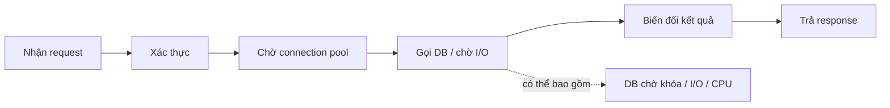

# Chi phí tính toán, cấp phát, I/O và chờ

Trong module `CODE_QUALITY_FUNDAMENTALS`, chất lượng mã nguồn không chỉ nằm ở việc chương trình trả kết quả đúng, mà còn ở mức độ **đáng tin cậy, dễ hiểu và dễ thay đổi** khi vận hành với khối lượng công việc thực tế. Ở chương **Hiệu năng và tài nguyên**, việc phân biệt **chi phí tính toán**, **cấp phát bộ nhớ**, **I/O** và **chờ đợi** giúp người phát triển xác định nguyên nhân làm một chức năng chậm hoặc tiêu tốn tài nguyên, thay vì tối ưu theo cảm giác.

Một API mất 400 ms không có nghĩa CPU đã tính toán trong 400 ms. Trong khoảng thời gian đó, luồng xử lý có thể chỉ sử dụng CPU 15 ms, còn lại đợi kết nối cơ sở dữ liệu, truy vấn SQL, phản hồi từ dịch vụ khác hoặc một khóa đang bị giữ. Ngược lại, một tác vụ xử lý hàng triệu bản ghi có thể gần như không gọi mạng nhưng sử dụng nhiều CPU, liên tục tạo đối tượng tạm và gây áp lực lên bộ thu gom rác.

**Mục tiêu bài học** là xây dựng cách suy luận từ công việc của chương trình đến tài nguyên bị sử dụng, thu thập bằng chứng đo lường, rồi chọn thay đổi có lợi ích rõ ràng mà vẫn giữ tính đúng đắn.

Sau bài học, người học có thể:

- Phân biệt thời gian thực tế của yêu cầu (*wall-clock latency*) với thời gian CPU, chờ và hoạt động I/O.
- Nhận biết chi phí thuật toán, tạo đối tượng, GC, truy vấn DB, mạng, khóa và hàng đợi trong ứng dụng Java.
- Phân tích một ví dụ chậm vì lặp gọi dữ liệu ngoài và thiết kế phương án tải theo lô.
- Hiểu vì sao tối ưu một điểm nhỏ có thể không cải thiện hiệu năng tổng thể.
- Dùng đo lường, tracing, profiler và kiểm thử tải để kiểm chứng một giả thuyết tối ưu.
- Đánh đổi hiệu năng với bộ nhớ, tính đúng đắn, độ phức tạp và khả năng phục hồi.

## 1. Thời gian phản hồi không chỉ là thời gian tính toán

Khi người dùng nhấn “Thanh toán”, thời gian họ cảm nhận là khoảng từ lúc bắt đầu gửi yêu cầu đến lúc nhận được phản hồi có ý nghĩa. Khoảng này thường gồm nhiều phần việc:

| Nhóm chi phí | Hoạt động điển hình | Nguồn lực hoặc rủi ro chính |
| --- | --- | --- |
| **Tính toán (CPU)** | Lọc, sắp xếp, mã hóa, xác thực, tính giá, phân tích dữ liệu | Thời gian xử lý CPU, thuật toán và khả năng chạy song song |
| **Cấp phát và quản lý bộ nhớ** | Tạo danh sách/chuỗi/đối tượng tạm, giữ cache, giải phóng rác | Heap, tốc độ cấp phát, GC, thời gian dừng và áp lực bộ nhớ |
| **I/O (Input/Output)** | Đọc file, truy vấn DB, gọi HTTP, ghi log, gửi dữ liệu | Độ trễ thiết bị/mạng, băng thông, số lượt giao tiếp |
| **Chờ (waiting)** | Chờ khóa, hàng đợi executor, connection pool, kết quả I/O, điều kiện đồng bộ | Tranh chấp, độ dài hàng đợi, giới hạn song song và timeout |

**I/O và chờ thường chồng lấp trong cách quan sát.** Một luồng đang chờ kết quả HTTP là thời gian chờ do I/O, không phải hai khoản cộng độc lập “thời gian mạng + thời gian chờ mạng”. GC cũng vừa tiêu thụ CPU của JVM vừa có thể làm tác vụ ứng dụng bị trì hoãn. Vì vậy, tránh cộng mọi chỉ số lấy từ những hệ đo khác nhau thành một tổng thời gian.

### Minh họa một luồng yêu cầu tuần tự

Giả sử tracing cho thấy một yêu cầu có các đoạn **không chồng lấp** sau đây (số liệu hoàn toàn giả định để giải thích):

| Đoạn hoạt động trên đường xử lý chính | Khoảng thời gian |
| --- | ---: |
| Xác thực và tính toán cục bộ | 12 ms |
| Chờ lấy kết nối từ pool | 18 ms |
| Gửi truy vấn và chờ DB phản hồi | 85 ms |
| Chuyển dữ liệu DB thành đối tượng và tạo phản hồi | 10 ms |
| Chờ khóa cập nhật trạng thái cục bộ | 5 ms |
| **Tổng thời gian của các đoạn tuần tự minh họa** | **130 ms** |

Đoạn dài nhất là tương tác với cơ sở dữ liệu, nhưng chưa thể kết luận **SQL** chạy 85 ms: số đó có thể bao gồm mạng, thời gian DB chờ khóa, thực thi truy vấn và đọc dữ liệu. Phải đo sâu hơn mới biết nên tối ưu câu lệnh SQL, thêm chỉ mục, giảm dữ liệu trả về hay xử lý tranh chấp.

Nếu các tác vụ được thực hiện song song, thời gian yêu cầu có thể gần với **đường xử lý tới hạn** (*critical path*) thay vì tổng tất cả thời gian của từng tác vụ. Ví dụ, hai lời gọi mạng cùng bắt đầu và lần lượt hoàn tất sau 40 ms và 70 ms có thể kéo dài khoảng 70 ms trên đường tới hạn, cộng thêm thời gian điều phối, thay vì mặc nhiên bằng 110 ms. Điều này chỉ đúng nếu các lời gọi thực sự được cho chạy đồng thời và không có phụ thuộc bắt buộc giữa chúng.



### Phân biệt các mục tiêu hiệu năng

- **Latency:** thời gian hoàn thành một thao tác hoặc yêu cầu, thường cần xem phân vị như p50/p95/p99.
- **Throughput:** số yêu cầu hoặc công việc hoàn thành trong một đơn vị thời gian.
- **CPU utilization:** tỷ lệ thời gian CPU được sử dụng; phải biết mẫu đo là một lõi, nhiều lõi hay quota container.
- **Allocation rate:** lượng bộ nhớ cấp phát cho các đối tượng trên một đơn vị thời gian.
- **Memory footprint:** bộ nhớ đang giữ, bao gồm heap và có thể cả bộ nhớ ngoài heap tùy số đo.
- **Saturation:** mức tài nguyên đã gần giới hạn đến đâu, ví dụ pool kết nối đầy, hàng đợi dài hoặc CPU chạy sát quota.
- **Error/timeout rate:** tỷ lệ yêu cầu thất bại hay quá hạn; hiệu năng có ý nghĩa khi hệ thống vẫn đáp ứng hành vi đúng.

Nên có **một mục tiêu đo được** trước khi sửa mã, chẳng hạn: “Với 100 yêu cầu/giây, p95 latency của endpoint lấy giỏ hàng dưới 250 ms và tỷ lệ lỗi không vượt giới hạn đã cam kết”. Những ngưỡng trong bài chỉ là ví dụ minh họa, không phải chuẩn mặc định cho mọi hệ thống.

## 2. Chi phí tính toán: nhìn cả thuật toán và quy mô dữ liệu

CPU thực hiện so sánh, tính toán số học, phân tích chuỗi, duyệt cấu trúc dữ liệu và mã hóa. Chi phí tính toán chịu ảnh hưởng bởi cả **số phép toán** lẫn **kiểu phép toán**, khả năng truy cập bộ nhớ đệm CPU, bộ biên dịch JIT, kiến trúc máy và mức cạnh tranh tài nguyên.

Ký hiệu Big-O giúp mô tả cách **số bước tăng theo kích thước đầu vào**. Nhưng Big-O không phải thời gian thực đo bằng mili giây và thường bỏ qua hằng số. Hai thuật toán đều là `O(n)` vẫn có thể chênh lệch đáng kể vì lượng cấp phát, số lần truy cập bộ nhớ hoặc chi phí I/O.

### Ví dụ Java: chọn cấu trúc dữ liệu phù hợp

Giả sử cần tìm các SKU đã được yêu cầu nhưng **không** nằm trong danh sách SKU hiện có. Cách đơn giản:

```java
import java.util.ArrayList;
import java.util.List;

static List<String> findMissing(
        List<String> requested, List<String> existing) {
    List<String> result = new ArrayList<>();
    for (String sku : requested) {
        if (!existing.contains(sku)) {
            result.add(sku);
        }
    }
    return result;
}
```

Với `requested` có `n` phần tử và `existing` có `m` phần tử, `List.contains` có thể phải duyệt tối đa `m` phần tử mỗi lần. Trong trường hợp xấu, công việc tìm kiếm tăng theo `O(n × m)`. Khi hai danh sách lớn, phần này có thể chiếm nhiều CPU.

Nếu chỉ cần kiểm tra sự hiện diện theo `equals/hashCode`, có thể tạo một tập tra cứu:

```java
import java.util.ArrayList;
import java.util.HashSet;
import java.util.List;
import java.util.Set;

static List<String> findMissing(
        List<String> requested, List<String> existing) {
    Set<String> existingSet = new HashSet<>(existing);
    List<String> result = new ArrayList<>();
    for (String sku : requested) {
        if (!existingSet.contains(sku)) {
            result.add(sku);
        }
    }
    return result;
}
```

Việc tạo `HashSet` tốn khoảng `O(m)` công việc trung bình và dùng thêm bộ nhớ. Mỗi lần tra cứu thường có chi phí trung bình gần `O(1)` nếu hàm băm phân bố tốt, nên tổng chi phí trung bình xấp xỉ `O(n + m)`. Đây **không phải** cam kết thời gian hằng số trong mọi điều kiện: va chạm băm, dữ liệu đặc biệt, kích thước và triển khai thực tế vẫn ảnh hưởng hiệu năng.

Cả hai phương thức ở trên giữ nguyên **thứ tự và số lần xuất hiện** của SKU không tìm thấy trong `requested`. Tuy nhiên, khi đổi cấu trúc dữ liệu, phải kiểm tra hợp đồng so sánh: `HashSet` dùng `hashCode` kết hợp `equals`; một kiểu đối tượng có `equals/hashCode` không nhất quán có thể cho kết quả khác `List.contains`. Ví dụ dùng `String` nên tránh được rủi ro này.

**Đánh đổi:** với `m` rất nhỏ, việc tạo `HashSet` có thể tốn nhiều hơn lợi ích tìm kiếm nhanh. Phân tích Big-O chỉ gợi ý nơi đáng đo; cần dùng dữ liệu và kích thước đầu vào thực tế để quyết định.

### Tránh nhầm chi phí của một thao tác với toàn bộ quy trình

- Một vòng `for` đơn giản không nhất thiết là điểm nghẽn; mỗi vòng có thể gọi DB hoặc thực hiện regex phức tạp.
- Một lệnh `stream()` không mặc nhiên nhanh/chậm hơn vòng lặp; hiệu năng phụ thuộc pipeline, boxing, cấp phát, khả năng tối ưu và dữ liệu.
- Dùng `parallelStream()` không bảo đảm nhanh hơn. Với tác vụ nhỏ, chi phí chia việc, tranh chấp và môi trường chạy có thể lớn hơn lợi ích song song.
- Một hàm ngắn có thể thực hiện `O(n²)`, trong khi một hàm dài chủ yếu kiểm tra một số điều kiện cố định có thể có chi phí thời gian gần như hằng số.

Độ phức tạp thuật toán quan trọng, nhưng để tối ưu chương trình phải biết **đường gọi nào nóng** (*hot path*) và quy mô dữ liệu nào thật sự xuất hiện.

## 3. Cấp phát bộ nhớ: nhìn vòng đời đối tượng, không chỉ dung lượng heap

Trong Java, tạo đối tượng trên heap thường tiện lợi và có thể rất nhanh. Tuy nhiên, một vòng xử lý liên tục sinh nhiều đối tượng ngắn hạn làm **allocation rate** tăng, gây áp lực lên các vùng bộ nhớ và có thể tăng hoạt động thu gom rác (*garbage collection*, GC).

Các chi phí cần phân biệt:

- **Cấp phát:** tạo đối tượng, mảng, chuỗi, wrapper hoặc cấu trúc trung gian.
- **Giữ lại:** dữ liệu vẫn còn được tham chiếu, ví dụ cache không giới hạn hoặc collection giữ mọi kết quả.
- **Thu gom:** JVM tìm và thu hồi đối tượng không còn sử dụng; tùy thuật toán GC, có giai đoạn dùng CPU đồng thời và/hoặc dừng ứng dụng.
- **Bộ nhớ ngoài heap:** direct buffer, native memory, thread stack, metaspace... có thể ảnh hưởng RSS/container dù heap có vẻ ổn.

**Tốc độ cấp phát cao không tự nó là lỗi**, và không nên kết luận “cứ tạo đối tượng là chậm”. JVM có thể tối ưu một số cấp phát qua JIT/escape analysis và những tối ưu khác. Điều cần đo là ảnh hưởng đến thông lượng, độ trễ, GC và bộ nhớ khi chịu tải thực tế.

### Ví dụ: nối chuỗi trong vòng lặp

```java
import java.util.List;

static String joinSlow(List<String> parts) {
    String result = "";
    for (String part : parts) {
        result += part;
    }
    return result;
}
```

`String` là bất biến, nên biểu thức cộng chuỗi trong vòng lặp thường tạo ra kết quả mới thay vì sửa nội dung chuỗi cũ. Với nhiều đoạn có độ dài tương tự, tổng lượng ký tự phải sao chép có thể tăng theo bậc hai so với số đoạn. Một cách thể hiện ý định rõ hơn:

```java
import java.util.List;

static String joinEfficiently(List<String> parts) {
    StringBuilder builder = new StringBuilder();
    for (String part : parts) {
        builder.append(part);
    }
    return builder.toString();
}
```

`StringBuilder` giữ bộ đệm có thể mở rộng và thường tránh việc tạo một chuỗi hoàn chỉnh mới ở **mỗi vòng**. Với bộ dữ liệu lớn và tổng dung lượng đã biết tương đối chính xác, có thể cấp dung lượng ban đầu hợp lý để giảm số lần mở rộng mảng. Tuy nhiên, việc cấp quá lớn cũng lãng phí bộ nhớ; chỉ tối ưu khi số liệu cho thấy hữu ích.

Trong code review, hãy chú ý những mẫu tương tự: tạo `new ArrayList` trong mỗi bước khi có thể tái sử dụng phạm vi cục bộ an toàn, boxing/unboxing trong đường chạy nóng, parse cùng dữ liệu nhiều lần, thu toàn bộ stream lớn vào danh sách dù chỉ cần xử lý từng phần. Không thay đối tượng bất biến bằng trạng thái mutable dùng chung chỉ để giảm cấp phát nếu điều đó tạo nguy cơ race condition.

### Phân biệt GC pressure và memory leak

Một ứng dụng có rất nhiều đối tượng **chết nhanh** có thể tăng số lần GC nhưng vẫn giữ bộ nhớ ổn định. Một ứng dụng giữ tham chiếu tới dữ liệu không còn cần (ví dụ cache lớn lên mãi) có thể làm **live set** tăng dần: heap sau các chu kỳ thu gom tiếp tục tăng, dẫn tới pause dài hoặc `OutOfMemoryError`.

Để phân biệt, cần xem **biểu đồ heap theo thời gian**, lượng cấp phát, số liệu GC và heap dump khi phù hợp. Chỉ nhìn phần trăm heap sử dụng tại một thời điểm không đủ để kết luận có rò rỉ bộ nhớ. Khi thử tối ưu bộ nhớ, không tăng cache vô hạn rồi xem đó là cách “giảm CPU” vì có thể chỉ chuyển chi phí sang bộ nhớ và GC.

## 4. I/O: số lần giao tiếp có thể quan trọng hơn vài phép tính

Đọc và ghi dữ liệu thường có độ trễ lớn hơn một phép tính trong bộ nhớ, nhưng chênh lệch thực tế phụ thuộc phần cứng, cache, truy vấn, đường mạng và trạng thái hệ thống. Một lời gọi I/O có thể gồm nhiều bước: lấy kết nối, gửi yêu cầu, máy chủ bên kia xếp hàng, thực thi, truyền dữ liệu, giải mã và giải phóng tài nguyên.

Vì vậy, **đếm số lời gọi và khối lượng dữ liệu được truyền** thường là bước đầu tiên đáng làm:

- Có bao nhiêu truy vấn SQL cho một request? Có gọi lặp theo từng phần tử không?
- Có tải nhiều cột hoặc nhiều bản ghi mà người dùng không cần không?
- Đã có chỉ mục và kế hoạch thực thi phù hợp với điều kiện lọc chưa?
- File/HTTP có được đọc thành từng phần khi dữ liệu rất lớn không?
- Mỗi lời gọi có timeout, kích thước phản hồi và quy tắc retry rõ ràng không?
- Có giữ kết nối hoặc tài nguyên mở lâu hơn thời gian cần thiết không?

### 4.1. Ví dụ Java: N+1 truy vấn trong tính tiền giỏ hàng

Giả sử mỗi dòng giỏ hàng gồm một mã SKU và số lượng. Repository tra cứu đơn giá ở cơ sở dữ liệu. Đoạn mã dưới đây gọi repository **mỗi dòng một lần**:

```java
import java.math.BigDecimal;
import java.util.List;

record BasketLine(String sku, int quantity) {
    BasketLine {
        if (sku == null || sku.isBlank() || quantity <= 0) {
            throw new IllegalArgumentException("Invalid basket line");
        }
    }
}

interface PriceRepository {
    BigDecimal findUnitPrice(String sku);
}

final class BasketPricing {
    private final PriceRepository repository;

    BasketPricing(PriceRepository repository) {
        this.repository = repository;
    }

    BigDecimal total(List<BasketLine> lines) {
        BigDecimal total = BigDecimal.ZERO;
        for (BasketLine line : lines) {
            BigDecimal price = repository.findUnitPrice(line.sku());
            if (price == null) {
                throw new IllegalStateException("Missing price: " + line.sku());
            }
            total = total.add(
                    price.multiply(BigDecimal.valueOf(line.quantity())));
        }
        return total;
    }
}
```

Nếu có 100 dòng, phương thức có thể phát sinh **100 lần tra cứu**. Nếu mỗi lần tra cứu là một truy vấn DB qua mạng, tổng thời gian có thể bị chi phối bởi nhiều lượt đi-về, kể cả khi phép nhân `BigDecimal` rất nhanh. Trong mã sử dụng ORM, dạng thường gặp của lỗi này là truy vấn lấy danh sách cha rồi tự kích hoạt truy vấn cho từng con: *N+1 query problem*.

Một hướng cải tiến là tạo **một thao tác tải đơn giá theo tập SKU**. Giao diện repository và mã tính tổng có thể là:

```java
import java.math.BigDecimal;
import java.util.LinkedHashSet;
import java.util.List;
import java.util.Map;
import java.util.Set;

interface BulkPriceRepository {
    // Trả giá cho các SKU tìm thấy; không trả giá trị null.
    Map<String, BigDecimal> findUnitPrices(Set<String> skus);
}

final class BulkBasketPricing {
    private final BulkPriceRepository repository;

    BulkBasketPricing(BulkPriceRepository repository) {
        this.repository = repository;
    }

    BigDecimal total(List<BasketLine> lines) {
        Set<String> skus = new LinkedHashSet<>();
        for (BasketLine line : lines) {
            skus.add(line.sku());
        }
        if (skus.isEmpty()) {
            return BigDecimal.ZERO;
        }

        Map<String, BigDecimal> prices = repository.findUnitPrices(skus);
        if (prices == null) {
            throw new IllegalStateException("Price lookup unavailable");
        }

        BigDecimal total = BigDecimal.ZERO;
        for (BasketLine line : lines) {
            BigDecimal price = prices.get(line.sku());
            if (price == null) {
                throw new IllegalStateException("Missing price: " + line.sku());
            }
            total = total.add(
                    price.multiply(BigDecimal.valueOf(line.quantity())));
        }
        return total;
    }
}
```

Trong ví dụ này, lời gọi repository ở mức Java giảm từ **mỗi dòng** xuống **một lần cho cả giỏ**; repository có thể triển khai bằng truy vấn phù hợp như `WHERE sku IN (...)` hoặc cơ chế tương đương. Tuy nhiên, đây là mục tiêu của hợp đồng batch, **không bảo đảm** mọi DB/ORM sẽ thực thi thành đúng một truy vấn vật lý: nơi triển khai có thể cần chia lô để tôn trọng giới hạn số tham số hoặc kích thước truy vấn.

Các điều kiện phải kiểm chứng trước khi thay:

1. **Giữ đúng nghĩa giá:** đơn giá có cùng tiền tệ, đơn vị và quy tắc làm tròn; không tự ý thay giá lịch sử bằng giá hiện tại khi đơn đã chốt.
2. **Giữ xử lý thiếu SKU:** repository thiếu mã phải cho phép phát hiện lỗi, không lặng lẽ tính giá 0.
3. **Giữ số lượng và thứ tự:** lệnh tính tổng vẫn xử lý mọi dòng, kể cả SKU xuất hiện nhiều lần; tập SKU chỉ dùng để tra cứu.
4. **Kiểm soát quy mô batch:** tập SKU rất lớn có thể cần phân trang/chia lô hoặc cơ chế truyền tham số khác.
5. **Hiểu tính nhất quán:** nhiều giá có thể thay đổi giữa các lần đọc. Nếu quy tắc cần tất cả đơn giá theo cùng một phiên bản, phải thiết kế snapshot, giao dịch hoặc phiên bản bảng giá; chỉ “gọi một phương thức batch” không tự bảo đảm điều đó.

**Đánh đổi:** phiên bản batch tạo thêm `Set`, `Map` và giữ kết quả giá trong bộ nhớ. Nếu trước đây truy cập giá đã nằm hoàn toàn trong cache cục bộ và số phần tử rất ít, lợi ích có thể khác biệt. Tối ưu I/O phải đo cả **số truy vấn thực tế**, **dung lượng phản hồi**, **thời gian DB** và **bộ nhớ ứng dụng**.

### 4.2. Giảm dữ liệu không cần thiết

Không phải truy vấn nào cũng nên “SELECT tất cả”. Với trang danh sách chỉ hiển thị mã hàng, tên và giá, tải thêm các trường mô tả rất dài có thể tăng dung lượng truyền, giải mã và số đối tượng được tạo.

Các hướng thường có ích:

- Chỉ lấy trường và bản ghi cần thiết; phân trang theo quy mô thật, không mặc định tải toàn bộ.
- Cẩn thận với phân trang `OFFSET` sâu khi dữ liệu lớn; có thể cân nhắc keyset pagination nếu hợp đồng sắp xếp cho phép.
- Dùng chỉ mục tương ứng điều kiện lọc/sắp xếp sau khi xem kế hoạch truy vấn và đặc điểm dữ liệu.
- Ghi file/đọc phản hồi lớn theo luồng hoặc từng khối thay vì giữ toàn bộ vào RAM nếu bài toán cho phép.
- Nén dữ liệu khi giảm băng thông đáng kể, nhưng nhớ việc nén/giải nén lại tiêu thụ CPU.

Cần kiểm tra cả **tính đúng đắn và thứ tự kết quả**. Giảm số bản ghi, thêm cache hoặc thay phương thức phân trang có thể làm dữ liệu bị thiếu, lặp hoặc không nhất quán nếu hợp đồng không rõ.

## 5. Chi phí chờ: luồng không chạy CPU vẫn có thể làm người dùng đợi

Một request có thể mất rất nhiều thời gian trong trạng thái chờ, ví dụ:

- Đợi connection pool khi mọi kết nối đang được sử dụng.
- Đợi khóa trên trạng thái chung hoặc khóa ở DB.
- Đợi một `Future`, phản hồi HTTP hoặc tác vụ khác.
- Đợi slot của executor khi số tác vụ đã đạt giới hạn.
- Đợi tài nguyên do cùng một hệ thống bị quá tải, ví dụ một ổ lưu trữ có hàng đợi dài.

**Chờ không có nghĩa là tài nguyên miễn phí.** Một request chờ vẫn có thể giữ vùng nhớ, connection, transaction, luồng hoặc quota. Khi số yêu cầu chờ tăng, hệ thống có thể bị quá tải dây chuyền: connection pool hết, executor đầy, timeout nhiều hơn và việc retry lại sinh thêm tải.

### 5.1. Phân biệt thời gian CPU và thời gian thực

Trong JVM, ta có thể dùng công cụ profiling để so sánh *wall-clock time* của một thao tác với CPU time của thread phù hợp. `System.nanoTime()` thích hợp cho đo thời gian trôi qua trong một tiến trình; nó **không phải** đo CPU time và không phải dấu thời gian tuyệt đối để ghi log nghiệp vụ.

Ví dụ minh họa đo thời gian một thao tác:

```java
long started = System.nanoTime();
try {
    processRequest();
} finally {
    long elapsedNanos = System.nanoTime() - started;
    // Ghi số đo theo cơ chế metrics/tracing được chọn.
    // Không coi elapsedNanos là thời gian CPU của thread.
}
```

Đo lường này quan sát **thời gian trôi qua** của toàn bộ `processRequest()`, có thể bao gồm CPU, GC, I/O, chờ khóa và lịch thực thi của hệ điều hành. Để tìm chi phí CPU cần thêm profiler hoặc công cụ đo CPU time. Việc thêm log đồng bộ chi tiết vào đường chạy nóng cũng tạo thêm I/O, nên phép đo phải hạn chế ảnh hưởng lên hành vi đang được đo.

### 5.2. Hàng đợi làm tăng độ trễ khi tải gần giới hạn

Khi số yêu cầu đến tăng gần năng lực xử lý của một tài nguyên, công việc mới phải xếp hàng lâu hơn. Vì vậy, hiệu năng có thể giảm mạnh dù **thời gian tự thực hiện một phép tính** gần như không đổi.

Theo **Little's Law** trong điều kiện hệ thống ổn định và đo nhất quán:

\[
L = \lambda W
\]

Trong đó `L` là số yêu cầu trung bình đang ở trong hệ thống, `\lambda` là tốc độ hoàn thành/đến trung bình trong trạng thái ổn định, và `W` là thời gian trung bình một yêu cầu ở trong hệ thống (tính cả chờ nếu đó là phạm vi đo). Ví dụ, nếu duy trì 100 yêu cầu/giây và thời gian trung bình trong hệ thống là 0,2 giây, số yêu cầu đồng thời trung bình xấp xỉ 20. Đây là quan hệ **trung bình**, không được thay `W` bằng p95 rồi suy một số lượng p95 đồng thời.

Little's Law **không** nói chính xác cần bao nhiêu thread hay connection, vì điều đó phụ thuộc cơ chế xử lý, thời gian giữ kết nối, fan-out và nhiều giới hạn khác. Nó nhắc rằng tăng thời gian chờ sẽ tăng lượng công việc đang tồn tại trong hệ thống nếu lưu lượng đến không giảm.

### 5.3. Đừng dùng thêm thread như lời giải mặc định

Tăng số luồng hoặc số kết nối đôi khi giảm chờ nếu còn tài nguyên thật sự dư. Nhưng nếu DB đã quá tải, tăng concurrency có thể khiến nhiều truy vấn tranh chấp hơn, tăng CPU ở DB, tăng khóa và làm p99 xấu hơn. Với CPU-bound work, thêm nhiều luồng vượt năng lực xử lý có thể tăng context switching mà không tăng throughput tương ứng.

Các biện pháp cần lựa chọn theo bằng chứng:

| Vấn đề chờ | Hướng kiểm tra/cải thiện | Rủi ro nếu làm máy móc |
| --- | --- | --- |
| Connection pool chờ lâu | Thời gian giữ connection, số truy vấn, kích thước pool, độ trễ DB | Tăng pool khi DB đã bão hòa làm tình hình tệ hơn |
| Khóa trong JVM bị tranh chấp | Phạm vi bất biến, thời gian giữ khóa, thao tác I/O dưới khóa | Tách khóa sai phạm vi có thể phá tính nhất quán |
| Executor queue tăng nhanh | Tốc độ đến/hoàn thành, giới hạn worker, backpressure | Hàng đợi vô hạn gây trễ và tăng bộ nhớ |
| HTTP upstream chậm | Timeout, deadline, kết nối, cơ chế retry, loại kết quả | Retry chồng lớp làm tăng tải và tác dụng phụ trùng |
| DB lock wait | Transaction dài, truy vấn ghi, mức cô lập, deadlock | Bỏ khóa hoặc hạ cô lập có thể phá bất biến |
| Dịch vụ khác có fan-out lớn | Số lời gọi mỗi request, cache, batch, song song có giới hạn | Gửi đồng thời quá nhiều tạo bão tải upstream |

### 5.4. Song song có giới hạn và đường tới hạn

Hai lời gọi I/O **độc lập** có thể chạy đồng thời để giảm latency, nhưng phải xác định chúng có thật sự không phụ thuộc thứ tự và có thể chịu lỗi riêng hay không. Gửi yêu cầu song song mà không giới hạn có thể làm quá tải upstream và tăng tỷ lệ timeout.

Trong Java, `CompletableFuture`, executor và các API bất đồng bộ có thể giúp tổ chức công việc. Tuy nhiên, `supplyAsync` chạy tác vụ **chặn I/O** trên executor không tự biến I/O thành non-blocking; luồng ở executor vẫn bị giữ trong lúc chờ. Trong hệ thống thật, cần chọn executor phù hợp, giới hạn concurrency, đặt timeout/deadline và có cơ chế hủy/giảm tải.

Tránh dùng `Thread.sleep()` để “đợi chắc kết quả đã sẵn sàng”. Với công việc bất đồng bộ, chờ tín hiệu hoàn thành thực tế hoặc kết quả future theo hợp đồng; sleep chỉ trì hoãn, không tạo ra quan hệ hoàn tất cần thiết.

## 6. Đo đúng nguyên nhân thay vì sửa theo trực giác

Một thay đổi được gọi là “tối ưu hiệu năng” khi có **bằng chứng** nó cải thiện mục tiêu thực tế trong điều kiện có thể so sánh và không làm hỏng các yêu cầu khác. Quy trình tối thiểu thường gồm:

1. Xác định thao tác, tải và mục tiêu cụ thể.
2. Thu thập baseline trước khi sửa.
3. Đặt giả thuyết về tài nguyên hoặc đường chờ gây chậm.
4. Chọn phép đo có thể bác bỏ giả thuyết.
5. Thực hiện một thay đổi có phạm vi rõ.
6. Đo lại trong điều kiện tương đương và kiểm chứng tính đúng đắn.

### 6.1. Chọn công cụ theo câu hỏi

| Câu hỏi cần trả lời | Dữ liệu hoặc công cụ thích hợp | Lưu ý khi diễn giải |
| --- | --- | --- |
| “Người dùng đang đợi ở bước nào?” | Distributed tracing, thời gian từng span, p95/p99 của endpoint | Các span lồng nhau hoặc song song không cộng giản đơn thành thời gian toàn request |
| “CPU dùng vào phương thức nào?” | CPU profiling, flame graph, Java Flight Recorder (JFR) | CPU nóng không tự chứng minh đoạn đó có thể tối ưu dễ hoặc đáng tối ưu |
| “Đang tạo nhiều đối tượng ở đâu?” | Allocation profiling, JFR allocation events, allocation rate | Khối lượng cấp phát khác với live heap và số lần GC |
| “GC có tác động tới độ trễ không?” | GC logs/metrics, pause time, heap occupancy, allocation rate | Cần liên hệ thời điểm pause và latency, không chỉ nhìn số lần GC |
| “Request bị chờ khóa hay thread pool?” | Thread dump, JFR lock contention, pool queue/wait metrics | Một thread ở trạng thái WAITING không đủ kết luận có deadlock |
| “Truy vấn DB chậm ở đâu?” | SQL timings, query count, slow query log, `EXPLAIN`/execution plan | Đo thời gian thực thi, lock wait, I/O và khối lượng dữ liệu thực |
| “Upstream chậm hay ứng dụng chậm?” | Thời gian lấy kết nối, DNS/TLS khi phù hợp, request/response, retries | Tracing phải phân biệt queue wait và network/upstream time |
| “Có bão hòa khi tăng tải không?” | Load test, throughput, error rate, queue depth, resource saturation | Đo ở nhiều mức tải, kể cả lúc gần giới hạn |

Đừng dùng profiler hoặc logging cường độ cao một cách mù quáng trên hệ thống thật: việc thu thập có thể tạo overhead, sinh dữ liệu nhạy cảm hoặc làm thay đổi thời gian thực thi. Chọn mức lấy mẫu, thời gian thu thập và môi trường phù hợp, và ghi rõ overhead khi đọc kết quả.

### 6.2. Phân vị quan trọng hơn một số trung bình duy nhất

Giả sử đa số request hoàn thành trong 70 ms nhưng một phần nhỏ phải chờ khóa 2 giây. Thời gian trung bình có thể che đi trải nghiệm rất chậm của nhóm người dùng bị ảnh hưởng.

Các đại lượng thường gặp:

- **p50:** khoảng 50% quan sát có giá trị nhỏ hơn hoặc bằng mốc này; thường gần trung vị.
- **p95:** khoảng 95% quan sát có giá trị không vượt mốc này, tùy cách tính phân vị của công cụ.
- **p99:** quan sát vùng đuôi chậm hơn; dễ biến động khi mẫu ít và cần đọc cùng số lượng mẫu.
- **Mean (trung bình):** hữu ích cho tổng tài nguyên/thời gian trung bình, nhưng không đại diện đầy đủ cho độ trễ đuôi.

Khi so sánh, phải kiểm soát **cùng loại request**, kích thước dữ liệu, tỷ lệ cache hit, mức concurrency, phiên bản JDK, cấu hình heap/GC, CPU quota và môi trường DB. Nếu trước tối ưu dùng giỏ 5 dòng còn sau tối ưu dùng giỏ 500 dòng, hai số đo không thể so sánh trực tiếp.

### 6.3. Đo microbenchmark khác với đo end-to-end

Nếu cần so sánh hai cách triển khai `List.contains` và `HashSet.contains` trong Java, microbenchmark như **JMH (Java Microbenchmark Harness)** thường phù hợp hơn việc chạy một vòng lặp duy nhất với `System.nanoTime()`. Một microbenchmark đáng tin cần xử lý warm-up/JIT, tránh dead-code elimination và constant folding, có nhiều lần đo/fork phù hợp, tạo đầu vào đại diện và xem sai số.

Nhưng JMH không cho biết endpoint thực đã nhanh hơn bao nhiêu nếu bottleneck nằm ở truy vấn DB. Ngược lại, load test end-to-end không luôn chỉ được chi phí riêng của một cấu trúc dữ liệu. Hai tầng đo **bổ sung**, không thay thế nhau.

Các phép đo có thể chạy trong:

- **Unit/microbenchmark:** kiểm tra một thuật toán hoặc thao tác nhỏ, ít I/O.
- **Integration benchmark:** kiểm tra repository/adapter thật với dữ liệu đại diện.
- **Load/soak test:** kiểm tra nhiều request, thời gian đủ dài để thấy queue, GC, connection pool, memory retention và lỗi dưới tải.
- **Production observability:** xác nhận kết quả trong lưu lượng thật, với các biện pháp đo và triển khai an toàn.

## 7. Ví dụ chẩn đoán một endpoint giỏ hàng bị chậm

Giả sử endpoint `GET /basket/summary` chịu tải tăng và người dùng phản ánh phản hồi chậm. Đội phát triển ghi nhận **bộ số liệu minh họa, không phải benchmark thực tế**:

| Tín hiệu baseline giả định | Quan sát | Cách diễn giải ban đầu |
| --- | ---: | --- |
| p95 latency | 420 ms | Trải nghiệm của nhóm request chậm vượt mục tiêu đang xét |
| CPU của service | 25% quota trung bình | CPU chưa chắc là điểm nghẽn, cần xem peak và quota/throttling |
| Số lần gọi repository mỗi request 80 dòng | 80 lần | Có dấu hiệu tra đơn giá từng dòng |
| Thời gian chờ pool DB ở nhóm chậm | 90 ms | Có thể pool hoặc truy vấn giữ kết nối quá lâu |
| Tổng thời gian các lượt DB | Cao và lặp lại nhiều lần | Cần xem tracing, số truy vấn, kế hoạch thực thi |
| Allocation rate | Chưa có số đo | Không thể kết luận GC hoặc tạo đối tượng là nguyên nhân |

**Giả thuyết 1:** phần lớn độ trễ tăng vì mỗi SKU kích hoạt một lượt tra giá; nhiều request đồng thời kéo dài thời gian chiếm connection.

**Phép thử phân biệt:** quan sát số câu truy vấn thực trong tracing/DB metrics, so sánh phương án tải theo lô với cùng giỏ hàng và điều kiện DB. Nếu số truy vấn giảm và thời gian chờ pool/latency giảm đồng thời, giả thuyết được củng cố. Nếu repository đã cache hoàn toàn trong bộ nhớ và không phát SQL, cần chuyển hướng điều tra.

**Phương án sửa:** dùng `BulkBasketPricing` ở mục 4 với repository batch; kiểm thử rõ giá, số lượng, SKU lặp, SKU thiếu và trường hợp giỏ trống. Sau đó đo lại:

| Tiêu chí sau sửa | Điều cần kiểm tra |
| --- | --- |
| Độ đúng | Tổng tiền không đổi với dữ liệu tương đương, bao gồm giá trị biên và lỗi dữ liệu |
| Số I/O | Số SQL thực / request giảm như kỳ vọng, không chỉ số phương thức Java |
| Độ trễ | p50/p95/p99 dưới tải tương đương, không tăng tỷ lệ timeout |
| Bộ nhớ | `Map` chứa bảng giá không làm heap/GC tăng ngoài mức chấp nhận |
| Tải DB | Không tạo truy vấn `IN` quá lớn, kế hoạch truy vấn hoặc lock wait xấu hơn |
| Độ tin cậy | Không đọc sai phiên bản giá hoặc bỏ mất hàng khi một SKU không tồn tại |

Nếu tải đồng thời lớn, giảm số lượt DB có thể giúp giảm thời gian giữ connection và kéo theo giảm **chờ pool**, dù phương án batch sử dụng thêm một ít CPU và bộ nhớ ở ứng dụng.

### Kiểm thử hành vi của phương án batch

Một unit test JUnit 5 có thể xác minh không chỉ tổng tiền mà còn việc repository được gọi đúng một lần, vì **giảm số lượt gọi là mục tiêu cụ thể của bản sửa này**:

```java
import static org.junit.jupiter.api.Assertions.assertEquals;

import java.math.BigDecimal;
import java.util.List;
import java.util.Map;
import java.util.Set;
import java.util.concurrent.atomic.AtomicInteger;
import org.junit.jupiter.api.Test;

class BulkBasketPricingTest {
    @Test
    void usesOneBatchAndPreservesLineQuantities() {
        AtomicInteger calls = new AtomicInteger();
        BulkPriceRepository repository = skus -> {
            calls.incrementAndGet();
            assertEquals(Set.of("A", "B"), skus);
            return Map.of(
                    "A", new BigDecimal("100000"),
                    "B", new BigDecimal("20000"));
        };

        BulkBasketPricing pricing = new BulkBasketPricing(repository);
        BigDecimal actual = pricing.total(List.of(
                new BasketLine("A", 2),
                new BasketLine("B", 3)));

        assertEquals(new BigDecimal("260000"), actual);
        assertEquals(1, calls.get());
    }

    @Test
    void emptyBasketSkipsLookup() {
        AtomicInteger calls = new AtomicInteger();
        BulkPriceRepository repository = skus -> {
            calls.incrementAndGet();
            return Map.of();
        };

        assertEquals(BigDecimal.ZERO,
                new BulkBasketPricing(repository).total(List.of()));
        assertEquals(0, calls.get());
    }
}
```

Đây là kiểm thử hợp đồng của lớp nghiệp vụ với repository giả. Nó **không chứng minh** repository thật thực thi đúng một câu SQL hoặc DB chạy nhanh hơn. Cần kiểm thử tích hợp/đo ở repository thật và theo dõi truy vấn, thời gian, tải và các lỗi có thể xảy ra.

## 8. Hiểu đánh đổi và giới hạn của mỗi tối ưu

### 8.1. Định luật Amdahl: tối ưu phần nhỏ thường cho lợi ích tổng nhỏ

Giả sử một tác vụ tuần tự dành 10% thời gian cho phép tính cục bộ và 90% cho I/O/chờ. Ngay cả khi cải thiện phần tính toán đến mức gần như không tốn thời gian, tổng latency tối đa chỉ giảm khoảng 10% trong mô hình đơn giản này.

Với tỷ phần thời gian có thể cải thiện là `p` và hệ số tăng tốc của riêng phần đó là `s`, mô hình Amdahl lý tưởng viết:

\[
S_{\text{total}} = \frac{1}{(1-p)+\frac{p}{s}}
\]

Nếu `p=0,1` và `s` tiến tới vô hạn, tốc độ tổng chỉ tăng tối đa khoảng `1/0,9 ≈ 1,11` lần. Công thức này giả định phần còn lại không thay đổi, công việc không thay đổi và các tỷ phần được đo phù hợp; trong hệ thống có tranh chấp, hàng đợi hoặc thực thi song song, tác động thực tế có thể phi tuyến hơn.

Vì vậy, nếu request mất nhiều thời gian chờ DB, tối ưu một biểu thức Java vốn chiếm vài micro giây không phải ưu tiên tốt nhất.

### 8.2. Chi phí thường được chuyển chỗ, không tự biến mất

| Tối ưu dự kiến | Lợi ích có thể đạt | Chi phí/rủi ro chuyển sang |
| --- | --- | --- |
| Cache kết quả tính toán/DB | Giảm CPU và I/O lặp lại | Dùng thêm bộ nhớ, dữ liệu cũ, invalidation, tranh chấp cache |
| Batch truy vấn/HTTP | Giảm số lượt đi-về | Phản hồi batch lớn, bộ nhớ, giới hạn tham số, xử lý lỗi từng phần |
| Song song lời gọi I/O | Giảm latency đường tới hạn | Tăng concurrency, pool/DB/upstream có thể bão hòa |
| Stream dữ liệu theo phần | Giảm peak memory | Có thể tăng số lần đọc, logic xử lý và phục hồi phức tạp hơn |
| Tăng pool kết nối | Giảm chờ pool trong một số trường hợp | DB có thể quá tải hoặc tăng lock contention |
| Giữ đối tượng/tái sử dụng buffer | Giảm allocation tạm | Trạng thái mutable dùng chung, memory retention và rủi ro đồng thời |
| Tạo chỉ mục DB | Tăng tốc truy vấn đọc phù hợp | Thêm dung lượng, chi phí cập nhật và bảo trì chỉ mục |
| Nén payload | Giảm truyền dữ liệu qua mạng | Thêm CPU và độ trễ nén/giải nén |

Một tối ưu có thể khiến hệ thống chạy nhanh hơn ở trung bình nhưng chậm hơn ở p99, tăng lỗi dưới tải hoặc làm kết quả không còn đúng. Cần đánh giá các thuộc tính cùng nhau thay vì chỉ chọn một chỉ số đẹp nhất.

### 8.3. Giảm tải là một phần của thiết kế đáng tin cậy

Khi hệ thống gần bão hòa, giới hạn số công việc đồng thời, backpressure, phân loại ưu tiên và trả lỗi sớm có kiểm soát có thể tốt hơn việc nhận mọi request rồi để chúng đợi đến timeout. Một giới hạn phù hợp giúp **bảo vệ tài nguyên và duy trì khả năng phục hồi**.

Với thao tác có tác dụng phụ như đặt hàng hoặc thu tiền, cần thiết kế retry dựa trên idempotency key và trạng thái đã cam kết. Việc giảm thời gian chờ bằng cách tăng retry vô hạn có thể tạo **thêm công việc và kết quả trùng**, làm xấu cả hiệu năng lẫn tính đúng đắn.

## 9. Quy trình review mã theo chi phí thực tế

Khi thấy đoạn mã “có vẻ chậm”, hãy đặt câu hỏi theo thứ tự:

1. **Hành vi nào quan trọng?** Endpoint, tác vụ nền hay pipeline nào đang không đạt nhu cầu? Latency, throughput hay bộ nhớ là tiêu chí?
2. **Đầu vào và tải là gì?** Số dòng giỏ hàng, kích thước tập dữ liệu, mức concurrency, tỷ lệ cache hit và giới hạn tài nguyên?
3. **Thời gian nằm ở đâu?** CPU, cấp phát/GC, I/O, chờ khóa, pool hay hàng đợi? Bằng chứng đo được là gì?
4. **Giả thuyết có thể bị bác bỏ không?** Ví dụ “giảm số truy vấn từ theo-dòng sang theo-lô sẽ giảm p95 tại cùng tải”.
5. **Hợp đồng nào phải giữ?** Kết quả, thứ tự, lỗi, tính nhất quán, độ chính xác tiền, quyền truy cập và tác dụng phụ?
6. **Đánh đổi là gì?** CPU sang RAM, RAM sang I/O, latency sang concurrency, cache sang tính mới của dữ liệu?
7. **Sau sửa đã đo lại chưa?** So sánh cùng điều kiện và xác nhận không tăng lỗi, timeout hoặc rò rỉ tài nguyên?

Không cần refactor toàn bộ mã khi một truy vấn SQL mới là nguyên nhân chính. Ngược lại, cũng không nên trì hoãn cải thiện thuật toán `O(n × m)` trên dữ liệu lớn chỉ vì CPU trung bình toàn máy có vẻ thấp; hãy kiểm tra CPU theo thời điểm cao điểm và theo đoạn mã đang thực thi.

## 10. Bài thực hành

### Bài 1 — Phân loại chi phí

Một request mất 300 ms, tracing ghi nhận 20 ms xử lý cục bộ, 60 ms đợi connection pool, 200 ms cho hoạt động DB và 20 ms dựng phản hồi; các đoạn không chồng lấp. Hãy phân loại tính toán, I/O và chờ; xác định dữ liệu cần đo tiếp để biết 200 ms ở DB là thời gian thực thi SQL hay thời gian chờ khóa/mạng. Giải thích vì sao chưa thể chỉ nhìn số CPU để kết luận.

### Bài 2 — Chọn cấu trúc dữ liệu

Với hai danh sách SKU lần lượt có `n` và `m` phần tử, giải thích độ phức tạp trường hợp xấu của cách dùng `List.contains` trong vòng lặp; so sánh với phương án `HashSet` theo thời gian trung bình và bộ nhớ. Đề xuất trường hợp `m` rất nhỏ mà không nên vội thay đổi.

### Bài 3 — N+1 trong giỏ hàng

Một giỏ có 80 dòng và repository hiện thực gọi SQL cho mỗi `findUnitPrice`. Thiết kế hợp đồng tải giá theo lô, nêu hành vi với SKU trùng, SKU thiếu và giá thay đổi đồng thời. Viết ca kiểm thử xác nhận kết quả tính tiền không đổi và kiểm tra số truy vấn **thực tế** ở tầng tích hợp.

### Bài 4 — Phân biệt memory leak và allocation cao

Hệ thống có tỷ lệ cấp phát lớn nhưng heap sau GC ổn định; hệ thống khác có heap sau GC tăng liên tục nhiều giờ. Với mỗi hệ thống, nêu giả thuyết, số liệu cần xem và việc nên tránh trước khi đưa ra kết luận.

### Bài 5 — Hàng đợi và tăng số worker

Một pool có số yêu cầu chờ tăng trong khi DB đã dùng CPU và I/O gần giới hạn. Nếu tăng kích thước pool gấp đôi, những kết quả nào có thể xảy ra? Đề xuất cách đo chờ pool, thời gian giữ kết nối, throughput, latency đuôi và tỷ lệ timeout để quyết định có nên tăng pool hay giảm số truy vấn.

### Bài 6 — Benchmark có kiểm soát

So sánh hai triển khai nối chuỗi ở mục 3. Hãy xây dựng kế hoạch microbenchmark với các kích thước dữ liệu khác nhau, warm-up, cách tránh đo nhầm tối ưu JIT và tiêu chí so sánh allocation. Nêu vì sao kết quả này không tự suy ra p95 của toàn endpoint.

### Bài 7 — Tối ưu nhưng giữ đúng dữ liệu

Đội phát triển thêm cache giá để tránh truy vấn. Giá sản phẩm thay đổi nhưng người dùng đã tạo đơn trước đó phải giữ giá đã xác nhận. Hãy đề xuất chính sách đọc giá, phiên bản giá và điều kiện làm mới cache phù hợp; xác định test chứng minh không làm thay đổi giá lịch sử.

### Bài 8 — Chọn nơi cải thiện trước

Một dịch vụ có CPU 30%, p99 cao và tần suất timeout upstream tăng, trong khi mã có một phương thức nhiều nhánh. Hãy lập giả thuyết cho cả bốn nhóm chi phí, đề xuất phép đo phân biệt và lý do không thể kết luận chỉ số độ phức tạp mã là nguồn gây latency.

**Tiêu chí tự đánh giá:** người học xác định được mục tiêu hiệu năng, phân biệt chi phí CPU/cấp phát/I-O/chờ, chọn số đo tương ứng, nhận ra rủi ro khi tối ưu sai tầng và kiểm chứng hành vi nghiệp vụ vẫn đúng sau thay đổi.

## Ghi nhớ

**Hiệu năng là kết quả của toàn bộ đường xử lý, không chỉ tốc độ CPU.** Chi phí tính toán liên quan thuật toán và dữ liệu; chi phí cấp phát liên quan vòng đời đối tượng, heap và GC; I/O liên quan số lượt giao tiếp, kích thước dữ liệu và hoạt động phía dịch vụ khác; chờ liên quan khóa, pool, hàng đợi và tài nguyên bão hòa. Những nhóm chi phí này có thể chồng lấp và ảnh hưởng lẫn nhau. Hãy **đo trước, hình thành giả thuyết, sửa đúng điểm nghẽn, kiểm chứng sau sửa**, đồng thời bảo vệ tính đúng đắn và độ tin cậy. Một mã nguồn thực sự có chất lượng là mã có hiệu năng phù hợp yêu cầu mà người phát triển vẫn **hiểu được, kiểm thử được và thay đổi an toàn**.
