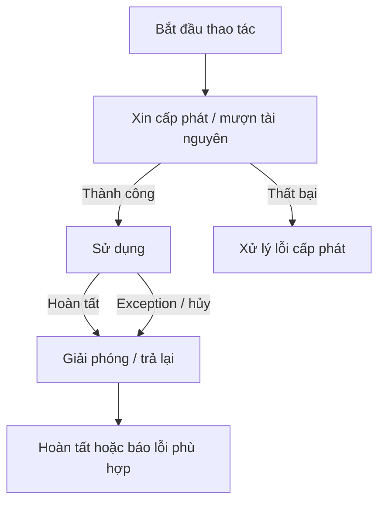

# Vòng đời tài nguyên và dấu hiệu rò rỉ

Một dịch vụ Java xử lý đơn hàng có thể hoạt động tốt trong vài phút đầu, nhưng sau vài giờ lại báo “không lấy được kết nối cơ sở dữ liệu” dù CPU chưa quá tải. Một công cụ xuất báo cáo có thể đọc đúng dữ liệu nhưng dần không mở thêm được tệp. Một chương trình nền có thể hoàn thành công việc nhưng vẫn không thoát vì các luồng do nó tạo ra chưa được dừng.

Những tình huống này gợi ý một vấn đề về **vòng đời tài nguyên**: tài nguyên được tạo hoặc mượn nhưng không được trả lại đúng thời điểm, hoặc được giữ lâu hơn nhu cầu thực tế.

Trong chương **Hiệu năng và tài nguyên** của `CODE_QUALITY_FUNDAMENTALS`, bài học này giải thích cách quản lý vòng đời, xác định **ai sở hữu trách nhiệm giải phóng**, nhận diện các dấu hiệu rò rỉ và dùng bằng chứng để chẩn đoán. Đây là một yếu tố quyết định mã nguồn có **đáng tin cậy, dễ hiểu và dễ thay đổi** hay không: chức năng chạy đúng một lần chưa đủ nếu mỗi lần chạy âm thầm tiêu tốn thêm tài nguyên hữu hạn.

Sau bài này, bạn có thể phân biệt rò rỉ tài nguyên với tăng mức sử dụng hợp lệ, dùng `try-with-resources` trong Java, hiểu khi nào `close()` trả kết nối về pool, quản lý `ExecutorService`, thiết kế hợp đồng sở hữu và lựa chọn chỉ số/kiểm thử phù hợp.

## 1. Vòng đời tài nguyên gồm những giai đoạn nào?

**Tài nguyên (resource)** ở đây là một đối tượng hoặc khả năng hệ thống có **chi phí hữu hạn** và có thể cần thao tác giải phóng rõ ràng. Ví dụ: tệp đang mở, socket, kết nối cơ sở dữ liệu, transaction, thread pool, subscription hoặc bộ đệm giữ dữ liệu lớn.

Một vòng đời thông thường:

1. **Acquire / Open:** Xin cấp phát hoặc mượn tài nguyên từ hệ thống hay pool.
2. **Use:** Thực hiện thao tác được phép trong khi tài nguyên còn hợp lệ.
3. **Release / Close:** Đóng, trả lại pool, hủy đăng ký hoặc dừng công việc; kể cả khi tác vụ thất bại.
4. **Observe / Verify:** Xác nhận kết quả giải phóng và theo dõi giới hạn tài nguyên khi chạy thực tế.



**Một tài nguyên có thể được đóng mà chưa từng dùng thành công.** Ví dụ, vừa mở tệp thì parsing phát hiện định dạng sai; file handle vẫn cần được đóng. Nếu chỉ đặt lệnh `close()` ở cuối đường chạy thành công, các nhánh `return`, `throw` hoặc lỗi giữa chừng có thể bỏ sót nó.

### Rò rỉ là gì?

**Rò rỉ tài nguyên (resource leak)** là tình trạng tài nguyên không còn cần thiết nhưng vẫn bị chiếm giữ hoặc không được giải phóng theo hợp đồng. Hệ quả có thể là cạn connection, file descriptor, luồng, bộ nhớ hoặc hạn mức của dịch vụ bên ngoài.

Cần phân biệt:

| Hiện tượng | Ý nghĩa | Có chắc là rò rỉ? |
| --- | --- | --- |
| Số kết nối đang dùng tăng theo tải rồi giảm khi hết yêu cầu | Tài nguyên phục vụ công việc hợp lệ | Không |
| Số kết nối được mượn liên tục tăng, không trở về pool sau khi yêu cầu hoàn tất | Có thể quên trả hoặc có tác vụ treo | **Đáng nghi**, cần điều tra |
| Heap tăng khi cache mới được làm ấm, sau đó ổn định | Giữ dữ liệu để phục vụ các lần đọc sau | Không nhất thiết |
| Heap sau các đợt tải lặp lại ngày càng cao vì dữ liệu cũ vẫn bị giữ tham chiếu | Có thể rò rỉ bộ nhớ theo nghĩa giữ đối tượng không còn cần dùng | **Đáng nghi** |
| Thread count không giảm sau khi công việc nền kết thúc | Executor, timer hoặc task có thể chưa được dừng | **Đáng nghi** |
| Một lần đọc file chậm do dữ liệu lớn | Có thể do kích thước đầu vào hoặc I/O | Không đủ bằng chứng về rò rỉ |

Không nên chẩn đoán chỉ từ một số đo đơn lẻ. Cần đặt số đo trong **ngữ cảnh tải, giới hạn tài nguyên, cơ chế pooling và thời gian quan sát**.

## 2. Java GC không thay thế trách nhiệm đóng tài nguyên

Java có **garbage collector (GC)** để thu hồi bộ nhớ của những đối tượng không còn reachable. Nhưng GC **không phải** một cơ chế quản lý vòng đời đáng tin cậy cho mọi tài nguyên bên ngoài heap.

Ví dụ:

- `FileInputStream` giữ tài nguyên liên quan đến tệp đang mở của hệ điều hành.
- `Socket` giữ kết nối mạng cùng tài nguyên kernel.
- `Connection` từ JDBC thường đại diện cho một kết nối cần được đóng hoặc trả lại pool.
- `ExecutorService` có thể giữ các luồng sống và hàng đợi tác vụ.
- Listener hoặc subscription có thể giữ tham chiếu đến đối tượng khác, khiến chúng không được GC thu hồi.

**Không nên viết mã dựa vào việc GC sẽ tự đóng tài nguyên đúng lúc.** Thời điểm thu gom không xác định theo thời điểm nghiệp vụ cần giải phóng. Một đối tượng còn được giữ tham chiếu thậm chí có thể không đủ điều kiện thu gom.

### Hai nhóm rò rỉ cần tách bạch

| Nhóm | Bản chất | Ví dụ |
| --- | --- | --- |
| **Rò rỉ tài nguyên ngoài heap** | Tài nguyên hữu hạn không được đóng/trả theo vòng đời | File handle, socket, connection, thread |
| **Giữ đối tượng không còn cần thiết trong heap** | Đối tượng vẫn reachable nên GC không thể giải phóng | `static Map` tăng vô hạn, listener không hủy, cache không giới hạn |

Hai nhóm có thể liên quan: một executor chưa dừng có thể giữ thread, task, closure và cả object graph; một kết nối chưa trả pool có thể giữ buffer và đối tượng theo dõi. Nhưng **heap usage không tự phản ánh đầy đủ số file handle, socket hoặc kết nối bên ngoài**.

## 3. Ai chịu trách nhiệm giải phóng? Quy tắc sở hữu tài nguyên

Một phần khó nhất là xác định **ai có quyền đóng và ai phải đóng**. Quy tắc thực dụng:

> **Thành phần acquire tài nguyên thường chịu trách nhiệm release**, trừ khi API tuyên bố rõ việc chuyển giao quyền sở hữu sang bên khác.

Ví dụ:

- Phương thức tự gọi `Files.newBufferedReader(path)`: phương thức đó nên đóng reader trước khi trả về kết quả đã tính.
- Phương thức nhận một `InputStream` từ caller: không nên mặc nhiên đóng stream nếu hợp đồng nói caller vẫn sở hữu nó.
- Repository gọi `dataSource.getConnection()`: thường phải `close()` connection được mượn trong cùng phạm vi, trừ khi transaction framework/quy trình bên ngoài quản lý connection theo cách khác.
- Ứng dụng tạo thread pool dùng chung lúc khởi động: thành phần quản lý vòng đời ứng dụng có trách nhiệm dừng pool, không phải mỗi tác vụ mượn pool.
- API trả một `Stream<String>` gắn với tệp đang mở: nếu cố tình chuyển quyền sở hữu ra ngoài, caller phải biết cần gọi `close()`.

| Kiểu truyền giao | Ví dụ | Trách nhiệm giải phóng |
| --- | --- | --- |
| **Tạo và dùng nội bộ** | `readReport(Path)` mở reader rồi xử lý | `readReport` |
| **Mượn tham chiếu** | `parse(InputStream stream)` dùng stream do caller cấp | Tùy hợp đồng; thường caller giữ trách nhiệm |
| **Chuyển giao quyền sở hữu** | `openLines(Path)` trả stream đọc file | Caller nhận quyền sở hữu và phải đóng |
| **Tài nguyên dùng chung** | `ExecutorService` của ứng dụng | Thành phần quản lý vòng đời pool |
| **Pool** | `DataSource` cấp connection để dùng tạm | Bên mượn đóng *logical handle*; chủ pool quản lý pool |
| **Subscription** | `registerListener(listener)` trả handle | Bên đăng ký hủy handle khi không còn cần |

**Tránh quyền sở hữu mơ hồ:** Khi một phương thức nhận tài nguyên có thể đóng, Javadoc hoặc hợp đồng API nên nói nó **có đóng tài nguyên hay không**. Nếu hai nơi cùng đóng, có thể gây lỗi “resource already closed”; nếu không nơi nào đóng, có thể rò rỉ.

Một số lớp có `close()` idempotent, nhưng không phải mọi `AutoCloseable` đều cam kết như vậy. Đừng dùng việc “đóng hai lần chắc không sao” để thay hợp đồng sở hữu.

## 4. Java `try-with-resources`: đóng đúng trên cả đường thành công và thất bại

Java cung cấp cú pháp **try-with-resources** cho đối tượng triển khai `AutoCloseable`. `Closeable` cũng mở rộng `AutoCloseable`, vì vậy các stream và reader phổ biến có thể sử dụng cú pháp này.

### 4.1. Một mẫu dễ rò rỉ

```java
import java.io.BufferedReader;
import java.io.IOException;
import java.nio.charset.StandardCharsets;
import java.nio.file.Files;
import java.nio.file.Path;

long countLines(Path path) throws IOException {
    BufferedReader reader =
            Files.newBufferedReader(path, StandardCharsets.UTF_8);

    long count = 0L;
    String line;

    while ((line = reader.readLine()) != null) {
        count++;
    }

    reader.close(); // Không chạy nếu readLine() ném IOException.
    return count;
}
```

Đoạn code là **minh họa lỗi**: khi `readLine()` ném exception, đường chạy bỏ qua `reader.close()`. Nếu chạy thường xuyên, tệp bị bỏ mở có thể tích lũy tài nguyên hệ điều hành.

### 4.2. Sửa bằng cách gắn vòng đời vào phạm vi

```java
import java.io.BufferedReader;
import java.io.IOException;
import java.nio.charset.StandardCharsets;
import java.nio.file.Files;
import java.nio.file.Path;
import java.util.Objects;

final class ReportLineCounter {
    static long countNonBlankLines(Path path) throws IOException {
        Objects.requireNonNull(path, "path");

        try (BufferedReader reader =
                     Files.newBufferedReader(path, StandardCharsets.UTF_8)) {
            long count = 0L;
            String line;

            while ((line = reader.readLine()) != null) {
                if (!line.isBlank()) {
                    count = Math.addExact(count, 1L);
                }
            }

            return count;
        }
    }
}
```

Đây là ví dụ Java 17 hoàn chỉnh trong phạm vi nhiệm vụ đếm dòng. Khi khối `try` kết thúc, Java gọi `close()` trên reader **kể cả khi có `return` hoặc exception**. Dùng `Math.addExact` giúp phát hiện tràn số nguyên thay vì để bộ đếm sai âm thầm; trong bài toán này khả năng vượt giới hạn `long` là không thực tế, nhưng phép toán minh họa xử lý overflow rõ ràng.

**Điều được bảo đảm:** tài nguyên reader được yêu cầu đóng đúng theo ngữ nghĩa `try-with-resources`. Nếu chính `close()` ném `IOException`, exception đó vẫn có thể lan ra. “Đã dùng try-with-resources” **không tự chứng minh** thao tác I/O luôn thành công hay không thể xảy ra lỗi khi đóng.

### 4.3. Nhiều tài nguyên: đóng theo thứ tự ngược khi mở

Khi khai báo nhiều tài nguyên trong cùng `try`:

```java
try (Resource first = openFirst();
     Resource second = openSecond()) {
    use(first, second);
}
```

`Resource`, `openFirst`, `openSecond` và `use` ở đây là tên minh họa. Java đóng **`second` trước, rồi `first`**. Nếu khởi tạo `second` thất bại, `first` đã mở vẫn được đóng theo quy tắc.

Với JDBC, hành vi này rất phù hợp: đóng `ResultSet`, rồi `PreparedStatement` và cuối cùng là `Connection` được mượn trong phạm vi.

### 4.4. Khi thao tác và `close()` cùng ném lỗi

Giả sử đọc tệp thất bại, rồi thao tác đóng tệp cũng thất bại. `try-with-resources` giữ exception chính từ phần thân `try`; exception trong `close()` thường được thêm vào danh sách **suppressed exceptions**, có thể đọc qua `Throwable.getSuppressed()`.

```java
try (AutoCloseable resource = openResource()) {
    processResource(resource);
} catch (Exception exception) {
    // Lỗi chính và các suppressed exception đều có thể hữu ích để điều tra.
    for (Throwable suppressed : exception.getSuppressed()) {
        // Ghi nhận theo chính sách log an toàn của ứng dụng.
    }
    throw exception;
}
```

`openResource()` và `processResource()` ở đây chỉ là tên minh họa để làm rõ ngữ nghĩa, không phải mã triển khai hoàn chỉnh. Khi debug, đừng bỏ qua suppressed exceptions vì chúng có thể cho biết **đã có vấn đề trong bước giải phóng tài nguyên**. Nhưng cũng tránh ghi dữ liệu nhạy cảm có thể xuất hiện trong thông điệp exception.

## 5. JDBC: đóng connection được mượn khác với đóng cả pool

Một connection pool tạo và quản lý một tập kết nối tới database. Khi gọi `dataSource.getConnection()`, ứng dụng thường nhận một **logical connection/handle**. Gọi `close()` trên handle này thường trả kết nối về pool để yêu cầu khác sử dụng; nó không nhất thiết đóng kết nối mạng vật lý.

### 5.1. Cách viết dễ làm cạn pool

```java
Connection connection = dataSource.getConnection();
PreparedStatement statement = connection.prepareStatement(
        "SELECT order_id FROM orders WHERE customer_id = ?");
statement.setString(1, customerId);
ResultSet results = statement.executeQuery();

// Đọc dữ liệu...
// Thiếu đóng results, statement và connection trên mọi đường thực thi.
```

Trong đoạn minh họa, `dataSource` và `customerId` đã có sẵn. Nếu đoạn này được gọi mỗi yêu cầu mà không trả connection, pool có thể hết connection khả dụng. Khi đó người dùng gặp timeout xin kết nối dù truy vấn riêng lẻ có thể rất nhanh.

### 5.2. Đóng theo phạm vi giao dịch thực tế

Ví dụ dưới đây giả định repository **tự mượn connection cho một thao tác đọc độc lập**, không nhận connection do framework transaction quản lý từ bên ngoài:

```java
import java.sql.Connection;
import java.sql.PreparedStatement;
import java.sql.ResultSet;
import java.sql.SQLException;
import java.util.ArrayList;
import java.util.List;
import java.util.Objects;
import javax.sql.DataSource;

record OrderSummary(String orderId, long totalVnd) {}

final class JdbcOrderQueries {
    static List<OrderSummary> findByCustomer(
            DataSource dataSource, String customerId) throws SQLException {
        Objects.requireNonNull(dataSource, "dataSource");
        Objects.requireNonNull(customerId, "customerId");

        String sql = """
                SELECT order_id, total_vnd
                FROM orders
                WHERE customer_id = ?
                ORDER BY order_id
                """;

        try (Connection connection = dataSource.getConnection();
             PreparedStatement statement = connection.prepareStatement(sql)) {
            statement.setString(1, customerId);

            try (ResultSet rows = statement.executeQuery()) {
                List<OrderSummary> results = new ArrayList<>();

                while (rows.next()) {
                    results.add(new OrderSummary(
                            rows.getString("order_id"),
                            rows.getLong("total_vnd")));
                }

                return List.copyOf(results);
            }
        }
    }
}
```

Các đối tượng `ResultSet`, `PreparedStatement` và `Connection` được giải phóng theo phạm vi của khối `try`. Kể cả khi đọc một dòng gây lỗi hoặc tạo kết quả thất bại, đường giải phóng vẫn được chạy.

**Ranh giới sở hữu quan trọng:**

- `JdbcOrderQueries` mượn một connection và trả nó lại thông qua `close()`.
- `DataSource` / connection pool thường được quản lý bởi ứng dụng, container hoặc framework, **không** bị đóng mỗi khi repository trả về.
- Nếu một transaction framework **đã cấp và quản lý connection**, repository cần tuân theo hợp đồng framework; tự lấy hoặc đóng connection sai chỗ có thể phá transaction.

Ví dụ cũng giữ toàn bộ kết quả trong `List`. Nếu truy vấn trả rất nhiều dòng, việc không rò rỉ connection chưa đủ: danh sách lớn có thể tiêu tốn heap. Khi đó cần thiết kế phân trang hoặc streaming với vòng đời connection rõ ràng.

### 5.3. Dấu hiệu pool bị chiếm giữ bất thường

Các chỉ số hữu ích tùy thư viện pool gồm:

- Số connection đang **active/borrowed**;
- Số connection đang **idle**;
- Thời gian yêu cầu **chờ mượn connection** và số lần timeout;
- Thời gian mỗi connection bị mượn;
- Số transaction lâu hoặc truy vấn chưa hoàn tất.

Nếu `active` tăng dần đến giới hạn trong khi tốc độ hoàn thành yêu cầu giảm, có thể có connection không được trả. Nhưng cũng có khả năng các truy vấn quá chậm, transaction giữ khóa lâu hoặc tải vượt năng lực. **Tăng kích thước pool có thể chỉ che triệu chứng** và làm database chịu thêm tải; cần tìm nguyên nhân trước.

Một số pool có cơ chế **leak detection** ghi cảnh báo khi connection được giữ quá ngưỡng. Đó là tín hiệu điều tra, không phải kết luận chắc chắn rò rỉ: một công việc hợp lệ rất lâu cũng có thể bị cảnh báo.

## 6. Stream và tài nguyên có vòng đời bị che khuất

Một số API Java trông như làm việc thuần túy với collection nhưng thực tế giữ tài nguyên phía sau. Ví dụ `Files.lines(path)` trả về `Stream<String>` đọc dữ liệu từ tệp. Stream này **phải được đóng** sau khi dùng.

### 6.1. Đoạn code dễ quên đóng

```java
import java.io.IOException;
import java.nio.file.Files;
import java.nio.file.Path;

long count(Path path) throws IOException {
    return Files.lines(path).filter(line -> !line.isBlank()).count();
}
```

Đoạn mã minh họa tuy ngắn nhưng không có `try-with-resources`; không bảo đảm stream sẽ được đóng tại thời điểm phương thức kết thúc. Nguồn dữ liệu `Files.lines` được mở từ filesystem, không chỉ là một `Stream` thuần từ collection trong bộ nhớ.

### 6.2. Đúng cách: đóng stream sau terminal operation

```java
import java.io.IOException;
import java.nio.charset.StandardCharsets;
import java.nio.file.Files;
import java.nio.file.Path;
import java.util.stream.Stream;

final class StreamReportCounter {
    static long countNonBlankLines(Path path) throws IOException {
        try (Stream<String> lines =
                     Files.lines(path, StandardCharsets.UTF_8)) {
            return lines.filter(line -> !line.isBlank()).count();
        }
    }
}
```

Một chi tiết cần lưu ý: `Files.lines` có thể phát hiện lỗi I/O khi **stream đang được tiêu thụ**. Khi đó lỗi có thể được bọc thành `UncheckedIOException` (một exception runtime), không chỉ xuất hiện dưới dạng `IOException` đã khai báo ở chữ ký. Hợp đồng lỗi của API phải phản ánh cách sử dụng thực tế.

### 6.3. Trả stream ra ngoài: ai là người đóng?

```java
Stream<String> openLines(Path path) throws IOException {
    return Files.lines(path);
}
```

Ở đây phương thức **chuyển trách nhiệm đóng stream cho caller**. Nếu cố tình thiết kế API như vậy, tài liệu phải nêu rõ caller phải gọi `close()`, và mọi nơi sử dụng phải áp dụng try-with-resources.

Nếu không có yêu cầu xử lý lười (lazy processing), một phương thức tự mở, tiêu thụ và đóng rồi trả **giá trị đã tính** thường có hợp đồng vòng đời dễ dùng hơn. Đừng trả về một `Stream` gắn với connection, reader hoặc file chỉ để tiết kiệm vài dòng mà che giấu tài nguyên phải giải phóng.

## 7. `ExecutorService`, thread và tác vụ nền: dừng đúng chủ sở hữu

Không chỉ tài nguyên I/O mới có vòng đời. Một `ExecutorService` có thể tạo thread và hàng đợi tác vụ. Nếu ứng dụng tạo pool mới cho mỗi yêu cầu rồi không dừng, số thread và tài nguyên liên quan có thể tăng dần.

### 7.1. Ví dụ dễ sinh rò rỉ thread

```java
void handleRequest(Runnable task) {
    ExecutorService pool = Executors.newFixedThreadPool(2);
    pool.submit(task);
    // Không shutdown: pool có thể tiếp tục giữ luồng sống.
}
```

Mã minh họa giả định đã import `ExecutorService` và `Executors`. Trong Java 17, `ExecutorService` **không phải** tài nguyên `AutoCloseable` để tự đưa vào try-with-resources theo cách của các bản Java mới hơn. Cần dùng API vòng đời như `shutdown()` và `awaitTermination()` theo ngữ nghĩa thích hợp.

### 7.2. Pool dùng chung phải có điểm dừng trong vòng đời ứng dụng

Một cách tiếp cận là tạo pool lúc khởi động, truyền nó cho những thành phần cần gửi tác vụ và quản lý dừng khi ứng dụng đóng.

```java
import java.util.concurrent.ExecutorService;
import java.util.concurrent.TimeUnit;

final class ExecutorLifecycle {
    static void stop(ExecutorService executor) {
        executor.shutdown(); // Không nhận thêm task mới.

        try {
            if (!executor.awaitTermination(5, TimeUnit.SECONDS)) {
                executor.shutdownNow(); // Yêu cầu dừng task đang chạy.
                if (!executor.awaitTermination(5, TimeUnit.SECONDS)) {
                    // Hệ thống vận hành nên ghi nhận task chưa dừng.
                }
            }
        } catch (InterruptedException interrupted) {
            executor.shutdownNow();
            Thread.currentThread().interrupt();
        }
    }
}
```

`shutdown()` cho phép các tác vụ đã nhận được tiếp tục chạy theo cơ chế của executor. `shutdownNow()` thường cố ngắt các tác vụ đang chạy và trả về danh sách tác vụ chưa bắt đầu, nhưng **không bảo đảm** mọi tác vụ sẽ dừng ngay: tác vụ có thể không phản hồi interrupt hoặc bị kẹt trong I/O.

Do đó, **điểm dừng** và **chính sách hủy** phải thuộc vòng đời ứng dụng. Một task không nên tự dừng executor dùng chung sau khi hoàn thành nếu có nhiều task khác vẫn đang sử dụng.

Nếu ứng dụng được quản lý bởi framework, hãy tuân theo lifecycle của framework thay vì tự tạo pool không được container biết đến.

### 7.3. Listener, subscription và `ThreadLocal` cũng có thể giữ tài nguyên

Một vài rò rỉ không đi qua `close()` truyền thống:

- **Listener không hủy đăng ký:** bộ phát sự kiện giữ tham chiếu tới listener, listener giữ tham chiếu tới nhiều object khác, khiến chúng vẫn reachable.
- **Scheduled task không hủy:** tác vụ định kỳ tiếp tục chạy dù màn hình hoặc phiên làm việc đã kết thúc.
- **`ThreadLocal` dùng trên thread pool:** giá trị gắn với thread sống lâu; nếu không `remove()` ở cuối phạm vi, dữ liệu có thể tồn tại qua nhiều yêu cầu hoặc gây lẫn ngữ cảnh.

Ví dụ dọn `ThreadLocal`:

```java
private static final ThreadLocal<String> REQUEST_CONTEXT = new ThreadLocal<>();

static void handle(String requestId, Runnable action) {
    REQUEST_CONTEXT.set(requestId);
    try {
        action.run();
    } finally {
        REQUEST_CONTEXT.remove();
    }
}
```

Đây là đoạn minh họa đặt **trong một lớp Java**. `finally` xóa giá trị kể cả khi `action.run()` ném exception. Tuy nhiên, code dùng `ThreadLocal` còn cần cân nhắc quy tắc kế thừa hoặc lan truyền ngữ cảnh khi chuyển sang luồng khác; giá trị không tự đi theo mọi `CompletableFuture` hoặc executor.

## 8. Kiểm thử vòng đời tài nguyên thay vì chỉ kiểm thử kết quả

Một bài kiểm thử đơn vị có thể trả đúng dữ liệu dù tài nguyên không được đóng. Do đó, ở những điểm có quyền sở hữu rõ, nên kiểm tra **cả hành vi và việc giải phóng**.

### 8.1. Kiểm thử tích hợp: tệp thật được xử lý đúng

```java
import static org.junit.jupiter.api.Assertions.assertEquals;

import java.nio.charset.StandardCharsets;
import java.nio.file.Files;
import java.nio.file.Path;
import org.junit.jupiter.api.Test;
import org.junit.jupiter.api.io.TempDir;

class ReportLineCounterTest {
    @TempDir
    Path directory;

    @Test
    void countsNonBlankLines() throws Exception {
        Path report = directory.resolve("report.txt");
        Files.writeString(
                report,
                "ORD-1\n\nORD-2\n",
                StandardCharsets.UTF_8);

        assertEquals(2L, ReportLineCounter.countNonBlankLines(report));
    }
}
```

Test này xác minh hành vi đọc một tệp trên filesystem thật. Nhưng **chỉ dựa vào kết quả đếm chưa chứng minh** reader đã được đóng đúng trong mọi nhánh lỗi; cần xem mã và kiểm thử tập trung vào vòng đời khi rủi ro cao.

### 8.2. Kiểm thử đơn vị: resource được đóng cả khi task thất bại

Một tài nguyên giả có thể ghi nhận lần đóng để kiểm tra hợp đồng:

```java
final class CloseProbe implements AutoCloseable {
    private boolean closed;

    boolean isClosed() {
        return closed;
    }

    @Override
    public void close() {
        closed = true;
    }
}

final class ProbeWorker {
    // Hợp đồng: phương thức này nhận quyền sở hữu và đóng probe.
    static void process(CloseProbe probe, boolean simulateFailure) {
        try (probe) {
            if (simulateFailure) {
                throw new IllegalStateException("Simulated failure");
            }
        }
    }
}
```

Trong Java 9 trở lên, `try (probe)` hợp lệ khi biến `probe` là final hoặc effectively final. Mã dùng Java 17.

```java
import static org.junit.jupiter.api.Assertions.assertFalse;
import static org.junit.jupiter.api.Assertions.assertThrows;
import static org.junit.jupiter.api.Assertions.assertTrue;

import org.junit.jupiter.api.Test;

class ProbeWorkerTest {
    @Test
    void closesOnSuccess() {
        CloseProbe probe = new CloseProbe();

        ProbeWorker.process(probe, false);

        assertTrue(probe.isClosed());
    }

    @Test
    void closesOnFailure() {
        CloseProbe probe = new CloseProbe();

        assertThrows(IllegalStateException.class,
                () -> ProbeWorker.process(probe, true));

        assertTrue(probe.isClosed());
    }
}
```

Test thứ hai xác nhận đường thất bại vẫn gọi `close()`. Một test tương tự có thể dùng spy/fake cho connection hoặc HTTP response body, nhưng cần nhớ **fake cho biết code đã gọi `close()`**, còn integration test mới kiểm tra việc pool thật đã nhận lại connection hoặc hệ thống ngoài đã giải phóng đúng.

**Lưu ý:** Tài nguyên giả trong ví dụ chỉ đánh dấu boolean; nó không cần file handle hoặc socket thật. Đây là chủ đích để test nhanh và kiểm tra riêng trách nhiệm đóng.

### 8.3. Tái hiện lỗi trong tình huống sát thực tế

Nếu nghi rò rỉ connection khi request lỗi, có thể viết kiểm thử tích hợp chạy lặp lại nhiều lời gọi cố tình thất bại và quan sát:

- Active connection về mức cơ sở sau khi các request hoàn tất hay không;
- Thời gian chờ mượn connection có tăng bất thường không;
- Có exception nào bị nuốt mất, khiến đường dọn dẹp không được chạy không.

Không nên yêu cầu số connection **bằng 0** nếu pool có cơ chế giữ kết nối idle; chỉ số cần hiểu theo **active/borrowed vs idle/total** và cách pool được cấu hình.

Với tài nguyên ngoài heap, cần kiểm tra cả **OS/process metrics** hoặc chỉ số chuyên biệt; một test chỉ nhìn heap có thể bỏ sót file handle hoặc socket bị giữ.

## 9. Nhận diện rò rỉ trong vận hành: nhìn vào xu hướng, không chỉ một ảnh chụp

Khi ứng dụng chạy một thời gian, các chỉ số thường giúp phát hiện dấu hiệu trước khi hết tài nguyên.

| Nguồn lực | Chỉ số hoặc triệu chứng đáng theo dõi | Điều cần phân biệt |
| --- | --- | --- |
| **JDBC pool** | Active connections, thời gian mượn, timeout khi chờ | Quên trả connection hay truy vấn/transaction chậm? |
| **File descriptor / handle** | Số handle mở tăng liên tục, không mở được tệp/socket | Handle đang phục vụ tải hay bị bỏ quên? |
| **Thread** | Số thread tăng sau mỗi request, ứng dụng không tắt được | Pool dùng chung hợp lệ hay tạo pool không dừng? |
| **Heap** | Used heap sau GC tăng qua các đợt tải; `OutOfMemoryError` | Cache/queue hợp lệ hay giữ object vô hạn? |
| **Native/off-heap memory** | RSS/native memory tăng nhưng heap không giải thích được | Direct buffer, native library hoặc tài nguyên nền? |
| **Socket/network** | Kết nối đang mở, trạng thái kết nối bất thường, timeout | Connection pool được thiết kế hay socket không đóng? |
| **Task/queue** | Hàng đợi tăng dần, tác vụ hoàn tất chậm, lượng pending không giảm | Nguồn tạo việc vượt năng lực hay task bị treo? |

Một triệu chứng có thể có nhiều nguyên nhân. Ví dụ `OutOfMemoryError` không luôn đồng nghĩa với rò rỉ heap; nó có thể do kích thước dữ liệu một lần xử lý quá lớn, cấu hình heap quá nhỏ hoặc giới hạn bộ nhớ ngoài heap. Tương tự, connection pool cạn có thể do **tải hợp lệ quá cao** hoặc truy vấn mất nhiều thời gian, không nhất thiết do quên `close()`.

### Quy trình điều tra có căn cứ

1. **Xác định tài nguyên đang bị giới hạn.** Heap, file handle, connection, thread hay task queue?
2. **Ghi lại trạng thái ban đầu và tải.** Bao nhiêu request, loại công việc nào, cấu hình giới hạn bao nhiêu?
3. **Tái hiện với khối lượng có kiểm soát.** Lặp lại cùng workload, quan sát sau khi công việc đã hoàn tất.
4. **Phân biệt đỉnh tải và tài nguyên không được trả.** Dùng số `active` và `idle`, heap sau các chu kỳ GC, số handle/thread còn lại.
5. **Tìm chủ sở hữu và đường dọn dẹp.** Đối chiếu các điểm acquire với `close/shutdown/unsubscribe/remove`; kiểm tra nhánh exception và cancellation.
6. **Dùng công cụ phù hợp.** Java Flight Recorder (JFR), heap dump, thread dump, profiler, JMX/metrics của pool, công cụ đo handle/socket của hệ điều hành.
7. **Sửa nguyên nhân và xác minh lại.** Đo trên workload trước/sau, thêm test chặn tái diễn và giám sát ngưỡng rủi ro.

**Không nên dùng `System.gc()` như một bản sửa rò rỉ.** Lời gọi này không thay thế hợp đồng đóng tài nguyên, không bảo đảm thu hồi mọi object ngay và không sửa việc pool/stream/thread bị giữ sai vòng đời.

### Một tình huống chẩn đoán

Dịch vụ báo cáo có pool tối đa 20 connection. Sau khi xử lý 20 yêu cầu tải báo cáo bị hủy giữa chừng, các yêu cầu mới bắt đầu timeout xin connection. Bảng chỉ số cho thấy `active = 20` và `idle = 0` dù 20 yêu cầu trước đã dừng.

Giả thuyết ban đầu: đường hủy báo cáo **không trả connection**. Cần kiểm tra luồng xử lý cancellation, thời điểm đóng `ResultSet/Statement/Connection` và liệu một task nền còn giữ connection hay không.

Nếu sửa code để đóng connection trong `finally` hoặc `try-with-resources` đúng ranh giới và sau đó `active` giảm khi tải kết thúc, đó là bằng chứng hỗ trợ giả thuyết. Tuy nhiên, cũng cần kiểm tra truy vấn bị treo, transaction mở lâu và hành vi của pool trước khi kết luận chắc chắn.

## 10. Giới hạn tài nguyên là một phần của thiết kế độ tin cậy

Đóng tài nguyên đúng là cần thiết, nhưng hệ thống còn phải quyết định **bao nhiêu tài nguyên được phép sử dụng đồng thời**.

Một số biện pháp bổ sung:

- **Giới hạn concurrency:** Dùng pool hoặc semaphore phù hợp để tránh mở quá nhiều connection/socket cùng lúc.
- **Giới hạn thời gian:** Timeout khi xin connection, đọc dữ liệu hoặc gọi dịch vụ ngoài, theo yêu cầu nghiệp vụ và đặc tính API.
- **Giới hạn khối lượng dữ liệu:** Phân trang, streaming hoặc chunking khi dữ liệu lớn; tránh gom toàn bộ kết quả vào `List` không giới hạn.
- **Backpressure:** Khi producer tạo việc nhanh hơn consumer xử lý, cần giới hạn hàng đợi hoặc điều tiết nguồn phát.
- **Cancellation:** Xác định khi một yêu cầu bị hủy thì task, stream, query và kết nối được dừng/đóng thế nào.
- **Dọn dẹp định kỳ hợp lệ:** Cache hoặc subscription có chính sách hết hạn, eviction và hủy đăng ký rõ ràng.

**Đánh đổi quan trọng:** Đóng kết nối vật lý ngay sau mỗi tác vụ có thể tăng chi phí tạo lại; connection pool giúp tái sử dụng nhưng cần quản lý đúng hai vòng đời: **handle được mượn của mỗi thao tác** và **pool của ứng dụng**. Mục tiêu không phải “không giữ tài nguyên”, mà là **giữ đúng tài nguyên, đúng lượng, trong đúng thời gian cần thiết**.

Nếu cache được thiết kế để giữ tối đa 5.000 phần tử hoặc giữ dữ liệu trong một thời gian xác định, mức sử dụng bộ nhớ tăng đến ngưỡng rồi ổn định có thể phù hợp. Nhưng cache không giới hạn key mới và không có eviction có thể khiến object graph ngày càng lớn. Khi ấy cần xác định chính sách dung lượng, thời gian sống và mức độ chấp nhận dữ liệu cũ.

## 11. Những ngộ nhận thường gặp

| Ngộ nhận | Cách hiểu đúng hơn |
| --- | --- |
| “Java có GC nên không thể rò rỉ tài nguyên.” | GC chủ yếu quản lý heap; file, socket, connection và thread cần hợp đồng vòng đời riêng. |
| “`final` nghĩa là đối tượng sẽ được giải phóng đúng.” | `final` chỉ hạn chế gán lại biến/tham chiếu, không thực hiện `close()`. |
| “Gọi `close()` trên JDBC connection luôn đóng socket vật lý.” | Với pool, `close()` thường trả logical handle về pool. |
| “Dùng `try-with-resources` thì không còn lỗi I/O.” | Nó giúp đóng trên mọi đường thực thi; đọc, ghi hoặc đóng vẫn có thể thất bại. |
| “Đóng ở cuối phương thức là đủ.” | `return` sớm, exception hoặc hủy tác vụ có thể bỏ qua dòng đóng thông thường. |
| “`Collections.unmodifiableList` và cache là rò rỉ.” | Không tự động; cần xem vòng đời, giới hạn dung lượng và khả năng giải phóng. |
| “`ExecutorService` xong task thì luồng tự biến mất ngay.” | Executor có thể giữ worker threads cho các task tiếp theo, cần quản lý shutdown. |
| “Pool cạn thì cứ tăng pool lên.” | Có thể che triệu chứng quên trả, query chậm hoặc giới hạn database; phải điều tra. |
| “Heap ổn định thì không có leak.” | File handle, socket, thread hoặc connection có thể bị giữ ngoài heap. |
| “Chỉ cần chạy test thành công một lần.” | Rò rỉ thường chỉ rõ khi lặp tải, có lỗi, timeout hoặc hủy giữa chừng. |

## 12. Checklist cho code review

Khi gặp mã mở tệp, dùng JDBC, tạo thread hoặc đăng ký listener, hãy kiểm tra:

1. **Ai acquire tài nguyên?** Có chủ sở hữu rõ để release không?
2. **Các đường thoát có giải phóng không?** Thành công, `return` sớm, exception, timeout, cancellation và init thất bại.
3. **Có dùng cơ chế phù hợp không?** `try-with-resources`, `finally`, lifecycle hook, `shutdown`, unsubscribe hay `ThreadLocal.remove`.
4. **Đóng có đúng phạm vi không?** Không đóng connection/stream mà caller còn sở hữu; không shutdown pool dùng chung từ task con.
5. **Tài nguyên có bị giữ qua callback hoặc stream lazy không?** Kết quả trả về có che giấu một file handle hoặc connection mở?
6. **Có giới hạn thời gian và dung lượng không?** Pool, timeout, số task, cache, hàng đợi, kích thước kết quả.
7. **Có bằng chứng từ test không?** Test đường lỗi và cancellation có quan sát đóng/trả tài nguyên không?
8. **Có chỉ số vận hành không?** Active vs idle connection, handle, thread, heap/off-heap và task pending.
9. **Có phân biệt leak với nhu cầu sử dụng hợp lệ không?** Dữ liệu tăng vì tải hay vì quên release?
10. **Có hợp đồng sở hữu trong tài liệu API không?** Người gọi biết lúc nào phải `close()` và khi nào không?

## 13. Bài tập tự kiểm tra

**Câu 1.** Một hàm mở `BufferedReader`, đọc dữ liệu, rồi gọi `close()` sau vòng lặp. Khi `readLine()` ném exception, điều gì có thể xảy ra?

*Gợi ý:* Đường thực thi bỏ qua `close()`. Dùng `try-with-resources` để bảo đảm yêu cầu đóng được thực hiện khi rời phạm vi.

**Câu 2.** Dùng `Files.lines(path).count()` mà không lưu stream vào biến có cần đóng không?

*Gợi ý:* Có. `Files.lines` giữ tài nguyên gắn với file. Cần dùng `try (Stream<String> lines = Files.lines(path)) { ... }`.

**Câu 3.** Một repository mượn connection từ pool nhưng không gọi `close()`. Vì sao pool có thể hết kết nối dù GC chạy thường xuyên?

*Gợi ý:* Pool cần biết handle đã được trả. GC không thay hợp đồng trả connection kịp thời và không bảo đảm cleanup dựa trên vòng đời yêu cầu.

**Câu 4.** Một dịch vụ trả về `Stream<Order>` từ query database. Ai đóng `ResultSet` và `Connection` khi caller đọc xong?

*Gợi ý:* Hợp đồng phải quy định rõ. Nếu stream giữ query/connection đang mở, caller cần có cách `close()` stream và pipeline phải đóng đúng tài nguyên. Thiết kế trả về một danh sách đã materialize hoặc API callback trong phạm vi có thể đơn giản và an toàn hơn khi dữ liệu phù hợp.

**Câu 5.** Vì sao pool thread có thể khiến ứng dụng không thoát sau khi mọi tác vụ đã chạy xong?

*Gợi ý:* Worker threads của pool có thể còn sống để chờ task mới; cần shutdown theo vòng đời ứng dụng và xử lý trường hợp task không dừng.

**Câu 6.** Một `Map` static chứa kết quả cho mỗi user và không giới hạn số user. Đây có thể là loại rò rỉ gì?

*Gợi ý:* Giữ đối tượng không còn cần thiết trong heap. GC không thể thu hồi những entry vẫn reachable qua map static. Cần giới hạn cache/eviction hoặc thay đổi hợp đồng giữ dữ liệu.

**Câu 7.** Pool có `active = 20/20` trong lúc 20 request đang thực hiện truy vấn dài. Đây đã là bằng chứng leak chưa?

*Gợi ý:* Chưa. Có thể là sử dụng hợp lệ nhưng chậm. Cần quan sát sau khi yêu cầu hoàn thành, thời gian giữ connection và đường release.

**Câu 8.** Vì sao unit test chỉ kiểm tra kết quả đếm dòng chưa đủ chứng minh không rò rỉ reader?

*Gợi ý:* Kết quả có thể đúng dù quên đóng. Cần xem cấu trúc `try-with-resources` và test tập trung vào đường exception/close, sau đó kiểm chứng tích hợp nếu có rủi ro.

**Câu 9.** Gọi `shutdownNow()` có bảo đảm mọi thread dừng ngay không?

*Gợi ý:* Không. Nó cố gắng ngắt các tác vụ; task có thể không đáp ứng interruption. Cần hợp đồng cancellation, timeout và giám sát.

**Câu 10.** Dùng `List.copyOf` để làm snapshot rồi giữ cả một danh sách rất lớn trong cache không giới hạn. Danh sách bất biến có loại bỏ nguy cơ tăng bộ nhớ vô hạn không?

*Gợi ý:* Không. Bất biến giúp tránh sửa trạng thái ngoài ý muốn, nhưng dữ liệu vẫn chiếm heap khi cache giữ tham chiếu. Cần chính sách dung lượng và vòng đời.

## Ghi nhớ

**Vòng đời tài nguyên là một phần của hợp đồng chất lượng mã.** Mỗi tài nguyên phải có nơi acquire, nơi release và quy tắc sở hữu rõ. Trong Java, dùng `try-with-resources` cho tài nguyên `AutoCloseable` khi phù hợp, quản lý connection pool và executor theo đúng phạm vi, đồng thời kiểm soát những tài nguyên bị giữ gián tiếp qua stream, callback hoặc cache.

**Dấu hiệu rò rỉ là xu hướng tài nguyên không trở về mức hợp lý sau khi công việc kết thúc**, chứ không chỉ là một số đo cao. Quan sát connection, file handle, thread, heap/off-heap và task queue; tái hiện dưới tải và kiểm tra đường lỗi trước khi kết luận. Khi tài nguyên được giữ đúng thời điểm, đúng lượng và được trả đúng chủ sở hữu, mã nguồn sẽ **đáng tin cậy, dễ hiểu và dễ bảo trì hơn** khi hệ thống phát triển.
