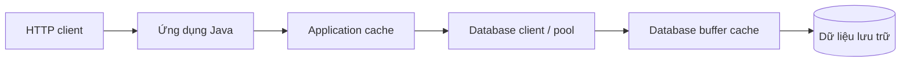

# Khởi động, bộ nhớ đệm và điều kiện đo lặp lại

Một đoạn Java chạy lần đầu mất nhiều thời gian hơn những lần sau. Một API khi mới triển khai trả lời chậm, nhưng sau vài phút lại nhanh. Một truy vấn cơ sở dữ liệu có thể chỉ mất vài mili giây khi dữ liệu đã nằm trong bộ nhớ đệm, rồi chậm rõ rệt sau khi hệ thống khởi động lại. Nếu chỉ đo một lần hoặc không ghi trạng thái khởi động và bộ nhớ đệm, nhóm phát triển rất dễ kết luận sai về hiệu năng.

Trong chương **Hiệu năng và tài nguyên** của **CODE_QUALITY_FUNDAMENTALS**, bài học này giải thích cách **khởi động** (*startup*), **làm nóng** (*warm-up*), **bộ nhớ đệm** (*cache*) và **điều kiện thí nghiệm** ảnh hưởng đến phép đo. Đây là một phần của mục tiêu module: hiểu những thuộc tính quyết định mã nguồn có **đáng tin cậy, dễ hiểu và dễ thay đổi** hay không. Mã nhanh trong một benchmark khó tái hiện chưa chắc đem lại trải nghiệm tốt trong môi trường thật.

## Mục tiêu học tập

Sau bài này, bạn có thể:

1. Phân biệt thời gian khởi động, độ trễ lần gọi đầu (*cold path*) và hiệu năng sau khi đã làm nóng (*steady state*).
2. Nhận diện ảnh hưởng của nạp lớp, JIT, GC, kết nối và bộ nhớ đệm trong ứng dụng Java.
3. Xác định cache hit, cache miss, trạng thái lạnh/ấm và rủi ro dữ liệu cũ, bùng nổ yêu cầu hoặc bộ nhớ không giới hạn.
4. Thiết kế phép đo lặp lại với dữ liệu, môi trường, tải và trạng thái cache được mô tả rõ.
5. Biết khi nào dùng JMH để đo mã JVM, khi nào cần benchmark khởi động, tích hợp hoặc kiểm thử tải.
6. Đọc các chỉ số thời gian đáp ứng, throughput, phân vị, bộ nhớ và GC mà không suy diễn quá mức.

## 1. Vì sao cùng một chương trình có thể cho nhiều kết quả khác nhau?

Giả sử dịch vụ báo giá có endpoint `GET /quotes/SKU-42`. Các lần gọi có thể đi qua những trạng thái rất khác nhau:

| Lần thực hiện | Trạng thái hệ thống | Nguồn chi phí có thể xuất hiện |
| --- | --- | --- |
| Sau khi tiến trình vừa được tạo | JVM và ứng dụng đang khởi động. | Nạp và khởi tạo lớp, tạo đối tượng, đọc cấu hình, khởi tạo framework, kết nối phụ thuộc. |
| Yêu cầu đầu tiên sau khi sẵn sàng | Một số đường đi chưa từng chạy. | Khởi tạo lười, biên dịch JIT, kết nối/TLS/DNS, cache miss, truy vấn dữ liệu. |
| Yêu cầu lặp lại trên dữ liệu cũ | Nhiều tài nguyên đã sẵn sàng. | Cache hit, kết nối tái sử dụng, đoạn mã nóng đã được tối ưu. |
| Yêu cầu sau khi cache hết hạn | Tiến trình vẫn ấm nhưng dữ liệu không có trong cache. | Đọc lại DB/dịch vụ ngoài, tính toán lại, cấp phát thêm. |
| Yêu cầu lúc tải cao | Nhiều công việc đồng thời. | Xếp hàng, tranh chấp khóa, cạn pool, CPU/GC, giới hạn upstream. |

Những tình huống trên không phải năm phép đo thay thế cho nhau. Nếu yêu cầu là **thời gian đáp ứng của request đầu tiên**, chỉ báo ở trạng thái ổn định không đủ. Nếu yêu cầu là **throughput dưới tải dài hạn**, phép đo đầu tiên sau khi chạy tiến trình cũng không đại diện.

### Các loại thời gian cần ghi nhãn

- **Startup time:** từ mốc bắt đầu đã định nghĩa đến mốc ứng dụng được coi là sẵn sàng. Cần nói rõ mốc bắt đầu là tạo process, bắt đầu main, khởi tạo container hay một mốc khác.
- **Time to first successful request:** thời gian từ mốc khởi chạy đến lúc yêu cầu đầu tiên đáp ứng thành công; có thể bao gồm thời gian đợi sẵn sàng, network và công việc lần đầu.
- **Cold request latency:** độ trễ của một request khi những cache/tài nguyên liên quan chưa được làm nóng, theo kịch bản đã mô tả.
- **Warm/steady-state latency:** độ trễ sau giai đoạn làm nóng, khi những điều kiện quan trọng tương đối ổn định. “Ấm” không bảo đảm tải hoặc trạng thái bộ nhớ hoàn toàn ổn định.
- **Throughput:** số thao tác hoặc request hoàn tất trong một đơn vị thời gian với mức tải và điều kiện xác định.

Không gộp các chỉ số có mục đích khác nhau thành một số “ứng dụng chạy nhanh” duy nhất.

## 2. Làm nóng JVM: nạp lớp, JIT và mã tối ưu

Java thường chạy trên JVM có khả năng tối ưu mã khi chương trình đang chạy. Kết quả đo phụ thuộc vào việc một đường đi đã được thực thi bao nhiêu lần, nhưng không thể rút gọn mọi thay đổi tốc độ chỉ thành “JIT làm nóng”.

### Những việc có thể xảy ra trong giai đoạn đầu

1. **Nạp, liên kết và khởi tạo lớp:** một số lớp chỉ được tải/khởi tạo khi được dùng lần đầu; static initializer có thể tạo thêm chi phí hoặc tác dụng phụ.
2. **Biên dịch JIT:** JVM có thể quan sát đường thực thi và biên dịch những đoạn mã đủ nóng sang mã máy tối ưu hơn. Mức và thời điểm tối ưu phụ thuộc JVM, cấu hình và hành vi chương trình.
3. **Khởi tạo thư viện/framework:** tạo metadata, bộ chuyển đổi JSON, proxy, validator, biểu thức template hoặc runtime hỗ trợ.
4. **Cấp phát và thu gom bộ nhớ:** heap thay đổi theo lượng đối tượng sống và cách GC hoạt động. GC pause hoặc chu kỳ cấp phát có thể ảnh hưởng phân bố độ trễ.
5. **Khởi tạo kết nối và dữ liệu:** phần mềm có thể xây connection pool, thiết lập TLS, xác thực với dịch vụ ngoài hoặc điền cache.

JIT có thể tối ưu hoặc biên dịch lại đoạn mã trong thời gian chạy; tải và đặc tính dữ liệu thay đổi cũng có thể làm hiệu năng biến động sau khi đã “warm-up”. Vì vậy, **số vòng làm nóng cố định không tự chứng minh đã đạt steady state**.

### Tránh nhầm warm-up với “chạy thử vài lần rồi bỏ kết quả”

Ví dụ benchmark thủ công dễ gây hiểu lầm:

```java
long start = System.nanoTime();
for (int i = 0; i < 1_000_000; i++) {
    calculate(i);
}
long elapsed = System.nanoTime() - start;
System.out.println(elapsed);
```

Đây là **mẫu không nên dùng để kết luận hiệu năng**. Trình biên dịch có thể tối ưu phần tính không dùng kết quả; các thao tác đầu và cuối có trạng thái JIT/cache khác nhau; vòng lặp có thể đo cả overhead không đúng mục tiêu; độ nhiễu từ GC, OS và tải nền chưa được kiểm soát.

`System.nanoTime()` là công cụ đo thời gian đã trôi qua trong một tiến trình, nhưng **không tự tạo benchmark đáng tin**. Để đo microbenchmark trên JVM, nên dùng công cụ có thiết kế chống các sai lệch phổ biến, chẳng hạn JMH; để đo API, dùng công cụ tạo tải và thu thập độ trễ end-to-end phù hợp.

### Khi nào cold start là yêu cầu chính?

Một hệ thống chạy dạng job ngắn, command-line tool, dịch vụ scale-to-zero hoặc workload serverless có thể mất phần lớn thời gian ở giai đoạn khởi động. Khi đó tối ưu thêm 2% thời gian của một hàm đã nóng có thể ít giá trị hơn giảm thời gian tải dependency hoặc tạo connection.

Ngược lại, một tiến trình xử lý hàng triệu yêu cầu liên tục có thể quan tâm steady-state throughput, phân vị cao của độ trễ và mức tiêu thụ CPU. **Điểm cần đo phải được quyết định từ mục tiêu vận hành**, không phải từ nơi dễ viết benchmark nhất.

## 3. Bộ nhớ đệm có nhiều tầng, không chỉ một `Map`

**Cache** lưu dữ liệu hoặc kết quả đã tính để tránh lặp lại công việc đắt đỏ. Trong một request, có thể có nhiều tầng cache:



Sơ đồ là cách nhìn đơn giản hóa: trên thực tế còn có CPU cache, cache của hệ điều hành, CDN, proxy, DNS, TLS session, prepared statement/plan cache và cache từ thư viện. **Cache ở những tầng này có vòng đời và phạm vi khác nhau**; làm trống một cache ứng dụng không nhất thiết làm lạnh database buffer cache hay file-system page cache.

### Hit, miss, cold và warm

- **Cache hit:** yêu cầu tìm được dữ liệu hợp lệ trong cache và tránh được một phần thao tác nguồn.
- **Cache miss:** không có dữ liệu dùng được; phải tải/tính toán hoặc áp dụng fallback.
- **Cold cache:** cache chưa có những mục cần cho workload đang đo.
- **Warm cache:** nhiều mục tương ứng workload đã có sẵn, nhưng vẫn có thể miss do hết hạn, evict, thay key hoặc dữ liệu chưa từng truy cập.

Tỷ lệ hit thường được tính:

```text
hitRatio = hits / (hits + misses), nếu mẫu số > 0
```

Ví dụ, 950 hit và 50 miss cho tỷ lệ hit 95%. Con số 95% **chưa cho biết request nhanh bao nhiêu**: 5% miss có thể chi phối p99 nếu mỗi lần miss phải gọi dịch vụ chậm, và một phần hit vẫn có thể chậm do tranh chấp lock hoặc dữ liệu cần xử lý tiếp.

### Ví dụ định lượng giả định

Giả sử hit mất 1 ms, miss mất 101 ms, các thao tác là tuần tự và không có chi phí khác. Với 95% hit:

```text
Thời gian trung bình theo mô hình giản lược
  = 0,95 × 1 ms + 0,05 × 101 ms
  = 6 ms
```

Đây chỉ là **mô hình minh họa**: trong môi trường thật còn xếp hàng, xử lý đồng thời, phân bố miss, biến động DB và mạng. Không lấy trung bình này để suy ra p95 hoặc p99; các phân vị phải được đo trên phân bố độ trễ thực tế.

## 4. Lựa chọn cache là một đánh đổi về hiệu năng và tính đúng đắn

Cache có thể giảm số lần gọi I/O, nhưng thêm trạng thái, bộ nhớ, thời gian hết hạn và khả năng đọc dữ liệu cũ.

| Quyết định | Lợi ích mong muốn | Đánh đổi/rủi ro |
| --- | --- | --- |
| Cache kết quả tính toán thuần | Tránh tính lại với cùng input. | Tốn bộ nhớ, cần chọn key bao gồm đủ các tham số đầu vào. |
| Cache dữ liệu DB | Giảm độ trễ truy vấn và tải DB. | Dữ liệu có thể cũ nếu bản ghi bị cập nhật ngoài cache. |
| TTL (time to live) | Giới hạn thời gian tồn tại mục cũ. | Hết hạn có thể gây nhiều miss cùng lúc; TTL không bảo đảm dữ liệu luôn mới. |
| Giới hạn kích thước/eviction | Tránh cache tăng không giới hạn. | Eviction tăng miss, cần đo hiệu quả thực tế. |
| Preload/warm-up cache | Giảm độ trễ cho những lần truy cập đầu. | Kéo dài startup, tiêu thụ tài nguyên và có thể làm nóng dữ liệu không cần. |
| Phân tán cache | Chia sẻ dữ liệu giữa nhiều instance. | Thêm network, lỗi phụ thuộc và chính sách nhất quán. |

### Tính đúng đắn của key quan trọng hơn hit ratio

Giả sử cache thuế dùng key chỉ có mã vùng:

```text
key = region
```

Nhưng phép tính còn phụ thuộc **ngày hiệu lực** và **loại sản phẩm**. Khi đó cache có thể trả kết quả cũ hoặc sai cho một request khác dù hit ratio rất cao. Một key đúng hơn có thể là:

```text
key = (region, effectiveDate, productType)
```

Tương tự, không được để cache nhiều tenant dùng chung key nếu dữ liệu phụ thuộc tenant, quyền truy cập hoặc ngữ cảnh người dùng. **Cache trả nhanh dữ liệu sai vẫn là lỗi chất lượng mã và bảo mật**.

### Dữ liệu cũ và chính sách làm mới

Có nhiều lựa chọn, mỗi lựa chọn cần hợp đồng rõ:

- **Invalidate khi ghi:** sau cập nhật dữ liệu nguồn, xóa/đổi phiên bản mục cache liên quan.
- **TTL:** cho phép dữ liệu tồn tại trong một khoảng đã định rồi tải lại. Nên xác định có chấp nhận dữ liệu cũ trong thời gian TTL không.
- **Versioned key:** đưa phiên bản dữ liệu/quy tắc vào key để không dùng kết quả của phiên bản cũ.
- **Stale-while-revalidate:** có thể trả dữ liệu cũ tạm thời và tải mới ở nền, **chỉ khi nghiệp vụ cho phép**.

Không nên áp dụng chính sách trả dữ liệu cũ cho dữ liệu phân quyền, số dư hoặc tồn kho quan trọng mà chưa phân tích tác động. Với mỗi cache, phải xác định rõ **nguồn chân lý** và giới hạn chấp nhận sự không đồng bộ.

## 5. Ví dụ Java: cache nhỏ và phép kiểm thử hit/miss

Ví dụ dưới đây minh họa một cache trong bộ nhớ sử dụng `ConcurrentHashMap`. Nó **chưa phải cache production** vì không có TTL, eviction, giới hạn kích thước hay cơ chế làm mới dữ liệu. Chỉ dùng khi vòng đời và miền key đủ nhỏ/được kiểm soát hoặc để học cách quan sát hit/miss.

**`PriceCache.java`:**

```java
import java.math.BigDecimal;
import java.util.Objects;
import java.util.concurrent.ConcurrentHashMap;
import java.util.function.Function;

public final class PriceCache {
    private final ConcurrentHashMap<String, BigDecimal> values =
            new ConcurrentHashMap<>();
    private final Function<String, BigDecimal> loader;

    public PriceCache(Function<String, BigDecimal> loader) {
        this.loader = Objects.requireNonNull(loader, "loader");
    }

    public BigDecimal price(String sku) {
        if (sku == null || sku.isBlank()) {
            throw new IllegalArgumentException("SKU is required");
        }
        return values.computeIfAbsent(sku, key ->
                Objects.requireNonNull(loader.apply(key),
                        "Loader must return a price"));
    }

    public void invalidate(String sku) {
        if (sku != null) {
            values.remove(sku);
        }
    }

    public int size() {
        return values.size();
    }
}
```

Trong mô hình này, `price("SKU-42")` lần đầu thường cần gọi loader; những lần sau dùng giá trị được lưu. `ConcurrentHashMap.computeIfAbsent` thực hiện thao tác cập nhật nguyên tử cho key liên quan, nhưng **không nên xem nó là giải pháp tổng quát cho mọi việc đọc từ mạng**: loader chậm có thể khiến những yêu cầu cùng key phải đợi; key không được sinh một cách vô hạn; loader không được cập nhật map này theo cách vi phạm hợp đồng của `computeIfAbsent`. Nếu loader ném exception, mapping cho key không được thêm thành công.

### JUnit 5: phân biệt cold hit và warm hit về hành vi

```java
import static org.junit.jupiter.api.Assertions.*;

import java.math.BigDecimal;
import java.util.concurrent.atomic.AtomicInteger;
import org.junit.jupiter.api.Test;

class PriceCacheTest {
    @Test
    void loadsOnceThenReusesCachedPrice() {
        AtomicInteger loadCalls = new AtomicInteger();
        PriceCache cache = new PriceCache(sku -> {
            loadCalls.incrementAndGet();
            return new BigDecimal("129900");
        });

        assertEquals(new BigDecimal("129900"), cache.price("SKU-42"));
        assertEquals(1, loadCalls.get()); // Miss rồi tải dữ liệu.

        assertEquals(new BigDecimal("129900"), cache.price("SKU-42"));
        assertEquals(1, loadCalls.get()); // Hit; không tải lại.
        assertEquals(1, cache.size());

        cache.invalidate("SKU-42");
        assertEquals(new BigDecimal("129900"), cache.price("SKU-42"));
        assertEquals(2, loadCalls.get()); // Miss sau invalidate.
    }

    @Test
    void rejectsBlankKeyWithoutCallingLoader() {
        AtomicInteger calls = new AtomicInteger();
        PriceCache cache = new PriceCache(sku -> {
            calls.incrementAndGet();
            return BigDecimal.ONE;
        });

        assertThrows(IllegalArgumentException.class,
                () -> cache.price(" "));
        assertEquals(0, calls.get());
    }
}
```

Các test này chứng minh **hợp đồng hành vi**: lúc không có mục, loader được gọi; khi đã có mục, loader không bị gọi lại theo luồng tuần tự; invalidate khiến lần tiếp theo phải tải lại. Chúng **không đo tốc độ** và **không chứng minh cache an toàn với mọi lịch cập nhật đồng thời**.

### Tránh đọc nhầm kết quả khi invalidate đồng thời

Nếu một luồng đang tải key cũ, luồng khác xóa key rồi cập nhật dữ liệu nguồn, kết quả cuối có thể phụ thuộc thứ tự thực thi. Thao tác `remove` riêng lẻ **không tạo giao dịch chung** giữa cache, DB và loader. Khi dữ liệu có rủi ro stale lớn, cần thiết kế thêm version, khóa/cơ chế nhất quán hoặc sử dụng thư viện cache có hỗ trợ chính sách phù hợp; kiểm thử integration/concurrency ở đúng ranh giới.

## 6. Cache stampede và chi phí làm nóng

Một mục cache phổ biến hết hạn đúng lúc tải tăng. Hàng trăm request cùng thấy miss rồi đồng thời tải cùng dữ liệu từ DB; tốc độ API giảm và DB có thể quá tải. Hiện tượng này thường được gọi là **cache stampede** hoặc *thundering herd*.

Biện pháp thường gặp:

1. **Single-flight/per-key coordination:** đồng bộ việc tải cho cùng key để tránh trùng công việc, với timeout và đường lỗi rõ.
2. **TTL lệch ngẫu nhiên (jitter):** tránh quá nhiều key hết hạn đúng một thời điểm.
3. **Preload chọn lọc:** nạp dữ liệu quan trọng trước đợt tải đã biết, không cố làm nóng mọi key.
4. **Giới hạn tải, backpressure và retry có kiểm soát:** tránh đẩy sự cố xuống DB khi cache miss đồng loạt.
5. **Chính sách stale có điều kiện:** chỉ phục vụ dữ liệu cũ nếu hợp đồng nghiệp vụ cho phép.

Làm nóng cache có thể **chuyển chi phí từ request đầu sang startup** chứ không xóa chi phí. Cần xác định ứng dụng được coi là *ready* trước hay sau bước preload, và liệu preload có gây tăng tải cho dependency khi nhiều instance cùng khởi động không.

## 7. Điều kiện đo lặp lại: thiết kế một thí nghiệm công bằng

**Đo lặp lại** (*reproducible measurement*) nghĩa là người khác có đủ thông tin để thiết lập lại môi trường, workload và cách đo, rồi thu được kết quả có thể so sánh trong giới hạn dao động thực tế. Không phải mọi lần đều phải ra **cùng một số tuyệt đối**.

Một phép đo có giá trị cần ghi rõ:

| Nhóm điều kiện | Cần ghi nhận hoặc cố định |
| --- | --- |
| Mã và build | Commit/version, cấu hình build, chế độ debug/production, dependency. |
| Runtime Java | JDK vendor/version, JVM flags, heap `-Xms/-Xmx`, GC, số thread nếu liên quan. |
| Máy chạy | CPU, RAM, hệ điều hành, container/VM, giới hạn CPU/memory, tài nguyên dùng chung. |
| Dữ liệu | Số bản ghi, kích thước payload, phân bố key, tỷ lệ đọc/ghi, độ chọn lọc truy vấn. |
| Trạng thái đầu | JVM mới hay đã chạy; cache nào cold/warm; connection pool, DB buffer cache, DNS. |
| Tải | Số client, concurrency, request rate/arrival rate, thứ tự request, warm-up, thời gian giữ tải. |
| Cách đo | Mốc bắt đầu/kết thúc, đồng hồ/nguồn timestamp, số lần lặp, công cụ, timeout, cách tính phân vị. |
| Kết quả bổ trợ | CPU, allocation, heap, GC pause, hit/miss, miss latency, DB QPS, error/timeout rate. |

Chỉ một chi tiết “cache đã ấm hay chưa” có thể làm chênh lệch lớn hơn nhiều lần tối ưu mà bạn đang đánh giá.

### Chọn biến tác động và biến kiểm soát

Giả sử muốn biết cache giúp API báo giá nhanh hơn không:

- **Biến tác động:** bật/tắt cache ứng dụng hoặc một cấu hình cache cụ thể.
- **Giữ ổn định:** cùng mã nghiệp vụ, dữ liệu, request mix, lượng client, cấu hình JVM, DB và điều kiện tải.
- **Đo bổ sung:** hit ratio, số lần gọi DB, CPU, p50/p95/p99, throughput và lỗi.
- **Lặp nhiều lần:** chạy các trial độc lập, tránh chọn một kết quả đẹp nhất.

Nếu chỉ đổi cache rồi đồng thời tăng số connection, cập nhật database index và chuyển máy khác, không thể biết cải thiện đến từ yếu tố nào.

### Tránh kết luận từ một lần chạy

Một bảng số **minh họa**, không phải số đo thực tế:

| Trial | Trước (p95 ms) | Sau (p95 ms) |
| --- | ---: | ---: |
| 1 | 82 | 61 |
| 2 | 79 | 64 |
| 3 | 97 | 66 |
| 4 | 86 | 62 |
| 5 | 84 | 70 |

Các con số cho thấy xu hướng trong ví dụ nhưng chưa chứng minh nguyên nhân hoặc hiệu quả ở production. Cần biết số request tạo nên p95, cách lấy mẫu, trạng thái cache, số lỗi và dao động môi trường. Nếu trial “sau” luôn dùng cache warm còn trial “trước” luôn cold, so sánh đó không công bằng cho câu hỏi “cache cải thiện steady-state thế nào?”.

## 8. JMH: đo microbenchmark Java sau warm-up đúng mục đích

**JMH (Java Microbenchmark Harness)** hỗ trợ đo benchmark JVM với các khái niệm warm-up iteration, measurement iteration, fork JVM độc lập, thread và cơ chế dùng kết quả để hạn chế một số tối ưu sai lệch. Đây là công cụ thích hợp khi muốn đo **một thao tác Java nhỏ** tương đối độc lập với dịch vụ ngoài.

Ví dụ JMH đo chi phí đọc một key đã tồn tại trong `HashMap` ở các kích thước khác nhau. Đây là **benchmark cache hit trong bộ nhớ**, không phải phép đo startup hoặc miss tới DB.

**`MapLookupBenchmark.java`:**

```java
import java.util.HashMap;
import java.util.Map;
import java.util.concurrent.TimeUnit;
import org.openjdk.jmh.annotations.*;

@State(Scope.Thread)
@BenchmarkMode(Mode.AverageTime)
@OutputTimeUnit(TimeUnit.NANOSECONDS)
@Warmup(iterations = 5, time = 1, timeUnit = TimeUnit.SECONDS)
@Measurement(iterations = 8, time = 1, timeUnit = TimeUnit.SECONDS)
@Fork(2)
public class MapLookupBenchmark {
    @Param({"1024", "65536"})
    public int entries;

    private Map<Integer, Long> prices;
    private int index;

    @Setup(Level.Trial)
    public void setup() {
        prices = new HashMap<>();
        for (int i = 0; i < entries; i++) {
            prices.put(i, (long) (i + 1));
        }
        index = 0;
    }

    @Benchmark
    public long readCachedPrice() {
        int key = index++ & (entries - 1);
        Long price = prices.get(key);
        return price == null ? -1L : price;
    }
}
```

Để biên dịch/chạy, dự án cần cấu hình các dependency **JMH core** và **JMH annotation processor**, rồi chạy benchmark qua cơ chế JMH của build. Đoạn code dùng `@Param` với các kích thước là lũy thừa của hai để phép `& (entries - 1)` tạo key hợp lệ; đây là chi tiết riêng của benchmark, không phải thuật toán index tổng quát.

Vì benchmark trả kết quả cho JMH tiêu thụ, JVM không thể đơn giản bỏ toàn bộ phép tính như khi kết quả bị bỏ quên. Tuy vậy, **microbenchmark vẫn có giới hạn**: thao tác `HashMap.get` trong điều kiện giả lập không đại diện cho tải HTTP, tranh chấp thread, DB, serialization hoặc phân bố key thật. Nếu workload có nhiều cache miss, chỉ đo hit sẽ dẫn đến tối ưu sai chỗ.

### Ý nghĩa các annotation chính

| Cấu hình | Ý nghĩa |
| --- | --- |
| `@Warmup` | Chạy các vòng làm nóng trước các vòng lấy số liệu. |
| `@Measurement` | Chạy các vòng dùng để báo kết quả. |
| `@Fork(2)` | Chạy trên các JVM fork độc lập để giảm phụ thuộc vào trạng thái một tiến trình duy nhất. |
| `@State(Scope.Thread)` | Mỗi worker thread benchmark có state riêng; không cố mô phỏng tranh chấp chia sẻ. |
| `@Setup(Level.Trial)` | Tạo dữ liệu tại đầu mỗi trial, bên ngoài thao tác được đo. |
| `@Param` | Thử nhiều cấu hình dữ liệu trong cùng một bộ benchmark. |

Một thay đổi như `@State(Scope.Benchmark)` có thể khiến state được chia sẻ giữa các thread benchmark; lúc đó phép đo có thể khác về tranh chấp và tính đúng đắn. Cần chọn cấu hình theo mục tiêu chứ không sao chép annotation máy móc.

### Đừng dùng JMH để trả lời nhầm câu hỏi

JMH thông thường đo phương thức sau warm-up; nó **không trực tiếp trả lời** “mất bao lâu từ lúc người dùng khởi chạy ứng dụng đến khi API sẵn sàng?”. Với startup/cold-start, nên đo những **lần chạy tiến trình mới độc lập** và dùng mốc readiness có định nghĩa. Với hiệu năng dưới tải, cần công cụ tạo request, quan sát hệ thống và workload đại diện.

## 9. Đo cold start và warm state theo hai quy trình khác nhau

### 9.1. Đo startup/cold path

1. Xác định mốc bắt đầu: ví dụ từ lúc tạo process JVM.
2. Xác định mốc kết thúc: ví dụ ứng dụng trả `200` từ readiness probe sau khi các phụ thuộc cần thiết sẵn sàng.
3. Chuẩn bị trạng thái đầu: JVM mới; mô tả DB, cache, connection pool, DNS và image/container có đang cold hay không.
4. Chạy nhiều lần **với tiến trình mới**, lưu riêng thời gian startup, thời gian đến request thành công đầu tiên và lỗi.
5. Kiểm tra liệu phép đo có bao gồm kéo image, khởi tạo container, khởi tạo mạng hoặc tải thư viện từ ổ đĩa không. Nếu có, ghi rõ.

Không thể đo “startup JVM mới” bằng cách gọi lại `main()` trong **cùng một JVM đã chạy**: class loading, JIT, heap và nhiều tài nguyên đã tồn tại. Cũng không thể tự tuyên bố “cache hoàn toàn lạnh” chỉ vì gọi `clear()` trên một `Map`; cache ở OS/DB/hạ tầng có thể vẫn ấm.

### 9.2. Đo steady state dưới tải

1. Khởi chạy tiến trình; làm nóng những đường đi và bộ dữ liệu theo **kịch bản đã công bố**.
2. Tạo mức tải tăng dần để tìm ngưỡng ổn định, không chỉ đo ở một concurrency tùy ý.
3. Duy trì tải đủ lâu để quan sát GC, pool, cache eviction và dao động của các dependency.
4. Thu latency p50/p95/p99, throughput, error rate, CPU, memory, GC và cache hit/miss.
5. Lặp nhiều trial hoặc nhiều lần triển khai tương đương; ghi nhận biến thiên.

Một benchmark cần tránh làm hệ thống quá tải theo cách không đại diện. Tại mức tải cao, phần lớn độ trễ có thể đến từ **xếp hàng** thay vì thời gian chạy mã; kết quả cần được diễn giải theo load level. Nếu tool phát request theo số luồng đồng thời và chờ phản hồi trước khi gửi tiếp, workload có thể thay đổi tốc độ phát request khi hệ thống chậm; hãy mô tả mô hình tạo tải để không bỏ qua ảnh hưởng này.

### Ma trận thí nghiệm nên có

| Kịch bản | JVM/process | Cache ứng dụng | Connection/DB | Trả lời câu hỏi |
| --- | --- | --- | --- | --- |
| A — Cold start | Mới | Trống hoặc chưa preload | Trạng thái được công bố | Mất bao lâu để sẵn sàng và xử lý lần đầu? |
| B — JVM warm, cache miss | Đã warm | Cố ý miss theo key được chọn | Giữ điều kiện cố định | Miss tốn bao nhiêu? |
| C — JVM warm, cache hit | Đã warm | Hit với dữ liệu được xác định | Giữ điều kiện cố định | Hit nhanh hơn bao nhiêu trong cùng workload? |
| D — Steady-state mix | Đã warm | Theo phân bố hit/miss thật | Có tải đồng thời | Độ trễ và throughput tổng thể thế nào? |
| E — Cache hết hạn hàng loạt | Đã warm | Nhiều key đồng thời hết hạn | Theo tải kiểm tra | Có stampede hoặc suy giảm dịch vụ không? |

Đây là những kịch bản **khác nhau**; không lấy số liệu từ một kịch bản rồi kết luận cho tất cả.

## 10. Những chỉ số cần xem cùng nhau

### Latency và các phân vị

**p50** là giá trị mà khoảng 50% quan sát có độ trễ không vượt quá; **p95** và **p99** nhấn mạnh phần đuôi phân bố. Nếu API có p50 thấp nhưng p99 rất cao, phần lớn request có thể nhanh trong khi một nhóm nhỏ gặp cache miss, GC pause hoặc tranh chấp.

Không cộng/trung bình trực tiếp p95 của nhiều instance để coi đó là p95 toàn hệ thống. Cần tổng hợp trên phân bố quan sát hoặc phương pháp histogram phù hợp; các phân vị là hàm của dữ liệu, không phải đại lượng cộng tuyến tính.

### Throughput và số lỗi

Số request/giây cao không chứng minh hệ thống đáp ứng đúng nếu một phần request timeout hoặc trả lỗi. Báo cáo cùng:

- Số request thành công và thất bại.
- Tốc độ yêu cầu đầu vào và tốc độ hoàn tất.
- Số timeout, retry và số request đang chờ.
- Mức tải và số client đồng thời.

### Bộ nhớ và GC

Cache thường **đổi CPU/I/O lấy RAM**. Đo:

- Số entry và kích thước bộ nhớ ước tính của cache.
- Heap đang dùng, áp lực cấp phát và GC pause.
- RSS/process memory nếu ảnh hưởng giới hạn container.
- Tỷ lệ hit/miss sau eviction và khi dữ liệu thay đổi.

Một cache làm giảm latency trung bình nhưng khiến heap tăng không kiểm soát, gây GC dày hơn hoặc bị OOM khi chạy dài hạn không phải cải thiện bền vững. Thử tải đủ lâu để nhận ra xu hướng này.

### Quan sát đúng cache

Đừng chỉ đo một hit ratio toàn hệ thống nếu các key có chi phí khác nhau. Có thể phân loại cache theo loại dữ liệu hoặc độ đắt của miss, nhưng tránh gắn key có cardinality quá lớn hoặc thông tin nhạy cảm trực tiếp vào nhãn metric.

Với dữ liệu riêng tư, metrics/log không nên làm lộ tenant, token hay key nhạy cảm. Mục tiêu là theo dõi hiệu năng mà không tạo bề mặt rò rỉ mới.

## 11. Những ngộ nhận thường làm sai kết luận

**“Lần chạy thứ hai nhanh hơn nên thuật toán tốt.”** Có thể lần hai hưởng lợi từ JIT, cache hoặc connection pool. Phải xác định biến nào đã thay đổi.

**“Warm-up 10 lần chắc chắn đủ.”** Không có số lần chung cho mọi ứng dụng. Hãy quan sát độ ổn định, đặc tính workload và cách công cụ đo xử lý warm-up.

**“Cache hit ratio cao nghĩa là p99 tốt.”** Miss hiếm nhưng rất chậm có thể chi phối p99; cache hit vẫn có thể chậm nếu lock hoặc GC.

**“Xóa cache trong ứng dụng là hệ thống hoàn toàn cold.”** Database buffer, OS page cache, DNS và kết nối có thể còn nguyên.

**“Dùng `System.nanoTime()` là benchmark chuẩn.”** Đồng hồ đo khoảng thời gian không giải quyết tối ưu loại bỏ code, JIT, warm-up, GC và nhiễu hệ thống.

**“Tăng kích thước cache không có hại.”** Cache lớn dùng RAM, tăng áp lực GC và có thể giảm khả năng phục vụ khi eviction hoặc workload đổi.

**“Chỉ cần so sánh trung bình.”** Trung bình có thể che độ trễ đuôi, lỗi và biến động dưới tải. Cần chỉ số theo mục tiêu người dùng.

**“Chạy test trên laptop và production thì phải ra cùng số.”** Phần cứng, CPU governor, môi trường mạng, giới hạn container và các dependency khác nhau. Cần môi trường so sánh phù hợp và báo cáo giới hạn áp dụng.

**“JMH cho biết API production nhanh bao nhiêu.”** JMH trả lời câu hỏi microbenchmark đã cấu hình; latency thực tế còn serialization, I/O, network, queue và đồng thời.

**“Càng preload nhiều càng nhanh.”** Preload có thể kéo dài startup, tăng memory, gây stampede xuống DB và làm nóng dữ liệu không được truy cập.

## 12. Quy trình thực hành khi đánh giá một tối ưu hiệu năng

1. **Đặt mục tiêu đo có thể quan sát.** Ví dụ giảm p95 của API báo giá dưới workload đã định, không chỉ “làm code nhanh hơn”.
2. **Xác định pha cần tối ưu.** Startup, cold request, cache miss, steady-state hay tail latency dưới tải.
3. **Khoanh vùng chi phí.** Dùng metrics/profiling/tracing phù hợp để biết CPU, I/O, DB, GC hay network đang chi phối.
4. **Ghi baseline có thể tái hiện.** Commit, JDK, heap, dữ liệu, cache state, mức tải, số trial và công cụ đo.
5. **Chỉ thay một yếu tố chính.** Ví dụ bật một cache có key, TTL và giới hạn rõ; không đồng thời đổi toàn bộ hạ tầng.
6. **Đo nhiều kịch bản.** So cold/warm, hit/miss, steady-state mix và tải cao, nhất là nếu cache làm thay đổi hành vi.
7. **Đo cả chi phí tài nguyên.** CPU, RAM, GC, tải lên DB, startup và độ cũ dữ liệu.
8. **Kiểm chứng tính đúng đắn.** Test dữ liệu cũ, invalidation, concurrent miss, key có ngữ cảnh bảo mật và thay đổi nguồn.
9. **Báo cáo kết quả kèm điều kiện.** Không chỉ nêu một phần trăm “nhanh hơn”; nói rõ workload, số lần đo và dao động.
10. **Theo dõi sau triển khai.** Nếu phân bố key/tải production khác benchmark, đánh giá lại giả định và giới hạn cache.

## 13. Câu hỏi tự kiểm tra

**Câu 1.** Một method Java chạy lần đầu 40 ms, những lần sau 2 ms. Có thể kết luận JIT là nguyên nhân duy nhất không?

*Gợi ý:* Không. Còn nạp lớp, khởi tạo thư viện, kết nối, cache, GC và dữ liệu. Cần đo và phân loại từng nguồn chi phí.

**Câu 2.** Cache đạt hit ratio 99%, nhưng p99 vẫn chậm. Điều này có mâu thuẫn không?

*Gợi ý:* Không. Một tỷ lệ nhỏ miss rất chậm, tranh chấp hoặc GC có thể làm đuôi phân bố cao. Hit ratio không quyết định trực tiếp p99.

**Câu 3.** Gọi `cache.clear()` trên một map rồi đo truy vấn DB có chứng minh “cold database” không?

*Gợi ý:* Không. DB buffer cache, OS page cache, connection pool và query plan có thể đã được làm nóng.

**Câu 4.** Vì sao test `PriceCache` kiểm tra loader gọi đúng một lần chưa phải benchmark?

*Gợi ý:* Nó xác nhận hành vi của hit/miss, không đo thời gian có kiểm soát. Muốn so hiệu năng cần workload, warm-up, số trial, môi trường và các chỉ số phù hợp.

**Câu 5.** Tạo cache với key `sku` nhưng giá còn phụ thuộc loại tiền, tenant và ngày hiệu lực có thể gây điều gì?

*Gợi ý:* Cache hit trả dữ liệu sai giữa ngữ cảnh khác nhau, có thể làm lộ dữ liệu hoặc gây tính giá sai. Key phải chứa đủ thành phần quyết định kết quả.

**Câu 6.** Khi đo startup, vì sao gọi lại `main()` trong cùng JVM không tương đương khởi động tiến trình mới?

*Gợi ý:* JVM, class metadata, JIT, heap và nhiều tài nguyên đã tồn tại; cần trial tiến trình mới với mốc readiness rõ.

**Câu 7.** Nếu phiên bản B nhanh hơn phiên bản A trong một lần đo nhưng tiêu thụ RAM gấp ba, nên kết luận thế nào?

*Gợi ý:* Cần thêm trial, tải đủ lâu, số liệu heap/GC và ngân sách tài nguyên. Chưa thể chỉ nhìn một latency trung bình để khẳng định cải thiện tổng thể.

## Ghi nhớ

- **Startup, cold request và steady-state là các mục tiêu đo khác nhau.** Hãy định nghĩa chính xác điều đang đo và trạng thái đầu.
- **JVM warm-up** có thể liên quan nạp lớp, JIT, GC và khởi tạo thư viện; **cache warm-up** còn phụ thuộc dữ liệu, khóa và nhiều tầng lưu trữ.
- **Cache là một đánh đổi** giữa CPU/I/O, RAM, độ mới dữ liệu và độ phức tạp nhất quán. Hit ratio chỉ là một chỉ số, không phải kết quả cuối.
- **Phép đo đáng tin cần điều kiện lặp lại:** cùng workload, cùng môi trường, trạng thái cold/warm được ghi rõ, nhiều trial, chỉ số độ trễ và tài nguyên thích hợp.
- **JMH hữu ích cho microbenchmark Java**, còn startup và API dưới tải đòi quy trình đo riêng. Không áp dụng kết quả của một cấp đo cho toàn hệ thống.

**Câu hỏi trước khi tối ưu:** “Số liệu này đại diện cho trạng thái nào của JVM, cache, dữ liệu và tải; nếu lặp lại trên một tiến trình hoặc một máy khác, kết luận nào vẫn còn đúng?”
