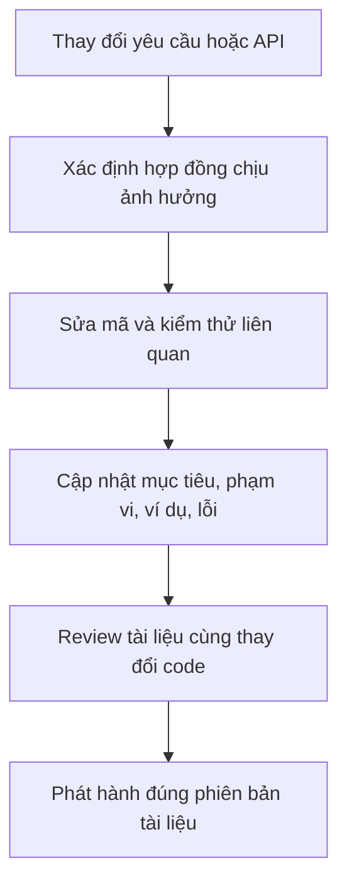

# Giải thích mục tiêu, phạm vi và cách sử dụng

> **Chương:** Tài liệu  
> **Học phần:** CODE_QUALITY_FUNDAMENTALS — Hiểu những thuộc tính quyết định mã nguồn có đáng tin cậy, dễ hiểu và dễ thay đổi hay không.

Một lớp Java có tên rõ ràng và mã nguồn dễ đọc giúp người khác biết nó **đang làm gì**, nhưng chưa chắc giúp họ biết **vì sao thành phần tồn tại, tình huống nào nên sử dụng và những điều gì nằm ngoài trách nhiệm của nó**. Thiếu các thông tin đó, người dùng có thể gọi đúng phương thức về mặt cú pháp nhưng sai nghiệp vụ: lấy phí giao hàng hiện tại để tính lại hóa đơn cũ, dùng tổng tiền trước giảm giá thay cho sau giảm giá hoặc hiểu một ngoại lệ như kết quả thành công.

**Tài liệu kỹ thuật tốt cần giải thích ba điều cốt lõi: mục tiêu (*why*), phạm vi (*what and boundaries*) và cách sử dụng (*how*).** Tài liệu không thay mã nguồn hay kiểm thử; nó bổ sung ngữ cảnh, cam kết và hướng dẫn mà người đọc khó suy ra đầy đủ từ câu lệnh. Khi các thông tin quan trọng được đặt đúng chỗ và được cập nhật cùng phần mềm, mã trở nên **dễ hiểu, đáng tin cậy và dễ thay đổi** hơn.

Sau bài học, bạn có thể:

- Viết mô tả mục tiêu xuất phát từ một vấn đề và người dùng cụ thể, thay vì chỉ nhắc lại tên lớp.
- Phân định trách nhiệm, đầu vào, đầu ra, điều kiện áp dụng và **những việc không được hỗ trợ**.
- Trình bày quy trình sử dụng bằng ví dụ Java có thể đối chiếu, kèm điều kiện lỗi và trường hợp biên.
- Lựa chọn nơi đặt thông tin: Javadoc, README/hướng dẫn module, tài liệu quyết định kỹ thuật hoặc hướng dẫn vận hành.
- Đánh giá liệu tài liệu có giúp người mới dùng thành phần **đúng ngay lần đầu** và giúp người bảo trì sửa đổi có căn cứ hay không.

## 1. Ba câu hỏi mà tài liệu cần trả lời

Hãy tưởng tượng bạn được giao tích hợp một thư viện tính phí giao hàng vào luồng thanh toán. Bạn tìm được:

```java
long calculateFeeVnd(long amountVnd, boolean express);
```

Chữ ký này cho thấy kết quả là một số `long`, nhưng chưa trả lời:

- `amountVnd` là tổng tiền **trước** hay **sau** giảm giá? Có gồm thuế và phí khác không?
- Thư viện được dùng cho **báo giá mới** hay được phép tính lại đơn đã chốt?
- Khu vực nào được hỗ trợ? Phí cho giao hàng nhanh được quyết định thế nào?
- Đầu vào âm, loại giao hàng không biết hoặc tràn số được xử lý ra sao?
- Hàm chỉ tính toán hay còn ghi dữ liệu, gọi dịch vụ bên ngoài?

Mô tả mục tiêu, phạm vi và cách sử dụng giúp trả lời ba lớp câu hỏi:

| Lớp thông tin | Câu hỏi người đọc muốn biết | Nội dung nên ghi |
| --- | --- | --- |
| **Mục tiêu** | Vì sao thành phần được tạo ra, giải quyết vấn đề cho ai? | Bối cảnh, nhu cầu, kết quả mong muốn, nguyên tắc thiết kế |
| **Phạm vi** | Thành phần bảo đảm điều gì, không bảo đảm điều gì? | Trách nhiệm, loại dữ liệu, quy tắc, giả định, giới hạn, phụ thuộc |
| **Cách sử dụng** | Làm sao dùng đúng và nhận biết sai? | Điều kiện tiên quyết, ví dụ gọi, kết quả, lỗi, kiểm thử, lưu ý tích hợp |

Một tài liệu chỉ viết “đây là lớp tính phí giao hàng” đã **lặp lại tên lớp**, chưa giải thích mục tiêu. Một tài liệu chỉ có đoạn code mẫu nhưng không nói điều kiện áp dụng có thể tạo ra một ví dụ **đúng với dữ liệu mẫu nhưng sai với dữ liệu thực**.

> **Nguyên tắc:** Tài liệu chất lượng giúp người đọc đưa ra quyết định chính xác tại ranh giới sử dụng, không chỉ giúp họ tìm được tên phương thức.

## 2. Viết mục tiêu: giải thích “vì sao”, không chỉ “làm gì”

### 2.1. Mục tiêu nên gắn với nhu cầu và kết quả

Hai cách mô tả cùng một thành phần:

**Mô tả chưa hữu ích:**

> `ShippingFeePolicy` có các phương thức tính phí giao hàng.

**Mô tả rõ mục tiêu hơn:**

> `ShippingFeePolicy` cung cấp một nơi áp dụng chính sách phí giao hàng cho **báo giá đơn hàng mới**. Checkout và màn hình xem trước dùng cùng cách tính để tránh lệch mức phí. Thành phần chỉ thực hiện phép tính; việc xác nhận và lưu giá trị phí đã chốt thuộc quy trình tạo đơn.

Mô tả thứ hai cho thấy **lý do tồn tại** (tránh nhiều bản tính phí lệch nhau), **người sử dụng** (checkout và màn hình xem trước), **giới hạn** (báo giá mới) và **ranh giới trách nhiệm** (không lưu hóa đơn).

Một mẫu câu ngắn có thể dùng:

```text
[Tên thành phần] giúp [nhóm người dùng/thành phần sử dụng]
thực hiện [mục tiêu] trong [bối cảnh]
bằng [khả năng chính], nhằm tránh/đạt [hậu quả có ý nghĩa].
```

Ví dụ:

> `OrderPermissionChecker` cho phép tầng API xác nhận quyền xem đơn hàng trước khi trả dữ liệu, nhằm tránh truy cập đơn không thuộc về người gọi.

Không nên diễn đạt mục tiêu thành lời hứa vượt quá trách nhiệm. Chẳng hạn, một lớp kiểm tra quyền theo danh tính đã xác thực không thể tự bảo đảm **toàn bộ ứng dụng an toàn** nếu các endpoint khác bỏ qua bước kiểm tra.

### 2.2. Khi nào cần ghi lý do chọn giải pháp?

Có những quyết định không hiển nhiên trong mã, ví dụ:

- Dùng `long` biểu diễn số tiền theo đơn vị VND thay vì `double`.
- Không tự gọi mạng khi tính phí vì checkout cần đường tính toán nhanh và có thể kiểm thử độc lập.
- Lưu mức phí đã chốt trong đơn hàng vì chính sách hiện tại có thể thay đổi.
- Dùng dữ liệu bất biến để các lần tính không bị ảnh hưởng bởi trạng thái toàn cục.

Lý do như vậy nên được ghi ở nơi người bảo trì có thể tìm thấy, nhất là khi người sửa dễ vô tình “đơn giản hóa” và làm mất một bất biến. Tuy nhiên, không cần biến mọi lựa chọn cú pháp bình thường thành một tài liệu quyết định dài.

## 3. Viết phạm vi: nêu cả điều được hỗ trợ và điều không được hỗ trợ

Một phạm vi rõ ràng nên mô tả **trách nhiệm**, **ranh giới dữ liệu**, **điều kiện áp dụng** và **phụ thuộc**. Đặc biệt, phần **ngoài phạm vi** (*non-goals*) giúp ngăn cách dùng sai dù tên API trông có vẻ phù hợp.

Với chính sách phí giao hàng giả định:

| Nội dung | Thuộc phạm vi | Ngoài phạm vi |
| --- | --- | --- |
| **Mục đích sử dụng** | Báo giá phí giao hàng cho đơn mới | Tính lại phí của hóa đơn lịch sử |
| **Kiểu giao hàng** | `STANDARD` và `EXPRESS` | Các kiểu chưa được định nghĩa như giao hàng quốc tế |
| **Căn cứ tính phí** | Tổng tiền hàng **sau giảm giá**, đơn vị VND | Tổng tiền trước giảm giá hoặc đã cộng các loại phí khác |
| **Quy tắc phí** | Tiêu chuẩn 30.000 VND, miễn từ 500.000 VND; nhanh 50.000 VND | Thuế, phí xử lý, bảo hiểm và chiết khấu riêng theo vùng |
| **Tác dụng phụ** | Không có; chỉ tạo kết quả | Lưu đơn, thu tiền, gửi thông báo |
| **Đầu vào sai** | Ném ngoại lệ theo hợp đồng | Tự đổi giá trị sai về 0 để tiếp tục |

Các con số trong bảng **chỉ là chính sách minh họa của bài học**, không phải chính sách thật của một tổ chức.

### 3.1. Phạm vi cũng phải nói rõ dữ liệu và đơn vị

Hai biến cùng kiểu `long` có thể mang ý nghĩa hoàn toàn khác:

```java
long subtotalVnd;
long subtotalAfterDiscountVnd;
```

Nếu API yêu cầu giá trị thứ hai nhưng bên gọi truyền giá trị thứ nhất, mã vẫn biên dịch. Tài liệu phải nêu **ngữ nghĩa của dữ liệu**. Tên tham số tốt giúp ích, nhưng đôi khi chỉ tài liệu mới có thể giải thích đầy đủ cách tính và thời điểm dữ liệu được xác nhận.

Tương tự, với ngày giờ cần ghi rõ múi giờ và quy tắc về ngày hiệu lực; với tỷ lệ phần trăm cần phân biệt `0.15` và `15`; với mã định danh cần nói rõ nó thuộc người dùng, đơn hàng hay giao dịch.

### 3.2. Ranh giới phạm vi giúp tránh phụ thuộc sai

Nếu một hàm tính phí được mô tả là **không thay đổi trạng thái**, bên sử dụng có thể gọi lại để xem trước khi chưa tạo đơn. Nếu sau này người phát triển thêm lời gọi `orderRepository.save(...)` trong hàm, đó không còn là thay đổi nội bộ vô hại: hợp đồng tác dụng phụ đã thay đổi.

Khi viết phạm vi, hãy hỏi: **người gọi được phép giả định điều gì mà không phải mở mã bên trong?** Những giả định có ý nghĩa đó phải được công bố và được kiểm thử phù hợp.

## 4. Ví dụ Java xuyên suốt: hợp đồng rõ cho chính sách giao hàng

Ta sẽ dùng một phiên bản Java tối giản nhưng đủ để minh họa Javadoc, ví dụ sử dụng và giới hạn:

```java
// ShippingFeePolicy.java
import java.util.Objects;

/**
 * Tính phí giao hàng cho báo giá mới theo chính sách minh họa.
 *
 * <p>Đầu vào là tổng tiền hàng sau giảm giá, tính bằng VND. Lớp không
 * thực hiện I/O và không thay đổi trạng thái bên ngoài. Phí đã chốt
 * trong đơn hàng lịch sử phải được đọc từ bản ghi giao dịch.</p>
 */
public final class ShippingFeePolicy {
    private static final long STANDARD_FEE_VND = 30_000L;
    private static final long EXPRESS_FEE_VND = 50_000L;
    private static final long FREE_STANDARD_THRESHOLD_VND = 500_000L;

    public enum DeliveryMode {
        STANDARD,
        EXPRESS
    }

    public static final class ShippingQuote {
        private final long subtotalAfterDiscountVnd;
        private final long shippingFeeVnd;
        private final long totalVnd;

        private ShippingQuote(long subtotalAfterDiscountVnd,
                              long shippingFeeVnd,
                              long totalVnd) {
            this.subtotalAfterDiscountVnd = subtotalAfterDiscountVnd;
            this.shippingFeeVnd = shippingFeeVnd;
            this.totalVnd = totalVnd;
        }

        public long getSubtotalAfterDiscountVnd() {
            return subtotalAfterDiscountVnd;
        }

        public long getShippingFeeVnd() {
            return shippingFeeVnd;
        }

        public long getTotalVnd() {
            return totalVnd;
        }
    }

    /**
     * Tạo báo giá bằng VND cho một đơn hàng mới.
     *
     * @param subtotalAfterDiscountVnd tổng tiền hàng đã trừ giảm giá,
     *                                 không âm và chưa cộng phí giao hàng
     * @param mode chế độ giao hàng được hỗ trợ; không được null
     * @return báo giá chứa tiền hàng, phí giao hàng và tổng phải trả
     * @throws IllegalArgumentException nếu tổng tiền âm
     * @throws NullPointerException nếu mode là null
     * @throws ArithmeticException nếu cộng phí làm tràn kiểu long
     */
    public ShippingQuote quote(long subtotalAfterDiscountVnd,
                               DeliveryMode mode) {
        if (subtotalAfterDiscountVnd < 0L) {
            throw new IllegalArgumentException("Negative subtotal");
        }
        Objects.requireNonNull(mode, "mode");

        long shippingFeeVnd = calculateShippingFeeVnd(
                subtotalAfterDiscountVnd, mode);
        long totalVnd = Math.addExact(
                subtotalAfterDiscountVnd, shippingFeeVnd);

        return new ShippingQuote(
                subtotalAfterDiscountVnd, shippingFeeVnd, totalVnd);
    }

    private static long calculateShippingFeeVnd(long subtotalVnd,
                                                DeliveryMode mode) {
        if (mode == DeliveryMode.EXPRESS) {
            return EXPRESS_FEE_VND;
        }
        return subtotalVnd >= FREE_STANDARD_THRESHOLD_VND
                ? 0L
                : STANDARD_FEE_VND;
    }
}
```

Đoạn mã có những lựa chọn có chủ đích:

1. **Tên và tham số** xác định tổng tiền được tính **sau giảm giá**.
2. **Kiểu `DeliveryMode`** hạn chế các giá trị chế độ giao hàng được hỗ trợ trong ví dụ.
3. **`ShippingQuote`** trả ba trường có đơn vị rõ, để bên gọi không tự đoán phí đã cộng vào tổng hay chưa.
4. **Ngoại lệ** thể hiện điều kiện đầu vào sai hoặc phép cộng vượt miền số nguyên.
5. **Không có lời gọi I/O** trong phương thức tính; đây là một phần hợp đồng, không chỉ là lựa chọn về hiệu năng.
6. **Tài liệu Javadoc** giải thích mục tiêu dùng cho báo giá mới và ranh giới với dữ liệu lịch sử.

Các phần của lớp đều được trình bày trong một ví dụ Java. Nếu đặt trong dự án có package, cần khai báo package và sắp xếp tệp theo quy ước của dự án; ví dụ này không đòi hỏi thư viện bên ngoài ngoài JDK.

## 5. Viết “cách sử dụng”: ví dụ phải đủ ngữ cảnh để làm đúng

Một tài liệu hữu ích cần cho người mới biết **tạo đối tượng ở đâu, chuẩn bị đầu vào nào, gọi thế nào và kết quả có nghĩa gì**. Ví dụ:

```java
ShippingFeePolicy policy = new ShippingFeePolicy();

// Đơn có hàng trị giá 600.000 VND và giảm 100.000 VND.
long subtotalAfterDiscountVnd = 600_000L - 100_000L;

ShippingFeePolicy.ShippingQuote quote = policy.quote(
        subtotalAfterDiscountVnd,
        ShippingFeePolicy.DeliveryMode.STANDARD);

System.out.println(quote.getShippingFeeVnd()); // 0
System.out.println(quote.getTotalVnd());       // 500000
```

Ví dụ này chứa đủ những yếu tố có ý nghĩa:

- **Đầu vào từ đâu:** giá trị 500.000 VND là số tiền hàng **sau giảm giá**, không phải số trước khuyến mại.
- **Cách gọi:** tạo `ShippingFeePolicy`, truyền tiền và chế độ giao hàng.
- **Kỳ vọng:** ở đúng ngưỡng, phí giao hàng tiêu chuẩn là `0`, tổng thanh toán bằng tiền hàng sau giảm giá.
- **Phạm vi:** đây là báo giá; ví dụ không lưu đơn, thu tiền hoặc phát hành hóa đơn.

### 5.1. Ghi cả ví dụ không được dùng

Một ví dụ **sai ngữ nghĩa** nhưng vẫn biên dịch:

```java
long subtotalBeforeDiscountVnd = 600_000L;
long discountVnd = 100_000L;

// Sai: truyền tổng tiền trước giảm giá vào API yêu cầu sau giảm giá.
ShippingFeePolicy.ShippingQuote quote = policy.quote(
        subtotalBeforeDiscountVnd,
        ShippingFeePolicy.DeliveryMode.STANDARD);
```

Tại 600.000 VND, ví dụ trên vẫn có thể cho phí `0` như trường hợp đúng, nên lỗi truyền dữ liệu **khó nhận thấy nếu chỉ nhìn phí**. Tổng phải trả lại bị tính thành 600.000 VND thay vì 500.000 VND.

Ví dụ **đúng**:

```java
long subtotalAfterDiscountVnd =
        subtotalBeforeDiscountVnd - discountVnd;

ShippingFeePolicy.ShippingQuote quote = policy.quote(
        subtotalAfterDiscountVnd,
        ShippingFeePolicy.DeliveryMode.STANDARD);
```

Trong ứng dụng thật, việc tính giảm giá phải tuân theo hợp đồng riêng, chẳng hạn `discountVnd >= 0` và không lớn hơn tổng tiền trước giảm giá. Ví dụ ở đây tập trung vào **ranh giới dữ liệu của API báo giá**, không xây dựng toàn bộ hệ thống tính khuyến mại.

### 5.2. Bảng tình huống giúp nhận diện trường hợp biên

| Đầu vào | Chế độ | Phí giao hàng | Tổng VND / Kết quả |
| --- | --- | ---: | --- |
| 499.999 VND sau giảm giá | `STANDARD` | 30.000 | 529.999 |
| **500.000 VND** sau giảm giá | `STANDARD` | **0** | 500.000 |
| 600.000 VND sau giảm giá | `EXPRESS` | 50.000 | 650.000 |
| -1 VND sau giảm giá | `STANDARD` | — | `IllegalArgumentException` |
| 100.000 VND sau giảm giá | `null` | — | `NullPointerException` |
| `Long.MAX_VALUE` VND | `EXPRESS` | — | `ArithmeticException` do tổng tràn |

Người viết tài liệu không nhất thiết phải liệt kê mọi giá trị; nên chọn các trường hợp giải thích được **hành vi quan trọng, ranh giới và lỗi dễ hiểu sai**. Các con số trong bảng khớp với chính sách minh họa đã nêu.

## 6. Lỗi và giới hạn phải được ghi trong phần sử dụng

Hướng dẫn chỉ mô tả đường đi thành công có thể khiến người sử dụng không biết nên làm gì khi thao tác thất bại. Với ví dụ báo giá:

| Tình huống | Hành vi API | Phản ứng phù hợp ở phía gọi |
| --- | --- | --- |
| Số tiền âm | `IllegalArgumentException` | Xem lại dữ liệu đầu vào, không tự đổi về 0 |
| Chế độ giao hàng bằng `null` | `NullPointerException` | Sửa dữ liệu hoặc lỗi tích hợp; không ngầm chọn chế độ khác |
| Tổng tiền vượt `Long.MAX_VALUE` khi cộng phí | `ArithmeticException` | Báo không tính được báo giá; không dùng tổng bị tràn |
| Đầu vào hợp lệ | Trả `ShippingQuote` | Dùng phí và tổng theo đúng ngữ nghĩa công bố |

Không nên hướng dẫn:

```java
try {
    return policy.quote(amountVnd, mode).getTotalVnd();
} catch (Exception ignored) {
    return 0L; // Không được dùng giá trị hợp lệ để che thất bại.
}
```

Nếu 0 VND có nghĩa “không phải trả tiền”, cách xử lý trên biến một lỗi thành thành công giả. Tài liệu cần nêu **lỗi nào là lỗi đầu vào**, **lỗi nào người gọi có thể xử lý** và **điều gì không được phép giả định**.

Ở ranh giới HTTP hoặc thanh toán có tác dụng phụ, phải nói thêm về timeout, trạng thái chưa xác định, retry và idempotency khi phù hợp. Ví dụ `ShippingFeePolicy` là phép tính cục bộ **không gọi mạng**, nên không nên bịa thêm cơ chế timeout vào hợp đồng của chính lớp này.

## 7. Chọn nơi đặt tài liệu để người cần dùng có thể tìm thấy

Không phải mọi thông tin đều nên dồn vào một tệp README dài hoặc mỗi phương thức đều có Javadoc vài trang. Chọn nơi đặt theo **người đọc và thời điểm họ cần thông tin**.

| Loại thông tin | Nơi đặt thường phù hợp | Mục đích |
| --- | --- | --- |
| Mục tiêu module, trách nhiệm và phạm vi | README hoặc trang giới thiệu module | Người mới biết vì sao module tồn tại và nên dùng khi nào |
| Cách khởi tạo và ví dụ sử dụng | README / hướng dẫn tích hợp | Người dùng nhanh chóng gọi thành phần đúng cách |
| Tham số, kết quả, ngoại lệ và tác dụng phụ của API | Javadoc hoặc tài liệu API gần chữ ký | Người gọi hiểu hợp đồng mà không đọc cài đặt |
| Lý do quyết định thiết kế quan trọng, phương án thay thế | ADR (*Architecture Decision Record*) hoặc ghi chú quyết định | Người bảo trì biết tại sao chọn giải pháp và điều kiện xem xét lại |
| Cách cấu hình, triển khai, vận hành và xử lý sự cố | Runbook / hướng dẫn vận hành | Người vận hành ứng phó an toàn |
| Quy tắc và ca biên quan trọng | Kiểm thử với tên rõ và đặc tả liên quan | Bảo vệ hành vi khi code thay đổi |

Tài liệu có thể tồn tại ở nhiều nơi với **mức chi tiết khác nhau**: README tóm tắt mục tiêu và liên kết tới Javadoc chi tiết; ADR lưu lý do ra quyết định; test kiểm tra hành vi cụ thể. Tránh copy nguyên một chính sách thành nhiều bản mô tả **độc lập không được quản lý**, vì chúng có thể lệch nhau khi chính sách đổi.

### 7.1. Javadoc: hợp đồng ở gần phương thức

Ví dụ về một Javadoc có ích:

```java
/**
 * Tính phí giao hàng cho báo giá mới.
 *
 * @param subtotalAfterDiscountVnd tổng tiền hàng sau giảm giá,
 *                                 chưa cộng phí, đơn vị VND, không âm
 * @param mode loại giao hàng được hỗ trợ, không null
 * @return phí giao hàng không âm, đơn vị VND
 * @throws IllegalArgumentException nếu số tiền âm
 * @throws NullPointerException nếu mode là null
 */
long calculateFeeVnd(
        long subtotalAfterDiscountVnd,
        DeliveryMode mode);
```

Trong ví dụ chữ ký rút gọn, `DeliveryMode` được giả định đã khai báo ở phạm vi thích hợp. Nếu thư viện công bố kiểu kết quả phức tạp, Javadoc cần giải thích thêm tính bất biến, quyền sở hữu dữ liệu, tác dụng phụ hoặc lỗi từ phụ thuộc bên ngoài.

Javadoc nên ghi **thứ người gọi cần dựa vào**, không mô tả lại từng dòng thuật toán. Ví dụ “cộng phí rồi trả về” không nói được trường hợp tràn số; trong khi mô tả về `ArithmeticException` có thể rất quan trọng cho người dùng.

### 7.2. README: đường vào cho người mới

Một README tốt thường trả lời được: module làm gì, yêu cầu môi trường nào, cách chạy ví dụ ngắn nhất, giới hạn lớn nhất và nơi xem hợp đồng chi tiết.

Ví dụ bố cục **mẫu**, không phải lệnh cài đặt của một thư viện thật:

```markdown
# Shipping Fee Policy

## Mục tiêu
Tính phí giao hàng nhất quán cho báo giá đơn hàng mới.

## Phạm vi
- Hỗ trợ STANDARD và EXPRESS.
- Đầu vào là tổng tiền hàng sau giảm giá, đơn vị VND.
- Không lưu đơn, thu tiền hoặc tính lại hóa đơn lịch sử.

## Bắt đầu
Tạo ShippingFeePolicy và gọi quote(amountVnd, mode).
Xem ví dụ Java tại mục "Cách sử dụng".

## Xử lý lỗi
Giá trị âm: IllegalArgumentException.
mode null: NullPointerException.
Tràn số: ArithmeticException.

## Tham khảo
Xem Javadoc của ShippingFeePolicy và bộ test quy tắc phí.
```

README có thể liên kết đến các trang chi tiết phù hợp dự án. Không nên đưa địa chỉ môi trường, lệnh build hay thông tin cấu hình **không được xác minh** chỉ để làm tài liệu trông đầy đủ.

### 7.3. ADR: lưu lý do khó suy ra từ mã

Nếu nhóm chọn tính phí bằng phép tính thuần thay vì gọi dịch vụ từ xa, một ADR ngắn có thể ghi:

```text
Quyết định: Thành phần báo giá tính phí tại chỗ từ chính sách được cung cấp.
Lý do: Giảm phụ thuộc mạng khi hiển thị báo giá; dễ kiểm thử biên.
Hệ quả: Phải kiểm soát phiên bản chính sách khi phát hành nhiều dịch vụ.
Không áp dụng: Giá trị phí đã chốt trong hóa đơn lịch sử.
Điều kiện xem xét lại: Chính sách trở nên phụ thuộc dữ liệu thời gian thực.
```

Đây là ví dụ **một quyết định giả định**, không phải một quyết định đã tồn tại trong dự án. Việc ghi cả *hệ quả* và *điều kiện xem xét lại* giúp người bảo trì hiểu được đánh đổi, thay vì tưởng cách thiết kế là chân lý vĩnh viễn.

## 8. Tài liệu cần trả lời cho từng nhóm người đọc

Cùng một thành phần được dùng bởi nhiều vai trò:

| Người đọc | Cần gì nhất? | Tài liệu cần giúp họ làm gì? |
| --- | --- | --- |
| Lập trình viên tích hợp | Điều kiện đầu vào, kiểu trả về, lỗi, ví dụ gọi | Gọi đúng mà không cần đọc mã nội bộ |
| Người review | Mục tiêu nghiệp vụ, giả định, giới hạn và tác dụng phụ | Đối chiếu cài đặt với hợp đồng |
| Người bảo trì | Lý do thiết kế, nơi sở hữu quy tắc, tác động khi đổi | Sửa đúng nơi và không phá người gọi |
| Người kiểm thử | Các ca thành công, điều kiện biên, ngoại lệ | Viết kỳ vọng độc lập với thuật toán |
| Người vận hành | Cấu hình, tín hiệu lỗi, cách xác định ảnh hưởng | Nhận biết và xử lý sự cố trong phạm vi hỗ trợ |

Không cần viết một tài liệu dài riêng cho từng vai trò nếu thông tin đã được tổ chức rõ ràng. Nhưng nếu README chỉ có lệnh chạy còn Javadoc chỉ nhắc lại tên phương thức, mỗi nhóm người đọc vẫn phải tự suy đoán thông tin quan trọng.

### 8.1. Kiểm tra tài liệu từ góc nhìn người chưa biết code

Một bài kiểm tra rất thực dụng: đưa hướng dẫn cho đồng nghiệp **chưa tham gia viết thành phần**, yêu cầu họ dùng nó cho một tình huống hợp lệ và một tình huống không được hỗ trợ. Quan sát họ có phải hỏi tác giả về **đơn vị, điều kiện biên, kiểu lỗi hay tác dụng phụ** không.

Nếu có, đó là tín hiệu cần bổ sung tài liệu hoặc cải thiện chính API. Không nên viết tài liệu quá dài chỉ để che tên phương thức và mô hình dữ liệu vốn đã mơ hồ.

## 9. Liên kết tài liệu với kiểm thử và hành vi thật

Tài liệu tốt phải **phù hợp với mã được phát hành**, không chỉ diễn đạt một ý tưởng mong muốn. Ví dụ, nếu Javadoc nói miễn phí giao hàng từ 500.000 VND, bộ kiểm thử cần bảo vệ điểm biên đó.

```java
import static org.junit.jupiter.api.Assertions.assertEquals;
import static org.junit.jupiter.api.Assertions.assertThrows;

import org.junit.jupiter.api.Test;

class ShippingFeePolicyTest {
    private final ShippingFeePolicy policy = new ShippingFeePolicy();

    @Test
    void standardFeeAppliesJustBelowThreshold() {
        ShippingFeePolicy.ShippingQuote quote = policy.quote(
                499_999L, ShippingFeePolicy.DeliveryMode.STANDARD);

        assertEquals(30_000L, quote.getShippingFeeVnd());
        assertEquals(529_999L, quote.getTotalVnd());
    }

    @Test
    void standardShippingIsFreeExactlyAtThreshold() {
        ShippingFeePolicy.ShippingQuote quote = policy.quote(
                500_000L, ShippingFeePolicy.DeliveryMode.STANDARD);

        assertEquals(0L, quote.getShippingFeeVnd());
        assertEquals(500_000L, quote.getTotalVnd());
    }

    @Test
    void expressShippingIsNotMadeFreeByThreshold() {
        ShippingFeePolicy.ShippingQuote quote = policy.quote(
                600_000L, ShippingFeePolicy.DeliveryMode.EXPRESS);

        assertEquals(50_000L, quote.getShippingFeeVnd());
    }

    @Test
    void invalidSubtotalIsRejected() {
        assertThrows(IllegalArgumentException.class,
                () -> policy.quote(
                        -1L, ShippingFeePolicy.DeliveryMode.STANDARD));
    }
}
```

Những kiểm thử trên minh họa cách **biến mô tả thành bằng chứng có thể thực thi**. Tuy nhiên, một bộ test xanh không tự bảo đảm rằng tài liệu hoàn chỉnh: nội dung “ngoài phạm vi” và lý do quyết định thiết kế nhiều khi cần review của người hiểu nghiệp vụ.

### 9.1. Tránh dùng cài đặt làm kỳ vọng của chính test

Không nên viết:

```java
long expected = policy.quote(500_000L,
        ShippingFeePolicy.DeliveryMode.STANDARD).getShippingFeeVnd();
long actual = policy.quote(500_000L,
        ShippingFeePolicy.DeliveryMode.STANDARD).getShippingFeeVnd();
assertEquals(expected, actual);
```

Ví dụ này chỉ so sánh hàm với chính nó. Ngay cả khi cả hai lần cùng sai ngưỡng, test có thể vẫn xanh. Kỳ vọng kiểm thử phải xuất phát từ **quy tắc nghiệp vụ độc lập**, ví dụ “phí bằng 0 tại đúng ngưỡng”.

### 9.2. Tài liệu không phải đặc tả duy nhất nếu hệ thống có nhiều nguồn

Với quy tắc thay đổi thường xuyên, có thể cần một đặc tả hoặc chính sách được quản lý tập trung. README/Javadoc nên mô tả ý nghĩa và chỉ dẫn đến nguồn có thẩm quyền, trong khi kiểm thử bảo vệ hành vi của phiên bản được dùng.

Nếu tài liệu và phần mềm mâu thuẫn, không nên mặc định **mã luôn đúng** hoặc **tài liệu luôn đúng**. Cần đối chiếu với yêu cầu và quyết định nghiệp vụ thực tế, rồi cập nhật cả những nơi có trách nhiệm.

## 10. Những rủi ro khi tài liệu thiếu hoặc sai

| Thiếu sót | Hậu quả có thể xảy ra | Cách cải thiện |
| --- | --- | --- |
| Chỉ mô tả tên lớp, không có mục tiêu | Người dùng chọn sai thành phần | Nêu vấn đề được giải quyết và đối tượng dùng |
| Không xác định phạm vi | Người gọi dùng API để làm việc nó không hỗ trợ | Ghi rõ *in scope* và *out of scope* |
| Không ghi đơn vị hoặc điều kiện đầu vào | Cùng kiểu dữ liệu nhưng truyền sai nghĩa | Đặt tên rõ, ghi đơn vị và ví dụ đúng/sai |
| Không nói về tác dụng phụ | Caller retry hoặc gọi nhiều lần không an toàn | Công bố thay đổi trạng thái và ngữ nghĩa lặp lại |
| Không nói trường hợp lỗi | Giá trị mặc định có thể che thất bại | Mô tả lỗi, ngoại lệ và hướng xử lý |
| Ví dụ sử dụng không chạy được hoặc đã cũ | Người mới mất thời gian, có thể sao chép mã sai | Review ví dụ cùng thay đổi code; kiểm thử ví dụ khi phù hợp |
| Sao chép chính sách ở nhiều nơi | README, wiki và Javadoc có thể lệch nhau | Quy định nguồn có thẩm quyền và liên kết |
| Đưa thông tin bí mật vào hướng dẫn | Rò rỉ khóa, token, thông tin nội bộ | Dùng giá trị mẫu an toàn và nơi quản lý secrets phù hợp |

Tài liệu sai có thể **nguy hiểm hơn việc thiếu tài liệu**, vì nó tạo cảm giác chắc chắn sai. Do đó, chất lượng tài liệu bao gồm **độ đúng, phạm vi áp dụng và khả năng duy trì**.

## 11. Duy trì tài liệu khi mã và hợp đồng thay đổi

Tài liệu không phải một bước chỉ làm khi kết thúc dự án. Khi thay đổi tính năng, các câu hỏi review nên gồm:

1. **Mục tiêu có thay đổi không?** Ví dụ từ tính phí giao hàng tiêu chuẩn sang hỗ trợ thêm khu vực quốc tế.
2. **Phạm vi có thay đổi không?** Thêm loại giao hàng, tính thuế hay có gọi hệ thống khác?
3. **Đầu vào/đầu ra có đổi nghĩa không?** Đổi từ tiền sau giảm giá sang tiền trước giảm giá, hoặc thêm loại tiền tệ?
4. **Lỗi có thay đổi không?** Từ trả giá trị rỗng sang ngoại lệ, thêm timeout hay trạng thái chưa xác định?
5. **Ví dụ còn đúng không?** Giá trị biên, kết quả in ra và đường khởi tạo có phù hợp phiên bản mới?
6. **Người sử dụng cũ có bị ảnh hưởng không?** API có nhiều module hoặc nhiều phiên bản client cần hướng dẫn chuyển đổi?
7. **Những nơi nào phải cập nhật cùng?** Javadoc, README, tài liệu tích hợp, quyết định thiết kế và test liên quan.

Một quy trình cập nhật thực dụng:



Với API được nhiều nhóm dùng, cần biết tài liệu thuộc **phiên bản nào**. Một ví dụ đúng cho API v2 có thể sai với client v1; hãy đánh dấu điều kiện tương thích và hướng dẫn chuyển đổi khi có thay đổi phá vỡ hợp đồng.

### 11.1. Không biến tài liệu thành gánh nặng lặp lại

Nếu cùng ngưỡng chính sách được sao chép ở quá nhiều nơi, mọi lần đổi đều có nguy cơ sót một bản. Nên chọn **nguồn sở hữu quy tắc** rõ ràng và dùng tài liệu ở những nơi khác để giải thích ý nghĩa, phạm vi hoặc liên kết đến nguồn đó. Tài liệu không cần chứa mọi chi tiết thuật toán mà mã đã thể hiện rõ.

Tốt hơn là có **một hướng dẫn ngắn, chính xác, dễ tìm** hơn một wiki hàng trăm dòng không còn phù hợp với phần mềm đang chạy.

## 12. Checklist viết và review một tài liệu “mục tiêu – phạm vi – cách dùng”

| Câu hỏi | Dấu hiệu đạt |
| --- | --- |
| Người đọc có hiểu tại sao thành phần tồn tại? | Nêu vấn đề, người sử dụng và giá trị mong muốn |
| Có thể nói một câu về trách nhiệm chính? | Mục tiêu và ranh giới đủ cụ thể |
| Có liệt kê những gì được và không được hỗ trợ? | Không để người dùng tự đoán phạm vi |
| Đầu vào có kiểu, đơn vị và tiền điều kiện rõ? | Không nhầm tiền trước/sau giảm giá hay giá trị `null` |
| Kết quả và tác dụng phụ có hợp đồng rõ? | Biết phương thức trả gì và thay đổi gì |
| Ví dụ có thể đối chiếu với API hiện tại? | Có khởi tạo, gọi hàm, dữ liệu mẫu và kỳ vọng |
| Trường hợp lỗi quan trọng có được giải thích? | Biết khi nào phải dừng, sửa dữ liệu hoặc xử lý ngoại lệ |
| Lý do quyết định khó hiểu có thể tìm thấy? | Có ghi chú/ADR khi cần, không phụ thuộc trí nhớ tác giả |
| Có liên kết với kiểm thử và quy tắc nguồn? | Trường hợp biên được bảo vệ, không có nhiều bản quy tắc độc lập |
| Tài liệu có thông tin nhạy cảm hoặc chi tiết môi trường sai? | Dùng placeholder an toàn; thông tin vận hành được kiểm chứng |
| Có người sở hữu và quy trình cập nhật? | Review tài liệu cùng code và quản lý theo phiên bản |
| Người mới có thể dùng đúng mà không hỏi tác giả? | Hướng dẫn đủ để tự tích hợp và nhận biết giới hạn |

Không cần tài liệu nào cũng dài bằng bài học này. Với một phương thức nội bộ đơn giản, một tên tốt và vài dòng Javadoc có thể đủ. Với API được nhiều module hoặc nhóm sử dụng, việc ghi rõ phạm vi và cách dùng thường đáng đầu tư hơn.

## 13. Bài tập thực hành

Một lớp Java dùng để tra cứu số lượng sản phẩm còn hàng có API:

```java
int getAvailableQuantity(String productId);
```

Tác giả chỉ ghi bình luận:

```java
// Lấy số lượng hàng.
```

Giả sử người thiết kế cung cấp những quy tắc **của tình huống bài tập**:

- API trả số lượng **đã trừ lượng hàng được giữ cho đơn khác**.
- Chỉ dùng để **hiển thị ước tính** trên trang sản phẩm; không đảm bảo quyền mua hàng tại thời điểm thanh toán.
- `productId` phải khác `null`, không rỗng và tồn tại trong hệ thống danh mục.
- Không tìm thấy sản phẩm là tình huống khác với lỗi kho không khả dụng.
- Nếu không truy vấn được kho, API phải **báo thất bại rõ ràng**, không trả `0` như thể hết hàng.
- API không tự thực hiện thao tác giữ hàng.

Hãy thực hiện các yêu cầu:

1. Viết lại **mục tiêu** bằng một hoặc hai câu, nêu ai sử dụng và mục đích hiển thị.
2. Lập bảng **trong phạm vi/ngoài phạm vi**, đặc biệt phân biệt **hiển thị số lượng ước tính** với **xác nhận giữ hàng khi thanh toán**.
3. Đề xuất một hợp đồng API rõ hơn cho trường hợp sản phẩm không tồn tại và kho không khả dụng. Có thể chọn kiểu kết quả hoặc các loại ngoại lệ phù hợp, nhưng phải nêu ý nghĩa.
4. Viết Javadoc cho phương thức mới: đầu vào, kết quả, điều kiện không hợp lệ, ngoại lệ, tác dụng phụ.
5. Soạn một hướng dẫn ngắn có ví dụ gọi thành công và cách xử lý lỗi, không biến lỗi kết nối thành số lượng `0`.
6. Nêu ít nhất bốn test: còn hàng, hết hàng hợp lệ, mã sản phẩm không hợp lệ/không tồn tại và lỗi nguồn kho.
7. Giải thích vì sao một thay đổi từ “số lượng khả dụng hiện tại” sang “số lượng tối đa có thể đặt trước” là **thay đổi ngữ nghĩa**, dù API vẫn trả `int`.
8. Xác định nơi phù hợp để đặt mục tiêu module, Javadoc và lý do quyết định không giữ hàng ngay trong bước hiển thị.

**Gợi ý:** tài liệu cần giúp người tích hợp hiểu **khi nào có thể tin giá trị số lượng**, khi nào phải báo lỗi và khi nào cần một API khác để bảo đảm giao dịch. Tên hàm và chữ ký chỉ là một phần của thông tin đó.

## Ghi nhớ

Tài liệu kỹ thuật có chất lượng không chỉ mô tả “mã làm gì”, mà còn giải thích **mục tiêu tồn tại, phạm vi trách nhiệm và cách sử dụng đúng**. Hãy gắn mục tiêu với vấn đề thật, ghi ranh giới và điều không hỗ trợ, cung cấp ví dụ có đầu vào/kết quả rõ, đồng thời công bố lỗi và tác dụng phụ quan trọng. Đặt thông tin ở nơi người dùng dễ tìm, giữ nhất quán với kiểm thử và cập nhật cùng phiên bản mã. Khi người khác có thể dùng và thay đổi thành phần mà không cần đoán ý tác giả, tài liệu đã góp phần thực chất vào chất lượng phần mềm.
