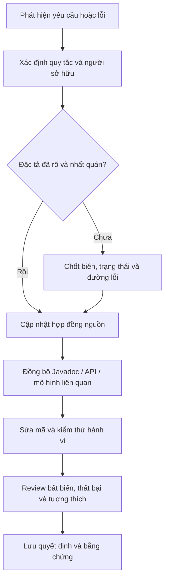

# Ghi hợp đồng, bất biến và trường hợp lỗi

Một phương thức Java tên `reserve()` trông rất dễ hiểu. Nhưng khi hết hàng, nó trả `false`, ném ngoại lệ hay tạo yêu cầu chờ? Nếu hai luồng cùng gọi, liệu có giữ quá số hàng đang có? Sau một lỗi, trạng thái tồn kho có thay đổi một phần không? Chỉ nhìn tên phương thức hoặc một vài câu lệnh thường không đủ để trả lời.

Trong chương **Tài liệu** của module **CODE_QUALITY_FUNDAMENTALS**, tài liệu có giá trị khi giải thích **những bảo đảm mà bên gọi được phép dựa vào**. Tài liệu tốt góp phần giúp mã nguồn đáng tin cậy, dễ hiểu và dễ thay đổi: người dùng API biết gọi thế nào, người sửa mã biết điều gì không được phá vỡ, người kiểm thử biết kỳ vọng nào cần xác minh.

Trọng tâm của bài là **hợp đồng**, **bất biến** và **trường hợp lỗi**. Đây không phải ba kiểu chú thích để điền cho đủ biểu mẫu; chúng là những thành phần bổ sung nhau để làm rõ hành vi.

## 1. Hợp đồng, bất biến và trường hợp lỗi khác nhau thế nào?

| Thành phần | Câu hỏi trọng tâm | Ví dụ với hệ thống giữ chỗ |
| --- | --- | --- |
| **Hợp đồng (contract)** | Đầu vào nào được chấp nhận? Khi hoàn tất, bên gọi nhận gì và được dựa vào điều gì? | `hold(2)` trả `true` khi giữ thành công hai chỗ |
| **Bất biến (invariant)** | Quan hệ trạng thái nào phải giữ tại những ranh giới đã xác định? | `available >= 0` và `available + held == capacity` |
| **Trường hợp lỗi (failure case)** | Khi không hoàn tất như mong muốn, điều gì được báo và trạng thái còn lại ra sao? | Thiếu chỗ: trả `false`, không thay đổi hai bộ đếm |

Các khái niệm thường đi kèm:

- **Tiền điều kiện** (*precondition*) là điều kiện mà bên gọi phải thỏa hoặc API sẽ chủ động kiểm tra trước thao tác. Ví dụ, số chỗ xin giữ phải dương.
- **Hậu điều kiện** (*postcondition*) nêu kết quả và thay đổi trạng thái được bảo đảm sau một nhánh kết thúc. Ví dụ, giữ thành công làm số chỗ trống giảm đúng số lượng yêu cầu.
- **Bất biến lớp** thường đúng sau khi khởi tạo và tại ranh giới các thao tác công khai. Nó không nhất thiết đúng ở mọi lệnh trung gian nếu dữ liệu được bảo vệ khỏi việc quan sát trong lúc cập nhật.
- **Hành vi khi thất bại** nói rõ việc từ chối là kết quả nghiệp vụ dự kiến, ngoại lệ của lời gọi không hợp lệ, lỗi kỹ thuật hay trạng thái chưa thể xác nhận.

Một tài liệu API chỉ ghi “có thể ném ngoại lệ” là chưa đủ, vì bên gọi chưa biết **ngoại lệ nào**, **khi nào**, **phần việc nào có thể đã diễn ra** và **có an toàn khi thử lại hay không**.

### 1.1. Đặt hợp đồng ở góc nhìn người sử dụng

Trước khi viết tài liệu, hãy thử trả lời:

1. Ai là người gọi và họ cần biết loại dữ liệu nào?
2. Đầu vào hợp lệ có đơn vị, biên, `null` hoặc ràng buộc giữa các trường không?
3. Khi thành công, giá trị trả về, dữ liệu và tác dụng phụ nào được cam kết?
4. Khi không thành công, kết quả nào được trả và trạng thái nào được giữ?
5. Bất biến nào phải đúng trước/sau lời gọi, và ai sở hữu chúng?
6. Phạm vi bảo đảm nằm trong một đối tượng, một giao dịch DB hay cả một luồng nhiều dịch vụ?
7. Đồng thời, timeout và retry có thể làm thay đổi cách hiểu kết quả không?

Một hợp đồng có thể ngắn nếu quy tắc đơn giản. Nhưng một lời gọi thu tiền hoặc ghi dữ liệu quan trọng thường cần nhiều hơn một dòng chú thích.

## 2. Tài liệu cần mô tả lời hứa, không chỉ diễn giải mã

So sánh hai lời chú thích:

```java
// Kiểm tra số lượng rồi giảm số chỗ.
```

và:

```java
// Nếu còn đủ chỗ, giữ đúng count chỗ và trả true.
// Nếu thiếu chỗ, trả false và giữ nguyên trạng thái.
// count <= 0 bị từ chối bằng IllegalArgumentException.
```

Câu đầu lặp lại **cách triển khai**, có thể lỗi thời khi thuật toán được thay. Câu sau mô tả **hành vi có thể kiểm chứng** và thường vẫn đúng sau một lần refactor giữ nguyên hợp đồng.

| Chú thích ít hữu ích | Chú thích mang thông tin hợp đồng |
| --- | --- |
| “Hàm dùng vòng lặp để tính tổng.” | “Kết quả là tổng các phần tử hợp lệ; đầu vào `null` bị từ chối.” |
| “Gọi repository để lưu đơn.” | “Khi trả thành công, lệnh lưu đơn đã được repository xác nhận theo hợp đồng của nó.” |
| “Ném lỗi nếu sai.” | “Khi `count <= 0`, ném `IllegalArgumentException` và không đổi trạng thái.” |
| “Hàm có `synchronized`.” | “Các thao tác trên cùng instance không xen kẽ; `snapshot()` không quan sát trạng thái dở dang.” |

Chú thích giải thích **vì sao** phải dùng một kỹ thuật cũng có giá trị, đặc biệt với quyết định không hiển nhiên. Tuy nhiên, tài liệu không nên hứa khả năng mà kỹ thuật thực tế không cung cấp: `synchronized` trên một object không tự làm cho dữ liệu chung giữa nhiều JVM được đồng bộ.

## 3. Tình huống xuyên suốt: kho chỗ của một lớp học

Xét một đối tượng giữ chỗ đơn giản với ba đại lượng:

- `capacity`: sức chứa cố định, không âm.
- `available`: số chỗ còn có thể giữ.
- `held`: số chỗ đã giữ nhưng chưa giải phóng.

Bất biến mong muốn:

```text
capacity >= 0
available >= 0
held >= 0
available + held == capacity
```

Đối tượng chỉ quản lý **số lượng chỗ**, chưa quản lý danh tính học viên, mã reservation, thanh toán, cơ sở dữ liệu hoặc nhiều máy chủ. Việc ghi rõ phạm vi này giúp người đọc không tự suy diễn rằng `release(1)` đã kiểm tra quyền sở hữu chỗ.

### 3.1. Viết bảng hợp đồng trước khi cài đặt

| Thao tác và điều kiện | Kết quả | Hậu điều kiện |
| --- | --- | --- |
| Khởi tạo với `capacity >= 0` | Tạo đối tượng | `available = capacity`; `held = 0` |
| Khởi tạo với `capacity < 0` | `IllegalArgumentException` | Không tạo đối tượng hợp lệ |
| `hold(count)` với `count <= 0` | `IllegalArgumentException` | Trạng thái không đổi |
| `hold(count)` với `0 < count <= available` | `true` | `available -= count`; `held += count` |
| `hold(count)` với `count > available` | `false` | Trạng thái không đổi |
| `release(count)` với `count <= 0` | `IllegalArgumentException` | Trạng thái không đổi |
| `release(count)` với `count > held` | `IllegalStateException` | Trạng thái không đổi |
| `release(count)` với `0 < count <= held` | Kết thúc bình thường | `available += count`; `held -= count` |
| `snapshot()` | Bản chụp ba đại lượng | Không thay đổi trạng thái |

**Thiếu chỗ** là một trường hợp từ chối nghiệp vụ được biểu diễn bằng `false`. **Số lượng không dương** là đầu vào không hợp lệ, nên được biểu diễn bằng ngoại lệ. Nếu hai trường hợp bị trộn lẫn vào cùng một giá trị `false`, bên gọi khó đưa ra thông báo và quyết định đúng.

### 3.2. Biểu diễn tại API Java bằng Javadoc

Ví dụ dưới đây dùng Java 17, tệp `SeatInventory.java`:

```java
package com.example.documentation;

/**
 * Quản lý số chỗ trống và đã giữ trong một đối tượng.
 *
 * <p>Bất biến tại ranh giới các thao tác công khai:
 * capacity >= 0; available >= 0; held >= 0;
 * available + held == capacity.
 *
 * <p>Các thao tác công khai trên cùng instance được đồng bộ.
 * Không bảo đảm nhất quán giữa nhiều JVM hoặc một database.
 * Không theo dõi người sở hữu của từng chỗ đã giữ.
 */
public final class SeatInventory {
    private final int capacity;
    private int available;
    private int held;

    /**
     * Khởi tạo kho với toàn bộ chỗ ở trạng thái trống.
     *
     * @param capacity sức chứa không âm
     * @throws IllegalArgumentException nếu capacity âm
     */
    public SeatInventory(int capacity) {
        if (capacity < 0) {
            throw new IllegalArgumentException(
                    "capacity must be non-negative");
        }
        this.capacity = capacity;
        this.available = capacity;
        this.held = 0;
    }

    /**
     * Thử giữ thêm số chỗ được yêu cầu.
     *
     * <p>Khi thành công, available giảm đúng count và held
     * tăng đúng count. Khi thiếu chỗ, trả false và không
     * thay đổi trạng thái. Các nhánh giữ nguyên bất biến lớp.
     *
     * @param count số chỗ muốn giữ; bắt buộc dương
     * @return true khi giữ thành công, false nếu thiếu chỗ
     * @throws IllegalArgumentException khi count không dương;
     *         trạng thái không đổi
     */
    public synchronized boolean hold(int count) {
        if (count <= 0) {
            throw new IllegalArgumentException(
                    "count must be positive");
        }
        if (count > available) {
            return false;
        }

        available -= count;
        held += count;
        return true;
    }

    /**
     * Giải phóng số chỗ đang được giữ.
     *
     * <p>Khi thành công, available tăng đúng count,
     * held giảm đúng count. Nếu bị từ chối, trạng thái
     * không thay đổi.
     *
     * @param count số chỗ muốn giải phóng; bắt buộc dương
     * @throws IllegalArgumentException khi count không dương
     * @throws IllegalStateException khi count lớn hơn held
     */
    public synchronized void release(int count) {
        if (count <= 0) {
            throw new IllegalArgumentException(
                    "count must be positive");
        }
        if (count > held) {
            throw new IllegalStateException(
                    "not enough held seats");
        }

        held -= count;
        available += count;
    }

    /** Trả bản chụp nhất quán, không thay đổi kho chỗ. */
    public synchronized Snapshot snapshot() {
        return new Snapshot(capacity, available, held);
    }

    /** Kết quả bất biến chỉ chứa giá trị, không lộ trạng thái nội bộ. */
    public record Snapshot(int capacity, int available, int held) {}
}
```

Tại sao đoạn mã phù hợp với hợp đồng?

1. Constructor không tạo đối tượng hợp lệ với sức chứa âm.
2. `hold` chỉ cập nhật khi `0 < count <= available`. Vì `held + count <= capacity`, phép cộng không vượt `Integer.MAX_VALUE`, và phép trừ không cho giá trị âm.
3. `release` chỉ cập nhật khi `0 < count <= held`. Vì `available + count <= capacity`, kết quả vẫn trong miền số nguyên.
4. Các trường hợp lỗi được phát hiện **trước khi gán trạng thái**, nên bảo đảm “không đổi” cho những lỗi được nêu.
5. Ba phương thức `synchronized` sử dụng cùng khóa của instance. Việc đọc bằng `snapshot()` không quan sát hai phép gán ở giữa một lời gọi `hold` hoặc `release` trên cùng đối tượng.

Bất biến `available + held == capacity` có thể **tạm thời sai giữa hai phép gán bên trong** `hold` hay `release`; điều được cam kết là nó đúng tại ranh giới thao tác công khai quan sát được trong mô hình trên. Không được thay câu này bằng “bất biến luôn đúng ở mọi dòng mã” nếu triển khai không thực sự có đặc tính đó.

### 3.3. Tài liệu phải nói cả điều không được bảo đảm

`SeatInventory` không hứa:

- Dữ liệu tồn tại sau khi tiến trình kết thúc.
- Hai server có thể giữ chỗ trên cùng một kho mà không xảy ra tranh chấp.
- Mỗi lời gọi `hold(1)` tự động có định danh chống lặp.
- Người gọi `release(1)` là chủ sở hữu hợp lệ của một chỗ đã giữ.
- Có thông báo, ghi DB hay thanh toán sau khi giữ thành công.

Những bảo đảm này phải xuất hiện trong **hợp đồng của thành phần cao hơn** nếu sản phẩm cần. Nói rõ giới hạn thường có ích hơn một tuyên bố chung chung như “lớp này hoàn toàn thread-safe trong mọi tình huống”.

## 4. Bất biến nên được ghi ở đúng cấp sở hữu

Bất biến không chỉ dành cho lớp Java. Nó có thể áp dụng cho một giá trị, tập bản ghi hoặc toàn bộ quy trình nghiệp vụ.

| Cấp độ | Ví dụ | Nơi thể hiện và kiểm chứng |
| --- | --- | --- |
| Giá trị | `discountAmountVnd >= 0`; `discount <= subtotal` | Hợp đồng kiểu dữ liệu, validation và unit test |
| Đối tượng | `available + held == capacity` | Javadoc lớp, mã quản lý trạng thái và unit test |
| Cơ sở dữ liệu | Mỗi học viên chỉ có một đăng ký còn hiệu lực cho một lớp | Quy tắc nghiệp vụ, unique constraint và integration test |
| Luồng nghiệp vụ | Không thu tiền hai lần cho cùng một `paymentRequestId` | API contract, thiết kế idempotency và kiểm thử cạnh tranh |
| Nhiều dịch vụ | Khoản thu đã xác nhận phải có trạng thái đối soát tương ứng | Đặc tả trạng thái, runbook, sự kiện và kiểm thử hồi phục |

Một bản mô tả bất biến đầy đủ nên có **định danh**, **điều kiện**, **phạm vi**, **thời điểm cam kết**, **người sở hữu** và **bằng chứng kiểm tra**:

```text
Invariant I-01
Điều kiện: 0 <= available, 0 <= held,
           available + held == capacity.
Phạm vi: một instance SeatInventory trong một JVM.
Thời điểm: sau khởi tạo thành công và sau mỗi lời gọi
           công khai hoàn tất/bị từ chối như hợp đồng.
Chủ sở hữu: SeatInventory.
Thao tác được phép đổi trạng thái: hold(), release().
Bằng chứng: unit test trạng thái và kiểm thử đồng thời.
```

Ví dụ này tách **mô tả điều cần giữ** khỏi chi tiết mã đang dùng `synchronized`. Nếu triển khai sau này đổi thành một cấu trúc khác nhưng vẫn giữ cùng hợp đồng, bất biến và kiểm thử vẫn có thể dùng làm chuẩn.

### 4.1. Ranh giới bất biến trong hệ thống phân tán

Một transaction trong một database có thể giữ quan hệ giữa các bản ghi thuộc transaction ấy, nhưng không tự bảo vệ trạng thái ở một nhà cung cấp thanh toán ngoài hệ thống. Tương tự, khóa trong JVM chỉ bảo vệ truy cập qua cùng khóa đó, không tự bảo vệ hai instance ở hai server.

Vì vậy nên phân biệt:

- **Bất biến cục bộ:** được đảm bảo bởi một kiểu, đối tượng hay giao dịch.
- **Bất biến xuyên thành phần:** cần hợp đồng liên kết giữa nhiều thành phần.
- **Điều kiện cuối cùng (*eventual condition*):** có thể tạm thời chưa đúng trong khi một quy trình bất đồng bộ đang phục hồi, nhưng phải được khôi phục trong phạm vi/thời hạn đã quy định.

Nếu một bất biến có thể tạm thời bị vi phạm, tài liệu cần nêu **trạng thái trung gian nào được phép**, ai phục hồi và cách phát hiện việc không phục hồi.

## 5. Ghi trường hợp lỗi dưới dạng ma trận hành vi

Một bảng lỗi hữu ích cần trả lời bốn điều: **kích hoạt khi nào**, **báo thế nào**, **để lại trạng thái gì**, **người gọi nên làm gì**.

### 5.1. Ma trận lỗi của `SeatInventory`

| Mã | Trường hợp | Kết quả được công bố | Trạng thái sau lỗi | Hành động tiếp theo |
| --- | --- | --- | --- | --- |
| F-01 | Sức chứa âm khi khởi tạo | `IllegalArgumentException` | Không tạo đối tượng hợp lệ | Sửa cấu hình |
| F-02 | `hold(count)` với `count <= 0` | `IllegalArgumentException` | Không đổi | Sửa dữ liệu gọi |
| F-03 | `hold(count)` khi thiếu chỗ | `false` | Không đổi | Thông báo hết chỗ hoặc chọn số lượng khác |
| F-04 | `release(count)` với `count <= 0` | `IllegalArgumentException` | Không đổi | Sửa số lượng |
| F-05 | `release(count)` vượt số đã giữ | `IllegalStateException` | Không đổi | Kiểm tra trạng thái trước khi giải phóng |

Bảng nói rõ một kết quả `false` **không phải** lỗi mạng, ngoại lệ hay trạng thái không chắc chắn. Điều này quan trọng khi một lớp được dùng trong API: tầng HTTP có thể ánh xạ thiếu chỗ sang một phản hồi từ chối nghiệp vụ phù hợp mà không nhầm với lỗi hạ tầng.

### 5.2. Không mặc định mọi ngoại lệ có nghĩa “không làm gì”

Hãy xét API đặt hàng gọi thêm DB, dịch vụ kho và email. Nếu kết nối bị mất sau khi database đã commit, client có thể nhận timeout dù đơn đã được tạo. Tài liệu cần phân biệt:

| Tình huống | Có thể bảo đảm gì? | Cần làm rõ với client |
| --- | --- | --- |
| Dữ liệu sai trước khi bắt đầu xử lý | Không tạo đơn theo hợp đồng | Trả lỗi và sửa đầu vào |
| Hết hàng, chưa tạo đơn | Đã xác nhận từ chối, không áp dụng tác dụng phụ đã cam kết | Có thể thay lựa chọn hoặc thử lại theo chính sách |
| Giao dịch DB rollback thành công | Những thay đổi trong transaction được hoàn nguyên | Side effect ngoài DB được xử lý riêng |
| DB commit xong nhưng phản hồi bị mất | Có thể đã tạo đơn dù client không biết | Tra trạng thái bằng mã yêu cầu |
| Email lỗi sau khi tạo đơn | Đơn có thể đã tồn tại, email chưa được xác nhận | Gửi lại thông báo theo chính sách, không tạo đơn mới |

Mỗi tình huống phải có **phạm vi bảo đảm**. “Rollback DB” không có nghĩa email đã gửi sẽ bị thu hồi. “Timeout” không đồng nghĩa yêu cầu chắc chắn thất bại. Khi không biết kết quả, trạng thái `PENDING` hoặc `UNKNOWN` có thể phù hợp hơn việc trả “chưa có gì xảy ra”.

### 5.3. Bảo đảm mạnh, cơ bản và thành công một phần

Có thể mô tả các bảo đảm khi lỗi:

- **Bảo đảm mạnh (*strong guarantee*):** lỗi thuộc phạm vi đã nêu để trạng thái quan sát được giống trước lời gọi. `hold` và `release` trong ví dụ cung cấp bảo đảm này cho các trường hợp từ chối đã định nghĩa.
- **Bảo đảm cơ bản (*basic guarantee*):** bất biến vẫn được giữ, nhưng một phần tác dụng phụ có thể đã diễn ra. Ví dụ nhập được 7/10 bản ghi và báo rõ ba bản ghi thất bại.
- **Trạng thái chưa rõ:** bên gọi không thể biết thao tác đã áp dụng hay chưa, thường do mất phản hồi qua mạng. Phải có cơ chế truy vấn hoặc đối soát.

Không nên hứa “mọi Throwable đều để nguyên trạng thái” khi mới chỉ kiểm tra `IllegalArgumentException`. Lỗi nghiêm trọng như tiến trình bị dừng hoặc `OutOfMemoryError` có thể nằm ngoài mô hình bảo đảm.

## 6. Chuyển hợp đồng thành kiểm thử có thể truy vết

Tài liệu cần có bằng chứng để phát hiện triển khai sai. Nhưng vài assertion không thay thế được một định nghĩa dễ hiểu: người dùng API vẫn cần biết **vì sao** và **trong phạm vi nào** điều kiện đúng.

Ví dụ JUnit 5, tệp `SeatInventoryTest.java` cùng package:

```java
package com.example.documentation;

import static org.junit.jupiter.api.Assertions.assertEquals;
import static org.junit.jupiter.api.Assertions.assertFalse;
import static org.junit.jupiter.api.Assertions.assertThrows;
import static org.junit.jupiter.api.Assertions.assertTrue;

import org.junit.jupiter.api.Test;

class SeatInventoryTest {
    @Test
    void successfulHoldUpdatesBothCounters() {
        SeatInventory inventory = new SeatInventory(5);

        assertTrue(inventory.hold(2));

        assertEquals(new SeatInventory.Snapshot(5, 3, 2),
                inventory.snapshot());
    }

    @Test
    void insufficientCapacityLeavesStateUnchanged() {
        SeatInventory inventory = new SeatInventory(5);
        assertTrue(inventory.hold(4));
        var before = inventory.snapshot();

        assertFalse(inventory.hold(2));

        assertEquals(before, inventory.snapshot());
    }

    @Test
    void invalidCountDoesNotMutateInventory() {
        SeatInventory inventory = new SeatInventory(5);
        var before = inventory.snapshot();

        assertThrows(IllegalArgumentException.class,
                () -> inventory.hold(0));
        assertThrows(IllegalArgumentException.class,
                () -> inventory.release(-1));

        assertEquals(before, inventory.snapshot());
    }

    @Test
    void overReleaseIsRejectedWithoutPartialChange() {
        SeatInventory inventory = new SeatInventory(5);
        assertTrue(inventory.hold(2));
        var before = inventory.snapshot();

        assertThrows(IllegalStateException.class,
                () -> inventory.release(3));

        assertEquals(before, inventory.snapshot());
    }

    @Test
    void releaseRestoresAvailableCapacity() {
        SeatInventory inventory = new SeatInventory(5);
        assertTrue(inventory.hold(3));

        inventory.release(2);

        assertEquals(new SeatInventory.Snapshot(5, 4, 1),
                inventory.snapshot());
    }
}
```

Bảng truy vết có thể rất nhỏ:

| Yêu cầu trong tài liệu | Ví dụ kiểm thử |
| --- | --- |
| Giữ thành công thay đổi đúng hai đại lượng | `successfulHoldUpdatesBothCounters` |
| F-03: thiếu chỗ không thay đổi trạng thái | `insufficientCapacityLeavesStateUnchanged` |
| F-02/F-04: đầu vào sai bị từ chối | `invalidCountDoesNotMutateInventory` |
| F-05: giải phóng quá mức không thay đổi trạng thái | `overReleaseIsRejectedWithoutPartialChange` |
| Giải phóng thành công giữ bất biến tổng | `releaseRestoresAvailableCapacity` |

**Giới hạn bằng chứng:** đây là mã minh họa, chưa phải báo cáo đã chạy JUnit. Các kiểm thử này chưa bao phủ mọi đầu vào, mọi lịch xen kẽ đồng thời hoặc một adapter DB. Khi phạm vi hợp đồng mở rộng, cần kiểm thử tương ứng. Một test xanh chứng minh các trường hợp đã quan sát, không chứng minh tuyệt đối mọi tình huống chưa thử.

## 7. Đặt tài liệu ở nơi người sử dụng có thể tìm được

Không phải mọi thông tin đều nên nằm trong cùng một `README` hay một khối Javadoc dài. Nên phân biệt **nguồn chuẩn** và nơi cần tóm tắt/đường dẫn:

| Nội dung | Nơi thường phù hợp | Người sử dụng chính |
| --- | --- | --- |
| Mục tiêu và quy tắc nghiệp vụ | Đặc tả, acceptance criteria | Product owner, QA, lập trình viên |
| Hợp đồng lớp/phương thức Java | Javadoc ở type, interface, public method | Người gọi thư viện và người bảo trì |
| Hợp đồng HTTP, schema, mã lỗi | OpenAPI hoặc tài liệu API có phiên bản | Client API, backend |
| Bất biến dữ liệu và sở hữu cập nhật | Tài liệu mô hình, ràng buộc schema, mã bảo vệ | Người thiết kế dữ liệu, lập trình viên |
| Quyết định kiến trúc khó thay đổi | ADR (*Architecture Decision Record*) | Nhóm thay đổi kiến trúc |
| Quy trình khôi phục sau lỗi | Runbook và sơ đồ trạng thái | Người vận hành và ứng trực |
| Bằng chứng triển khai đáp ứng hợp đồng | Unit, integration, contract, end-to-end tests | Nhóm phát triển, reviewer |

Tài liệu có thể **liên kết** tới quy tắc chuẩn thay vì sao chép nguyên văn nhiều nơi. Tuy nhiên, Javadoc của một API công khai vẫn nên nói đủ những điều bên gọi cần ngay lúc sử dụng, nhất là tiền điều kiện, loại kết quả, hậu quả khi lỗi và giới hạn đồng thời.

### 7.1. Ghi quyết định và lý do, không chỉ mô tả hiện trạng

Ví dụ một API cũ trả `PENDING_REVIEW` cho đơn đã được duyệt nhưng chưa phát hành chứng từ. Tên trạng thái nghe không trực quan, nhưng có thể tồn tại vì client phiên bản cũ đang phụ thuộc vào nó. Một ghi chú hữu ích là:

```text
Quy tắc tương thích C-12:
API v1 tiếp tục trả PENDING_REVIEW khi đơn đã được duyệt
nhưng chưa phát hành chứng từ.

Lý do: giữ tương thích với client v1.
Phạm vi hiệu lực: chỉ API v1.
Điểm xem lại: khi kết thúc hỗ trợ v1.
Nguồn quyết định: tài liệu đã được phê duyệt.
```

Đây là **ví dụ giả định về cách ghi một quyết định**, không khẳng định có hệ thống thực nào đã duyệt quy tắc này. Nội dung quan trọng là **vì sao khác biệt tồn tại**, **ở đâu nó áp dụng** và **khi nào được thay**.

### 7.2. Không ép mọi hàm phải có chú thích dài

Một hàm private nhỏ có tên chính xác và hợp đồng đã hiển nhiên trong ngữ cảnh thường không cần khối tài liệu dài hơn thân hàm. Ngược lại, một lệnh thu tiền công khai, một thao tác thay đổi dữ liệu hay một API được nhiều client dùng cần có hợp đồng đủ để người gọi quyết định an toàn.

Nên ưu tiên tài liệu cho những phần có **ngữ nghĩa nghiệp vụ, điều kiện biên, trạng thái, tác dụng phụ, yêu cầu đồng thời và rủi ro tương thích**. Tài liệu phải giảm công sức suy đoán, không tạo thêm văn bản phải đọc mà không có thông tin mới.

## 8. Tránh những lời hứa không được kiểm chứng

### 8.1. Viết mốc biên chính xác

“Đơn lớn hơn 500.000 VND” và “đơn từ 500.000 VND” dẫn đến hai phép so sánh khác nhau. Nếu quy tắc chính thức là `amountDueVnd >= 500_000`, ghi rõ **đúng 500.000 cũng hợp lệ**, và số tiền đang được đo trước hay sau giảm giá.

### 8.2. Đừng suy ngược đặc tả từ mã đang chạy

Nếu triển khai hiện dùng `>`, không nên chép nguyên hành vi đó vào Javadoc rồi coi là bằng chứng yêu cầu nghiệp vụ đúng. Cần xác nhận từ nguồn có thẩm quyền. Tài liệu phản ánh **hợp đồng đã được quyết định**, không chỉ phản ánh trạng thái tạm thời của code.

### 8.3. Tuyên bố đồng thời phải có phạm vi

Câu “thread-safe” thường chưa đủ. Nên ghi “các phương thức của cùng instance được đồng bộ” hoặc “thao tác cập nhật trong transaction DB bảo vệ cập nhật có điều kiện” nếu đúng. Ngay cả nhiều phương thức thread-safe cũng không tự bảo đảm rằng **chuỗi hai lời gọi riêng lẻ** là nguyên tử.

### 8.4. Ngoại lệ không tự giải thích tác dụng phụ

Một `IOException` có thể xuất hiện sau khi đã ghi một phần dữ liệu. Một timeout có thể xuất hiện sau khi server đã commit. Cần ghi trạng thái và cách phục hồi hoặc tra cứu, không chỉ danh sách tên exception.

### 8.5. Ghi điều kiện thay đổi tài liệu

Khi đổi ý nghĩa `false` thành ngoại lệ, đổi field JSON hoặc thay all-or-nothing bằng kết quả một phần, đó là thay đổi hợp đồng dù tên phương thức giữ nguyên. Cần xem xét versioning, tương thích client, tài liệu và kiểm thử hồi quy.

## 9. Quy trình cập nhật tài liệu cùng code



**Bước 1 — Xác định thay đổi về nghĩa.** Chỉ đổi tên helper nội bộ có thể không làm đổi API; đổi loại ngoại lệ, thêm trạng thái trung gian hoặc thay phạm vi tác dụng phụ có thể buộc cập nhật hợp đồng.

**Bước 2 — Chốt trường hợp chưa rõ.** Hỏi người phụ trách nghiệp vụ về ngưỡng, đơn vị, tính hợp lệ, tình huống từ chối và kết quả khi lỗi. Tránh tự điền khoảng trống bằng suy đoán.

**Bước 3 — Sửa tại nguồn chuẩn và ranh giới sử dụng.** Cập nhật đặc tả, Javadoc, OpenAPI hoặc schema ở nơi cần thiết. Với tệp được sinh tự động, sửa nguồn đầu vào thay vì sửa tay tệp sinh ra.

**Bước 4 — Bổ sung kiểm thử theo hợp đồng.** Mỗi quy tắc quan trọng nên có ca thành công, biên, từ chối và trạng thái sau lỗi. Nếu liên quan DB/mạng, bổ sung kiểm thử tích hợp và đối soát tương ứng.

**Bước 5 — Kiểm tra tương thích.** Đổi từ `false` sang ném `IllegalStateException` có thể làm client cũ lỗi, dù nội bộ trông “sạch hơn”. Cần quyết định có cần phiên bản, deprecation hoặc giai đoạn chuyển đổi.

### 9.1. Checklist review một API công khai

| Câu hỏi | Đã đủ rõ khi... |
| --- | --- |
| Ý nghĩa và đơn vị | Người đọc hiểu đầu vào/đầu ra đại diện gì |
| Tiền điều kiện | Miền hợp lệ, `null` và ràng buộc giữa tham số được nêu |
| Hậu điều kiện thành công | Viết được assertion từ lời hứa |
| Bất biến | Có điều kiện, phạm vi, chủ sở hữu, điểm bảo đảm |
| Đường từ chối | Phân biệt dữ liệu sai, thiếu điều kiện và lỗi hệ thống |
| Trạng thái sau lỗi | Biết còn nguyên, thành công một phần hay chưa rõ |
| Đồng thời và retry | Phạm vi atomicity, thread safety và idempotency minh bạch |
| Tác dụng phụ | Nêu điều kiện ghi DB, gửi mạng, email và sự kiện |
| Giới hạn | Ghi điều API **không** hứa nếu dễ gây hiểu lầm |
| Truy vết | Có nguồn yêu cầu và kiểm thử tương ứng |
| Vòng đời tài liệu | Biết nơi cần cập nhật khi quy tắc thay đổi |

Checklist giúp review có hệ thống chứ không yêu cầu mọi getter phải có hàng chục dòng Javadoc.

## 10. Bài tập vận dụng

Một ví điểm thưởng cung cấp API `redeem(customerId, points, requestId)` với quy tắc giả định đã được xác nhận:

- `customerId` phải tồn tại, `points > 0`.
- Điểm khả dụng phải đủ để đổi; số dư điểm không âm.
- Khi thành công, điểm khả dụng giảm đúng `points` và tạo bản ghi đổi quà.
- Khi không đủ điểm, không tạo bản ghi đổi quà, không trừ điểm.
- Cùng `requestId` với cùng nội dung không được thực hiện tác dụng phụ hai lần.
- Client có thể mất phản hồi sau khi server commit.

Hãy thực hiện:

1. Viết hợp đồng gồm đầu vào, hậu điều kiện thành công, kết quả không đủ điểm và hành vi với đầu vào không hợp lệ.
2. Đề xuất **hai bất biến**: một về số dư, một về tính duy nhất của yêu cầu đổi điểm. Nêu nơi sở hữu và phạm vi.
3. Lập ma trận ít nhất **sáu trường hợp**: thành công, thiếu điểm, `points = 0`, khách không tồn tại, hai yêu cầu tranh chấp số điểm cuối, timeout sau commit.
4. Với từng trường hợp, ghi phản hồi có ý nghĩa, trạng thái còn lại và hành động tiếp theo an toàn của client.
5. Đặt tên ít nhất ba unit test và hai integration/contract test để chứng minh quy tắc dưới DB và nhiều lời gọi đồng thời.
6. Nếu API cũ ném `IllegalStateException` khi thiếu điểm, API mới muốn trả `INSUFFICIENT_POINTS`, hãy mô tả ảnh hưởng tới hợp đồng và khả năng tương thích.

**Hướng tự đối chiếu:** thiếu điểm là từ chối đã biết, trạng thái phải giữ nguyên theo hợp đồng; timeout sau commit là **chưa biết từ phía client**, không được tự suy thành từ chối. Tính duy nhất theo `requestId` cần được bảo vệ bằng cơ chế bền vững và cập nhật nguyên tử thích hợp. Một `if` trong Java trước lệnh ghi DB không tự bảo đảm hai yêu cầu cạnh tranh không cùng đổi số điểm cuối.

## 11. Ghi nhớ

- **Hợp đồng** cho biết điều bên gọi được phép dựa vào: đầu vào, kết quả, hậu điều kiện và tác dụng phụ.
- **Bất biến** nêu quan hệ phải giữ, thời điểm, phạm vi và thành phần chịu trách nhiệm.
- **Trường hợp lỗi** cần điều kiện, kết quả, trạng thái sau lỗi và cách xử lý tiếp; tên exception đơn thuần chưa đủ.
- **Javadoc, tài liệu nghiệp vụ, OpenAPI và kiểm thử có vai trò khác nhau** nhưng cần cùng diễn đạt một ý nghĩa.
- **Tài liệu tốt diễn đạt lời hứa và lý do**, không phải chép lại mọi dòng mã.
- **Thay đổi hành vi công khai đòi hỏi kiểm tra tài liệu và tương thích**, ngay cả khi tên phương thức không đổi.

Mục tiêu của tài liệu không phải hứa phần mềm sẽ không bao giờ gặp lỗi. Mục tiêu là để người đọc biết **đâu là điều được bảo đảm, đâu là giới hạn của bảo đảm và phải làm gì khi thao tác không hoàn tất như mong muốn**. Khi các quy tắc ấy được ghi rõ và giữ đồng bộ với kiểm thử, mã nguồn trở nên dễ sử dụng đúng và dễ thay đổi an toàn hơn.
