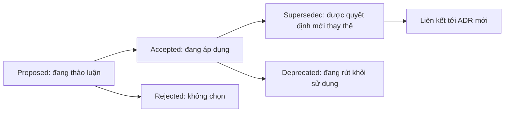

# Lưu quyết định thiết kế cùng phương án đã cân nhắc

## 1. Mục tiêu bài học

Trong chương **Tài liệu** của module **CODE_QUALITY_FUNDAMENTALS**, chúng ta tìm hiểu cách lưu lại không chỉ **thiết kế đã chọn** mà cả **bối cảnh, ràng buộc và các phương án từng được cân nhắc**. Những thông tin này giúp người bảo trì hiểu *vì sao mã có cấu trúc hiện tại*, thay vì phải đoán từ kết quả cuối cùng.

Module hướng đến việc **hiểu những thuộc tính quyết định mã nguồn có đáng tin cậy, dễ hiểu và dễ thay đổi hay không**. Một quyết định thiết kế được ghi lại đúng mức giúp nhóm thay đổi an toàn hơn: có thể phân biệt phần nào là yêu cầu còn hiệu lực, phần nào chỉ là giả định lúc ra quyết định, và điều kiện nào khiến cần xem xét lại.

Sau bài học, bạn có thể:

- Phân biệt **mô tả cách hệ thống đang hoạt động** với **ghi lại lý do một phương án được chọn**.
- Xác định quyết định nào nên được lưu thành bản ghi riêng, thay vì chỉ xuất hiện trong bình luận mã hoặc tin nhắn.
- Viết một **Architecture Decision Record (ADR)** ngắn gọn nhưng đủ bối cảnh, phương án thay thế, đánh đổi, hệ quả và điều kiện xem xét lại.
- Đánh giá công bằng các phương án đã loại bỏ, không biến tài liệu thành lời biện hộ một chiều.
- Kết nối bản ghi quyết định với code, kiểm thử và bằng chứng đo lường mà không coi ADR là chứng minh thiết kế đã đúng trong mọi hoàn cảnh.
- Quản lý vòng đời của quyết định khi yêu cầu hoặc ràng buộc thay đổi.

## 2. Vì sao chỉ nhìn mã nguồn chưa đủ?

Mã cho biết hệ thống **đang làm gì** và một phần **được thực hiện như thế nào**. Nhưng cùng một cách cài đặt có thể xuất phát từ nhiều lý do khác nhau.

Ví dụ, một service Java đọc thông tin sản phẩm trực tiếp từ database thay vì dùng cache. Người mới có thể đưa ra nhiều cách giải thích:

1. Nhóm chưa có thời gian thêm cache.
2. Dữ liệu cần mới ngay sau khi cập nhật nên cache khó bảo đảm tính đúng đắn.
3. Tải đọc hiện tại đủ nhỏ, đo hiệu năng chưa cho thấy database là điểm nghẽn.
4. Hệ thống từng dùng cache nhưng gặp vấn đề dữ liệu cũ nên đã loại bỏ.
5. Việc đọc đã được một tầng khác cache, thêm cache ở Java chỉ nhân đôi trạng thái.

Chỉ nhìn câu lệnh truy vấn không thể biết lý do nào đúng. Nếu người mới tự bổ sung cache dựa trên giả định “nhanh hơn là tốt hơn”, họ có thể vô tình vi phạm một ràng buộc quan trọng.

**Bản ghi quyết định thiết kế** giải quyết khoảng trống đó: lưu *vấn đề lúc quyết định*, *những lựa chọn hợp lý*, *cơ sở chọn lựa* và *hệ quả phải chấp nhận*. Nó không thay thế mã nguồn hay kiểm thử; nó giúp người đọc hiểu **ý định đằng sau ranh giới và đánh đổi kỹ thuật**.

| Nguồn thông tin | Giải đáp tốt câu hỏi nào? | Giới hạn |
| --- | --- | --- |
| Mã và kiểm thử | Hành vi nào đang được hiện thực và kiểm tra? | Không tự cho biết vì sao loại bỏ các thiết kế khác. |
| Tài liệu API/Javadoc | Caller được quyền trông đợi gì ở một hợp đồng? | Không nhất thiết mô tả quá trình lựa chọn kiến trúc. |
| Sơ đồ kiến trúc | Thành phần nào phụ thuộc vào thành phần nào? | Không nêu đầy đủ giả định và những phương án đã cân nhắc. |
| Issue, pull request, cuộc họp | Diễn biến trao đổi, người tham gia và thay đổi cụ thể | Thông tin có thể phân tán, thiếu kết luận và khó tìm sau nhiều tháng. |
| **ADR / decision record** | Vì sao chọn một phương án trong bối cảnh cụ thể; hệ quả và khi nào xét lại? | Có thể lỗi thời; cần liên kết với thực trạng và được cập nhật trạng thái. |

Một quyết định tốt không nhất thiết dẫn tới phương án “tối ưu toàn cục”. Nó có thể là **phương án phù hợp nhất với các mục tiêu và ràng buộc mà nhóm biết vào thời điểm đó**.

## 3. Khi nào một quyết định đáng được ghi lại?

Không phải mọi phép đổi tên biến, tách phương thức hay chỉnh format đều cần ADR. Viết quá nhiều bản ghi cho những việc hiển nhiên khiến người đọc khó tìm quyết định có tác động thật.

Nên cân nhắc lưu riêng nếu quyết định có một hoặc nhiều đặc điểm:

- **Tác động rộng:** ảnh hưởng nhiều module, service, dữ liệu hoặc người sử dụng API.
- **Khó đảo ngược:** đổi schema, giao thức công khai, mô hình nhất quán hoặc cách lưu dữ liệu.
- **Có đánh đổi không hiển nhiên:** ví dụ chọn độ mới dữ liệu thay vì giảm tải, hoặc tính đơn giản thay vì tối ưu sớm.
- **Có nhiều phương án hợp lý:** một người có kinh nghiệm khác cũng có thể chọn cách khác trong bối cảnh khác.
- **Dễ bị hỏi lại:** vì sao không dùng cache, message queue, framework, transaction phân tán hoặc một cấu trúc dữ liệu khác?
- **Phụ thuộc giả định:** quyết định sẽ không còn tốt nếu tải tăng, yêu cầu thay đổi hoặc nhà cung cấp đổi hợp đồng.
- **Có rủi ro cần theo dõi:** tính bảo mật, tính đúng đắn, khả năng phục hồi, chi phí hoặc khả năng nâng cấp.

Nếu lựa chọn chỉ liên quan vài dòng trong một pull request và lý do đã rõ qua tên/hợp đồng/kiểm thử, phần mô tả PR có thể đủ. Với quyết định có tuổi thọ vượt một PR, một bản ghi tìm được về sau thường hữu ích hơn lịch sử thảo luận dài.

**Mức độ chi tiết phải tương xứng với mức ảnh hưởng.** Một ADR một trang với vài phương án được đánh giá có thể hiệu quả hơn một tài liệu dài nhưng không chốt điều gì.

## 4. Những thành phần thiết yếu của một bản ghi quyết định

ADR (*Architecture Decision Record*) là một cách tổ chức phổ biến để ghi một quyết định kỹ thuật có bối cảnh. Không có một mẫu duy nhất bắt buộc cho mọi dự án; nhóm nên thống nhất một mẫu ngắn, dễ tìm và có thể đưa vào review.

| Thành phần | Nội dung cần có | Câu hỏi kiểm tra |
| --- | --- | --- |
| **ID và tiêu đề** | Một định danh ổn định và tên nêu lựa chọn | Người đọc tìm lại bản ghi được không? |
| **Trạng thái** | Proposed, Accepted, Superseded… theo quy ước dự án | Quyết định có còn hiệu lực không? |
| **Bối cảnh / vấn đề** | Hành vi hiện tại, điều cần giải quyết, phạm vi | Vì sao nhóm phải ra quyết định lúc này? |
| **Ràng buộc** | Yêu cầu nghiệp vụ, giới hạn tài nguyên, tính tương thích, thời hạn | Có điều gì là bắt buộc, không thể đánh đổi? |
| **Phương án đã cân nhắc** | Những lựa chọn khả thi và lợi/hại chính | Lựa chọn bị loại có được mô tả công bằng không? |
| **Quyết định** | Phương án được chọn, phạm vi áp dụng | Chính xác nhóm sẽ làm gì và không làm gì? |
| **Lý do** | Tiêu chí, bằng chứng, đánh đổi ưu tiên | Vì sao cách này phù hợp hơn các cách còn lại hiện tại? |
| **Hệ quả** | Lợi ích, chi phí, nợ kỹ thuật hoặc việc cần triển khai | Người duy trì phải chấp nhận và theo dõi điều gì? |
| **Điều kiện xét lại** | Tín hiệu/biến cố làm quyết định có thể hết phù hợp | Khi nào cần mở quyết định mới? |
| **Liên kết và người phụ trách** | PR, issue, thiết kế liên quan, người chịu trách nhiệm | Ai kiểm chứng và duy trì dấu vết? |

**Phân biệt dữ liệu và suy luận:** “Độ trễ p95 đo được là 85 ms trong thử nghiệm X” chỉ nên viết khi thật sự có kết quả và điều kiện thử. Nếu chưa đo, phải ghi “chưa có bằng chứng đủ đại diện” hoặc “dự kiến”, không biến ước lượng thành sự thật.

### Một mẫu Markdown có thể dùng lại

```markdown
# ADR-XXX: [Động từ + đối tượng quyết định]

- Trạng thái: Proposed / Accepted / Superseded
- Ngày ghi: YYYY-MM-DD
- Phạm vi: [Module, service, dữ liệu bị ảnh hưởng]
- Người phụ trách: [Vai trò hoặc nhóm]

## Bối cảnh
[Vấn đề cần giải quyết và tình trạng hiện tại]

## Yêu cầu và giả định
[Điều bắt buộc, điều mong muốn, điều chưa kiểm chứng]

## Các phương án
- A: [Lợi ích, chi phí, rủi ro]
- B: [Lợi ích, chi phí, rủi ro]
- C: [Lợi ích, chi phí, rủi ro]

## Quyết định và lý do
[Chọn phương án nào, vì sao và trong phạm vi nào]

## Hệ quả
[Lợi ích, hạn chế, việc cần làm và trách nhiệm]

## Khi nào xem xét lại?
[Tín hiệu, ngưỡng, thay đổi yêu cầu hoặc rủi ro mới]

## Liên kết
[PR/issue/đặc tả/test/benchmark liên quan]
```

Mẫu trên không yêu cầu điền mọi ô bằng câu dài. Nếu một mục không áp dụng, có thể ghi “không áp dụng” hoặc lược bớt theo quy ước của nhóm. Điều quan trọng là người khác **có thể tái dựng lập luận ra quyết định**.

## 5. Ví dụ xuyên suốt: chọn cách đọc dữ liệu danh mục sản phẩm

### 5.1. Bối cảnh giả định

Một ứng dụng Java cung cấp trang **giới thiệu sản phẩm**. Dữ liệu gồm tên và mô tả, **không bao gồm giá thanh toán hoặc số lượng tồn kho**. Trang đọc thông tin theo SKU từ database.

Nhóm đang cân nhắc có nên thêm cache tại ứng dụng trước đợt phát hành đầu không. Các điều kiện sau là **dữ liệu tình huống giả định dùng để học**, không phải kết quả đo của một hệ thống thực tế:

- Luồng hiển thị cần phản ánh thay đổi mô tả tương đối nhanh, tránh giữ thông tin cũ không kiểm soát.
- Sản phẩm dự kiến có tải đọc vừa phải; **chưa có benchmark đại diện** ở tải cao nhất.
- Ưu tiên ban đầu là triển khai đáng tin cậy, có thể theo dõi, dễ vận hành với đội nhóm nhỏ.
- Sẽ theo dõi độ trễ p95 của API, số lần đọc database, tỷ lệ lỗi và tải database.
- Đội thống nhất **mục tiêu thảo luận** p95 dưới 200 ms ở điều kiện tải đã xác định; con số này chưa phải bằng chứng hệ thống đã đạt.

Ba phương án khả thi:

| Phương án | Lợi ích | Chi phí và rủi ro | Khi có thể phù hợp |
| --- | --- | --- | --- |
| **A — Đọc trực tiếp database** | Ít trạng thái trung gian; đường đi dễ hiểu; thay đổi sau commit có thể được đọc ở truy vấn mới theo mô hình đọc đã chọn | Mỗi request tạo áp lực đọc; độ trễ phụ thuộc database | Tải chưa cao, cần đơn giản và muốn đo điểm nghẽn trước |
| **B — Cache trong bộ nhớ ứng dụng, TTL** | Có thể giảm số lần truy vấn, độ trễ thấp cho cache hit | Mỗi instance có dữ liệu khác nhau; TTL, invalidation và bộ nhớ cần quản lý; có thể hiển thị dữ liệu cũ | Dữ liệu ít đổi, chấp nhận độ trễ cập nhật, nhiều lượt đọc lặp |
| **C — Cache dùng chung như Redis** | Nhiều instance có thể chia sẻ dữ liệu cache | Thêm phụ thuộc hạ tầng, chi phí vận hành, lỗi mạng/cache, chiến lược invalidation | Có nhiều instance và nhu cầu cache đã được chứng minh |

**Không có phương án “xấu” tuyệt đối.** Nếu tải tăng mạnh và kết quả đo cho thấy database là điểm nghẽn, B hoặc C có thể là lựa chọn tốt. Trong giai đoạn còn ít dữ liệu đo, A cho phép giữ số điểm thất bại và trạng thái cần đồng bộ ở mức thấp.

### 5.2. Bản ghi quyết định minh họa

> **ADR-014 — Tạm thời đọc mô tả sản phẩm trực tiếp từ database**
>
> **Trạng thái:** Accepted (giả định trong ví dụ)
>
> **Phạm vi:** API đọc tên và mô tả sản phẩm cho trang giới thiệu; *không áp dụng* cho tính giá và tồn kho.
>
> **Bối cảnh:** Dự kiến tải vừa phải, đội ưu tiên đơn giản và còn thiếu số đo đầy đủ trong điều kiện cao điểm. Dữ liệu mô tả có thể được chỉnh sửa bởi bộ phận nội dung.
>
> **Các lựa chọn:** A — đọc trực tiếp; B — cache local TTL; C — cache dùng chung. Các lợi/hại nằm trong bảng so sánh kèm quyết định.
>
> **Quyết định:** Chọn A ở lần phát hành đầu. Tầng nghiệp vụ phụ thuộc vào hợp đồng `ProductCatalog`, còn adapter database thực hiện việc đọc; chưa bổ sung cache tại ứng dụng.
>
> **Lý do:** Giảm cơ chế vô hiệu hóa dữ liệu và vận hành ở giai đoạn chưa có bằng chứng rằng cache cần thiết. Chấp nhận đánh đổi bằng việc phát sinh truy vấn đọc cho mỗi request; cải thiện truy vấn/chỉ mục nếu có số liệu chứng minh.
>
> **Hệ quả:** Cần quan sát độ trễ và tải database; nếu database không đáp ứng mục tiêu, phải xem lại phương án. Bản ghi không bảo đảm dữ liệu luôn tức thời trong mọi cấu hình replica/isolation.
>
> **Điều kiện xét lại:** Khi p95 liên tục vượt mục tiêu đã thống nhất trong điều kiện tải đại diện, database trở thành điểm nghẽn được đo, hoặc nhu cầu về độ mới dữ liệu thay đổi. Các ngưỡng vận hành cụ thể sẽ được phê duyệt trong thiết kế giám sát.
>
> **Liên kết cần bổ sung lúc triển khai:** PR cấu hình adapter, kiểm thử tích hợp, dashboard và số liệu tải khi có.

Điểm quan trọng: bản ghi **nói rõ những gì chưa biết**. Nó không khẳng định “database luôn nhanh hơn cache”, cũng không hứa “thêm cache sau này chắc chắn dễ”. Nó ghi **lựa chọn có điều kiện**, các lựa chọn hợp lý bị hoãn và cơ sở để xét lại.

### 5.3. Liên hệ bản ghi với ranh giới trong mã Java

Việc lưu ADR không tự tạo ra thiết kế tốt; mã cần phản ánh quyết định. Trong ví dụ, có thể giữ một hợp đồng đọc danh mục để tầng hiển thị không trực tiếp phụ thuộc cách lấy dữ liệu.

```java
// ProductCard.java
import java.util.Objects;

public record ProductCard(String sku, String title) {
    public ProductCard {
        Objects.requireNonNull(sku, "sku");
        Objects.requireNonNull(title, "title");
        if (sku.isBlank() || title.isBlank()) {
            throw new IllegalArgumentException(
                    "sku and title must not be blank");
        }
    }
}
```

```java
// ProductCatalog.java
import java.util.Optional;

public interface ProductCatalog {
    // Không tìm thấy SKU là một kết quả bình thường.
    // Hợp đồng trả dữ liệu, không ấn định nguồn từ database hay cache.
    Optional<ProductCard> findBySku(String sku);
}
```

```java
// ProductPageService.java
import java.util.Objects;
import java.util.Optional;

public final class ProductPageService {
    private final ProductCatalog catalog;

    public ProductPageService(ProductCatalog catalog) {
        this.catalog = Objects.requireNonNull(catalog, "catalog");
    }

    public Optional<ProductCard> view(String sku) {
        if (sku == null || sku.isBlank()) {
            throw new IllegalArgumentException("sku must not be blank");
        }
        return Objects.requireNonNull(
                catalog.findBySku(sku),
                "catalog result must not be null");
    }
}
```

Trong giai đoạn đầu, application composition root cung cấp một adapter database thực hiện `ProductCatalog`. Nếu tương lai chuyển sang cache có điều kiện, service vẫn có thể phụ thuộc vào cùng hợp đồng **nếu** hợp đồng về độ mới, lỗi và ý nghĩa dữ liệu tiếp tục được đáp ứng.

**Cần lưu ý:** hợp đồng ở trên chỉ mô tả dữ liệu tìm thấy hoặc không tìm thấy. Nếu sản phẩm bắt buộc có một bảo đảm độ mới cụ thể, cần ghi rõ nó trong hợp đồng hoặc ranh giới nghiệp vụ. Không nên dùng interface để che giấu một thay đổi về tính nhất quán mà caller thực sự cần biết.

Một kiểm thử hành vi tại tầng service có thể dùng fake đơn giản:

```java
import static org.junit.jupiter.api.Assertions.assertEquals;
import static org.junit.jupiter.api.Assertions.assertThrows;

import java.util.Optional;
import org.junit.jupiter.api.Test;

class ProductPageServiceTest {
    @Test
    void delegatesLookupAndReturnsCatalogValue() {
        ProductCatalog catalog = sku -> "SKU-A".equals(sku)
                ? Optional.of(new ProductCard("SKU-A", "Sổ tay"))
                : Optional.empty();
        ProductPageService service = new ProductPageService(catalog);

        assertEquals(
                Optional.of(new ProductCard("SKU-A", "Sổ tay")),
                service.view("SKU-A"));
        assertEquals(Optional.empty(), service.view("SKU-X"));
    }

    @Test
    void rejectsInvalidSkuBeforeLookup() {
        ProductPageService service = new ProductPageService(
                sku -> { throw new AssertionError("must not be called"); });

        assertThrows(IllegalArgumentException.class,
                () -> service.view(" "));
    }
}
```

Các bài test này kiểm tra hợp đồng của `ProductPageService`, **không chứng minh phương án A đáp ứng mục tiêu hiệu năng**. Bằng chứng đó cần đo tải, kiểm thử adapter database thật và quan sát khi vận hành. Đây là lý do ADR nên liên kết tới **nhiều loại bằng chứng**, chứ không chỉ ghi “đã có unit test”.

## 6. So sánh phương án một cách công bằng

Một bản ghi hữu ích không chỉ mô tả lý do chọn lựa mà còn lưu lại **vì sao phương án khác chưa được chọn trong bối cảnh hiện tại**.

### 6.1. Dùng cùng tiêu chí cho các phương án

Chọn vài tiêu chí gắn với bài toán, chẳng hạn:

- Tính đúng đắn và độ mới dữ liệu.
- Độ trễ và khả năng đáp ứng tải.
- Bộ nhớ, I/O và chi phí vận hành.
- Độ phức tạp triển khai và kiểm thử.
- Khả năng quan sát thất bại và phục hồi.
- Chi phí thay đổi khi yêu cầu hoặc tải tăng.

So sánh các phương án trên **cùng một tập tiêu chí** để tránh thiên lệch. Ví dụ, không nên chỉ nói cache “nhanh” mà bỏ qua invalidation, cũng không nên chỉ phê phán cache “phức tạp” mà bỏ qua lợi ích ở tải cao.

### 6.2. Phân biệt yêu cầu, giả định và bằng chứng

| Loại thông tin | Ví dụ | Cách ghi |
| --- | --- | --- |
| **Yêu cầu đã xác nhận** | Không được hiển thị giá thanh toán từ bản cache cũ | Ghi như ràng buộc phải tuân thủ. |
| **Giả định cần kiểm chứng** | Tải đọc danh mục sẽ ở mức vừa phải | Ghi rõ là dự kiến và cách đo khi có dữ liệu. |
| **Bằng chứng đã có** | Kết quả load test ở cấu hình xác định | Dẫn tới số liệu, commit, điều kiện đo và ngày đo. |
| **Đánh đổi được chấp nhận** | Chấp nhận tăng số truy vấn để giảm cơ chế đồng bộ dữ liệu | Ghi rõ bên chịu trách nhiệm và hậu quả có thể xảy ra. |
| **Rủi ro tồn đọng** | Database có thể quá tải khi lượng đọc tăng nhanh | Có tín hiệu theo dõi và điều kiện mở quyết định mới. |

Một cách trình bày kém là:

> “Chọn DB vì cache rất rắc rối và không cần thiết.”

Cách trình bày có giá trị hơn:

> “Hiện chưa có đo đạc cho thấy truy vấn DB là điểm nghẽn; cache sẽ tạo thêm nhiệm vụ invalidation và tính nhất quán. Chọn đọc trực tiếp cho giai đoạn đầu, đồng thời đo p95 và tải DB để đánh giá lại khi có dấu hiệu vượt ngưỡng.”

Cách thứ hai **thừa nhận ưu điểm của phương án còn lại** và cho biết dữ liệu nào có thể khiến nhóm đổi quyết định.

### 6.3. Không hợp thức hóa quyết định sau khi đã làm

Đôi khi tài liệu được viết **sau** một đợt triển khai. Nếu vậy, hãy ghi thật rằng đây là bản ghi tái dựng, phân biệt điều **đã biết tại thời điểm quyết định** với hiểu biết **mới có sau triển khai**.

Không nên thay số liệu lịch sử bằng số liệu mới để làm phương án cũ trông đúng đắn hơn. Nếu biết thêm dữ liệu khiến đánh giá đổi hướng, thêm phần cập nhật có mốc thời gian hoặc tạo quyết định mới.

## 7. Trạng thái và vòng đời của quyết định

Một bản ghi không nên trông như yêu cầu đang hiệu lực vĩnh viễn. Có thể dùng quy trình đơn giản:



- **Proposed:** các phương án đang được đánh giá; chưa coi là kết luận bắt buộc.
- **Accepted:** đã được chấp thuận trong phạm vi nêu rõ.
- **Rejected:** không chọn đề xuất đó; có thể giữ để giải thích lý do và tránh lặp lại tranh luận.
- **Superseded:** một quyết định mới thay thế quyết định cũ; bản ghi cũ vẫn là lịch sử.
- **Deprecated:** thiết kế cũ đang được loại bỏ theo kế hoạch, có thể vẫn còn tồn tại trong mã ở giai đoạn chuyển tiếp.

Đây là **tên trạng thái gợi ý**, không phải một chuẩn bắt buộc. Nhóm có thể dùng trạng thái khác nhưng cần giải thích nghĩa và người có quyền chuyển trạng thái.

### Nếu quyết định thay đổi thì sửa tài liệu thế nào?

Ví dụ sau ba tháng, số liệu cho thấy lượt đọc danh mục tăng mạnh và database là điểm nghẽn. Nhóm chọn bổ sung cache dùng chung. Không nên âm thầm sửa ADR-014 thành “chúng ta luôn chọn Redis”, vì điều đó xóa mất lý do của giai đoạn trước.

Thay vào đó:

1. Tạo bản ghi mới nêu bối cảnh đã đổi và bằng chứng về tải/độ trễ.
2. So sánh lại các phương án trên những ràng buộc hiện tại.
3. Ghi quyết định mới, cách di chuyển và rủi ro invalidation/cache failure.
4. Chuyển ADR-014 sang **Superseded** và liên kết ADR mới.
5. Kiểm tra code, cấu hình, kiểm thử và tài liệu vận hành có phản ánh quyết định mới không.

Giữ lại lịch sử giúp người bảo trì thấy **vì sao thiết kế thay đổi theo thời gian**, thay vì hiểu nhầm rằng các lựa chọn trước đều sai.

## 8. Nên đặt ADR ở đâu và liên kết với mã ra sao?

Một lựa chọn phổ biến là lưu ADR dưới dạng **Markdown cùng kho mã**, theo đường dẫn nhóm đã thống nhất, ví dụ `docs/decisions/`. Tên tệp có số hoặc ID ổn định giúp tham chiếu trong issue và pull request. Không nhất thiết dùng đúng thư mục đó; quan trọng là **dễ tìm, có quy trình review và cùng vòng đời với thay đổi**.

Thực hành có ích:

1. **Bắt đầu trước khi triển khai thay đổi lớn:** mở bản ghi ở trạng thái Proposed, nhận phản biện về ràng buộc và phương án.
2. **Review cùng code khi phù hợp:** bản ghi nên cho thấy vấn đề, phạm vi, lựa chọn và hệ quả; PR code nên liên kết quyết định liên quan.
3. **Dẫn tới nguồn bằng chứng:** test, load-test report, issue hoặc số liệu đo; ghi ngày và môi trường nếu bằng chứng có thể hết giá trị.
4. **Giữ ID và lịch sử:** khi đổi quyết định, tạo bản ghi mới hoặc lưu dấu sửa đổi có mốc rõ, không thay lịch sử như chưa từng có lựa chọn cũ.
5. **Chỉ định người duy trì:** xác định nhóm nào chịu trách nhiệm xem lại khi dấu hiệu đã ghi xuất hiện.
6. **Không đưa bí mật vào tài liệu:** tránh sao chép token, mật khẩu, dữ liệu khách hàng hoặc thông tin vận hành nhạy cảm vào ADR.

Một ADR không nhất thiết phải nằm cạnh lớp Java mà nó ảnh hưởng. Nhưng nếu không có đường tìm từ **tên quyết định tới code** và ngược lại, bản ghi dễ bị bỏ quên. Có thể liên kết từ PR hoặc tài liệu module; hạn chế rải những chú thích dài và trùng nhau ở nhiều lớp.

### ADR không thay thế tài liệu khác

- **Javadoc/contract:** giải thích cách một API phải được sử dụng *hiện tại*.
- **README/runbook:** hướng dẫn thiết lập, chạy, theo dõi, xử lý sự cố *hiện tại*.
- **Sơ đồ kiến trúc:** mô tả quan hệ giữa thành phần *hiện tại*.
- **ADR:** ghi lại **lý do, lựa chọn và đánh đổi** của một quyết định tại một thời điểm.

Tất cả có thể liên kết nhau. Nếu hành vi thực tế đã khác bản ghi Accepted, đó là tín hiệu cần tìm nguyên nhân và cập nhật dấu vết; **không dùng ADR để khẳng định mã chắc chắn đang làm đúng như mô tả**.

## 9. Khi nào ADR có thể gây hại thay vì giúp ích?

**Quá dài và không có kết luận.** Một tài liệu nhiều trang mô tả mọi công nghệ nhưng không nói phương án chọn và hậu quả thực tế sẽ khó sử dụng khi review.

**Chỉ có quyết định, không có bối cảnh.** Dòng “dùng Redis cho mọi thứ” không cho biết dữ liệu nào, lý do, giới hạn hay cách nhận biết quyết định hết phù hợp.

**Đánh giá một chiều.** Viết các phương án bị loại như những lựa chọn vô lý khiến nhóm mất cơ hội nhìn lại khi bối cảnh thay đổi.

**Đưa nhận định chưa đo thành bằng chứng.** “Cách này nhanh gấp ba” cần kết quả đo và điều kiện tương ứng; nếu chỉ là dự kiến thì phải ghi đúng như vậy.

**Hợp đồng và bản ghi mâu thuẫn.** ADR nói dữ liệu có thể cũ một phút nhưng API cam kết vừa cập nhật là đọc thấy ngay: cần giải quyết mâu thuẫn, không chỉ sửa câu chữ cho qua.

**Không quản lý trạng thái.** Giữ ADR Accepted cũ sau khi code đã chuyển phương án làm người đọc tưởng đang có hai nguồn sự thật.

**Ghi mọi việc nhỏ thành ADR.** Tốn thời gian viết và tìm kiếm, giảm khả năng chú ý đến những quyết định thật sự quan trọng.

**Dùng ADR để thay kiểm thử hoặc review.** Bản ghi giải thích *lý do chọn*, không chứng minh *triển khai đúng*, *tối ưu* hay *an toàn*. Quyết định vẫn cần được hiện thực và kiểm chứng.

## 10. Quy trình thực hành: từ câu hỏi đến quyết định có thể kiểm chứng

Khi đứng trước một lựa chọn thiết kế có ảnh hưởng đáng kể, thực hiện theo thứ tự:

1. **Đặt tên vấn đề:** ví dụ “Có thêm cache tầng ứng dụng cho truy vấn danh mục ở lần phát hành đầu không?” thay vì tiêu đề mơ hồ “Thiết kế hệ thống”.
2. **Ghi ranh giới và yêu cầu bắt buộc:** dữ liệu nào, ai dùng, độ mới, tính tương thích và những điều không được làm sai.
3. **Ghi giả định và điều chưa biết:** số liệu tải, hành vi người dùng, ràng buộc nhà cung cấp; tránh suy diễn thành sự kiện.
4. **Liệt kê 2–4 phương án thực tế:** kể cả giữ cách hiện có nếu đó là lựa chọn hợp lý.
5. **Đánh giá trên cùng tiêu chí:** tính đúng đắn, hiệu năng, bộ nhớ, vận hành, bảo mật và khả năng thay đổi tùy bài toán.
6. **Ghi quyết định và hệ quả:** chọn cách nào, tại sao, phải chấp nhận rủi ro nào, cần bổ sung test/quan sát gì.
7. **Nêu điều kiện xem xét lại:** sự kiện hoặc chỉ số nào có thể khiến quyết định không còn phù hợp.
8. **Review, chấp thuận và liên kết hiện thực:** trạng thái từ Proposed sang Accepted chỉ khi có người/nhóm có thẩm quyền đồng ý theo quy trình.
9. **Duy trì sau phát hành:** theo dõi bằng chứng mới; nếu quyết định đổi, tạo lịch sử mới thay vì xóa lịch sử cũ.

**Câu hỏi quan trọng nhất khi review ADR:** “Nếu sáu tháng nữa một người muốn đổi phương án này, họ có biết những ràng buộc nào phải giữ và cần kiểm chứng điều gì trước khi thay đổi không?”

## 11. Bài tập áp dụng

Nhóm đang thiết kế chức năng **gửi email xác nhận đơn hàng**. Có hai phương án:

- **A:** Gửi email đồng bộ trong request tạo đơn, rồi mới trả phản hồi.
- **B:** Lưu yêu cầu gửi email để một worker xử lý bất đồng bộ sau khi đơn hàng được ghi.

Hãy phác thảo ADR bằng cách trả lời:

1. **Ranh giới nghiệp vụ:** việc tạo đơn có bắt buộc phải thất bại nếu email chưa gửi thành công không? Email có được gửi nhiều hơn một lần không?
2. **Lợi/hại phương án A:** có đơn giản hơn trong việc quan sát lỗi tức thời không? Độ trễ và phụ thuộc nhà cung cấp email ảnh hưởng thế nào đến request?
3. **Lợi/hại phương án B:** có thể cải thiện độ trễ và tách lỗi email khỏi việc tạo đơn ra sao? Ai lưu công việc, thử lại, chống gửi trùng và giám sát backlog?
4. **Rủi ro dữ liệu:** nếu database commit thành công nhưng chưa ghi được lệnh gửi, hoặc lệnh gửi được ghi nhưng đơn bị rollback, cần cơ chế nào để tránh mất hoặc gửi sai?
5. **Điều kiện xét lại:** khi nào thay đổi nhu cầu về độ trễ, khả năng gửi lại hoặc tỷ lệ lỗi khiến cần chọn phương án khác?

**Gợi ý:** Một ADR tốt phải chỉ rõ sự khác biệt giữa **“đơn đã được tạo”** và **“email đã được gửi”**. Với phương án B, transaction/outbox có thể được cân nhắc để hạn chế mất sự kiện khi ghi đơn và yêu cầu gửi; worker cần xử lý idempotency vì một công việc có thể được thực hiện lại. Không nên viết “bất đồng bộ bảo đảm email được gửi chính xác một lần” nếu hệ thống không có hợp đồng và bằng chứng tương ứng. Tùy yêu cầu, cả A và B đều có thể hợp lý.

## 12. Câu hỏi tự kiểm tra

**Câu 1.** Một service dùng database trực tiếp. Vì sao một developer không thể chỉ nhìn code mà chắc chắn biết nhóm đã loại bỏ cache do vấn đề nhất quán dữ liệu?

**Câu 2.** Nếu ADR viết “đã kiểm tra cache nhanh hơn 50%” nhưng không có điều kiện đo và báo cáo, nhận định đó có hạn chế gì?

**Câu 3.** Phương án cache đã từng bị loại. Khi tải đọc tăng gấp nhiều lần, có nên coi ADR cũ là lệnh cấm dùng cache vĩnh viễn không?

**Câu 4.** Nếu một ADR chỉ nói “chọn PostgreSQL” mà không nêu nhu cầu giao dịch, tải, vận hành, dữ liệu và phương án khác, người bảo trì đang thiếu thông tin gì?

**Câu 5.** Vì sao test `ProductPageService` với fake `ProductCatalog` không chứng minh lựa chọn đọc DB trực tiếp đáp ứng mục tiêu độ trễ?

**Gợi ý:** (1) Cấu trúc hiện tại không lưu lại các phương án bị loại và lý do lịch sử. (2) Không thể đánh giá tính đại diện, tái hiện hoặc giới hạn áp dụng của kết quả. (3) Không; ADR mô tả quyết định theo bối cảnh, cần xét lại khi giả định thay đổi. (4) Thiếu lập luận, tiêu chí, đánh đổi, hệ quả và điều kiện đổi quyết định. (5) Test fake kiểm tra hành vi của service, không đo database thật, cấu hình, tải hoặc I/O.

## 13. Ghi nhớ

**Lưu quyết định thiết kế cùng phương án đã cân nhắc** giúp biến một lựa chọn kỹ thuật từ “truyền miệng” thành **lập luận có thể đọc, phản biện và xem lại**. Bản ghi tốt cho biết *vấn đề, yêu cầu, những cách đã cân nhắc, lý do chọn, chi phí phải chấp nhận và dấu hiệu cần xét lại*. Nó phải phân biệt sự thật với giả định, giữ lịch sử khi bối cảnh thay đổi và liên kết đến code/kiểm thử/bằng chứng liên quan. Nhờ vậy, người phát triển về sau có thể **hiểu đúng quyết định cũ, tránh lặp lại sai lầm và thay đổi hệ thống một cách có cơ sở**.
