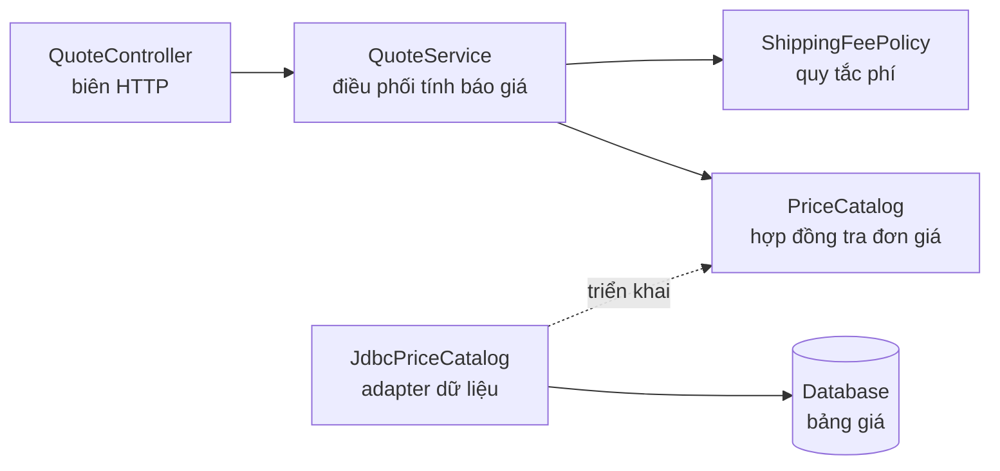
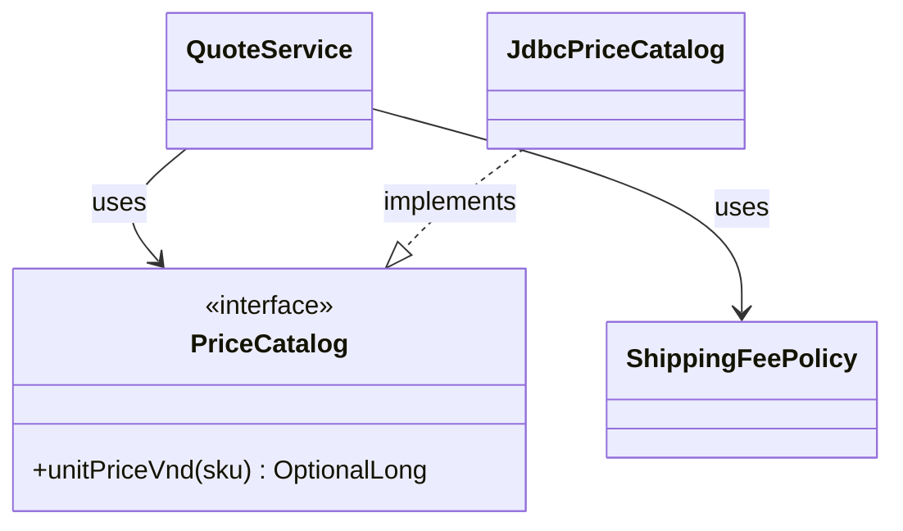
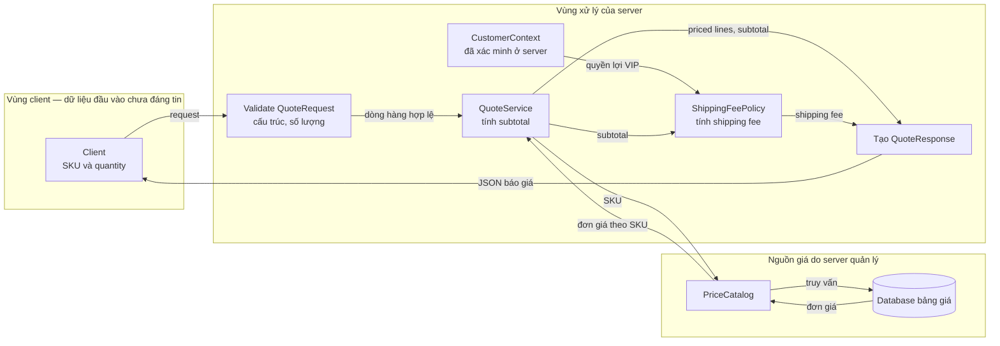
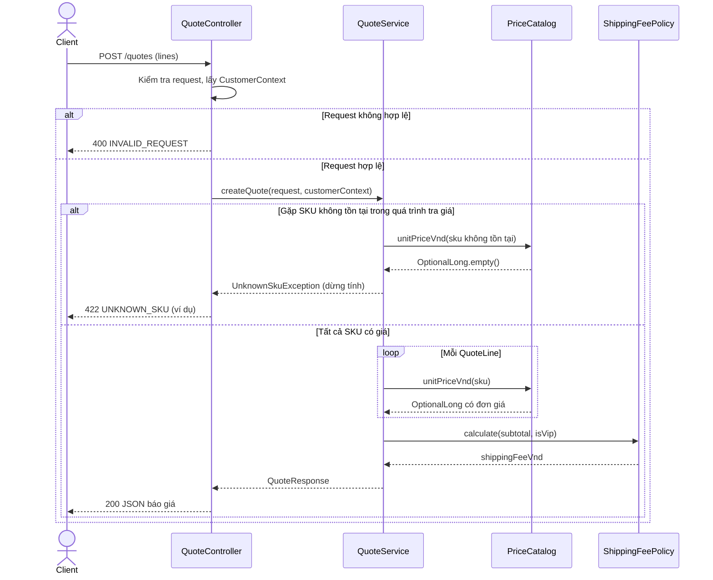
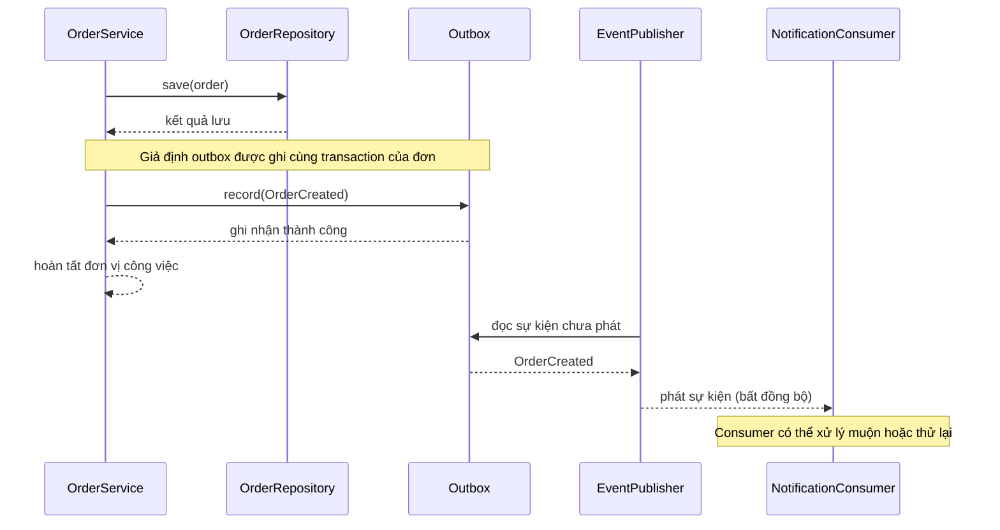

# Sơ đồ hỗ trợ đọc cấu trúc và luồng dữ liệu

Một hệ thống có thể có những tên lớp dễ hiểu, phương thức ngắn và kiểm thử đầy đủ nhưng người mới tham gia vẫn khó trả lời: **“Khi một yêu cầu đến, dữ liệu đi qua những đâu, phần nào quyết định quy tắc, và phần nào thực sự truy cập cơ sở dữ liệu?”** Việc phải mở hàng chục file để lần theo từng lời gọi khiến bảo trì tốn thời gian; việc hiểu sai hướng phụ thuộc hoặc bỏ sót một bước kiểm tra còn có thể gây lỗi.

Trong chương **Tài liệu** của `CODE_QUALITY_FUNDAMENTALS`, chúng ta học cách dùng **sơ đồ** để giải thích cấu trúc và luồng dữ liệu. Bài học phục vụ mục tiêu hiểu những thuộc tính khiến mã nguồn **đáng tin cậy, dễ hiểu và dễ thay đổi**: tài liệu tốt không chỉ liệt kê thành phần, mà còn làm rõ ranh giới trách nhiệm, dữ liệu đầu vào, nơi chuyển đổi và nơi phát sinh tác dụng phụ.

Sau bài học, bạn có thể chọn đúng loại sơ đồ theo câu hỏi cần trả lời; đọc và vẽ sơ đồ cấu trúc, luồng dữ liệu và trình tự; gắn chúng với một ví dụ Java; đánh dấu ranh giới tin cậy; và biết cách giữ sơ đồ không bị lỗi thời khi mã thay đổi.

> **Nguyên tắc cốt lõi:** Sơ đồ là một mô hình có chủ đích, được giản lược để trả lời một câu hỏi cụ thể. Nó **hỗ trợ đọc mã và kiểm tra giả thiết**, không tự trở thành bằng chứng rằng mọi hành vi của hệ thống đều đúng.

## 1. Trước khi vẽ, xác định câu hỏi cần giải đáp

“Sơ đồ kiến trúc” là một tên gọi rất rộng. Nếu không xác định người đọc đang muốn biết điều gì, sơ đồ dễ trở thành một tấm hình đầy hộp và mũi tên nhưng ít giá trị sử dụng.

Các câu hỏi thường gặp:

- **Cấu trúc:** Những module hoặc lớp chính là gì? Ai phụ thuộc vào ai? Ai sở hữu quy tắc tính giá?
- **Luồng dữ liệu:** Dữ liệu từ request được kiểm tra và chuyển đổi ở đâu? Giá lấy từ nguồn nào? Kết quả được trả ra đâu?
- **Trình tự thực thi:** Khi một thao tác được gọi, bước nào phải xảy ra trước bước nào? Có nhánh lỗi hoặc công việc bất đồng bộ không?
- **Trạng thái:** Một đối tượng trải qua những trạng thái nào? Lời gọi nào thay đổi trạng thái?
- **Triển khai:** Thành phần chạy trên tiến trình hoặc máy nào, và giao tiếp qua giao thức gì?

Không nên ép một sơ đồ duy nhất giải đáp cả năm câu hỏi. Thường hiệu quả hơn khi giữ một sơ đồ tổng quan nhỏ và một vài sơ đồ chuyên biệt cho những luồng hoặc ranh giới cần hiểu sâu.

| Loại sơ đồ | Phù hợp để trả lời | Không nên tự suy ra |
| --- | --- | --- |
| **Cấu trúc/thành phần** | Module, lớp, trách nhiệm, phụ thuộc giữa thành phần | Thứ tự runtime hoặc số lần phương thức được gọi |
| **Luồng dữ liệu (data flow)** | Nguồn dữ liệu, các bước chuyển đổi, nơi lưu/tiêu thụ, ranh giới tin cậy | Dữ liệu luôn được xử lý tuần tự như vị trí các hộp |
| **Trình tự (sequence)** | Tương tác theo thời gian cho một kịch bản, nhánh thành công/lỗi | Hành vi của mọi kịch bản chưa được vẽ |
| **Trạng thái (state)** | Trạng thái hợp lệ và những chuyển đổi được phép | Cơ chế lưu bền vững hay an toàn đồng thời của triển khai |
| **Triển khai (deployment)** | Tiến trình, dịch vụ, vùng mạng và các kết nối | Chi tiết thuật toán hoặc quyền truy cập dữ liệu nếu chưa được thể hiện |

Bài này tập trung vào **cấu trúc và luồng dữ liệu**, dùng sơ đồ trình tự làm cầu nối để giải thích cách thực thi một yêu cầu.

## 2. Một tình huống Java xuyên suốt: tính báo giá giỏ hàng

Xét API minh họa `POST /quotes` của một cửa hàng. Client gửi danh sách mã sản phẩm và số lượng; hệ thống lấy **đơn giá từ danh mục do server quản lý**, tính tổng tiền hàng và phí giao hàng rồi trả báo giá.

Quy tắc nghiệp vụ dùng trong bài:

1. Mỗi dòng có SKU khác rỗng và số lượng dương; một yêu cầu có từ 1 đến 20 dòng.
2. Đơn giá phải lấy từ `PriceCatalog` tin cậy, **không lấy từ client**.
3. Khách VIP được miễn phí giao hàng.
4. Khách thường có tổng tiền hàng từ **300.000 VND** được miễn phí; trường hợp còn lại chịu **30.000 VND**.
5. Mã SKU không tồn tại được trả về lỗi có ý nghĩa; bài không tự giả định sản phẩm giá bằng 0.
6. Báo giá chỉ được **tính và trả về**; ví dụ chưa đặt hàng, trừ tiền, giữ tồn kho hay lưu báo giá.

Lưu ý về danh tính: thông tin `vip` chỉ được sử dụng nếu do **phía server xác minh** từ tài khoản hoặc chính sách khách hàng. Client không được tự gửi `"vip": true` rồi làm thay đổi phí mà không có bước kiểm tra quyền lợi tương ứng.

Với tình huống này, ta cần ba câu trả lời khác nhau:

- **Cấu trúc:** `QuoteService` phụ thuộc vào hợp đồng nào?
- **Luồng dữ liệu:** SKU, số lượng và đơn giá đi qua những bước nào?
- **Trình tự:** Nếu một SKU không tồn tại thì phần còn lại của quy trình có được thực hiện không?

## 3. Sơ đồ cấu trúc: nhận diện trách nhiệm và hướng phụ thuộc

Trước hết, vẽ các thành phần chính và hợp đồng mà chúng sử dụng.



### 3.1. Đọc đúng ý nghĩa mũi tên

Trong sơ đồ **cấu trúc** này:

- Mũi tên từ `QuoteController` đến `QuoteService` nghĩa là controller **sử dụng** API của service.
- Mũi tên từ `QuoteService` đến `PriceCatalog` là **phụ thuộc vào hợp đồng tra giá**, không phải phụ thuộc trực tiếp vào JDBC.
- Mũi tên nét đứt từ `JdbcPriceCatalog` đến `PriceCatalog` biểu thị quan hệ **triển khai hợp đồng**.
- Mũi tên từ adapter tới database biểu thị adapter cần làm việc với nguồn dữ liệu ngoài bộ nhớ ứng dụng.

Mũi tên cấu trúc **không có nghĩa** `QuoteController` chạy trước mọi phương thức của `QuoteService` trong mọi hoàn cảnh, cũng không có nghĩa một thành phần chỉ được gọi một lần. Nó thể hiện **quan hệ phụ thuộc và trách nhiệm**, chứ không phải lịch thực thi chi tiết.

Nếu sơ đồ dùng mũi tên theo chiều khác, cần có **chú giải**. Mũi tên `A --> B` đôi khi được dùng để chỉ “A gọi B”, đôi khi chỉ “dữ liệu đi từ A sang B”. Hai cách hiểu này không được trộn lẫn trong cùng một hình nếu không được giải thích.

### 3.2. Hình vẽ cho thấy điểm mạnh và điểm cần xem lại của cấu trúc

Nhìn vào sơ đồ, người bảo trì có thể dự đoán:

- Đổi ngưỡng miễn phí giao hàng nên tập trung ở `ShippingFeePolicy`.
- Đổi JDBC sang một nguồn giá khác có thể chỉ cần thay adapter và cấu hình lắp ghép, nếu hợp đồng `PriceCatalog` vẫn phù hợp.
- Controller nên chịu trách nhiệm nhận/trả HTTP, không tự viết truy vấn SQL hoặc chứa công thức phí.
- Quy tắc tính phí và thao tác tra giá có thể được kiểm thử độc lập với lớp giao tiếp HTTP.

Nhưng **chỉ nhìn hình vẽ không chứng minh** mã thực tế đã tuân thủ các ranh giới đó. Nếu controller vẫn import thẳng `JdbcPriceCatalog` và tự tạo connection, sơ đồ đang mô tả **thiết kế mong muốn** chứ không phải **hiện trạng**. Tài liệu cần nói rõ đây là mô hình hiện tại, thiết kế đề xuất hay phương án đang chuyển đổi.

### 3.3. Khi nào cần sơ đồ lớp thay vì sơ đồ thành phần?

Sơ đồ thành phần đủ khi cần biết **ai sở hữu khả năng nào**. Nếu phải hiểu kiểu dữ liệu, interface và quan hệ triển khai Java, có thể dùng sơ đồ lớp giản lược:



Sơ đồ này nhấn mạnh cách `QuoteService` phụ thuộc vào **abstraction** `PriceCatalog`, trong khi `JdbcPriceCatalog` cung cấp một cách triển khai. Không cần thêm mọi field/private method của cả bốn lớp nếu chúng không giúp trả lời câu hỏi hiện tại.

**Quy tắc lựa chọn:** Nếu mục tiêu là onboarding hoặc review kiến trúc, vẽ trách nhiệm và hợp đồng. Nếu mục tiêu là đọc một API phức tạp, bổ sung kiểu dữ liệu và quan hệ class ở mức cần thiết. Sơ đồ càng nhiều chi tiết càng có chi phí cập nhật cao.

## 4. Sơ đồ luồng dữ liệu: nguồn, chuyển đổi, kết quả và điểm kiểm tra

**Data flow diagram (DFD)** trả lời: dữ liệu được tạo ở đâu, đi qua những xử lý nào, có được biến đổi không, và cuối cùng được lưu hoặc gửi tới đâu?

Với API báo giá:



### 4.1. Đọc sơ đồ theo câu hỏi dữ liệu

Để đọc có ích, hãy lần theo một trường dữ liệu cụ thể:

**`sku`:** Client gửi mã sản phẩm → được kiểm tra theo hợp đồng request → service dùng SKU tra `PriceCatalog` → catalog trả đơn giá hoặc thông báo không có sản phẩm.

**`quantity`:** Client gửi số lượng → được kiểm tra là số nguyên dương trong giới hạn yêu cầu → service nhân với đơn giá do server lấy để tính thành tiền.

**`vip`:** Không đi từ JSON của client; nó đến từ `CustomerContext` được phía server xác minh → chính sách phí sử dụng để quyết định miễn phí.

**`totalVnd`:** Được tính trên server từ `subtotalVnd` cộng `shippingFeeVnd` → trả về báo giá; chưa có bước lưu hay thu tiền trong bài này.

Sơ đồ DFD hữu ích vì tách được **dữ liệu do người gọi kiểm soát** khỏi **dữ liệu do hệ thống có thẩm quyền cung cấp**. Điều này giúp người review không vô tình coi một giá do client tự gửi là giá được phép thu.

### 4.2. Sơ đồ luồng dữ liệu không đồng nghĩa với sơ đồ luồng điều khiển

Khi vẽ `QUOTE --> POLICY` với nhãn `subtotal`, mũi tên diễn đạt một **giá trị dữ liệu được dùng**. Nó không chứng minh hai xử lý diễn ra ở hai luồng hoặc hai tiến trình khác nhau. Tương tự, mũi tên từ database quay lại catalog không có nghĩa database chủ động gọi vào catalog; đó chỉ là cách biểu diễn **dữ liệu được trả về**.

Nếu câu hỏi là “Trong một request, khi nào service gọi repository và bước nào chạy sau?”, cần dùng **sơ đồ trình tự** thay vì cố suy luận thứ tự từ vị trí các hộp của DFD.

### 4.3. Đánh dấu ranh giới tin cậy và dữ liệu nhạy cảm

Với sơ đồ có dữ liệu khách hàng, nên thể hiện hoặc chú giải:

- Điểm **vào từ bên ngoài**: HTTP body, file upload, event, webhook.
- Vùng xử lý có **danh tính đã xác minh** hoặc dữ liệu đã qua kiểm tra hợp đồng.
- Nguồn dữ liệu **có thẩm quyền** cho một quyết định: bảng giá, trạng thái thanh toán, quyền truy cập.
- Nơi dữ liệu rời khỏi hệ thống: phản hồi, log, message queue, email, dịch vụ đối tác.
- Dữ liệu nhạy cảm đi qua ranh giới nào và có được phép ghi log hay chuyển tiếp không.

Trong ví dụ, `vip` là thuộc tính ảnh hưởng phí, nên không thể chỉ ghi “VIP flag” mà bỏ qua nguồn gốc của nó. Trong dự án thật, nếu báo giá là riêng cho tài khoản, có thể cần kiểm tra xác thực và quyền trước khi trả một số dữ liệu. **Sơ đồ không thay thế việc triển khai và kiểm thử các điều kiện này.**

## 5. Sơ đồ trình tự: biến một luồng dữ liệu thành câu chuyện thực thi

Một **sequence diagram** biểu diễn những lời gọi qua thời gian đối với **một kịch bản**. Dùng nó khi cần hiểu thứ tự, điểm chờ kết quả, vòng lặp và nhánh lỗi.



Trong sơ đồ này, **mũi tên liền** thường biểu diễn lời gọi hoặc yêu cầu, **mũi tên nét đứt** biểu diễn phản hồi. Nhánh `alt` thể hiện các kết quả loại trừ nhau; `loop` thể hiện thao tác tra đơn giá cho nhiều dòng trong nhánh thành công. Nhánh lỗi rút gọn các lần tra giá trước đó (nếu có) để nhấn mạnh rằng quá trình **dừng ngay khi gặp SKU không tồn tại**. HTTP status `422` là **một lựa chọn minh họa** khi SKU không hợp lệ theo quy tắc nghiệp vụ, không phải chuẩn bắt buộc cho mọi hệ thống.

Một chi tiết quan trọng: nếu một SKU không tồn tại, `QuoteService` **không tính phí rồi trả báo giá thành công**. Luồng lỗi cần được thể hiện để người đọc không tự tưởng tượng ra một giá mặc định. Tương tự, sơ đồ chưa nói rõ catalog timeout hay phép tính tràn số thì API phản hồi gì; đó là **phần chưa được đặc tả trong hình**, không phải ngầm bảo đảm những lỗi ấy không xảy ra.

### 5.1. Khi có xử lý bất đồng bộ

Với quy trình khác, ví dụ “lưu đơn rồi phát sự kiện xác nhận”, sơ đồ trình tự cần cho biết một bước là **đồng bộ** hay **gửi thông điệp bất đồng bộ**. Ghi “gửi sự kiện” không đồng nghĩa người nhận đã xử lý xong.



Sơ đồ thứ hai chỉ là **minh họa khái niệm outbox**, không phải quy trình hoàn chỉnh để triển khai: để có bảo đảm nguyên tử giữa lưu đơn và ghi outbox, hai thao tác phải thực sự nằm trong **cùng một transaction hỗ trợ điều đó**. Hình vẽ không tự tạo transaction hay xử lý trùng thông điệp. Khi dùng để review giải pháp thật, cần mô tả các điểm commit, retry và idempotency bằng hợp đồng/triển khai tương ứng.

## 6. Đối chiếu sơ đồ với mã Java thật

Để tránh sơ đồ chỉ là ý tưởng, hãy biểu diễn đúng các trách nhiệm quan trọng trong mã. Dưới đây là một triển khai Java 17 minh họa logic báo giá; các lớp và `record` có thể đặt trong cùng một package, rồi tách file phù hợp ở dự án thực tế.

### 6.1. Kiểu dữ liệu và quy tắc đầu vào

```java
import java.util.List;
import java.util.Objects;

record QuoteLine(String sku, int quantity) {
    QuoteLine {
        Objects.requireNonNull(sku, "sku");
        if (sku.isBlank() || quantity <= 0) {
            throw new IllegalArgumentException("Invalid quote line");
        }
    }
}

record QuoteRequest(List<QuoteLine> lines) {
    QuoteRequest {
        Objects.requireNonNull(lines, "lines");
        if (lines.isEmpty() || lines.size() > 20) {
            throw new IllegalArgumentException("Quote must have 1..20 lines");
        }
        lines = List.copyOf(lines);
    }
}

record CustomerContext(String customerId, boolean vip) {
    CustomerContext {
        Objects.requireNonNull(customerId, "customerId");
        if (customerId.isBlank()) {
            throw new IllegalArgumentException("Customer ID is required");
        }
    }
}
```

`QuoteRequest` được tạo từ dữ liệu request và bảo đảm số dòng từ 1 đến 20. `List.copyOf` tạo danh sách không cho sửa để phần tính toán không thấy người gọi thay đổi cấu trúc list giữa chừng. `QuoteLine` chứa `String` và kiểu nguyên thủy nên không có trạng thái con mutable cần copy thêm.

`CustomerContext` có tên riêng để phân biệt với dữ liệu client. **Điều kiện an toàn nằm ở cách tạo nó:** trong ứng dụng thật, controller phải lấy `customerId` và `vip` từ nguồn được server xác minh. Việc tạo một `record` không tự xác thực danh tính.

### 6.2. Hợp đồng tra giá và lớp tính phí

```java
import java.util.OptionalLong;

interface PriceCatalog {
    OptionalLong unitPriceVnd(String sku);
}

final class ShippingFeePolicy {
    private static final long FREE_THRESHOLD_VND = 300_000L;
    private static final long STANDARD_FEE_VND = 30_000L;

    long calculate(long subtotalVnd, boolean isVip) {
        if (subtotalVnd < 0) {
            throw new IllegalArgumentException("Negative subtotal");
        }
        return (isVip || subtotalVnd >= FREE_THRESHOLD_VND)
                ? 0L : STANDARD_FEE_VND;
    }
}

final class UnknownSkuException extends RuntimeException {
    UnknownSkuException(String sku) {
        super("Unknown SKU: " + sku);
    }
}
```

`PriceCatalog` là hợp đồng; có thể có adapter JDBC, REST hoặc fake trong test. Mã `QuoteService` không cần import thư viện SQL để đọc đơn giá. Một catalog thực còn cần quy ước lỗi hạ tầng, timeout, đơn vị tiền và dữ liệu giá hợp lệ.

### 6.3. Service thực hiện đúng luồng dữ liệu

```java
import java.util.ArrayList;
import java.util.List;
import java.util.Objects;
import java.util.OptionalLong;

record PricedLine(
        String sku,
        int quantity,
        long unitPriceVnd,
        long lineTotalVnd) {}

record QuoteResponse(
        List<PricedLine> lines,
        long subtotalVnd,
        long shippingFeeVnd,
        long totalVnd) {
    QuoteResponse {
        lines = List.copyOf(lines);
    }
}

final class QuoteService {
    private final PriceCatalog catalog;
    private final ShippingFeePolicy shipping;

    QuoteService(PriceCatalog catalog, ShippingFeePolicy shipping) {
        this.catalog = Objects.requireNonNull(catalog);
        this.shipping = Objects.requireNonNull(shipping);
    }

    QuoteResponse createQuote(
            QuoteRequest request, CustomerContext customer) {
        Objects.requireNonNull(request, "request");
        Objects.requireNonNull(customer, "customer");

        List<PricedLine> priced = new ArrayList<>();
        long subtotal = 0L;

        for (QuoteLine line : request.lines()) {
            OptionalLong found = catalog.unitPriceVnd(line.sku());
            if (found.isEmpty()) {
                throw new UnknownSkuException(line.sku());
            }

            long unitPrice = found.getAsLong();
            if (unitPrice < 0) {
                throw new IllegalStateException("Negative catalog price");
            }

            long lineTotal = Math.multiplyExact(
                    unitPrice, (long) line.quantity());
            subtotal = Math.addExact(subtotal, lineTotal);

            priced.add(new PricedLine(
                    line.sku(), line.quantity(), unitPrice, lineTotal));
        }

        long fee = shipping.calculate(subtotal, customer.vip());
        long total = Math.addExact(subtotal, fee);

        return new QuoteResponse(priced, subtotal, fee, total);
    }
}
```

Đối chiếu mã với sơ đồ:

- Vòng lặp trong `QuoteService` khớp với `loop Mỗi QuoteLine` ở sequence diagram.
- `catalog.unitPriceVnd(line.sku())` thể hiện chiều **dữ liệu SKU đi vào catalog, giá trở lại service**.
- `shipping.calculate(subtotal, customer.vip())` nhận subtotal đã tính và quyền lợi khách hàng từ phía server.
- `QuoteResponse` là đầu ra **được tính trên server**, không chứa một giá do client tự đặt.
- `Math.multiplyExact` và `Math.addExact` phát hiện tràn số nguyên; sơ đồ trình tự chưa vẽ đường lỗi này. Nó cần được xử lý tại biên API theo hợp đồng thật.

Ví dụ chỉ đáp ứng các quy tắc đã nêu, **không phải giải pháp checkout production**. Báo giá có thể hết hiệu lực khi giá hoặc tồn kho thay đổi. Nếu nhiều SKU được đọc ở những thời điểm khác nhau, báo giá có thể không đại diện cho một snapshot giá nguyên tử. Khi nghiệp vụ yêu cầu tính nhất quán, cần thêm version bảng giá, transaction/snapshot hoặc điều kiện kiểm tra khi đặt hàng. Sơ đồ nên ghi rõ những giả định này nếu chúng ảnh hưởng quyết định thiết kế.

### 6.4. Kiểm thử: sơ đồ là giả thuyết, test là bằng chứng

```java
import static org.junit.jupiter.api.Assertions.assertEquals;
import static org.junit.jupiter.api.Assertions.assertThrows;

import java.util.List;
import java.util.Map;
import java.util.OptionalLong;
import org.junit.jupiter.api.Test;

class QuoteServiceTest {
    private final Map<String, Long> prices = Map.of(
            "SKU-A", 100_000L,
            "SKU-B", 75_000L);

    private final PriceCatalog fakeCatalog = sku -> {
        Long value = prices.get(sku);
        return value == null
                ? OptionalLong.empty()
                : OptionalLong.of(value);
    };

    private final QuoteService service = new QuoteService(
            fakeCatalog, new ShippingFeePolicy());

    @Test
    void calculatesSubtotalShippingAndTotal() {
        QuoteRequest request = new QuoteRequest(List.of(
                new QuoteLine("SKU-A", 2),
                new QuoteLine("SKU-B", 1)));

        QuoteResponse quote = service.createQuote(
                request, new CustomerContext("C-1", false));

        assertEquals(275_000L, quote.subtotalVnd());
        assertEquals(30_000L, quote.shippingFeeVnd());
        assertEquals(305_000L, quote.totalVnd());
        assertEquals(2, quote.lines().size());
    }

    @Test
    void vipAndThresholdHaveFreeShipping() {
        QuoteRequest request = new QuoteRequest(List.of(
                new QuoteLine("SKU-A", 3)));

        QuoteResponse regular = service.createQuote(
                request, new CustomerContext("C-2", false));
        QuoteResponse vip = service.createQuote(
                request, new CustomerContext("C-3", true));

        assertEquals(0L, regular.shippingFeeVnd());
        assertEquals(0L, vip.shippingFeeVnd());
        assertEquals(300_000L, vip.totalVnd());
    }

    @Test
    void unknownSkuDoesNotProduceQuote() {
        QuoteRequest request = new QuoteRequest(List.of(
                new QuoteLine("UNKNOWN", 1)));

        assertThrows(UnknownSkuException.class, () ->
                service.createQuote(
                        request, new CustomerContext("C-4", false)));
    }
}
```

Kiểm thử JUnit 5 dùng **fake catalog** để xác nhận phép tính, giá trị biên và nhánh SKU không tồn tại. Nó không chứng minh adapter JDBC truy vấn đúng schema, controller lấy quyền VIP từ nguồn tin cậy hay JSON thực tế có đúng hợp đồng HTTP. Các ranh giới ấy cần integration/contract tests tương ứng.

Khi sơ đồ và mã mâu thuẫn, cần điều tra: **mã có sai thiết kế hay sơ đồ đã cũ?** Không nên tự động coi hình vẽ là sự thật; cũng không nên sửa hình để hợp thức hóa một phụ thuộc mới vô tình xuất hiện.

## 7. Sơ đồ giúp nhìn thấy chất lượng nào?

Sơ đồ hữu ích khi hỗ trợ một quyết định kỹ thuật cụ thể. Dưới đây là những liên hệ quan trọng trong `CODE_QUALITY_FUNDAMENTALS`.

| Thuộc tính chất lượng | Dấu hiệu có thể nhìn thấy qua sơ đồ | Câu hỏi review |
| --- | --- | --- |
| **Khả năng đọc** | Trách nhiệm và đầu vào/đầu ra của từng thành phần rõ | Người mới có lần theo một yêu cầu mà không mở mọi file không? |
| **Khả năng bảo trì** | Một thay đổi có nơi sở hữu chính | Đổi quy tắc phí có phải sửa controller và adapter lưu trữ không? |
| **Coupling** | Module nghiệp vụ phụ thuộc vào interface hay chi tiết công nghệ | Nếu thay JDBC, phần nghiệp vụ có phải đổi không? |
| **Cohesion** | Mỗi thành phần gom những việc có cùng mục tiêu | Lớp tính giá có đang gửi email hoặc tạo SQL không? |
| **Độ tin cậy** | Nhánh lỗi, điểm có tác dụng phụ, xử lý dữ liệu thiếu | SKU không tồn tại thì hệ thống phản hồi thế nào? |
| **Bảo mật** | Ranh giới client/server, nguồn dữ liệu có thẩm quyền | VIP và đơn giá có thể bị client tự khai không? |
| **Tính kiểm thử được** | Ranh giới hợp đồng rõ, adapter có thể thay bằng fake | Có thể test tính phí mà không mở database không? |
| **Hiệu năng** | Lời gọi lặp hoặc I/O trên đường xử lý | Mỗi SKU có một lần truy vấn DB không? Có rủi ro N+1 không? |
| **Quan sát vận hành** | Các điểm chờ, nơi phát sinh lỗi, ranh giới ngoài hệ thống | Sự cố ở catalog được nhận diện và truy vết ở đâu? |

Ví dụ, sequence diagram cho thấy `PriceCatalog.unitPriceVnd` được gọi **một lần mỗi dòng hàng**. Nếu mỗi lời gọi đi tới database, với 100 dòng hàng sẽ có thể phát sinh 100 truy vấn. Đó là **giả thuyết cần kiểm tra**, không phải một kết luận hiệu năng định lượng. Nếu cần tối ưu, ta có thể cân nhắc `findPrices(Set<String> skus)` theo batch, caching có hợp đồng rõ hoặc một truy vấn phù hợp. Cần đo thời gian, số lần I/O và hành vi thực trước khi quyết định.

Cũng cần nhớ: sơ đồ không đo được memory allocation, p95 latency hoặc mức độ contention. Để đánh giá những đặc tính ấy, cần **metrics, tracing, profiling và kiểm thử tải** bên cạnh hình vẽ.

## 8. Phân biệt ba loại mũi tên rất dễ bị nhầm

Trong tài liệu lớn, một mũi tên không nhãn có thể gây hiểu lầm hơn cả việc không có sơ đồ.

### 8.1. Mũi tên phụ thuộc mã nguồn

`A --> B` trong sơ đồ cấu trúc: *A cần biết hợp đồng/kiểu của B để biên dịch hoặc phối hợp triển khai*. Nó không đồng nghĩa có request runtime trực tiếp giữa hai tiến trình.

Ví dụ `QuoteService --> PriceCatalog` không nói adapter JDBC có chạy ở cùng JVM không; nó chỉ cho thấy service phụ thuộc vào hợp đồng.

### 8.2. Mũi tên luồng dữ liệu

`A -->|"subtotal"| B` trong DFD: *giá trị subtotal được chuyển hoặc trở thành đầu vào của B*. Nó không nhất thiết có một phương thức Java tên `sendSubtotal` hoặc một HTTP request.

Nhãn nên ghi loại dữ liệu hoặc biến đổi có ý nghĩa, thay vì “gửi thông tin”.

### 8.3. Mũi tên tương tác theo trình tự

`A->>B: method(args)` trong sequence diagram: *A thực hiện tương tác với B tại thời điểm đang xét*. Phản hồi `B-->>A` biểu diễn giá trị hoặc kết quả trở lại. Với xử lý bất đồng bộ, cần ghi rõ việc xếp hàng/acknowledgment và thời điểm công việc hoàn tất; đừng dùng cùng ký hiệu rồi để người đọc tự đoán.

**Một chú giải nhỏ có thể giúp hơn hàng loạt hộp chi tiết:** “Mũi tên liền = gọi đồng bộ”, “mũi tên nét đứt = phản hồi”, “mũi tên gắn nhãn = dữ liệu được chuyển”, “vùng tô/đường biên = ranh giới tin cậy”. Trong Mermaid, hình thức và ý nghĩa nên được mô tả bên cạnh sơ đồ, nhất là khi kết hợp nhiều kiểu.

## 9. Tạo sơ đồ vừa đủ: phạm vi, mức trừu tượng và tên gọi

Một sơ đồ hữu ích thường làm rõ:

1. **Mục đích:** “Cho biết đường đi dữ liệu tạo báo giá” tốt hơn “Tổng thể hệ thống”.
2. **Phạm vi:** Chỉ một request `POST /quotes`, hay cả checkout, thanh toán và thông báo?
3. **Mức độ:** Module, lớp, endpoint, bảng dữ liệu hay tiến trình? Tránh trộn ngẫu nhiên.
4. **Tên gọi:** Dùng tên nghiệp vụ dễ hiểu; thêm tên Java thực tế nếu giúp tra cứu mã.
5. **Ký hiệu:** Giải thích mũi tên, nhánh lỗi, store, ranh giới.
6. **Giả định:** Danh tính lấy từ server; bảng giá là nguồn có thẩm quyền; báo giá chưa giữ tồn kho.
7. **Điểm kết thúc:** Người đọc biết kết quả được trả cho ai hoặc được ghi ở đâu.

### Ví dụ sơ đồ quá rối

Một hình chứa toàn bộ controller, 50 DTO, mọi trường của entity, từng nhánh `if`, 20 bảng SQL và các hành trình UI thường khiến người đọc mất mục tiêu. Khi không thể xác định luồng quan trọng, hãy **tách hình theo câu hỏi**, không chỉ thu nhỏ font chữ.

### Mức khái quát nên khớp người đọc

- **Người mới onboarding:** thành phần chính, đường đi request, nơi có thể tìm logic.
- **Reviewer một thay đổi:** trước/sau của các ranh giới bị tác động, dữ liệu nào được truyền.
- **Nhóm bảo mật:** nguồn input, principal, ranh giới tin cậy, sink nhạy cảm.
- **Nhóm vận hành:** dịch vụ, queue, database, timeout, retry và điểm đo.
- **Người thiết kế API:** hợp đồng đầu vào/đầu ra, nhánh lỗi, trạng thái và tính tương thích.

Nếu phải cho nhiều đối tượng cùng xem, giữ một sơ đồ tổng quan chung rồi dẫn tới các sơ đồ chuyên biệt.

## 10. Giữ sơ đồ đồng bộ với mã nguồn

Sơ đồ lỗi thời có thể gây hại vì nó tạo **một mô hình sai nhưng có vẻ đáng tin**. Người sửa có thể dựa vào mũi tên cũ và bỏ qua một phụ thuộc mới, một bước xác thực đã bị di chuyển hoặc một nhánh lỗi đã thay đổi.

### 10.1. Đặt sơ đồ ở nơi dễ review

Khi phù hợp, lưu sơ đồ dưới dạng văn bản (ví dụ Mermaid) gần tài liệu module hoặc luồng nghiệp vụ mà nó mô tả. Lợi ích:

- Có thể xem diff khi pull request thay đổi kiến trúc.
- Reviewer nhìn thấy tên thành phần/mũi tên vừa được thêm hoặc bỏ.
- Có thể tìm kiếm ký hiệu và liên kết sang test hoặc tài liệu.
- Dễ thống nhất quy ước thay vì mỗi người chỉnh ảnh theo cách riêng.

Sơ đồ dạng ảnh vẫn có ích cho hình có bố cục đặc thù, nhưng cần bảo đảm **nguồn chỉnh sửa** được lưu và có người cập nhật. Đừng chỉ lưu ảnh xuất ra rồi để mất bản nguồn.

### 10.2. Tài liệu nên ghi rõ trạng thái và phạm vi

Ví dụ một tiêu đề sơ đồ có thể kèm:

```text
Tên: Luồng dữ liệu tạo báo giá
Phạm vi: POST /quotes
Trạng thái: Hiện trạng (không bao gồm checkout và thanh toán)
Giả định: VIP do server xác minh; giá do PriceCatalog cung cấp
Điểm kiểm chứng: QuoteServiceTest; integration test PriceCatalog;
                 contract test cho JSON response
```

Các tên kiểm thử trong ví dụ là **gợi ý vị trí liên kết**, không phải khẳng định dự án hiện đã có đủ các bài kiểm thử đó. Khi đưa vào repository, điền đường dẫn/test và phiên bản thực tế.

### 10.3. Khi sửa mã, hỏi “sơ đồ nào phải đổi?”

Một checklist ngắn cho pull request:

- Thêm/bỏ module hoặc thay hướng phụ thuộc? → Cập nhật **sơ đồ cấu trúc**.
- Thay nguồn dữ liệu hoặc cách tính một trường? → Cập nhật **sơ đồ luồng dữ liệu**.
- Đổi thứ tự gọi hoặc đưa một bước vào hàng đợi? → Cập nhật **sơ đồ trình tự**.
- Đổi trạng thái hợp lệ hoặc điều kiện chuyển? → Cập nhật **sơ đồ trạng thái**.
- Dời xác thực, đổi quyền hoặc bắt đầu ghi một dữ liệu mới ra ngoài? → Rà soát **ranh giới tin cậy**.
- Sơ đồ không còn phản ánh thực tế, nhưng chưa thể sửa trong cùng thay đổi? → Ghi rõ phần đã lỗi thời và người/việc cần cập nhật; không để hình cũ xuất hiện như tài liệu hiện trạng không có cảnh báo.

Không cần sửa sơ đồ cho mỗi thay đổi tên biến cục bộ. Mục tiêu là giữ **những quyết định mà sơ đồ hứa mô tả**, không làm hình thành một bản sao đồ họa của từng dòng mã.

## 11. Những ngộ nhận cần tránh

| Ngộ nhận | Cách hiểu đúng hơn |
| --- | --- |
| “Cứ có nhiều hộp và mũi tên là tài liệu đầy đủ.” | Mỗi sơ đồ nên trả lời một câu hỏi và có phạm vi rõ. |
| “Sơ đồ cấu trúc cũng cho biết thứ tự chạy.” | Phụ thuộc mã nguồn không tự diễn đạt thứ tự thực thi; dùng sequence diagram khi cần. |
| “Mũi tên dữ liệu tức là có lời gọi mạng.” | Dữ liệu có thể chuyển qua tham số, return value, bộ nhớ hoặc I/O; phải ghi rõ cơ chế nếu quan trọng. |
| “Vẽ ranh giới bảo mật tức là dữ liệu đã được bảo vệ.” | Hình chỉ mô tả giả thiết; cần kiểm tra mã xác thực, quyền và kiểm thử. |
| “Đã có sơ đồ nên không cần đọc mã.” | Sơ đồ là tóm tắt, mã và các kiểm chứng là căn cứ về hành vi triển khai. |
| “Không cần vẽ nhánh lỗi vì đường thành công đủ.” | Nếu lỗi ảnh hưởng quyết định thiết kế, phải thể hiện hoặc chỉ rõ phạm vi bị lược bỏ. |
| “Sơ đồ phải bao gồm toàn bộ class và phương thức.” | Chỉ đưa chi tiết giúp giải đáp mục tiêu đọc hiểu. |
| “Mã thay đổi nhưng sơ đồ vẫn dùng được vì chỉ là minh họa.” | Phải ghi rõ đó là minh họa hay thiết kế đề xuất; không được gắn nhãn hiện trạng nếu đã sai. |
| “Đưa DFD vào tài liệu tự động giải quyết N+1 query.” | Nó giúp nhận diện rủi ro; cần số đo và thay đổi thiết kế/triển khai để cải thiện. |
| “Mọi yêu cầu đều phải có sơ đồ riêng.” | Chọn sơ đồ khi nó giảm chi phí hiểu, review hoặc bảo trì đủ rõ. |

## 12. Quy trình 7 bước xây sơ đồ từ một tính năng hiện có

1. **Chọn một hành trình cụ thể.** Ví dụ một yêu cầu `POST /quotes` thành công và một trường hợp SKU không tồn tại.
2. **Xác định điểm vào và đầu ra.** Request chứa gì? Response chứa gì? Có dữ liệu nào không được phép do client quyết định?
3. **Tìm trách nhiệm chính.** Ai validate, ai tính giá, ai cung cấp đơn giá, ai tính phí?
4. **Vẽ cấu trúc trước.** Chỉ đưa những thành phần cần hiểu và nhãn mũi tên có ý nghĩa.
5. **Lần theo từng giá trị quan trọng.** `sku`, `quantity`, `unitPriceVnd`, `subtotalVnd`, `vip` và `totalVnd`.
6. **Bổ sung trình tự và nhánh lỗi.** Những bước nào phải hoàn tất trước bước khác? Có gọi network, timeout hoặc side effect không?
7. **Đối chiếu với mã và test.** Mỗi đường đi được vẽ có hiện diện trong triển khai không? Những giả thiết nào vẫn chưa được kiểm chứng? Ghi rõ phạm vi và cập nhật cùng thay đổi.

Bạn không cần vẽ đủ cả ba loại sơ đồ cho mọi chức năng. Nếu câu hỏi chỉ là “ai sở hữu chính sách giao hàng?”, sơ đồ cấu trúc đơn giản có thể đủ. Nếu đang điều tra lỗi “client nhận báo giá từ giá cũ”, luồng dữ liệu và nguồn bảng giá có thể quan trọng hơn một class diagram chi tiết.

## 13. Bài tập tự kiểm tra

**Câu 1.** Bạn cần biết module nào phụ thuộc trực tiếp vào `JdbcPriceCatalog`. Nên bắt đầu bằng sơ đồ gì?

*Gợi ý:* Sơ đồ cấu trúc hoặc dependency diagram. Nêu rõ hướng mũi tên là **phụ thuộc ở mức mã nguồn**, rồi đối chiếu import và nơi tạo/tiêm triển khai trong code.

**Câu 2.** Người dùng được phép gửi `"unitPriceVnd"` trong JSON, và backend dùng thẳng trường đó để tính tiền. Sơ đồ nào giúp phát hiện vấn đề nhanh?

*Gợi ý:* DFD gắn nhãn nguồn dữ liệu; nó cho thấy dữ liệu giá đang đi từ vùng client chưa đáng tin vào phép tính. Cần xác định nguồn giá có thẩm quyền ở server và kiểm tra ranh giới.

**Câu 3.** `QuoteService` gọi `PriceCatalog` cho từng SKU. Chỉ nhìn sơ đồ trình tự có thể kết luận hệ thống chậm bao nhiêu mili giây không?

*Gợi ý:* Không. Sơ đồ gợi ý số lần gọi và một rủi ro I/O lặp, nhưng cần metrics/tracing hoặc benchmark trong điều kiện đại diện để đo hiệu năng.

**Câu 4.** Sơ đồ có mũi tên từ `QuoteService` đến `PriceCatalog`. Có chứng minh controller sẽ gọi `QuoteService` trước khi khởi tạo catalog không?

*Gợi ý:* Không. Mũi tên cấu trúc không mô tả thứ tự tạo đối tượng hay luồng runtime. Nếu đó là câu hỏi, cần sơ đồ trình tự/khởi tạo hoặc xem mã composition root.

**Câu 5.** Một API gửi sự kiện vào queue, rồi lập tức trả `200`. Có thể vẽ bước “đã gửi email” trước phản hồi `200` không?

*Gợi ý:* Chỉ khi hợp đồng thật sự bảo đảm email đã được gửi trước phản hồi. Nếu queue chỉ xác nhận tiếp nhận thông điệp, phải phân biệt **accepted/enqueued** với **consumer đã xử lý**.

**Câu 6.** Một class diagram không chứa nhánh lỗi SKU không tồn tại. Nó có nhất thiết là sơ đồ sai không?

*Gợi ý:* Không. Class diagram chủ yếu biểu diễn cấu trúc. Nhánh lỗi có thể thuộc sequence diagram hoặc hợp đồng API. Quan trọng là **phạm vi sơ đồ được nói rõ**, không làm người đọc hiểu nhầm rằng đã bao phủ mọi hành vi.

**Câu 7.** Sau khi refactor, `QuoteService` không gọi JDBC nữa mà dùng một API giá từ dịch vụ ngoài. Những sơ đồ nào nên rà soát?

*Gợi ý:* Sơ đồ cấu trúc/dependency đổi adapter và phụ thuộc; DFD đổi nguồn giá; sequence diagram có thể cần bổ sung HTTP call, timeout và nhánh thất bại. Kiểm chứng với mã/test hiện tại.

**Câu 8.** Đội phát triển chỉ lưu sơ đồ PNG, không còn bản nguồn. Bất lợi bảo trì là gì?

*Gợi ý:* Khó review diff, chỉnh sửa, tái tạo hoặc tìm kiếm cấu trúc. Khi phù hợp, lưu nguồn Mermaid hoặc định dạng chỉnh sửa được trong repository.

**Câu 9.** Một sơ đồ vẽ `CustomerContext.vip` do server cung cấp. Điều đó có chứng minh client không thể tự bật quyền VIP?

*Gợi ý:* Không. Phải đối chiếu code xây dựng context từ security/pricing policy và kiểm thử đường request giả mạo quyền. Hình thể hiện **ý định thiết kế**, không tự thực thi điều kiện bảo mật.

**Câu 10.** Khi nào không cần một sơ đồ mới?

*Gợi ý:* Khi câu hỏi đã được trả lời rõ bằng tên, API, tài liệu hiện có hoặc một đoạn mã ngắn; thêm sơ đồ chỉ làm tăng nguồn thông tin phải cập nhật mà không giúp đọc hoặc ra quyết định tốt hơn.

## Ghi nhớ

**Sơ đồ cấu trúc** cho thấy thành phần và hướng phụ thuộc; **sơ đồ luồng dữ liệu** cho thấy nguồn, biến đổi và nơi tiêu thụ dữ liệu; **sơ đồ trình tự** cho thấy tương tác theo thời gian của một kịch bản. Mỗi loại có mục đích riêng, nên phải nói rõ ý nghĩa mũi tên, ranh giới và phạm vi không được mô tả.

Một sơ đồ tốt giúp người đọc tìm đúng nơi chứa quy tắc, phát hiện dữ liệu vượt ranh giới tin cậy và hiểu ảnh hưởng của thay đổi. Nhưng nó chỉ hữu ích lâu dài khi **khớp với mã thực tế, có kiểm thử hoặc quan sát để xác minh các giả thiết quan trọng và được cập nhật cùng thay đổi**. Cách dùng sơ đồ như vậy góp phần làm mã nguồn **đáng tin cậy, dễ hiểu và dễ bảo trì**.
