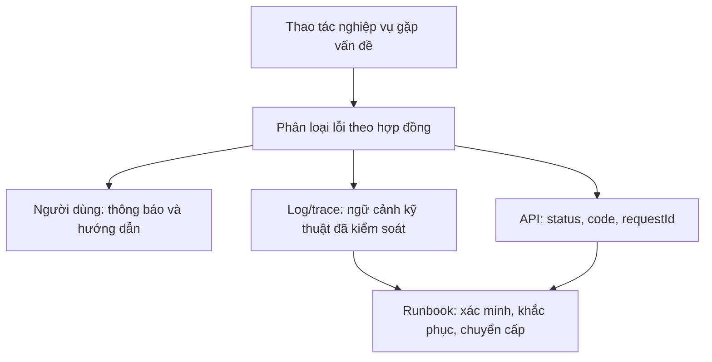

# Thông báo lỗi và hướng dẫn chẩn đoán

Trong module `CODE_QUALITY_FUNDAMENTALS`, chất lượng mã nguồn được nhìn qua các thuộc tính giúp phần mềm **đáng tin cậy, dễ hiểu và dễ thay đổi**. Ở chương **Tài liệu**, thông báo lỗi và hướng dẫn chẩn đoán là một phần của chất lượng đó: khi hệ thống gặp sự cố, người dùng cần biết phải làm gì, người tích hợp API cần biết phản hồi có ý nghĩa gì, còn người phát triển và vận hành cần có đủ bằng chứng để tìm nguyên nhân mà không làm lộ thông tin nhạy cảm.

Một câu thông báo như “Có lỗi xảy ra” không giúp ai quyết định bước tiếp theo. Nhưng đẩy nguyên văn `NullPointerException`, câu lệnh SQL và stack trace cho người dùng cũng không phải giải pháp: vừa khó hiểu vừa có thể tiết lộ cấu trúc nội bộ. Thiết kế tốt **phân biệt thông điệp hướng tới hành động với dữ liệu kỹ thuật phục vụ điều tra**, kết nối chúng bằng mã lỗi ổn định và định danh tương quan.

Hãy xét tình huống một người dùng xác nhận đơn hàng nhưng nhà cung cấp thanh toán không phản hồi trước hạn. Hệ thống **chưa biết chắc** giao dịch đã thu tiền hay chưa. Nếu trả “Thanh toán thất bại, hãy trả tiền lại”, người dùng có thể bị thu hai lần. Một phản hồi phù hợp hơn là “Chưa thể xác nhận kết quả thanh toán. Vui lòng kiểm tra trạng thái đơn hàng trước khi thử lại”, kèm mã tham chiếu để hỗ trợ tra cứu. Trong log nội bộ, hệ thống ghi thời gian gọi, mã giao dịch đã che bớt thông tin, nhà cung cấp, loại timeout và trạng thái đối soát.

Sau bài học, bạn có thể:

- Phân biệt **thông báo cho người dùng**, **hợp đồng lỗi API**, **log kỹ thuật** và **runbook chẩn đoán**.
- Viết thông báo chỉ rõ tình huống, ảnh hưởng, hành động tiếp theo và giới hạn điều hệ thống biết.
- Chọn mã lỗi có thể xử lý bằng máy, trạng thái HTTP và định danh tương quan phù hợp.
- Thiết kế cách ghi log đủ ngữ cảnh nhưng không tiết lộ bí mật, dữ liệu cá nhân hoặc chi tiết an ninh.
- Tạo hướng dẫn chẩn đoán có bước kiểm chứng, nhánh xử lý, điều kiện dừng và phương án chuyển cấp.
- Kiểm thử thông điệp và tài liệu lỗi như một phần của hợp đồng chất lượng phần mềm.

## 1. Thông điệp lỗi có nhiều đối tượng đọc

Một lỗi có thể cần được trình bày khác nhau theo nơi người ta gặp nó:

| Đối tượng | Điều cần biết | Hình thức phù hợp | Tránh đưa vào |
| --- | --- | --- | --- |
| **Người dùng cuối** | Việc gì chưa hoàn tất, dữ liệu đã được lưu chưa, cần làm gì tiếp | Ngôn ngữ rõ ràng trong giao diện; mã tham chiếu hỗ trợ khi cần | Stack trace, tên bảng DB, lỗi framework |
| **Ứng dụng tích hợp API** | Loại lỗi ổn định, trạng thái có thể xử lý, có retry được không | HTTP status, mã lỗi, trường chi tiết có cấu trúc, request ID | Phụ thuộc vào câu chữ đã bản địa hóa |
| **Người phát triển** | Đường xử lý, đầu vào liên quan, bước thất bại, exception gốc | Structured log, trace, metrics, liên kết mã nguồn | Bí mật, dữ liệu dư thừa, log trùng lặp |
| **Người vận hành/hỗ trợ** | Mức ảnh hưởng, nơi kiểm tra trước, quy trình giảm thiểu và chuyển cấp | Runbook có điều kiện và bằng chứng cần thu | Hướng dẫn tùy tiện thử lại một giao dịch có tác dụng phụ |

**Một thông báo không cần phục vụ đồng thời cả bốn đối tượng.** Thay vào đó, hãy cho chúng dùng chung *định danh sự kiện*, *mã lỗi* và *hợp đồng hành vi*. Câu chữ hiển thị có thể thay đổi theo ngôn ngữ, còn mã lỗi máy đọc nên ổn định đủ để chương trình tích hợp xử lý.

### Bốn lớp thông tin của một sự cố



Ví dụ lỗi “không đủ hàng” thường là một tình huống **nghiệp vụ được dự kiến**, không nhất thiết là sự cố hạ tầng. Người dùng thấy hành động đề xuất “Giảm số lượng hoặc chọn sản phẩm khác”; API trả mã như `INVENTORY_INSUFFICIENT`. Log có thể ghi một sự kiện nghiệp vụ ở mức thích hợp mà không cần stack trace. Ngược lại, lỗi truy cập DB là sự cố kỹ thuật: người dùng nhận thông điệp an toàn, API có mã lỗi riêng, còn hệ thống vận hành cần trace và nguyên nhân gốc.

## 2. Một thông báo lỗi hữu ích cần trả lời những câu nào?

Thông báo tốt không nhất thiết dài. Với hành vi có ảnh hưởng đến người dùng, hãy kiểm tra bốn yếu tố:

1. **Điều gì xảy ra?** Xác định thao tác không thành công, đang chờ xác nhận hay chỉ một phần dữ liệu không sẵn sàng.
2. **Hậu quả hoặc trạng thái hiện tại là gì?** Đơn chưa được tạo, dữ liệu đã lưu thành bản nháp, hay kết quả thanh toán chưa xác định?
3. **Người dùng có thể làm gì an toàn?** Sửa trường nhập, kiểm tra trạng thái, chờ và tra cứu, thử lại trong điều kiện cho phép hoặc liên hệ hỗ trợ.
4. **Làm sao tham chiếu sự cố?** Khi cần hỗ trợ, hiển thị mã tham chiếu tương quan mà người dùng có thể sao chép, thay vì yêu cầu họ nhớ thời gian chính xác hay gửi thông tin nhạy cảm.

Không phải lỗi nào cũng cần cả bốn phần hiển thị trên cùng một dòng. Câu “Số lượng phải lớn hơn 0” đủ cho một trường nhập liệu đơn giản. Còn với giao dịch thanh toán không rõ kết quả, người dùng cần thêm hướng dẫn an toàn và mã tra cứu.

| Thông báo kém | Vì sao chưa đủ | Thông báo tốt hơn |
| --- | --- | --- |
| “Error 500” | Không nói được việc gì đang ảnh hưởng | “Chưa thể tải danh sách đơn hàng. Hãy thử lại sau. Mã tham chiếu: ...” |
| “Invalid input” | Không nêu trường và quy tắc | “Số lượng sản phẩm phải là số nguyên lớn hơn 0.” |
| “SQL constraint violation” | Lộ chi tiết kỹ thuật nhưng không chỉ hành động | “Mã đơn hàng đã được sử dụng. Hãy kiểm tra đơn hiện có trước khi tạo mới.” |
| “Không thể thanh toán. Hãy bấm lại ngay!” | Có thể thúc đẩy thu tiền trùng khi kết quả chưa rõ | “Chưa thể xác nhận thanh toán. Hãy kiểm tra trạng thái đơn trước khi thử lại.” |
| “Bạn đã làm sai” | Đổ lỗi không cần thiết và không hướng dẫn | “Tệp vượt giới hạn 10 MB. Hãy chọn tệp nhỏ hơn.” |
| “Request timed out at com.example...” | Lộ triển khai; người dùng không thể khắc phục từ thông tin đó | “Yêu cầu đang xử lý lâu hơn dự kiến. Vui lòng kiểm tra trạng thái trước khi gửi lại.” |

### Phát biểu đúng mức độ chắc chắn

Lựa chọn từ ngữ phản ánh điều hệ thống *thật sự biết*:

- **Đã xác định:** “Đơn không được tạo vì số lượng vượt tồn kho khả dụng.”
- **Chưa xác định:** “Chưa thể xác nhận giao dịch đã hoàn tất hay chưa.”
- **Đang xử lý:** “Đang đồng bộ dữ liệu; kết quả mới có thể chưa xuất hiện.”
- **Bị từ chối theo quy tắc:** “Tài khoản chưa có quyền thực hiện thao tác này.”

Không được nói “không có gì bị thay đổi” nếu có khả năng thao tác đã commit trước khi kết nối bị ngắt. Cũng không khẳng định “hãy thử lại sau 1 phút” khi không có thông tin về thời gian khôi phục hoặc chính sách được hệ thống bảo đảm.

### Thông báo không nên thay thế cấu trúc giao diện

Với lỗi xác thực một biểu mẫu, đặt thông điệp gần trường bị lỗi, có nhãn phù hợp, liên kết từ phần tóm tắt lỗi nếu biểu mẫu dài và giữ lại giá trị người dùng đã nhập khi an toàn. Với màn hình chờ thao tác bất đồng bộ, hiển thị trạng thái và hành động phù hợp thay vì chỉ hiện một toast sẽ biến mất trước khi người dùng đọc.

Thông điệp cần dễ tiếp cận: không dựa duy nhất vào màu đỏ hoặc biểu tượng; kết hợp chữ, nhãn và cách công bố trạng thái phù hợp cho công nghệ hỗ trợ. Câu chữ nên nhất quán, tránh thuật ngữ nội bộ và tránh khiến người dùng phải hiểu cấu trúc triển khai.

## 3. Mã lỗi ổn định là một phần của hợp đồng

**Mã lỗi có cấu trúc** phục vụ chương trình và hỗ trợ tra cứu; **thông điệp** phục vụ con người. Không nên để client phân nhánh bằng cách so khớp chuỗi tiếng Việt hoặc tiếng Anh, vì sửa chính tả hoặc dịch ngôn ngữ có thể làm hỏng tích hợp.

Ví dụ các mã lỗi minh họa:

| Mã | Nghĩa ổn định | Hướng xử lý kỳ vọng |
| --- | --- | --- |
| `INVALID_QUANTITY` | Số lượng đầu vào không hợp lệ | Sửa dữ liệu, không retry cùng payload |
| `INVENTORY_INSUFFICIENT` | Không đủ tồn kho để xác nhận yêu cầu | Giảm số lượng hoặc chọn mặt hàng khác |
| `ORDER_ALREADY_CONFIRMED` | Đơn đã ở trạng thái không cho xác nhận lặp | Xem trạng thái hiện có, không tạo lệnh mới mù quáng |
| `PAYMENT_STATUS_UNKNOWN` | Chưa thể xác định kết quả của thao tác thanh toán | Tra cứu/đối soát theo định danh trước khi retry |
| `CATALOG_TEMPORARILY_UNAVAILABLE` | Nguồn danh mục hiện không sẵn sàng | Retry có giới hạn nếu thao tác là đọc an toàn |
| `REQUEST_RATE_LIMITED` | Vượt giới hạn yêu cầu áp dụng | Giảm tốc độ; tôn trọng hướng dẫn chờ nếu có |

Các mã này chỉ là **mẫu thiết kế** của bài học, không phải danh sách tiêu chuẩn bắt buộc. Khi đặt mã trong dự án, cần quản lý vòng đời, ý nghĩa chính xác, khả năng thay đổi và tài liệu tra cứu để client không phải suy đoán.

### HTTP status và mã lỗi ứng dụng trả lời hai câu hỏi khác nhau

Một API qua HTTP thường cần hai tầng thông tin:

- **HTTP status:** cho biết nhóm kết quả ở mức giao thức HTTP (thành công, lỗi yêu cầu, lỗi phía server...).
- **Application error code:** nêu nguyên nhân có ý nghĩa với ứng dụng và hành động xử lý trong hợp đồng cụ thể.

Một số ánh xạ thường gặp:

| HTTP status thường dùng | Trường hợp minh họa | Điều cần cân nhắc |
| --- | --- | --- |
| `400 Bad Request` | Cú pháp yêu cầu hoặc tham số không hợp lệ | Với lỗi kiểm tra dữ liệu hợp lệ về cú pháp, một số API chọn `422`; cần nhất quán theo hợp đồng API |
| `401 Unauthorized` | Chưa có thông tin xác thực hợp lệ | Xác định cơ chế xác thực; không lộ thông tin credential |
| `403 Forbidden` | Đã nhận diện nhưng không được phép thực hiện | Có thể trả `404` theo chính sách che giấu sự tồn tại của tài nguyên |
| `404 Not Found` | Không tìm thấy tài nguyên được yêu cầu | Không tiết lộ tài nguyên ngoài phạm vi người dùng được phép biết |
| `409 Conflict` | Yêu cầu xung đột với trạng thái hiện tại | Cung cấp mã lỗi và cách đọc lại trạng thái mới |
| `429 Too Many Requests` | Tần suất yêu cầu vượt giới hạn | Có thể cung cấp `Retry-After` khi xác định được |
| `500 Internal Server Error` | Sự cố nội bộ không có mã chi tiết công khai phù hợp | Không trả stack trace; lưu nguyên nhân trong log/trace bảo vệ |
| `503 Service Unavailable` | Dịch vụ tạm không sẵn sàng | Retry chỉ khi thao tác an toàn và có giới hạn |
| `504 Gateway Timeout` | Gateway/proxy không nhận phản hồi kịp hạn từ upstream | Không suy rằng thao tác upstream chưa thực hiện |

Ánh xạ phải dựa trên thiết kế và hợp đồng của API. Ví dụ, `PAYMENT_STATUS_UNKNOWN` có thể được biểu diễn bằng một **trạng thái nghiệp vụ đang chờ** trong tài nguyên giao dịch thay vì một lỗi 5xx đơn thuần. Việc chọn status cần phản ánh đúng giao thức và quy trình; không có một bảng ánh xạ duy nhất phù hợp mọi hệ thống.

### Một hợp đồng lỗi JSON tối thiểu

```json
{
  "code": "INVENTORY_INSUFFICIENT",
  "message": "Không đủ hàng để xác nhận đơn. Hãy giảm số lượng.",
  "requestId": "req-72c1",
  "retryable": false,
  "details": {
    "field": "quantity"
  }
}
```

Ở ví dụ này:

- `code` dùng cho xử lý tự động; cần giữ ổn định về ngữ nghĩa.
- `message` dùng để hiển thị/tham khảo và có thể được bản địa hóa; **không** dùng làm khóa phân nhánh phía client.
- `requestId` hỗ trợ liên kết báo lỗi với sự kiện kỹ thuật tương ứng. Giá trị trên chỉ là ví dụ, không chứa dữ liệu cá nhân.
- `retryable` chỉ là **gợi ý từ hợp đồng cụ thể**, không phải giấy phép tự động phát lại mọi thao tác. Với thao tác ghi, phải xét idempotency và trạng thái commit.
- `details` chỉ chứa dữ liệu đã được công bố an toàn; không đưa SQL, đường dẫn nội bộ hoặc token vào đó.

Trường thông tin có thể thêm hoặc bớt theo API cụ thể, nhưng phải tài liệu hóa tính bắt buộc, kiểu dữ liệu, độ ổn định và ý nghĩa khi trường vắng mặt. Nếu một client cần đọc `details.field`, hợp đồng phải nói rõ trường đó có ở những loại lỗi nào.

## 4. Java: tách nguyên nhân nội bộ khỏi phản hồi công khai

Một nguyên tắc thực dụng là **không trả trực tiếp `exception.getMessage()` của mọi lỗi** ra API. Thông điệp của exception nội bộ có thể chứa câu lệnh SQL, địa chỉ hệ thống, tên file hoặc dữ liệu từ phụ thuộc ngoài. Thay vào đó:

1. Phân loại lỗi nghiệp vụ dự kiến bằng kiểu hoặc mã có nghĩa ổn định.
2. Chuyển lỗi đó thành status và thông báo công khai theo một bảng ánh xạ rõ ràng.
3. Với lỗi không phân loại được, trả thông điệp an toàn và mã chung; giữ nguyên nhân kỹ thuật trong kênh log/trace bảo vệ.
4. Đưa `requestId` do hệ thống tạo hoặc đã xác thực vào cả phản hồi và sự kiện chẩn đoán.

### 4.1. Khai báo mã lỗi và kiểu phản hồi

Ví dụ Java 17 dưới đây dùng các kiểu JDK, không phụ thuộc framework HTTP. Nó minh họa **ý tưởng ánh xạ lỗi**; trong ứng dụng thật, lớp controller/handler sẽ chuyển `HttpError.status` thành mã trạng thái HTTP và tuần tự hóa `ApiError` thành JSON.

```java
import java.util.Objects;

enum ErrorCode {
    INVALID_QUANTITY,
    INVENTORY_INSUFFICIENT,
    ORDER_ALREADY_CONFIRMED,
    PAYMENT_STATUS_UNKNOWN,
    INTERNAL_ERROR
}

record ApiError(
        String code,
        String message,
        String requestId,
        boolean retryable) {
}

record HttpError(int status, ApiError body) {
}

final class BusinessFailure extends RuntimeException {
    private final ErrorCode code;

    BusinessFailure(ErrorCode code) {
        super(Objects.requireNonNull(code).name());
        this.code = code;
    }

    ErrorCode code() {
        return code;
    }
}
```

`BusinessFailure` chỉ giữ **mã ổn định** dùng trong phạm vi ứng dụng. Không nhồi toàn bộ dữ liệu đơn hàng hoặc chuỗi do người dùng nhập vào thông điệp exception. Hành vi có thể có tham số riêng được kiểm soát, chẳng hạn tên trường hợp lệ cho lỗi validation.

### 4.2. Ánh xạ mã theo hợp đồng

```java
import java.util.Objects;

final class ErrorPresenter {
    static HttpError present(Throwable failure, String requestId) {
        Objects.requireNonNull(failure);
        Objects.requireNonNull(requestId);

        if (failure instanceof BusinessFailure business) {
            return switch (business.code()) {
                case INVALID_QUANTITY -> response(
                        400, business.code(),
                        "Số lượng phải là số nguyên lớn hơn 0.",
                        requestId, false);
                case INVENTORY_INSUFFICIENT -> response(
                        409, business.code(),
                        "Không đủ hàng. Hãy giảm số lượng hoặc chọn sản phẩm khác.",
                        requestId, false);
                case ORDER_ALREADY_CONFIRMED -> response(
                        409, business.code(),
                        "Đơn đã được xác nhận. Hãy kiểm tra trạng thái hiện tại.",
                        requestId, false);
                case PAYMENT_STATUS_UNKNOWN -> response(
                        409, business.code(),
                        "Chưa thể xác nhận thanh toán. Hãy kiểm tra trạng thái đơn trước khi thử lại.",
                        requestId, false);
                case INTERNAL_ERROR -> internalError(requestId);
            };
        }
        return internalError(requestId);
    }

    private static HttpError response(
            int status,
            ErrorCode code,
            String message,
            String requestId,
            boolean retryable) {
        return new HttpError(
                status,
                new ApiError(code.name(), message, requestId, retryable));
    }

    private static HttpError internalError(String requestId) {
        return response(
                500, ErrorCode.INTERNAL_ERROR,
                "Không thể hoàn tất yêu cầu. Hãy liên hệ hỗ trợ nếu lỗi tiếp diễn.",
                requestId, false);
    }
}
```

Trong ví dụ này, `PAYMENT_STATUS_UNKNOWN` cố ý đặt `retryable=false` để **không khuyến khích gửi lại lệnh thu tiền ngay**. Mã HTTP `409` ở đây chỉ là một quyết định minh họa cho API giả định khi trạng thái đơn chưa cho phép thao tác tiếp; API thật có thể mô hình hóa khoản thanh toán ở trạng thái `PENDING_RECONCILIATION` và trả phản hồi khác. Quan trọng hơn mã HTTP cụ thể là **hợp đồng về kết quả không chắc chắn** phải đúng và nhất quán.

Các tình huống không xác định được loại lỗi dùng `INTERNAL_ERROR` công khai. Điều này không có nghĩa mọi lỗi cần bị nuốt: handler ở ranh giới cần **ghi nguyên nhân vào kênh kỹ thuật phù hợp** trước khi trả phản hồi; không để phản hồi công khai chứa stack trace.

### 4.3. Kiểm thử ánh xạ bằng JUnit 5

```java
import static org.junit.jupiter.api.Assertions.assertEquals;
import static org.junit.jupiter.api.Assertions.assertFalse;
import static org.junit.jupiter.api.Assertions.assertTrue;

import org.junit.jupiter.api.Test;

class ErrorPresenterTest {
    @Test
    void insufficientStockHasActionablePublicMessage() {
        HttpError error = ErrorPresenter.present(
                new BusinessFailure(ErrorCode.INVENTORY_INSUFFICIENT),
                "req-test-1");

        assertEquals(409, error.status());
        assertEquals("INVENTORY_INSUFFICIENT", error.body().code());
        assertTrue(error.body().message().contains("giảm số lượng"));
        assertEquals("req-test-1", error.body().requestId());
        assertFalse(error.body().retryable());
    }

    @Test
    void unexpectedExceptionNeverLeaksInternalDetail() {
        String secretDetail = "jdbc:internal-db/private_table";
        HttpError error = ErrorPresenter.present(
                new IllegalStateException(secretDetail),
                "req-test-2");

        assertEquals(500, error.status());
        assertEquals("INTERNAL_ERROR", error.body().code());
        assertFalse(error.body().message().contains(secretDetail));
        assertFalse(error.body().retryable());
    }

    @Test
    void unknownPaymentStateDoesNotRecommendBlindRetry() {
        HttpError error = ErrorPresenter.present(
                new BusinessFailure(ErrorCode.PAYMENT_STATUS_UNKNOWN),
                "req-test-3");

        assertEquals("PAYMENT_STATUS_UNKNOWN", error.body().code());
        assertFalse(error.body().retryable());
        assertTrue(error.body().message().contains("kiểm tra trạng thái"));
    }
}
```

Các test kiểm chứng **hợp đồng công khai**: mã, nhóm lỗi, hướng dẫn và không rò rỉ chi tiết nội bộ. Trong dự án có bản địa hóa, không nhất thiết khóa mọi câu chữ bằng `assertEquals`; có thể kiểm tra mã thông điệp, biến được truyền vào và một số thông điệp mẫu theo tiêu chí sản phẩm, trong khi bài kiểm thử riêng kiểm tra ngôn ngữ và tính dễ hiểu.

Kiểm thử ở đây chỉ xác minh `ErrorPresenter`. Để chứng minh API thật trả đúng HTTP status, JSON schema, header và request ID, cần thêm kiểm thử ở tầng adapter/controller và kiểm thử tích hợp phù hợp.

## 5. Log chẩn đoán phải liên kết được với phản hồi lỗi

Thông báo công khai cần súc tích; log kỹ thuật cần đủ bằng chứng. Một sự kiện chẩn đoán có cấu trúc thường bao gồm:

| Trường | Công dụng | Lưu ý |
| --- | --- | --- |
| `timestamp` kèm múi giờ | Đối chiếu thời điểm, tìm khoảng xảy ra sự cố | Dùng định dạng thống nhất, không tự giả định đồng hồ các máy hoàn toàn đồng bộ |
| `level` | Phân loại mức độ đáng chú ý theo quy ước của hệ thống | Không log mọi lỗi validation ở mức nghiêm trọng |
| `service`, `operation` | Xác định dịch vụ và thao tác đang chạy | Dùng tên ổn định, tránh gắn cả payload vào tên operation |
| `errorCode` | Liên kết với loại lỗi có hợp đồng | Không thay thế mô tả nguyên nhân kỹ thuật |
| `requestId` hoặc `traceId` | Tìm các sự kiện cùng luồng yêu cầu | Tạo/kiểm soát ở ranh giới tin cậy, không mù quáng tin mọi giá trị do client gửi |
| `durationMs`, `attempt` | Điều tra timeout, retry, độ trễ | Xác định rõ đoạn thời gian và đơn vị đo |
| `dependency`, `status` | Tìm nơi kết nối bên ngoài thất bại | Không ghi credential/URL chứa secret |
| `commitState` | Phân biệt đã commit, chưa commit và chưa xác định | Không suy từ timeout rằng thao tác chắc chắn chưa commit |
| `exceptionClass`, `cause` | Tìm nguyên nhân kỹ thuật | Chỉ đưa chi tiết nhạy cảm vào nơi lưu được kiểm soát nếu thực sự cần |

Ví dụ sự kiện cấu trúc có các giá trị **minh họa**:

```json
{
  "timestamp": "2027-03-04T09:00:00Z",
  "level": "ERROR",
  "service": "checkout",
  "operation": "confirm_payment",
  "errorCode": "PAYMENT_STATUS_UNKNOWN",
  "requestId": "req-72c1",
  "dependency": "payment-gateway",
  "attempt": 1,
  "durationMs": 3000,
  "failureKind": "READ_TIMEOUT",
  "commitState": "UNKNOWN"
}
```

Sự kiện này hỗ trợ tìm kiếm theo `requestId` và `errorCode`. Tuy nhiên, trường `READ_TIMEOUT` chỉ nói rằng quá thời hạn đọc phản hồi; nó **không** chứng minh cổng thanh toán chưa xử lý yêu cầu. Muốn xác nhận, cần tra cứu trạng thái từ nguồn có thẩm quyền bằng định danh giao dịch/idempotency key.

### Ghi đủ ngữ cảnh, không ghi lặp vô ích

Một exception có thể đi qua nhiều tầng. Nếu mỗi tầng đều log `ERROR` kèm toàn bộ stack trace rồi ném tiếp, một lỗi duy nhất có thể tạo nhiều bản ghi giống nhau, làm nhiễu chẩn đoán và tăng chi phí log. Một cách làm hợp lý là:

- Tầng thấp **giữ nguyên nguyên nhân** khi ánh xạ lỗi, không tự động log mọi lần ném nếu tầng trên sẽ xử lý.
- Tại ranh giới có đủ thông tin về thao tác và request, ghi **một sự kiện có ngữ cảnh** ở mức thích hợp.
- Bổ sung metrics/tracing cho các loại lỗi có tần suất cao thay vì dựa hoàn toàn vào stack trace.
- Với lỗi nghiệp vụ dự kiến, log theo nhu cầu giám sát; không biến mọi lỗi validation thành cảnh báo vận hành.

Đừng để một thao tác thất bại bị **log như đã thành công** chỉ vì handler đã trả phản hồi HTTP hợp lệ. Ngược lại, trả HTTP 4xx không đồng nghĩa hệ thống có sự cố cần đánh thức người trực.

### Bảo vệ thông tin trong log và thông điệp

Nội dung không nên xuất hiện trong phản hồi công khai hoặc log đại trà gồm: mật khẩu, token, API key, số thẻ thanh toán, dữ liệu định danh cá nhân không cần thiết, truy vấn chứa dữ liệu nhạy cảm, thông tin nội bộ giúp người khác khai thác hệ thống.

Ngoài việc bỏ/che giá trị, cần kiểm soát cả:

- **Log injection:** dữ liệu từ request có thể chứa xuống dòng hoặc ký tự điều khiển; phải dùng structured logging và cơ chế encode phù hợp.
- **Truy cập và lưu trữ:** phân quyền đọc log, thời gian lưu, mã hóa và chính sách xử lý dữ liệu.
- **Cardinality của metrics:** không dùng `requestId`, email hay order ID làm nhãn metrics có số lượng giá trị không giới hạn; dùng chúng trong trace/log khi cần.
- **Thông tin bảo mật nhạy cảm:** thông báo đăng nhập không nên vô tình tiết lộ tài khoản có tồn tại hay không khi chính sách bảo mật yêu cầu tránh phân biệt.

Định danh tham chiếu cần sinh hoặc chuẩn hóa trong phạm vi tin cậy và có thể được tra cứu nội bộ. Nó không được đóng vai trò như bằng chứng người dùng có quyền truy cập một tài nguyên.

## 6. Hướng dẫn chẩn đoán khác với việc liệt kê lỗi

**Runbook** là hướng dẫn thực hành để người chịu trách nhiệm có thể điều tra, giảm thiểu tác động và xác nhận trạng thái hệ thống. Một runbook hữu ích không chỉ viết “kiểm tra log” hoặc “khởi động lại dịch vụ”; nó cần trả lời:

1. **Khi nào sử dụng?** Mã lỗi, cảnh báo, triệu chứng và phạm vi dịch vụ tương ứng.
2. **Sự cố ảnh hưởng đến ai?** Một người dùng, một tenant, một vùng hay tất cả yêu cầu?
3. **Đâu là nguồn sự thật?** DB giao dịch, trạng thái nhà cung cấp, hệ thống hàng đợi hay một bản sao có thể bị trễ?
4. **Kiểm tra theo thứ tự nào?** Những dấu hiệu đủ để xác nhận/bác bỏ từng giả thuyết là gì?
5. **Có thể làm gì an toàn?** Retry, đọc lại trạng thái, giảm tải, chuyển luồng dự phòng hoặc dừng thao tác?
6. **Khi nào phải dừng và chuyển cấp?** Ai được phép thay dữ liệu, rollback, thay cấu hình hoặc đối soát thủ công?
7. **Làm sao xác nhận đã khôi phục?** Cần chỉ số, ca kiểm thử hay điều kiện trạng thái nào?

### Mẫu runbook có thể tái sử dụng

| Mục | Thông tin cần viết |
| --- | --- |
| Tên và phạm vi | Loại sự cố, dịch vụ, version áp dụng, nhóm sở hữu |
| Dấu hiệu kích hoạt | Error code, alert, metric, log/trace pattern cụ thể |
| Ảnh hưởng | Thao tác nào không hoàn thành, có nguy cơ mất dữ liệu/thu tiền trùng không |
| Điều kiện tiên quyết | Quyền truy cập, hệ thống cần kiểm tra, hướng dẫn bảo vệ dữ liệu |
| Thu thập chứng cứ | Request/trace ID, mốc thời gian, mã giao dịch, phiên bản deploy, trạng thái phụ thuộc |
| Kiểm tra từng bước | Phép kiểm tra → kết quả có thể có → bước tiếp theo |
| Giảm thiểu an toàn | Hành động được phép, điều kiện áp dụng, rủi ro và cách quay lại |
| Chuyển cấp | Điều kiện chuyển, người/nhóm phụ trách, thông tin cần bàn giao |
| Xác nhận và đóng sự cố | Bất biến cần đúng, số lượng yêu cầu lỗi giảm, đối soát đã xong |

**Một runbook không nên yêu cầu thao tác phá hủy, cập nhật trực tiếp DB hoặc phát lại giao dịch tài chính như một bước mặc định.** Hành động có tác dụng phụ cần phạm vi, quyền thực hiện, bằng chứng và phương án xác minh rõ; trong hệ thống thật có thể phải qua quy trình phê duyệt vận hành.

## 7. Ví dụ runbook: chưa rõ kết quả thanh toán

**Tín hiệu kích hoạt:** ứng dụng ghi `PAYMENT_STATUS_UNKNOWN` sau timeout khi gọi cổng thanh toán, hoặc dashboard cho thấy số giao dịch “chờ đối soát” tăng bất thường.

**Mức độ quan trọng:** không khẳng định thu tiền thành công hay thất bại khi chưa có dữ liệu đáng tin. Ưu tiên tránh **thu tiền hai lần**, tránh xác nhận đơn khi chưa đủ bằng chứng và tránh để giao dịch treo không có người theo dõi.

### Bước 1 — Thu thập phạm vi và định danh

Từ mã tham chiếu người dùng cung cấp, tra ra `requestId` và bản ghi giao dịch tương ứng trong hệ thống được phép truy cập. Xác định phiên bản ứng dụng, thời điểm timeout, nhà cung cấp, định danh yêu cầu/idempotency key đã sử dụng và trạng thái nội bộ hiện tại.

Không yêu cầu người dùng gửi thông tin thẻ, mật khẩu hoặc ảnh chụp có dữ liệu nhạy cảm để “chẩn đoán”. Việc tra cứu phải áp dụng phân quyền phù hợp với vai trò hỗ trợ.

### Bước 2 — Xác định nguồn có quyền quyết định trạng thái

Kiểm tra nguồn dữ liệu giao dịch của ứng dụng và API tra cứu trạng thái chính thức của nhà cung cấp (nếu có). Đừng kết luận chỉ từ cache trang thanh toán hay HTTP timeout. Nếu hai nguồn mâu thuẫn, ghi rõ mốc thời gian, phiên bản và giữ tình trạng “cần đối soát” cho đến khi có quyết định có căn cứ.

| Tình huống thu được | Hành động an toàn theo hướng dẫn giả định |
| --- | --- |
| Có bằng chứng giao dịch **đã thành công** và đã liên kết đúng đơn | Đảm bảo nội bộ không tạo lần thu mới; kiểm tra tiếp việc xác nhận đơn/sự kiện sau commit |
| Có bằng chứng giao dịch **bị từ chối** và không có lần xử lý nào khác đang chờ | Hiển thị trạng thái thất bại; cho người dùng thử phương thức thanh toán khác theo quy tắc |
| Nhà cung cấp trả trạng thái **đang xử lý** | Giữ trạng thái chờ; định kỳ tra cứu có giới hạn; cung cấp trạng thái rõ cho người dùng |
| Không tra cứu được hoặc phản hồi vẫn **không xác định** | Không tự gửi lại lệnh thu tiền nếu chưa có cơ chế chống trùng; chuyển cấp và ghi nhận cần đối soát |
| Phát hiện nhiều lần xử lý cùng ý định | Ngăn thao tác mới, ghi nhận ảnh hưởng và chuyển quy trình xử lý giao dịch trùng theo chính sách |

Điều kiện chính xác phụ thuộc khả năng bảo đảm của nhà cung cấp, định danh giao dịch, quy tắc idempotency và thiết kế dữ liệu của ứng dụng. Bảng này là khung hướng dẫn, **không thay thế quy trình thanh toán thật đã được phê duyệt**.

### Bước 3 — Kiểm tra nguyên nhân khiến trạng thái bị treo

Đối chiếu trace theo thời gian: kết nối tới nhà cung cấp bị timeout ở pha nào, có retry ở tầng HTTP hay phía ứng dụng không, số lần gọi thực sự là bao nhiêu, trạng thái giao dịch trong DB đã commit chưa, có sự kiện nào chưa được tiêu thụ không.

Nếu vấn đề xảy ra trên nhiều giao dịch cùng lúc, xem tình trạng upstream, connection pool, hàng đợi, thời gian phản hồi và thay đổi cấu hình gần đây. Tránh quy về “nhà cung cấp bị lỗi” chỉ từ một exception: timeout cũng có thể do DNS, mạng nội bộ hoặc quá tải trong chính dịch vụ của bạn.

### Bước 4 — Giảm thiểu, đối soát và xác nhận kết thúc

Hành động có thể là tạm giới hạn yêu cầu thanh toán mới, chuyển sang trạng thái chờ, bật luồng tra cứu trạng thái, hoặc kích hoạt quy trình hỗ trợ theo chính sách. Chỉ khi có bằng chứng rõ và cơ chế chống trùng đáng tin mới xem xét gửi lại lệnh có tác dụng phụ.

Runbook được coi là kết thúc cho một giao dịch khi trạng thái nội bộ và trạng thái từ nguồn có thẩm quyền được đối soát, bất biến tài chính được kiểm tra, người dùng được thông báo kết quả cuối và có dấu vết ai/điều gì đã đưa ra quyết định. Với sự cố diện rộng, còn phải kiểm tra số giao dịch treo giảm về mức chấp nhận, tỷ lệ timeout trở lại bình thường và cảnh báo không tiếp tục xuất hiện.

### Điều kiện chuyển cấp rõ ràng

Chuyển cho nhóm phụ trách thanh toán/điều hành sự cố nếu phát hiện thu tiền trùng, dữ liệu giao dịch mâu thuẫn, không thể tra cứu trạng thái trong thời gian giới hạn hoặc có dấu hiệu mất dữ liệu. Thông tin bàn giao gồm mã tham chiếu, khoảng thời gian, mức ảnh hưởng, phép kiểm tra đã thực hiện, bằng chứng và **những thao tác chưa được phép làm**.

## 8. Hướng dẫn chẩn đoán phải có bằng chứng và thứ tự ưu tiên

Không cần một runbook riêng cho mọi exception của JVM. Nên ưu tiên những lỗi:

- Xảy ra đủ thường xuyên để hỗ trợ/vận hành cần giải quyết lặp lại.
- Có nguy cơ dữ liệu sai, mất thông tin, thu tiền trùng hoặc lỗi phân quyền.
- Khó tìm nguyên nhân qua một dòng log hoặc liên quan nhiều dịch vụ.
- Có bước khắc phục được xác định rõ và cần kiểm soát quyền thực hiện.
- Cần phân biệt nhiều giả thuyết (DB chậm, upstream chậm, pool hết, deadlock, dữ liệu không hợp lệ...).

### Một chuỗi chẩn đoán có thể kiểm chứng

Ví dụ cảnh báo “Thời gian phản hồi API tăng”:

| Giả thuyết | Bằng chứng nên đo | Nếu kết quả đúng | Nếu kết quả sai |
| --- | --- | --- | --- |
| CPU của dịch vụ bão hòa | CPU utilization theo quota, CPU profiling, throttling | Tìm hot path, thuật toán hoặc mức tải vượt khả năng | Kiểm tra I/O, chờ và hàng đợi |
| Connection pool hết | Thời gian chờ pool, số connection đang dùng, thời gian giữ connection | Tìm truy vấn chậm, transaction dài và kích thước pool hợp lý | Kiểm tra hướng chờ khác |
| DB xử lý chậm | Query timing, số lượt SQL, execution plan, lock wait | Tối ưu truy vấn, chỉ mục, batch hoặc tranh chấp bằng chứng | Kiểm tra mạng/ứng dụng/upstream |
| Upstream timeout | Trace gọi dịch vụ ngoài, retries, tỷ lệ lỗi và latency | Giới hạn retry, theo dõi upstream, xem fallback được phép | Tìm nghẽn trước/sau lời gọi |
| Ứng dụng chờ khóa | Thread dump, lock contention và thời gian giữ khóa | Xem phạm vi khóa và thao tác I/O dưới khóa | Không suy deadlock chỉ từ WAITING |

Bảng này giúp tổ chức **giả thuyết → phép đo → nhánh quyết định**. Runbook không nên chỉ hướng dẫn “tăng timeout” hay “tăng số thread” vì các hành động đó có thể che dấu nguyên nhân hoặc làm tài nguyên càng bão hòa.

### Kiểm tra điều kiện dừng và quay lại

Mọi biện pháp giảm thiểu phải xác định: người chịu trách nhiệm, tác dụng phụ có thể có, tín hiệu chứng minh đã có hiệu quả, thời điểm ngừng thử và cách hoàn tác khi gây tác động ngoài dự kiến. Chẳng hạn tạm tắt chức năng có thể bảo vệ dữ liệu nhưng ảnh hưởng người dùng; quyết định đó phải được thông báo và theo dõi, không chỉ là một lệnh trong runbook.

Sau sự cố, cập nhật lại **bằng chứng đã gặp**, **phép kiểm tra hữu ích** và **điều kiện không còn đúng**. Runbook không được coi là bất biến: khi kiến trúc, API hoặc cơ chế lưu trữ thay đổi, hướng dẫn chẩn đoán cần được kiểm tra lại.

## 9. Bản địa hóa, khả năng tiếp cận và tính ổn định của tài liệu

### 9.1. Tách mã, thông điệp và biến

Một cách thiết kế khi hỗ trợ nhiều ngôn ngữ:

```text
code: INVALID_QUANTITY
messageKey: error.quantity.positive
params: {min: 1}

vi: "Số lượng phải từ {min} trở lên."
en: "Quantity must be at least {min}."
```

`code` phục vụ chương trình tích hợp; `messageKey` và `params` phục vụ hiển thị. Bên dịch không nên tự thay nghĩa mã lỗi; nơi render phải xử lý đúng số, ngày, tiền tệ và cách diễn đạt của từng ngôn ngữ. Không ghép chuỗi với dữ liệu từ người dùng mà không có cách escape phù hợp.

### 9.2. Không lẫn mã lỗi với quyền truy cập

Khi trả thông báo lỗi xác thực hoặc truy cập, sự khác biệt về nội dung và thời gian phản hồi đôi khi có thể tiết lộ rằng tài khoản hoặc tài nguyên tồn tại. Hãy bám theo chính sách bảo mật: thông báo đủ để người dùng hợp lệ tiếp tục nhưng không cung cấp thêm tín hiệu cho người không có quyền.

`requestId` không phải token cấp quyền, còn liên kết tới runbook nội bộ không nên xuất hiện trong response công khai nếu runbook chứa thông tin bảo mật. Nếu tài liệu dành cho khách hàng và tài liệu vận hành cùng đề cập một mã lỗi, cần quy định rõ phần nào được công khai.

### 9.3. Phiên bản hóa hợp đồng lỗi

Khi API đã có client sử dụng:

- Không thay đổi tùy tiện **ngữ nghĩa** của mã lỗi cũ.
- Không bắt client phải phân tích chuỗi `message` để ra quyết định.
- Nếu thêm trường JSON, cần xác định client cũ có bỏ qua trường không biết hay không.
- Nếu thay kiểu trường hoặc thay cách xử lý retry, đó có thể là thay đổi phá tương thích và cần kế hoạch chuyển phiên bản.
- Duy trì bảng mã lỗi và runbook theo cùng phiên bản hành vi thực tế.

Ví dụ, hôm nay `PAYMENT_STATUS_UNKNOWN` nghĩa là “không được retry lệnh thu tiền mù quáng”, nhưng bản sau đổi thành “luôn retry ngay” mà không đổi hợp đồng sẽ gây rủi ro nghiêm trọng cho client. Thay đổi như vậy cần được quản lý như thay đổi nghiệp vụ, không phải chỉ là chỉnh câu chữ tài liệu.

### 9.4. Kiểm tra khả năng tiếp cận

Với giao diện:

- Đặt lỗi xác thực dữ liệu gần trường liên quan và giữ nhãn dễ hiểu.
- Có phần tóm tắt lỗi cho biểu mẫu dài; cho người dùng quay về đúng trường.
- Không chỉ dùng màu hoặc biểu tượng để thể hiện lỗi.
- Khi trạng thái thay đổi bất đồng bộ, sử dụng cơ chế thông báo trạng thái có thể được công nghệ hỗ trợ nhận biết.
- Cung cấp hành động tiếp theo rõ ràng thay vì một toast biến mất ngay.

Thông báo tốt cần vừa chính xác về kỹ thuật vừa phù hợp cách người dùng thật tương tác, nhất là khi họ không có bối cảnh nội bộ của hệ thống.

## 10. Kiểm thử và review thông báo lỗi như mã nguồn

Tài liệu lỗi cũng có thể **sai** hoặc **lỗi thời**. Các thay đổi về quy tắc nghiệp vụ, luồng retry hoặc kiểu kết quả của dịch vụ ngoài đều có thể làm thông báo và runbook không còn đúng.

### 10.1. Ma trận kiểm thử theo loại lỗi

| Tình huống | API/giao diện cần chứng minh | Log/runbook cần chứng minh |
| --- | --- | --- |
| Số lượng nhập 0 hoặc âm | Trường sai được xác định; người dùng biết cách sửa; mã `INVALID_QUANTITY` | Không ghi stack trace nghiêm trọng cho lỗi đã dự kiến |
| Không đủ tồn kho | Không xác nhận vượt tồn; mã `INVENTORY_INSUFFICIENT` và hướng dẫn phù hợp | Có dữ liệu để phân biệt từ chối hợp lệ với lỗi cập nhật |
| Đơn đã xác nhận | Không thực hiện thao tác xác nhận lần nữa | Có mã tham chiếu và trạng thái đơn đã được kiểm chứng |
| Lỗi DB không biết trước | Phản hồi an toàn, không lộ SQL/secret; mã `INTERNAL_ERROR` | Giữ exception gốc và ngữ cảnh đủ để điều tra ở kênh bảo vệ |
| Payment timeout sau khi gửi lệnh | Không khẳng định chắc chắn giao dịch thất bại; không hướng dẫn retry mù quáng | Ghi trạng thái `UNKNOWN`, có cách tra cứu/đối soát |
| Rate limit | Mã lỗi và hướng dẫn giảm tốc; `Retry-After` nếu có | Có số liệu ngưỡng và mức ảnh hưởng để điều chỉnh |
| Chuyển ngôn ngữ | Mã lỗi không đổi, thông điệp hiển thị đúng ngôn ngữ | Log vẫn có trường mã lỗi để tìm kiếm xuyên ngôn ngữ |

### 10.2. Kiểm tra tính hữu dụng của runbook

Đọc runbook như một người **không phải tác giả**. Với một sự kiện giả lập hoặc dữ liệu đã được làm sạch:

1. Từ mã lỗi hoặc cảnh báo, người thử có tìm đúng runbook không?
2. Các lệnh và truy vấn trong hướng dẫn có phù hợp phiên bản hệ thống hiện tại không?
3. Người thử có xác định nguồn sự thật và quyền cần thiết không?
4. Nếu kết quả kiểm tra khác dự kiến, runbook có nhánh tiếp theo hay điều kiện chuyển cấp không?
5. Có bước nào vô tình làm thay đổi dữ liệu hoặc phát lại tác dụng phụ không?
6. Sau khắc phục, người thử có biết cần xác nhận bất biến và chỉ số nào không?

Những bài diễn tập sự cố (*game day*) hoặc review chéo runbook thường giúp phát hiện hướng dẫn mơ hồ như “kiểm tra hệ thống” hay “khởi động lại khi cần” trước khi phải dùng trong sự cố thật.

### 10.3. Checklist khi review thay đổi code

Khi một PR thêm đường xử lý lỗi mới, reviewer có thể hỏi:

- Mã lỗi có ý nghĩa ổn định và tương ứng đúng trường hợp nghiệp vụ không?
- Thông điệp có nói rõ điều xảy ra, điều người dùng biết chắc và cách xử lý an toàn không?
- Có trường hợp timeout, retry, partial success hoặc trạng thái chưa xác định không?
- Phản hồi có bị rò chi tiết implementation hoặc dữ liệu nhạy cảm không?
- Log có request/trace ID và nguyên nhân cần thiết, không log trùng hoặc tạo nhãn metrics quá nhiều giá trị không?
- Test có bảo vệ HTTP status, code, schema, an toàn dữ liệu và trường hợp biên không?
- Tài liệu lỗi và runbook có cần cập nhật để khớp hành vi mới không?

Không cần thêm hàng chục lớp exception chỉ để “có cấu trúc”: một tập mã lỗi rõ ràng, điểm ánh xạ tập trung và tài liệu tra cứu có thể hữu ích hơn hệ thống phân cấp lớp sâu và khó lần theo.

## 11. Bài tập thực hành

### Bài 1 — Viết lại thông báo

Cho ba thông điệp `Unknown error`, `java.sql.SQLException` và `Failed payment, retry immediately`. Hãy viết lại theo ba bối cảnh: lỗi nhập liệu, lỗi dịch vụ ngoài không sẵn sàng và thanh toán có kết quả chưa xác định. Với mỗi thông điệp, ghi rõ thông tin nào người dùng có thể biết chắc và hành động nào an toàn.

### Bài 2 — Phân tách thông điệp người dùng và API

Thiết kế phản hồi cho tình huống giỏ hàng yêu cầu 5 sản phẩm nhưng kho chỉ còn 2. Chọn mã HTTP theo hợp đồng, mã lỗi ứng dụng, thông báo tiếng Việt và `requestId`. Giải thích vì sao client nên dựa vào mã lỗi thay vì tìm chữ “không đủ hàng”.

### Bài 3 — Bảo vệ lỗi nội bộ

Một handler đang trả nguyên `exception.getMessage()` ra response. Exception có thể chứa tên bảng, URL nội bộ và phần truy vấn. Hãy viết lại handler để trả lỗi công khai an toàn, đồng thời giữ nguyên nhân kỹ thuật trong log được kiểm soát. Bổ sung kiểm thử chứng minh nội dung nhạy cảm không xuất hiện trong JSON.

### Bài 4 — Chọn giữa retry và tra cứu trạng thái

Một lệnh tạo thanh toán timeout sau khi client đã gửi request. Hãy phân biệt bằng chứng “không nhận được phản hồi” với kết luận “thanh toán thất bại”. Thiết kế mã lỗi, lời hướng dẫn cho người dùng, nơi lưu `idempotency key`, cách tra cứu trạng thái và điều kiện cho phép thực hiện lại.

### Bài 5 — Soạn runbook ngắn

Viết runbook cho mã `CATALOG_TEMPORARILY_UNAVAILABLE`: dấu hiệu kích hoạt, dữ liệu cần thu, nguồn kiểm tra, cách phân biệt DB/HTTP/upstream, giảm thiểu có giới hạn, điều kiện chuyển cấp và tiêu chí xác nhận khôi phục. Phân biệt thao tác đọc an toàn với thao tác ghi có tác dụng phụ.

### Bài 6 — Chẩn đoán không nhảy tới kết luận

Một endpoint có p99 tăng và trong log thấy nhiều thread ở trạng thái `WAITING`. Liệt kê ít nhất ba giả thuyết khác nhau (pool, lock, I/O), số liệu cần đo cho mỗi giả thuyết và điều kiện nào đủ để bắt đầu khắc phục. Giải thích vì sao `WAITING` chưa chứng minh deadlock.

### Bài 7 — Bản địa hóa mà vẫn giữ hợp đồng

Chuyển mã `INVALID_QUANTITY` sang hai thông điệp tiếng Việt và tiếng Anh với tham số giới hạn tối thiểu. Chỉ ra phần nào ổn định cho máy đọc, phần nào có thể dịch, và cách kiểm thử khi đổi nội dung hiển thị không làm hỏng client.

### Bài 8 — Kiểm tra lỗi thời của tài liệu

Một runbook cũ ghi “nếu timeout thì phát lại lệnh thu tiền”; phiên bản hiện tại chuyển sang trạng thái đối soát và chỉ cho tra cứu kết quả. Hãy lập kế hoạch cập nhật runbook, kiểm tra tương thích API, bổ sung test, hướng dẫn người trực và cách phát hiện những tài liệu hoặc dashboard còn giữ quy trình cũ.

**Tiêu chí tự đánh giá:** mỗi lời giải phải xác định được **người đọc**, **điều đã biết và chưa biết**, **mã lỗi ổn định**, **hành động an toàn**, **bằng chứng chẩn đoán**, **nguy cơ lộ dữ liệu** và **cách kiểm chứng lời hướng dẫn còn đúng**.

## Ghi nhớ

**Thông báo lỗi tốt là một phần của hợp đồng đáng tin cậy, còn hướng dẫn chẩn đoán tốt là một phần của khả năng vận hành và bảo trì.** Đối với người dùng, thông báo cần rõ điều xảy ra và cách xử lý an toàn; đối với API, mã lỗi và schema cần ổn định; đối với người phát triển và vận hành, log/trace phải đủ ngữ cảnh và bảo vệ dữ liệu. Runbook cần giúp người khác đi từ dấu hiệu đến phép kiểm tra, quyết định, giảm thiểu và xác nhận kết quả, **không** khuyến khích hành động mù quáng. Khi tài liệu lỗi được kiểm thử, cập nhật và gắn với hành vi thật của hệ thống, nó giúp mã nguồn dễ hiểu hơn, xử lý sự cố đáng tin cậy hơn và thay đổi an toàn hơn.
