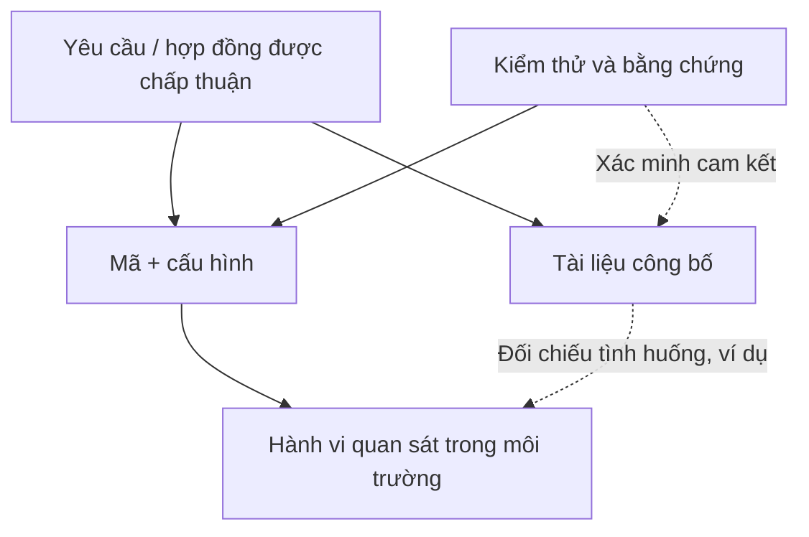
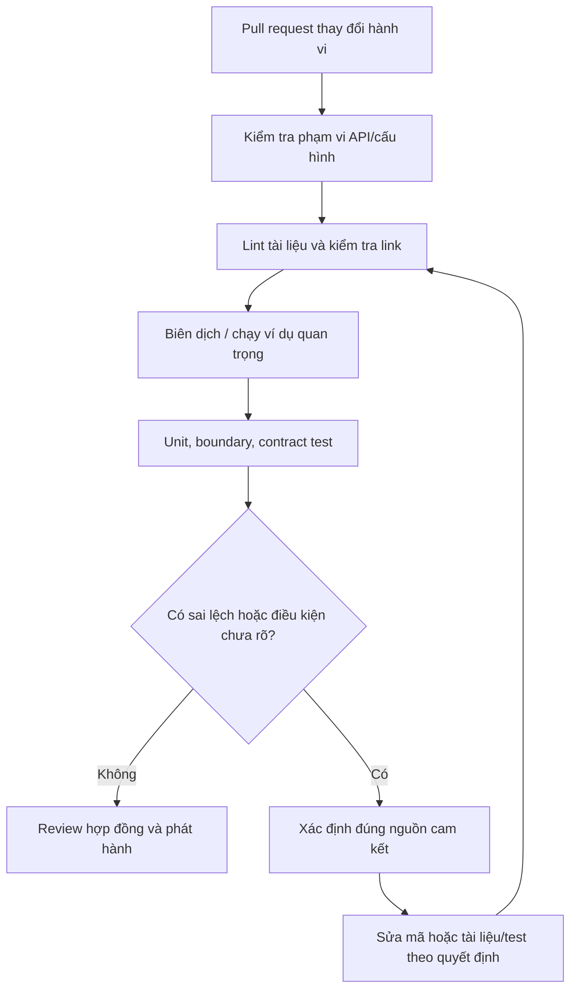

# Phát hiện tài liệu không còn khớp hành vi

Một tài liệu hướng dẫn ghi “đơn hàng từ 500.000 đồng được miễn phí vận chuyển”, nhưng mã Java chỉ miễn phí khi giá trị đơn hàng **lớn hơn** 500.000 đồng. Một JavaDoc hứa phương thức không thay đổi dữ liệu, nhưng implementation lại cập nhật trạng thái. Một tài liệu API mô tả lỗi `404`, trong khi phiên bản đang triển khai trả `200` với dữ liệu rỗng. Tài liệu vẫn đọc trôi chảy, nhưng người sử dụng làm theo sẽ nhận kết quả khác điều được hứa.

Trong chương **Tài liệu** của **CODE_QUALITY_FUNDAMENTALS**, bài học này tập trung vào cách nhận diện, xác minh và xử lý hiện tượng **tài liệu không còn khớp hành vi** (*documentation drift*). Đây là một phần của mục tiêu học phần: hiểu các thuộc tính quyết định mã nguồn có **đáng tin cậy, dễ hiểu và dễ thay đổi** hay không. Tài liệu đúng giúp người gọi API, người bảo trì và người vận hành có thể dự đoán chương trình. Tài liệu sai tạo ra một “hợp đồng tưởng tượng” khiến những thay đổi tiếp theo trở nên nguy hiểm hơn.

## Mục tiêu học tập

Sau bài này, bạn có thể:

1. Nhận diện những dạng sai lệch giữa tài liệu, mã, kiểm thử, cấu hình và hành vi vận hành.
2. Phân biệt **yêu cầu dự kiến**, **hành vi đã cài đặt** và **hành vi quan sát được**, tránh coi một nguồn duy nhất luôn đúng.
3. Chuyển một lời hứa trong tài liệu thành tình huống và assertion có thể kiểm chứng.
4. Sử dụng JavaDoc, JUnit 5, contract test và kiểm tra tài liệu trong CI để phát hiện sai lệch sớm.
5. Đánh giá thay đổi nào cần cập nhật tài liệu, thay đổi nào là lỗi của mã và khi nào phải phối hợp thay đổi hợp đồng.
6. Thiết kế quy trình bảo trì tài liệu gắn với phiên bản triển khai, chủ sở hữu và bằng chứng kiểm chứng.

## 1. Tài liệu và hành vi là hai thứ liên quan nhưng không đồng nhất

Trong một hệ thống, người đọc có thể gặp nhiều loại “sự thật”:

- **Yêu cầu/hợp đồng dự kiến:** nghiệp vụ hoặc API đã cam kết phải hoạt động thế nào.
- **Tài liệu đang công bố:** README, hướng dẫn, JavaDoc, tài liệu API, ví dụ request/response hoặc runbook.
- **Mã và cấu hình:** những nhánh xử lý, điều kiện, cờ tính năng, mặc định và dependency đã được cài đặt.
- **Kiểm thử:** những tình huống đã được chọn và những kỳ vọng được assertion.
- **Hành vi quan sát:** kết quả khi chạy một bản build trong một môi trường, với dữ liệu và cấu hình xác định.

Những lớp này có thể khớp nhau, hoặc chỉ khớp một phần. Ví dụ, test cũ và tài liệu cũ đều mong đợi hành vi A, nhưng một bản sửa mã vô tình làm hành vi chuyển thành B; đây có thể là **bug ở mã**. Ngược lại, nghiệp vụ đã phê duyệt đổi từ A sang B, mã và test đã cập nhật nhưng hướng dẫn vẫn ghi A; lúc đó nhiều khả năng **tài liệu cần được cập nhật**.

Điểm cốt lõi: **không kết luận “tài liệu sai” chỉ vì thấy mã khác tài liệu**. Cần kiểm tra phiên bản áp dụng, hợp đồng được phê duyệt và mục đích của thay đổi. Có khi phải sửa mã để giữ cam kết cũ.

### Tam giác cần đối chiếu



Sơ đồ thể hiện **quan hệ cần kiểm chứng**, không ngụ ý mọi thay đổi phải đi qua đúng một quy trình duy nhất. Đặc biệt, hành vi quan sát có thể khác giữa development và production do phiên bản, feature flag, dữ liệu hoặc dịch vụ bên ngoài.

## 2. Các dạng sai lệch thường gặp

Tài liệu không chỉ là văn bản giải thích thuật toán. Những thuộc tính ảnh hưởng người sử dụng cũng là một phần của hành vi phải mô tả chính xác.

| Khía cạnh | Tài liệu nói | Chương trình có thể đang làm | Rủi ro |
| --- | --- | --- | --- |
| **Đầu vào** | Số lượng cho phép bằng 0. | Validation đòi số lượng dương. | Client gửi dữ liệu bị từ chối. |
| **Ranh giới** | Miễn phí khi tổng tiền **từ** ngưỡng trở lên. | Dùng điều kiện `>` thay vì `>=`. | Sai nghiệp vụ đúng tại ngưỡng. |
| **Giá trị trả về** | Trả `Optional.empty()` khi không tìm thấy. | Ném exception. | Người gọi xử lý nhầm nhánh. |
| **Tác dụng phụ** | Phương thức chỉ tính toán. | Ghi DB hoặc gửi thông báo. | Retry gây ghi/gửi lặp. |
| **Mã lỗi** | HTTP `404` khi tài nguyên vắng mặt. | Trả `200` cùng `null`. | Client xử lý sai hợp đồng. |
| **Đơn vị dữ liệu** | Giá tính bằng đồng. | Giá tính bằng đơn vị khác hoặc đã nhân hệ số. | Tính tiền sai dù kiểu JSON đúng. |
| **Thứ tự / tính nhất quán** | Sự kiện xuất hiện ngay sau ghi. | Xử lý bất đồng bộ, có độ trễ và phát lại. | Người gọi hiểu sai thời điểm hoàn tất. |
| **Cấu hình** | Biến môi trường không bắt buộc. | Thiếu biến khiến ứng dụng không khởi động. | Triển khai thất bại. |
| **Tính tương thích** | Trường JSON tùy chọn. | Phiên bản mới yêu cầu phải có trường. | Consumer cũ bị lỗi. |
| **Hiệu năng / giới hạn** | Tài liệu khẳng định xử lý 1.000 yêu cầu/giây. | Chưa có phép đo cùng workload, hoặc kết quả chỉ đạt dưới điều kiện khác. | Suy đoán sai năng lực hệ thống. |

Cần phân biệt **tài liệu sai về hợp đồng** với **tài liệu thiếu chi tiết không bắt buộc**. Một phương thức có implementation riêng thay đổi nhưng không làm thay đổi đầu vào, kết quả, side effect hay điều kiện được cam kết có thể không cần cập nhật tài liệu người dùng.

### Dấu hiệu tài liệu có nguy cơ bị lỗi thời

- Mô tả điều kiện bằng từ **“luôn luôn”, “chỉ”, “không bao giờ”, “từ”, “tối đa”**, nhưng không có kiểm thử ranh giới tương ứng.
- JavaDoc nói một phương thức “không có tác dụng phụ”, nhưng tên các dependency cho thấy có lời gọi `save`, `send`, `publish` hoặc `delete`.
- Ví dụ trong README dùng tham số, endpoint hoặc định dạng response đã đổi tên.
- Hướng dẫn cấu hình đưa ra default khác với mã hoặc deployment manifest.
- Cùng một khái niệm xuất hiện trong nhiều trang với giá trị khác nhau.
- Tài liệu chỉ ghi tên phiên bản “mới nhất” mà không nêu bản phát hành hoặc phạm vi áp dụng.
- Một PR thay đổi chữ ký API, trạng thái lỗi hoặc feature flag nhưng không nhắc đến tài liệu và bài kiểm thử hợp đồng.

Đây là **tín hiệu cần điều tra**, chưa phải kết luận. Ví dụ một trang được đánh dấu rõ “áp dụng cho API v1” không nhất thiết sai khi v2 hoạt động khác.

## 3. Ví dụ xuyên suốt: ngưỡng miễn phí vận chuyển

Giả sử một dịch vụ báo phí vận chuyển có hợp đồng được thống nhất:

1. `basketMinor` là tổng tiền giỏ hàng, dùng số nguyên đơn vị tiền nhỏ nhất theo ngữ cảnh ví dụ.
2. Tổng tiền **không âm**; số âm bị từ chối.
3. Nếu `basketMinor >= 500_000`, phí vận chuyển bằng `0`.
4. Nếu `0 <= basketMinor < 500_000`, phí là `30_000`.
5. Tính phí là một phép tính thuần, không ghi đơn hàng hoặc thu tiền.

Các giá trị là **quy tắc giả định để học**, không phải biểu phí thật của một doanh nghiệp.

### 3.1. Tài liệu và mã bị lệch nhau

Tài liệu JavaDoc mô tả đúng hợp đồng:

```java
/**
 * Tính phí vận chuyển từ tổng tiền giỏ hàng.
 *
 * <p>Giỏ hàng từ 500_000 đơn vị tiền trở lên được miễn phí.
 * Hàm không thay đổi trạng thái đơn hàng.</p>
 *
 * @param basketMinor tổng tiền giỏ hàng, phải >= 0
 * @return 0 nếu basketMinor >= 500_000; ngược lại 30_000
 * @throws IllegalArgumentException nếu basketMinor âm
 */
```

Nhưng implementation thực tế có thể là:

```java
// CỐ Ý SAI: không miễn phí ở chính ngưỡng 500_000.
long shippingFeeMinor(long basketMinor) {
    if (basketMinor < 0) {
        throw new IllegalArgumentException("Negative basket amount");
    }
    return basketMinor > 500_000 ? 0 : 30_000;
}
```

Điểm lệch nằm ở **một ký tự**: `>` khác `>=`. Các trường hợp 400.000 và 600.000 đều cho kết quả trùng khớp tài liệu; chỉ trường hợp đúng 500.000 phát hiện lỗi.

### 3.2. Biến câu chữ thành bảng kiểm chứng

| `basketMinor` | Kỳ vọng từ hợp đồng | Vì sao kiểm tra? |
| ---: | ---: | --- |
| -1 | Ném `IllegalArgumentException`. | Đầu vào ngoài miền. |
| 0 | 30.000. | Giá trị thấp nhất hợp lệ. |
| 499.999 | 30.000. | Ngay trước ngưỡng. |
| 500.000 | 0. | **Đúng ngưỡng**, phân biệt `>` với `>=`. |
| 500.001 | 0. | Ngay sau ngưỡng. |
| `Long.MAX_VALUE` | 0. | Giá trị lớn hợp lệ theo quy tắc minh họa. |

Một tài liệu có chữ “**từ** 500.000” xác định rằng 500.000 **được bao gồm**. Những từ thể hiện điều kiện biên nên được chuyển thành test ranh giới thay vì để người đọc tự đoán.

### 3.3. Kiểm thử trước khi quyết định sửa đâu

Đoạn test JUnit 5 dưới đây lấy kỳ vọng từ hợp đồng giả định ở đầu mục:

```java
import static org.junit.jupiter.api.Assertions.*;

import org.junit.jupiter.api.Test;

class ShippingFeePolicyTest {
    private final ShippingFeePolicy policy = new ShippingFeePolicy();

    @Test
    void includesExactlyTheFreeShippingThreshold() {
        assertEquals(0L, policy.shippingFeeMinor(500_000L));
    }

    @Test
    void chargesImmediatelyBelowTheThreshold() {
        assertEquals(30_000L, policy.shippingFeeMinor(499_999L));
    }

    @Test
    void rejectsNegativeAmount() {
        assertThrows(IllegalArgumentException.class,
                () -> policy.shippingFeeMinor(-1L));
    }
}
```

Nếu `ShippingFeePolicy` chứa bản implementation sai ở mục 3.1, test đầu tiên sẽ thất bại. Đây là **bằng chứng có thể tái hiện** rằng mã không đáp ứng kỳ vọng trong test. Để xác định kỳ vọng đúng, nhóm vẫn cần đối chiếu với quyết định nghiệp vụ/đặc tả được chấp thuận: nếu chính sách đã đổi sang “chỉ miễn phí khi lớn hơn 500.000”, test và tài liệu mới là nơi cần cập nhật.

### 3.4. Bản cài đặt phù hợp với hợp đồng

```java
/**
 * Quy tắc tính phí vận chuyển minh họa.
 * Từ 500_000 đơn vị tiền trở lên được miễn phí.
 */
public final class ShippingFeePolicy {
    private static final long FREE_THRESHOLD = 500_000L;
    private static final long STANDARD_FEE = 30_000L;

    /**
     * Tính phí mà không thay đổi trạng thái ngoài hàm.
     *
     * @param basketMinor tổng tiền giỏ hàng không âm
     * @return 0 nếu đạt ngưỡng; ngược lại là phí tiêu chuẩn
     * @throws IllegalArgumentException nếu basketMinor âm
     */
    public long shippingFeeMinor(long basketMinor) {
        if (basketMinor < 0) {
            throw new IllegalArgumentException(
                    "Basket amount must be non-negative");
        }
        return basketMinor >= FREE_THRESHOLD ? 0L : STANDARD_FEE;
    }
}
```

Sau sửa, test ranh giới đạt và JavaDoc cùng mã thể hiện một hợp đồng. Nhưng **test xanh vẫn chỉ chứng minh những tình huống đã chạy**; nếu có thêm thuế, mã khuyến mãi hoặc điều kiện theo khu vực, cần bổ sung test và tài liệu để phản ánh hành vi mới.

## 4. Từ một tuyên bố trong tài liệu đến bằng chứng kiểm thử

Một cách làm rõ ràng là chuyển mỗi phát biểu quan trọng thành chuỗi:

```text
Tuyên bố → Điều kiện đầu vào → Kết quả quan sát được
         → Cách kiểm chứng → Phiên bản / môi trường → Kết luận
```

Ví dụ với `shippingFeeMinor`:

- **Tuyên bố:** “Tổng tiền đạt ngưỡng được miễn phí.”
- **Điều kiện:** `basketMinor = 500_000`, policy mới được tạo, không có cấu hình thay đổi ngưỡng.
- **Quan sát:** giá trị trả về `0`; phương thức không gọi repository hay payment gateway.
- **Kiểm chứng:** unit test ranh giới, review dependency nếu cần xác nhận tính thuần.
- **Phiên bản:** commit hoặc bản phát hành mà test áp dụng.
- **Kết luận:** khớp, không khớp hoặc chưa đủ bằng chứng.

### Ma trận tuyên bố – phép đo – nguồn xác nhận

| Tuyên bố cần xác minh | Test/quan sát phù hợp | Nguồn cần đối chiếu |
| --- | --- | --- |
| “Không chấp nhận số lượng âm.” | Unit test truyền -1, kiểm tra ngoại lệ. | Hợp đồng validation. |
| “Không làm thay đổi dữ liệu.” | Fake repository đếm số lời gọi ghi; test tích hợp khi cần. | Phạm vi tác dụng phụ được cam kết. |
| “Không tìm thấy trả `404`.” | API integration/contract test kiểm status và body. | Hợp đồng HTTP phiên bản tương ứng. |
| “Sự kiện chỉ phát một lần mỗi ý định.” | Test retry/idempotency và sự kiện trùng; quan sát DB/outbox. | Ngữ nghĩa nghiệp vụ và delivery guarantee. |
| “Timeout mặc định 2 giây.” | Test cấu hình được nạp; quan sát client tại môi trường cụ thể. | Quy tắc precedence của cấu hình triển khai. |
| “Đáp ứng p95 dưới 100 ms.” | Load test theo workload, đo latency p95 và error rate. | Điều kiện và SLO được xác định rõ. |

**Tránh tạo assertion chỉ lặp lại implementation.** Nếu test được viết dựa trên mã sai thay vì hợp đồng, cả test lẫn mã có thể cùng “đồng ý” với hành vi lỗi. Một test hợp đồng có giá trị phải có nguồn kỳ vọng độc lập: quy tắc nghiệp vụ, thiết kế được duyệt hoặc yêu cầu consumer đang sử dụng.

## 5. Đọc JavaDoc để phát hiện những cam kết dễ lệch

JavaDoc thường nằm ngay cạnh public API, nhưng điều đó không bảo đảm nó được sửa khi implementation đổi. Hãy xem kỹ:

### 5.1. Đầu vào, trả về và ngoại lệ

```java
/**
 * Tìm khách hàng theo mã.
 *
 * @param id mã khách hàng không rỗng
 * @return khách hàng; null nếu không tồn tại
 */
Customer findCustomer(String id);
```

Nếu phương thức sau đó đổi sang `Optional<Customer>`, JavaDoc đang mô tả sai kiểu và cách xử lý trường hợp không tồn tại. Nếu signature vẫn trả `Customer` nhưng implementation bắt đầu ném `NoSuchElementException`, sai lệch khó phát hiện hơn qua kiểm tra biên dịch và cần test hành vi.

Một số câu hỏi phải đặt:

- `null` có được phép ở tham số hoặc kết quả không?
- Tài liệu có liệt kê những ngoại lệ **theo hợp đồng**, thay vì tình cờ ném từ thư viện không?
- Giá trị biên và đơn vị có đúng không?
- Hàm có trả danh sách mới, view hay tham chiếu có thể sửa không?
- Kết quả có còn hợp lệ sau khi trạng thái bên ngoài thay đổi không?

Đừng thêm mọi exception nội bộ vào JavaDoc. Một hợp đồng tốt mô tả những trường hợp người gọi **cần và có thể** xử lý; còn chi tiết của lỗi kỹ thuật có thể được gom thành loại lỗi ổn định.

### 5.2. Tác dụng phụ và thứ tự hành động

JavaDoc có thể ghi “chỉ kiểm tra đơn hàng hợp lệ” nhưng thực thi lại gọi `inventory.reserve()` hoặc `mail.send()`. Đây là sai lệch nghiêm trọng hơn một lỗi diễn đạt: người gọi có thể sử dụng phương thức trong điều kiện, retry hoặc gọi hai lần vì tưởng không tạo tác dụng phụ.

Hãy đối chiếu tên hàm, JavaDoc và luồng gọi:

```java
// Tên gây hiểu nhầm nếu implementation ghi dữ liệu.
boolean isReadyForPayment(Order order);

// Tên cho biết hành động có thể thay đổi trạng thái.
PaymentReservation reservePayment(Order order);
```

Chữ ký ở trên chỉ minh họa ý nghĩa đặt tên; tính an toàn phải được xác minh bằng implementation và test phù hợp. Tài liệu cần nêu rõ side effect nào là **đã thực hiện** khi phương thức trả về, việc gọi lại có an toàn hay không và lỗi giữa chừng để lại trạng thái gì.

### 5.3. Đồng bộ, bất đồng bộ và thời điểm hoàn tất

```java
CompletableFuture<Receipt> submitInvoice(Invoice invoice);
```

Nếu hướng dẫn nói “sau khi gọi `submitInvoice`, hóa đơn chắc chắn đã được gửi”, lời hứa đó có thể sai: nhận một `CompletableFuture` chưa đồng nghĩa công việc bất đồng bộ đã hoàn tất thành công. Tài liệu nên xác định khi nào được coi là **accepted**, **completed** hay **failed**, có retry hay callback, và bên gọi cần đợi hoặc đối soát thế nào.

Ngược lại, chỉ nhìn kiểu `CompletableFuture` cũng không đủ biết thao tác bắt đầu lúc nào; cần xem hợp đồng triển khai. Đặc tả phải diễn đạt trạng thái quan sát được, không suy đoán từ tên kiểu.

## 6. Tài liệu API: kiểm tra cấu trúc lẫn ngữ nghĩa

Với HTTP API, tài liệu có thể ở OpenAPI, trang hướng dẫn, mẫu request/response và tài liệu lỗi. Các nguồn này có thể lệch nhau hoặc lệch khỏi ứng dụng.

Giả sử API báo phí:

```http
GET /api/v1/shipping-fee?basketMinor=500000 HTTP/1.1
Accept: application/json
```

Theo hợp đồng minh họa, một response hợp lệ là:

```http
HTTP/1.1 200 OK
Content-Type: application/json
```

```json
{
  "feeMinor": 0,
  "currency": "VND"
}
```

Đầu vào âm có thể được ánh xạ thành lỗi:

```http
HTTP/1.1 400 Bad Request
Content-Type: application/json
```

```json
{
  "code": "INVALID_BASKET_AMOUNT",
  "message": "Tổng tiền giỏ hàng không hợp lệ."
}
```

Các mã HTTP và cấu trúc JSON trên là **quy ước của API ví dụ**, không phải ánh xạ tự động của `IllegalArgumentException` ở mọi framework Java.

### Những điểm có thể tự động kiểm tra

- Route và HTTP method còn tồn tại.
- Query/path/header bắt buộc đúng tên, kiểu và giới hạn.
- Response có status và Content-Type tương ứng.
- Các trường JSON có kiểu, trạng thái bắt buộc và tính nullable đúng đặc tả.
- Các trường hợp lỗi đã cam kết có body/mã lỗi ổn định.
- Thay đổi schema có phá các consumer còn được hỗ trợ hay không.

Tuy nhiên, **schema đúng không có nghĩa hành vi đúng**. Response `feeMinor: 30000` vẫn là số nguyên không âm và có thể thỏa JSON schema, nhưng sai quy tắc miễn phí khi `basketMinor=500000`. Cần test giá trị và quan hệ nghiệp vụ bên cạnh schema validation.

### Consumer contract và provider verification

Một consumer có thể công bố tương tác cần được provider đáp ứng:

```text
Given giỏ hàng có tổng 500000
When  GET /api/v1/shipping-fee?basketMinor=500000
Then  status = 200
And   body.feeMinor = 0
And   body.currency = "VND"
```

Provider chạy kiểm thử trên build sắp triển khai để xác minh tương tác này. Nếu provider đổi điều kiện sang `> 500000`, test hợp đồng thất bại trước khi khách hàng gặp lỗi. Các công cụ kiểm chứng API contract có thể hỗ trợ, nhưng test chỉ có giá trị khi nó phản ánh đúng kỳ vọng đã được thống nhất và provider state được chuẩn bị đúng.

**Phân biệt hai nguồn lệch:** một file OpenAPI có thể sai so với mã, hoặc mã có thể đang vi phạm OpenAPI được công bố. Cả hai đều cần xử lý, nhưng quyết định sửa bên nào phải dựa trên cam kết tương thích của phiên bản.

## 7. Ví dụ trong tài liệu cũng phải được kiểm chứng

Tài liệu có thể bị lỗi theo cách rất thực tế: code snippet dùng constructor cũ, import sai hoặc lệnh `curl` gọi endpoint đã đổi. Những lỗi này dễ bị bỏ qua vì file Markdown vẫn render đẹp.

### Ví dụ Java chạy được thay vì snippet trang trí

Nếu hướng dẫn dạy sử dụng `ShippingFeePolicy`, ví dụ nên phản ánh đúng API hiện tại:

```java
public final class ShippingExample {
    public static void main(String[] args) {
        ShippingFeePolicy policy = new ShippingFeePolicy();
        long fee = policy.shippingFeeMinor(500_000L);
        System.out.println(fee); // 0
    }
}
```

Có thể duy trì ví dụ này dưới dạng source file thật được build/test kiểm tra, rồi trích xuất hoặc liên kết phần tương ứng vào trang tài liệu. Nếu ví dụ chỉ được copy dán thủ công giữa nhiều nơi, mỗi lần đổi API cần nhớ sửa mọi bản sao.

**Không nhất thiết mọi snippet phải chạy độc lập.** Những đoạn mô tả thuật toán, pseudocode hoặc phần trích ngắn nên được gắn nhãn rõ. Nguy cơ xuất hiện khi một đoạn được trình bày là **ví dụ có thể dùng trực tiếp** nhưng thực ra chưa từng biên dịch.

### Ba tầng kiểm tra tự động

| Tầng | Bắt được loại lỗi nào? | Không bắt được điều gì? |
| --- | --- | --- |
| **Markdown/link lint** | Link hỏng, cú pháp Markdown, heading hoặc anchor không còn. | Công thức nghiệp vụ trong văn bản có đúng không. |
| **Biên dịch/chạy code sample** | Import, chữ ký API, kiểu dữ liệu, một số output được assert. | Các hành vi không nằm trong sample. |
| **Kiểm thử hợp đồng/tích hợp** | Response thực, mã lỗi, dữ liệu quan sát từ service/adapter. | Mọi tổ hợp tải, cấu hình và phiên bản trong production. |

Một pipeline tài liệu khỏe nên dùng các tầng **phù hợp với rủi ro**. Không cần biến mọi dòng giải thích thành test, nhưng những ví dụ nằm trên đường sử dụng quan trọng nên có bằng chứng thường xuyên được kiểm tra.

## 8. Cấu hình và vận hành: tài liệu đúng trên máy nào?

Một tài liệu ghi “mặc định timeout 2 giây” có thể chỉ đúng khi chạy local. Khi triển khai, cấu hình qua environment, profile, Helm chart hoặc biến hệ thống có thể ghi đè giá trị. Người vận hành cần biết **nguồn cấu hình nào thắng** và mức nào thật sự có hiệu lực.

Ví dụ giả định:

```yaml
shipping:
  timeout-ms: 2000
  cache-enabled: false
```

Một môi trường production có thể đặt:

```text
SHIPPING_TIMEOUT_MS=5000
SHIPPING_CACHE_ENABLED=true
```

Đây là giá trị ví dụ; framework hoặc ứng dụng phải có cơ chế ánh xạ cấu hình cụ thể để chúng có hiệu lực. **Không thể kết luận chỉ từ tên biến môi trường rằng nó chắc chắn được phần mềm đọc.**

Khi xác minh tài liệu cấu hình, cần phân biệt:

1. **Giá trị mặc định trong mã** nếu không có cấu hình ngoài.
2. **Giá trị được định nghĩa trong file** của môi trường.
3. **Thứ tự ưu tiên** giữa file, biến môi trường, command-line, secret manager hoặc cấu hình từ dịch vụ trung tâm.
4. **Giá trị effective** sau khi hệ thống nạp và áp dụng cấu hình.
5. **Thời điểm áp dụng:** lúc khởi động, khi refresh cấu hình hay sau khi restart.

Nếu tài liệu hướng dẫn “đổi timeout có hiệu lực ngay” nhưng ứng dụng chỉ đọc lúc start, đó là sai lệch hành vi. Với dữ liệu nhạy cảm, **không in toàn bộ effective config** chỉ để kiểm tra: cần phép quan sát chọn lọc, che secret và phân quyền.

### Hành vi phụ thuộc feature flag

Khi flag `newShippingPolicy` bật, ngưỡng có thể khác bản cũ. Cùng một build có thể trả hai kết quả theo tenant hoặc nhóm rollout. Một báo cáo “tài liệu sai” phải ghi:

- Build/version đang chạy.
- Môi trường và cấu hình có liên quan.
- Trạng thái feature flag tại thời điểm kiểm tra.
- Đầu vào và ngữ cảnh người dùng/tenant nếu được phép sử dụng.
- Response hoặc kết quả thực tế đã được ẩn dữ liệu nhạy cảm.

Thiếu bối cảnh có thể khiến nhóm sửa một tài liệu đúng cho v1 thành tài liệu sai cho cả v1 lẫn v2.

## 9. Thiết kế cơ chế phát hiện sớm khi mã thay đổi

Không có công cụ nào tự hiểu hoàn toàn văn bản tự nhiên và chứng minh mọi câu là đúng. Một hệ thống tốt **kết hợp kiểm tra tự động với review có trách nhiệm**.

### Ma trận tín hiệu thay đổi

| Thay đổi ở code | Tài liệu nên rà soát | Cách phát hiện |
| --- | --- | --- |
| Chữ ký public method hoặc kiểu trả về. | JavaDoc, ví dụ sử dụng, migration guide. | API diff, compile snippet, review PR. |
| Điều kiện biên, validation. | Hợp đồng input, bảng giá trị, lỗi. | Unit/boundary test, property test. |
| HTTP path/status/schema. | OpenAPI, ví dụ request/response, SDK guide. | Contract/schema diff, provider verification. |
| Thêm tác dụng phụ hoặc thay thứ tự gọi. | Mô tả side effect, retry/idempotency. | Review dependency, integration test. |
| Đổi tên/mặc định/precedence config. | Hướng dẫn triển khai, runbook. | Config test, lint key, deployment check. |
| Chuyển đồng bộ sang bất đồng bộ. | Hợp đồng hoàn tất, lỗi và nhất quán. | API test, event test, review tài liệu. |
| Đổi ngưỡng hiệu năng hoặc giới hạn. | SLA/SLO, điều kiện benchmark, hạn mức. | Load test và đánh giá môi trường. |
| Bỏ chức năng/đổi version. | Changelog, deprecation/migration. | Compatibility check, matrix phiên bản. |

### Quy trình trong CI



Tùy quy mô, các bước có thể chạy song song và có bộ kiểm tra nhanh/chậm khác nhau. Mục tiêu không phải tăng số lượng test vô hạn, mà là **mỗi thay đổi ảnh hưởng người dùng đều có nơi phát hiện và người chịu trách nhiệm rà soát**.

### “Docs-as-code” giúp nhưng không tự bảo đảm đúng

Đặt tài liệu gần mã nguồn, review trong cùng PR, lint Markdown, kiểm tra link và sinh mô tả API từ annotation có thể giảm việc tài liệu bị quên. Dù vậy:

- Tài liệu **được sinh từ mã** sẽ phản ánh phần cấu trúc của mã, kể cả khi mã đang vi phạm yêu cầu đã cam kết.
- Test **được viết theo implementation** có thể xanh đồng thời với mô tả nghiệp vụ sai.
- Một comment được đặt cạnh phương thức vẫn có thể cũ nếu không ai kiểm tra khi behavior đổi.

Vì vậy, cần gắn kiểm tra tự động với nguồn kỳ vọng độc lập và review những lời hứa mang tính ngữ nghĩa.

## 10. Phiên bản và tương thích: đừng xác minh nhầm đối tượng

Một service có thể đồng thời phục vụ API v1 và v2. Một thư viện Java có thể giữ nhánh LTS với hành vi cũ trong khi bản mới đã thay đổi. Một tài liệu viết cho v2 chưa chắc sai chỉ vì bạn thử API v1.

Khi ghi nhận một sai lệch, tối thiểu cần:

- Tên ứng dụng/module và **commit/build hoặc phiên bản** có thể truy xuất.
- Đường dẫn tài liệu và phiên bản tài liệu.
- Endpoint hoặc class/method cụ thể.
- Input, điều kiện môi trường, quyền, feature flag và dữ liệu liên quan.
- Kỳ vọng từ hợp đồng có nguồn xác nhận.
- Kết quả quan sát, thời điểm và bằng chứng test/log đã loại bỏ dữ liệu nhạy cảm.

### Thay đổi tương thích không chỉ là “test compile được”

Đổi tên tham số ở một số dạng API, đổi kiểu trả về, ném ngoại lệ mới hoặc đổi mã HTTP có thể ảnh hưởng consumer ngay cả khi provider hoạt động bình thường. Thay đổi ngữ nghĩa như “`> 500_000` thay cho `>= 500_000`” có thể giữ nguyên mọi signature nhưng phá hợp đồng người dùng.

Ngược lại, bổ sung một trường JSON không bắt buộc có thể tương thích với consumer linh hoạt, nhưng gây lỗi với client cấu hình từ chối trường lạ. Khi đổi API, cần quan sát **consumer đang được hỗ trợ** và lập kế hoạch phát hành/migration tương ứng.

**Một tài liệu đúng phải có phạm vi rõ:** áp dụng cho version nào, feature flag nào và được sửa lần cuối để phản ánh hành vi nào. Không nên dùng từ “hiện tại” nếu người đọc không thể biết “hiện tại” là build nào.

## 11. Đánh giá mức độ ảnh hưởng của sai lệch

Không phải mọi câu sai đều có độ ưu tiên giống nhau. Hãy xét:

| Yếu tố | Câu hỏi đánh giá |
| --- | --- |
| **Tác động nghiệp vụ** | Sai lệch có làm tính tiền, phân quyền, dữ liệu hoặc trạng thái sai không? |
| **Khả năng gặp** | Người dùng có thường đi qua nhánh này hay chỉ khi sự kiện hiếm? |
| **Phạm vi người dùng** | Bao nhiêu consumer hoặc nhóm vận hành đang làm theo tài liệu? |
| **Khả năng phát hiện** | Sai lệch gây lỗi rõ hay trả giá trị hợp lệ về mặt kiểu nhưng sai nghĩa? |
| **Chi phí chuyển đổi** | Đổi hành vi có phá phiên bản đang được hỗ trợ không? |
| **Rủi ro an toàn/bảo mật** | Tài liệu có khiến người dùng lộ secret, bỏ kiểm tra quyền hay retry không an toàn không? |

Ví dụ một typo trong tiêu đề thường ưu tiên thấp hơn tài liệu chỉ sai cách xác thực hoặc mô tả nhầm `POST` tạo giao dịch là có thể retry tùy ý. Tuy nhiên, lỗi nhỏ về chữ có thể gây tác động lớn nếu nó nằm ở dấu so sánh, đơn vị tiền hoặc mã lỗi mà consumer dựa vào.

### Quy trình triage khi phát hiện “không khớp”

1. **Tái hiện:** lấy đúng input, phiên bản, config và kết quả quan sát.
2. **Xác nhận lời hứa:** tài liệu nào, phiên bản nào, hợp đồng do ai sở hữu?
3. **Khoanh vùng:** lỗi do tài liệu cũ, implementation sai, cấu hình khác hay provider/consumer dùng phiên bản khác?
4. **Đánh giá tác động:** bảo mật, tiền, dữ liệu, người gọi hiện hữu và khả năng rollback.
5. **Quyết định hành động:** sửa mã, sửa tài liệu, thêm giai đoạn tương thích hoặc thay đổi quy trình triển khai.
6. **Đưa bằng chứng vào kiểm thử:** thêm ca ranh giới/contract test có thể tái hiện để chống tái phát.
7. **Cập nhật các nơi liên quan:** JavaDoc, ví dụ, schema, changelog, runbook và thông báo cho consumer cần biết.

Nếu tài liệu **đã cam kết hành vi A** với người dùng nhưng mã mới trả B, không được tự đổi tài liệu sang B rồi coi vấn đề hoàn tất. Trước hết phải xác định liệu thay đổi B có được chấp thuận và có thể phát hành tương thích hay không.

## 12. Tránh biến kiểm thử thành “bằng chứng giả”

Một test có thể xanh nhưng không chứng minh điều mà tên test tuyên bố. Ví dụ:

```java
@Test
void alwaysReturnsFreeShippingAboveThreshold() {
    assertEquals(0L, policy.shippingFeeMinor(600_000L));
}
```

Tên test dùng từ “always”, nhưng test chỉ kiểm một giá trị. Nó không phát hiện lỗi ở đúng ngưỡng hoặc ở giá trị cực lớn nếu có overflow. Nên dùng tên chính xác với phạm vi quan sát và bổ sung ca biên:

```java
@Test
void freeShippingIncludesTheThreshold() {
    assertEquals(0L, policy.shippingFeeMinor(500_000L));
}
```

Đối với điều kiện dạng khoảng, có thể dùng **property-based testing** trên miền hợp lệ:

```text
Với mọi amount >= 500000:
    shippingFeeMinor(amount) == 0
Với mọi 0 <= amount < 500000:
    shippingFeeMinor(amount) == 30000
```

Nhưng một property test sinh hữu hạn giá trị không phải chứng minh hình thức cho mọi `long`. Nó cũng chỉ mạnh bằng tính đúng của quy tắc được đặc tả. Giữ những ca biên có ý nghĩa thành test cố định; dùng property test như lớp bằng chứng bổ sung.

### Cần chú ý dữ liệu và trạng thái khi kiểm chứng

Một tài liệu “giữ hàng không bao giờ vượt tồn kho” không thể được chứng minh chỉ bằng unit test của hàm tính toán. Cần kiểm tra DB transaction và hai request đồng thời. Tài liệu về retry/idempotency cần thử trường hợp timeout sau commit và yêu cầu gửi lại, không chỉ trường hợp HTTP bình thường.

**Phép kiểm chứng phải nằm ở đúng tầng thực thi**: unit test cho quy tắc thuần, integration test cho giao dịch/tích hợp, contract test cho ranh giới API và load test cho cam kết hiệu năng. Đừng dùng một loại test để thay thế tất cả.

## 13. Những sai lầm phổ biến

**“Code chạy thế nào thì tài liệu phải ghi thế ấy.”** Không chắc. Code có thể đang vi phạm yêu cầu được phê duyệt. Cần xác nhận hợp đồng trước khi đổi lời hứa.

**“Có JavaDoc là đủ.”** JavaDoc vẫn có thể lỗi thời; nhiều sai lệch nằm ở tác dụng phụ, quy tắc lỗi và cấu hình, những thứ trình biên dịch không tự đối chiếu với văn bản.

**“Test xanh nghĩa là tài liệu đúng.”** Test có thể thiếu ranh giới hoặc được viết từ implementation sai. Cần liên kết assertion với kỳ vọng độc lập và đúng phiên bản.

**“Sinh OpenAPI từ annotation là khỏi cần review.”** Sinh tự động hạn chế lệch cấu trúc, nhưng có thể sinh ra mô tả của một hành vi vốn sai yêu cầu hoặc thiếu ngữ nghĩa nghiệp vụ.

**“Ví dụ code trong README không cần chạy.”** Ví dụ được trình bày là có thể dùng trực tiếp nên được biên dịch/chạy khi khả thi; nếu là pseudocode, hãy nói rõ.

**“Bản production khác local thì tài liệu sai.”** Có thể khác version, profile, flag, dữ liệu hoặc nguồn cấu hình. Phải chỉ ra môi trường mà tài liệu áp dụng.

**“Thêm thông tin chi tiết luôn tốt hơn.”** Một tài liệu quá nhiều chi tiết implementation dễ lỗi thời và làm người đọc nhầm thứ cần dựa vào. Nên ưu tiên **hành vi công khai và những ràng buộc người sử dụng cần biết**.

**“Chỉ cần cập nhật một trang.”** Một thay đổi API có thể ảnh hưởng code sample, SDK, schema, migration guide và runbook. Cần biết nơi nào cùng diễn đạt một hợp đồng.

**“Tất cả sai lệch đều là breaking change.”** Có sai lệch chỉ là ví dụ không còn chính xác nhưng hành vi vẫn tương thích; có sai lệch nhỏ ở kiểu, đơn vị hoặc ranh giới lại phá cả nghiệp vụ. Phải đánh giá theo tác động của consumer.

## 14. Checklist cho một pull request làm thay đổi hành vi

Trước khi chấp thuận PR, hãy đi theo trình tự:

1. **Mô tả hành vi trước/sau.** Những input, output, error, side effect hoặc điều kiện vận hành nào thay đổi?
2. **Xác định người chịu ảnh hưởng.** API public, lớp nội bộ, runbook hay consumer cụ thể nào dựa vào cam kết đó?
3. **Xác định nguồn kỳ vọng.** Yêu cầu đã phê duyệt, contract, tiêu chuẩn tương thích hoặc quyết định sản phẩm nào cho phép thay đổi?
4. **Rà soát JavaDoc và tài liệu API.** Tham số, kết quả, ngoại lệ, đơn vị, trạng thái và ví dụ có còn đúng không?
5. **Rà soát hướng dẫn triển khai.** Config key, default, flag, quyền và điều kiện khởi động có thay đổi không?
6. **Bổ sung kiểm thử ranh giới và contract.** Kiểm tra trường hợp mới, trường hợp cũ còn hỗ trợ, kết quả và side effect.
7. **Chạy/biên dịch các ví dụ quan trọng.** Tránh snippet copy dán không còn chạy.
8. **Kiểm tra phiên bản và hướng di trú.** Nếu phá tương thích, cần deprecation, changelog hoặc bản API mới theo chính sách.
9. **Xác minh trên môi trường phù hợp.** Cấu hình, dữ liệu, feature flag và provider version phải được ghi lại khi báo kết quả.
10. **Gắn chủ sở hữu và bằng chứng.** Chỉ ra người xác nhận tài liệu và test/đường dẫn chứng minh các cam kết chính.

Không nhất thiết mỗi PR cần tất cả bước nặng như load test. Điều quan trọng là **những phần bị ảnh hưởng được kiểm chứng tương xứng với rủi ro**, và thay đổi hành vi có người chịu trách nhiệm cho tài liệu liên quan.

## 15. Câu hỏi tự kiểm tra

**Câu 1.** JavaDoc nói miễn phí từ 500.000, mã dùng `basketMinor > 500_000`. Điều gì cần làm đầu tiên?

*Gợi ý:* Tái hiện tại 500.000 và xác nhận quy tắc nghiệp vụ được chấp thuận. Nếu ngưỡng bao gồm 500.000, sửa mã và thêm test; nếu chính sách đã đổi, cập nhật tài liệu/test cùng kế hoạch tương thích.

**Câu 2.** Một unit test dùng mock response theo tài liệu và chạy xanh. Nó có chứng minh HTTP provider hiện tại đáp ứng tài liệu không?

*Gợi ý:* Chưa. Mock chỉ phản ánh kỳ vọng phía consumer. Cần adapter test và provider contract verification hoặc integration test tương ứng.

**Câu 3.** API thêm trường JSON `priceVersion` không ảnh hưởng consumer hiện tại, nhưng snapshot test so nguyên chuỗi JSON thất bại. Có chắc đây là breaking change không?

*Gợi ý:* Không. Cần biết hợp đồng có cho phép trường bổ sung và parser của consumer có chấp nhận không. Snapshot quá chặt có thể gây báo động giả.

**Câu 4.** README ghi timeout 2 giây, production quan sát 5 giây. Những nguồn nào cần kiểm tra trước khi kết luận tài liệu sai?

*Gợi ý:* Mã mặc định, file config, environment, flags, thứ tự ưu tiên và phiên bản triển khai; cũng cần xác nhận phép đo có đo đúng timeout cấu hình hay không.

**Câu 5.** Vì sao thay đổi một `boolean` từ `>=` thành `>` có thể quan trọng hơn một refactor hàng trăm dòng?

*Gợi ý:* Thay đổi điều kiện biên có thể phá cam kết nghiệp vụ, còn refactor có thể giữ nguyên mọi hành vi quan sát được. Tác động hợp đồng quan trọng hơn số dòng thay đổi.

**Câu 6.** Một phương thức trước đây chỉ tính tổng, nay gọi thêm `repository.save()`. Những phần tài liệu và kiểm thử nào có thể cần sửa?

*Gợi ý:* Tài liệu về side effect, tính lặp an toàn, lỗi giao dịch, hướng dẫn dùng API và test xác nhận việc ghi; cần quyết định thay đổi này có được phép với hợp đồng cũ không.

**Câu 7.** Tại sao sinh tài liệu từ mã không thể thay thế toàn bộ review nghiệp vụ?

*Gợi ý:* Công cụ có thể phản ánh chữ ký và metadata chính xác nhưng không tự xác minh các quy tắc về tiền, thời điểm hoàn tất, quyền hoặc tương thích đã được phê duyệt.

## Ghi nhớ

- **Documentation drift** là sự khác biệt giữa điều tài liệu hứa và hành vi/hợp đồng áp dụng; không nên tự giả định code hay tài liệu luôn là nguồn đúng.
- Phát hiện hiệu quả bằng cách **biến câu chữ thành kịch bản có thể quan sát**, đặc biệt với điều kiện biên, lỗi, đơn vị dữ liệu và tác dụng phụ.
- **JavaDoc, README, API schema, ví dụ, config và runbook** đều có thể lệch. Kiểm chứng phải đặt ở đúng tầng và đúng phiên bản.
- **Docs-as-code, test chạy được, contract verification và CI** giảm sai lệch nhưng không thay thế việc xác nhận yêu cầu và review các cam kết ngữ nghĩa.
- Khi thấy không khớp, phải **tái hiện, xác nhận hợp đồng, đánh giá tác động, sửa đúng nguồn và thêm kiểm thử chống tái phát**.

**Câu hỏi khi bảo trì:** “Nếu một người mới làm đúng như tài liệu này mô tả trên phiên bản đang được hỗ trợ, họ có nhận được kết quả, tác dụng phụ và cách xử lý lỗi mà họ đã được hứa hay không?”
