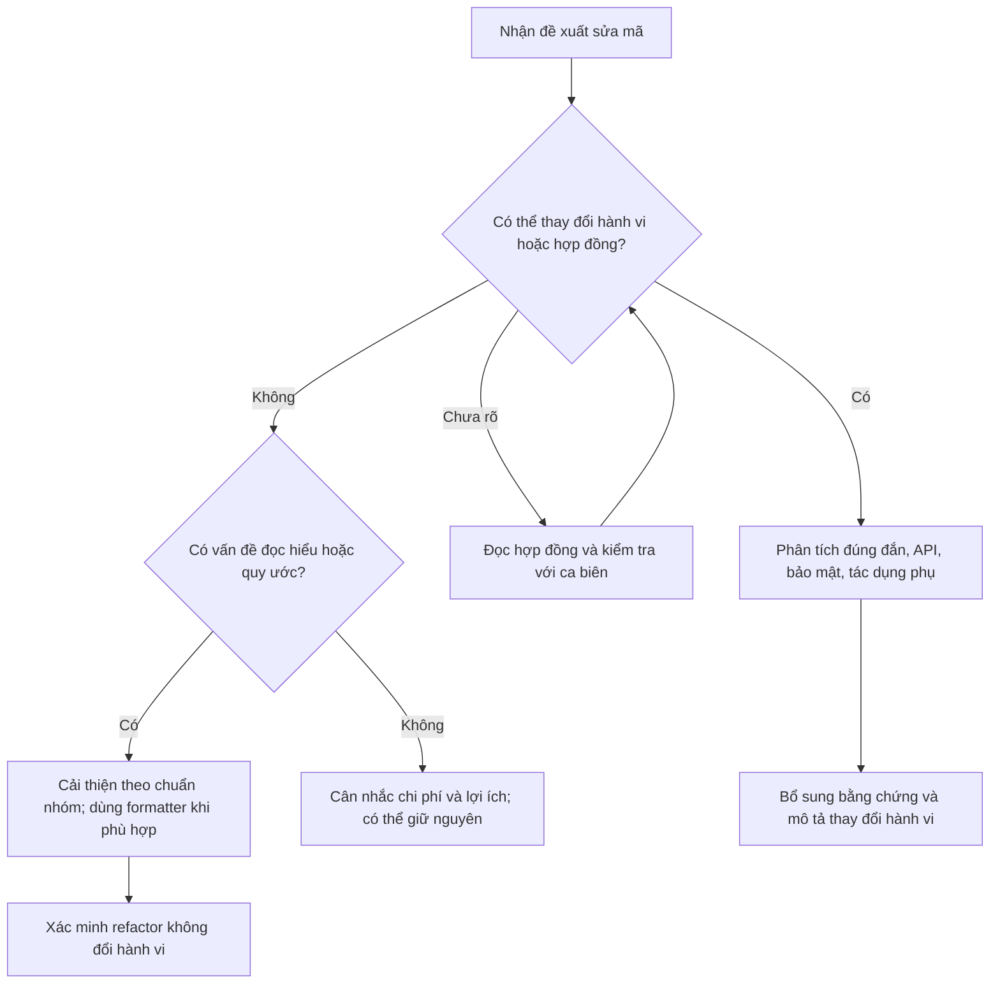

# Phân biệt lựa chọn phong cách với vấn đề đúng đắn

> **Chương:** Quy ước và nhất quán  
> **Học phần:** CODE_QUALITY_FUNDAMENTALS — Hiểu những thuộc tính quyết định mã nguồn có đáng tin cậy, dễ hiểu và dễ thay đổi hay không.

Trong một buổi review Java, có người đề nghị đổi dấu ngoặc nhọn, người khác muốn đổi tên biến, và một người phát hiện điều kiện miễn phí giao hàng dùng `>` thay vì `>=`. Cả ba đều là nhận xét về mã, nhưng **không cùng loại vấn đề**. Hai nhận xét đầu chủ yếu liên quan đến khả năng đọc và quy ước; nhận xét cuối có thể khiến khách hàng bị tính sai phí ngay tại ngưỡng nghiệp vụ.

Phân biệt được **lựa chọn phong cách** (*style*) và **vấn đề đúng đắn** (*correctness*) giúp nhóm đánh giá mức độ ưu tiên hợp lý. Nhóm vẫn cần nhất quán trong cách viết, nhưng không nên tranh luận về dấu cách với mức khẩn cấp như lỗi phân quyền, lỗi tính tiền hoặc làm mất dữ liệu. Ngược lại, cũng không được gọi một thay đổi là “chỉ chỉnh code style” khi nó làm đổi giá trị trả về, ngoại lệ, tác dụng phụ hoặc hợp đồng của API.

Sau bài học, bạn có thể:

- Nhận diện vấn đề về định dạng, đặt tên, quy ước, cấu trúc, tính đúng đắn và bảo mật.
- Dùng **hợp đồng hành vi quan sát được** để đánh giá một thay đổi có thật sự chỉ thuộc phong cách không.
- Phân biệt refactor giữ hành vi với sửa lỗi nghiệp vụ, dù cả hai cùng làm mã dễ hiểu hơn.
- Đưa ra nhận xét review rõ mức độ ảnh hưởng và ưu tiên kiểm tra đúng phần có rủi ro.
- Thiết lập quy ước và công cụ tự động để giảm tranh luận không cần thiết, không nhầm kết quả kiểm tra style với bằng chứng chương trình đúng.

## 1. Vì sao cần tách phong cách khỏi tính đúng đắn?

Xét hai câu nhận xét:

> “Nên xuống dòng trước toán tử để phù hợp quy ước nhóm.”

> “Điều kiện này khiến đơn đúng 500.000 VND không được miễn phí dù đặc tả nói **từ 500.000 VND trở lên**.”

Nhận xét đầu có thể giúp codebase nhất quán, dễ quét bằng mắt và ít tạo xung đột định dạng. Nhưng nếu chỉ đổi cách xuống dòng mà không thay câu lệnh Java, hành vi chương trình về cơ bản không thay đổi.

Nhận xét thứ hai nói về **sai khác giữa cài đặt và yêu cầu**. Nó cần được xử lý bằng cách hiểu hợp đồng, kiểm thử giá trị biên và sửa quy tắc, không chỉ đổi định dạng.

Nếu nhóm không phân biệt hai loại:

- Review có thể mất nhiều thời gian tranh luận lựa chọn cá nhân trong khi lỗi quan trọng chưa được phát hiện.
- Một thay đổi có rủi ro bị gắn nhãn “cleanup” và được bỏ qua kiểm thử phù hợp.
- Người mới khó biết điều gì **bắt buộc** để chương trình đúng và điều gì là **quy ước chung** để cộng tác.
- Công cụ kiểm tra định dạng có thể tạo cảm giác sai rằng một pull request “đã đạt chất lượng” dù chưa có bằng chứng về hành vi.

Mục tiêu không phải hạ thấp style. **Quy ước nhất quán giúp giảm chi phí đọc và sửa mã**, đặc biệt khi nhiều người cùng bảo trì. Nhưng mỗi vấn đề cần được giải quyết bằng loại bằng chứng và mức ưu tiên tương ứng.

## 2. Các tầng vấn đề trong một đoạn mã

Một thay đổi có thể liên quan đến nhiều thuộc tính chất lượng. Bảng sau là khung thảo luận, không phải cách phân loại cứng áp dụng cho mọi dự án.

| Loại vấn đề | Câu hỏi chính | Ví dụ Java | Cách đánh giá |
| --- | --- | --- | --- |
| **Định dạng** (*formatting*) | Có trình bày nhất quán, dễ đọc không? | Khoảng trắng, xuống dòng, dấu ngoặc nhọn | So với quy ước đã thống nhất; dùng formatter |
| **Đặt tên và diễn đạt** | Người đọc có hiểu ý định không? | `x` thay vì `subtotalAfterDiscountVnd` | So với nghĩa dữ liệu và ngữ cảnh người dùng |
| **Cấu trúc và khả năng bảo trì** | Có khó thay đổi hoặc nhiều phụ thuộc không cần thiết không? | Lồng `if` sâu, lặp cùng quy tắc ở nhiều nơi | Đánh giá luồng, trách nhiệm, khả năng kiểm thử |
| **Tính đúng đắn** | Hành vi có đáp ứng hợp đồng không? | `>` thay cho `>=` tại ngưỡng | Đặc tả, ca biên, kiểm thử và review hành vi |
| **Bảo mật** | Có cho phép hành vi không được phép hoặc làm lộ dữ liệu không? | Bỏ kiểm tra quyền sở hữu đơn hàng | Phân tích đe dọa, kiểm thử phân quyền và kiểm soát ranh giới |
| **Độ tin cậy** | Hệ thống có phản ánh và xử lý thất bại đúng không? | Nuốt lỗi truy vấn rồi trả danh sách rỗng | Kiểm thử lỗi, trạng thái sau lỗi và khả năng phục hồi |
| **Hiệu năng/tài nguyên** | Có đáp ứng giới hạn vận hành đã công bố không? | Lặp truy vấn nặng cho mỗi phần tử | Đo đạc với tải và cấu hình phù hợp |

Một vấn đề **có thể thuộc nhiều hàng**. Ví dụ, tên `total` không nói rõ đơn vị tiền là vấn đề khả năng đọc; nếu vì thế người gọi truyền USD thay cho VND, hậu quả đã thành vấn đề đúng đắn. Một thay đổi bỏ `null` check có thể đồng thời ảnh hưởng ngoại lệ, độ tin cậy và bảo mật tùy ngữ cảnh.

**Quy tắc ưu tiên:** không kết luận một đề xuất chỉ thuộc style từ hình thức của đoạn diff; hãy xem liệu điều mà người dùng hoặc bên gọi có thể quan sát có thay đổi hay không.

## 3. Hợp đồng hành vi là ranh giới để phân biệt

Trong bài này, *hợp đồng hành vi quan sát được* bao gồm những điều bên sử dụng có quyền dựa vào:

1. **Đầu vào và tiền điều kiện:** giá trị nào hợp lệ, kiểu dữ liệu có nghĩa gì, đơn vị ra sao.
2. **Giá trị trả về:** kết quả nào được bảo đảm và trong những trường hợp nào.
3. **Ngoại lệ và thất bại:** lúc nào ném lỗi, loại lỗi nào có ý nghĩa với người gọi.
4. **Tác dụng phụ:** ghi dữ liệu, phát sự kiện, gửi email, gọi dịch vụ hoặc thay đổi trạng thái nào.
5. **Thứ tự và số lần tác động:** lệnh nào xảy ra trước, thao tác có lặp lại an toàn không.
6. **Tính chất dữ liệu trả về:** thứ tự phần tử, khả năng chỉnh sửa, tính nhất quán nếu thuộc hợp đồng.
7. **Các cam kết khác nếu có:** thời hạn phản hồi, điều kiện đồng thời, tính nguyên tử, quyền truy cập, tính tương thích API.

Một sửa đổi được xem là **chỉ thay phong cách** khi những cam kết cần giữ không đổi trong phạm vi đã xác định. Điều này cần kiểm chứng khi thay đổi đủ phức tạp, không thể suy ra chỉ bằng nhãn “refactor”.

### Ví dụ cùng kết quả nhưng khác hợp đồng

```java
List<String> findSupportedRegions() {
    return new ArrayList<>(regions);
}
```

và:

```java
List<String> findSupportedRegions() {
    return List.copyOf(regions);
}
```

Hai phương thức có thể trả **các phần tử giống nhau**, nhưng đoạn đầu trả danh sách có thể sửa qua tham chiếu được trả; đoạn sau trả danh sách không hỗ trợ thay đổi cấu trúc. `List.copyOf` còn không chấp nhận phần tử `null`, trong khi `new ArrayList<>(regions)` có thể chứa `null`. Vì vậy, thay một dòng cho “gọn” **không mặc nhiên chỉ là style**.

Nếu hợp đồng đã quy định danh sách kết quả là bất biến và không chứa `null`, thay đổi có thể phù hợp; vẫn cần xác minh điều kiện và nơi gọi thực tế.

## 4. Ví dụ Java: refactor phong cách khác với sửa lỗi

Giả sử quy tắc minh họa cho giao hàng tiêu chuẩn:

- Tổng tiền hàng **sau giảm giá**, tính bằng VND, phải không âm.
- Phí tiêu chuẩn là **30.000 VND**.
- Được miễn phí giao hàng khi tổng tiền **từ 500.000 VND trở lên**, bao gồm đúng 500.000.
- Phương thức không ghi dữ liệu hoặc gọi hệ thống bên ngoài.

### 4.1. Phiên bản ban đầu: khó đọc và có lỗi điều kiện biên

```java
public final class StandardShipping {
    private StandardShipping() {
    }

    public static long calculateFeeVnd(long x) {
        if (x < 0L) {
            throw new IllegalArgumentException("Negative subtotal");
        }
        if (x > 500000L) {
            return 0L;
        } else {
            return 30000L;
        }
    }
}
```

Ở đây tồn tại **hai loại nhận xét**:

- **Khả năng đọc/phong cách:** tham số `x` khó diễn đạt nghĩa; các hằng số nghiệp vụ chưa có tên; có thể bỏ `else` sau nhánh `return`.
- **Tính đúng đắn:** điều kiện `x > 500000L` không miễn phí tại **đúng ngưỡng 500.000 VND**. Đặc tả yêu cầu `>=`.

Nếu chỉ trộn mọi chỉnh sửa vào một thao tác “dọn code”, reviewer khó phân biệt đâu là làm rõ cách diễn đạt và đâu là thay đổi quy tắc.

### 4.2. Bước A — làm rõ cách viết nhưng **giữ nguyên hành vi**, kể cả lỗi cũ

```java
public final class StandardShipping {
    private static final long FREE_SHIPPING_THRESHOLD_VND = 500_000L;
    private static final long STANDARD_FEE_VND = 30_000L;

    private StandardShipping() {
    }

    public static long calculateFeeVnd(long subtotalAfterDiscountVnd) {
        if (subtotalAfterDiscountVnd < 0L) {
            throw new IllegalArgumentException("Negative subtotal");
        }

        return subtotalAfterDiscountVnd > FREE_SHIPPING_THRESHOLD_VND
                ? 0L
                : STANDARD_FEE_VND;
    }
}
```

Sau bước này, tên tham số và hằng số đã rõ hơn, điều kiện trả về cũng ngắn gọn hơn. Nhưng **dấu `>` vẫn còn nguyên**. Với mọi giá trị `long` hợp lệ mà phương thức cho phép, nhánh trả về vẫn có cùng ý nghĩa như phiên bản trước.

Đây là một **refactor nhằm cải thiện khả năng đọc, không phải bản sửa lỗi**. Nó vẫn trả **30.000 VND** tại 500.000 VND — một hành vi sai theo đặc tả của ví dụ.

Lưu ý: đổi tên tham số của một phương thức `public` không làm đổi chữ ký gọi thông thường trong Java, nhưng tên tham số có thể được phản ánh trong tài liệu, metadata hoặc một số cơ chế binding dựa trên tên. Khi API dùng những cơ chế đó, vẫn phải kiểm tra tác động tương thích.

### 4.3. Bước B — sửa **quy tắc nghiệp vụ** và ghi nhận là thay đổi hành vi

Sửa đúng một toán tử trong phiên bản dễ đọc:

```java
return subtotalAfterDiscountVnd >= FREE_SHIPPING_THRESHOLD_VND
        ? 0L
        : STANDARD_FEE_VND;
```

Sự khác biệt chỉ một ký tự, nhưng làm thay đổi kết quả tại **500.000 VND**:

| Tổng tiền sau giảm giá | Bước A: dùng `>` | Bước B: dùng `>=` | Theo đặc tả |
| --- | ---: | ---: | ---: |
| 499.999 VND | 30.000 | 30.000 | 30.000 |
| **500.000 VND** | **30.000** | **0** | **0** |
| 500.001 VND | 0 | 0 | 0 |
| -1 VND | Ngoại lệ | Ngoại lệ | Ngoại lệ |

Vì vậy, một thay đổi làm mã **ngắn hơn** vẫn có thể là bug fix, còn một thay đổi làm mã **dài hơn** vẫn có thể chỉ nhằm đọc dễ hơn. Không thể phân loại bằng số dòng hoặc mức độ “đẹp” của diff.

### 4.4. Kiểm thử phân biệt hai bước

Với JUnit 5, bộ kiểm thử cho hành vi nghiệp vụ mong muốn có thể là:

```java
import static org.junit.jupiter.api.Assertions.assertEquals;
import static org.junit.jupiter.api.Assertions.assertThrows;

import org.junit.jupiter.api.Test;

class StandardShippingTest {
    @Test
    void amountBelowThresholdPaysStandardFee() {
        assertEquals(30_000L, StandardShipping.calculateFeeVnd(499_999L));
    }

    @Test
    void amountExactlyAtThresholdGetsFreeShipping() {
        assertEquals(0L, StandardShipping.calculateFeeVnd(500_000L));
    }

    @Test
    void amountAboveThresholdGetsFreeShipping() {
        assertEquals(0L, StandardShipping.calculateFeeVnd(500_001L));
    }

    @Test
    void negativeAmountIsRejected() {
        assertThrows(
                IllegalArgumentException.class,
                () -> StandardShipping.calculateFeeVnd(-1L));
    }
}
```

Trong ví dụ này:

- Với **bước A**, test tại đúng ngưỡng sẽ **thất bại** — điều này phát hiện **lỗi đã có từ trước**, không chứng minh refactor đổi hành vi.
- Với **bước B**, test tại ngưỡng sẽ đạt, phù hợp đặc tả.
- Các test còn lại giúp bảo vệ những trường hợp liền kề và chính sách đầu vào.

Muốn đánh giá một refactor có giữ nguyên hành vi cũ hay không, cần so sánh trước/sau trên phạm vi liên quan. Muốn đánh giá hành vi có **đúng** hay không, phải so với **đặc tả độc lập**. Hai câu hỏi liên quan nhưng khác nhau.

**Ghi chú thực hành:** các đoạn mã và kết quả test ở đây được phân tích theo logic của ví dụ, không phải kết quả chạy JUnit hoặc build trong dự án.

## 5. Những chỉnh sửa trông giống style nhưng có thể đổi hành vi

### 5.1. Đổi thứ tự điều kiện và cơ chế *short-circuit*

```java
// Có bảo vệ null:
if (customer != null && customer.isActive()) {
    showDiscount();
}
```

So với:

```java
// Có thể ném NullPointerException:
if (customer.isActive() && customer != null) {
    showDiscount();
}
```

Với toán tử `&&`, Java đánh giá từ trái qua phải và dừng sớm khi vế trái là `false`. Hoán đổi hai vế chỉ để “đọc tự nhiên hơn” đã làm thay đổi khả năng phát sinh ngoại lệ khi `customer == null`.

Một ví dụ về tác dụng phụ:

```java
if (isEligible(order) && reserveInventory(order)) {
    confirmOrder(order);
}
```

Nếu đổi thành `reserveInventory(order) && isEligible(order)`, hệ thống có thể **giữ hàng trước khi kiểm tra đủ điều kiện**. Dù hai biểu thức có thể tương đương về bảng chân trị khi các hàm thuần và ổn định, chương trình thực tế còn phụ thuộc **thứ tự gọi và trạng thái**.

### 5.2. Đổi cách xử lý `Boolean` và `null`

```java
Boolean enabled = null;

boolean safeDefaultFalse = Boolean.TRUE.equals(enabled); // false
boolean directUnboxing = enabled; // Ném NullPointerException.
```

Không nên gọi việc thay `Boolean.TRUE.equals(enabled)` bằng `enabled` là “rút gọn biểu thức” thuần style nếu `null` có thể xuất hiện. Hai cách có hợp đồng khác nhau. Phải quyết định rõ trường hợp `null` được phép và nên xử lý thế nào.

### 5.3. Đổi phép tính tiền hoặc kiểu số

```java
long totalVnd = subtotalVnd + feeVnd;
```

So với:

```java
long totalVnd = Math.addExact(subtotalVnd, feeVnd);
```

`Math.addExact` ném `ArithmeticException` khi cộng tràn số; phép `+` với `long` có thể tạo kết quả tràn theo quy tắc số nguyên Java. Việc thay đổi này cải thiện khả năng phát hiện lỗi tràn nếu hợp đồng yêu cầu, nhưng **không chỉ là phong cách**.

Tương tự, với tiền tệ cần độ chính xác thập phân, đổi `BigDecimal` sang `double` để ít code hơn có thể đổi ngữ nghĩa làm tròn và biểu diễn. Việc chọn kiểu số là quyết định **mô hình dữ liệu và tính đúng đắn**, không nên được áp đặt chỉ vì sở thích cú pháp.

### 5.4. Đổi cách so sánh đối tượng

```java
if (status == "PAID") {
    // ...
}
```

và:

```java
if ("PAID".equals(status)) {
    // ...
}
```

Với `String`, `==` kiểm tra danh tính tham chiếu, còn `equals` kiểm tra nội dung theo hợp đồng của `String`. Sửa `==` thành `equals` thường là **sửa lỗi đúng đắn** khi yêu cầu là so sánh chuỗi ký tự. Dù chỉ đổi một toán tử, ý nghĩa đã khác.

Với `enum`, ngược lại, `==` là cách so sánh danh tính hằng enum thích hợp. Không nên áp một quy tắc “luôn dùng equals” cho mọi kiểu đối tượng.

### 5.5. Đổi collection, thứ tự và khả năng thay đổi

```java
Map<String, Integer> counts = new LinkedHashMap<>();
```

và:

```java
Map<String, Integer> counts = new HashMap<>();
```

`LinkedHashMap` duy trì thứ tự duyệt xác định theo quy tắc của lớp (mặc định theo thứ tự chèn); `HashMap` không cam kết cùng thứ tự duyệt. Nếu API hoặc file xuất báo cáo yêu cầu thứ tự, đổi một tên lớp **không còn là style**.

Tương tự, thay `new ArrayList<>(items)` bằng `List.copyOf(items)` có thể đổi khả năng sửa danh sách và cách xử lý phần tử `null`. Khi đánh giá, hãy xem **người gọi được quyền quan sát và làm gì với dữ liệu trả về**.

### 5.6. Đổi câu lệnh bắt ngoại lệ

```java
try {
    return repository.findOrders(customerId);
} catch (DataAccessException exception) {
    throw new OrderLookupUnavailableException("Cannot load orders", exception);
}
```

Nếu “đơn giản hóa” thành:

```java
try {
    return repository.findOrders(customerId);
} catch (DataAccessException exception) {
    return List.of();
}
```

thì lỗi truy vấn đã biến thành **danh sách rỗng hợp lệ**. Đây là một thay đổi trong hợp đồng thất bại, có thể khiến người dùng tưởng không có đơn. Nó không phải chuyện chọn kiểu viết `catch`.

Trong hai ví dụ, `DataAccessException`, `OrderLookupUnavailableException` và `repository` là các thành phần minh họa của ứng dụng, không phải một ví dụ Java độc lập có thể biên dịch nguyên tệp.

## 6. Đặt tên: thường là khả năng đọc, đôi khi ảnh hưởng hợp đồng

Đổi `x` thành `subtotalAfterDiscountVnd` thường giúp làm rõ nghĩa mà không đổi phép tính. Nhưng việc đặt tên không phải lúc nào cũng thuần mỹ thuật.

| Tình huống | Có thể là thay đổi phong cách? | Điều cần kiểm tra |
| --- | --- | --- |
| Đổi tên biến cục bộ mà không đổi nơi dùng | Thường có | Có giữ đúng phạm vi và mọi tham chiếu không? |
| Đổi tên tham số trong phương thức Java nội bộ | Thường có với lời gọi theo vị trí | Javadoc, reflection và framework binding có dựa vào tên không? |
| Đổi tên phương thức `public` | **Không thuần style với nơi sử dụng** | Caller có còn biên dịch hoặc liên kết được không? |
| Đổi trường JSON `customerId` thành `clientId` | Là thay đổi hợp đồng dữ liệu | Client cũ, serializer và schema có còn tương thích không? |
| Đổi tên cột dữ liệu do ứng dụng khác sử dụng | Có thể phá hợp đồng lưu trữ | Migration, query và tích hợp liên quan |
| Sửa tên nhầm đơn vị `amountUsd` thành `amountVnd` | Có thể là sửa diễn đạt hoặc ngữ nghĩa | Dữ liệu thực sự là đơn vị nào; có chuyển đổi giá trị không? |

Tên tốt giảm khả năng lập trình viên **dùng sai dữ liệu**. Chẳng hạn `total` không nói rõ tổng gì, trong khi `subtotalAfterDiscountVnd` nói rõ đơn vị và bước tính. Nhưng sửa tên có thể làm phát sinh yêu cầu cập nhật tài liệu và những thành phần dùng API; cần xác định phạm vi thay đổi.

**Không nên dùng tên đẹp để che mô hình sai.** Đổi tên `amount` thành `amountVnd` không làm giá trị vốn đang tính theo USD tự trở thành VND.

## 7. Quy ước có giá trị khi được dùng nhất quán

Một codebase Java có thể quy định:

- Quy tắc đặt tên lớp, phương thức, hằng số và biến.
- Khoảng trắng, xuống dòng, độ dài dòng và cách đặt dấu ngoặc.
- Cách sắp xếp `import` và cấu trúc tệp.
- Cách viết Javadoc cho API công khai.
- Quy tắc về tính bất biến, xử lý `null`, giới hạn phương thức và cách báo lỗi.
- Cách tổ chức test và tên test phản ánh hành vi.

Một số mục ở trên chỉ là **style**; một số mang **hàm ý thiết kế hoặc hợp đồng**. Cần phân biệt khi chọn cách kiểm tra.

### 7.1. Ví dụ lựa chọn định dạng thường không đổi hành vi

```java
if (eligible) { return 0L; }
```

và:

```java
if (eligible) {
    return 0L;
}
```

Giả sử các token Java và ngữ cảnh khác không đổi, hai cách trình bày thực hiện cùng câu lệnh. Nhóm có thể chọn một phong cách để codebase nhất quán. Đó là **quy ước hợp tác**, không phải yêu cầu nghiệp vụ.

Trong khi đó:

```java
if (eligible)
    sendEmail();
    markComplete();
```

chỉ `sendEmail()` thuộc nhánh `if`; `markComplete()` được thực hiện vô điều kiện. Thêm dấu ngoặc bao cả hai lệnh:

```java
if (eligible) {
    sendEmail();
    markComplete();
}
```

**làm thay đổi hành vi**, vì `markComplete()` nay chỉ chạy khi `eligible` đúng. Đây có thể là bản sửa lỗi tốt, nhưng không được mô tả là “chỉ thêm ngoặc cho đẹp” nếu trước đó nhánh điều kiện thật sự khác.

### 7.2. Quy ước giảm tải nhận thức, không thay thế suy luận

Khi mọi file dùng cùng cách định dạng, người đọc ít phải dành chú ý để đoán cấu trúc. Khi các kiểu tên nhất quán, người đọc có thể nhanh chóng nhận ra một lớp, hằng số hay hành động. Nhưng **công cụ format không biết tiền có được thu đúng hoặc quyền có được kiểm tra đúng**.

Một mục tiêu hợp lý là tự động hóa những gì có thể thống nhất bằng công cụ, để review của con người tập trung vào **ý định, bất biến, tác dụng phụ, lỗi và đánh đổi**.

## 8. Phân biệt công cụ kiểm tra quy ước với bằng chứng đúng đắn

Các công cụ thường được dùng ở những lớp khác nhau:

| Nhóm kiểm tra | Loại tín hiệu chính | Điều không nên suy ra |
| --- | --- | --- |
| **Formatter** | Mã có tuân định dạng đã chọn không? | Các quy tắc nghiệp vụ có đúng không |
| **Linter/style checker** | Tên gọi, bố cục hoặc mẫu viết có vi phạm quy ước không? | Mọi cảnh báo đều là lỗi runtime |
| **Static analyzer** | Có dấu hiệu của lỗi tiềm tàng, mẫu code nguy hiểm hoặc vấn đề tài nguyên không? | Không có cảnh báo đồng nghĩa không còn lỗi |
| **Compiler / type checker** | Mã có hợp lệ theo ngôn ngữ và kiểu dữ liệu không? | Một phép tính hợp lệ cú pháp là đúng nghiệp vụ |
| **Unit/integration test** | Hành vi có khớp kỳ vọng đã kiểm tra không? | Các tình huống chưa được mô tả đều đúng |
| **Security review / threat analysis** | Có đường đi lạm dụng, bỏ kiểm soát hoặc rủi ro bên ngoài không? | Các phép kiểm tra tự động có thể bao phủ mọi mô hình đe dọa |

Trong Java, các nhóm có thể cân nhắc công cụ định dạng, Checkstyle/PMD cho một số quy ước, hoặc các công cụ phân tích lỗi như SpotBugs hay Error Prone tùy môi trường. **Tên công cụ không quyết định bản chất lỗi**: một cảnh báo từ linter có thể chỉ về bố cục, hoặc cũng có thể phát hiện mẫu code dễ gây sai hành vi. Cần xem **quy tắc và lý do** của từng cảnh báo.

Không nên đặt một chỉ tiêu “0 cảnh báo style” ngang với bằng chứng “không còn lỗi phân quyền”. Cả hai có thể quan trọng cho chất lượng, nhưng chúng phục vụ những mục tiêu khác nhau.

### 8.1. Khi formatter giúp tránh lỗi review

Một formatter thống nhất giúp hạn chế diff chỉ chứa thay đổi khoảng trắng, giảm tranh luận về sở thích và có thể giúp reviewer nhìn rõ những dòng thực sự đổi logic.

Tuy nhiên, nếu chạy formatter cho toàn bộ dự án trong cùng pull request đang sửa một lỗi tính tiền, diff có thể rất lớn và che mất phần thay đổi quan trọng. Nên cân nhắc **tách commit hoặc pull request chỉ định dạng** khỏi thay đổi hành vi, nhất là ở codebase đang được nhiều người sửa.

### 8.2. Static analysis không phải một dấu xác nhận tuyệt đối

Một đoạn mã có thể vượt mọi rule style nhưng trả sai tại biên `500_000L`. Ngược lại, một đoạn code vi phạm độ dài dòng chưa chắc sai nghiệp vụ. Đánh giá chất lượng cần kết hợp **bằng chứng đúng loại**, phù hợp với rủi ro của thay đổi.

## 9. Review: làm rõ mức độ và đưa ra đề xuất có thể hành động

Một nhận xét review hữu ích nên nêu:

1. **Điều quan sát được:** dòng nào, hành vi hoặc quy ước nào.
2. **Lý do:** vì sao đó là vấn đề đọc hiểu, nhất quán, đúng đắn, bảo mật hoặc rủi ro.
3. **Độ ưu tiên:** cần sửa trước khi gộp hay có thể cải thiện sau?
4. **Bằng chứng hoặc cách kiểm chứng:** quy ước đã thống nhất, ví dụ đầu vào gây lỗi, test nên bổ sung.

Ví dụ:

| Nhận xét | Cách diễn đạt hữu ích |
| --- | --- |
| Phong cách | “Theo quy ước định dạng của module, có thể để formatter chỉnh phần này.” |
| Đặt tên | “`amount` đang là tổng tiền sau giảm giá tính bằng VND; đổi tên để người gọi không nhầm với tổng trước giảm giá.” |
| Khả năng bảo trì | “Điều kiện miễn phí đang được viết ở hai nơi; hãy xác định chúng có cùng chính sách và cùng lý do thay đổi không.” |
| Đúng đắn | “Đặc tả ghi miễn phí từ 500.000 VND, nhưng `>` bỏ sót đúng 500.000. Cần test biên và đổi thành `>=`.” |
| Bảo mật | “Endpoint đọc đơn hàng từ `orderId` nhưng chưa xác minh quyền của người gọi đối với đơn. Cần chặn đường truy cập không được phép và kiểm thử âm tính.” |
| Độ tin cậy | “Nhánh `catch` trả danh sách rỗng khi database lỗi, khiến caller hiểu nhầm là không có đơn. Cần báo trạng thái thất bại đúng hợp đồng.” |

Không cần dùng một hệ thống nhãn bắt buộc. Nhưng trong thực tế, có thể phân biệt:

- **Bắt buộc trước khi gộp:** lỗi làm sai hợp đồng, vi phạm bảo mật, phá API hoặc không đáp ứng điều kiện kiểm soát đã thống nhất.
- **Nên cải thiện:** cấu trúc gây khó đọc hoặc rủi ro bảo trì đáng kể, nhưng chưa làm sai hành vi đã xác định.
- **Gợi ý nhỏ:** định dạng hoặc tên gọi không gây hiểu sai nghiêm trọng; ưu tiên tự động hóa hoặc sửa cùng thay đổi liên quan.

Một vấn đề style cũng có thể **bắt buộc** nếu dự án đã chọn quy ước và CI yêu cầu tuân thủ. “Bắt buộc theo quy trình” không đồng nghĩa “có lỗi nghiệp vụ”; cần giữ rõ lý do để reviewer và tác giả cùng hiểu.

### 9.1. Đừng biến sở thích cá nhân thành tiêu chuẩn không rõ nguồn

Nhận xét “mình thích viết `if/else` hơn toán tử ba ngôi” có thể là sở thích. Nếu nhóm đã có quy ước cho những biểu thức đơn giản, hãy dẫn quy ước đó. Nếu chưa, hãy nói rõ mục tiêu dễ đọc thay vì áp đặt một cú pháp là chân lý.

Ví dụ, hai cách:

```java
return active && !blocked;
```

và:

```java
if (active && !blocked) {
    return true;
}
return false;
```

với các biến Boolean nguyên thủy ổn định, không có tác dụng phụ, cho cùng kết quả. Cách đầu thường ngắn và rõ, nhưng việc chọn vẫn phải xét ngữ cảnh, mức độ phức tạp và quy ước nhóm.

## 10. Thực hiện refactor phong cách mà không lẫn với sửa lỗi

Một quy trình thận trọng:

### Bước 1 — Nêu rõ mục tiêu của thay đổi

Ví dụ: “Đổi tên biến và format để đọc mạch tính phí dễ hơn, **không đổi hành vi**.” Hoặc: “Sửa điều kiện miễn phí tại đúng ngưỡng 500.000 VND.” Hai mục tiêu có thể đi cùng một đợt công việc nhưng cần **được tách trong giải thích và bằng chứng**.

### Bước 2 — Xác định hợp đồng cần giữ

Liệt kê giá trị trả về, ngoại lệ, thứ tự tác dụng phụ và những trường hợp biên có ý nghĩa. Với phương thức công khai, xét cả tên API, dữ liệu được tuần tự hóa và cách các client sử dụng.

### Bước 3 — Làm thay đổi nhỏ, dễ đọc diff

Định dạng bằng công cụ, cải thiện tên và ranh giới phương thức khi phù hợp. Tránh đồng thời đổi thư viện, đổi kiến trúc, thêm tác dụng phụ và sửa logic không liên quan trong một patch khó review.

### Bước 4 — Xác minh hành vi trước và sau

Chạy các kiểm thử liên quan khi được phép, bổ sung trường hợp biên và xem những nơi gọi bị ảnh hưởng. Với tính toán thuần, có thể so sánh đầu ra trên tập dữ liệu đại diện; với thao tác có tác dụng phụ, cần kiểm tra thêm ngoại lệ, dữ liệu ghi và số lần/thứ tự gọi.

### Bước 5 — Ghi nhận riêng thay đổi có chủ đích về hành vi

Nếu phát hiện lỗi trong lúc làm sạch mã, nên mô tả rõ bug fix và test chứng minh. Có thể tách thành các commit:

```text
Commit A: format và đặt tên để đọc dễ hơn (giữ hành vi).
Commit B: sửa ngưỡng >= 500.000 VND (có test hồi quy).
```

Đây là một **gợi ý tổ chức lịch sử thay đổi**, không phải quy tắc cứng. Với thay đổi rất nhỏ, nhóm có thể gộp nếu diff và test vẫn đủ rõ để reviewer phân biệt.

### Bước 6 — Không coi test xanh là bằng chứng tuyệt đối

Một bộ test không có giá trị 500.000 VND sẽ không phát hiện lỗi `>` so với `>=` trong ví dụ. Tương tự, test có thể không kiểm tra trạng thái khi ngoại lệ hoặc dữ liệu phía dịch vụ ngoài. Refactor giữ hành vi và xác minh tính đúng đắn đều cần **bằng chứng phù hợp với hợp đồng**, không chỉ một dấu xanh chung.

## 11. Các trường hợp dễ tranh luận trong nhóm

### “Luôn dùng một `return` ở cuối phương thức”

Đây có thể là quy ước hoặc sở thích. Guard clause đôi khi làm rõ đường lỗi và giảm lồng nhau; ngược lại, nhiều điểm thoát sau tác dụng phụ có thể khiến trạng thái khó theo dõi. Không nên đánh giá đúng/sai chỉ bằng số lượng `return`.

### “Phương thức phải ngắn hơn N dòng”

Độ dài là một tín hiệu về khả năng đọc, không tự chứng minh hành vi đúng. Một phương thức dài có thể biểu diễn tuần tự rõ ràng; một biểu thức ngắn chứa nhiều phủ định và side effect có thể khó bảo trì hơn.

### “Thêm `final` lúc nào cũng tốt”

`final` trên biến cục bộ ngăn gán lại biến, có thể làm rõ ý định. Nhưng `final` trên tham chiếu không làm đối tượng được tham chiếu bất biến. Đánh giá cần xét mục tiêu: giảm tái gán, quản lý dữ liệu chia sẻ hay bảo vệ trạng thái? Những mục tiêu khác nhau đòi hỏi biện pháp khác nhau.

### “Đổi `HashMap` sang `LinkedHashMap` chỉ là sở thích”

Nếu bên sử dụng dựa vào thứ tự duyệt, đây là thay đổi hành vi. Nếu hợp đồng không công bố thứ tự và không nơi nào sử dụng nó, sự khác biệt có thể không quan trọng với nghiệp vụ, nhưng vẫn cần xem hệ quả hiệu năng/bộ nhớ.

### “Đặt tên API đẹp hơn chắc chắn không phá tương thích”

Đổi tên phương thức hay trường dữ liệu công khai có thể phá caller hoặc định dạng truyền qua mạng. Không nên lẫn một thay đổi ngữ nghĩa giao tiếp với việc đổi tên biến nội bộ.

### “Linter báo lỗi nghĩa là chương trình sai”

Một cảnh báo định dạng có thể chỉ yêu cầu theo quy ước; một cảnh báo null dereference có thể là lỗi runtime thực sự. Hãy đọc **quy tắc, ngữ cảnh và đường thực thi** trước khi quyết định mức độ.

### “Mã chạy đúng thì không cần nhất quán”

Mã có thể đúng hôm nay nhưng khó hiểu, khiến lần sửa sau dễ sai. Nhất quán giúp bảo trì, review và hướng dẫn người mới. Nó là một thuộc tính chất lượng có giá trị, dù khác với bằng chứng đúng đắn của một phép tính.

## 12. Sơ đồ quyết định cho một nhận xét về code



Sơ đồ là một cách **đặt câu hỏi**, không phải bộ phân loại tự động. Nhiều thay đổi cần cả hai nhánh: vừa làm rõ tên, vừa sửa điều kiện sai. Khi đó, reviewer nên tách phần **cải thiện khả năng đọc** khỏi phần **chứng minh tính đúng đắn** trong nhận xét và kiểm thử.

## 13. Checklist khi review “phong cách hay đúng đắn?”

| Câu hỏi | Nếu chưa trả lời được |
| --- | --- |
| Có yêu cầu nghiệp vụ hoặc hợp đồng nào liên quan đến dòng này không? | Chưa thể kết luận chỉ là style |
| Có đầu vào biên khiến hai cách viết cho kết quả khác không? | Tạo ca 499.999 / 500.000 / 500.001 hoặc ca tương đương |
| Thứ tự đánh giá điều kiện có đổi không? | Xem `&&`, `||`, `null` và tác dụng phụ |
| Loại ngoại lệ hoặc thời điểm ném ngoại lệ có thay không? | Kiểm thử nhánh lỗi và trạng thái sau lỗi |
| Có thay đổi số lần/thứ tự gọi dịch vụ không? | Xem khả năng ghi trùng, thất bại giữa chừng và tính idempotent |
| Kiểu dữ liệu có đổi khả năng sửa hoặc thứ tự phần tử không? | Kiểm tra hợp đồng collection và những nơi gọi |
| Tên mới có là phần API công khai hoặc schema không? | Kiểm tra tương thích compile/runtime/serialization |
| Quy ước style đã được thống nhất và tự động hóa chưa? | Tránh tranh luận cảm tính, bổ sung chuẩn rõ ràng nếu hữu ích |
| Có thể tách chỉnh style khỏi bug fix không? | Giảm diff, giúp reviewer hiểu chính xác hành vi nào thay đổi |
| Bằng chứng kiểm thử có đủ cho nhận xét quan trọng nhất không? | Ưu tiên ca biên, lỗi, bảo mật và tích hợp liên quan |

## 14. Bài tập thực hành: phân loại nhận xét trong một pull request

Một nhóm xây dựng chức năng cho phép gửi đơn hàng đi khi **đã thanh toán**, **chưa hủy** và **thuộc người dùng có quyền thao tác**. Mã hiện tại:

```java
boolean canShip(Order order, User user) {
    if (order != null && user != null) {
        if (order.isPaid() || !order.isCancelled()) {
            if (order.getOwnerId().equals(user.getId())) {
                return true;
            }
        }
    }
    return false;
}
```

Giả sử `Order` và `User` là các kiểu miền nghiệp vụ; getter chỉ đọc trạng thái ổn định trong lần gọi này. Quy tắc nghiệp vụ yêu cầu **cả ba điều kiện đều đúng**, nhưng biểu thức hiện dùng `||` ở giữa `isPaid()` và `!isCancelled()`.

Các nhận xét đề xuất:

1. Đổi cách xuống dòng và dùng formatter của nhóm.
2. Đổi tên `canShip` thành `isOrderEligibleForShipping`.
3. Đổi `order.isPaid() || !order.isCancelled()` thành `order.isPaid() && !order.isCancelled()`.
4. Đảo thứ tự `order != null` và `order.isPaid()` để biểu thức ngắn hơn.
5. Thay kiểm tra `order.getOwnerId().equals(user.getId())` bằng `Objects.equals(order.getOwnerId(), user.getId())`.
6. Tách điều kiện kiểm tra quyền thành `hasShippingPermission(order, user)`.
7. Cho phép trả `true` nếu `user == null` để “đỡ lỗi trong demo”.

Hãy thực hiện:

- **Phân loại từng đề xuất:** phong cách/khả năng đọc, refactor cần kiểm chứng, sửa lỗi đúng đắn hoặc thay đổi có rủi ro bảo mật. Một đề xuất có thể thuộc nhiều nhóm.
- **Chỉ ra lỗi rõ nhất:** với một đơn đã thanh toán **nhưng đã hủy**, mã hiện tại có thể cho gửi đi không? Với đơn **chưa thanh toán nhưng chưa hủy**, kết quả ra sao khi đúng chủ đơn?
- **Giải thích `Objects.equals`:** nếu cả hai ID đều `null`, `Objects.equals(null, null)` trả `true` trong khi lời gọi `equals` trên tham chiếu `null` sẽ ném `NullPointerException`. Đề xuất số 5 có còn là style nếu ID có thể `null`? Hợp đồng nên xử lý thế nào?
- **Đánh giá đề xuất số 2:** việc đổi tên phương thức có thể ảnh hưởng caller, tài liệu hoặc API công khai không?
- **Đề xuất phiên bản dễ đọc hơn** nhưng phải ghi rõ phần nào là refactor giữ hành vi và phần nào là sửa điều kiện nghiệp vụ.
- **Viết bộ kiểm thử tối thiểu:** đơn đã thanh toán/chưa hủy/đúng chủ; đơn chưa thanh toán; đơn đã hủy; sai chủ; đầu vào `null`. Nêu kết quả mong đợi và lý do.
- **Phân loại mức ưu tiên review:** nhận xét nào cần giải quyết trước khi gộp vì ảnh hưởng quyền và trạng thái đơn; nhận xét nào có thể được formatter xử lý?

**Gợi ý:** lỗi `||` thay `&&` ở điều kiện nghiệp vụ có thể cho phép gửi đơn không hợp lệ. Đây không phải một sở thích cú pháp. Với kiểm tra chủ sở hữu, lựa chọn xử lý `null` cũng không nên dựa vào mong muốn “mã ít ném lỗi”, mà phải dựa vào hợp đồng danh tính và quyền truy cập của ứng dụng.

## Ghi nhớ

**Phong cách** giúp mã nhất quán và dễ hiểu; **tính đúng đắn** yêu cầu hành vi thỏa hợp đồng. Hai thuộc tính đều quan trọng nhưng cần cách đánh giá khác nhau. Khi review Java, hãy hỏi sự thay đổi có ảnh hưởng **kết quả, ngoại lệ, tác dụng phụ, thứ tự xử lý, dữ liệu hoặc API** không. Nếu có, phải xem là thay đổi hành vi hoặc ít nhất cần chứng minh tính tương đương. Nếu không, hãy áp dụng quy ước chung và công cụ tự động để tránh tranh luận cảm tính. Phân biệt đúng hai loại giúp nhóm vừa giữ codebase dễ đọc, vừa tập trung bằng chứng vào những sai sót có thể thật sự ảnh hưởng người dùng.
