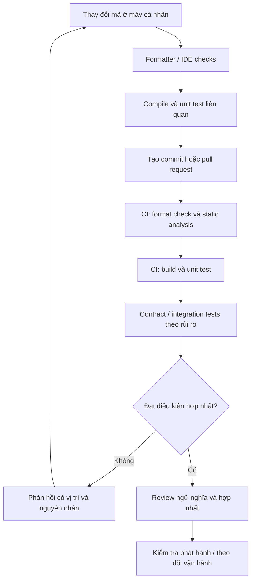
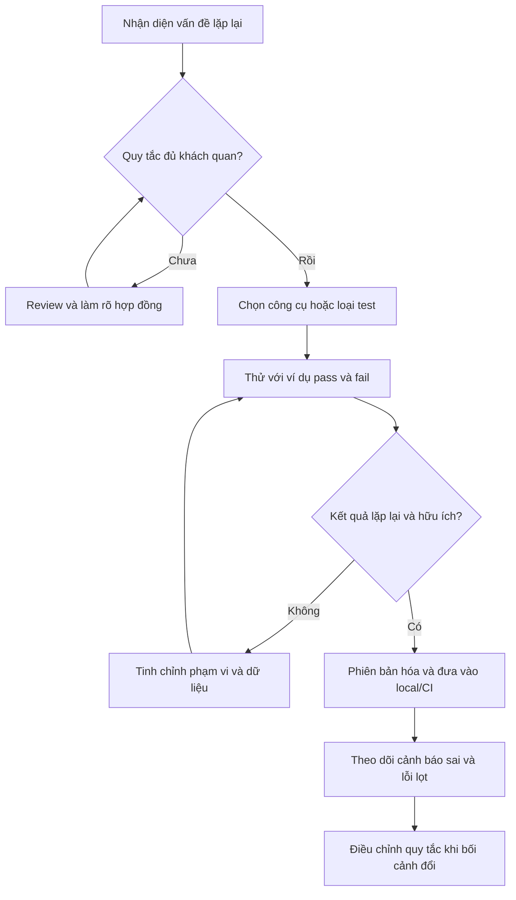

# Tự động hóa những kiểm tra rõ ràng và lặp lại được

## 1. Vì sao tính nhất quán không nên phụ thuộc vào trí nhớ người review?

Một nhóm Java có thể thống nhất rằng mã nguồn phải có tên rõ nghĩa, định dạng nhất quán, kiểm tra đầu vào và kiểm thử cho các trường hợp biên. Tuy nhiên, nếu mọi pull request đều phải chờ một người nhắc “thiếu dấu xuống dòng”, “import sai thứ tự”, “test này chưa chạy” hoặc “đã vô tình bỏ kiểm tra giá trị âm”, quy ước sẽ khó được duy trì khi nhóm lớn lên.

Trong module `CODE_QUALITY_FUNDAMENTALS`, mục tiêu là **hiểu những thuộc tính quyết định mã nguồn có đáng tin cậy, dễ hiểu và dễ thay đổi hay không**. Bài thuộc chương **Quy ước và nhất quán** này tập trung vào nguyên tắc: **những điều rõ ràng, có thể mô tả thành quy tắc và kiểm tra lặp lại được nên được tự động hóa ở mức hợp lý**.

Tự động hóa giúp ba việc:

- **Đáng tin cậy hơn:** mỗi thay đổi đi qua cùng những kiểm tra quan trọng; không phụ thuộc người review hôm đó có nhớ một điều kiện biên hay không.
- **Dễ hiểu hơn:** định dạng và các quy ước máy móc nhất quán giúp người đọc tập trung vào ý nghĩa nghiệp vụ thay vì khác biệt trình bày.
- **Dễ thay đổi hơn:** phản hồi kiểm tra nhanh và có thể chạy lại giúp refactor nhỏ, review và sửa hồi quy có kiểm soát.

Nhưng không phải mọi thuộc tính chất lượng đều chuyển thành một luật máy được. Một formatter không biết quy tắc tính thuế có đúng không; test xanh không chứng minh hệ thống không có race condition; công cụ phân tích tĩnh có thể cảnh báo sai hoặc bỏ sót lỗi. Vì thế, mục tiêu không phải “tự động hóa mọi thứ”, mà là **đưa các kiểm tra khách quan, lặp lại được về một nơi đáng tin; dành thời gian review con người cho ý định, rủi ro và đánh đổi**.

Sau bài học, bạn có thể xác định kiểm tra nào phù hợp để tự động hóa, phân biệt các lớp kiểm tra, thiết kế quy tắc có thể chạy ở máy cá nhân và CI, viết ví dụ kiểm thử Java tại giá trị biên, xử lý cảnh báo giả và triển khai dần bộ kiểm tra trong codebase cũ.

## 2. Thế nào là kiểm tra “rõ ràng và lặp lại được”?

Một quy tắc phù hợp để tự động hóa nên trả lời được:

1. **Đúng/sai được định nghĩa thế nào?** Có một kết quả mong đợi đủ rõ để hai người áp dụng giống nhau không?
2. **Đầu vào có xác định được không?** Tệp, code, cấu hình, dữ liệu kiểm thử hoặc môi trường nào được sử dụng?
3. **Kết quả có tái lập được không?** Cùng phiên bản công cụ và cùng điều kiện có cho ra kết luận nhất quán không?
4. **Khi sai có phản hồi hành động được không?** Người sửa có biết tệp, vị trí, quy tắc bị vi phạm và cách xử lý không?
5. **Chi phí có tương xứng không?** Thời gian chạy, tỷ lệ báo sai và công duy trì có nhỏ hơn lợi ích bảo vệ chất lượng không?

Ví dụ:

| Quy tắc đề xuất | Có thể tự động hóa? | Cách kiểm tra phù hợp |
| --- | --- | --- |
| Mọi tệp Java phải tuân theo một kiểu định dạng thống nhất | **Có** | Formatter và kiểm tra format |
| Không để import không sử dụng | **Có trong phạm vi công cụ hỗ trợ** | Compiler warning, IDE, static analyzer |
| Không được sửa một public API làm hỏng caller cũ | **Một phần** | Kiểm tra tương thích API, contract test và review |
| Đúng ngưỡng 200.00 phải được miễn phí giao tiêu chuẩn | **Có nếu quy tắc đã xác nhận** | Unit test với giá trị biên |
| Không có thanh toán trùng khi timeout và retry | **Có thể kiểm tra nhiều phần** | Integration/failure/concurrency test và đối soát |
| Tên biến “đủ hay” trong mọi ngữ cảnh | **Không hoàn toàn** | Quy ước đặt tên + review theo miền nghiệp vụ |
| Kiến trúc này có đơn giản nhất trong bối cảnh thật không? | **Không hoàn toàn** | Review, dữ liệu thay đổi thực và quyết định thiết kế |
| Lớp miền nghiệp vụ không được tham chiếu package adapter | **Có nếu ranh giới được định nghĩa rõ** | Rule kiểm tra phụ thuộc/kiến trúc |
| Mọi endpoint đều có mức xử lý lỗi phù hợp | **Một phần** | Contract test, lint, test lỗi và review |
| Mọi thay đổi đều có lý do hợp lý | **Không thể suy ra từ số rule pass** | Review quyết định và tác động |

Quy tắc kiểu “class nào cũng phải ngắn hơn 200 dòng” **có thể đếm tự động**, nhưng không mặc nhiên là quy tắc chất lượng tốt. Nó có thể khiến lập trình viên chia một thuật toán dễ hiểu thành nhiều phương thức vô nghĩa chỉ để qua cổng kiểm tra. **Có thể đo được không đồng nghĩa nên biến thành điều kiện bắt buộc**.

## 3. Bốn nhóm kiểm tra và điều chúng thực sự bảo vệ

### 3.1. Định dạng và quy ước cơ học

Các kiểm tra như thụt lề, vị trí dấu ngoặc, khoảng trắng, thứ tự import, newline cuối tệp và bố cục code có tính lặp lại cao. Đây là nơi automation đem lại lợi ích dễ nhận thấy: sau khi chọn quy ước, máy thực hiện nhất quán thay người.

- **Formatter** chủ động biến đổi code sang một định dạng thống nhất.
- **Format check** chỉ kiểm tra code có tuân thủ định dạng đã chọn không.
- **Lint/style checks** phát hiện những quy tắc khác, chẳng hạn tên không theo quy ước hoặc hạn chế import wildcard, tùy công cụ.

Một số ví dụ công cụ trong hệ sinh thái Java: Google Java Format, Spotless để tích hợp định dạng vào build, Checkstyle cho quy tắc trình bày và nhất quán. Mỗi công cụ có phạm vi và cấu hình riêng; không nên giả định mọi loại quy tắc đều có trong mọi công cụ.

**Điểm quan trọng:** một formatter giúp giảm tranh luận về hình thức, không sửa thuật toán. Trong trường hợp hiếm công cụ làm thay đổi code theo cách không mong muốn hoặc phiên bản mới đổi quy tắc, vẫn cần kiểm tra diff và giữ phiên bản công cụ phù hợp.

### 3.2. Compiler, phân tích tĩnh và lỗi tiềm ẩn

Compiler Java phát hiện lỗi kiểu dữ liệu, ký hiệu hoặc cấu trúc cú pháp không hợp lệ. Các công cụ như Error Prone, SpotBugs, PMD hoặc những quy tắc static analysis có thể phát hiện thêm mẫu rủi ro trong code.

Ví dụ một cảnh báo có thể liên quan đến:

- Nullability hoặc dereference đáng nghi.
- Sử dụng kết quả của một phương thức sai hợp đồng.
- Trạng thái mutable toàn cục.
- Cấu trúc điều kiện hoặc đoạn code không thể tới.
- Resource có nguy cơ không được đóng.
- Mẫu dùng API đã lỗi thời hoặc không an toàn.

**Cảnh báo phân tích tĩnh là tín hiệu, không phải chứng minh:** công cụ có thể báo sai do thiếu ngữ cảnh và có thể bỏ sót lỗi nghiệp vụ. Không nên tuyên bố “không có bug” chỉ vì không còn cảnh báo.

### 3.3. Kiểm thử hành vi

Unit test, contract test, integration test và regression test giúp kiểm tra đầu vào/đầu ra, tác dụng phụ và các bất biến đã được xác định. Chúng có khả năng bắt lỗi mà formatter không thể nhìn ra.

Ví dụ, dấu so sánh `>` thay vì `>=` có thể hoàn toàn hợp lệ theo Java và mọi quy tắc style, nhưng sai tại giá trị biên. Test với dữ liệu đúng bằng ngưỡng mới bảo vệ hành vi.

### 3.4. Kiểm tra kiến trúc, phụ thuộc và ranh giới vận hành

Khi nhóm đã có quy tắc kiến trúc rõ, có thể tự động xác minh các ràng buộc như “package miền nghiệp vụ không phụ thuộc vào adapter hạ tầng” hoặc “không thêm dependency bị cấm”. Công cụ như ArchUnit có thể kiểm tra quan hệ class/package trong Java; các quy trình build có thể kiểm tra dependency, metadata hoặc cấu hình.

Một số kiểm tra về bảo mật, license hay dependency có lỗ hổng cần dữ liệu/cơ sở quy tắc thường xuyên cập nhật. Chúng hữu ích nhưng **không nhất thiết hoàn toàn tái lập từng byte theo thời gian** nếu nguồn cảnh báo bên ngoài đổi. Muốn có kết luận có thể kiểm tra lại, cần ghi phiên bản dữ liệu quét, công cụ và thời điểm.

## 4. Phân biệt “máy nên làm” với “người nên xem”

Tự động hóa hiệu quả không khiến người review trở nên thừa. Nó phân chia lại trách nhiệm.

| Vấn đề | Ưu tiên máy kiểm | Người review còn phải đánh giá |
| --- | --- | --- |
| Dấu ngoặc, indent, format import | Formatter/check | Không cần tranh luận thẩm mỹ khi đã thống nhất |
| Compile được trên Java mục tiêu | Compiler/build | Có dùng đúng tính năng và hợp đồng runtime không |
| Test ngưỡng phí giao hàng | Unit test | Ngưỡng đã đúng theo nghiệp vụ hiện tại chưa |
| Package vi phạm hướng phụ thuộc | Architecture test | Ranh giới kiến trúc hiện tại còn phù hợp không |
| Một cảnh báo nullability | Static analyzer | Điều kiện thực, false positive và hợp đồng dữ liệu |
| Query có biểu hiện N+1 | Monitoring, integration/profiling | Có cần đổi truy vấn theo tải và độ nhất quán thật không |
| Tên phương thức gây hiểu lầm | Một phần qua quy ước | Ý nghĩa nghiệp vụ và tác dụng phụ thực tế |
| Thuật toán xử lý an toàn khi timeout | Failure test ở các tình huống đã mô hình | Phạm vi bảo đảm, trạng thái chưa xác định, phục hồi |
| Abstraction có quá mức không | Một vài tín hiệu complexity | Tần suất thay đổi và chi phí hiểu trong bối cảnh thật |

Một cách viết quy tắc review có ích là: **“Nếu một kiểm tra có thể diễn đạt chính xác và có công cụ đáng tin để chạy lặp lại, hãy đưa vào automation; nếu nó cần suy luận về ý định và đánh đổi, hãy để review con người đảm nhận với bằng chứng phù hợp.”**

Điều này không có nghĩa đánh giá của con người là tùy tiện. Review vẫn nên dựa trên câu hỏi cụ thể, ví dụ tình huống lỗi nào chưa được mô hình, phụ thuộc nào gây rủi ro và hợp đồng nào có thể bị phá.

## 5. Từ thỏa thuận nhóm đến quy tắc có thể thực thi

Một quy ước miệng như “mọi người nhớ format trước khi commit” thường không đủ. Để tự động hóa, cần biến nó thành hành vi có thể kiểm tra.

### 5.1. Chọn phạm vi và một nguồn cấu hình chung

Ví dụ nhóm chọn một formatter Java cho toàn bộ module. Từ đó cần quyết định:

- Những phần nào được format: chỉ `src/main/java`, cả test hay mọi tệp Java?
- Phiên bản formatter và các công cụ liên quan được xác định ở đâu?
- Dùng line endings, encoding và quy tắc import nào?
- Máy cá nhân và CI chạy cùng cấu hình hay không?
- Khi nâng phiên bản formatter, ai review thay đổi toàn bộ code?
- Có cách chạy chỉ kiểm tra mà không tự sửa file trên CI không?

Không để mỗi người tự chọn cách format trong IDE rồi coi sự khác nhau là “gu cá nhân”. Mục tiêu nhất quán đạt được khi **cấu hình được chia sẻ và cùng được thực thi**.

### 5.2. Lưu quy tắc cùng phiên bản code

Quy tắc nên sống trong repository hoặc trong một cơ chế cấu hình có phiên bản rõ. Nếu chỉ có bản sao trong wiki, pipeline vẫn có thể chạy quy tắc cũ còn tài liệu nói quy tắc mới.

Quy tắc cũng nên có **người sở hữu** và cách thay đổi minh bạch. Một lần nâng công cụ có thể tạo hàng nghìn thay đổi format; hãy tách thay đổi cơ học khỏi sửa nghiệp vụ để diff dễ review và giảm nguy cơ xung đột.

### 5.3. Phản hồi phải hành động được

Thông báo:

```text
Quality gate failed.
```

ít giá trị hơn:

```text
Format check: src/main/java/.../InvoiceService.java
  Dòng 42 không khớp formatter được cấu hình.
  Chạy tác vụ định dạng của dự án ở máy cá nhân.
```

Một kiểm tra tốt nên giải thích **điều kiện vi phạm, vị trí, cách tái hiện và hướng xử lý**. Với static analysis, có thể bổ sung rule ID và tài liệu về lý do quy tắc tồn tại.

## 6. Tự động hóa format để loại bỏ tranh luận không tạo giá trị

Xét hai cách viết Java tương đương về cú pháp:

```java
if (ready) {doWork();}
```

```java
if (ready) {
    doWork();
}
```

Một nhóm có thể chọn cách thứ hai và để formatter áp dụng. Sau khi quyết định, việc review từng dấu cách không còn là cách sử dụng thời gian hiệu quả.

Những lợi ích thường thấy:

1. **Diff nhất quán:** một thay đổi nhỏ không đồng thời sinh ra rất nhiều thay đổi thụt lề do công cụ mỗi người khác nhau.
2. **Giảm tranh luận:** ý kiến review tập trung vào nghiệp vụ, trách nhiệm và kiểm thử.
3. **Onboarding dễ hơn:** người mới không cần học bằng cách nhận hàng chục góp ý format.
4. **Có thể sửa tự động:** nhiều vi phạm được giải quyết trước khi mở PR.

Tuy vậy, autoformat không nên chạy âm thầm để sửa mọi thứ trong CI rồi chỉ báo “pass”. Cách rõ ràng hơn là **format khi phát triển**, còn CI **kiểm tra commit đã đúng định dạng**. Nếu CI tự sửa nhưng không đưa sửa đổi vào commit đang review, bản được kiểm tra có thể khác bản được phát hành.

### 6.1. Phân biệt format và ý nghĩa API

Việc đổi khoảng trắng, thụt lề hay bố cục thường không đổi hành vi Java. Nhưng tự động “dọn code” rộng hơn, như đổi kiểu dữ liệu, xóa import có tác dụng xử lý annotation bất thường, thay tên public method hoặc đổi cấu trúc điều kiện, cần đánh giá theo tác động thực tế. Đừng đánh đồng mọi tác vụ “auto-fix” với formatter thuần.

### 6.2. Quy tắc càng nhỏ càng dễ thống nhất

Một quy tắc như “mọi tệp Java dùng cùng formatter đã cấu hình” dễ xác minh. Một quy tắc như “mọi phương thức phải thể hiện trọn vẹn Clean Code” quá mơ hồ để áp dụng bằng một linter. Hãy chia thành quy tắc cơ học rõ và câu hỏi review cần suy luận, tránh công cụ hóa khẩu hiệu.

## 7. Ví dụ Java: một lỗi nghiệp vụ chỉ test mới phát hiện được

Một hệ thống giao hàng tiêu chuẩn có quy tắc giả định: nếu tổng tiền hàng **từ 200.00 trở lên**, khách được miễn phí giao hàng; nếu thấp hơn, phí là 30.00. Tổng tiền không được âm và được tính theo cùng đơn vị tiền tệ.

Phiên bản dưới đây hợp lệ về cú pháp và có thể hoàn toàn đạt formatter, nhưng **cố ý chứa bug** tại ngưỡng:

```java
import java.math.BigDecimal;
import java.util.Objects;

public final class ShippingFeePolicy {
    private static final BigDecimal FREE_THRESHOLD =
            new BigDecimal("200.00");
    private static final BigDecimal STANDARD_FEE =
            new BigDecimal("30.00");

    private ShippingFeePolicy() {}

    public static BigDecimal feeFor(BigDecimal merchandiseSubtotal) {
        Objects.requireNonNull(merchandiseSubtotal, "merchandiseSubtotal");
        if (merchandiseSubtotal.signum() < 0) {
            throw new IllegalArgumentException("Subtotal must be non-negative");
        }

        // BUG: so sánh > thay vì >= tại đúng ngưỡng.
        if (merchandiseSubtotal.compareTo(FREE_THRESHOLD) > 0) {
            return BigDecimal.ZERO;
        }
        return STANDARD_FEE;
    }
}
```

Trên đầu vào `200.00`, `compareTo` trả 0, điều kiện `> 0` sai, nên trả 30.00. Không có quy tắc format hoặc import nào buộc phải hiểu nghiệp vụ miễn phí tại ngưỡng. Vì thế cần kiểm thử hành vi.

### 7.1. Viết JUnit 5 bảo vệ giá trị biên

```java
import static org.junit.jupiter.api.Assertions.*;

import java.math.BigDecimal;
import org.junit.jupiter.api.Test;

class ShippingFeePolicyTest {
    @Test
    void chargesStandardFeeBelowThreshold() {
        BigDecimal result =
                ShippingFeePolicy.feeFor(new BigDecimal("199.99"));

        assertEquals(0, result.compareTo(new BigDecimal("30.00")));
    }

    @Test
    void makesShippingFreeAtExactThreshold() {
        BigDecimal result =
                ShippingFeePolicy.feeFor(new BigDecimal("200.00"));

        assertEquals(0, result.compareTo(BigDecimal.ZERO));
    }

    @Test
    void makesShippingFreeAboveThreshold() {
        BigDecimal result =
                ShippingFeePolicy.feeFor(new BigDecimal("200.01"));

        assertEquals(0, result.compareTo(BigDecimal.ZERO));
    }

    @Test
    void rejectsNegativeSubtotal() {
        assertThrows(IllegalArgumentException.class,
                () -> ShippingFeePolicy.feeFor(new BigDecimal("-0.01")));
    }

    @Test
    void rejectsNullSubtotal() {
        assertThrows(NullPointerException.class,
                () -> ShippingFeePolicy.feeFor(null));
    }
}
```

Bộ test này dùng `BigDecimal.compareTo` để kiểm tra giá trị số học độc lập với `scale`. Nếu yêu cầu nghiệp vụ còn quy định scale/định dạng tiền, cần kiểm tra riêng, không được bỏ qua. `assertEquals` cho biến đếm `compareTo` bằng 0 là **bằng chứng về giá trị kỳ vọng**, không phải benchmark hay kết luận về mọi trường hợp.

### 7.2. Từ test đỏ đến bản sửa

Ở phiên bản lỗi, ca `makesShippingFreeAtExactThreshold` **dự kiến đỏ**. Thay đổi tối thiểu:

```diff
- if (merchandiseSubtotal.compareTo(FREE_THRESHOLD) > 0) {
+ if (merchandiseSubtotal.compareTo(FREE_THRESHOLD) >= 0) {
      return BigDecimal.ZERO;
  }
```

Sau khi sửa, tất cả ca trong ví dụ **dự kiến xanh** nếu môi trường Java/JUnit được cấu hình đúng. Không có lệnh build nào được chạy trong bài viết này; đây là mã minh họa để người học thực hiện. Trong dự án thật, một bug được coi là có regression test khi test đã được chạy, thấy lỗi cũ bị bắt đúng nguyên nhân, và xác nhận bản sửa đạt yêu cầu.

### 7.3. Từng kiểm tra trả lời câu hỏi khác nhau

| Kiểm tra | Có phát hiện lỗi ngưỡng? | Vai trò |
| --- | --- | --- |
| Formatter | Không | Định dạng nhất quán |
| Java compiler | Không | Chữ ký, kiểu dữ liệu và cú pháp hợp lệ |
| Static analyzer thông thường | Không thể mặc định là có | Các mẫu rủi ro mà công cụ nhận biết |
| Unit test tại 200.00 | **Có trong ví dụ này** | Bảo vệ quy tắc ngưỡng theo nghiệp vụ |
| Integration test của API | Có thể, nếu dựng đúng dữ liệu và assertion | Kiểm tra đường đi qua các ranh giới thật |
| Review nghiệp vụ | Có thể phát hiện nguồn sai trong yêu cầu và code | Xác nhận ý nghĩa và hậu quả |

Một hệ thống tốt cần **nhiều lớp bằng chứng phù hợp**, không kỳ vọng một công cụ duy nhất đại diện cho toàn bộ chất lượng mã.

## 8. Thiết kế chuỗi kiểm tra trong vòng đời thay đổi

Các kiểm tra cần xuất hiện vào đúng thời điểm. Nếu chỉ chạy ở cuối release, chi phí sửa lỗi lớn và feedback chậm. Nếu mọi lần gõ ký tự đều chạy toàn bộ end-to-end suite, người phát triển sẽ mất thời gian và có thể tránh dùng công cụ.

Một cấu trúc thường hữu ích:



Sơ đồ là một ví dụ tổ chức, không phải yêu cầu cứng rằng mọi dự án đều chạy các bước này theo thứ tự chính xác. Một số kiểm tra độc lập có thể chạy song song trong CI để giảm thời gian phản hồi; các kiểm tra nặng có thể chạy theo lịch hoặc theo vùng thay đổi khi vẫn giữ được độ bảo vệ cần thiết.

### 8.1. Local checks: phản hồi nhanh, ít phụ thuộc

Những kiểm tra phù hợp khi phát triển:

- Formatter áp dụng bằng lệnh của dự án hoặc tích hợp IDE.
- Compile cơ bản và unit test cho vùng code đang thay đổi.
- Lint/static checks chạy đủ nhanh cho vòng lặp thường xuyên.
- Pre-commit hook nếu nhóm thấy hữu ích, nhưng **không coi hook cục bộ là hàng rào cuối** vì người dùng có thể bỏ qua hoặc không cài hook.

Tốt nhất là developer có thể chạy **cùng quy tắc với CI** bằng một hoặc vài lệnh đã tài liệu hóa. Không yêu cầu nhớ từng cấu hình máy cá nhân.

### 8.2. CI checks: nguồn xác nhận chung

CI nên chạy trên nội dung commit/PR chính xác với cấu hình kiểm tra có phiên bản. Nó không nên phụ thuộc vào việc một người đã chạy hook hay IDE plugin chưa. Kết quả được dùng làm điều kiện hợp nhất cần ghi rõ bước thất bại và cung cấp log chẩn đoán.

Một pipeline khái niệm:

```text
1. Checkout đúng revision của pull request.
2. Chuẩn bị JDK và công cụ/build wrapper theo cấu hình dự án.
3. Kiểm tra định dạng và quy tắc cơ học.
4. Biên dịch, chạy unit tests và static analysis.
5. Chạy contract/integration tests cần thiết.
6. Tập hợp kết quả, chỉ cho phép hợp nhất khi điều kiện bắt buộc đạt.
7. Lưu báo cáo kiểm thử hoặc artifact phục vụ điều tra khi cần.
```

Với dự án Gradle **đã cấu hình** Spotless và Java tests, một ví dụ lệnh cho người phát triển có thể là:

```bash
./gradlew spotlessCheck test
```

`spotlessCheck` **không phải tác vụ có sẵn của mọi dự án Gradle**; nó chỉ tồn tại khi plugin và cấu hình phù hợp đã được thiết lập. Trên Windows PowerShell, người dùng thường chạy `.\gradlew.bat spotlessCheck test`. Có thể dùng Maven hoặc công cụ khác nếu đó là hệ thống build của dự án; điều quan trọng là **cùng một hợp đồng kiểm tra**, không phải chọn công nghệ theo thói quen.

## 9. Tính lặp lại: cùng code chưa chắc đã cho kết quả giống nhau

Một kiểm tra đáng tin cần tính đến những nguồn khác nhau giữa máy phát triển và CI.

| Nguồn khác biệt | Hậu quả | Cách kiểm soát |
| --- | --- | --- |
| JDK khác phiên bản | Compile hoặc hành vi library khác | Xác định phiên bản Java mục tiêu và toolchain |
| Plugin/checker khác phiên bản | Rule mới hoặc định dạng khác | Khóa phiên bản dependency/plugin hợp lý |
| Locale và timezone mặc định | Test ngày/định dạng số lúc xanh lúc đỏ | Truyền `Clock`, `ZoneId` hoặc `Locale` theo hợp đồng |
| Encoding và line endings | Diff thừa hoặc lỗi giải mã | Dùng UTF-8, quy tắc newline và công cụ thống nhất |
| Thời gian hiện tại | Test deadline đổi theo giờ chạy | Dùng đồng hồ cố định trong unit test |
| Thứ tự test và shared state | Chạy riêng xanh, chạy suite đỏ | Cô lập fixture và reset trạng thái |
| Mạng, database, dịch vụ ngoài | Timeout, rate limit hoặc dữ liệu thay đổi | Unit test dùng test double; integration test dùng môi trường kiểm soát |
| Concurrency và timing | Test ngẫu nhiên thất bại | Dùng đồng bộ thích hợp, tránh `Thread.sleep` tùy tiện |
| Phụ thuộc tải nền | Benchmark/CI không ổn định | Ghi điều kiện tải và phân loại test hiệu năng riêng |

### 9.1. “Deterministic” là mục tiêu phù hợp với từng lớp kiểm tra

Formatter chạy trên cùng cấu hình thường có thể cho kết quả xác định. Unit test của một hàm thuần với input cố định cũng thường như vậy. Nhưng test concurrency hoặc hệ thống phân tán có thể vẫn không phủ mọi lịch thực thi dù được tổ chức cẩn thận.

Không nên diễn giải “có CI xanh” thành “mọi khả năng đều đã được kiểm tra”. Tính lặp lại giúp **tin vào tín hiệu quan sát**, còn mức bao phủ và giá trị của tín hiệu là câu hỏi khác.

### 9.2. Khóa cấu hình, nhưng cũng phải nâng cấp có kế hoạch

Giữ mãi một phiên bản tool vì sợ thay đổi sẽ bỏ lỡ sửa lỗi hoặc quy tắc mới. Ngược lại, nâng tự động không review có thể làm pipeline đỏ hàng loạt. Cách thực dụng là:

1. Chốt phiên bản công cụ trong cấu hình có thể review.
2. Nâng phiên bản bằng thay đổi riêng khi cần.
3. Đọc thay đổi quy tắc và kiểm tra false positives.
4. Chạy trên codebase và xem diff/diagnostic.
5. Chốt quyết định áp dụng, hoãn hoặc điều chỉnh rule theo lý do có căn cứ.

## 10. Khi kiểm tra báo sai: triage, severity và ngoại lệ có kiểm soát

Một bộ kiểm tra chỉ có ích khi người phát triển **tin rằng cảnh báo phản ánh rủi ro cần xử lý**. Nếu công cụ liên tục đưa ra hàng trăm cảnh báo không liên quan, nhóm có thể bỏ qua tất cả, kể cả vấn đề nghiêm trọng.

### 10.1. Phân biệt các tình huống

- **Vi phạm thật:** quy tắc phù hợp và code thực sự sai; sửa code hoặc hợp đồng.
- **False positive:** công cụ hiểu nhầm một hành vi hợp lệ; cần xác minh và ghi lại lý do.
- **Quy tắc không phù hợp:** quy tắc có thể phát hiện điều thật nhưng bắt buộc nó làm tăng chi phí mà không đem lại lợi ích cho dự án.
- **Lỗi cấu hình hoặc môi trường:** tool không chạy đúng, không phân tích đủ mã hoặc sai runtime.
- **Nợ cũ:** vi phạm tồn tại từ lâu và chưa đủ nguồn lực sửa toàn bộ ngay.

Không phải cứ rule fail là “công cụ sai”; cũng không phải cứ rule pass thì hành vi đúng. Trước khi tắt rule, cần hiểu nó bảo vệ điều gì.

### 10.2. Cách xử lý ngoại lệ

Nếu một cảnh báo được xác nhận là false positive hoặc một ngoại lệ chấp nhận được, có thể dùng suppression hẹp với lý do rõ:

```java
// Ví dụ khái niệm: chỉ suppress đúng rule đã được phân tích,
// ghi vì sao đoạn này là ngoại lệ và test nào bảo vệ hợp đồng.
// @SuppressWarnings("specific-rule-id")
```

Đây **không phải** một annotation có rule ID cụ thể để sao chép nguyên vào code; cú pháp và phạm vi suppression phụ thuộc công cụ đang dùng. Đừng suppress cả package hoặc tắt mọi cảnh báo chỉ vì một trường hợp đặc biệt. Đặc biệt tránh cấu hình “ignore all” làm mất tín hiệu cho các thay đổi về sau.

Một suppression có chất lượng nên xác định: rule bị bỏ qua, vì sao được chấp nhận, phạm vi nhỏ nhất và điều kiện xem lại. Đối với vấn đề bảo mật hoặc dữ liệu, cần đánh giá hậu quả trước khi chấp nhận.

## 11. Áp dụng bộ kiểm tra vào codebase cũ mà không chặn toàn bộ công việc

Một repository tồn tại nhiều năm có thể có hàng nghìn cảnh báo format, lint hoặc static analysis. Bật mọi quy tắc mới với chế độ fail toàn bộ ngay lập tức có thể khiến không PR nào được merge, dù phần lớn lỗi nằm ở mã không liên quan.

Một lộ trình **tăng dần**:

| Giai đoạn | Công việc | Mục tiêu |
| --- | --- | --- |
| 1. Khảo sát | Chạy công cụ ở chế độ báo cáo, nhóm loại vi phạm | Hiểu quy mô và độ chính xác |
| 2. Chọn quy tắc | Bắt đầu từ quy tắc có lợi ích rõ, ít báo sai | Tín hiệu đáng tin |
| 3. Khóa baseline | Ghi nhận nợ hiện có theo cách công cụ hỗ trợ | Không phát sinh vi phạm mới |
| 4. Áp dụng cho mã thay đổi | Kiểm tra trên vùng thay đổi hoặc toàn bộ nhưng so với baseline | Không chặn chỉ vì nợ cũ không liên quan |
| 5. Sửa nợ theo rủi ro | Ưu tiên lỗi nguy hiểm và vùng thay đổi thường xuyên | Giảm rủi ro thực tế |
| 6. Siết dần điều kiện | Thu hẹp baseline hoặc nâng mức nghiêm ngặt | Đạt quy ước chung lâu dài |

Đây là một chiến lược có điều kiện, không phải lời khuyên chấp nhận nợ kỹ thuật vô hạn. Những cảnh báo liên quan đến lỗ hổng, mất dữ liệu hoặc tính đúng đắn nghiêm trọng có thể cần xử lý ngay dù nằm trong mã cũ.

### 11.1. Tránh PR format trộn lẫn với sửa logic

Một PR vừa autoformat hàng nghìn dòng vừa sửa quy tắc thanh toán sẽ rất khó review. Nếu quyết định chuẩn hóa format toàn repository, nên tách thành thay đổi cơ học riêng, có kiểm tra build/test tương ứng và lịch phù hợp để giảm xung đột với các nhánh đang làm.

Sau đó, các PR nghiệp vụ sẽ có diff ít nhiễu hơn. Tuy nhiên, một đợt format tự động rộng cũng cần xem tác động đến generated code, cấu hình công cụ và những chỗ có cú pháp đặc biệt.

### 11.2. Cải thiện quy tắc dựa trên phản hồi

Nếu một rule bị suppress ở nhiều nơi với cùng một lý do chính đáng, có thể bản thân rule chưa hợp ngữ cảnh. Hãy xem lại dữ liệu báo sai và chi phí phát sinh, thay vì mặc định người phát triển thiếu kỷ luật.

## 12. Chọn quality gate theo hậu quả và tốc độ phản hồi

Một **quality gate** là tập điều kiện mà thay đổi phải đáp ứng trước một mốc, ví dụ trước khi merge hoặc trước phát hành. Gate tốt nên bảo vệ các rủi ro quan trọng nhưng không khiến mọi thao tác nhỏ bị chặn bởi kiểm tra không phù hợp.

### 12.1. Phân tầng mức độ bắt buộc

| Kiểm tra | Ví dụ chính sách | Lý do |
| --- | --- | --- |
| Compile / lỗi cấu trúc | Bắt buộc ở mọi PR có Java | Không thể bàn giao code không build theo mục tiêu |
| Format đã thống nhất | Bắt buộc ở PR thay đổi mã được quản lý | Tránh tranh luận cơ học |
| Unit test liên quan | Bắt buộc khi có logic liên quan | Chặn hồi quy sớm |
| Static analysis mức nghiêm trọng cao | Bắt buộc sau khi xác nhận rule phù hợp | Tránh rủi ro rõ |
| Contract/integration test | Theo thay đổi và phạm vi rủi ro, hoặc theo policy chung | Bảo vệ tương tác thật |
| Kiểm tra hiệu năng chuyên sâu | Khi chạm đường nóng hoặc có kế hoạch chạy riêng | Đo đúng workload, tránh test chậm thiếu giá trị |
| Phân tích bảo mật/dependency | Theo mức rủi ro và quy trình bảo mật | Không bỏ qua vấn đề trọng yếu dù code đúng style |

Bảng này là ví dụ, không phải một chuẩn bắt buộc áp dụng cho mọi dự án. Một hệ thống tài chính chịu rủi ro cao có thể có gate nghiêm hơn. Một thư viện nhỏ có thể cần pipeline đơn giản hơn nhưng vẫn giữ compiler, test và các bảo đảm hợp đồng quan trọng.

### 12.2. Đừng biến quality score thành mục tiêu thay cho chất lượng

Những chỉ số như coverage, số cảnh báo, độ dài phương thức hay số dòng được format có thể hỗ trợ giám sát. Nhưng nếu bắt “coverage 100%” bằng mọi giá, lập trình viên có thể viết test không có assertion có nghĩa hoặc kiểm tra implementation thay vì hợp đồng.

Một test về thanh toán trùng sau timeout có thể quan trọng hơn hàng chục test chỉ kiểm tra getter. Vì vậy, gate nên bảo vệ **rủi ro đáng kể và bằng chứng đáng tin**, không chỉ điểm số bề ngoài.

### 12.3. Khi kiểm tra mất ổn định

Nếu pipeline đỏ vì một flaky test, cần xác định nguyên nhân và sửa tính bất định. Có thể cô lập tạm thời theo chính sách có người chịu trách nhiệm và thời hạn khắc phục, nhưng không được báo các lần chạy lại xanh là bằng chứng rằng lỗi production đã biến mất.

Một cổng kiểm tra liên tục báo sai sẽ khiến nhóm bỏ qua cả những cảnh báo đúng; **độ tin cậy của gate cũng là một thuộc tính cần được quản lý**.

## 13. Theo dõi chất lượng của chính quá trình tự động hóa

Một bộ kiểm tra không nên chỉ được đánh giá bằng số công cụ đã cài. Hãy quan sát nó có tạo phản hồi hữu ích và phát hiện vấn đề thực hay không.

| Chỉ số hoặc quan sát | Câu hỏi cần trả lời | Giới hạn |
| --- | --- | --- |
| Thời gian feedback của CI | Người sửa có nhận kết quả đủ sớm để hành động không? | Nhanh chưa chắc phát hiện đủ lỗi |
| Tỷ lệ fail do lỗi thật | Gate có bắt đúng những vi phạm đã định nghĩa không? | Cần phân loại false positive |
| Tỷ lệ flaky | Kết quả có đáng tin khi chạy lại không? | Một test đỏ có thể do nhiều nguyên nhân |
| Số cảnh báo mới trên code thay đổi | Có đang tạo nợ kỹ thuật mới không? | Số lượng không phản ánh mức độ nghiêm trọng |
| Bug lọt sau kiểm thử | Có đường đi quan trọng chưa được bảo vệ không? | Không suy nguyên nhân chỉ từ một vụ việc |
| Thời gian review dành cho format | Automation có giảm tranh luận cơ học không? | Khó đo chính xác; có thể khảo sát nhóm |
| Khả năng chạy local | Người phát triển có tái hiện cùng lỗi CI được không? | Còn phụ thuộc môi trường và dữ liệu |
| Chi phí duy trì rule | Rule có nhiều suppression và ngoại lệ không? | Đôi khi ngoại lệ hợp lý |

**Mục tiêu cuối cùng là chất lượng mã và khả năng làm việc của nhóm**, không phải tỷ lệ xanh của dashboard. Một pipeline luôn xanh vì đã tắt mọi test sẽ không hữu ích; một pipeline luôn đỏ vì rule mơ hồ cũng không hỗ trợ phát triển.

## 14. Quy trình thiết kế một kiểm tra tự động mới

Khi nhóm gặp một lỗi hoặc tranh cãi lặp đi lặp lại, có thể dùng trình tự:

1. **Mô tả vấn đề đã quan sát:** điều gì bị bỏ sót, xảy ra ở đâu, ảnh hưởng ra sao?
2. **Viết quy tắc khách quan:** điều kiện nào chính xác là vi phạm? Có thể tạo ví dụ đúng/sai không?
3. **Chọn loại bằng chứng:** formatter, lint, static check, unit/contract/integration test hay review?
4. **Kiểm tra dữ liệu và môi trường:** rule có cần đồng hồ, database, cấu hình hoặc phụ thuộc ngoài không?
5. **Tạo ca dương và âm:** xác nhận check fail khi vi phạm và pass khi hợp lệ, tránh rule luôn đỏ hoặc luôn xanh.
6. **Đo false positives và chi phí:** chạy thử trên một tập code đại diện, xem diagnostic có hành động được không.
7. **Phiên bản hóa cấu hình:** thống nhất công cụ, quy tắc và cách chạy local/CI.
8. **Đưa vào vòng thay đổi:** quyết định check chạy lúc nào, có block merge hay chỉ cảnh báo.
9. **Ghi cách xử lý ngoại lệ:** quy định suppression hẹp, lý do và cách xem lại.
10. **Quan sát rồi điều chỉnh:** nếu rule gây nhiễu hoặc bỏ sót lỗi thật, cập nhật bằng chứng và policy.

Ví dụ, sau một lần lỗi `>`/`>=` tại ngưỡng giao hàng, không cần viết static analyzer cấm mọi dấu `>` trong Java. **Quy tắc đúng là nghiệp vụ phải được kiểm tra tại ranh giới**; một unit test thích hợp hơn một luật cú pháp quá chung.

### Mô hình phản hồi



Không nhất thiết mọi kiểm tra nhỏ cần một dự án riêng. Nhưng với quality gate ảnh hưởng nhiều nhóm, các bước trên giúp tránh áp dụng một luật máy móc rồi chỉ phát hiện hệ quả khi workflow đã bị chặn.

## 15. Bài tập tình huống

### Bài 1 — Đưa tranh luận format về máy

Trong các PR, reviewer thường góp ý về indent, thứ tự import và vị trí dấu ngoặc. Hãy đề xuất một quy tắc formatter có cấu hình thống nhất, vị trí chạy local và CI, cách xử lý autoformat trong pull request, và lý do không để CI chỉ âm thầm sửa tệp rồi báo pass.

### Bài 2 — Một luật máy đếm được nhưng chưa chắc tốt

Nhóm muốn chặn mọi method dài hơn 20 dòng. Hãy phân tích vì sao rule này có thể tạo nhiều method nhỏ vô nghĩa, đưa ra dữ liệu cần xem trước khi bắt buộc, và phân biệt tín hiệu “nên review kỹ” với vi phạm chắc chắn.

### Bài 3 — Bug nghiệp vụ lọt qua formatter

Một hàm tính phí miễn phí giao hàng từ 200.00 nhưng dùng toán tử `>`. Formatter, compiler và lint đều pass. Hãy viết tên test, dữ liệu dưới/bằng/trên ngưỡng, assertion và giải thích vì sao không nên tự động cấm mọi điều kiện `>`.

### Bài 4 — CI chỉ đỏ trên một máy

Một test xử lý ngày đến hạn chạy xanh ở máy lập trình viên nhưng đỏ trên CI khi đổi múi giờ. Hãy xác định các dependency ẩn, đề xuất `Clock.fixed` hoặc tham số thời gian, chọn `ZoneId` đúng nghiệp vụ, và cách bảo đảm local/CI cùng nhận kết quả.

### Bài 5 — Một nghìn cảnh báo cũ

Dự án có 1.000 lỗi format và 200 cảnh báo static analysis trước khi bật gate mới. Hãy xây kế hoạch áp dụng dần, xử lý cảnh báo nghiêm trọng trước, tránh phát sinh vi phạm mới và thu hẹp baseline theo thời gian.

### Bài 6 — False positive và suppression

Công cụ cảnh báo một đoạn code có thể null nhưng nhóm chứng minh nó đã được kiểm tra ở ranh giới ổn định. Hãy nêu bằng chứng cần có, lựa chọn sửa kiểu/hợp đồng hoặc suppression hẹp, và cách review để không tắt kiểm tra toàn bộ project.

### Bài 7 — Đánh giá hiệu quả quality gate

Một pipeline mất 30 phút, nhưng gần như mọi cảnh báo đều là lỗi format; một số bug liên quan xử lý thanh toán vẫn lọt production. Hãy đề xuất phân tầng kiểm tra để phản hồi sớm hơn, giữ test rủi ro cao, và chọn chỉ số đánh giá chất lượng thật thay vì chỉ đếm rule.

### Bài 8 — Kiểm tra kiến trúc

Module miền nghiệp vụ không được biết SDK gửi email, nhưng nhiều lớp đang import trực tiếp thư viện đó. Hãy xác định ranh giới nghiệp vụ, rule phụ thuộc có thể kiểm tra tự động, adapter cần bổ sung và integration test xác nhận hành vi thật không đổi.

Với mỗi bài, hãy trình bày **quy tắc rõ → công cụ/lớp kiểm tra → dữ liệu pass/fail → cách chạy lặp lại → giới hạn và rủi ro còn lại**.

## 16. Ghi nhớ

- **Tự động hóa những điều rõ ràng và lặp lại được** giúp quy ước được áp dụng nhất quán, giảm phụ thuộc vào trí nhớ của người review.
- **Formatter, lint, compiler, static analysis và test không thay thế nhau.** Mỗi lớp bảo vệ một loại thuộc tính; tất cả đều có giới hạn.
- **Quy tắc phải có ý nghĩa:** một điều có thể đếm tự động chưa chắc là một quality gate tốt. Chọn điều kiện gắn với rủi ro và hợp đồng thực.
- **Kiểm tra phải tái hiện được:** phiên bản công cụ, JDK, cấu hình, dữ liệu, thời gian và môi trường cần được kiểm soát ở mức phù hợp.
- **Phản hồi phải hành động được:** báo vị trí, rule và lý do; không chỉ nói “quality failed”.
- **CI là điểm xác nhận chung, không phải nơi duy nhất phát hiện lỗi.** Chạy kiểm tra nhanh tại local, kiểm tra bắt buộc ở CI, kiểm tra tích hợp và vận hành theo mức rủi ro.
- **Đối xử nghiêm túc với false positives và flaky tests.** Một quy trình hay báo sai sẽ mất uy tín; không giải quyết bằng cách tắt hàng loạt cảnh báo.
- **Áp dụng dần cho code cũ:** ghi baseline, bảo vệ code mới, xử lý vi phạm nguy hiểm trước và giảm nợ kỹ thuật bằng kế hoạch.
- **Con người vẫn chịu trách nhiệm với ý định và đánh đổi.** Máy phát hiện một quy tắc đã định nghĩa có bị vi phạm hay không; người review quyết định quy tắc đó có đúng và đủ cho tình huống hay không.

Một hệ thống kiểm tra có chất lượng khiến người phát triển biết **điều gì sẽ được kiểm tra, vì sao nó quan trọng, cách tái hiện và cách sửa khi vi phạm**. Khi phần lặp lại đã được máy xử lý đáng tin cậy, nhóm có nhiều thời gian hơn để hiểu nghiệp vụ, đánh giá rủi ro và xây mã nguồn **đáng tin cậy, dễ hiểu, dễ thay đổi**.
