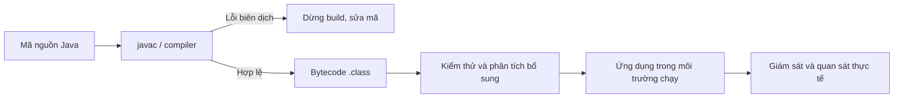
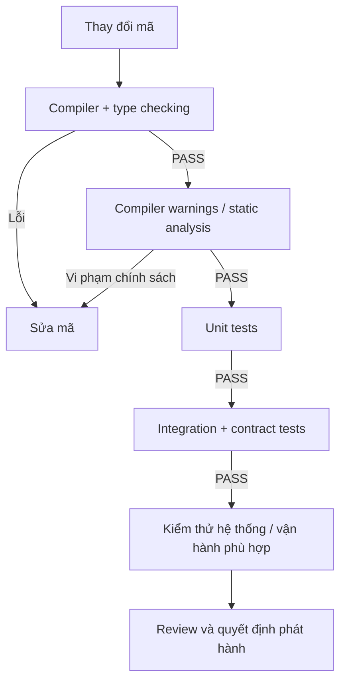

# Trình biên dịch và hệ kiểu như lớp kiểm tra đầu tiên

Một chương trình Java có thể chứa lỗi ngay trước khi chạy: gọi phương thức với tham số sai kiểu, trả về giá trị không tương thích, dùng tên biến chưa được khai báo hoặc cố gắng truy cập thành phần không được phép. Những lỗi này không nhất thiết phải đợi kiểm thử hay người dùng phát hiện. **Trình biên dịch và hệ kiểu của Java** có thể chặn nhiều trường hợp ngay từ bước xây dựng phần mềm.

Tuy nhiên, **biên dịch thành công không đồng nghĩa chương trình đúng**. Một phép tính tiền dùng sai ngưỡng vẫn có thể hợp lệ về kiểu; một tham chiếu `String` vẫn có thể là `null`; một truy vấn SQL được ghép chuỗi vẫn có thể biên dịch. Đánh giá chất lượng mã đòi hỏi hiểu chính xác **điều lớp kiểm tra đầu tiên bảo đảm, điều nó cảnh báo, và điều nó không thể chứng minh**.

Trong chương **Kiểm tra tự động** của `CODE_QUALITY_FUNDAMENTALS`, bài học này giới thiệu trình biên dịch và hệ kiểu như cơ chế hỗ trợ mục tiêu làm mã nguồn **đáng tin cậy, dễ hiểu và dễ thay đổi**. Chúng ta sẽ dùng Java 17 để xem các lỗi bị từ chối trước lúc chạy, thiết kế kiểu dữ liệu rõ nghĩa hơn và kết hợp kết quả biên dịch với validation, kiểm thử và phân tích tĩnh.

Sau bài này, bạn có thể đọc và phân loại lỗi compiler; phân biệt kiểm tra kiểu lúc biên dịch với kiểm tra lúc chạy; hiểu lợi ích và giới hạn của generic, `record`, `enum`, `final` và checked exception; và biết cách biến một số sai sót nghiệp vụ thường gặp thành **lỗi biên dịch thay vì lỗi phát hiện muộn**.

## 1. Lớp kiểm tra đầu tiên nghĩa là gì?

Trong quy trình phát triển Java, biên dịch thường xảy ra trước khi chạy kiểm thử hoặc khởi động ứng dụng. Khi làm việc với mã nguồn, trình biên dịch thực hiện nhiều bước: phân tích cú pháp, giải quyết tên và phạm vi, kiểm tra tương thích kiểu, kiểm tra quy tắc truy cập, phân tích một số tính chất luồng điều khiển, rồi tạo mã bytecode khi chương trình hợp lệ.



**Lợi ích trực tiếp:** Nếu một lời gọi không khớp chữ ký phương thức, bản build có thể thất bại trước khi thay đổi được triển khai. Người sửa nhận được phản hồi tại thời điểm còn dễ xác định nguyên nhân, không phải điều tra một lỗi xuất hiện khi người dùng thực hiện một hành trình hiếm gặp.

Nhưng có hai lưu ý:

1. **Compiler kiểm tra theo các quy tắc ngôn ngữ và thông tin kiểu mà nó biết**, không hiểu đầy đủ quy tắc nghiệp vụ của cửa hàng hoặc mục tiêu độ trễ của hệ thống.
2. Mã có thể **biên dịch thành công nhưng ném exception hoặc trả kết quả sai khi chạy**. Vì vậy, compiler là lớp đầu tiên trong nhiều lớp bảo vệ, không phải lớp cuối cùng.

### 1.1. Những lỗi thường bị phát hiện trước khi chạy

| Tình huống | Ví dụ lỗi | Điều compiler thường làm |
| --- | --- | --- |
| **Sai cú pháp** | Thiếu dấu đóng ngoặc, câu lệnh không hợp lệ | Báo lỗi cú pháp, không tạo build hợp lệ |
| **Tên hoặc phạm vi không hợp lệ** | Gọi biến chưa khai báo, dùng biến local ngoài phạm vi | Không tìm được ký hiệu hoặc xác định được rằng không được truy cập |
| **Kiểu không tương thích** | Truyền `String` vào tham số yêu cầu `int` | Báo lỗi tương thích kiểu |
| **Giá trị trả về không đúng kiểu** | Phương thức khai báo `long` nhưng trả `String` | Báo lỗi biên dịch |
| **Sai quy tắc truy cập** | Gọi phương thức `private` từ lớp không được phép | Báo lỗi truy cập |
| **Thiếu triển khai hợp đồng** | Lớp concrete triển khai interface nhưng bỏ phương thức bắt buộc | Báo lỗi chưa triển khai |
| **Checked exception chưa xử lý** | Gọi API khai báo `IOException` mà không bắt hoặc khai báo chuyển tiếp | Báo lỗi nghĩa vụ xử lý hoặc khai báo |
| **Một số bất biến ngôn ngữ** | Gán lại biến `final`, nhánh switch expression không bao phủ đủ trường hợp | Báo lỗi theo quy tắc tương ứng |

Đây là những **lỗi compile-time**, không phải bằng chứng rằng chương trình đã được kiểm thử hành vi. Một compiler có thể đưa ra thêm các **warning** đối với mã đáng nghi nhưng vẫn tạo bytecode; warning và error có ý nghĩa khác nhau.

### 1.2. Ví dụ: sửa chữ ký sẽ làm lộ nơi gọi bị ảnh hưởng

Giả sử phương thức ban đầu nhận `long`:

```java
static long calculateFee(long subtotalVnd) {
    return subtotalVnd >= 300_000L ? 0L : 30_000L;
}
```

Sau đó nhóm thay API sang một kiểu giá trị `SubtotalVnd` để thể hiện quy tắc rõ hơn. Những lời gọi còn truyền `long` trực tiếp sẽ **không biên dịch**, trừ khi chúng được cập nhật theo hợp đồng mới. Đây là lợi ích khi refactor: hệ kiểu giúp tìm những nơi sử dụng mà công cụ tìm kiếm văn bản có thể bỏ sót.

Tuy nhiên, nếu hai tham số vẫn có cùng kiểu `String`, compiler **không thể biết** chúng bị đảo vị trí theo ngữ nghĩa. Đó là lý do thiết kế kiểu của API quan trọng không kém việc chỉ bật trình biên dịch.

## 2. Cú pháp, kiểu và ý nghĩa nghiệp vụ là ba tầng khác nhau

Xét một phương thức tính thành tiền:

```java
static long lineTotal(long unitPriceVnd, int quantity) {
    return unitPriceVnd * quantity;
}
```

Lời gọi dưới đây **biên dịch hợp lệ**:

```java
long total = lineTotal(100_000L, -2);
```

Compiler biết `100_000L` tương thích với `long` và `-2` tương thích với `int`. Nhưng nó không tự biết **số lượng đặt hàng phải dương**. Phép nhân cũng có thể bị tràn số ở các giá trị lớn. Đây là hai lỗi thuộc **quy tắc giá trị và thực thi**, không phải lỗi tương thích kiểu trong chữ ký đang có.

So sánh:

| Câu hỏi | Hệ kiểu Java có trả lời trực tiếp? | Cơ chế phù hợp bổ sung |
| --- | --- | --- |
| `quantity` có phải giá trị kiểu `int`? | Có | — |
| `quantity` có lớn hơn 0 không? | Không, với `int` thông thường | Kiểm tra constructor/validation, test |
| Đơn giá và số lượng có bị truyền ngược vị trí không? | Có thể không, nếu các kiểu được tự động chuyển đổi tương thích | Kiểu dữ liệu riêng với hợp đồng rõ |
| Phép nhân có tràn `long` không? | Không đối với các giá trị runtime | `Math.multiplyExact`, test biên |
| Đơn giá có đúng giá bán hiện tại không? | Không | Nguồn dữ liệu có thẩm quyền, kiểm thử tích hợp |
| Người dùng có quyền đặt hàng không? | Không | Authentication/authorization |
| Thuật toán có đạt mục tiêu độ trễ không? | Không | Profiling, benchmark, giám sát |

**Giá trị của hệ kiểu phụ thuộc vào thông tin được đưa vào kiểu.** Nếu mô hình mọi thứ bằng `String` và `long`, nhiều sai sót về ý nghĩa vẫn lọt qua. Nếu đặt những khái niệm dễ nhầm thành các kiểu riêng, một số lỗi sẽ được phát hiện sớm hơn.

## 3. Đừng để “chuỗi nào cũng như chuỗi nào”

Ví dụ một API quản lý đơn hàng có hai mã:

```java
static void cancelOrder(String orderId, String customerId) {
    // ...
}
```

Hai lời gọi này đều hợp lệ về kiểu:

```java
cancelOrder("ORD-10", "CUS-20"); // Đúng theo thứ tự nghiệp vụ.
cancelOrder("CUS-20", "ORD-10"); // Sai ý nghĩa nhưng vẫn biên dịch.
```

Compiler chỉ thấy hai tham số đều là `String`. Để giúp nó phân biệt, dùng hai kiểu miền nghiệp vụ khác nhau:

```java
import java.util.Objects;

record OrderId(String value) {
    OrderId {
        Objects.requireNonNull(value, "value");
        if (value.isBlank()) {
            throw new IllegalArgumentException("Order ID is blank");
        }
    }
}

record CustomerId(String value) {
    CustomerId {
        Objects.requireNonNull(value, "value");
        if (value.isBlank()) {
            throw new IllegalArgumentException("Customer ID is blank");
        }
    }
}

final class OrderActions {
    static void cancelOrder(OrderId orderId, CustomerId customerId) {
        Objects.requireNonNull(orderId, "orderId");
        Objects.requireNonNull(customerId, "customerId");

        // Kiểm tra quyền và chuyển trạng thái ở lớp nghiệp vụ tương ứng.
    }
}
```

Giờ đây, lời gọi đúng có hình dạng:

```java
OrderActions.cancelOrder(
        new OrderId("ORD-10"),
        new CustomerId("CUS-20"));
```

Còn đoạn sau **cố ý không thể biên dịch** (chỉ là ví dụ về lỗi, không đưa vào nguồn chạy thực tế):

```java
// KHÔNG BIÊN DỊCH: constructor đầu tiên yêu cầu OrderId.
OrderActions.cancelOrder(
        new CustomerId("CUS-20"),
        new OrderId("ORD-10"));
```

Đây là chiến lược thường được mô tả là **làm cho trạng thái hoặc cách dùng sai khó biểu diễn được**. Một API chặt về kiểu chuyển sai sót từ thời điểm chạy sang thời điểm viết mã.

Nhưng cũng phải hiểu giới hạn: người lập trình vẫn có thể tạo `new OrderId("CUS-20")`. Cả hai `record` mới chỉ kiểm tra chuỗi không rỗng; nếu định dạng mã có quy tắc riêng, phải kiểm tra đúng quy tắc đó. Và việc có một `OrderId` hợp lệ **không chứng minh** người dùng được quyền hủy đơn.

### Khi nào nên tạo kiểu riêng?

Nên cân nhắc khi:

- Hai giá trị cùng kiểu primitive/chuỗi nhưng **ý nghĩa khác nhau và dễ bị tráo đổi**.
- Một dữ liệu có **bất biến quan trọng**: số lượng dương, phần trăm trong khoảng cho phép, mã định danh hợp lệ.
- Hợp đồng API dài hạn cần phân biệt rõ những khái niệm nghiệp vụ.
- Sai sót có tác động lớn, thường tái diễn hoặc khó phát hiện bằng review thủ công.

Không nhất thiết tạo một lớp mới cho mọi biến cục bộ. Một kiểu riêng cũng có chi phí: thêm file, constructor, serialization và mapping. Ưu tiên ranh giới mà lợi ích tránh lỗi lớn hơn chi phí trừu tượng.

## 4. Ví dụ Java 17 đầy đủ: dùng kiểu để bảo vệ phép tính tiền

Ta xây một mô hình dòng hàng với ba khái niệm tách biệt:

- `ProductId`: mã sản phẩm.
- `Quantity`: số lượng nguyên dương.
- `UnitPriceVnd`: đơn giá VND không âm.

Mỗi kiểu làm rõ ý nghĩa ở chữ ký; constructor kiểm tra các điều kiện mà hệ kiểu cơ bản chưa thể chứng minh.

```java
import java.util.List;
import java.util.Objects;

record ProductId(String value) {
    ProductId {
        Objects.requireNonNull(value, "value");
        if (value.isBlank()) {
            throw new IllegalArgumentException("Product ID is blank");
        }
    }
}

record Quantity(int value) {
    Quantity {
        if (value <= 0) {
            throw new IllegalArgumentException("Quantity must be positive");
        }
    }
}

record UnitPriceVnd(long value) {
    UnitPriceVnd {
        if (value < 0) {
            throw new IllegalArgumentException("Price must be nonnegative");
        }
    }
}

record PricedOrderLine(
        ProductId productId,
        Quantity quantity,
        UnitPriceVnd unitPrice) {

    PricedOrderLine {
        Objects.requireNonNull(productId, "productId");
        Objects.requireNonNull(quantity, "quantity");
        Objects.requireNonNull(unitPrice, "unitPrice");
    }

    long lineTotalVnd() {
        return Math.multiplyExact(
                unitPrice.value(), (long) quantity.value());
    }
}

final class OrderPricing {
    static long totalVnd(List<PricedOrderLine> lines) {
        Objects.requireNonNull(lines, "lines");

        long total = 0L;
        for (PricedOrderLine line : lines) {
            Objects.requireNonNull(line, "line");
            total = Math.addExact(total, line.lineTotalVnd());
        }
        return total;
    }
}
```

Đoạn mã sử dụng `record`, có từ Java 16; nội dung minh họa phù hợp với Java 17. Các định nghĩa có thể đặt trong cùng package khi học và tách thành file thích hợp trong dự án thực tế.

### 4.1. Phần nào được kiểm tra lúc biên dịch?

Compiler giúp bảo vệ **cấu trúc lời gọi và sự tương thích giữa các khái niệm**:

- `PricedOrderLine` phải nhận lần lượt `ProductId`, `Quantity`, `UnitPriceVnd`.
- `OrderPricing.totalVnd` yêu cầu `List<PricedOrderLine>`, không phải danh sách chuỗi bất kỳ.
- Phương thức `lineTotalVnd` trả `long` đúng chữ ký.
- Nếu đổi tên accessor hoặc tham số constructor, các lời gọi không khớp sẽ được phát hiện khi biên dịch lại.

Ví dụ **cố ý sai kiểu, không thể biên dịch**:

```java
// KHÔNG BIÊN DỊCH: Quantity không thể dùng làm ProductId.
PricedOrderLine invalid = new PricedOrderLine(
        new Quantity(2),
        new ProductId("SKU-A"),
        new UnitPriceVnd(100_000L));

// KHÔNG BIÊN DỊCH: List<String> không phải List<PricedOrderLine>.
long total = OrderPricing.totalVnd(List.of("SKU-A"));
```

Những ví dụ này chỉ minh họa thông báo lỗi compiler; **không thêm vào cùng file thực thi**.

### 4.2. Phần nào vẫn chỉ được kiểm tra lúc chạy?

Compiler **không chứng minh** đối tượng `Quantity` luôn được tạo với giá trị dương bằng cách suy luận mọi giá trị đầu vào. Chính constructor thực hiện kiểm tra **ở runtime**.

```java
Quantity invalidQuantity = new Quantity(0);
// Biên dịch được, nhưng ném IllegalArgumentException khi chạy.
```

Tương tự, `Math.multiplyExact` và `Math.addExact` phát hiện tràn số **khi tính với dữ liệu thực**, không phải một lời hứa của compiler rằng phép nhân luôn an toàn.

Một `UnitPriceVnd` hợp lệ chỉ nói đơn giá không âm. Nó **không bảo đảm** giá đó xuất phát từ danh mục có thẩm quyền, vẫn còn hiệu lực hoặc người gọi có quyền mua sản phẩm. Những kiểm tra này thuộc hợp đồng dữ liệu, nghiệp vụ và bảo mật tại tầng phù hợp.

### 4.3. Kiểm thử JUnit 5 bảo vệ các bất biến runtime

```java
import static org.junit.jupiter.api.Assertions.assertEquals;
import static org.junit.jupiter.api.Assertions.assertThrows;

import java.util.List;
import org.junit.jupiter.api.Test;

class OrderPricingTest {
    @Test
    void totalsValidLines() {
        PricedOrderLine first = new PricedOrderLine(
                new ProductId("SKU-A"),
                new Quantity(2),
                new UnitPriceVnd(100_000L));

        PricedOrderLine second = new PricedOrderLine(
                new ProductId("SKU-B"),
                new Quantity(1),
                new UnitPriceVnd(50_000L));

        assertEquals(250_000L,
                OrderPricing.totalVnd(List.of(first, second)));
    }

    @Test
    void rejectsInvalidValues() {
        assertThrows(IllegalArgumentException.class,
                () -> new Quantity(0));

        assertThrows(IllegalArgumentException.class,
                () -> new UnitPriceVnd(-1L));

        assertThrows(IllegalArgumentException.class,
                () -> new ProductId(" "));
    }

    @Test
    void detectsArithmeticOverflow() {
        PricedOrderLine excessive = new PricedOrderLine(
                new ProductId("SKU-X"),
                new Quantity(2),
                new UnitPriceVnd(Long.MAX_VALUE));

        assertThrows(ArithmeticException.class,
                excessive::lineTotalVnd);
    }
}
```

Bài kiểm thử này xác nhận **kết quả số học, điều kiện giá trị và xử lý overflow**. Nó không kiểm tra cách JSON được chuyển thành `record`, kết nối dữ liệu giá, transaction hay luồng HTTP. Cần các kiểm thử tích hợp/hợp đồng tương ứng ở ranh giới hệ thống.

**Tóm lại:** Hệ kiểu chặn *sai loại giá trị* ở thời điểm biên dịch; constructor và phép toán có kiểm tra chặn *giá trị không hợp lệ* khi chạy; test kiểm tra *hành vi được yêu cầu* ở các tình huống cụ thể.

## 5. Generic giúp compiler bảo vệ phần tử của tập hợp

Không có generic, nhiều đối tượng khác kiểu có thể bị đưa vào một tập hợp và lỗi chỉ xuất hiện khi lấy ra.

```java
import java.util.ArrayList;
import java.util.List;

List<String> productIds = new ArrayList<>();
productIds.add("SKU-A");

// KHÔNG BIÊN DỊCH: List<String>.add() không nhận Integer.
// productIds.add(123);
```

Khai báo `List<String>` cho biết danh sách này dự kiến chứa chuỗi. Compiler chặn lời gọi `add` với `Integer` khi chương trình sử dụng kiểu **được tham số hóa đầy đủ**.

Nếu dùng `List<PricedOrderLine>`, compiler còn có thể xác nhận rằng phép duyệt trả `PricedOrderLine` và gọi `lineTotalVnd()` là hợp lệ, giảm nhu cầu ép kiểu thủ công.

### 5.1. Vì sao generic vẫn có giới hạn?

Java triển khai generic chủ yếu bằng **type erasure**. Thông tin tham số kiểu thông thường được sử dụng lúc biên dịch nhưng không tạo ra một lớp runtime riêng như `List<String>` và `List<Integer>`.

Vì vậy, cần thận trọng với **raw type**, **unchecked conversion** và **unchecked cast**.

```java
import java.util.ArrayList;
import java.util.List;

List raw = new ArrayList();
raw.add(123);                // Raw type: compiler có thể cảnh báo.
List<String> skus = raw;     // Unchecked conversion: cảnh báo.
String first = skus.get(0);  // Có thể ném ClassCastException khi chạy.
```

Mã có thể **biên dịch khi chỉ phát warning**, nhưng phần tử thực là `Integer`. Việc gán kết quả `get(0)` sang `String` có thể gây `ClassCastException` ở runtime. Dùng `@SuppressWarnings("unchecked")` chỉ ẩn cảnh báo tại vị trí đó; **nó không biến dữ liệu thành đúng kiểu**.

Không phải mọi cách dùng generic đều được kiểm tra ở runtime: chẳng hạn, `instanceof List<String>` không hợp lệ như một phép kiểm tra tham số kiểu đã bị xóa; có thể kiểm tra `instanceof List<?>` nhưng không suy ra kiểu cụ thể của mọi phần tử chỉ từ phép đó.

### 5.2. Bất biến generic (invariance)

Nhiều người mới học bất ngờ vì:

```java
List<String> names = List.of("A", "B");

// KHÔNG BIÊN DỊCH: List<String> không phải List<Object>.
// List<Object> objects = names;
```

Nếu gán như vậy được, một biến `List<Object>` có thể thêm `Integer` vào danh sách dự kiến chỉ chứa `String`, phá hợp đồng kiểu. Vì thế `List<String>` không phải subtype của `List<Object>`.

Khi chỉ cần đọc phần tử của nhiều kiểu, có thể dùng wildcard:

```java
static int sizeOf(List<?> values) {
    return values.size();
}
```

Nhưng `List<?>` không cho phép thêm một đối tượng tùy ý (ngoại trừ `null` theo quy tắc generic), vì compiler không biết kiểu phần tử cụ thể. Khi thiết kế API generic phức tạp, cân nhắc wildcard theo vai trò **đọc (producer)** hay **ghi (consumer)**, đồng thời giữ chữ ký càng rõ càng tốt.

**Giới hạn quan trọng:** Generic tăng an toàn kiểu ở mã nguồn thông thường, nhưng không xác nhận rằng JSON, reflection, dữ liệu database hoặc một thư viện legacy đã cung cấp phần tử đúng kiểu. Những ranh giới đó cần chuyển đổi/kiểm tra runtime và kiểm thử.

## 6. `null`, mảng và trạng thái mutable: hệ kiểu không bảo vệ hoàn toàn

### 6.1. `String` vẫn có thể là `null`

Trong Java thông thường:

```java
String customerName = null;
System.out.println(customerName.length()); // Ném NullPointerException.
```

Đoạn mã **biên dịch hợp lệ**. Chữ ký `String customerName` không tự khẳng định giá trị khác `null`. Tùy ngữ cảnh, có thể dùng:

- `Objects.requireNonNull` ở ranh giới tạo đối tượng hoặc nhận tham số quan trọng;
- Validation của framework với hợp đồng rõ;
- `Optional<T>` để biểu diễn một kết quả **có thể vắng mặt** khi thích hợp, thường cho giá trị trả về;
- Công cụ phân tích nullness hoặc annotation được kiểm tra bởi công cụ phù hợp.

Ví dụ:

```java
import java.util.Objects;

record CustomerName(String value) {
    CustomerName {
        Objects.requireNonNull(value, "value");
        if (value.isBlank()) {
            throw new IllegalArgumentException("Name must not be blank");
        }
    }
}
```

Compiler biết `CustomerName` là một kiểu riêng; constructor bảo vệ giá trị runtime. Tuy nhiên một biến kiểu tham chiếu `CustomerName` vẫn có thể nhận `null` nếu không được kiểm tra ở điểm dùng.

### 6.2. `final` không làm đối tượng bất biến sâu

```java
import java.util.ArrayList;
import java.util.List;

final List<String> names = new ArrayList<>();
names.add("A");  // Hợp lệ: sửa danh sách, không gán lại biến.
```

`final` ngăn gán lại biến `names`, không ngăn sửa `ArrayList`. Tương tự, `record` dùng các trường final nhưng nếu một thành phần là mảng hoặc đối tượng mutable, nội dung vẫn có thể thay đổi qua tham chiếu đó. Để xây snapshot an toàn, cần xem xét `List.copyOf`, defensive copy và kiểu phần tử bất biến.

### 6.3. Mảng cho thấy kiểm tra runtime vẫn cần thiết

Java array có tính **covariant**: một `String[]` có thể được gán cho biến `Object[]`. Nhưng cố ghi phần tử không phù hợp sẽ bị từ chối lúc chạy.

```java
String[] words = {"A"};
Object[] objects = words;

objects[0] = 42; // Biên dịch được; ném ArrayStoreException khi chạy.
```

Ví dụ này làm rõ ranh giới giữa **kiểu tĩnh** của biến `objects` và **kiểu thực** của mảng tại runtime. Nó cũng giải thích vì sao các quy tắc generic của Java được thiết kế khác mảng.

## 7. `enum`, `switch` và hợp đồng về tập giá trị hợp lệ

Khi một trạng thái chỉ có một số giá trị xác định, `enum` thường rõ hơn `String`:

```java
enum OrderStatus {
    NEW, PAID, CANCELLED
}

final class ShippingRules {
    static boolean canShip(OrderStatus status) {
        return switch (status) {
            case PAID -> true;
            case NEW, CANCELLED -> false;
        };
    }
}
```

Ưu điểm của kiểu này:

- Người gọi thông thường không thể truyền một chuỗi bất kỳ như `"PAYED"` vào tham số yêu cầu `OrderStatus`.
- Trình biên dịch biết tập hằng của `enum` và có thể kiểm tra **tính bao phủ của switch expression**.
- Khi **biên dịch lại mã nguồn** sau khi thêm một hằng mới như `REFUNDED`, switch expression không còn bao phủ đủ các giá trị và cần được cập nhật.

Ví dụ **cố ý không biên dịch** nếu `OrderStatus` có đủ ba hằng như trên:

```java
// KHÔNG BIÊN DỊCH: switch expression thiếu NEW và CANCELLED.
return switch (status) {
    case PAID -> true;
};
```

Điều này hỗ trợ refactor: khi mô hình trạng thái mở rộng, compiler giúp tìm các vị trí cần cân nhắc hành vi mới. Tuy vậy, không nên lạm dụng nhánh `default` chỉ để “cho biên dịch qua” nếu nó che khuất yêu cầu xử lý trạng thái mới một cách có chủ đích.

**Giới hạn:** Một biến kiểu `OrderStatus` vẫn có thể là `null`; `switch` trên nó có thể gây `NullPointerException` trong Java 17. Và compiler không biết quy tắc nghiệp vụ “đã hủy thì không được giao hàng” có đúng hay đã thay đổi; người phát triển phải định nghĩa và kiểm thử quy tắc.

## 8. Interface, `@Override` và kiểm tra hợp đồng cấu trúc

Hệ kiểu Java giúp một lớp triển khai đúng **hình dạng API** mà nó cam kết:

```java
interface PriceCatalog {
    long unitPriceVnd(String sku);
}

final class InMemoryPriceCatalog implements PriceCatalog {
    @Override
    public long unitPriceVnd(String sku) {
        return 100_000L; // Giá cố định để minh họa.
    }
}
```

Nếu lớp ghi sai tên phương thức hoặc sai chữ ký trong khi dùng `@Override`, compiler có thể báo phương thức không override được hợp đồng. Nếu một lớp concrete không triển khai đầy đủ thành phần abstract bắt buộc, compiler cũng sẽ báo lỗi.

Nhưng **khớp chữ ký không tự chứng minh đúng ý nghĩa**: `InMemoryPriceCatalog` ở trên luôn trả 100.000 VND dù SKU là gì. Nó biên dịch và thỏa hợp đồng về kiểu, nhưng có thể sai nếu hợp đồng nghiệp vụ yêu cầu phải trả giá đúng cho từng SKU.

Phân biệt:

- **Hợp đồng kiểu:** Có phương thức tên `unitPriceVnd` nhận `String`, trả `long`?
- **Hợp đồng hành vi:** Có chỉ trả giá của SKU hợp lệ, xử lý SKU không tồn tại và lấy giá từ nguồn đáng tin không?
- **Hợp đồng vận hành:** Có thể timeout, dùng cache, hoặc có giới hạn số lần gọi không?

Compiler kiểm tra phần lớn hợp đồng **cấu trúc**. Hai phần sau cần thiết kế rõ, validation, kiểm thử, phân tích tĩnh và quan sát vận hành tùy rủi ro.

## 9. Checked exception: compiler bắt buộc khai báo đường lỗi nhất định

Java phân biệt **checked exception** với những exception không bắt buộc khai báo. Nếu một phương thức gọi API có thể ném `IOException`, mã thường phải **bắt** hoặc **khai báo chuyển tiếp** exception đó:

```java
import java.io.IOException;
import java.nio.file.Files;
import java.nio.file.Path;

final class ConfigLoader {
    static String readText(Path path) throws IOException {
        return Files.readString(path);
    }
}
```

Nếu xóa `throws IOException` mà vẫn không bắt exception, compiler sẽ báo lỗi. Điều này nhắc người dùng API rằng **đọc tệp có thể thất bại** theo một cách đã được khai báo.

Tuy nhiên:

- Checked exception không bảo đảm người gọi **xử lý đúng**. Người gọi vẫn có thể bắt rồi bỏ qua, hoặc ném tiếp mà không thêm ngữ cảnh.
- Nhiều lỗi runtime như `NullPointerException`, `IllegalArgumentException` hoặc `ArithmeticException` không bị bắt buộc khai báo.
- Lỗi hệ thống có thể xuất hiện qua các exception không được chữ ký mô tả đầy đủ, nhất là khi có thư viện, callback hoặc mã bất đồng bộ.
- Việc đóng tài nguyên và tính nhất quán sau khi lỗi cần cơ chế riêng như `try-with-resources`, transaction hoặc rollback.

**Nghĩa vụ biên dịch giúp thấy một đường lỗi**, không thay thế thiết kế hành vi khi thất bại.

## 10. Cảnh báo của compiler: tín hiệu rủi ro trước khi chạy

Không phải mọi đoạn mã đáng nghi đều làm build thất bại. Compiler có thể phát **warning**, ví dụ raw type, unchecked conversion hoặc một số vấn đề khác được bật qua các tùy chọn cảnh báo.

Với `javac` của JDK 17, có thể chủ động bật cảnh báo ở bước biên dịch:

```text
javac -Xlint:all ...
```

Dấu `...` chỉ danh sách file nguồn và các tùy chọn build phù hợp, **không phải lệnh hoàn chỉnh để chạy nguyên văn**. Với dự án Maven/Gradle, cấu hình nên được tích hợp vào build chính, thay vì phụ thuộc một người chạy lệnh thủ công.

Các tùy chọn thường dùng:

| Tùy chọn | Mục đích | Lưu ý |
| --- | --- | --- |
| `-Xlint:unchecked` | Cảnh báo một số thao tác generic không được kiểm tra đầy đủ | Thích hợp khi xử lý mã có raw/unchecked conversion |
| `-Xlint:rawtypes` | Cảnh báo dùng raw type ở những nơi đáng nghi | Có thể phát nhiều warning ở mã legacy |
| `-Xlint:all` | Bật nhiều nhóm cảnh báo của `javac` | Phụ thuộc phiên bản JDK và loại cảnh báo hỗ trợ |
| `-Werror` | Biến warning được phát ra thành lỗi build | Nên có chính sách xử lý cảnh báo trước khi áp dụng rộng |

**Chú ý:** `-Werror` không tăng khả năng hiểu nghiệp vụ của compiler; nó chỉ làm CI nghiêm hơn đối với warning mà công cụ đã phát hiện. Nếu dự án có nhiều warning cũ, bật `-Werror` ngay có thể làm toàn bộ build thất bại mà chưa tăng độ an toàn thực tế. Nên xử lý từng nhóm, đặt quy tắc nhất quán và hạn chế suppression không có lý do.

### 10.1. `@SuppressWarnings` không sửa lỗi

```java
@SuppressWarnings("unchecked")
static List<String> unsafeCast(List raw) {
    return raw;
}
```

Ví dụ giả định đã import `java.util.List`. Annotation chỉ yêu cầu compiler **không phát một số cảnh báo** ở phạm vi được áp dụng. Nếu `raw` chứa `Integer`, người dùng `List<String>` vẫn có thể gặp `ClassCastException`.

Chỉ dùng suppression khi có lý do kiểm chứng được, giới hạn phạm vi nhỏ nhất và ghi giải thích hợp lý nếu rủi ro không hiển nhiên. Khi có thể, sửa API hoặc bổ sung kiểm tra trước khi chuyển đổi.

### 10.2. Không phải mọi phân tích tĩnh đều là tính năng mặc định của `javac`

Các công cụ như **Checkstyle**, **SpotBugs**, **PMD**, **Error Prone** hay bộ kiểm tra nullness có thể phát hiện những mẫu mã đáng nghi ngoài kiểm tra kiểu cơ bản. Một số tích hợp vào compiler hoặc annotation processing; số khác phân tích mã nguồn hoặc bytecode ở bước riêng.

Không nên nói rằng `javac` mặc định phát hiện mọi vi phạm style, nguy cơ null, SQL injection, dữ liệu nhạy cảm trong log hoặc deadlock. Những trường hợp đó cần **công cụ và cấu hình phù hợp**, cùng review và kiểm thử để xác minh kết luận.

## 11. Compiler không thể chứng minh điều gì?

Hiểu giới hạn giúp tránh cảm giác an toàn giả khi build màu xanh.

| Vấn đề | Vì sao có thể biên dịch thành công? | Cơ chế cần bổ sung |
| --- | --- | --- |
| **Sai quy tắc nghiệp vụ** | `>= 300_000` và `> 300_000` đều hợp lệ về kiểu | Unit test giá trị biên, review yêu cầu |
| **`null` và tràn số** | Kiểu tham chiếu có thể nhận `null`; phép số học runtime có thể overflow | Validation, `requireNonNull`, `Math.*Exact`, test |
| **Sai quyền truy cập** | Kiểu `String` không chứa bằng chứng người gọi được ủy quyền | Authentication, authorization, test bảo mật |
| **SQL injection hoặc XSS** | Nối chuỗi hoặc đưa text vào HTML là thao tác hợp lệ về cú pháp | Prepared statements, output encoding theo ngữ cảnh |
| **Lỗi tích hợp** | Compiler không kết nối database hoặc xác nhận JSON của đối tác | Integration/contract test |
| **Race condition** | Hai luồng có thể truy cập cùng trạng thái mutable dù kiểu đều hợp lệ | Thiết kế đồng thời, kiểm thử cạnh tranh, phân tích |
| **Rò rỉ tài nguyên** | Biên dịch không bảo đảm gọi `close()` ở mọi nhánh | `try-with-resources`, test và metrics |
| **Hiệu năng không đạt mục tiêu** | Thuật toán O(n²) vẫn hợp lệ về kiểu | Đo đạc, benchmark, profiling |
| **Cấu hình sai khi triển khai** | Địa chỉ service, quyền tài khoản và biến môi trường được cung cấp lúc chạy | Test tích hợp, smoke test, giám sát |
| **Dữ liệu đầu vào sai schema** | JSON/CSV/HTTP body nằm ngoài hệ kiểu Java cho tới khi được parse | Schema validation, conversion và test tại ranh giới |

Một trường hợp đáng lưu ý: compiler biết `List<PricedOrderLine>` là loại dữ liệu Java mà một phương thức kỳ vọng; nhưng dữ liệu JSON đến từ client có thể chứa trường sai kiểu hoặc thiếu trường. **Deserialization, validation và phân quyền vẫn phải làm ở ranh giới nhận dữ liệu**. Việc có một DTO được khai báo kiểu mạnh không tự biến input từ bên ngoài thành đáng tin.

### Biên dịch thành công cũng không bảo đảm tương thích mọi môi trường

Cần xác định phiên bản JDK, phụ thuộc thư viện và lựa chọn build. Nếu compile với API của JDK mới rồi chạy trên runtime cũ không được hỗ trợ, có thể phát sinh vấn đề tương thích. Tương tự, các thành phần Java được biên dịch riêng có thể không tương thích về nhị phân khi phiên bản API thay đổi. Đó là lý do CI cần **kiểm thử trên môi trường mục tiêu**, không chỉ xác nhận biên dịch bằng máy của một người.

## 12. Kết hợp hệ kiểu với kiểm thử, phân tích tĩnh và review

Một quy trình kiểm tra tự động hợp lý có nhiều lớp, mỗi lớp giải quyết một nhóm rủi ro.



Sơ đồ là **một cách tổ chức minh họa**, không yêu cầu mọi công ty phải chạy tuần tự như vậy. Một số bước có thể chạy song song để giảm thời gian CI; những nhóm kiểm thử cụ thể phụ thuộc vào kiến trúc và mức rủi ro của thay đổi.

### 12.1. Giá trị của từng lớp

1. **Trình biên dịch:** Chặn nhanh lỗi cú pháp, kiểu và một số vi phạm hợp đồng cấu trúc.
2. **Cảnh báo và phân tích tĩnh:** Tìm mẫu mã đáng nghi, quy tắc style và lỗi có thể xảy ra theo bộ phân tích đã cấu hình.
3. **Unit test:** Kiểm tra hành vi, bất biến, nhánh lỗi và các trường hợp biên ở phạm vi nhỏ.
4. **Integration/contract test:** Kiểm tra thành phần thật có làm việc cùng nhau và API có giữ cam kết với bên sử dụng hay không.
5. **System test và quan sát vận hành:** Đánh giá luồng ghép hệ thống, cấu hình, tải, độ tin cậy và các tình huống thực tế.
6. **Code review:** Xem xét mục tiêu, đánh đổi, quyền truy cập, ranh giới trách nhiệm và những giả định mà công cụ chưa kiểm chứng.

**Một lớp bảo vệ tốt không làm lớp khác trở nên vô ích.** Type checking giảm nhu cầu viết test chỉ để phát hiện phép truyền tham số sai kiểu, cho phép test tập trung hơn vào hành vi. Ngược lại, một test nghiệp vụ tốt không thay thế compiler, vì vẫn cần bảo đảm toàn bộ mã nguồn có thể được xây dựng hợp lệ.

### 12.2. Khi refactor, dùng compiler như “bộ dò ảnh hưởng”

Giả sử nhóm chuyển:

```java
void cancelOrder(String orderId);
```

thành:

```java
void cancelOrder(OrderId orderId);
```

Những lời gọi Java còn truyền `String` trực tiếp sẽ báo lỗi khi biên dịch lại. Điều đó giúp phát hiện nơi cần cập nhật. Nhưng **không phải mọi người tiêu thụ API đều được compiler thấy**: một client HTTP ở repository khác, một script gửi JSON hoặc cấu hình được đọc bằng reflection có thể tiếp tục sử dụng hợp đồng cũ. Khi thay public API, cần xem xét versioning, consumer contract test và migration.

**Cảnh báo quan trọng:** Chỉ cố “làm cho biên dịch lại” bằng cách bọc mọi chuỗi trong `new OrderId(...)` mà không kiểm tra nguồn dữ liệu có thể bỏ qua mục đích của thay đổi. Compiler giúp chỉ ra điểm chạm; người phát triển vẫn phải quyết định chuyển đổi thế nào mới đúng.

## 13. Checklist khi thiết kế và review API Java

Trước khi thêm một kiểu, đổi chữ ký hoặc xác nhận một thay đổi đã an toàn, hãy hỏi:

1. **Chữ ký có thể hiện ý nghĩa không?** Có hai `String`/`long` dễ bị tráo đổi mà nên tách thành kiểu riêng?
2. **Những trạng thái không hợp lệ nào có thể ngăn từ cấu trúc kiểu?** Dùng `enum`, kiểu giá trị hoặc API chuyên biệt có hợp lý?
3. **Những bất biến nào phải kiểm tra runtime?** Dữ liệu dương, không `null`, đúng định dạng, giới hạn kích thước, giá trị được cấp quyền?
4. **Generic có được dùng đúng không?** Có raw type, unchecked cast hoặc `@SuppressWarnings` không có giải thích?
5. **`record`, `final` hoặc collection đang được hiểu đúng?** Có mutable state vẫn bị chia sẻ?
6. **Lỗi đã được mô tả đúng chưa?** Checked exception nào là một phần của hợp đồng? Runtime exception nào cần test và ghi tài liệu?
7. **Bộ compiler warning có phù hợp không?** CI có ghi nhận hoặc chặn những warning quan trọng theo chính sách?
8. **Có kiểm thử hành vi không?** Logic, điều kiện biên, overflow, trạng thái sai và ranh giới với hệ thống ngoài đã có bằng chứng chưa?
9. **Có rủi ro bảo mật hoặc đồng thời không?** Kiểu hợp lệ không chứng minh quyền truy cập và atomicity.
10. **Thay đổi API có ảnh hưởng consumer ngoài Java build không?** Cần cập nhật schema, hợp đồng giao tiếp hoặc tài liệu không?
11. **Môi trường chạy có phù hợp không?** Phiên bản JDK, thư viện, database và cấu hình có được kiểm chứng?
12. **Có đang dùng một kiểu quá phức tạp cho vấn đề nhỏ không?** Loại trừ lỗi phải đi đôi với giữ mã dễ hiểu và dễ bảo trì.

Không cần áp dụng mọi kỹ thuật vào mọi dòng. **Thiết kế kiểu có giá trị nhất tại các ranh giới nhiều người sử dụng và các dữ liệu dễ gây nhầm lẫn hoặc tác động lớn**.

## 14. Bài tập tự kiểm tra

**Câu 1.** Phương thức `sendReceipt(String customerId, String orderId)` vẫn biên dịch khi hai tham số bị đảo. Có thể cải thiện điều gì?

*Gợi ý:* Tạo `CustomerId` và `OrderId` là hai kiểu riêng, dùng đúng chữ ký và kiểm tra các bất biến khi tạo giá trị. Compiler sẽ chặn việc truyền hai kiểu đảo vị trí.

**Câu 2.** `new Quantity(-3)` có bị compiler Java tự từ chối không nếu `Quantity` là `record` với component `int`?

*Gợi ý:* Không. `-3` vẫn là `int` hợp lệ. Constructor có thể kiểm tra và ném exception lúc chạy; test cần bảo vệ điều kiện nghiệp vụ.

**Câu 3.** Mã `List raw = new ArrayList(); List<String> skus = raw;` có thể tạo rủi ro gì dù compiler vẫn biên dịch?

*Gợi ý:* Unchecked conversion làm mất bảo đảm về kiểu phần tử; một giá trị `Integer` trong list có thể dẫn tới `ClassCastException` khi được đọc như `String`. Cần xử lý cảnh báo chứ không chỉ suppression.

**Câu 4.** Dùng `switch expression` trên `enum` có lợi gì khi sau này thêm trạng thái mới?

*Gợi ý:* Nếu switch không có nhánh bao phủ trạng thái mới, việc biên dịch lại mã nguồn có thể báo chưa đủ trường hợp, giúp buộc người phát triển quyết định hành vi cho trạng thái đó.

**Câu 5.** Vì sao `String text = null; text.length();` có thể biên dịch?

*Gợi ý:* Kiểu tham chiếu Java thông thường không đảm bảo non-null. Khi chạy, việc gọi phương thức trên `null` ném `NullPointerException`. Cần thiết kế hợp đồng nullness và validation.

**Câu 6.** Một chương trình có `final List<String> items = new ArrayList<>();`. Có thể gọi `items.add("A")` không?

*Gợi ý:* Có. `final` chỉ ngăn gán lại biến `items`, không làm đối tượng `ArrayList` bất biến.

**Câu 7.** Compiler chặn lời gọi `Files.readString(path)` khi chưa bắt hoặc khai báo `IOException`. Điều đó đã đảm bảo tài nguyên được giải phóng và thông báo lỗi phù hợp cho người dùng chưa?

*Gợi ý:* Chưa. Nghĩa vụ checked exception chỉ yêu cầu mã công nhận đường lỗi theo hệ kiểu. Cần quản lý vòng đời, xử lý và ánh xạ lỗi đúng ngữ cảnh.

**Câu 8.** API trả giá sản phẩm hợp lệ về kiểu `UnitPriceVnd` nhưng giá do client tự gửi. Compiler có giúp biết giá đó đáng tin không?

*Gợi ý:* Không. Kiểu dữ liệu bảo vệ hình dạng và điều kiện đã lập trình; nguồn giá có thẩm quyền và quyền truy cập phải được kiểm tra theo nghiệp vụ/bảo mật.

**Câu 9.** Bật `-Werror` có làm compiler phát hiện được SQL injection và race condition trong mọi trường hợp không?

*Gợi ý:* Không. `-Werror` chỉ biến warning hiện có thành lỗi. Các rủi ro ấy cần thiết kế API an toàn, công cụ phân tích phù hợp, kiểm thử và review.

**Câu 10.** Vì sao vẫn cần contract test khi thay chữ ký nội bộ hoặc JSON của một API?

*Gợi ý:* Compiler chỉ thấy các thành phần được biên dịch cùng phạm vi. Consumer chạy riêng hoặc gọi qua HTTP không được bảo vệ trực tiếp bởi kiểu Java của provider.

## Ghi nhớ

**Trình biên dịch và hệ kiểu là lớp kiểm tra tự động đầu tiên vì chúng có thể loại bỏ sớm nhiều lỗi cú pháp, kiểu dữ liệu và hợp đồng cấu trúc trước khi chương trình chạy.** Thiết kế kiểu có ý nghĩa nghiệp vụ giúp chuyển một số cách dùng sai thành lỗi biên dịch; `record`, `enum`, generic và interface có thể làm API rõ ràng hơn nếu được dùng đúng mục đích.

Nhưng **kiểu đúng không đồng nghĩa dữ liệu đúng, quyền đúng hoặc hành vi đúng**. `null`, overflow, sai công thức, rò rỉ tài nguyên, lỗi tích hợp và đồng thời vẫn cần kiểm tra runtime, kiểm thử, phân tích tĩnh và quan sát thực tế. Kết hợp các lớp bằng chứng theo rủi ro sẽ giúp mã nguồn **đáng tin cậy, dễ hiểu và dễ thay đổi an toàn hơn**.
