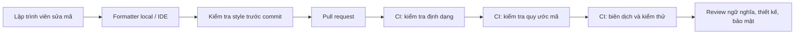

# Kiểm tra định dạng và quy ước mã

Một pull request thay đổi đúng ba điều kiện nghiệp vụ nhưng kéo theo hàng trăm dòng chỉ khác khoảng trắng, vị trí dấu ngoặc hoặc thứ tự import. Người review phải mất thời gian tách phần trình bày khỏi phần hành vi. Ở một trường hợp khác, mỗi lập trình viên đặt tên biến và lớp theo thói quen riêng, khiến người mới khó nhận biết cùng một khái niệm đang xuất hiện ở đâu.

Trong chương **Kiểm tra tự động** của module **CODE_QUALITY_FUNDAMENTALS**, chúng ta tìm hiểu cách tự động hóa việc kiểm tra **định dạng** và **quy ước mã** để nguồn Java dễ đọc, nhất quán và ít gây nhiễu khi thay đổi. Đây là một phần của mục tiêu làm mã **đáng tin cậy, dễ hiểu và dễ thay đổi**, nhưng cần ghi nhớ: **mã đúng định dạng chưa chắc đúng về mặt nghiệp vụ**.

## 1. Phân biệt định dạng, quy ước và tính đúng đắn

Ba nhóm yêu cầu thường được nhắc cùng nhau nhưng không tương đương:

| Nhóm | Điều muốn kiểm soát | Ví dụ | Công cụ phù hợp |
| --- | --- | --- | --- |
| **Định dạng (formatting)** | Cách mã được trình bày một cách nhất quán | Thụt đầu dòng, khoảng trắng, xuống dòng, bố cục dấu ngoặc | Formatter |
| **Quy ước mã (coding conventions)** | Cách đặt tên và tổ chức mã theo quy tắc chung | Tên lớp, phương thức, hằng số; thứ tự import; tránh import không dùng | Linter, style checker, một phần formatter |
| **Tính đúng đắn và chất lượng hành vi** | Hệ thống có làm điều nghiệp vụ yêu cầu không? | Dùng `>=` thay vì `>` ở ngưỡng miễn phí; không trừ tiền hai lần | Kiểm thử, review, phân tích tĩnh phù hợp |

Ranh giới giữa các loại công cụ có thể giao nhau. Ví dụ **Checkstyle** có thể kiểm tra cả quy ước tên và một số quy tắc trình bày; **Spotless** có thể điều phối công cụ định dạng và các kiểm tra định dạng. Tuy nhiên, **formatter không phải bộ chứng minh tính đúng đắn**, và tên gọi “static analyzer” không bảo đảm mọi vấn đề về nghiệp vụ đều được phát hiện.

### 1.1. Tại sao nhất quán lại có giá trị?

Định dạng nhất quán mang lại những lợi ích thực tế:

- **Giảm chi phí đọc:** người đọc không cần học lại phong cách trình bày của mỗi tệp.
- **Giảm nhiễu trong diff:** khi cùng dùng một formatter, thay đổi hành vi ít bị che khuất bởi chỉnh sửa trình bày ngẫu nhiên.
- **Giảm tranh luận chủ quan:** nhóm có thể tập trung review thiết kế, hợp đồng và trường hợp lỗi thay vì độ rộng thụt đầu dòng.
- **Hỗ trợ tự động hóa:** máy kiểm tra cùng quy tắc trên môi trường phát triển và CI.
- **Giúp onboarding:** người mới có căn cứ để đặt tên và trình bày mã thay vì đoán theo từng tác giả.

Những lợi ích này **không tự động xuất hiện** chỉ vì thêm một công cụ. Quy tắc cần được công bố, áp dụng ổn định, phù hợp với môi trường dự án và không tạo quá nhiều cảnh báo vô ích.

## 2. Định dạng: thay đổi cách nhìn, không cố ý thay đổi hành vi

Xét ví dụ Java 17 về phí giao hàng. Đây là **chính sách minh họa**: đơn hàng hợp lệ có `payableVnd >= 0`; thành viên với tiền hàng từ 500.000 VND trở lên được miễn phí, các trường hợp khác trả 15.000 VND.

### 2.1. Mã khó đọc nhưng vẫn có thể hợp lệ về cú pháp

```java
package com.example.shipping;
public final class ShippingFeePolicy{private static final long LIMIT=500_000L;
private ShippingFeePolicy(){}
public static long calculate(long payableVnd,boolean member){
if(payableVnd<0){throw new IllegalArgumentException("negative amount");}
return member&&payableVnd>=LIMIT?0L:15_000L;
}}
```

Dấu ngoặc, khoảng trắng và cách xuống dòng làm người đọc khó nhận ra cấu trúc. Nhưng về ngữ nghĩa Java, mã có thể thực hiện đúng chính sách giả định nêu trên.

### 2.2. Cùng hành vi với cách trình bày nhất quán hơn

```java
package com.example.shipping;

public final class ShippingFeePolicy {
    private static final long LIMIT = 500_000L;

    private ShippingFeePolicy() {}

    public static long calculate(long payableVnd, boolean member) {
        if (payableVnd < 0) {
            throw new IllegalArgumentException("negative amount");
        }

        return member && payableVnd >= LIMIT ? 0L : 15_000L;
    }
}
```

Bản sau để lộ các phần: tên lớp, hằng số, constructor, điều kiện đầu vào và giá trị trả về. **Không có quy tắc nghiệp vụ nào cần thay đổi** khi chỉ chỉnh lại khoảng trắng và cấu trúc xuống dòng.

Formatter có thể tự làm phần lớn thay đổi ấy. Cách định dạng cụ thể — chiều dài dòng, vị trí dấu ngoặc, cách ngắt biểu thức — phụ thuộc formatter và cấu hình được nhóm chọn. Không có một cách xuống dòng duy nhất phù hợp với mọi dự án.

**Lưu ý:** một số pipeline “format” còn tự sắp xếp hoặc loại bỏ import. Vì vậy vẫn cần xem diff và chạy kiểm thử sau khi áp dụng, nhất là khi công cụ định dạng hoặc cấu hình vừa được nâng phiên bản. Không nên mặc nhiên coi mọi thay đổi do công cụ tạo ra là vô hại.

### 2.3. Thay tên có phải công việc của formatter không?

Nếu đổi `LIMIT` thành `FREE_SHIPPING_THRESHOLD_VND` để diễn đạt đúng nghĩa và đơn vị, đây là **cải thiện tên gọi**, không chỉ chỉnh khoảng trắng:

```java
private static final long FREE_SHIPPING_THRESHOLD_VND = 500_000L;
```

Một formatter thông thường không thể biết hằng số `LIMIT` có nghĩa là gì trong nghiệp vụ. Quyết định đặt tên cần dựa vào **định nghĩa miền nghiệp vụ** và quy ước đã thống nhất. Công cụ kiểm tra tên có thể phát hiện sai *mẫu cú pháp*, nhưng không tự hiểu đầy đủ nghĩa của một từ.

## 3. Xây dựng quy ước mã Java đủ rõ để kiểm tra

Một quy ước hữu ích phải biến nhận xét “tên nên dễ hiểu” thành những phần có thể áp dụng được, đồng thời không thay thế suy luận nghiệp vụ.

| Đối tượng | Quy ước Java phổ biến | Ví dụ phù hợp | Rủi ro khi lạm dụng |
| --- | --- | --- | --- |
| Package | Chữ thường, tên có ý nghĩa và ổn định | `com.example.shipping` | Package quá sâu hoặc tên chung chung |
| Class/interface/record | `UpperCamelCase` | `ShippingFeePolicy`, `OrderRepository` | Tên hợp cú pháp nhưng quá mơ hồ như `DataManager` |
| Method | `lowerCamelCase`, mô tả thao tác | `calculateShippingFeeVnd` | Tên đẹp nhưng che giấu tác dụng phụ |
| Biến và tham số | `lowerCamelCase`, diễn đạt vai trò | `discountAmountVnd` | Dùng `value`, `data`, `x` ở phạm vi nghiệp vụ lớn |
| Hằng số `static final` | `UPPER_SNAKE_CASE` khi là hằng số theo quy ước nhóm | `MAX_BATCH_SIZE` | Cứng nhắc với mọi trường `final`, kể cả đối tượng không phải hằng số |
| Enum | Kiểu `UpperCamelCase`, phần tử `UPPER_SNAKE_CASE` | `PaymentStatus.PAID` | Một `Status` chung cho nhiều quy trình |
| Boolean | Tên gợi được câu trả lời đúng/sai | `hasOutstandingBalance` | `flag` hoặc `status` khiến không rõ ý nghĩa |
| Đơn vị | Thể hiện trong tên hoặc kiểu dữ liệu | `timeoutMillis`, `amountVnd` | Nhầm ms với giây, số tiền với số lượng |

Những mẫu trên là **quy ước phổ biến**, không phải ràng buộc cú pháp bắt buộc của ngôn ngữ Java. Nhóm có thể chọn quy ước khác nếu có lý do, miễn **nhất quán và công bố rõ**.

### 3.1. Một tên có thể đúng cú pháp mà sai nghĩa

```java
long total = subtotal - discount;
long remaining = total - paid;
```

Một linter có thể chấp nhận tất cả tên trên vì chúng hợp `lowerCamelCase`. Nhưng người đọc vẫn không biết `total` là **tiền hàng**, **nghĩa vụ cần thanh toán**, hay **số tiền còn nợ**.

Nếu nghiệp vụ đã xác định:

```java
long amountDueVnd = merchandiseSubtotalVnd - discountAmountVnd;
long outstandingAmountVnd = amountDueVnd - paidAmountVnd;
```

Các tên diễn đạt ý nghĩa tốt hơn. **Quy ước có thể kiểm tra tự động** và **từ vựng nghiệp vụ chính xác** là hai lớp bổ sung nhau: máy có thể phát hiện `amount_due_vnd` sai convention Java, còn con người vẫn cần xác nhận công thức và nghĩa của `amountDueVnd`.

### 3.2. Không biến quy ước thành mệnh lệnh bất chấp ngữ cảnh

Tên `i` trong một vòng lặp ngắn có thể phù hợp. `x` trong hàm tính toán hình học có thể là ký hiệu chuẩn. Nhưng `x` là tham số số tiền trong một API thanh toán công khai lại dễ gây sai sót.

Quy ước tốt nên nói **trường hợp ngoại lệ được phép**, thay vì tạo cảnh báo mà cả nhóm phải liên tục bỏ qua. Cũng không nên ép toàn bộ dự án đổi tên biến chỉ để đạt một regex, nếu việc đổi gây rủi ro lớn cho API công khai hoặc schema.

## 4. Công cụ tự động làm gì và không làm gì?

Những nhóm công cụ thường gặp trong hệ sinh thái Java:

| Nhóm | Ví dụ | Điều phù hợp để giao cho công cụ | Điều vẫn cần kiểm chứng khác |
| --- | --- | --- | --- |
| Formatter | google-java-format, Eclipse Java formatter | Khoảng trắng, ngắt dòng, bố cục mã | Quy tắc nghiệp vụ, thứ tự tác dụng phụ |
| Điều phối format | Spotless | Tích hợp formatter và kiểm tra định dạng trong build | Cấu hình formatter đúng với quy ước nhóm |
| Style checker / linter | Checkstyle | Quy ước đặt tên, import và các quy tắc style được cấu hình | Ý nghĩa tên và tính đúng đắn logic |
| Phân tích tĩnh rộng hơn | PMD, một số rule của Error Prone | Mẫu mã đáng ngờ, quy tắc code quality cụ thể | Hành vi hệ thống dưới dữ liệu và trạng thái thật |
| Biên dịch và kiểm thử | `javac`, JUnit 5 | Cú pháp/kiểu, các hợp đồng đã được đưa vào test | Những đường chưa kiểm thử và đặc tả chưa rõ |
| Review của con người | Code review có checklist | Tên nghiệp vụ, thiết kế API, mức phù hợp của quy tắc | Không thay thế kiểm tra lặp lại tự động |

Tên công cụ không quyết định kết quả; **rule được bật, phiên bản, phạm vi quét và cách xử lý cảnh báo** mới cho biết pipeline đang kiểm tra gì. Một dự án “có Checkstyle” nhưng chỉ kiểm tra hai quy tắc tên không thể tuyên bố đã kiểm tra toàn bộ coding conventions.

### 4.1. Formatter và linter có cách sử dụng khác nhau

- **Formatter:** có thể đưa mã về một trình bày chuẩn. Thường có hai chế độ: *áp định dạng* và *kiểm tra xem mã đã đúng định dạng chưa*.
- **Style checker:** báo trường hợp không tuân quy tắc; một số rule có hỗ trợ tự sửa, nhiều rule chỉ đưa ra cảnh báo hoặc lỗi.
- **Bộ phân tích tĩnh:** cố phát hiện một số mẫu có khả năng gây bug hoặc khó bảo trì; không phải mọi cảnh báo đều là lỗi thực tế.

Trong CI, nên ưu tiên **chế độ kiểm tra không sửa mã**. Nếu CI tự định dạng rồi báo xanh mà không tạo commit nào, repository vẫn có thể lưu nguồn không đúng chuẩn. Người phát triển nên áp định dạng ở local hoặc qua một thay đổi được review.

## 5. Cấu hình định dạng có thể chia sẻ

Một cách thống nhất một số quy ước cơ bản giữa editor là đặt tệp `.editorconfig` trong dự án. Ví dụ:

```ini
root = true

[*]
charset = utf-8
end_of_line = lf
insert_final_newline = true
trim_trailing_whitespace = true

[*.java]
indent_style = space
indent_size = 4

[*.md]
trim_trailing_whitespace = false
```

Tệp này mô tả quy ước nền như mã hóa, xuống dòng và thụt đầu dòng. **Không phải editor hoặc formatter nào cũng tuân thủ đầy đủ mọi thuộc tính**, và `.editorconfig` **không thay thế bộ định dạng cú pháp Java**. Ví dụ, nó không quyết định cách xuống dòng của một biểu thức `switch` dài.

Hai lớp cấu hình có thể kết hợp:

1. **EditorConfig** đặt quy tắc tệp cơ bản khi sửa.
2. **Formatter được pin phiên bản và cấu hình** chuẩn hóa mã Java ở mức cú pháp.

Các quy tắc phải **không mâu thuẫn**. Nếu formatter muốn một kiểu thụt đầu dòng còn editor tự đổi sang kiểu khác, file sẽ liên tục xuất hiện diff dù người dùng chưa thay logic.

### 5.1. Chọn một nguồn chuẩn định dạng

Với một repository, nên ghi rõ:

- Formatter nào được chọn và cách dùng trong IDE.
- Phiên bản formatter và cấu hình có được cố định trong build không.
- Lệnh áp định dạng trên máy phát triển.
- Lệnh kiểm tra định dạng trong CI.
- Loại tệp nào được kiểm tra; tệp sinh tự động hoặc mã vendor được xử lý thế nào.
- Quy tắc khi nâng phiên bản formatter: tách commit định dạng cơ học khỏi thay đổi nghiệp vụ khi cần.

Một số dự án cho formatter chạy trước khi commit, một số cung cấp lệnh thủ công; hai cách đều có thể hữu ích. Điểm quan trọng là **mọi người và CI dùng cùng quy tắc**, thay vì mỗi máy có một định dạng tự phát.

## 6. Ví dụ kiểm tra tên Java bằng Checkstyle

Để minh họa sự khác biệt giữa *kiểm tra mẫu tên* và *kiểm tra ý nghĩa*, giả sử một dự án đã tích hợp Checkstyle và muốn nhắc nhở về tên kiểu, phương thức, trường và hằng số.

Một đoạn cấu hình tối giản ở `config/checkstyle/checkstyle.xml` có thể là:

```xml
<?xml version="1.0"?>
<!DOCTYPE module PUBLIC
    "-//Checkstyle//DTD Checkstyle Configuration 1.3//EN"
    "https://checkstyle.org/dtds/configuration_1_3.dtd">
<module name="Checker">
    <module name="TreeWalker">
        <module name="TypeName"/>
        <module name="MethodName"/>
        <module name="MemberName"/>
        <module name="ConstantName"/>
    </module>
</module>
```

Đây là **cấu hình minh họa cho một số nhóm rule**, không phải checklist chất lượng đầy đủ. Dự án cần chọn phiên bản Checkstyle tương thích, gắn tệp cấu hình với build và xác nhận rule thực sự chạy trên tập mã mong muốn. Các checker trên sử dụng quy tắc riêng và có thể cấu hình thêm; nên kiểm tra tài liệu của phiên bản công cụ đang dùng.

Ví dụ lớp tên `shippingfee`, phương thức `Calculate` hoặc hằng số `maxCount` có thể bị báo tùy cấu hình. Nhưng tên `TOTAL` vẫn có thể vượt qua kiểm tra hằng số dù mơ hồ về nghiệp vụ.

### 6.1. Tránh đồng nhất việc “đặt tên đúng” với “thiết kế đúng”

Một lớp `OrderManager` có thể hoàn toàn phù hợp với quy tắc chữ hoa/chữ thường nhưng đang làm cả tính giá, lưu đơn, gọi thanh toán và gửi email. Style checker không thể tự kết luận trách nhiệm của lớp có hợp lý không. Kết quả “không có vi phạm quy ước” chỉ chứng minh **những rule đã được bật không phát hiện vi phạm** trong phạm vi phân tích.

### 6.2. Cùng một quy tắc cần có lý do

Một quy ước tên hằng số có thể bảo vệ tính nhất quán, nhưng nếu rule yêu cầu mọi biến `final` cục bộ phải viết `UPPER_SNAKE_CASE` thì dễ tạo nhiễu. Có thể điều chỉnh rule theo ngữ nghĩa và phạm vi mà nhóm muốn bảo vệ. Không nên chọn cấu hình chỉ vì “càng nhiều rule càng tốt”.

## 7. Từ IDE đến CI: quy trình kiểm tra lặp lại được

Một quy trình tự động hóa thường gồm:



Các bước trên là **cấu trúc quy trình gợi ý**. Thực tế một pipeline có thể chạy song song các bước độc lập để tiết kiệm thời gian. Nếu formatter hoặc style check lỗi, hệ thống cần thông báo rõ vị trí và cách sửa thay vì đưa ra hàng nghìn dòng log khó đọc.

### 7.1. Ví dụ thao tác với Gradle

Giả sử dự án đã **cấu hình plugin tương ứng** để có các task sau:

```bash
# Áp định dạng trên máy phát triển, nếu đã cài Spotless:
./gradlew spotlessApply

# Kiểm tra định dạng, không thay đổi tệp:
./gradlew spotlessCheck

# Kiểm tra quy ước Java, nếu đã cài Checkstyle:
./gradlew checkstyleMain checkstyleTest

# Chạy vòng kiểm tra build/test thông thường:
./gradlew check
```

Tên task là **ví dụ phụ thuộc cấu hình build**, không phải cam kết rằng mọi dự án Java đều có sẵn `spotlessApply` hoặc `checkstyleMain`. Trên Windows, dự án thường dùng Gradle Wrapper `gradlew.bat` thay cho `./gradlew`. Không nên dùng phiên bản Gradle hay plugin chưa kiểm soát để tạo kết quả khác nhau giữa máy cá nhân và CI.

### 7.2. Sự khác nhau giữa “apply” và “check”

| Chế độ | Hành vi | Dùng ở đâu? |
| --- | --- | --- |
| **Apply / format** | Thay đổi tệp để tuân quy tắc | Máy phát triển, commit định dạng có review |
| **Check / verify** | Đọc tệp và báo pass/fail, không tự sửa | CI, pre-commit khi cần kiểm tra nhanh |
| **Lint report** | Báo vi phạm quy tắc theo tệp và dòng | Local, CI, review |
| **Compile / test** | Phát hiện lỗi cú pháp/kiểu và hồi quy đã có test | CI cùng với style checks |

Nếu CI gọi `spotlessApply` để thay tệp rồi vẫn trả xanh, repository có thể chứa mã chưa chuẩn và bản CI đã sửa sẽ không được commit. Vì vậy, để làm **quality gate**, dùng task kiểm tra tương ứng.

### 7.3. Kiểm tra được phải có tiêu chí đầu ra

Một chính sách đơn giản:

```text
Pull request chỉ được coi đạt kiểm tra style khi:
- Không có khác biệt định dạng theo formatter chuẩn.
- Không có vi phạm quy ước mới ở mã thuộc phạm vi bắt buộc.
- Build và các kiểm thử bắt buộc vẫn đạt.
- Những ngoại lệ có lý do, phạm vi và người review.
```

Đây là **đề xuất chính sách**, không phải chuẩn bắt buộc cho mọi tổ chức. Nên quy định rõ *phạm vi bắt buộc* và cơ chế phê duyệt ngoại lệ. Một repository lâu đời có thể cần giai đoạn chuyển tiếp trước khi áp gate nghiêm ngặt cho toàn bộ tệp.

## 8. Quy ước định dạng và quy ước mã không thay thế kiểm thử

Quay lại `ShippingFeePolicy.calculate(...)`. Hai biểu thức sau đều có thể được formatter và style checker chấp nhận:

```java
// Giả sử nghiệp vụ yêu cầu "từ 500.000 VND trở lên".
return member && payableVnd > LIMIT ? 0L : 15_000L;

// Đúng theo giả định ở ví dụ:
return member && payableVnd >= LIMIT ? 0L : 15_000L;
```

Dòng thứ nhất **sai ở điều kiện biên** nếu chính sách đã xác nhận bao gồm đúng 500.000 VND. Không công cụ định dạng nào biết thay `>` thành `>=` dựa trên mong muốn nghiệp vụ.

Kiểm thử hành vi có thể bảo vệ điều này:

```java
package com.example.shipping;

import static org.junit.jupiter.api.Assertions.assertEquals;
import static org.junit.jupiter.api.Assertions.assertThrows;

import org.junit.jupiter.api.Test;

class ShippingFeePolicyTest {
    @Test
    void memberAtInclusiveThresholdGetsFreeShipping() {
        assertEquals(0L,
                ShippingFeePolicy.calculate(500_000L, true));
    }

    @Test
    void memberBelowThresholdPaysStandardFee() {
        assertEquals(15_000L,
                ShippingFeePolicy.calculate(499_999L, true));
    }

    @Test
    void nonMemberPaysStandardFee() {
        assertEquals(15_000L,
                ShippingFeePolicy.calculate(600_000L, false));
    }

    @Test
    void negativeAmountIsRejected() {
        assertThrows(IllegalArgumentException.class,
                () -> ShippingFeePolicy.calculate(-1L, true));
    }
}
```

Như vậy, **formatter làm mã dễ đọc**, **quy ước làm tên và cách trình bày nhất quán**, còn **kiểm thử xác nhận hành vi được đặc tả**. Chúng bổ sung nhau nhưng không thể thay thế nhau.

## 9. Áp dụng trong dự án cũ mà không tạo “diff khổng lồ”

Khi bật formatter lần đầu trên một repository lâu đời, nhiều tệp có thể đổi chỉ vì phong cách trình bày. Nếu trộn thay đổi ấy với sửa bug, việc review và truy vết lịch sử sẽ khó hơn.

Một lộ trình thận trọng:

1. **Đo hiện trạng:** số tệp đang vi phạm, loại vi phạm, phần mã tự sinh hoặc không sở hữu.
2. **Chốt quy tắc và phiên bản:** lựa chọn formatter, style rules, quy trình CI, các ngoại lệ chính đáng.
3. **Thử trên một phạm vi nhỏ:** chạy kiểm tra trong một module đại diện; xem báo cáo và thời gian CI.
4. **Tách commit định dạng thuần:** nếu quyết định format toàn bộ, tạo thay đổi cơ học riêng, không trộn sửa nghiệp vụ.
5. **Thiết lập gate cho mã mới và mã chạm tới:** nếu số nợ cũ lớn, có thể chỉ bắt buộc phần thay đổi hoặc dùng baseline được quản lý.
6. **Giảm nợ có chủ đích:** xử lý rule vi phạm dần, ghi lại ngoại lệ được chấp thuận và mục tiêu loại bỏ.
7. **Kiểm tra lại hiệu quả:** review có giảm nhiễu không; tỷ lệ vi phạm mới có giảm không; có quá nhiều cảnh báo bị bỏ qua không?

### 9.1. Format toàn bộ hay chỉ file thay đổi?

| Lựa chọn | Lợi ích | Rủi ro/cần chú ý |
| --- | --- | --- |
| **Toàn repository một lần** | Đạt sự nhất quán nhanh, gate đơn giản | Diff lớn, nhiễu lịch sử, xung đột với nhánh đang mở |
| **Chỉ file thay đổi** | Giảm phạm vi diff trước mắt | Cùng một repository có thể còn nhiều phong cách lâu dài |
| **Chỉ dòng thay đổi** | Ít nhiễu nhất | Một số formatter định dạng cả cấu trúc nên khó giới hạn theo dòng; quy tắc có thể không nhất quán |
| **Baseline nợ style** | Áp gate cho vi phạm mới | Phải có cơ chế giữ baseline không tăng âm thầm |

Không có lựa chọn duy nhất đúng cho mọi tổ chức. Với dự án nhiều nhánh đang phát triển, cần cân nhắc thời điểm format toàn bộ; với dự án nhỏ, commit format riêng có thể đơn giản hơn duy trì quy tắc theo dòng.

### 9.2. Loại trừ mã sinh tự động và mã từ bên thứ ba

Một thư mục chứa mã sinh từ OpenAPI, protobuf hoặc công cụ khác thường **không phải nơi nên sửa tay**. Định dạng mã sinh không đúng chính sách có thể khiến lần sinh tiếp theo tạo diff lặp lại.

Nên xác định rõ: mã sinh có đi qua formatter ở bước sinh không, có kiểm tra như mã viết tay không, hay có ngoại lệ; phần nào là nguồn chuẩn. Tránh áp đặt quy tắc mới lên thư viện được vendored nếu nhóm không sở hữu và không thể kiểm soát cập nhật của nó.

## 10. Khi nào nên bỏ qua cảnh báo?

Một kiểm tra có thể báo **false positive**, quá nghiêm ngặt cho ngữ cảnh hoặc xung đột với quy tắc nghiệp vụ thực tế. Cơ chế suppression chỉ nên là **ngoại lệ được kiểm soát**, không phải cách mặc định để làm pipeline xanh.

Một suppression hợp lý nên ghi:

- Rule nào bị bỏ qua và tại vị trí/phạm vi nào.
- Lý do cụ thể, ví dụ tên API công khai phải giữ để tương thích client.
- Ai đã review và chấp thuận ngoại lệ.
- Khi nào nên xem lại, chẳng hạn lúc kết thúc hỗ trợ API cũ.

Ví dụ nguyên tắc:

```text
Rule: MethodName
Ngoại lệ: API v1 công khai có phương thức tên legacyCall.
Lý do: client hiện có phụ thuộc tên này.
Phạm vi: đúng một phương thức.
Xem lại: khi ngừng hỗ trợ API v1.
```

Đây là **mẫu ghi nhận**, không phải cú pháp suppression cụ thể của Checkstyle. Mỗi công cụ có cách cấu hình ngoại lệ riêng; cần tham chiếu hướng dẫn theo phiên bản đang dùng.

**Không nên tắt hẳn một rule trên toàn dự án** chỉ vì một tệp vi phạm có lý do, nếu có thể khoanh ngoại lệ hẹp hơn. Ngược lại, nếu phần lớn cảnh báo của rule không có giá trị, nên thảo luận sửa hoặc bỏ rule thay vì yêu cầu từng lập trình viên thêm hàng trăm suppression.

## 11. Đánh giá hiệu quả và giới hạn của tự động hóa

Định dạng và quy ước mang lại kết quả tốt nhất khi được đo bằng **hiệu quả hỗ trợ nhóm**, không phải đơn thuần số cảnh báo càng nhiều càng tốt.

| Chỉ dấu | Câu hỏi nên hỏi | Giới hạn khi diễn giải |
| --- | --- | --- |
| Số vi phạm mới | Quy tắc có được áp dụng ổn định không? | Ít vi phạm không chứng minh ít bug nghiệp vụ |
| Thời gian CI style check | Gate có quá chậm khiến nhóm tìm cách bỏ qua không? | Nhanh không đồng nghĩa rule hữu ích |
| Tỷ lệ cảnh báo bị suppression | Có rule nào quá nhiễu không? | Một số ngoại lệ là nhu cầu tương thích thật |
| Diff chỉ do formatting | Pull request có đang chứa quá nhiều thay đổi cơ học không? | Số dòng đổi không trực tiếp đo chất lượng |
| Thời gian review, phản hồi onboarding | Nhóm có dễ hiểu và sửa mã hơn không? | Bị ảnh hưởng bởi nhiều yếu tố ngoài formatter |
| Lỗi hồi quy | Kiểm thử và review có tiếp tục phát hiện hành vi sai không? | Style check không thể thay thế kiểm thử |

Kết quả tốt thường là **ít tranh cãi về cách trình bày**, **ít lỗi tên gọi có thể tránh**, **CI lặp lại được**, và **người review tập trung vào các quyết định quan trọng**. Nếu bộ quy tắc tạo hàng nghìn cảnh báo mà không ai đọc, tính tự động hóa trên danh nghĩa không còn giúp nâng chất lượng thực tế.

### 11.1. Chọn mức chặn pipeline theo rủi ro

Có thể phân mức:

- **Bắt buộc sửa:** lỗi định dạng theo nguồn chuẩn, rule tên cơ bản đã thống nhất, lỗi rõ ràng ảnh hưởng hợp đồng.
- **Cảnh báo để review:** rule có khả năng false positive hoặc phụ thuộc ngữ cảnh.
- **Thống kê, chưa chặn:** vi phạm cũ trong phạm vi đang giảm nợ.

Quy tắc phân mức phải được ghi rõ để mọi người dự đoán được kết quả. Không nên để một rule chuyển từ “thông tin” sang “chặn merge” mà không thông báo và không có cách xử lý nợ tồn tại.

## 12. Bài tập vận dụng

Một nhóm phát triển hệ thống đăng ký khóa học có các vấn đề:

- Mỗi máy phát triển có cấu hình IDE khác nhau, khiến khoảng trắng và xuống dòng liên tục thay đổi.
- Lớp `studentservice`, phương thức `Register` và hằng số `maxStudents` không thống nhất convention.
- Một API công khai cũ tên `get_student_list()` vẫn được client bên ngoài sử dụng.
- Repository có hàng trăm tệp Java viết tay, một thư mục mã sinh OpenAPI và nhiều nhánh đang mở.
- CI chỉ chạy unit test; không kiểm tra định dạng hay style.
- Có một lỗi nghiệp vụ: số học viên tối đa là 30, nhưng mã đang kiểm tra `count > 30` thay vì điều kiện phù hợp trước khi thêm học viên mới.

**Yêu cầu:**

1. Lập bảng phân loại các vấn đề thành **định dạng**, **quy ước mã**, **tương thích API** và **tính đúng đắn nghiệp vụ**. Giải thích vì sao formatter không thể sửa tất cả.
2. Đề xuất quy tắc đặt tên Java cho lớp, phương thức, hằng số, enum và package; nêu ngoại lệ có căn cứ cho `get_student_list()`.
3. Viết cấu hình `.editorconfig` tối thiểu cho Java; mô tả công cụ formatter và style checker cần thống nhất trong build.
4. Lập kế hoạch đưa kiểm tra vào CI **không tự sửa tệp**, bao gồm thông báo khi phát hiện vi phạm và cách phát hành thay đổi định dạng riêng.
5. Phân tích ba phương án cho mã cũ: format toàn bộ, chỉ mã thay đổi, hoặc baseline; chọn một phương án có lý do dựa trên số nhánh đang mở.
6. Thiết kế hai ca kiểm thử biên cho giới hạn 30 học viên và giải thích vì sao một pipeline style xanh vẫn có thể chứa lỗi ở điều kiện thêm học viên thứ 31.

**Hướng tự đối chiếu:** định dạng giải quyết khoảng trắng và bố cục; style checker hỗ trợ kiểm tra quy tắc tên; tên API cũ cần xem xét tương thích trước khi đổi. Với giới hạn 30 học viên, điều kiện nhận thêm phải dựa trên số lượng **trước thao tác** và sức chứa còn lại, đồng thời cần kiểm tra cạnh tranh nếu nhiều người đăng ký cùng lúc. Không thể chứng minh điều đó bằng một quy tắc `MethodName`. Mã sinh cần có chính sách riêng để tránh diff vô ích.

## 13. Ghi nhớ

- **Formatter chuẩn hóa cách trình bày**, giúp diff và review tập trung hơn; nó không quyết định đúng sai nghiệp vụ.
- **Quy ước mã** bao gồm tên, cấu trúc trình bày và các quy tắc dùng chung; máy kiểm tra được một phần, con người vẫn cần xác nhận ngữ nghĩa.
- **Cấu hình và phiên bản công cụ phải nhất quán** giữa IDE, local build và CI.
- **CI nên kiểm tra, không âm thầm sửa nguồn**; việc format và thay đổi mã phải được lưu vào commit có thể review.
- **Áp dụng dần với dự án cũ**, phân biệt nợ style, mã sinh và API cần tương thích; suppression phải có lý do và phạm vi.
- **Chất lượng không phải số cảnh báo bằng 0**: cần tiếp tục kiểm thử hành vi, review thiết kế và kiểm chứng hợp đồng.

Tự động hóa định dạng và quy ước hiệu quả nhất khi nó làm những việc lặp lại mà máy kiểm tra được, để người phát triển dành sự chú ý cho **tính đúng đắn, khả năng hiểu và tác động của thay đổi**. Một bộ quy tắc rõ ràng, chạy lặp lại được và có ngoại lệ có kiểm soát sẽ hữu ích hơn một danh sách kiểm tra dài nhưng không ai thực sự sử dụng.
