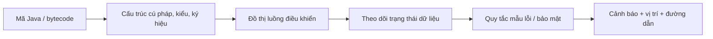
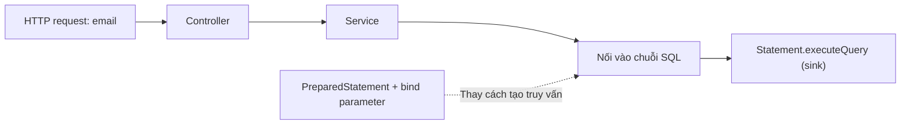
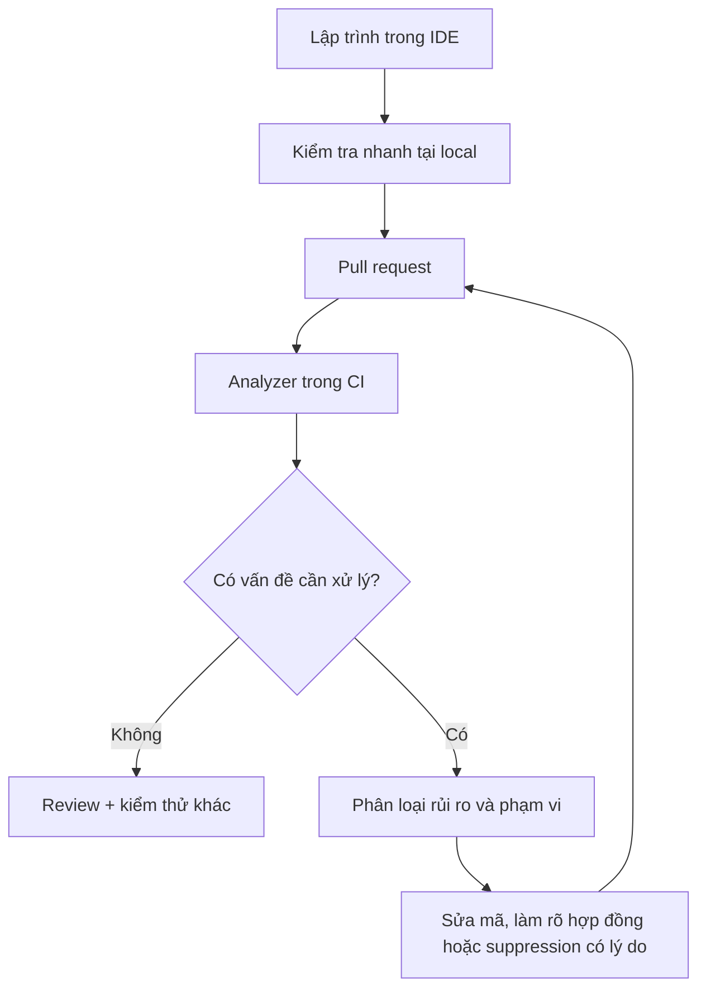

# Phân tích tĩnh cho mẫu lỗi và luồng dữ liệu

Một phương thức Java có thể biên dịch thành công nhưng vẫn có đường đi gây `NullPointerException`. Một biến nhận dữ liệu từ HTTP request có thể đi qua vài lớp rồi được nối vào câu SQL. Một file được mở nhưng chỉ được đóng ở nhánh chạy bình thường, còn nhánh ném ngoại lệ để rò rỉ tài nguyên. Những lỗi này không phải lúc nào cũng xuất hiện trong các ca kiểm thử thông thường.

**Phân tích tĩnh** (*static analysis*) giúp tìm những dấu hiệu rủi ro bằng cách xem xét mã nguồn, bytecode hoặc mô hình chương trình **mà không cần chạy chính đường đi ứng dụng đang được phân tích**. Trong chương **Kiểm tra tự động** của **CODE_QUALITY_FUNDAMENTALS**, bài học này tập trung vào hai nhóm kỹ thuật: **nhận diện mẫu lỗi** (*bug-pattern detection*) và **theo dõi luồng dữ liệu** (*data-flow analysis*). Mục tiêu gắn với toàn học phần: hiểu những thuộc tính quyết định mã nguồn có **đáng tin cậy, dễ hiểu và dễ thay đổi** hay không.

Phân tích tĩnh không thay thế compiler, kiểm thử hay review. Giá trị của nó nằm ở khả năng tự động nhận diện một số kiểu lỗi lặp lại, chỉ ra đường đi đáng ngờ và đưa phản hồi sớm trước khi lỗi đến môi trường chạy thật.

## Mục tiêu học tập

Sau bài này, bạn có thể:

1. Phân biệt kiểm tra cú pháp, kiểu dữ liệu, quy tắc mã nguồn, mẫu lỗi và phân tích luồng dữ liệu.
2. Giải thích vai trò của **AST**, **control-flow graph** và trạng thái trừu tượng trong việc phát hiện lỗi.
3. Nhận diện những cảnh báo liên quan đến `null`, tài nguyên, giá trị trả về, dữ liệu không đáng tin cậy và các đường đi không được xử lý.
4. Hiểu khái niệm **source**, **sink**, **sanitizer** và **taint propagation** trong phân tích bảo mật.
5. Phân biệt *true positive*, *false positive* và những lỗi phân tích tĩnh có thể bỏ sót.
6. Đưa kiểm tra tự động vào IDE, pull request và CI với quy tắc phân loại, xử lý nợ cũ và ghi nhận ngoại lệ có trách nhiệm.

## 1. Phân tích tĩnh khác gì chạy chương trình?

Hãy xem ba cách phát hiện lỗi:

| Cách kiểm tra | Nó quan sát gì? | Ví dụ |
| --- | --- | --- |
| **Compiler/type checker** | Cú pháp, kiểu, các ràng buộc ngôn ngữ bắt buộc khi biên dịch. | Không cho gán `String` vào biến `int` nếu không có chuyển đổi phù hợp. |
| **Phân tích tĩnh bổ sung** | Mẫu mã, quan hệ giữa biến, nhánh điều kiện, lời gọi, luồng nguồn–đích. | Phát hiện một đường đi có thể dereference `null`; giá trị từ request có thể chảy vào câu SQL không được tham số hóa. |
| **Kiểm thử/chạy thực tế** | Kết quả và tác dụng phụ khi thực thi với input, môi trường, lịch chạy cụ thể. | Gọi API với một request rồi xác nhận response, dữ liệu DB và số lần phát sự kiện. |

Compiler thường bắt được lỗi ngôn ngữ chắc chắn theo quy tắc biên dịch, nhưng nhiều hành vi hợp lệ về cú pháp vẫn có thể nguy hiểm. Ví dụ, Java cho phép khai báo một tham chiếu đối tượng có giá trị `null` và gọi method trên tham chiếu đó; chương trình chỉ ném ngoại lệ khi đường đi nguy hiểm được thực thi.

Một công cụ phân tích tĩnh có thể xem nhiều đường đi điều khiển mà test chưa thử, nhưng nó phải **xấp xỉ** hành vi có thể xảy ra. Phép xấp xỉ tạo ra hai giới hạn: công cụ đôi khi cảnh báo một đường không thể xảy ra trong thực tế, và đôi khi không nhận ra một lỗi thật.

### Không phải công cụ nào cũng phân tích sâu như nhau

“Static analyzer” là tên chung của nhiều công cụ có phạm vi khác biệt:

- Công cụ **format/lint** kiểm tra quy ước mã, import, tên gọi, độ dài hoặc kiểu trình bày.
- Công cụ **bug-pattern** phát hiện cấu trúc code thường dẫn đến lỗi, như so sánh đối tượng không phù hợp, bỏ qua kết quả quan trọng hay mẫu đóng tài nguyên đáng ngờ.
- Công cụ **data-flow** theo dõi giá trị qua phép gán, nhánh rẽ, lời gọi và vòng lặp.
- Công cụ **security taint analysis** theo dõi đầu vào có thể bị kiểm soát đến những thao tác nhạy cảm.
- Công cụ **kiểm tra kiến trúc/phụ thuộc** rà soát quan hệ import, vòng phụ thuộc hoặc quy tắc phân lớp.

Một công cụ có thể kết hợp nhiều nhóm, nhưng không nên suy rằng nó hiểu đầy đủ mọi bất biến nghiệp vụ chỉ vì được gọi là “phân tích tĩnh”.

## 2. Từ mã nguồn đến đường đi cần phân tích

Để hiểu vì sao công cụ báo một lỗi, có thể hình dung một quy trình đơn giản:



Đây là **mô hình khái niệm**, không bắt buộc mọi analyzer đều triển khai đúng các bước này hoặc dùng AST khi phân tích bytecode.

### 2.1. AST: biết chương trình được viết dưới cấu trúc nào

**Abstract Syntax Tree** biểu diễn cấu trúc cú pháp như lời gọi method, toán tử, nhánh `if`, vòng lặp và khai báo biến.

Ví dụ:

```java
if (quantity > 0) {
    total = price * quantity;
}
```

AST giúp nhận diện đây là một câu lệnh điều kiện, phép so sánh, phép nhân và phép gán. Một quy tắc thuần cú pháp có thể phát hiện dạng viết đáng ngờ mà chưa cần biết nhiều đường đi chạy.

Tuy nhiên, chỉ nhìn AST không đủ để biết ở một dòng nào đó biến có thể bằng `null` sau nhiều nhánh và phép gán trước đó hay không.

### 2.2. CFG: biết đường đi nào có thể tới dòng mã

**Control-flow graph (CFG)** mô hình hóa các bước có thể nối tiếp trong một phương thức, gồm nhánh điều kiện, vòng lặp, kết thúc và một số luồng ngoại lệ.

```java
String code = request.code();
if (code == null) {
    return "UNKNOWN";
}
return code.trim().toUpperCase(java.util.Locale.ROOT);
```

Đường đi đến `code.trim()` chỉ tồn tại sau khi nhánh `code == null` đã bị loại. Công cụ theo dõi nhánh có thể suy ra `code` khác `null` tại lời gọi này.

Ngược lại:

```java
String code = request.code();
if (code == null) {
    logger.warn("Code is missing");
}
return code.trim(); // Có đường đi code == null.
```

Nhánh `if` chỉ ghi log, không `return` hay gán giá trị thay thế. CFG cho thấy cả nhánh `null` vẫn đi đến `trim()`, vì vậy lời gọi có nguy cơ `NullPointerException`.

### 2.3. Luồng dữ liệu: biết giá trị đã được kiểm tra hay thay đổi

**Data-flow analysis** lan truyền thông tin về biến qua các cạnh của CFG. Thông tin đó không nhất thiết là giá trị chính xác; có thể chỉ là trạng thái trừu tượng:

| Trạng thái trừu tượng | Ý nghĩa |
| --- | --- |
| `NULL` | Phân tích xác định tham chiếu đang bằng `null` trên đường đang xét. |
| `NON_NULL` | Phân tích xác định tham chiếu khác `null` trên đường đang xét. |
| `MAYBE_NULL` | Có ít nhất một khả năng `null` chưa được loại trừ. |
| `UNKNOWN` | Không đủ thông tin để kết luận, tùy mô hình của công cụ. |

Đây là **ví dụ mô hình đơn giản**, không phải tập trạng thái chuẩn của mọi analyzer. Công cụ thực tế có thể dùng lattice, annotation và các quy tắc hợp nhất khác nhau.

Khi hai nhánh nhập lại, phân tích thường phải **gộp thông tin**. Một nhánh cho `NON_NULL`, nhánh kia có thể cho `NULL` thì trạng thái sau điểm nhập không thể mặc định là `NON_NULL`.

## 3. Ví dụ Java: kiểm tra `null` theo đường đi

Xét một yêu cầu tạo nhãn hiển thị. Theo hợp đồng ví dụ, người dùng không nhập tên thì ứng dụng dùng `"Guest"`; còn tên được nhập phải được cắt khoảng trắng đầu/cuối.

### 3.1. Mã dễ phát sinh lỗi

```java
record ProfileRequest(String displayName) {}

static String makeLabel(ProfileRequest request) {
    String name = request.displayName();
    if (name == null) {
        System.out.println("Missing display name");
    }
    return name.trim(); // Có thể dereference null.
}
```

Công cụ có khả năng phân tích `null` theo nhánh có thể cảnh báo tại `name.trim()`. Nhưng lưu ý còn một trường hợp khác: nếu `request == null`, lỗi xuất hiện sớm hơn ở `request.displayName()`. Những cảnh báo nào thực sự xuất hiện tùy công cụ, cấu hình và thông tin về việc tham số có được phép null hay không.

### 3.2. Sửa cho đúng hợp đồng

```java
import java.util.Objects;

record ProfileRequest(String displayName) {}

final class ProfileLabels {
    static String makeLabel(ProfileRequest request) {
        Objects.requireNonNull(request, "request");
        String name = request.displayName();
        if (name == null || name.isBlank()) {
            return "Guest";
        }
        return name.trim();
    }
}
```

Ở đây `request` không được phép `null` và việc thiếu tên được xử lý rõ ràng. `Objects.requireNonNull` báo lỗi tại ranh giới đầu vào thay vì để một lời gọi sâu bên trong vô tình ném ngoại lệ.

Không phải sửa mọi cảnh báo `null` bằng một câu `if` rồi trả mặc định. Nếu tên là **trường bắt buộc theo nghiệp vụ**, việc trả `"Guest"` có thể che đầu vào sai. Khi ấy nên từ chối dữ liệu không hợp lệ và có test cho hợp đồng đó. **Phân tích tĩnh chỉ chỉ ra rủi ro; quyết định ứng xử đúng thuộc về yêu cầu nghiệp vụ.**

### 3.3. Annotation hỗ trợ nhưng không thay hợp đồng

Nhiều hệ sinh thái Java có annotation như `@Nullable` và `@NonNull` để mô tả quan hệ nullness; tên package và khả năng diễn giải thay đổi theo thư viện/công cụ. Các annotation này **không tự khiến JVM thực thi kiểm tra tại runtime**, trừ khi có cơ chế riêng.

Nếu public API ghi một tham số là non-null, công cụ phù hợp có thể phát hiện lời gọi truyền null. Nhưng nếu implementation vẫn có đường gán null trái với khai báo, người viết cần kiểm tra cả annotation, mã và test để tránh hợp đồng bị mâu thuẫn.

## 4. Mẫu lỗi: từ dấu hiệu cú pháp đến rủi ro hành vi

**Bug pattern** là cấu trúc mã đã biết thường gắn với một lỗi hoặc sai sót. Chúng không cần lúc nào cũng phân tích mọi đường đi để hữu ích.

| Mẫu đáng ngờ | Ví dụ Java | Vì sao cần xem |
| --- | --- | --- |
| **So sánh tham chiếu thay vì nội dung** | `a == b` với hai `String`. | `==` so sánh cùng đối tượng, không so sánh nội dung ký tự. |
| **Giá trị trả về bị bỏ qua** | `name.trim();`. | `String` bất biến; chuỗi gốc không thay đổi. |
| **Kiểm tra null sai thứ tự** | `name.trim().isEmpty() || name == null`. | Dereference xảy ra trước khi kiểm tra `null`. |
| **Bắt lỗi rồi im lặng** | `catch (IOException e) { }`. | Lỗi I/O có thể bị giấu và dữ liệu sai vẫn được sử dụng. |
| **Mở tài nguyên mà không đóng đúng** | `Files.lines(path).count()` nhưng stream không được đóng. | Có thể giữ tài nguyên file ngoài ý muốn. |
| **Điều kiện có vẻ vô nghĩa** | `if (x > 0 && x < 0)`. | Với cùng một `x` nguyên, điều kiện luôn sai. |
| **Ghi đè giá trị trước khi dùng** | `result = read(); result = fallback();`. | Việc đọc ban đầu có thể là công việc vô ích hoặc mất kết quả. |
| **Tác dụng phụ bị giấu** | `stream.peek(sendEmail).findFirst()`. | Thao tác có thể đánh giá lười và dừng sớm. |

Từng mẫu cần xem ngữ cảnh. Ví dụ `==` đúng khi cố ý kiểm tra *identity*, như so sánh với một singleton; việc thay tự động mọi `==` bằng `equals` có thể làm sai chương trình. Cảnh báo là **điểm cần điều tra**, không phải lệnh sửa máy móc.

### Ví dụ bỏ qua kết quả trả về

```java
String normalized = "  A-42  ";
normalized.trim(); // Không thay đổi normalized.
System.out.println(normalized);
```

`String.trim()` trả về chuỗi kết quả; nó không sửa đối tượng gốc. Mã thể hiện rõ ý định hơn:

```java
String normalized = "  A-42  ";
normalized = normalized.trim();
```

Các API như `String.strip()`, `BigDecimal.add()` hay `LocalDate.plusDays()` cũng tạo giá trị mới. Một analyzer có thể có quy tắc nhận biết việc bỏ qua kết quả, nhưng khả năng nhận diện phụ thuộc danh sách API và cách công cụ xử lý lời gọi.

## 5. Phân tích vòng đời tài nguyên

Tài nguyên như file handle, stream I/O, socket hoặc kết nối DB thường có vòng đời vượt ra ngoài bộ nhớ heap do GC quản lý. Một đường đi ném ngoại lệ có thể bỏ qua bước đóng tài nguyên nếu mã không tổ chức đúng.

### Mẫu dễ bỏ sót nhánh lỗi

```java
import java.nio.file.Files;
import java.nio.file.Path;
import java.io.IOException;
import java.util.stream.Stream;

static long countLines(Path path) throws IOException {
    Stream<String> lines = Files.lines(path);
    long result = lines.count();
    lines.close();
    return result;
}
```

Nếu `count()` ném exception, `close()` không được gọi ở luồng điều khiển bình thường. Một analyzer có quy tắc theo dõi tài nguyên có thể báo rủi ro “không đóng trên mọi đường đi”.

### Sửa bằng try-with-resources

```java
import java.nio.charset.StandardCharsets;
import java.nio.file.Files;
import java.nio.file.Path;
import java.io.IOException;
import java.util.stream.Stream;

static long countLines(Path path) throws IOException {
    try (Stream<String> lines =
            Files.lines(path, StandardCharsets.UTF_8)) {
        return lines.count();
    }
}
```

`try-with-resources` đảm bảo `close()` được gọi khi ra khỏi scope, cả khi thân khối ném exception, theo ngữ nghĩa của Java. Với nhiều tài nguyên, thứ tự đóng và ngoại lệ `suppressed` cũng được ngôn ngữ quy định; người viết không nên tự thay bằng `finally` nếu không có lý do.

Tuy nhiên, **tài nguyên nào cần đóng phụ thuộc hợp đồng API**. Ví dụ `ByteArrayInputStream` không có cùng tác động ngoại hệ thống như `Files.lines`. Static analyzer dựa vào kiểu, annotation hay mô hình thư viện; nó có thể cảnh báo nhầm hoặc bỏ sót khi ownership được truyền qua nhiều hàm.

### Phụ thuộc quyền sở hữu

```java
void consume(java.io.InputStream input) throws IOException {
    // Ai chịu trách nhiệm đóng input: hàm này hay người gọi?
}
```

Không phải cứ nhận `InputStream` là phải đóng ngay. Hợp đồng phải chỉ rõ **ai sở hữu tài nguyên** và lúc nào quyền sở hữu được chuyển giao. Nếu một hàm đóng stream mà caller vẫn cần dùng, “sửa rò rỉ” lại trở thành lỗi hành vi. Đó là ví dụ điển hình cho giới hạn của quy tắc máy móc nếu thiếu thông tin ownership.

## 6. Luồng dữ liệu không đáng tin cậy: source, sink và sanitizer

Trong phân tích bảo mật, **taint analysis** theo dõi dữ liệu xuất phát từ một nguồn có thể bị bên không đáng tin cậy kiểm soát và tìm xem nó có chảy tới thao tác nhạy cảm hay không.

Ba khái niệm chính:

- **Source:** điểm dữ liệu đi vào, ví dụ tham số HTTP, header, file tải lên, dữ liệu từ message queue hoặc một response của hệ thống bên ngoài.
- **Sink:** thao tác nguy hiểm nếu nhận dữ liệu chưa được xử lý phù hợp, ví dụ thực thi SQL bằng cách nối chuỗi, tạo lệnh shell, dựng đường dẫn tệp hoặc chèn HTML vào trang.
- **Sanitizer / biện pháp bảo vệ:** phép xử lý làm cho dữ liệu an toàn **đối với một loại sink và ngữ cảnh cụ thể**, chẳng hạn tham số hóa SQL thay vì nối chuỗi.



### 6.1. Ví dụ không an toàn: nối dữ liệu vào câu SQL

```java
import java.sql.Connection;
import java.sql.ResultSet;
import java.sql.SQLException;
import java.sql.Statement;

static boolean emailExists(Connection connection, String email)
        throws SQLException {
    String sql =
            "SELECT 1 FROM customers WHERE email = '" + email + "'";
    try (Statement statement = connection.createStatement();
         ResultSet rows = statement.executeQuery(sql)) {
        return rows.next();
    }
}
```

Đường dữ liệu trong ví dụ: `email` là dữ liệu đầu vào → nối vào `sql` → chuyển đến `Statement.executeQuery`. Nếu `email` do client kiểm soát, nội dung có thể làm thay đổi cú pháp và ý nghĩa của truy vấn. Một analyzer bảo mật có mô hình phù hợp có thể cảnh báo **SQL injection** trên đường đi này.

Không cần tự viết payload tấn công trong test để hiểu quy tắc. Vấn đề nằm ở chỗ **dữ liệu trở thành một phần cú pháp truy vấn**.

### 6.2. Cách làm an toàn hơn: tham số hóa

```java
import java.sql.Connection;
import java.sql.PreparedStatement;
import java.sql.ResultSet;
import java.sql.SQLException;

static boolean emailExists(Connection connection, String email)
        throws SQLException {
    String sql = "SELECT 1 FROM customers WHERE email = ?";
    try (PreparedStatement statement =
                 connection.prepareStatement(sql)) {
        statement.setString(1, email);
        try (ResultSet rows = statement.executeQuery()) {
            return rows.next();
        }
    }
}
```

`PreparedStatement` với placeholder và `setString` đưa giá trị `email` vào **tham số dữ liệu**, không nối nó thành cú pháp SQL. Ứng dụng vẫn cần kiểm tra độ dài, định dạng và quyền truy cập theo hợp đồng; parameter binding giải quyết một lớp rủi ro injection chứ không tự bảo đảm mọi quy tắc nghiệp vụ.

**Giới hạn quan trọng:** placeholder SQL thường được dùng cho **giá trị dữ liệu**, không thay được tên bảng/cột hoặc cấu trúc truy vấn một cách tùy ý. Nếu phải chọn tên cột động, dùng một danh sách tên cột được phép, cố định theo mã, thay vì chèn chuỗi không đáng tin vào SQL.

### 6.3. “Đã sanitize” phải gắn với ngữ cảnh

Thay ký tự `<` bằng entity HTML có thể hữu ích trong một **ngữ cảnh xuất HTML**, nhưng không làm cho chuỗi an toàn khi dùng làm lệnh shell hoặc SQL. Tương tự, `trim()`, `toLowerCase()` hay kiểm tra `isBlank()` không phải biện pháp chống SQL injection.

Một số công cụ theo dõi phép chuyển đổi đã biết và loại bỏ cảnh báo tại sink khi thấy biện pháp bảo vệ phù hợp. Nếu thư viện tự viết wrapper quanh `PreparedStatement`, analyzer có thể **không nhận ra** luồng dữ liệu đã an toàn cho đến khi được cấu hình mô hình tương ứng.

## 7. Data-flow analysis có thể đi sâu đến đâu?

Phân tích một phương thức không đủ cho mọi dự án. Dữ liệu có thể đi qua controller, service, repository, callback và đối tượng dùng chung.

### 7.1. Nội thủ tục và liên thủ tục

- **Intraprocedural analysis** xem một phương thức và giả định/tóm tắt hành vi của các lời gọi ngoài.
- **Interprocedural analysis** theo dõi quan hệ giữa nhiều phương thức, ví dụ một tham số được controller truyền sang service rồi tới JDBC.

Phân tích liên thủ tục có thể phát hiện những đường nguy hiểm dài hơn nhưng cũng tăng chi phí, phức tạp của mô hình và nguy cơ không hiểu đúng thư viện/framework động.

### 7.2. Path sensitivity

Một bộ phân tích **path-sensitive** có thể giữ riêng điều kiện trên từng nhánh, chẳng hạn chỉ báo lỗi khi `value == null` ở nhánh có thể đi tới `value.length()`. Bộ phân tích gộp nhánh quá sớm có thể báo một `MAYBE_NULL` dù điều kiện kiểm tra đã loại trừ null trên đường thực tế.

### 7.3. Alias và dữ liệu có thể thay đổi

```java
UserProfile a = profile;
UserProfile b = a;
b.setEmail(null);
sendEmail(a.getEmail());
```

`a` và `b` cùng tham chiếu một đối tượng. Nếu analyzer chỉ theo dõi tên biến mà không hiểu alias/mutation, nó có thể bỏ qua việc `a.getEmail()` đã bị thay đổi gián tiếp.

Tương tự, trong mã đồng thời, một điều kiện `if (shared.value != null)` không nhất thiết bảo đảm `shared.value` còn non-null ở lời gọi sau nếu luồng khác có quyền thay đổi trường đó. Phân tích nullness thông thường không thay thế cơ chế đồng bộ và mô hình bộ nhớ Java.

### 7.4. Reflection, native code và cấu hình runtime

Reflection, dependency injection động, proxy, JNI, code generation và việc nạp cấu hình lúc chạy làm đường gọi thực tế khó quan sát chỉ từ source. Một công cụ có thể dùng mô hình framework hoặc metadata bổ sung, nhưng không thể mặc định rằng nó hiểu mọi đường đi.

**Không có cảnh báo không đồng nghĩa không có lỗi**. Điều đó chỉ cho biết công cụ, phiên bản, quy tắc và cấu hình đã chạy không phát hiện vấn đề thuộc phạm vi phân tích của nó.

## 8. Kết quả phân tích: hiểu cảnh báo trước khi sửa

Một báo cáo có thể gồm quy tắc, mức độ, vị trí, dòng gọi liên quan và đường đi dữ liệu. Ví dụ minh họa:

```text
Rule: POSSIBLE_NULL_DEREFERENCE
Location: ProfileService.java:42
Evidence:
  request.displayName() may return null
  branch logging missing name does not exit
  value.trim() is called on a possible null value
```

Đây **không phải output bắt buộc của một công cụ cụ thể**, mà là dạng thông tin hữu ích khi triage.

### Phân biệt những khái niệm dễ nhầm

| Kết quả | Ý nghĩa |
| --- | --- |
| **True positive** | Công cụ chỉ ra một vấn đề thực sự thuộc loại quy tắc đang kiểm tra. |
| **False positive** | Công cụ cảnh báo nhưng đường đi hoặc vi phạm đó không tồn tại theo hợp đồng/ngữ cảnh thật. |
| **False negative** | Có vấn đề thực nhưng công cụ không cảnh báo. |
| **Severity** | Mức nghiêm trọng của tác động khi vấn đề xảy ra; cần đánh giá bối cảnh. |
| **Confidence** | Mức tin cậy của công cụ đối với cảnh báo, nếu công cụ cung cấp. |

Một cảnh báo có độ tin cậy cao chưa chắc tác động lớn. Ví dụ lỗi tiềm ẩn ở lệnh dùng trong bộ test không có dữ liệu sản xuất khác với lỗi SQL injection ở endpoint công khai. Ngược lại, lỗi có xác suất thấp nhưng liên quan quyền truy cập hoặc giao dịch tiền vẫn có thể rất nghiêm trọng.

### Quy trình triage một cảnh báo

1. **Đọc quy tắc:** công cụ tuyên bố điều gì có thể sai, ở điều kiện nào?
2. **Theo đường đi:** xác định nguồn dữ liệu, nhánh, lời gọi và điểm có thể gặp lỗi.
3. **Kiểm tra hợp đồng:** có giả định nullness, quyền sở hữu tài nguyên, dữ liệu trusted/untrusted nào bị bỏ sót không?
4. **Đánh giá khả năng thực hiện:** đường đi có thật sự xảy ra với dữ liệu hợp lệ và cách gọi hiện hữu không?
5. **Đánh giá ảnh hưởng:** lỗi dữ liệu, bảo mật, rò rỉ tài nguyên hay chỉ là quy ước mã?
6. **Chọn thay đổi phù hợp:** sửa mã, làm rõ contract/annotation, thay API, bổ sung test hoặc cập nhật mô hình công cụ.
7. **Xác nhận kết quả:** chạy lại phân tích và kiểm thử liên quan, xem cảnh báo mất vì nguyên nhân đã được xử lý hay chỉ bị che đi.

Khi không có cách tái hiện lỗi bằng test vì đường đi hiếm, phân tích tĩnh vẫn có thể đưa bằng chứng hợp lý để sửa; không cần buộc mọi cảnh báo đều phải có một test runtime trước khi giải quyết.

## 9. Ví dụ kiểm thử làm rõ hợp đồng sau khi sửa

Giả sử `ProfileLabels` ở mục 3 đã được sửa. Một bộ kiểm thử JUnit 5 giúp ngăn việc người khác sau này vô tình bỏ nhánh xử lý thiếu tên:

```java
import static org.junit.jupiter.api.Assertions.*;

import org.junit.jupiter.api.Test;

class ProfileLabelsTest {

    @Test
    void usesGuestLabelForMissingOrBlankName() {
        assertEquals("Guest",
                ProfileLabels.makeLabel(new ProfileRequest(null)));
        assertEquals("Guest",
                ProfileLabels.makeLabel(new ProfileRequest("   ")));
    }

    @Test
    void trimsProvidedName() {
        assertEquals("Minh",
                ProfileLabels.makeLabel(new ProfileRequest("  Minh  ")));
    }

    @Test
    void rejectsNullRequest() {
        assertThrows(NullPointerException.class,
                () -> ProfileLabels.makeLabel(null));
    }
}
```

Các test trên kiểm tra **hợp đồng hành vi đã chọn**. Static analyzer có thể phát hiện rủi ro null ở những nhánh khác, nhưng không biết nghiệp vụ có muốn dùng `"Guest"` hay phải báo lỗi. Phân tích tĩnh và test bổ sung cho nhau:

- Phân tích tĩnh tìm đường đi, pattern và quan hệ dữ liệu đáng ngờ.
- Unit test diễn đạt kết quả có chủ đích cho những input đã chọn.
- Property-based testing có thể thử nhiều input theo bất biến.
- Integration test kiểm chứng resource, DB, HTTP, transaction và tác dụng phụ thật.

### Một ví dụ cảnh báo cần chứng minh ngữ cảnh

Giả sử analyzer cảnh báo `statement` có thể không được đóng, nhưng `statement` được trao quyền sở hữu cho một lớp khác chịu trách nhiệm đóng:

```java
ResultSet openCursor(Connection connection) throws SQLException {
    Statement statement = connection.createStatement();
    return statement.executeQuery("SELECT id FROM customers");
}
```

Đoạn mã này **không tự thể hiện hợp đồng ownership** và còn đặt ra rủi ro mất tham chiếu cần đóng `Statement`; một `ResultSet` có thể không tự đủ để quản lý toàn bộ vòng đời resource theo cách mong muốn. Nếu ý định là chuyển ownership, nên thiết kế một kiểu bao gói `AutoCloseable` giữ cả statement/result set, hoặc xử lý kết quả bên trong scope `try-with-resources`. Không nên chỉ thêm suppression với lý do “caller sẽ đóng hộ” khi API không cho caller phương tiện rõ ràng để làm điều đó.

## 10. Các nhóm công cụ trong hệ sinh thái Java

Ví dụ các công cụ thường được dùng, với phạm vi và khả năng thay đổi theo phiên bản/cấu hình:

| Nhóm công cụ | Thế mạnh thường gặp | Cần hiểu giới hạn |
| --- | --- | --- |
| **Compiler diagnostics / `javac`** | Lỗi cú pháp, kiểu và một số cảnh báo khi bật lựa chọn phù hợp. | Không chứng minh mọi logic nghiệp vụ. |
| **Checkstyle** | Quy ước mã, cấu trúc/trình bày, một số kiểm tra nguồn. | Trọng tâm là quy tắc code style và cấu trúc, không thay thế phân tích dữ liệu sâu. |
| **PMD** | Quy tắc mã nguồn và những mẫu có thể dẫn đến lỗi/bảo trì kém. | Kết quả phụ thuộc rule set và loại phân tích được bật. |
| **SpotBugs** | Mẫu lỗi dựa trên bytecode Java, có thể kết hợp một số plugin mở rộng. | Không nhất thiết hiểu hợp đồng framework hay nghiệp vụ tùy biến. |
| **Error Prone** | Những kiểm tra mẫu lỗi tích hợp vào quy trình biên dịch Java. | Quy tắc cần phù hợp JDK, build và mã đang dùng. |
| **SonarQube / Sonar analyzer** | Kết hợp kiểm tra chất lượng, bảo trì và một số phân tích bảo mật tùy sản phẩm/cấu hình. | Phạm vi từng quy tắc và khả năng taint analysis phụ thuộc môi trường/phiên bản/tính năng được sử dụng. |

Không cần dùng **tất cả** công cụ. Hai analyzer có thể cùng báo một vấn đề, gây trùng cảnh báo. Hãy chọn tập công cụ theo loại lỗi thật sự quan trọng và khả năng nhóm phát triển duy trì chất lượng cảnh báo.

### Các công cụ không thay thế nhau

Một quy tắc cấm wildcard import có thể giúp đồng nhất style nhưng không phát hiện SQL injection. Một bộ taint analysis có thể tìm luồng dữ liệu nguy hiểm nhưng không bảo đảm code có cohesion cao, tên biến dễ hiểu hay quy trình giao dịch đúng. **Chất lượng mã là nhiều chiều**; kiểm tra tự động chỉ bao phủ những chiều mà quy tắc có khả năng mô hình hóa.

## 11. Đưa phân tích tĩnh vào IDE, PR và CI

Một quy trình hiệu quả thường có nhiều lớp phản hồi:



### Ba tầng phản hồi

1. **IDE/local:** các cảnh báo nhanh ở file đang sửa, giúp phát hiện lỗi đơn giản ngay khi viết.
2. **PR/CI:** chạy bộ quy tắc đã thống nhất với cấu hình có thể tái hiện, tập trung vào thay đổi mới và rủi ro quan trọng.
3. **Quét định kỳ:** phân tích toàn bộ mã để xem nợ kỹ thuật, thay đổi rule set và những phát hiện nằm ngoài file mới sửa.

Nên lưu lại **phiên bản công cụ, cấu hình rules và bản build** khi so sánh kết quả. Nếu thay JDK, framework hoặc bộ quy tắc trong cùng PR với nhiều thay đổi mã, số cảnh báo tăng/giảm có thể đến từ công cụ chứ không phải chất lượng implementation.

### Quality gate phù hợp

Một chính sách gợi ý:

| Loại phát hiện | Cách xử lý thường phù hợp |
| --- | --- |
| Lỗ hổng bảo mật mức nghiêm trọng, có bằng chứng rõ, ở mã thay đổi. | Ưu tiên chặn merge và xử lý trước khi phát hành. |
| Rủi ro null/resource leak đáng tin cậy ở đường đi mới. | Yêu cầu sửa hoặc có giải trình cụ thể được review. |
| Lỗi style có auto-fix an toàn. | Tự động sửa theo công cụ hoặc phản hồi sớm ở local. |
| Cảnh báo cũ với số lượng lớn. | Lập baseline và kế hoạch giảm dần, không để chúng che vấn đề mới. |
| Cảnh báo nghi false positive. | Kiểm tra đường đi và hợp đồng trước khi suppression. |

Đây là **gợi ý quy trình**, không phải ngưỡng chất lượng áp dụng chung. Nếu CI chặn mọi cảnh báo dù không quan trọng và công cụ thường báo sai, người dùng dễ tắt kiểm tra; nếu bỏ qua mọi cảnh báo bảo mật quan trọng, quality gate trở nên vô nghĩa.

## 12. Baseline, suppression và quản lý nợ cảnh báo

Trong mã nguồn lớn, bật analyzer mới có thể tạo hàng nghìn cảnh báo trên code cũ. Đôi khi không thể xử lý hết trong một PR.

**Baseline** ghi nhận những cảnh báo hiện có, để CI tập trung kiểm tra **cảnh báo mới xuất hiện**. Nó giúp áp dụng quy tắc dần dần, nhưng không khiến những cảnh báo cũ trở nên an toàn.

Một quy trình có trách nhiệm:

1. Phân loại cảnh báo mới và cũ, ưu tiên vấn đề bảo mật/độ tin cậy cao.
2. Ghi nhận số lượng, mức độ và xu hướng cảnh báo trong baseline.
3. Đặt mục tiêu xử lý nợ cũ ở khu vực mã thường thay đổi hoặc rủi ro lớn.
4. Khi một module được refactor, cân nhắc giải quyết các cảnh báo liên quan trước khi tái cấu trúc.
5. Định kỳ rà soát các cảnh báo bị bỏ qua sau khi công cụ hoặc hệ thống thay đổi.

### Khi nào suppression hợp lý?

Nếu đã xác minh đây là false positive vì công cụ không hiểu một hợp đồng đặc thù, có thể suppression với **phạm vi nhỏ nhất**, lý do và khả năng truy vết. Ví dụ:

```java
// Ví dụ minh họa về ý tưởng suppression:
// "Analyzer chưa nhận ra hàm này chỉ trả dữ liệu đã được
//  xác thực ở lớp adapter. Có integration test X kiểm tra."
```

Cú pháp annotation/suppression thực tế khác nhau theo công cụ; không nên copy một tên rule tưởng tượng vào code production. Nếu hợp đồng có thể làm rõ bằng API/annotation hoặc sửa code để analyzer hiểu đúng mà **không làm giảm khả năng đọc**, thường tốt hơn việc tắt cảnh báo toàn cục.

Một suppression **không thay thế bằng chứng an toàn**. Nếu đường đi có khả năng gây lỗi thật, tắt cảnh báo chỉ làm mất tín hiệu và có thể khiến lỗi tái xuất hiện.

## 13. Rủi ro và giới hạn cần nhận thức

### Độ bao phủ không đồng nghĩa đúng toàn bộ

Analyzer có thể kiểm được hàng triệu dòng mà không chạy hệ thống, nhưng nó vẫn có phạm vi mô hình hóa. Một quy tắc SQL injection không thể bảo đảm không có lỗi phân quyền theo tenant; một phân tích nullness không chứng minh số tiền thanh toán đúng.

### Phản hồi quá nhiều có thể làm giảm chất lượng

Hàng nghìn cảnh báo chung chung khiến người viết không biết nên xử lý gì trước. Chất lượng quy tắc nên được đánh giá bằng khả năng tìm lỗi thật, mức nhiễu và chi phí review, không chỉ số lượng cảnh báo.

### Phân tích động và kiểm thử vẫn cần thiết

Kiểm thử tích hợp phát hiện khác biệt giữa mã và dịch vụ thực, timeout, DB constraint, lịch đồng thời và cấu hình runtime. Công cụ phân tích tĩnh không quan sát được mọi giá trị môi trường hoặc trạng thái bên ngoài.

### Bảo mật cần xét đúng bối cảnh sử dụng

Một chuỗi là “không đáng tin” không có nghĩa phải bị từ chối ở mọi nơi. Nó có thể được lưu và hiển thị an toàn nếu được xử lý đúng ngữ cảnh. Một sanitizer HTML không thay cho SQL parameterization; một kiểm tra kiểu không thay cho authorization. **Điểm đích và hợp đồng bảo mật quyết định quy tắc phù hợp**.

### Kiểm thử không phải phép xác minh tuyệt đối của cảnh báo

Nếu không tái hiện được lỗi bằng một test, cảnh báo vẫn có thể đúng trên đường đi hiếm. Nếu có test xanh, analyzer vẫn có thể tìm đường đi mà test bỏ sót. Hai phương pháp có thế mạnh và giới hạn khác nhau.

## 14. Checklist áp dụng cho một dự án Java

Khi bắt đầu hoặc cải thiện quy trình:

1. **Xác định rủi ro ưu tiên:** null, tài nguyên, SQL injection, bỏ qua kết quả, vòng đời, quy tắc mã và các lỗi thực tế từng gặp.
2. **Chọn công cụ phù hợp:** không chọn chỉ theo tên; xem rule set, độ sâu phân tích, khả năng tích hợp build và chi phí duy trì.
3. **Bật cấu hình thống nhất:** IDE và CI nên dùng các quy tắc tương thích; ghi lại version JDK và analyzer.
4. **Chạy một vòng quét ban đầu:** xem độ nhiễu và các vấn đề nghiêm trọng; không vội chặn merge bằng toàn bộ nợ cũ.
5. **Phân loại theo bằng chứng:** xem đường đi, input, ngữ cảnh runtime, contract và tác động trước khi sửa.
6. **Đặt chất lượng gate có lý do:** ưu tiên cảnh báo mới, mức rủi ro cao và những false positive cần được ghi nhận.
7. **Sửa từ nguyên nhân gốc:** dùng guard clause hợp lý, try-with-resources, SQL parameterization, hợp đồng ownership rõ ràng, không chỉ che cảnh báo.
8. **Thêm test phù hợp:** unit test cho nghiệp vụ và biên, integration test cho resource/DB, security test cho điểm nhạy cảm.
9. **Giới hạn suppression:** kèm lý do, owner và khả năng review lại khi code/công cụ thay đổi.
10. **Theo dõi hiệu quả:** số lỗi thật được tìm thấy, cảnh báo trùng, nợ cũ và thời gian review; điều chỉnh rules khi cần.

## 15. Câu hỏi tự kiểm tra

**Câu 1.** Vì sao chương trình Java biên dịch thành công vẫn có thể bị analyzer cảnh báo `NullPointerException`?

*Gợi ý:* Biên dịch đúng kiểu không bảo đảm tham chiếu không null trên mọi đường đi. Phân tích data-flow có thể tìm đường nhánh mà biến null vẫn đến lời gọi method.

**Câu 2.** Một nhánh `if (name == null)` chỉ log rồi chương trình gọi `name.trim()`. Vì sao logger không loại trừ cảnh báo?

*Gợi ý:* Nhánh null vẫn tiếp tục thực thi; không có `return`, `throw` hoặc phép gán làm rõ giá trị. CFG cho thấy đường dereference null còn tồn tại.

**Câu 3.** Đổi `Statement` nối chuỗi SQL sang `PreparedStatement` với tham số có ý nghĩa gì với taint analysis?

*Gợi ý:* Dữ liệu từ source được gắn làm **giá trị** thay vì cú pháp của truy vấn. Đây là biện pháp bảo vệ phù hợp với sink SQL; không thay thế validation và authorization nghiệp vụ.

**Câu 4.** Một công cụ cảnh báo rò rỉ tài nguyên ở method trả `InputStream` cho caller. Có nên luôn gọi `close()` ngay trước khi trả không?

*Gợi ý:* Không. Phải xác định hợp đồng ownership; đóng trước khi caller dùng sẽ là lỗi. Có thể chuyển ownership rõ hoặc trả kiểu bao gói có vòng đời được quản lý.

**Câu 5.** Vì sao không có cảnh báo bảo mật không đồng nghĩa ứng dụng an toàn?

*Gợi ý:* Công cụ chỉ kiểm tra những quy tắc, mô hình đường đi và thư viện mà nó hỗ trợ. Có thể bỏ sót đường reflection, quyền truy cập sai và quy tắc nghiệp vụ.

**Câu 6.** Một cảnh báo được xác nhận là false positive. Cách xử lý tốt hơn việc tắt cả nhóm rule là gì?

*Gợi ý:* Làm rõ contract/mô hình nếu có thể, hoặc suppression phạm vi nhỏ với lý do, bằng chứng và người chịu trách nhiệm; tiếp tục kiểm tra các trường hợp khác.

**Câu 7.** Một dự án mới bật analyzer có 2.000 cảnh báo cũ. Có nên chặn mọi pull request đến khi tất cả được xử lý?

*Gợi ý:* Cân nhắc baseline cho nợ cũ, xử lý ngay vấn đề nghiêm trọng, chặn cảnh báo mới theo mức rủi ro và lên kế hoạch giảm dần. Chính sách phải đủ tin cậy để nhóm không bỏ qua kiểm tra.

## Ghi nhớ

- **Phân tích tĩnh** xem xét mã hoặc bytecode mà không cần thực thi đường đi đang phân tích; nó bổ sung, không thay thế kiểm thử và review.
- **Mẫu lỗi** nhận diện cấu trúc đáng ngờ; **phân tích luồng dữ liệu** theo dõi thông tin qua nhánh, phép gán và lời gọi để tìm các đường có khả năng vi phạm.
- Với bảo mật, hãy hiểu **source → propagation → sink** và biện pháp xử lý đúng **ngữ cảnh**; nối chuỗi SQL với dữ liệu không đáng tin cần được thay bằng truy vấn tham số hóa.
- **Cảnh báo phải được triage theo đường đi và hợp đồng**; có thể có false positive, false negative và các giới hạn do reflection, alias, đồng thời hoặc framework.
- **Tự động hóa có giá trị khi tạo phản hồi sớm, ít nhiễu và có quy trình xử lý rõ**. CI, baseline, suppression có lý do và kiểm thử bổ sung giúp duy trì chất lượng dài hạn.

**Câu hỏi khi đọc một cảnh báo:** “Dữ liệu hoặc trạng thái nào có thể đi từ đâu đến thao tác nào, qua những nhánh nào, và điều kiện nào trong hợp đồng khiến đường đi đó thực sự an toàn hay nguy hiểm?”
