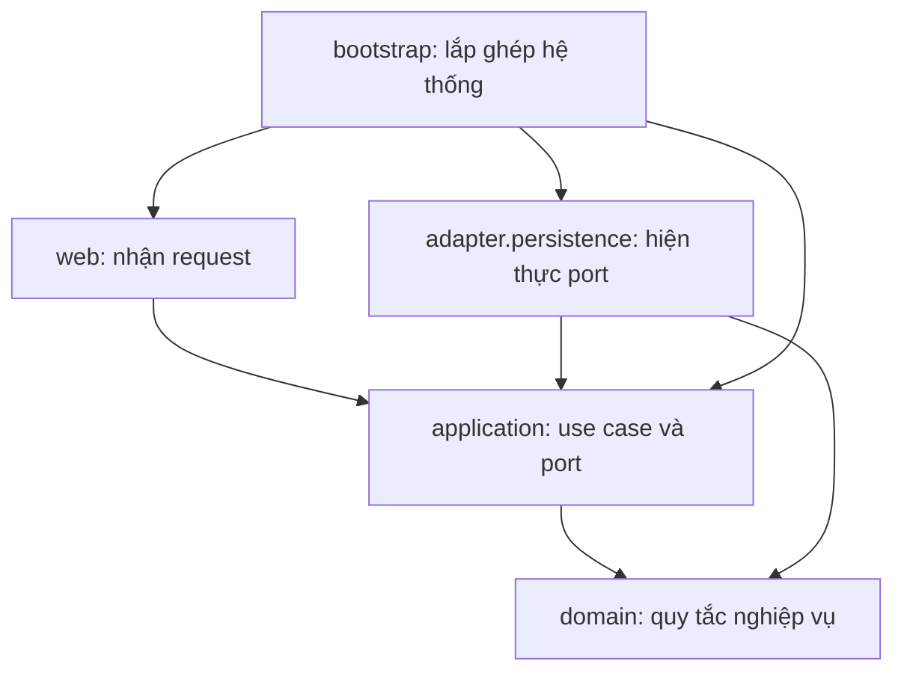
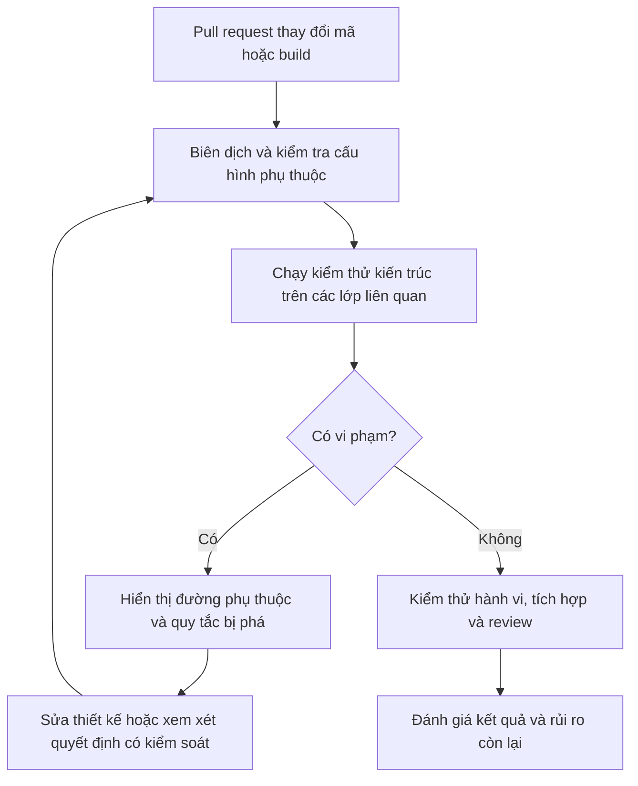

# Kiểm tra quan hệ phụ thuộc và ranh giới kiến trúc

## 1. Mục tiêu bài học

Trong chương **Kiểm tra tự động** của module **CODE_QUALITY_FUNDAMENTALS**, chúng ta tìm hiểu cách biến các quy tắc kiến trúc thành **điều kiện có thể kiểm tra tự động**. Một quy tắc như “nghiệp vụ không được phụ thuộc trực tiếp vào hạ tầng lưu trữ” sẽ đáng tin cậy hơn nếu một thay đổi vi phạm quy tắc có thể làm bài kiểm tra thất bại ngay trong quá trình phát triển.

Mục tiêu của module là **hiểu những thuộc tính quyết định mã nguồn có đáng tin cậy, dễ hiểu và dễ thay đổi hay không**. Việc kiểm tra quan hệ phụ thuộc giúp phát hiện sớm các ràng buộc ngầm, hạn chế hiệu ứng dây chuyền và làm rõ nơi có trách nhiệm thay đổi khi công nghệ hoặc nghiệp vụ phát triển.

Sau bài học, bạn có thể:

- Phân biệt **quan hệ phụ thuộc lúc biên dịch**, **hướng gọi lúc chạy** và **ranh giới kiến trúc được nhóm lựa chọn**.
- Nhận diện các vi phạm thường gặp: lõi nghiệp vụ phụ thuộc adapter, phụ thuộc vòng, truy cập trực tiếp lớp nội bộ và vượt qua hợp đồng đã định.
- Viết kiểm thử kiến trúc bằng **ArchUnit và JUnit 5** để kiểm tra những quy tắc phụ thuộc có thể biểu diễn qua lớp và package Java.
- Biết khi nào cần kiểm tra thêm **cấu hình build**, **JPMS**, **API công khai** hoặc thông tin lúc chạy.
- Xây dựng cách đưa kiểm tra vào CI, xử lý vi phạm có sẵn và tránh những quy tắc quá cứng gây trở ngại cho refactor hợp lý.

## 2. Quan hệ phụ thuộc là gì và vì sao cần kiểm soát?

**Phụ thuộc (dependency)** là quan hệ trong đó một thành phần cần biết hoặc sử dụng một thành phần khác. Ví dụ, lớp `OrderLookupService` dùng interface `OrderReader`; một adapter database hiện thực interface ấy; module ứng dụng dùng thư viện tính toán.

Trong Java, có nhiều kiểu phụ thuộc cần phân biệt:

| Loại | Ví dụ | Có thể kiểm tra bằng gì? |
| --- | --- | --- |
| **Phụ thuộc trong mã / bytecode** | Một lớp khai báo trường kiểu `OrderReader`, gọi phương thức, dùng annotation hoặc tạo một kiểu khác | Phân tích lớp bằng công cụ như ArchUnit; một số công cụ phát hiện thêm quan hệ qua bytecode |
| **Phụ thuộc artifact / build** | Subproject `app` khai báo cần `adapter-db` hoặc thư viện JDBC | Mô hình dependency của Maven/Gradle và quy tắc build |
| **Phụ thuộc JPMS** | `module com.example.shop.app` khai báo `requires com.example.shop.catalog;` | Java compiler/module descriptor, kiểm thử trên module path |
| **Gọi lúc chạy** | `OrderLookupService` gọi một đối tượng do `JdbcOrderReader` cung cấp qua interface | Kiểm thử tích hợp, trace và kiểm tra hành vi |
| **Phụ thuộc động hoặc ngoài mã tĩnh** | Reflection, tên lớp trong cấu hình, HTTP đến service khác, thông điệp trong hàng đợi | Phân tích cấu hình, contract/integration test và quan sát vận hành |

**Hướng gọi lúc chạy không đồng nhất với hướng phụ thuộc trong mã.** Một service nghiệp vụ có thể **gọi** phương thức của adapter lúc chạy, nhưng mã nguồn của service chỉ **biết interface** nằm ở tầng ứng dụng. Chính adapter phụ thuộc vào interface để hiện thực nó. Cách tổ chức này giúp thay adapter mà không phải sửa logic nghiệp vụ.

Mục tiêu không phải “loại bỏ tất cả phụ thuộc” — điều đó không thực tế. Mục tiêu là có **những phụ thuộc được phép, có hướng rõ ràng, không tạo vòng và không kéo chi tiết dễ thay đổi vào nơi cần ổn định**.

## 3. Ranh giới kiến trúc cần được phát biểu trước khi kiểm tra

Giả sử một ứng dụng quản lý đơn hàng được chia thành bốn nhóm trách nhiệm:

- **`domain`:** mô hình và bất biến nghiệp vụ, không cần biết cơ sở dữ liệu hay giao diện web.
- **`application`:** điều phối use case và khai báo các interface/port cần sử dụng; được phép dùng mô hình domain.
- **`adapter`:** hiện thực các port bằng database, file, HTTP hoặc bộ nhớ; được phép dùng hợp đồng application và domain.
- **`web`:** nhận và chuyển yêu cầu HTTP sang use case; không tự đi vòng qua application để truy cập adapter lưu trữ.

Một **composition root** riêng, ví dụ package `bootstrap`, có nhiệm vụ lắp ghép các hiện thực ở điểm khởi tạo ứng dụng.



Sơ đồ mô tả **hướng phụ thuộc ở mức mã**. Tại runtime, application có thể gọi đối tượng adapter đã được truyền vào; điều đó không tạo ra một import ngược từ application đến adapter.

Trong ví dụ, nhóm có thể đưa ra các **quy tắc được kiểm tra**:

1. Lớp trong `domain` không phụ thuộc vào lớp của `application`, `adapter` hoặc `web`.
2. Lớp trong `application` không phụ thuộc trực tiếp vào `adapter` hoặc `web`.
3. Lớp trong `web` không truy cập trực tiếp các lớp ở `adapter`; việc nối các thành phần đặt ở `bootstrap`.
4. Không có **chu trình phụ thuộc** giữa các nhóm package cấp cao đã định.
5. Các phụ thuộc build, API công khai và cấu hình chạy phải **phù hợp với phạm vi** của các quy tắc trên.

Đây là **chính sách giả định cho bài học**, không phải luật bắt buộc cho mọi dự án. Một hệ thống chia package khác, ví dụ `feature-order` và `feature-payment`, có thể cần quy tắc theo feature hoặc capability thay vì theo layer. Kiểm thử kiến trúc phải bắt đầu từ **quyết định được chấp thuận**, không từ một mẫu công cụ chọn ngẫu nhiên.

## 4. Ví dụ Java 17: thiết kế cho phép phụ thuộc đúng hướng

Ta xây dựng một use case **tra cứu đơn hàng**. Ứng dụng cần biết đơn có tồn tại hay không, nhưng không cần biết dữ liệu lấy từ JDBC, cache hay một nguồn trong bộ nhớ.

### 4.1. Domain không biết tầng bên ngoài

```java
// com/example/shop/domain/Order.java
package com.example.shop.domain;

import java.util.Objects;

public record Order(String orderId, long subtotalVnd) {
    public Order {
        Objects.requireNonNull(orderId, "orderId");
        if (orderId.isBlank()) {
            throw new IllegalArgumentException("orderId must not be blank");
        }
        if (subtotalVnd < 0) {
            throw new IllegalArgumentException(
                    "subtotalVnd must not be negative");
        }
    }
}
```

`Order` chỉ dùng kiểu cơ bản và thư viện chuẩn Java. Mã domain không chứa `import com.example.shop.adapter...` hay annotation lưu trữ chỉ để hoạt động với một database cụ thể.

### 4.2. Application sở hữu nhu cầu đọc dữ liệu

```java
// com/example/shop/application/OrderReader.java
package com.example.shop.application;

import com.example.shop.domain.Order;
import java.util.Optional;

public interface OrderReader {
    Optional<Order> findById(String orderId);
}
```

```java
// com/example/shop/application/OrderLookupService.java
package com.example.shop.application;

import com.example.shop.domain.Order;
import java.util.Objects;
import java.util.Optional;

public final class OrderLookupService {
    private final OrderReader orderReader;

    public OrderLookupService(OrderReader orderReader) {
        this.orderReader = Objects.requireNonNull(
                orderReader, "orderReader");
    }

    public Optional<Order> findById(String orderId) {
        if (orderId == null || orderId.isBlank()) {
            throw new IllegalArgumentException(
                    "orderId must not be blank");
        }
        return Objects.requireNonNull(
                orderReader.findById(orderId),
                "OrderReader must not return null");
    }
}
```

`OrderLookupService` biết **hợp đồng `OrderReader`** và kiểu `Order`, không biết lớp `JdbcOrderReader` hay `InMemoryOrderReader` nào được dùng trong môi trường chạy.

### 4.3. Adapter phụ thuộc vào hợp đồng của application

```java
// com/example/shop/adapter/inmemory/InMemoryOrderReader.java
package com.example.shop.adapter.inmemory;

import com.example.shop.application.OrderReader;
import com.example.shop.domain.Order;
import java.util.Map;
import java.util.Objects;
import java.util.Optional;

public final class InMemoryOrderReader implements OrderReader {
    private final Map<String, Order> ordersById;

    public InMemoryOrderReader(Map<String, Order> ordersById) {
        this.ordersById = Map.copyOf(
                Objects.requireNonNull(ordersById, "ordersById"));
    }

    @Override
    public Optional<Order> findById(String orderId) {
        Objects.requireNonNull(orderId, "orderId");
        return Optional.ofNullable(ordersById.get(orderId));
    }
}
```

`InMemoryOrderReader` là hiện thực minh họa, không phải adapter lưu dữ liệu bền vững. Khi cần chuyển sang JDBC, một lớp ở `adapter.persistence` có thể hiện thực cùng `OrderReader`. Mã application **không cần import lớp hiện thực đó**.

### 4.4. Điểm khởi tạo lắp ghép phụ thuộc

```java
// com/example/shop/bootstrap/ShopBootstrap.java
package com.example.shop.bootstrap;

import com.example.shop.adapter.inmemory.InMemoryOrderReader;
import com.example.shop.application.OrderLookupService;
import com.example.shop.domain.Order;
import java.util.Map;

public final class ShopBootstrap {
    private ShopBootstrap() {}

    public static void main(String[] args) {
        var adapter = new InMemoryOrderReader(
                Map.of("ORDER-1", new Order("ORDER-1", 120_000)));
        var service = new OrderLookupService(adapter);
        System.out.println(service.findById("ORDER-1"));
    }
}
```

Lớp `ShopBootstrap` được phép biết cả application và adapter vì nó chịu trách nhiệm nối chúng. **Không nên cấm mọi nơi tạo adapter** mà quên tạo ngoại lệ minh bạch cho composition root. Nếu service tự gọi `new JdbcOrderReader(...)`, mã application sẽ phụ thuộc trực tiếp hạ tầng và khó thay nguồn dữ liệu hơn.

Lưu ý: việc đặt đúng package **chưa tự chứng minh** API đáp ứng mọi yêu cầu về lỗi, giao dịch, độ mới dữ liệu và bảo mật. Kiểm tra kiến trúc là một lớp bằng chứng về **cấu trúc**, không thay thế kiểm thử hành vi.

## 5. Viết kiểm tra kiến trúc bằng ArchUnit và JUnit 5

**ArchUnit** là thư viện Java hỗ trợ mô tả những quy tắc kiến trúc qua việc phân tích class và quan hệ phụ thuộc. Có thể tích hợp với JUnit 5 để mỗi lần chạy test phát hiện thêm phụ thuộc không được phép.

Ví dụ bên dưới **giả định** dự án đã thêm thư viện ArchUnit tích hợp JUnit 5 vào phụ thuộc kiểm thử. Không áp dụng một phiên bản dependency cụ thể khi chưa biết cấu hình build; các package API được dùng là:

- `com.tngtech.archunit.junit.AnalyzeClasses` và `ArchTest`.
- `com.tngtech.archunit.lang.ArchRule`.
- `com.tngtech.archunit.lang.syntax.ArchRuleDefinition.noClasses`.
- `com.tngtech.archunit.library.dependencies.SlicesRuleDefinition.slices`.

Một lớp kiểm thử có thể được đặt trong **test source set** của thành phần có thể truy cập toàn bộ các lớp sản xuất cần kiểm tra:

```java
// src/test/java/com/example/architecture/DependencyRulesTest.java
package com.example.architecture;

import com.tngtech.archunit.junit.AnalyzeClasses;
import com.tngtech.archunit.junit.ArchTest;
import com.tngtech.archunit.lang.ArchRule;

import static com.tngtech.archunit.lang.syntax.ArchRuleDefinition.noClasses;
import static com.tngtech.archunit.library.dependencies.SlicesRuleDefinition.slices;

@AnalyzeClasses(packages = "com.example.shop")
class DependencyRulesTest {

    @ArchTest
    static final ArchRule domainMustNotKnowOuterLayers =
            noClasses()
                    .that().resideInAPackage("..domain..")
                    .should().dependOnClassesThat()
                    .resideInAnyPackage(
                            "..application..",
                            "..adapter..",
                            "..web..");

    @ArchTest
    static final ArchRule applicationMustNotKnowAdapters =
            noClasses()
                    .that().resideInAPackage("..application..")
                    .should().dependOnClassesThat()
                    .resideInAnyPackage(
                            "..adapter..",
                            "..web..");

    @ArchTest
    static final ArchRule webMustNotBypassApplication =
            noClasses()
                    .that().resideInAPackage("..web..")
                    .should().dependOnClassesThat()
                    .resideInAPackage("..adapter..");

    @ArchTest
    static final ArchRule topLevelPackagesMustNotFormCycles =
            slices()
                    .matching("com.example.shop.(*)..")
                    .should().beFreeOfCycles();
}
```

**Cách đọc một quy tắc:** “Không lớp nào thuộc `..application..` được có quan hệ phụ thuộc đến lớp trong `..adapter..` hoặc `..web..`”. Nếu ai đó đưa `import com.example.shop.adapter.persistence.JdbcOrderReader` vào `OrderLookupService` rồi tạo trực tiếp adapter, bài kiểm tra về application có thể phát hiện sai chiều phụ thuộc.

**Quy tắc chu trình:** `slices().matching("com.example.shop.(*)..")` nhóm các lớp theo phần package ngay sau `com.example.shop`. Ví dụ `application`, `domain`, `adapter` và `web` trở thành các nhóm; một chu trình giữa các nhóm có thể làm test thất bại.

Đó chỉ là **mức phân nhóm đã chọn**. Chu trình *giữa hai package con đều nằm trong `adapter`* có thể không bị phát hiện bởi quy tắc nhóm cấp cao này. Nếu cần kiểm soát các package nhỏ hơn, hãy định nghĩa mẫu slice hoặc quy tắc riêng phù hợp.

### Điều kiện để test có giá trị

Kiểm tra cấu trúc này cần **quét đúng tập lớp**. Nếu dự án có nhiều artifact nhưng test chỉ thấy class của `domain`, một vi phạm trong `application` ở artifact khác có thể không được kiểm tra. Cần bảo đảm các class sản xuất liên quan nằm trong phạm vi mà ArchUnit import được qua cấu hình test classpath hoặc cách phân tích artifact phù hợp.

Tên package trong ví dụ chỉ có ý nghĩa nếu chúng đúng với quy ước **thực tế**. Nếu mã chuyển từ package theo layer sang package theo feature mà không sửa quy tắc, test có thể bỏ sót vi phạm hoặc báo sai.

Khi thêm test lần đầu, hãy thử tạo **một vi phạm có kiểm soát** trong nhánh phát triển và xác nhận kiểm tra thất bại, rồi hoàn nguyên thay đổi đó. Bước này giúp phát hiện bài test “xanh vì không quét được lớp nào cần kiểm tra”, thay vì chỉ nhìn trạng thái PASS.

## 6. Trường hợp vi phạm và cách sửa đúng hướng

Giả sử service cần đọc đơn hàng từ database. Một phương án không phù hợp với chính sách đang chọn là cho `application` tự tạo đối tượng ở `adapter.persistence`:

```java
// Phác họa lỗi: application phụ thuộc trực tiếp vào adapter.
package com.example.shop.application;

import com.example.shop.adapter.persistence.JdbcOrderReader;

// ...
// new JdbcOrderReader(dataSource) được tạo bên trong use case.
```

Trong chính sách minh họa, vấn đề không nằm ở tên `JdbcOrderReader`, mà nằm ở việc **chi tiết lưu trữ chen vào phần điều phối nghiệp vụ**. Khi chuyển sang cache, database khác hoặc adapter giả để test, logic application phải sửa.

Cách tổ chức thích hợp hơn là:

1. Giữ interface `OrderReader` ở nơi biểu đạt nhu cầu của application.
2. Cho `JdbcOrderReader` ở adapter hiện thực interface đó.
3. Lắp ghép đối tượng cụ thể tại `bootstrap` hoặc điểm cấu hình dependency injection.
4. Để `OrderLookupService` nhận `OrderReader` qua constructor như ví dụ.
5. Chạy kiểm thử hành vi và kiểm thử kiến trúc để bảo đảm không đổi kết quả nghiệp vụ và không vi phạm chiều phụ thuộc.

**Không nên “sửa” cảnh báo bằng cách đổi tên package, dùng reflection để gọi lớp bị cấm hoặc thêm điều kiện bỏ qua test** trong khi ranh giới thật vẫn bị phá. Nếu chính sách không còn phù hợp, hãy xem xét thay đổi kiến trúc một cách có lý do và cập nhật quy tắc tương ứng.

## 7. Kiểm tra cấu hình build và phụ thuộc bắc cầu

ArchUnit phân tích quan hệ được biểu diễn qua những lớp nó import. Nó **không thay thế hoàn toàn** việc kiểm soát dependency giữa các artifact trong Maven/Gradle.

Ví dụ trong một hệ thống chia thành các Gradle subproject `:domain`, `:application`, `:adapter-db` và `:app`, một hướng phụ thuộc được cho phép có thể là:

```text
:application  --> :domain
:adapter-db   --> :application, :domain
:app          --> :application, :adapter-db
```

Đây chỉ là **mô hình giả định**, không phải sơ đồ đã được xác minh của repository. Nếu `:domain` lại khai báo `implementation(project(":adapter-db"))`, ranh giới đã bị xâm phạm ngay tại cấu hình build, kể cả khi chưa có lớp domain nào trực tiếp dùng adapter.

Một ví dụ khai báo dependency trong **build script Gradle**:

```kotlin
// Chỉ minh họa file build của subproject :application.
dependencies {
    implementation(project(":domain"))
}
```

Mã application không cần trực tiếp khai báo `:adapter-db`. Để kiểm tra thực tế, có thể sử dụng báo cáo dependency của công cụ build, cấu hình quy tắc cấm phụ thuộc hoặc task kiểm tra kiến trúc riêng.

Ví dụ về thao tác **chẩn đoán**, không phải lệnh đã được chạy trong bài học:

```text
./gradlew :application:dependencies
./gradlew :application:dependencyInsight --dependency <ten-thu-vien>
```

Các lệnh và tên task cần điều chỉnh theo shell, build và cấu hình dự án. Ngoài việc có phụ thuộc trực tiếp, cần xét **phụ thuộc bắc cầu (transitive dependency)**: một thư viện được kéo vào qua nhiều tầng có thể mang theo phiên bản không phù hợp, lỗi bảo mật hoặc những API không nên xuất hiện ở ranh giới công khai.

### Không đánh đồng phụ thuộc khai báo với sử dụng thật

- **Cấu hình build** cho biết module hoặc artifact **có thể** sử dụng một thư viện theo khai báo và cơ chế resolution.
- **Phân tích class** cho biết mã đã biên dịch **đang tham chiếu** kiểu nào trong tập class được quét.
- **Kiểm thử tích hợp** xác minh một số tương tác xảy ra **thật ở runtime**.

Ba góc nhìn bổ sung cho nhau. Một dependency thừa chỉ xuất hiện trong build có thể không bị phát hiện bởi quy tắc import class; ngược lại, một lớp tạo chu trình trong cùng một artifact không nhất thiết tạo vòng trong graph các subproject.

## 8. Ranh giới module Java (JPMS) là một cơ chế khác

Nếu dự án dùng **Java Platform Module System (JPMS)**, descriptor `module-info.java` định nghĩa named module, các quan hệ `requires` và package được `exports`. Ví dụ:

```java
// module-info.java của artifact domain, minh họa riêng.
module com.example.shop.domain {
    exports com.example.shop.domain;
}
```

```java
// module-info.java của artifact application, minh họa riêng.
module com.example.shop.application {
    requires com.example.shop.domain;
    exports com.example.shop.application;
}
```

```java
// module-info.java của artifact adapter, minh họa riêng.
module com.example.shop.adapter {
    requires com.example.shop.application;
    requires com.example.shop.domain;
    exports com.example.shop.adapter.inmemory;
}
```

Ba đoạn trên là **ba descriptor thuộc ba artifact khác nhau**, không đặt chung trong một `module-info.java`. Ở đây, module application cần module domain, còn adapter cần cả hợp đồng application và domain. Không có `requires com.example.shop.adapter` trong module application.

JPMS có thể ngăn một số truy cập sang package **không export** khi dùng module path, nhưng vẫn cần chính sách kiến trúc để xác định điều gì **nên** được phụ thuộc. Ví dụ, việc một package được export không đồng nghĩa mọi module được phép phụ thuộc vào nó theo kiến trúc đã chọn.

Các dự án chỉ dùng **classpath** không được bảo vệ bởi cùng cơ chế truy cập của JPMS; nhiều dự án dùng Maven/Gradle subproject nhưng **không** dùng named module. Ngoài ra, reflection và framework có thể sử dụng `opens`; nên kiểm tra cấu hình thực tế, không giả định test qua `exports` đã bao quát mọi truy cập động.

## 9. Kiểm tra vòng phụ thuộc và tính ổn định của API

### 9.1. Phụ thuộc vòng làm thay đổi khó kiểm soát

Giả sử:

```text
domain --> application
application --> adapter
adapter --> domain
```

Chu trình này khiến một thay đổi trong adapter có thể ảnh hưởng lại domain qua đường phụ thuộc. Ở mức build, vòng phụ thuộc giữa các module có thể bị công cụ build từ chối; ở mức package hoặc class trong cùng một artifact, chu trình có thể vẫn biên dịch nhưng khiến thiết kế khó tách và kiểm thử.

Không phải mọi chu trình giữa các class là lỗi cần loại bỏ ngay bất chấp ngữ nghĩa. Ví dụ hai kiểu dữ liệu cùng cấu thành một mô hình có thể tham chiếu lẫn nhau theo hợp đồng. Mục tiêu là ngăn **chu trình không mong muốn giữa các ranh giới trách nhiệm**. Vì thế cần chọn hạt kiểm tra thích hợp: layer, feature, package hoặc artifact.

### 9.2. Không truy cập lớp nội bộ

Một quy tắc khác có thể là “chỉ package `..api..` của thư viện được module khác sử dụng”. Với classpath, tên package `internal` **không tự ngăn** việc import lớp `public` bên trong. Nhóm có thể dùng JPMS, cấu trúc artifact hoặc quy tắc phân tích phụ thuộc để cấm đường truy cập đó.

Tuy nhiên, không nên viết một quy tắc kiểu “mọi lớp có `internal` trong tên đều bị cấm” nếu package thực tế có ý nghĩa khác hoặc các test hợp lệ cần truy cập một ranh giới đặc biệt. Chính sách phải nhắm đúng **hợp đồng bảo trì** mà nhóm muốn giữ.

### 9.3. Công khai kiểu dữ liệu không mong muốn

Ví dụ API `OrderLookupService` trả trực tiếp `JpaEntity` của adapter. Dù lúc này không có import ngược trong một vài lớp, contract public đã phụ thuộc vào kiểu lưu trữ. Khi đổi ORM hoặc cấu trúc database, caller bị ảnh hưởng theo.

Các ranh giới có thể cần kiểm tra thêm:

- Public API của application có chứa kiểu chỉ thuộc tầng adapter/framework không?
- Domain có dùng annotation hoặc exception dành riêng cho database không?
- Adapter có gọi trực tiếp nội bộ của feature khác thay vì dùng hợp đồng đã công bố không?
- Các DTO/contract có độc lập với mô hình persistence khi yêu cầu thay thế hạ tầng không?

Một số thuộc tính có thể mô tả bằng quy tắc trên method signature, field, annotation và package; thuộc tính khác cần **review hợp đồng và kiểm thử hành vi**.

## 10. Đưa kiểm tra kiến trúc vào quy trình CI

Một quy tắc chỉ tồn tại trong tài liệu dễ bị quên. Quy tắc chạy tự động giúp một PR vi phạm được phản hồi sớm:



Một pipeline phù hợp có thể:

1. **Biên dịch toàn bộ phần mã cần kiểm tra:** bảo đảm kiểm thử không bỏ sót module vì chưa build hoặc không có trong classpath.
2. **Chạy quy tắc kiến trúc cùng các test khác:** các quy tắc phải có đường thực thi trong CI, không chỉ nằm trong test source nhưng bị loại khỏi task chạy.
3. **Báo vi phạm có ích:** nêu lớp nguồn, lớp đích, loại quan hệ và quy tắc bị phá để developer tìm đúng nguyên nhân.
4. **Duy trì thời gian phản hồi hợp lý:** quy tắc rẻ chạy ở mỗi PR; những phép phân tích nặng hơn có thể được điều phối phù hợp, nhưng không bỏ kiểm tra quan trọng.
5. **Xử lý ngoại lệ minh bạch:** nếu một phụ thuộc thực sự cần thiết, sửa chính sách hoặc cấu trúc với review; không âm thầm tắt tất cả kiểm tra.
6. **Kết hợp kiểm thử hành vi và tích hợp:** bài test về chiều phụ thuộc xanh không đảm bảo việc thanh toán, đồng thời hay triển khai đang đúng.

Khi một hệ thống cũ đã có nhiều vi phạm, bật ngay quy tắc toàn cục có thể tạo một lượng lỗi lớn khiến nhóm vô hiệu hóa kiểm tra. Có thể áp dụng **baseline có kiểm soát**: ghi lại danh sách vi phạm đã biết, ngăn vi phạm mới và lên kế hoạch giảm nợ. Baseline cần người phụ trách, lý do và thời điểm xem lại; không nên trở thành cách bỏ qua mọi thay đổi.

## 11. Giới hạn của kiểm tra tự động

Không có một công cụ nào tự hiểu toàn bộ ý định kiến trúc. Bằng chứng từ phân tích tĩnh và đồ thị phụ thuộc có những giới hạn:

| Điều cần biết | Điều công cụ có thể phát hiện | Điều còn cần làm |
| --- | --- | --- |
| Phụ thuộc mã Java | Nhiều quan hệ ở class, method, field, annotation và lời gọi | Bảo đảm quét đủ tập lớp và khớp đúng package/module |
| Phụ thuộc build | Artifact được khai báo và resolve | Phân tích dependency transitive, version và runtime scope |
| JPMS | Ranh giới module/exports ở chế độ module path | Kiểm tra cách deploy, reflection và module graph thật |
| Reflection/config | Một số mẫu có thể phân tích từ cấu hình | Integration test với framework và cấu hình thực tế |
| HTTP/messaging | Kiểu client hoặc cổng gọi có thể được nhận diện một phần | Contract test, sơ đồ dịch vụ, quan sát runtime |
| Hành vi nghiệp vụ | Một số bất biến cấu trúc | Unit/integration tests; xác minh yêu cầu |
| Hiệu năng/độ tin cậy | Có thể phát hiện một số phụ thuộc quá mức | Benchmark, load test, fault testing và telemetry |

**Quy tắc kiến trúc xanh chỉ nói rằng tập quy tắc đã triển khai không tìm thấy vi phạm trong phạm vi được quét**. Nó không chứng minh hệ thống có kiến trúc tối ưu, không có rò rỉ phụ thuộc động hay đúng toàn bộ nghiệp vụ.

Đặc biệt:

- **Phụ thuộc qua reflection** có thể không hiện rõ như một import trực tiếp.
- **Lời gọi REST** đến một service khác có thể chỉ là chuỗi URL hoặc cấu hình.
- **Message queue** có thể tạo phụ thuộc vào định dạng sự kiện và giả định thứ tự xử lý.
- **Generated code** có thể nằm trong source set riêng không được quét ở thời điểm test.
- **Annotation processor, plugin, ServiceLoader** hoặc dynamic class loading có thể tạo quan hệ cần kiểm tra bằng phương pháp khác.

Vì vậy, xem kết quả tự động là **một lớp bằng chứng**, bổ sung cho review kiến trúc, kiểm thử contract và kiểm tra vận hành.

## 12. Thiết kế quy tắc tốt: đủ chặt nhưng không phản tác dụng

Một quy tắc quá rộng có thể cấm những phụ thuộc hợp lý; một quy tắc quá hẹp có thể luôn xanh dù kiến trúc bị phá.

Ví dụ một quy tắc “bất kỳ package nào cũng không được import package khác” sẽ làm ứng dụng hầu như không thể hoạt động. Một quy tắc “domain không phụ thuộc adapter” có ý nghĩa rõ hơn và cho phép domain dùng thư viện chuẩn Java hoặc các kiểu của chính nó.

Nên thực hiện từng bước:

1. **Chọn ranh giới đáng bảo vệ:** nơi có lý do thay đổi độc lập, hợp đồng được nhiều thành phần dùng hoặc chi phí phụ thuộc ngược lớn.
2. **Phát biểu quy tắc bằng ngôn ngữ rõ:** “application không import adapter”, thay vì “kiến trúc phải sạch”.
3. **Ánh xạ khái niệm sang mã thực:** package, artifact, JPMS module hoặc annotation nào biểu diễn ranh giới đó?
4. **Chọn công cụ đúng loại bằng chứng:** ArchUnit cho quan hệ class/package; build graph cho artifact; integration test cho đường động.
5. **Tạo trường hợp vi phạm thử:** xác minh rule có thể chuyển từ xanh sang đỏ khi bị phá.
6. **Giải thích ngoại lệ và điểm lắp ghép:** composition root có thể dùng adapter; adapter được phép dùng port; test có thể cần fake.
7. **Review quy tắc khi kiến trúc đổi:** nếu chuyển từ layer sang feature, không giữ nguyên glob package như thể thiết kế chưa từng thay đổi.

**Tính ổn định của rule quan trọng:** kiểm tra không nên đỏ chỉ vì đổi tên helper nội bộ khi ranh giới trách nhiệm vẫn đúng. Nhưng khi import trực tiếp lớp hạ tầng vào application, nó cần báo vi phạm ngay cả khi unit test nghiệp vụ vẫn xanh.

## 13. Bài tập áp dụng

Giả sử một dự án có các package:

```text
com.example.shop.domain
com.example.shop.application
com.example.shop.adapter.persistence
com.example.shop.web
com.example.shop.bootstrap
```

Nhóm thống nhất: domain độc lập với phần bên ngoài; application được dùng domain nhưng không được dùng web/persistence; adapter hiện thực port của application; bootstrap lắp ghép các hiện thực.

Xét bốn tình huống:

**Tình huống A.** `OrderLookupService` trong application tạo trực tiếp `JdbcOrderReader`. Unit test vẫn xanh.

**Tình huống B.** `JdbcOrderReader` trong adapter import `OrderReader` và `Order`, rồi được bootstrap truyền vào service.

**Tình huống C.** Một tính năng mới dùng reflection để nạp class adapter theo tên lấy từ cấu hình, trong khi ArchUnit chỉ kiểm tra quan hệ lớp tĩnh.

**Tình huống D.** Sau khi chuyển package `application` thành `feature.order.usecase`, các rule vẫn lọc bằng chuỗi `..application..` và CI luôn xanh.

Hãy trả lời:

1. Trường hợp nào phù hợp với chính sách, trường hợp nào vi phạm?
2. Một quy tắc ArchUnit nào có thể phát hiện A? Vì sao nó có thể không phát hiện C?
3. B cần được kiểm tra bằng những loại test nào ngoài kiểm tra chiều import?
4. Vì sao D nguy hiểm dù các kiểm tra đều xanh?
5. Nếu cần cho một thành phần đặc biệt phụ thuộc adapter trực tiếp, nên ghi nhận và kiểm soát ngoại lệ thế nào?

**Gợi ý:** A vi phạm vì application phụ thuộc hạ tầng; B là chiều phụ thuộc phù hợp, nhưng vẫn cần test hành vi, tích hợp và lắp ghép đúng. C có thể lọt qua phân tích tĩnh do reflection/config; cần bổ sung kiểm tra runtime và cấu hình. D cho thấy rule bị lệch phạm vi, phải cập nhật quy tắc và thử vi phạm có kiểm soát. Ngoại lệ hợp lệ cần ranh giới, lý do và review, không phải tắt toàn bộ test kiến trúc.

## 14. Checklist khi review và đưa vào CI

Trước khi kết luận rằng ranh giới kiến trúc đã được bảo vệ, hãy xác nhận:

- **Chính sách được mô tả rõ:** những layer/feature/module nào được phép phụ thuộc nhau?
- **Phạm vi import đủ:** bài test thấy các class của mọi artifact cần phân tích không?
- **Biểu thức rule khớp cách đặt package thật:** có bỏ sót code do đổi tên hoặc chuyển source set không?
- **Rule thất bại khi vi phạm được cố ý tạo ra:** có thể kiểm chứng thay vì chỉ tin màu xanh?
- **Cấu hình build nhất quán:** không có phụ thuộc artifact đi ngược chính sách dù class chưa sử dụng?
- **Phụ thuộc vòng được kiểm tra ở mức phù hợp:** package cấp cao, feature hoặc subproject?
- **Public API không lộ chi tiết hạ tầng ngoài ý muốn:** có kiểm tra chữ ký và hợp đồng khi cần?
- **Tác dụng phụ và đường động được kiểm tra riêng:** reflection, cấu hình, HTTP, messaging và DI có phù hợp?
- **CI chạy đúng task và môi trường:** test không bị lọc, bỏ qua hoặc chỉ chạy trên một phần mã?
- **Ngoại lệ và nợ kiến trúc có người chịu trách nhiệm:** có kế hoạch xem xét lại và ngăn nợ phát sinh mới?

Mỗi câu trả lời nên gắn với **quy tắc, cấu hình hoặc bằng chứng cụ thể**, không chỉ ghi “đã theo clean architecture”.

## 15. Ghi nhớ

**Kiểm tra quan hệ phụ thuộc và ranh giới kiến trúc** là cách chuyển quyết định thiết kế từ tài liệu thành **phản hồi tự động khi mã thay đổi**. Hãy phát biểu rõ chiều phụ thuộc được phép, mô hình hóa đúng phạm vi package/artifact/module, viết kiểm thử phát hiện vi phạm và chạy chúng trong CI. Đồng thời, cần phân biệt **đồ thị phụ thuộc lúc biên dịch**, **cấu hình build** và **tương tác lúc chạy**: không công cụ nào tự kiểm tra trọn vẹn tất cả. Khi kết hợp rule phù hợp, kiểm thử hành vi, kiểm thử tích hợp và review, mã nguồn sẽ **dễ hiểu ranh giới hơn, ít phụ thuộc ngược hơn và an toàn hơn khi thay đổi**.
