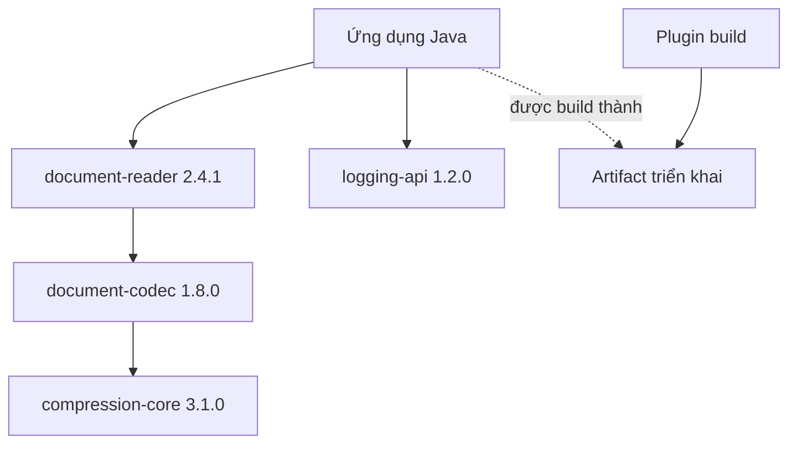
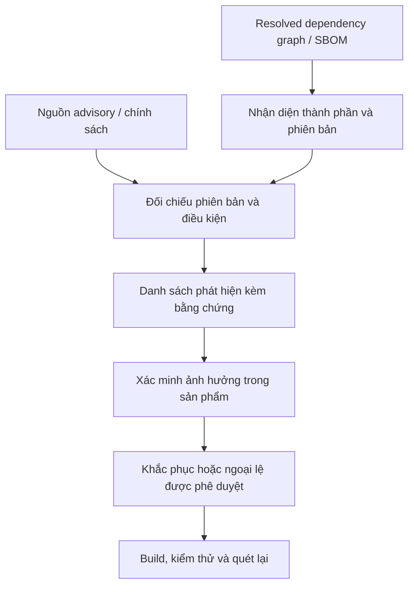
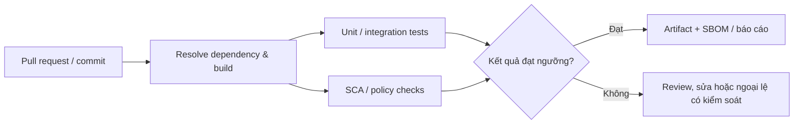

# Kiểm tra thành phần bên ngoài và vấn đề đã được nhận diện

> **Chương:** Kiểm tra tự động  
> **Học phần:** CODE_QUALITY_FUNDAMENTALS — Hiểu những thuộc tính quyết định mã nguồn có đáng tin cậy, dễ hiểu và dễ thay đổi hay không.

Một ứng dụng Java có thể vượt qua toàn bộ unit test và quy tắc định dạng nhưng vẫn phụ thuộc vào thư viện chứa lỗ hổng đã được công bố. Mã do nhóm tự viết không nhất thiết có lỗi, song ứng dụng có thể đưa dữ liệu không tin cậy vào một bộ phân tích tệp, trình xử lý JSON hoặc thành phần nén có vấn đề. Ngược lại, một báo cáo tự động gắn nhãn “nguy cơ cao” cho thư viện cũng chưa đủ để kết luận mọi cách sử dụng thư viện đó đều có thể bị khai thác.

Vì vậy, **kiểm tra tự động thành phần bên ngoài** cần giải quyết hai công việc khác nhau nhưng liên quan:

1. **Phát hiện và truy vết:** biết bản build thực sự sử dụng những thành phần và phiên bản nào, bao gồm phụ thuộc trực tiếp, bắc cầu và công cụ build phù hợp với phạm vi quét.
2. **Đánh giá và xử lý:** đối chiếu thành phần với những vấn đề đã được nhận diện, xác minh điều kiện ảnh hưởng, quyết định cách khắc phục rồi kiểm tra lại hiện vật sau thay đổi.

Hoạt động này thường được gọi là **Software Composition Analysis (SCA)**. Nó bổ sung cho kiểm thử chức năng, phân tích tĩnh mã nguồn, kiểm tra cấu hình và kiểm soát chuỗi cung ứng. Trong học phần **CODE_QUALITY_FUNDAMENTALS**, mục tiêu là hiểu cách các bằng chứng tự động giúp mã **đáng tin cậy, dễ đánh giá và dễ thay đổi**, chứ không chỉ học một lệnh chạy scanner.

Sau bài học, bạn có thể:

- Phân biệt phụ thuộc được **khai báo** với phụ thuộc đã được **giải quyết và đóng gói**.
- Hiểu cách scanner đối chiếu danh tính/phiên bản với advisory và vì sao cần review kết quả.
- Đọc cảnh báo về lỗ hổng, thành phần lỗi thời, nguồn không được phê duyệt và chính sách bản quyền theo đúng phạm vi.
- Truy ngược một phụ thuộc bắc cầu trong Gradle hoặc Maven, chọn cách xử lý phù hợp và xác minh bản vá.
- Đề xuất một quy trình CI có ngưỡng kiểm soát, ngoại lệ có thời hạn và trách nhiệm rõ ràng.
- Biết những gì SCA **không thể chứng minh**, đặc biệt khi thư viện xử lý đầu vào nguy hiểm.

## 1. Tại sao quét mã của nhóm thôi là chưa đủ?

Giả sử dịch vụ nhận tệp tài liệu có đồ thị phụ thuộc minh họa:



Mọi tên nhóm/gói và phiên bản trong ví dụ là **giả định**, không phải thư viện hay lỗ hổng thực đã được xác minh.

Nhóm phát triển chỉ khai báo `document-reader` và `logging-api`, nhưng runtime có thể còn sử dụng `document-codec` và `compression-core` do thư viện đầu kéo vào. Một cảnh báo về `document-codec` cần được xem xét dù nhóm chưa từng tự viết dòng `implementation("...:document-codec:...")`.

Ngoài runtime, plugin build có thể thực thi mã trong lúc tạo artifact. Nó không nhất thiết xuất hiện ở `runtimeClasspath`, nhưng vẫn có thể ảnh hưởng tính tin cậy của bản phát hành và quyền truy cập tài nguyên CI.

| Thành phần | Vai trò | Điều cần kiểm tra |
| --- | --- | --- |
| Phụ thuộc trực tiếp | Nhóm chủ động lựa chọn và khai báo | Tên, phiên bản, nguồn, advisory, cập nhật |
| Phụ thuộc bắc cầu | Được kéo vào qua quan hệ phụ thuộc khác | Đường đi, phiên bản được chọn, khả năng thay thế |
| Dependency ở test/compile | Tham gia kiểm thử hoặc biên dịch | Quyền thực thi, rủi ro CI, phạm vi scanner |
| Build plugin/tool | Chạy tác vụ cấu hình hoặc tạo artifact | Nguồn plugin, phiên bản, quyền của runner, bản phát hành |
| JDK/base image | Nền tảng chạy hoặc đóng gói | Phiên bản, bản vá, thành phần hệ điều hành, provenance |

**Quét đúng phạm vi** quan trọng hơn một nhãn “đã chạy scan”. Nếu chỉ quét những dependency runtime mà bỏ qua plugin có quyền xuất bản, báo cáo đó không thể được diễn giải là đã kiểm tra đầy đủ chuỗi build.

## 2. Một “vấn đề đã được nhận diện” có thể là gì?

Không phải mọi cảnh báo liên quan dependency đều cùng ý nghĩa, mức nghiêm trọng hoặc cách xử lý.

### 2.1. Lỗ hổng đã được công bố

Một bản ghi advisory mô tả lỗi hoặc điểm yếu ở một sản phẩm/thành phần, các phiên bản có thể bị ảnh hưởng, điều kiện khai thác và thông tin khắc phục nếu có. Hệ thống nhận diện có thể sử dụng các mã như **CVE**, **GHSA** hoặc định danh advisory khác tùy nguồn.

Các cơ sở dữ liệu và dịch vụ tư vấn bảo mật có phạm vi và thời điểm cập nhật khác nhau. Cùng một thành phần có thể được ánh xạ theo những định danh khác nhau; việc đối chiếu cần tránh **đếm trùng một vấn đề** hoặc nhận diện nhầm gói có tên giống nhau.

### 2.2. Thành phần hết hỗ trợ hoặc không còn được duy trì

Một dự án đã ngừng bảo trì chưa chắc chứa lỗ hổng đã được biết đến. Tuy nhiên, nếu có lỗi hoặc cần bản vá tương thích, nhóm có thể không có đường cập nhật đáng tin cậy.

Tín hiệu tự động có thể dựa trên ngày phát hành, metadata hoặc danh sách trạng thái hỗ trợ. Đây là **chỉ dấu cần đánh giá**, không phải kết luận tự động rằng mọi thư viện lâu không cập nhật đều nguy hiểm.

### 2.3. Phiên bản hoặc nguồn phân phối không phù hợp chính sách

Một bản build có thể tải artifact từ repository chưa được phê duyệt, sử dụng phiên bản động hoặc có thay đổi bất ngờ ở đồ thị phụ thuộc. Kiểm tra tự động có thể phát hiện sai lệch với allowlist, lockfile hoặc metadata xác minh.

Đây là **vấn đề kiểm soát nguồn và tính tái lập**, không đồng nghĩa mọi trường hợp đã phát hiện mã độc. Mức độ xử lý phụ thuộc chính sách tin cậy của dự án.

### 2.4. Giấy phép sử dụng không phù hợp

Một công cụ phân tích thành phần có thể báo cáo giấy phép (*license*) và so sánh với chính sách của tổ chức. Đây chủ yếu là **rủi ro tuân thủ/pháp lý** và điều kiện phân phối, không phải lỗ hổng kỹ thuật. Kết quả phát hiện giấy phép bằng heuristic cần được đối chiếu khi có xung đột hoặc dữ liệu thiếu.

### 2.5. Bằng chứng hoặc metadata chưa đầy đủ

Thiếu phiên bản, thiếu nguồn phát hành, không xác định được danh tính, không có digest đáng tin cậy hoặc SBOM không đầy đủ đều làm giảm khả năng đánh giá. **Không có bằng chứng về vấn đề** khác với **có bằng chứng rằng không có vấn đề**.

| Nhóm cảnh báo | Câu hỏi cần trả lời | Hướng xử lý thường gặp |
| --- | --- | --- |
| Lỗ hổng đã biết | Phiên bản và đường sử dụng có bị ảnh hưởng không? | Nâng cấp, giảm thiểu, cô lập, đánh giá rủi ro |
| Không còn bảo trì | Ai có thể sửa khi xảy ra sự cố? | Thay thế, fork có quản lý, giảm phụ thuộc |
| Nguồn không được duyệt | Tại sao artifact đến từ kho này? | Chặn tải, kiểm tra nguồn, điều chỉnh repository policy |
| Sai lệch lockfile/verification | Artifact hoặc graph có đổi ngoài dự kiến không? | Review thay đổi, cập nhật metadata sau xác minh |
| Giấy phép chưa phù hợp | Điều kiện sử dụng/phân phối là gì? | Review với người chịu trách nhiệm chính sách |
| Danh tính không xác định | Scanner đã đối chiếu đúng component chưa? | Bổ sung metadata, xác minh artifact thực tế |

## 3. Đầu vào đúng quyết định chất lượng của kết quả tự động

Một scanner cần biết **chính xác thành phần nào** được sử dụng. Chỉ tìm văn bản trong file build là chưa đủ vì trình giải quyết phụ thuộc có thể lựa chọn phiên bản thông qua constraint, BOM, lockfile, rule hoặc quan hệ bắc cầu.

### 3.1. Khai báo chưa chắc là phiên bản resolved

Ví dụ Gradle Kotlin DSL, với tên gói giả định:

```kotlin
dependencies {
    implementation("com.example.docs:document-reader:2.4.1")
    // Có thể kéo document-codec qua đồ thị phụ thuộc.
}
```

Giả sử một module khác yêu cầu `document-codec:1.8.2` còn `document-reader` yêu cầu `1.8.0`. Phiên bản thực tế trong một cấu hình có thể được Gradle chọn theo các quy tắc giải quyết phụ thuộc và constraint của dự án. **Không được suy phiên bản chạy thực tế chỉ từ một dòng khai báo của thư viện cha.**

Các nguồn dữ liệu hữu ích:

| Nguồn | Cung cấp gì? | Giới hạn cần nhớ |
| --- | --- | --- |
| File build | Phụ thuộc trực tiếp, repository, plugin và quy tắc chọn | Có thể không hiển thị toàn bộ graph đã resolve |
| Dependency graph resolved | Những phiên bản được chọn và quan hệ kéo vào | Cần đúng configuration và module; không tự xác minh tính an toàn |
| Lockfile | Ghi nhận phiên bản resolved theo phạm vi khóa | Không chứng minh byte artifact đúng hoặc không có lỗ hổng |
| Verification metadata | Giúp xác minh checksum/chữ ký theo cấu hình | Bằng chứng phải xuất phát từ nguồn đáng tin; không đánh giá mã |
| SBOM | Danh mục thành phần của một phạm vi sản phẩm/build | Chất lượng phụ thuộc độ đầy đủ, độ mới và cách tạo |
| Artifact/container thực tế | Những byte và thành phần đã đóng gói | Phải liên kết đúng với bản triển khai và môi trường |

### 3.2. Danh tính cần đủ chính xác

Trong Maven ecosystem, tọa độ thường gồm `groupId`, `artifactId` và `version`. Một thư viện còn có thể có classifier/variant hoặc được đưa vào artifact dưới hình thức đóng gói lại (*shading*) khiến việc nhận diện tự động khó hơn.

Khi scanner báo lỗi với một tên gần giống, cần xác minh **đúng gói, phiên bản, đường phụ thuộc và byte hiện vật**, thay vì chỉ nhìn tên tệp JAR. Một cảnh báo sai ánh xạ không nên được xem là lỗ hổng đã được xác nhận của ứng dụng.

## 4. Khảo sát phụ thuộc trong dự án Java

Trước khi cấu hình một cổng CI, hãy biết cách xác định đường đi của thành phần trong dự án.

### 4.1. Gradle

Các lệnh **tham khảo** khi một module Java có cấu hình `runtimeClasspath`:

```bash
./gradlew dependencies --configuration runtimeClasspath
./gradlew dependencyInsight --dependency document-codec --configuration runtimeClasspath
```

Với dự án nhiều module có thể cần chọn đúng task, chẳng hạn:

```bash
./gradlew :app:dependencies --configuration runtimeClasspath
./gradlew :app:dependencyInsight --dependency document-codec --configuration runtimeClasspath
```

`dependencies` giúp nhìn đồ thị đã giải quyết trong phạm vi cấu hình; `dependencyInsight` giúp tìm lý do một module/phiên bản được lựa chọn. Nếu thư viện chỉ thuộc `testRuntimeClasspath`, `compileClasspath` hoặc phần build plugin, phải kiểm tra đường phụ thuộc tương ứng.

**Không có lệnh nào được thực thi trong bài học này.** Chúng là ví dụ để người học biết loại bằng chứng cần lấy từ dự án thật.

### 4.2. Maven

Trong dự án Maven, một lệnh tham khảo:

```bash
mvn dependency:tree
```

Có thể lọc hoặc cấu hình thêm theo mục đích và phiên bản plugin. Cây dependency của ứng dụng **không tự bao quát mọi plugin build**, nên cần xem riêng plugin và nguồn phân phối khi kiểm soát chuỗi build.

### 4.3. Tại sao phải xác định đúng scope?

Một cảnh báo ở mã thư viện được đóng gói vào runtime có đường khai thác khác với một cảnh báo ở công cụ chỉ chạy lúc kiểm thử. Nhưng công cụ build/test vẫn có thể tiếp cận token CI, source code hoặc artifact phát hành, nên **không có mặt trong runtime không đồng nghĩa rủi ro bằng 0**.

Khi báo cáo scan nêu tổng số “lỗ hổng”, phần mô tả phải đi kèm **scope**, ví dụ runtime dependencies của module `app` tại commit cụ thể, thay vì diễn giải thành toàn bộ sản phẩm.

## 5. Cơ chế đối chiếu advisory: phát hiện là bước đầu

Một quy trình SCA đơn giản:



Nguồn advisory có thể đưa ra phiên bản được xem là bị ảnh hưởng và phiên bản đã sửa. Tuy nhiên, **cơ chế so sánh phiên bản không phải lúc nào cũng đơn giản**: có thể có nhiều nhánh phát hành, bản vá backport, điều kiện cấu hình đặc thù hoặc thông báo chưa cập nhật kịp.

Để review một finding, tối thiểu nên biết:

1. **Component:** gói và phiên bản được phát hiện, phạm vi build.
2. **Nguồn:** nó đi vào qua dependency nào, file/graph và artifact nào.
3. **Advisory:** định danh và nguồn thông tin, điều kiện ảnh hưởng, thời điểm cập nhật.
4. **Mức độ nghiêm trọng:** các tín hiệu như CVSS khi có, cùng mức phơi nhiễm của ứng dụng.
5. **Cách xử lý:** phiên bản đã sửa nếu được xác minh, biện pháp giảm thiểu hoặc phương án thay thế.
6. **Trạng thái đánh giá:** chưa xác minh, bị ảnh hưởng, không bị ảnh hưởng có căn cứ, đã xử lý hoặc chấp nhận rủi ro có thời hạn.

**Không có cảnh báo từ một scanner không chứng minh mọi dependency an toàn.** Có thể chưa tồn tại advisory, nguồn dữ liệu chưa cập nhật, bản build chưa được quét đúng, thành phần bị nhận diện sai hoặc loại lỗi nằm ngoài tập kiểm tra.

## 6. Ví dụ đọc báo cáo SCA: cảnh báo ở phụ thuộc bắc cầu

Giả sử công cụ trả một kết quả **hoàn toàn giả định**:

| Trường trong báo cáo mẫu | Giá trị minh họa |
| --- | --- |
| Component | `com.example.codec:document-codec` |
| Phiên bản tìm thấy | `1.8.0` |
| Phụ thuộc cha | `com.example.docs:document-reader:2.4.1` |
| Advisory | `ADV-DEMO-001` — mã minh họa, không phải CVE/GHSA có thật |
| Vấn đề mô tả | Một đường giải mã đặc biệt có thể dùng quá nhiều tài nguyên với dữ liệu không tin cậy |
| Phiên bản được nguồn giả định nêu là đã sửa | `1.8.2` |
| Phạm vi | Runtime của dịch vụ nhận tệp |
| Trạng thái ban đầu | Cần xác minh tính ảnh hưởng và phương án khắc phục |

Không được dựa vào tên gói, mã advisory hoặc phiên bản trong bảng này để kết luận về bất kỳ thư viện thực tế nào.

### 6.1. Các câu hỏi review

**Thành phần có thật sự có trong build?** Kiểm tra `runtimeClasspath`, lockfile hoặc artifact cuối. Nếu scanner đọc một file khai báo cũ, kết quả có thể không mô tả bản đang chạy.

**Ứng dụng có đưa tệp của người dùng vào đường giải mã bị ảnh hưởng không?** Nếu có, nguy cơ có thể cao hơn trường hợp thư viện chỉ dùng với dữ liệu nội bộ đã được kiểm soát. Tuy nhiên, cần kiểm chứng chính xác API và điều kiện kích hoạt thay vì suy đoán từ tên.

**Có phiên bản sửa phù hợp với đồ thị phụ thuộc không?** Một bản `document-codec:1.8.2` có thể tồn tại trong giả định, nhưng cần xem phiên bản `document-reader` hiện tại có tương thích, có bản vá khác và có thay đổi tác dụng phụ không.

**Có thể giảm thiểu trước khi nâng cấp không?** Giới hạn kích thước dữ liệu đầu vào, kiểm soát thời gian/tài nguyên hoặc tạm vô hiệu hóa loại tài liệu đặc thù có thể là biện pháp hỗ trợ, **không mặc nhiên thay thế bản vá** nếu vẫn tồn tại đường khai thác khác.

### 6.2. Từ finding tới quyết định có căn cứ

| Bằng chứng | Kết luận có thể đưa ra | Điều chưa thể suy ra |
| --- | --- | --- |
| Graph chứa `document-codec:1.8.0` | Thành phần nằm trong phạm vi resolved đã kiểm tra | Đường lỗi chắc chắn được gọi |
| Advisory nói phiên bản 1.8.0 bị ảnh hưởng | Có lý do đánh giá lỗ hổng đã biết | Ứng dụng đã bị khai thác |
| Dịch vụ nhận tệp người dùng | Có đường dữ liệu không tin cậy cần điều tra | Mọi tệp đều kích hoạt lỗi |
| Test sau nâng cấp chạy xanh | Các trường hợp đã kiểm tra không bị hỏng | Không còn mọi vấn đề bảo mật |
| Scan lại thấy 1.8.2, không còn finding demo | Bằng chứng phiên bản và cảnh báo giả định đã thay đổi | Byte, môi trường hoặc mọi thành phần khác đều an toàn tuyệt đối |

## 7. Phân loại ưu tiên: điểm nghiêm trọng không phải toàn bộ rủi ro

Một nhãn “High” hoặc điểm CVSS là tín hiệu quan trọng, nhưng **không tự trả lời hệ thống này có bị ảnh hưởng tới mức nào**. Cần xét cả:

- Đường xử lý có thực thi mã bị ảnh hưởng không?
- Nguồn đầu vào có thể do người không tin cậy kiểm soát không?
- Thư viện có quyền truy cập dữ liệu, mạng, filesystem hoặc secrets gì?
- Tính năng có mở từ Internet, mạng nội bộ hay chỉ được gọi offline?
- Có điều kiện cấu hình hoặc phương pháp giảm thiểu đáng tin cậy không?
- Hậu quả nếu lỗi xảy ra: lộ dữ liệu, làm gián đoạn, mất tính toàn vẹn hay chỉ ảnh hưởng một chức năng phụ?
- Có bản vá đáng tin, phương án thay thế và khả năng thử nghiệm không?

| Tình huống | Định hướng xử lý |
| --- | --- |
| Lỗ hổng phù hợp với đường xử lý tệp tải lên của người dùng | Ưu tiên xác minh và khắc phục, có thể hạn chế luồng nhập liệu khi cần |
| Lỗ hổng của mã không được sử dụng theo cấu hình đã xác minh | Ghi bằng chứng và phạm vi không ảnh hưởng, theo dõi khi điều kiện đổi |
| Công cụ build nhận mã từ pull request và có quyền phát hành | Đánh giá quyền CI, nguồn plugin và khả năng tác động artifact |
| Advisory không khớp tên gói/phiên bản thực tế | Kiểm tra lại việc nhận diện trước khi gán mức rủi ro |
| Không có bản vá công khai | Xác định giảm thiểu, phương án thay thế hoặc chấp nhận rủi ro có điều kiện |

Một báo cáo kiểu **VEX** có thể diễn đạt nhận định về tình trạng ảnh hưởng của một lỗ hổng đối với một sản phẩm. Nhưng tuyên bố “không bị ảnh hưởng” cần có **lý do, bằng chứng, phạm vi phiên bản, người chịu trách nhiệm và thời điểm đánh giá**. Không dùng VEX hoặc suppression để xóa cảnh báo mà không xem xét.

## 8. Khắc phục một phụ thuộc bị ảnh hưởng

### 8.1. Ưu tiên đường nâng cấp được nhà phát hành hỗ trợ

Nếu một dependency trực tiếp kéo theo phiên bản bắc cầu có vấn đề, nhóm có thể:

1. Nâng phiên bản dependency cha lên bản đã được nhà phát hành xác nhận dùng thành phần bắc cầu phù hợp.
2. Điều chỉnh constraint hoặc quy tắc chọn phiên bản của dependency bắc cầu **khi đã kiểm tra tương thích**.
3. Thay thế thư viện hoặc loại bỏ chức năng không cần thiết.
4. Áp dụng giảm thiểu được đánh giá và có thời hạn nếu chưa thể nâng cấp.

Không nên mặc định ép phiên bản bắc cầu mới nhất là an toàn. Các thư viện có thể dựa vào API, hành vi hoặc binary compatibility của một dải phiên bản cụ thể.

### 8.2. Ví dụ constraint Gradle (chỉ mang tính minh họa)

```kotlin
dependencies {
    implementation("com.example.docs:document-reader:2.4.1")

    constraints {
        implementation("com.example.codec:document-codec:1.8.2") {
            because("Review ADV-DEMO-001 trong ví dụ bài học")
        }
    }
}
```

Đây là cú pháp tham khảo cho Gradle Kotlin DSL, sử dụng **tọa độ giả định** và một advisory giả định. Constraint thể hiện yêu cầu lựa chọn phiên bản trong quá trình resolve; nó **không tự chứng minh** thư viện cha tương thích hoặc lỗ hổng đã được khắc phục trong ứng dụng. Với dự án thật, cần kiểm tra kết quả `dependencyInsight`, build/test và thông tin phát hành có thẩm quyền.

Việc chọn constraint hay nâng cấp trực tiếp phụ thuộc kiến trúc quản lý version, BOM, lockfile và chính sách của dự án. Tránh loại trừ hẳn dependency bắc cầu nếu chức năng của thư viện cha vẫn cần nó; thiếu dependency có thể gây lỗi runtime.

### 8.3. Xác minh sau sửa

Một bản sửa dependency chỉ nên được xem là có bằng chứng đầy đủ khi:

1. Đồ thị resolved cho thấy **phiên bản mong đợi**, không chỉ dòng khai báo đã đổi.
2. Build tạo artifact dự kiến và **các bài kiểm thử liên quan** đạt.
3. Kiểm thử tích hợp/đầu vào bất thường được xem xét khi thư viện xử lý dữ liệu nguy hiểm.
4. SCA chạy lại trên **đúng phạm vi bản build mới**, không còn finding liên quan hoặc có giải thích còn tồn tại.
5. Lockfile, verification metadata, SBOM và các artifact liên quan được cập nhật, review khi dự án có sử dụng.
6. Đánh giá tác động trên môi trường triển khai và khả năng quay lui phù hợp với mức rủi ro.

**Đổi version trong file build chưa phải bằng chứng bản vá đã đi vào production.** Cần liên kết commit, build ID, digest artifact và bản đang chạy nếu muốn khẳng định trạng thái đã triển khai.

## 9. Đưa kiểm tra vào CI mà không biến scanner thành thước đo duy nhất

Một pipeline tham khảo:



Không nhất thiết mọi dự án phải chạy mọi loại scan ở cùng thời điểm. Một chiến lược thực dụng:

- **Trên pull request:** phát hiện dependency mới, thay đổi phiên bản, thay đổi nguồn, finding mới quan trọng.
- **Trên bản phát hành:** quét phạm vi artifact thực tế và lưu bằng chứng gắn với build.
- **Theo lịch:** quét lại những phiên bản đang dùng để nhận diện advisory được công bố **sau khi** ứng dụng đã phát hành, ngay cả khi mã không đổi.
- **Khi có cảnh báo khẩn:** xác định những bản phát hành và dịch vụ bị ảnh hưởng rồi đưa ra quyết định xử lý theo rủi ro.

### 9.1. Chọn “cổng chặn” (quality gate) có mục đích

Một quy tắc CI hữu ích thường trả lời:

1. Finding nào phải chặn merge/phát hành ngay theo chính sách?
2. Có phân biệt **lỗ hổng mới đưa vào** với vấn đề tồn tại trước đó đã có kế hoạch xử lý không?
3. Khi cơ sở dữ liệu advisory không truy cập được, job sẽ **thất bại** hay ghi trạng thái “chưa thể kiểm tra”? Ai quyết định?
4. Một ngoại lệ có được phê duyệt, có người sở hữu và ngày đánh giá lại không?
5. Người sửa nhìn thấy **component, đường phụ thuộc và hành động được đề xuất** ở đâu?

Ví dụ chính sách **minh họa**, không phải chuẩn bắt buộc:

| Tín hiệu | Hành động mẫu |
| --- | --- |
| Thêm dependency mới từ repository ngoài allowlist | Chặn đến khi được xác minh/phê duyệt |
| Finding ảnh hưởng trực tiếp đường xử lý dữ liệu nhạy cảm | Ưu tiên khắc phục trước phát hành |
| Finding cũ đã có ngoại lệ được phê duyệt còn hạn | Tiếp tục theo dõi, không âm thầm bỏ qua |
| Kết quả scan thiếu dữ liệu advisory | Ghi rõ trạng thái không xác định; xử lý theo rủi ro của pipeline |
| Cảnh báo nhiễu do nhận diện sai gói | Sửa metadata/mapping và ghi bằng chứng, không tùy tiện tắt toàn bộ scanner |

Không nên đặt một ngưỡng máy móc, ví dụ “mọi CVSS từ X trở lên đều bị chặn bất kể ngữ cảnh”, mà không đánh giá tác động, tính khẩn cấp và khả năng xử lý của dự án. Các ngưỡng kỹ thuật có thể hỗ trợ tự động hóa nhưng **phải đi cùng quy trình giải thích và ngoại lệ rõ ràng**.

### 9.2. Cẩn trọng với quyền của job quét

Tool quét phụ thuộc cũng là phần mềm bên ngoài. Nếu chạy trong CI, cần quản lý nguồn và phiên bản của chính tool, giới hạn quyền cần thiết, không chuyển secrets vào log/báo cáo và tránh thực thi mã chưa tin cậy với token phát hành.

Những báo cáo chứa tên gói nội bộ, đường dẫn hạ tầng hoặc metadata nhạy cảm cần được chia sẻ theo phạm vi phù hợp. Việc tự động hóa không loại bỏ yêu cầu bảo vệ dữ liệu của pipeline.

## 10. Quản lý ngoại lệ, false positive và dữ liệu thiếu

Không phải mọi finding đều có thể xử lý bằng nâng cấp trong ngày. Tuy nhiên, việc “ignore” không có lý do có thể khiến vấn đề biến mất khỏi màn hình mà không thực sự biến mất khỏi sản phẩm.

Một bản ghi ngoại lệ có chất lượng nên chứa:

```yaml
# DỮ LIỆU MINH HỌA, không phải advisory thật.
finding: ADV-DEMO-001
component: com.example.codec:document-codec
affectedVersion: 1.8.0
scope: invoice-import-runtime
decision: temporary-mitigation
reason: >
  Đã giới hạn luồng tải tệp và đang kiểm thử đường nâng cấp
  tương thích với thư viện đọc tài liệu.
owner: security-and-platform-team
reviewBefore: 2027-01-15
```

Tệp YAML này **chỉ là hình thức minh họa cấu trúc một hồ sơ đánh giá**; không phải cấu hình suppression của một scanner cụ thể. Các trường và giá trị do bài học đặt ra, không nên đưa nguyên xi vào sản phẩm.

Lý do cần thời hạn:

- Điều kiện không bị ảnh hưởng **có thể thay đổi** khi thêm tính năng.
- Phiên bản sửa lỗi **có thể xuất hiện** sau ngày đánh giá ban đầu.
- Một ngoại lệ được chấp nhận khi rủi ro thấp có thể trở nên không phù hợp khi dịch vụ mở ra Internet.
- Dữ liệu advisory **có thể được sửa** sau khi có thêm bằng chứng.

**False positive** cần được phân tích: scanner có đối chiếu nhầm tọa độ, phạm vi phiên bản hay artifact thực tế không? Nếu là sai nhận diện, sửa bằng chứng hoặc loại trừ **có mục tiêu**, không vô hiệu hóa mọi loại cảnh báo của công cụ.

**False negative** cũng tồn tại: scanner có thể bỏ sót do dữ liệu không cập nhật, mã được shading, thành phần không nằm trong scope hoặc lỗi chưa công bố. Vì thế, việc một scan “không tìm thấy vấn đề” không nên được diễn giải là sản phẩm an toàn tuyệt đối.

## 11. Kiểm thử thành phần bên ngoài: SCA không thay thế kiểm tra hành vi

Scanner có thể báo “dependency đã ở phiên bản không thuộc dải bị ảnh hưởng đã biết”, nhưng không kiểm tra mọi đặc điểm của **cách ứng dụng dùng** thư viện đó.

Ví dụ, một API nhập tài liệu có thể đặt ranh giới rõ ràng:

```java
// DocumentDecoder.java
@FunctionalInterface
public interface DocumentDecoder {
    DecodedDocument decode(byte[] data) throws DocumentDecodeException;
}
```

```java
// DecodedDocument.java
import java.util.Objects;

public final class DecodedDocument {
    private final String documentId;

    public DecodedDocument(String documentId) {
        this.documentId = Objects.requireNonNull(documentId, "documentId");
    }

    public String documentId() {
        return documentId;
    }
}
```

```java
// DocumentDecodeException.java
public final class DocumentDecodeException extends Exception {
    public DocumentDecodeException(String message, Throwable cause) {
        super(message, cause);
    }
}
```

```java
// DocumentImportException.java
public final class DocumentImportException extends RuntimeException {
    public DocumentImportException(String message, Throwable cause) {
        super(message, cause);
    }
}
```

```java
// DocumentImportService.java
import java.util.Objects;

public final class DocumentImportService {
    private static final int MAX_INPUT_BYTES = 1_048_576;
    private final DocumentDecoder decoder;

    public DocumentImportService(DocumentDecoder decoder) {
        this.decoder = Objects.requireNonNull(decoder, "decoder");
    }

    public DecodedDocument importDocument(byte[] data) {
        if (data == null || data.length == 0 || data.length > MAX_INPUT_BYTES) {
            throw new IllegalArgumentException("Invalid document size");
        }

        try {
            DecodedDocument result = decoder.decode(data.clone());
            if (result == null || result.documentId().isBlank()) {
                throw new IllegalStateException("Invalid decoded document");
            }
            return result;
        } catch (DocumentDecodeException cause) {
            throw new DocumentImportException("Could not decode document", cause);
        }
    }
}
```

Ví dụ sử dụng `String.isBlank()`, có từ Java 11. `DocumentDecoder` là **hợp đồng nội bộ**; triển khai thật có thể dùng một thư viện ngoài đã được review. Các tệp Java trong ví dụ là các tệp độc lập cùng package khi tích hợp vào dự án.

Đây không phải **sandbox**. Nếu decoder độc hại chạy cùng tiến trình, interface và giới hạn đầu vào không ngăn nó dùng quyền của tiến trình. Tệp nhỏ vẫn có thể tạo tiêu thụ bộ nhớ/CPU lớn khi giải mã; với dữ liệu có rủi ro cao, cần thêm giới hạn thời gian/tài nguyên, cô lập thực thi hoặc xử lý phù hợp.

### 11.1. JUnit kiểm tra hợp đồng nhập liệu và lỗi

```java
import static org.junit.jupiter.api.Assertions.assertEquals;
import static org.junit.jupiter.api.Assertions.assertSame;
import static org.junit.jupiter.api.Assertions.assertThrows;

import org.junit.jupiter.api.Test;

class DocumentImportServiceTest {
    @Test
    void validDocumentReturnsDecodedResult() {
        DocumentDecoder decoder = data -> new DecodedDocument("DOC-100");
        DocumentImportService service = new DocumentImportService(decoder);

        assertEquals("DOC-100",
                service.importDocument(new byte[] {1, 2}).documentId());
    }

    @Test
    void emptyInputNeverReachesDecoder() {
        DocumentDecoder decoder = data -> {
            throw new AssertionError("Decoder must not be called");
        };
        DocumentImportService service = new DocumentImportService(decoder);

        assertThrows(IllegalArgumentException.class,
                () -> service.importDocument(new byte[0]));
    }

    @Test
    void decoderFailureRemainsARealFailure() {
        DocumentDecodeException failure =
                new DocumentDecodeException("Bad format", null);
        DocumentImportService service = new DocumentImportService(data -> {
            throw failure;
        });

        DocumentImportException actual = assertThrows(
                DocumentImportException.class,
                () -> service.importDocument(new byte[] {3}));

        assertSame(failure, actual.getCause());
    }

    @Test
    void invalidDecoderResultIsNotAccepted() {
        DocumentImportService service =
                new DocumentImportService(data -> new DecodedDocument(" "));

        assertThrows(IllegalStateException.class,
                () -> service.importDocument(new byte[] {4}));
    }
}
```

Bộ test bảo vệ **hành vi của ứng dụng tại ranh giới**, không chứng minh `document-codec` hay một thư viện ngoài cụ thể đã được vá. Cần kết hợp:

| Bằng chứng | Chứng minh được điều gì? |
| --- | --- |
| SCA trên graph phiên bản mới | Những advisory đã biết trong phạm vi quét được đối chiếu với thành phần hiện có |
| Xác minh artifact/nguồn | Byte hiện vật và nguồn tải phù hợp với metadata tin cậy theo cấu hình |
| Unit test adapter | Kiểm tra đầu vào, đầu ra và lỗi theo hợp đồng ứng dụng |
| Integration test với thư viện thật | Đường xử lý thực tế với dữ liệu hợp lệ, lỗi và biên quan trọng |
| Kiểm thử giới hạn tài nguyên/cô lập | Bằng chứng về cách ứng dụng ứng phó với thời gian/bộ nhớ/tiến trình bất thường trong phạm vi thử |
| Theo dõi vận hành | Nhận diện hành vi bất thường và phạm vi tác động sau triển khai |

**Không có một tín hiệu nào thay thế toàn bộ các tín hiệu còn lại.** Mục tiêu là có bằng chứng phù hợp với đường rủi ro thực tế.

## 12. Đo hiệu quả của kiểm tra thành phần mà không chạy theo “0 cảnh báo”

Một dashboard chỉ hiển thị “0 lỗ hổng” dễ tạo cảm giác an toàn quá mức. Nên bổ sung các chỉ số cho biết **chất lượng phát hiện và khả năng xử lý**:

| Tín hiệu | Mục đích | Điều cần tránh |
| --- | --- | --- |
| Phạm vi scan theo module/artifact | Biết cái gì đã được kiểm tra | Cộng số cảnh báo từ các scope trùng nhau |
| Tỷ lệ component có danh tính/phiên bản rõ | Đánh giá khả năng truy vết | Cho rằng SBOM đầy đủ chỉ vì có một file được tạo |
| Finding mới và finding còn mở | Biết rủi ro mới phát sinh và tồn đọng | Chỉ đếm số lượng mà không xét mức ảnh hưởng |
| Thời gian đánh giá finding | Đo khả năng phản ứng của nhóm | Khuyến khích đóng giả để cải thiện chỉ số |
| Thời gian khắc phục theo mức rủi ro | Theo dõi xử lý vấn đề đã xác minh | Áp một SLA không phù hợp cho mọi loại lỗi |
| Ngoại lệ sắp hết hạn | Tránh để giảm thiểu tạm thời trở thành vĩnh viễn | Suppression không có người sở hữu hoặc kỳ review |
| Tình trạng cập nhật cơ sở dữ liệu advisory | Biết thời điểm kết quả có thể đã cũ | Đọc “scan xanh” từ dữ liệu lỗi thời như bằng chứng hiện tại |
| Bản đang triển khai đã được quét chưa | Liên kết report với đúng artifact thực tế | Dùng report của nhánh code thay cho production |

Khi không thể lấy dữ liệu advisory mới, hệ thống nên báo **scan chưa hoàn chỉnh hoặc chưa xác định** theo cơ chế công cụ, thay vì ghi “không có lỗ hổng”. Điều này giúp người ra quyết định hiểu mức tin cậy của kết quả.

## 13. Những ngộ nhận thường gặp

### “CI quét xanh nghĩa là mọi thư viện an toàn”

Không. Scanner chỉ đánh giá những đối tượng, nguồn dữ liệu và quy tắc mà nó hỗ trợ tại thời điểm quét. Lỗi chưa biết, mã độc mới, lỗi cấu hình và vấn đề hành vi có thể nằm ngoài phạm vi.

### “Chỉ cần đọc dependency được khai báo”

Chưa đủ. Phiên bản bắc cầu được resolver chọn, plugin build, artifact đã đóng gói và base image có thể ảnh hưởng kết quả. Cần nêu phạm vi và lấy bằng chứng thực tế.

### “Thấy advisory High là chứng minh hệ thống đang bị khai thác”

Không. Một advisory cho biết lý do điều tra, không chứng minh đã xảy ra khai thác. Cần xác định đường dùng, đầu vào và mức phơi nhiễm; đồng thời không coi thiếu bằng chứng exploit là an toàn tuyệt đối.

### “Không có CVE là không có lỗ hổng”

Không phải mọi vấn đề được báo bằng CVE, và việc phát hiện/công bố có thể đến sau khi lỗi đã tồn tại. Một số rủi ro còn thuộc nguồn gốc artifact, quyền CI hoặc dùng API sai cách.

### “Cứ ép tất cả dependency bắc cầu lên version mới nhất”

Ép một phiên bản không tương thích có thể làm hỏng runtime hoặc thay đổi hành vi. Hãy ưu tiên đường cập nhật được hỗ trợ, review đồ thị và kiểm thử đường sử dụng thật.

### “Ignore finding giúp giảm rủi ro”

Ignore/suppression chỉ giảm thông báo, không sửa code. Nếu có lý do không bị ảnh hưởng hoặc giảm thiểu tạm thời, cần ghi bằng chứng, trách nhiệm và điều kiện đánh giá lại.

### “Nâng cấp xong, test xanh, thế là chắc chắn đã vá”

Cần kiểm tra phiên bản đã resolve, artifact thực sự đóng gói, nguồn phát hành và việc bản mới đã được triển khai. Test xanh chỉ bảo vệ những trường hợp đã kiểm tra.

### “Phải có đúng một scanner chuẩn cho mọi tình huống”

Các công cụ có phạm vi và năng lực khác nhau: phân tích Maven/Gradle, scan SBOM, scan container, kiểm tra giấy phép hay xác minh artifact. Chọn công cụ theo hệ thống và chính sách thay vì nhầm một công cụ là thay thế mọi kiểm soát.

## 14. Checklist khi review kết quả kiểm tra tự động

Khi đọc một phát hiện liên quan thành phần bên ngoài, hãy hỏi:

1. Bản báo cáo gắn với **commit, build hoặc artifact** cụ thể nào?
2. Phạm vi gồm **runtime, compile, test, build plugin, container** đến đâu?
3. Component được nhận diện theo **tên, phiên bản và nguồn** có chính xác không?
4. Nó là phụ thuộc trực tiếp hay bắc cầu? Có thể truy ra đường đưa vào ứng dụng không?
5. Advisory hoặc quy tắc cảnh báo đến từ đâu; đã cập nhật và có áp dụng cho phiên bản này không?
6. Đường xử lý bị ảnh hưởng có thật sự được ứng dụng sử dụng không? Có dữ liệu không tin cậy không?
7. Hậu quả, mức phơi nhiễm và quyền của thành phần được đánh giá ra sao?
8. Bản vá/biện pháp xử lý có **được xác minh tương thích** không?
9. Sau cập nhật, dependency graph, lockfile/SBOM và artifact có phản ánh phiên bản mong muốn không?
10. Có unit/integration test và kiểm tra lỗi phù hợp với đường rủi ro không?
11. Nếu ngoại lệ được chấp nhận, có **lý do, người sở hữu và thời hạn** không?
12. Scan không hoàn chỉnh hoặc scanner không truy cập được dữ liệu có được ghi rõ thay vì coi là “xanh” không?

## 15. Bài tập thực hành

Một dịch vụ Java nhận tệp PDF do người dùng tải lên. Dự án khai báo trực tiếp một thư viện phân tích tài liệu và dùng một plugin tạo artifact trong CI. Báo cáo minh họa:

```text
Ứng dụng: invoice-import-service
Dependency trực tiếp: com.example.docs:document-reader:2.4.1
Dependency bắc cầu: com.example.codec:document-codec:1.8.0
Finding: ADV-DEMO-001 (giả định)
Mô tả: bộ giải mã có thể bị tiêu thụ tài nguyên lớn với đầu vào đặc biệt
Phiên bản sửa trong tình huống bài tập: document-codec 1.8.2
Phạm vi scan: runtimeClasspath của ứng dụng
Thông tin còn thiếu: phiên bản plugin build và phạm vi thành phần trong image
```

Các tên, mã advisory và phiên bản đều **chỉ phục vụ bài tập**, không phải kết quả quét có thật.

Hãy giải quyết:

1. Phân biệt đâu là dependency trực tiếp, bắc cầu và công cụ build. Vì sao báo cáo runtime chưa đủ để đánh giá toàn bộ pipeline?
2. Nêu lệnh Gradle hoặc Maven phù hợp để kiểm tra **phiên bản resolved và đường đưa `document-codec` vào ứng dụng**. Phân biệt kết quả lệnh với bằng chứng hiện vật được triển khai.
3. Liệt kê các câu hỏi cần trả lời để đánh giá mức ảnh hưởng khi dịch vụ nhận tệp PDF của người dùng. Đầu vào không tin cậy và giới hạn tài nguyên ảnh hưởng ra sao?
4. Đề xuất **ít nhất hai hướng xử lý**, chẳng hạn nâng thư viện cha hoặc constraint có kiểm chứng, và nêu nguy cơ khi ép phiên bản bắc cầu không tương thích.
5. Mô tả các bằng chứng cần thu thập sau sửa: graph, kiểm thử, kết quả quét lại, SBOM, checksum/provenance nếu hệ thống có kiểm soát, và artifact đang chạy.
6. Giả sử scanner không truy cập được cơ sở dữ liệu advisory nhưng pipeline vẫn xuất báo cáo “0 findings”. Vì sao cách báo cáo này gây hiểu nhầm? Nên phản ánh trạng thái thế nào?
7. Thiết kế quality gate cho pull request: khi nào phải chặn; khi nào cần đánh giá rủi ro; ngoại lệ phải chứa những trường nào?
8. Viết một kiểm thử Java/JUnit cho ranh giới nhập tệp xác minh decoder **không được gọi** khi tệp rỗng hoặc vượt giới hạn kích thước. Giải thích vì sao test này không chứng minh thư viện ngoài không có lỗ hổng.
9. Một tháng sau, có advisory mới cho phiên bản đang chạy dù code không đổi. Hãy nêu cơ chế phát hiện và cách liên kết những bản phát hành bị ảnh hưởng.
10. Nếu một người đề xuất “tắt scanner vì không sửa được ngay”, bạn sẽ yêu cầu bằng chứng, chủ sở hữu và kế hoạch nào trước khi quyết định?

**Gợi ý:** một lời giải tốt không dừng ở việc “cập nhật phiên bản mới nhất”. Nó phải làm rõ **đang dùng byte nào, cảnh báo nói gì, ứng dụng có thể bị ảnh hưởng theo đường nào, cách xử lý ra sao và bằng chứng nào chứng minh bản sửa đi đến đúng artifact**.

## Ghi nhớ

Kiểm tra tự động thành phần bên ngoài giúp chuyển câu hỏi “ta có thư viện nào và có vấn đề đã biết nào?” thành **bằng chứng có thể truy vết và hành động**. Hãy quét đúng đồ thị phụ thuộc và artifact, hiểu dữ liệu advisory, phân tích điều kiện ảnh hưởng, xử lý theo mức rủi ro, rồi kiểm chứng lại phiên bản đã resolve và hành vi sau nâng cấp. SCA, lockfile, SBOM, dependency verification và kiểm thử mỗi loại trả lời một phần khác nhau của bài toán; **không có cảnh báo không phải bằng chứng an toàn tuyệt đối**. Kiểm soát tốt là khi nhóm biết **cái gì đã kiểm tra, cái gì còn chưa chắc chắn và ai chịu trách nhiệm cho bước tiếp theo**.
