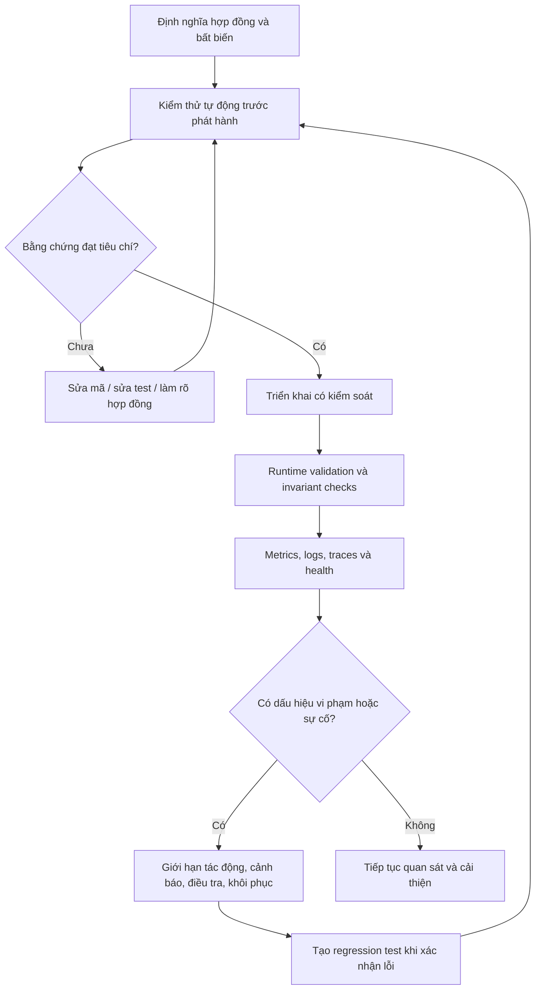
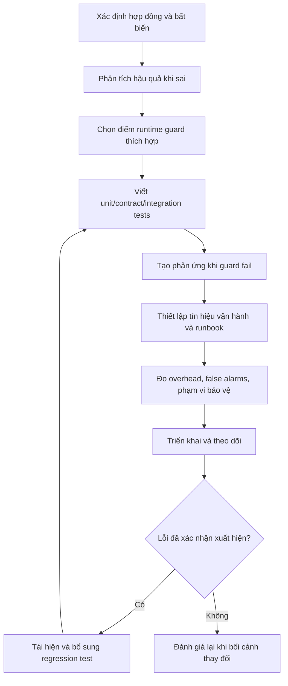

# Kiểm thử tự động và kiểm tra khi chạy

## 1. Một hệ thống đáng tin cần bằng chứng trước và trong khi vận hành

Một tính năng có thể vượt qua toàn bộ unit test nhưng vẫn gặp dữ liệu bất thường, timeout của dịch vụ ngoài, lỗi cấu hình hoặc hai yêu cầu xử lý cùng một tài nguyên khi đi vào production. Ngược lại, hệ thống có log, metrics và cảnh báo phong phú vẫn có thể phát hành một lỗi logic đơn giản nếu không có kiểm thử tự động bảo vệ quy tắc nghiệp vụ.

Trong module `CODE_QUALITY_FUNDAMENTALS`, chúng ta tìm hiểu **những thuộc tính quyết định mã nguồn có đáng tin cậy, dễ hiểu và dễ thay đổi hay không**. Thuộc chương **Kiểm tra tự động**, bài này làm rõ hai cơ chế bổ trợ:

- **Kiểm thử tự động (automated testing):** chạy các tình huống đã thiết kế trong môi trường kiểm soát để xác minh hành vi trước khi phát hành hoặc sau khi mã thay đổi.
- **Kiểm tra khi chạy (runtime checks):** kiểm tra dữ liệu, trạng thái, giới hạn tài nguyên và các tín hiệu vận hành ngay khi phần mềm đang thực thi; từ đó ngăn trạng thái không hợp lệ, phát hiện sự cố hoặc kích hoạt biện pháp xử lý có chủ đích.

Ví dụ với chức năng giữ hàng:

- Một **unit test** xác nhận số lượng bằng 0 bị từ chối và không gọi kho lưu trữ.
- Một **integration test** xác nhận hai giao dịch cùng giữ sản phẩm không thể khiến số hàng khả dụng âm trong database thật.
- Một **runtime validation** từ chối số lượng âm do client gửi trong mọi lần chạy, không chỉ trong test.
- Một **ràng buộc ở database** ngăn cập nhật tồn kho âm ngay cả khi nhiều request cùng chạy.
- Một **metric/cảnh báo** phát hiện tỷ lệ lỗi giữ hàng tăng đột ngột sau khi phát hành.

Các cơ chế này trả lời những câu hỏi khác nhau. Không nên coi “unit test pass” là bảo đảm cho mọi tác động đồng thời; cũng không nên coi “có kiểm tra ở runtime” là lý do bỏ test.

Sau bài học, người học có thể phân biệt tầng kiểm thử với runtime guard, chọn vị trí kiểm tra hợp đồng và bất biến, viết ví dụ Java 17/JUnit 5, phân loại lỗi khi kiểm tra thất bại, thiết kế health check và cảnh báo hữu ích, đồng thời tránh chi phí và sự tự tin sai do tự động hóa.

## 2. Phân biệt kiểm thử và kiểm tra khi chạy

| Khía cạnh | Kiểm thử tự động | Kiểm tra khi chạy |
| --- | --- | --- |
| **Thời điểm** | Local, CI, trước phát hành, lịch kiểm thử hoặc môi trường chuyên biệt | Trong xử lý request, background job, adapter, database hoặc hệ thống giám sát |
| **Đầu vào** | Fixture và tình huống được lựa chọn có chủ đích | Đầu vào và trạng thái phát sinh từ vận hành thực tế |
| **Mục tiêu** | Tìm sai lệch trước khi đưa mã vào sử dụng rộng | Ngăn, phát hiện hoặc giới hạn hậu quả của trạng thái bất thường |
| **Kết quả thất bại** | Test fail, pipeline chặn thay đổi hoặc sinh báo cáo | Trả lỗi, rollback giao dịch, từ chối hành động, ghi nhận tín hiệu hay kích hoạt khôi phục |
| **Điểm mạnh** | Kiểm chứng đường đi khó tái hiện bằng dữ liệu cố định, chạy lặp sau sửa mã | Bảo vệ cả những dữ liệu và tình huống chưa có trong test |
| **Giới hạn** | Chỉ bao phủ tình huống, môi trường và assertion đã định nghĩa | Có thể phát hiện muộn, tăng overhead hoặc gây tác dụng phụ nếu thiết kế sai |

**Kiểm thử không thay thế runtime check.** Test xác nhận rằng validation hoạt động ở một số trường hợp; validation vẫn phải chạy khi người dùng thật gửi dữ liệu sai.

**Runtime check không thay thế kiểm thử.** Điều kiện kiểm tra khi chạy có thể viết sai, bỏ sót nhánh hoặc báo lỗi không đúng; kiểm thử giúp chứng minh nó thực hiện hợp đồng trong các trường hợp quan trọng.

Hãy xem chúng như hai vòng bảo vệ:



Sơ đồ là mô hình học tập, không ngụ ý mọi phát hiện runtime đều tự tạo được một test. Một sự cố production có thể cần điều tra để xác định quy tắc bị vi phạm và điều kiện tái hiện an toàn.

## 3. Các tầng kiểm thử tự động bổ trợ nhau như thế nào?

### 3.1. Unit test: bảo vệ quy tắc nhỏ và điều kiện biên

Unit test phù hợp với logic có đầu vào, đầu ra rõ: tính giá, kiểm tra hạn, chọn trạng thái, kiểm tra số lượng. Nó thường dùng dữ liệu cố định, chạy nhanh và không cần mạng/database thật.

Ví dụ cần bảo vệ: `quantity > 0`, tại đúng deadline chính sách có còn hiệu lực không, khi không tìm thấy dữ liệu thì kết quả nào được trả.

Một unit test trả về xanh chỉ chứng minh những assertion **trong điều kiện đang kiểm tra**, không chứng minh cơ sở dữ liệu đã ghi giao dịch đúng.

### 3.2. Contract test: hai bên có hiểu cùng một hợp đồng?

Nếu service gọi payment gateway hoặc repository, contract test xác minh các giả định quan trọng giữa bên gọi và bên cung cấp: định dạng request/response, loại lỗi, nullability, trạng thái không tìm thấy và tương thích phiên bản.

Ví dụ, một repository cam kết trả `Optional.empty()` khi bản ghi không tồn tại, nhưng **ném lỗi** khi database không sẵn sàng. Nếu adapter lại trả empty khi timeout, code nghiệp vụ có thể hiểu nhầm sự cố là kết quả bình thường. Cần test trực tiếp adapter hoặc hợp đồng tích hợp này.

### 3.3. Integration test: giao dịch và tương tác thành phần thật

Integration test kiểm tra nơi nhiều đơn vị ghép với nhau: transaction, ràng buộc unique, serialize/deserialize, schema, queue và adapter. Dùng môi trường thử nghiệm với dữ liệu độc lập; tránh tạo tác dụng phụ lên khách hàng hoặc hệ thống thật.

Ví dụ, test xác nhận một câu lệnh giảm tồn kho có điều kiện và constraint ở database ngăn tồn kho âm khi nhiều giao dịch tranh chấp.

### 3.4. End-to-end test: đường giá trị hoàn chỉnh

End-to-end test đi qua những bước quan trọng của người dùng, chẳng hạn tạo đơn → giữ hàng → thanh toán thử nghiệm → nhận xác nhận. Loại test này chứng minh sự kết nối giữa nhiều thành phần trong **một môi trường cụ thể**, nhưng thường chậm và khó xác định nguyên nhân khi fail.

Không nên viết mọi trường hợp biên thành test end-to-end nếu một unit test đủ bộc lộ bug. Đồng thời, không nên chỉ dùng mock cho một lỗi liên quan transaction thật.

### 3.5. Failure, concurrency và performance test

Một số rủi ro chỉ xuất hiện khi có timeout, restart, dữ liệu lớn hoặc đồng thời. Những test như vậy cần mô hình tiêm lỗi, đồng bộ request và assertion **về bất biến cuối cùng**, thay vì chỉ đếm lời gọi một mock.

| Tầng | Câu hỏi chính | Điều không tự chứng minh |
| --- | --- | --- |
| Unit | Quy tắc đúng với dữ liệu đã định chưa? | DB, mạng và đồng thời thật |
| Contract | Hai phía hiểu cùng schema/hành vi lỗi chưa? | Mọi dữ liệu và mọi đường nghiệp vụ |
| Integration | Các thành phần và giao dịch làm việc đúng cùng nhau chưa? | Toàn bộ trải nghiệm người dùng |
| End-to-end | Luồng quan trọng hoạt động trong môi trường thử chưa? | Mọi nhánh, mọi trường hợp biên |
| Failure/concurrency | Bất biến còn đúng trong tình huống rủi ro đã mô hình chưa? | Mọi lịch thực thi phân tán |
| Performance | Có đáp ứng mục tiêu tải và tài nguyên đã đặt không? | Tính đúng đắn của nghiệp vụ nếu thiếu assertion |

## 4. Kiểm tra khi chạy cần đặt đúng ranh giới

Runtime check có nhiều hình thức. Không phải check nào cũng nên nằm trong một phương thức Java; đôi khi database constraint, gateway validation hoặc health monitor phù hợp hơn.

### 4.1. Kiểm tra đầu vào (*input validation*)

Khi request đi vào ranh giới ứng dụng, cần kiểm tra những thuộc tính không thể tin mặc định: trường bắt buộc, định dạng, phạm vi số, kích thước payload và quyền truy cập. Kiểu dữ liệu có constructor kiểm tra bất biến giúp tránh truyền những đối tượng sai vào phần còn lại của hệ thống.

Ví dụ:

```java
public record ReservationCommand(String sku, int quantity, String requestId) {
    public ReservationCommand {
        if (sku == null || sku.isBlank()) {
            throw new IllegalArgumentException("sku must not be blank");
        }
        if (quantity <= 0) {
            throw new IllegalArgumentException("quantity must be positive");
        }
        if (requestId == null || requestId.isBlank()) {
            throw new IllegalArgumentException("requestId must not be blank");
        }
    }
}
```

Trong Java, compact constructor của `record` cho phép kiểm tra tham số trước khi gán trường. Khi tạo `ReservationCommand` với số lượng không hợp lệ, chương trình ném lỗi ngay thay vì truyền số lượng âm tới repository.

**Kiểm tra dữ liệu không giống kiểm tra phân quyền.** `sku` hợp lệ không chứng minh người dùng có quyền giữ SKU đó; cần ranh giới xác thực và phân quyền theo hợp đồng riêng.

### 4.2. Bất biến miền nghiệp vụ (*domain invariants*)

Bất biến là điều phải giữ đúng qua các chuyển trạng thái. Ví dụ:

- Số hàng khả dụng không âm.
- Một `requestId` không được ứng với hai yêu cầu nghiệp vụ khác nhau nếu dùng để khử trùng lặp.
- Một đơn đã hủy không được chuyển sang trạng thái giao hàng bằng đường cập nhật không được phép.
- Tổng tiền thanh toán không được âm và các thành phần tiền phải cùng đồng tiền theo hợp đồng.

Một `if` trong Java có thể ngăn một số trường hợp, nhưng với **trạng thái chia sẻ và concurrency**, bất biến thường phải được bảo vệ thêm ở transaction/constraint của database hoặc cơ chế đồng bộ phù hợp. Kiểm tra giá trị trước khi ghi rồi ghi sau đó, nếu không nguyên tử, có thể bị race condition.

### 4.3. Kiểm tra đầu ra và hợp đồng phụ thuộc

Một service có thể nhận dữ liệu từ adapter mà nó **không được phép tin tuyệt đối**, ngay cả khi interface có kiểu rõ. Kiểm tra đối tượng `null` hoặc trạng thái mâu thuẫn ở ranh giới giúp phát hiện lỗi tích hợp sớm.

Ví dụ, nếu gateway trả kết quả “đã giữ hàng” nhưng không có mã giữ chỗ, caller không nên báo thành công. Cần nêu lỗi hợp đồng thay vì đoán một mã mặc định.

### 4.4. Kiểm tra cấu hình khi khởi động

Một ứng dụng cấu hình timeout âm, URL rỗng hoặc giới hạn thread bằng 0 nên phát hiện lỗi trước khi nhận lưu lượng. Đó là một dạng **fail fast** hữu ích: dừng khởi tạo hoặc đánh dấu không sẵn sàng, thay vì xử lý một phần request rồi lỗi khó hiểu.

Tránh đưa các cấu hình chưa có tác dụng vào hàng loạt guard “phòng khi cần” khiến hệ thống khó khởi động mà không cải thiện rủi ro thật.

### 4.5. Kiểm tra giới hạn tài nguyên

Giới hạn số phần tử trong một request, thời gian chờ dịch vụ ngoài, kích thước file, số kết nối hoặc hàng đợi có thể ngăn hệ thống tiêu thụ tài nguyên không kiểm soát. Đây không chỉ là tối ưu hiệu năng mà còn là bảo vệ độ tin cậy.

Cần chọn ngưỡng dựa trên yêu cầu và tải có căn cứ; nếu đặt quá thấp, runtime check sẽ **từ chối yêu cầu hợp lệ**. Thay đổi ngưỡng nên có giám sát tỷ lệ bị từ chối.

## 5. Ví dụ Java 17: hợp đồng, runtime guard và kết quả có kiểu

Giả sử hệ thống nhận yêu cầu giữ hàng với những quy tắc đã xác nhận **cho bài học**:

1. SKU và mã yêu cầu không được rỗng; số lượng phải dương.
2. Khi giữ hàng thành công hoặc yêu cầu đã được xử lý trước đó, phải có mã giữ chỗ.
3. Khi kết quả là hết hàng, không được trả mã giữ chỗ như thể đã giữ thành công.
4. Repository có hợp đồng `reserveAtomically`: tự chịu trách nhiệm cập nhật tồn kho và khử trùng lặp một cách nguyên tử; lời hứa này phải được triển khai thật, không chỉ đặt tên.
5. Lỗi truy cập dữ liệu không được chuyển thành `OUT_OF_STOCK`; timeout có thể tạo trạng thái chưa xác định, cần thiết kế thêm khi tích hợp thật.

Ví dụ sau tập trung vào **những kiểm tra có thể thực thi ngay tại runtime**. Đặt mã trong tệp `ReservationService.java`:

```java
import java.util.Objects;

public final class ReservationService {
    public record ReservationCommand(
            String sku,
            int quantity,
            String requestId) {

        public ReservationCommand {
            if (sku == null || sku.isBlank()) {
                throw new IllegalArgumentException("sku must not be blank");
            }
            if (quantity <= 0) {
                throw new IllegalArgumentException("quantity must be positive");
            }
            if (requestId == null || requestId.isBlank()) {
                throw new IllegalArgumentException("requestId must not be blank");
            }
        }
    }

    public enum ReservationStatus {
        RESERVED,
        ALREADY_RESERVED,
        OUT_OF_STOCK
    }

    public record ReservationResult(
            ReservationStatus status,
            String reservationId) {

        public ReservationResult {
            Objects.requireNonNull(status, "status");

            boolean hasId =
                    reservationId != null && !reservationId.isBlank();

            if (status == ReservationStatus.OUT_OF_STOCK && reservationId != null) {
                throw new IllegalArgumentException(
                        "OUT_OF_STOCK must not have reservationId");
            }
            if (status != ReservationStatus.OUT_OF_STOCK && !hasId) {
                throw new IllegalArgumentException(
                        "Successful reservation requires reservationId");
            }
        }
    }

    public interface InventoryStore {
        // Triển khai phải cập nhật tồn kho nguyên tử và xử lý requestId lặp.
        // Lỗi hệ thống không được giả làm kết quả OUT_OF_STOCK.
        ReservationResult reserveAtomically(ReservationCommand command);
    }

    private final InventoryStore store;

    public ReservationService(InventoryStore store) {
        this.store = Objects.requireNonNull(store, "store");
    }

    public ReservationResult reserve(ReservationCommand command) {
        Objects.requireNonNull(command, "command");

        // Không tuyên bố thành công khi dependency phá hợp đồng trả kết quả.
        return Objects.requireNonNull(
                store.reserveAtomically(command), "reservation result");
    }
}
```

### 5.1. Có những kiểm tra nào thực sự hoạt động?

- **Kiểm tra đầu vào:** `ReservationCommand` không thể được tạo với số lượng `0` hoặc mã rỗng.
- **Kiểm tra tính nhất quán của kết quả:** `ReservationResult` chỉ cho phép tổ hợp status và reservation ID đúng theo quy ước đã định.
- **Kiểm tra ranh giới phụ thuộc:** `ReservationService` không coi `null` do store trả là một kết quả hợp lệ.
- **Tách phần quản lý trạng thái chia sẻ:** giao diện `InventoryStore` làm rõ hợp đồng, nhưng chưa triển khai transaction hay khóa duy nhất.

Khi runtime check thất bại, hệ thống ném exception thay vì trả kết quả có vẻ thành công. Trong ứng dụng thật, tầng HTTP/message consumer phải **ánh xạ lỗi đầu vào** thành phản hồi phù hợp và **lỗi triển khai/hạ tầng** thành lỗi nội bộ có thể theo dõi; không trả thông điệp chi tiết nhạy cảm thẳng cho client.

### 5.2. Điều quan trọng mà ví dụ không tự bảo đảm

Đừng nhầm `reserveAtomically` là bằng chứng tính nguyên tử. Một implementation chỉ thực hiện:

```java
int stock = readStock(sku);
if (stock >= quantity) {
    writeStock(sku, stock - quantity);
}
```

có thể xử lý sai khi hai luồng cùng đọc giá trị cũ. Để bảo vệ bất biến “tồn kho không âm”, có thể cần **cập nhật có điều kiện**, transaction và constraint trong database. Khử trùng lặp theo `requestId` cũng phải dùng nơi lưu trữ bền vững, kiểm tra cùng khóa có cùng nội dung yêu cầu và xử lý cạnh tranh đồng thời.

Các lời gọi `readStock` và `writeStock` ở ví dụ trên chỉ minh họa anti-pattern; chúng không phải phương thức có sẵn trong `ReservationService`.

## 6. Kiểm thử Java/JUnit cho chính các runtime checks

Một runtime guard có thể được viết sai. Vì thế cần test không chỉ đường thành công mà cả những đầu vào và kết quả bị cấm. Ví dụ JUnit 5 sau giả định lớp `ReservationService` ở phần 5.

```java
import static org.junit.jupiter.api.Assertions.*;
import java.util.concurrent.atomic.AtomicInteger;
import org.junit.jupiter.api.Test;

class ReservationServiceTest {
    @Test
    void rejectsZeroQuantityBeforeInvokingStore() {
        AtomicInteger storeCalls = new AtomicInteger();
        ReservationService.InventoryStore store = command -> {
            storeCalls.incrementAndGet();
            return new ReservationService.ReservationResult(
                    ReservationService.ReservationStatus.RESERVED, "r-1");
        };
        ReservationService service = new ReservationService(store);

        assertThrows(IllegalArgumentException.class, () -> {
            var command = new ReservationService.ReservationCommand(
                    "sku-1", 0, "req-1");
            service.reserve(command);
        });

        assertEquals(0, storeCalls.get());
    }

    @Test
    void acceptsReservedResultWithId() {
        var command = new ReservationService.ReservationCommand(
                "sku-1", 2, "req-2");
        ReservationService.InventoryStore store = ignored ->
                new ReservationService.ReservationResult(
                        ReservationService.ReservationStatus.RESERVED, "r-2");

        var service = new ReservationService(store);
        var result = service.reserve(command);

        assertEquals(ReservationService.ReservationStatus.RESERVED,
                result.status());
        assertEquals("r-2", result.reservationId());
    }

    @Test
    void rejectsSuccessWithoutReservationId() {
        assertThrows(IllegalArgumentException.class, () ->
                new ReservationService.ReservationResult(
                        ReservationService.ReservationStatus.RESERVED, null));
    }

    @Test
    void rejectsOutOfStockWithReservationId() {
        assertThrows(IllegalArgumentException.class, () ->
                new ReservationService.ReservationResult(
                        ReservationService.ReservationStatus.OUT_OF_STOCK, "r-3"));
    }

    @Test
    void acceptsOutOfStockWithoutReservationId() {
        var result = new ReservationService.ReservationResult(
                ReservationService.ReservationStatus.OUT_OF_STOCK, null);

        assertEquals(ReservationService.ReservationStatus.OUT_OF_STOCK,
                result.status());
        assertNull(result.reservationId());
    }

    @Test
    void rejectsNullStoreResultInsteadOfClaimingSuccess() {
        var command = new ReservationService.ReservationCommand(
                "sku-1", 1, "req-4");
        ReservationService.InventoryStore brokenStore = ignored -> null;

        var service = new ReservationService(brokenStore);

        assertThrows(NullPointerException.class,
                () -> service.reserve(command));
    }

    @Test
    void preservesInfrastructureFailureSignal() {
        var command = new ReservationService.ReservationCommand(
                "sku-1", 1, "req-5");
        ReservationService.InventoryStore unavailableStore = ignored -> {
            throw new IllegalStateException("database unavailable");
        };
        var service = new ReservationService(unavailableStore);

        assertThrows(IllegalStateException.class,
                () -> service.reserve(command));
    }
}
```

Đọc test cần phân biệt:

- `rejectsZeroQuantityBeforeInvokingStore` chứng minh **đối tượng không hợp lệ bị chặn trước khi store được gọi** trong ca thử đó.
- `rejectsSuccessWithoutReservationId` và `rejectsOutOfStockWithReservationId` kiểm chứng các kết hợp kết quả không hợp lệ.
- `preservesInfrastructureFailureSignal` xác nhận service **không che lỗi hạ tầng thành hết hàng**.
- Không test nào ở đây xác nhận database thật ngăn trừ kho âm hoặc xử lý idempotent khi restart. Để chứng minh phần đó theo phạm vi có thể kiểm tra, cần integration/concurrency/failure tests tại adapter và nơi lưu dữ liệu thực.

### 6.1. Một lỗi có thể xuất hiện sau khi runtime check đã qua

Một object `ReservationCommand` hợp lệ ở thời điểm tạo không có nghĩa hàng vẫn còn sau 200 mili giây. Những điều kiện có thể thay đổi trong hệ thống đồng thời **không nên được bảo vệ bằng một lần đọc và kiểm tra ở lớp Java rồi mới ghi sau**.

Bất biến thuộc dữ liệu chia sẻ cần được kiểm tra/cập nhật nguyên tử ngay tại ranh giới lưu trữ phù hợp. Unit test của guard đầu vào và integration test của invariant cùng quan trọng nhưng có phạm vi khác nhau.

## 7. `assert` trong Java không thay thế validation hay invariant bắt buộc

Java có từ khóa `assert`:

```java
assert quantity > 0 : "quantity must be positive";
```

Nhưng Java assertions có thể bị **tắt mặc định** và chỉ bật khi chạy JVM với tùy chọn tương ứng (ví dụ `-ea`). Vì vậy, không dùng `assert` để kiểm tra đầu vào không đáng tin, quyền truy cập, số tiền hoặc bất biến mà production **bắt buộc phải thực thi**.

So sánh:

```java
// Không phù hợp cho validation bắt buộc ở API công khai:
assert requestId != null;

// Có hiệu lực không phụ thuộc cờ assertions:
Objects.requireNonNull(requestId, "requestId");

// Có thể dùng cho điều kiện số lượng đã được xác nhận:
if (quantity <= 0) {
    throw new IllegalArgumentException("quantity must be positive");
}
```

**Khi nào `assert` có ích?** Nó có thể hỗ trợ kiểm tra một số giả định nội bộ trong môi trường phát triển và test, nơi tắt assertions không làm mất bảo vệ bắt buộc. Nếu điều kiện đó rất quan trọng và vi phạm có hậu quả khi vận hành, dùng kiểm tra luôn có hiệu lực hoặc một cơ chế bất biến mạnh hơn.

Đừng dựa vào tác dụng phụ trong biểu thức `assert`, vì biểu thức có thể không được đánh giá khi assertions tắt.

## 8. Runtime check thất bại: phản ứng phải phù hợp loại lỗi

Một hệ thống tốt không chỉ phát hiện sai mà còn **phản ứng theo đúng ngữ nghĩa**.

| Tình huống | Phản ứng có thể phù hợp | Điều cần tránh |
| --- | --- | --- |
| Request thiếu mã hàng hoặc quantity ≤ 0 | Từ chối đầu vào, ghi lỗi validation an toàn | Gọi DB rồi mới phát hiện lỗi |
| Không đủ hàng theo kiểm tra nguyên tử | Kết quả nghiệp vụ `OUT_OF_STOCK` | Coi mọi lỗi DB là hết hàng |
| Kết quả gateway có tổ hợp status/ID mâu thuẫn | Báo lỗi hợp đồng nội bộ, không báo thành công | Tự điền mã giả hoặc nuốt lỗi |
| DB không sẵn sàng | Trả lỗi tạm thời theo hợp đồng, giám sát và áp dụng giới hạn retry | Retry vô hạn hoặc đánh dấu khách hàng sai |
| Timeout gửi lệnh có tác dụng phụ | Trạng thái chưa xác định nếu phù hợp, tra cứu/đối soát bằng khóa ổn định | Kết luận chắc chắn giao dịch chưa chạy |
| Số lượng request vượt giới hạn | Từ chối hoặc điều tiết có chủ đích | Tiếp nhận vô hạn tới khi cạn RAM |
| Dữ liệu đã lưu vi phạm bất biến | Ngừng hoặc cô lập đường ghi nguy hiểm, cảnh báo/điều tra theo mức nghiêm trọng | Âm thầm sửa giá trị làm mất dấu vết |
| Một dependency tạm mất | Có thể giảm chức năng hoặc fallback nếu hợp đồng cho phép | Trả dữ liệu cũ/sai trong nghiệp vụ đòi nhất quán |

Việc chọn HTTP status, exception hay kết quả có kiểu phụ thuộc API cụ thể. `IllegalArgumentException` trong tầng Java có thể được ánh xạ thành lỗi client khi đó là dữ liệu người dùng sai; **không** nên trả mọi `IllegalArgumentException` bất kể nguồn gốc như lỗi client vì nó cũng có thể phát sinh từ bug nội bộ.

### 8.1. Fail fast và graceful degradation không mâu thuẫn

**Fail fast** phù hợp khi tiếp tục xử lý có nguy cơ tạo dữ liệu sai, chẳng hạn thiếu cấu hình bắt buộc hoặc kết quả thanh toán không nhất quán. **Graceful degradation** phù hợp khi có thể cung cấp một chức năng giảm bớt mà vẫn đúng hợp đồng, ví dụ tạm ẩn gợi ý sản phẩm nếu hệ thống đề xuất không sẵn sàng.

Không áp dụng fallback bừa bãi. Một hệ thống thanh toán có thể chấp nhận không hiển thị danh sách đề xuất, nhưng không được mặc định “đã trả tiền” khi gateway mất phản hồi.

## 9. Kiểm tra sức khỏe và mức sẵn sàng của ứng dụng

Health check tự động giúp nền tảng triển khai hoặc người vận hành biết instance nên tiếp tục nhận lưu lượng hay cần được xem xét. Các loại kiểm tra có ý nghĩa khác nhau.

| Loại | Câu hỏi | Hành vi điển hình cần thiết kế |
| --- | --- | --- |
| **Liveness** | Tiến trình có còn hoạt động, hay đã kẹt không thể phục hồi? | Tránh phụ thuộc không cần thiết vào DB/HTTP ngoài để không tạo vòng restart khi dependency chung gặp sự cố |
| **Readiness** | Instance hiện có thể tiếp nhận và xử lý yêu cầu theo hợp đồng không? | Có thể từ chối nhận lưu lượng khi chưa khởi tạo xong hoặc dependency thiết yếu không sẵn sàng |
| **Startup** | Ứng dụng đã hoàn thành pha khởi động dài chưa? | Tránh coi khởi động chậm là tiến trình chết |
| **Synthetic/business check** | Một luồng nghiệp vụ quan trọng có thực sự hoạt động không? | Chạy trong phạm vi kiểm soát, tránh giao dịch hoặc tác dụng phụ ngoài ý muốn |

Nếu liveness probe luôn gọi database, lúc database gặp sự cố chung, hàng loạt instance có thể tự khởi động lại và làm hệ thống càng khó phục hồi. Trong khi đó, readiness có thể xét một số dependency **thiết yếu cho việc phục vụ request**, nhưng cần timeout và caching hợp lý để probe không làm quá tải dependency khi sự cố.

Một probe trả HTTP 200 chỉ nói rằng **điều kiện probe kiểm tra** đã đạt. Nó không chứng minh mọi nghiệp vụ và mọi external call đều khỏe. Đối với hệ thống nhiều chức năng, cần quan sát thêm SLI hoặc synthetic checks phù hợp.

### 9.1. Không tạo tác dụng phụ nguy hiểm từ health check

Một health check không nên thực hiện chuyển tiền thật, đặt hàng thật hoặc tạo dữ liệu không thể dọn dẹp. Nếu cần kiểm tra đường ghi, dùng môi trường hoặc tài nguyên thử nghiệm được thiết kế riêng và quy tắc dọn dữ liệu rõ ràng.

### 9.2. Kết nối health với chiến lược khôi phục

Readiness fail có thể khiến instance bị rút khỏi cân bằng tải; điều đó không đồng nghĩa dữ liệu trong hàng đợi đã được xử lý hết hoặc giao dịch đang chạy có thể bị bỏ. Cần xét cơ chế graceful shutdown, drain, retry và idempotency theo kiến trúc thật.

## 10. Kiểm tra bằng metrics, logs, traces và cảnh báo

Runtime checks còn có thể được thực hiện **ngoài đường xử lý chính** qua giám sát tự động. Một guard trong Java từ chối request sai; metrics cho biết tần suất request sai tăng; tracing giúp xác định dependency nào đang chậm; alert đưa tín hiệu tới người có thể hành động.

### 10.1. Chọn tín hiệu gắn với tác động

Với chức năng giữ hàng, có thể đo:

- Tỷ lệ kết quả `RESERVED`, `ALREADY_RESERVED` và `OUT_OF_STOCK` theo endpoint hoặc loại thao tác.
- Tỷ lệ exception từ kho lưu trữ, timeout và lỗi hợp đồng kết quả.
- Latency p95/p99 của yêu cầu giữ hàng tại mức tải có ý nghĩa.
- Thời gian chờ pool kết nối, queue depth và tài nguyên liên quan.
- Số yêu cầu tồn ở trạng thái chưa xác định cần đối soát, **nếu hệ thống có mô hình trạng thái đó**.
- Số lần phát hiện bất biến dữ liệu bị vi phạm, nếu có cơ chế ghi nhận an toàn.

Không nên mặc định mọi kết quả `OUT_OF_STOCK` là lỗi vận hành: đây có thể là tình huống nghiệp vụ bình thường. Tương tự, lỗi đầu vào của một client không đồng nghĩa server không sẵn sàng, nhưng tăng đột biến có thể chỉ ra lỗi phía client hoặc thay đổi hợp đồng.

### 10.2. Một tín hiệu tốt phải có hành động tương ứng

| Tín hiệu | Hành động điều tra hoặc xử lý | Bẫy thường gặp |
| --- | --- | --- |
| p95 latency tăng ở giờ cao điểm | Đối chiếu DB, queue, CPU, GC, traces | Chỉ nhìn trung bình và bỏ qua phần đuôi |
| Lỗi repository tăng | Kiểm tra kết nối, DB, cấu hình và rollout gần đây | Gộp với `NOT_FOUND` khiến mất tín hiệu |
| Thao tác chưa đối soát tăng | Kiểm tra queue đối soát và trạng thái bền vững | Retry vô điều kiện gây tác dụng phụ trùng |
| Readiness fail nhiều instance | Kiểm tra dependency chung và rollout | Restart đồng loạt làm sự cố nặng hơn |
| Vi phạm bất biến | Dừng hoặc hạn chế đường ghi liên quan, bảo toàn bằng chứng | Tự sửa dữ liệu âm thầm khi chưa điều tra |
| Tỷ lệ request bị giới hạn cao | Xem tải, hành vi client và ngưỡng bảo vệ | Tăng giới hạn ngay làm cạn tài nguyên |

Đặt alert dựa trên **tác động đến người dùng hoặc nghĩa vụ vận hành**, ví dụ SLO/burn rate, thay vì gửi cảnh báo mỗi khi một request đơn lẻ có lỗi bình thường. Cảnh báo quá nhiều hoặc luôn báo sai sẽ giảm khả năng phản ứng của đội.

### 10.3. Dữ liệu nhạy cảm và cardinality

Log cần đủ ngữ cảnh để truy vết nhưng không ghi mật khẩu, token hay payload thanh toán nhạy cảm. Với metrics, tránh dùng `requestId`, email hoặc customer ID làm **nhãn có cardinality lớn**. Có thể dùng tên endpoint dạng chuẩn hóa, loại kết quả hoặc mã lỗi ổn định; dùng correlation ID trong log/trace theo chính sách bảo mật tương ứng.

## 11. Runtime checks có chi phí và có thể trở thành nguồn lỗi

Thêm guard và giám sát không miễn phí. Một số kiểm tra được thực hiện trên mỗi request, một số chỉ nên chạy khi khởi động hoặc theo lịch; chọn sai vị trí có thể giảm hiệu năng hoặc tăng phạm vi sự cố.

### 11.1. Không gọi dependency ngoài cho mọi invariant cục bộ

Kiểm tra `quantity > 0` thường rất rẻ. Nhưng với mỗi request lại gọi ba dịch vụ ngoài chỉ để “chắc chắn hệ thống khỏe” có thể làm tăng latency, tạo vòng phụ thuộc và khiến lỗi chung lan rộng.

Đặt check **tại nơi sở hữu dữ liệu và có đủ thông tin** để đưa ra kết luận: validation cục bộ ở ranh giới request, bất biến giao dịch tại database, health check ở tầng triển khai, cảnh báo ở hệ thống quan sát.

### 11.2. Không biến lỗi vận hành thành lỗi toàn hệ thống nếu có thể tránh

Nếu một thành phần tùy chọn như gợi ý sản phẩm thất bại, cấu hình health/readiness không nên mặc định làm toàn bộ ứng dụng ngừng nhận yêu cầu thanh toán, trừ khi đó là dependency thật sự thiết yếu theo hợp đồng.

Ngược lại, nếu cơ chế lưu giao dịch không hoạt động, ứng dụng không nên giả vờ sẵn sàng nhận lệnh ghi quan trọng chỉ để dashboard xanh.

### 11.3. Cân bằng độ chi tiết giám sát

- Log mọi vòng lặp có thể làm ngập hệ thống lưu trữ.
- Trace toàn bộ request với mọi trường dữ liệu có thể gây overhead và rủi ro riêng tư.
- Quá nhiều alerts không có người chịu trách nhiệm tạo mệt mỏi cảnh báo.
- Probe quá thường xuyên có thể gây áp lực lên dependency đang yếu.
- Check chạy trong transaction dài có thể kéo dài thời gian khóa dữ liệu.

Hãy đo chi phí instrumentation và kiểm tra theo workload thực; chọn sampling, ngưỡng hoặc kiểm tra theo chu kỳ khi có căn cứ, nhưng không bỏ các bảo vệ bắt buộc của dữ liệu chỉ để giảm overhead.

## 12. Sai lầm phổ biến khi kết hợp test và runtime checks

| Sai lầm | Vì sao nguy hiểm | Cách cải thiện |
| --- | --- | --- |
| “Unit test xanh nên không cần validation” | Dữ liệu production có thể nằm ngoài fixture | Giữ validation bắt buộc ở ranh giới runtime |
| Dùng `assert` để bảo vệ dữ liệu đầu vào | Assertion có thể bị tắt | `if`/exception, type invariant hoặc constraint |
| Kiểm tra tồn kho rồi cập nhật riêng | Race condition giữa đọc và ghi | Thao tác nguyên tử/transaction/constraint |
| Nuốt mọi exception, trả kết quả nghiệp vụ | Che giấu lỗi DB thành hết hàng | Phân loại lỗi và giữ trạng thái chính xác |
| Mock làm test xanh rồi kết luận queue bảo đảm bền vững | Mock không thực thi giao thức thật | Contract/integration/failure test adapter |
| Mọi probe đều gọi database | Dependency chung lỗi gây restart hàng loạt | Phân biệt liveness và readiness, timeout phù hợp |
| Chỉ log “operation failed” | Không đủ ngữ cảnh để khoanh vùng | Correlation ID, loại lỗi và bước xử lý an toàn |
| Cảnh báo cho mọi lỗi nhỏ | Alert fatigue, bỏ qua tín hiệu quan trọng | Cảnh báo gắn SLO và hành động cụ thể |
| Tạo runtime check dựa trên cấu hình ngầm | Môi trường khác nhau cho kết quả khác | Cấu hình có kiểu, validation và tài liệu |
| Test kiểm tra phương thức nội bộ đã gọi bao nhiêu lần | Refactor hợp lệ làm test giòn | Kiểm tra kết quả và tác dụng phụ có ý nghĩa |
| Chỉ kiểm tra “không có lỗi” | Phản hồi thành công sai vẫn được xem là pass | Assertion dữ liệu, bất biến và điểm cam kết |
| Tăng retry sau mọi timeout | Có thể nhân đôi tác dụng phụ | Idempotency, đối soát, giới hạn retry và backoff có kiểm soát |

Bất kỳ công cụ hoặc check nào cũng cần trả lời: **nó bảo vệ hợp đồng nào, nó có thể phát hiện gì và nó không thể kết luận điều gì?**

## 13. Quy trình thiết kế kiểm tra theo rủi ro

### Bước 1 — Xác định hợp đồng và hậu quả khi vi phạm

Bắt đầu từ những điều quan trọng nhất: số tiền phải đúng, tồn kho không âm, không lộ dữ liệu, không gửi thông báo sai, không mất sự kiện quan trọng. Viết rõ điều kiện đầu vào, kết quả và bất biến.

### Bước 2 — Chọn nơi có quyền xác nhận

Một service có thể kiểm tra request hợp lệ. Database có thể thực thi ràng buộc tính nhất quán khi nhiều transaction đồng thời. Gateway có thể xác nhận yêu cầu đã tiếp nhận. Monitoring quan sát tỷ lệ lỗi. **Không đặt một check ở nơi nó thiếu thông tin để đưa ra kết luận.**

### Bước 3 — Viết kiểm thử cho hành vi đúng và sai

Thêm test với trường hợp biên, đầu vào không hợp lệ, phản hồi phụ thuộc sai hợp đồng và các tình huống lỗi đã biết. Khi kiểm tra rủi ro đồng thời hoặc bền vững, chọn tầng tích hợp thích hợp thay vì chỉ dùng fake.

### Bước 4 — Triển khai check chạy thật có phản ứng xác định

Quy định khi check fail thì dừng thao tác, trả kết quả lỗi, rollback, chuyển trạng thái chờ đối soát hay phát cảnh báo. Không được “log rồi tiếp tục” nếu điều kiện hỏng có thể tạo dữ liệu sai.

### Bước 5 — Thiết kế tín hiệu giám sát

Với những sự cố không thể ngăn hoàn toàn ở request time, thêm metrics/traces/alerts phù hợp và runbook. Phân biệt kết quả nghiệp vụ bình thường với sự cố hạ tầng.

### Bước 6 — Kiểm tra chi phí và failure mode của chính check

Xem runtime guard có làm tăng latency quá mức không, alert có báo sai không, health probe có gây hiệu ứng dây chuyền không, và giới hạn tài nguyên có vô tình chặn request hợp lệ không.

### Bước 7 — Phát hành và bổ sung regression test từ sự cố thực

Sau khi phát hành, so sánh số liệu quan trọng, kiểm tra bất biến và trạng thái chưa xác định. Nếu phát hiện lỗi đã xác nhận, tạo test có thể tái hiện để tránh lỗi lặp lại trong lần thay đổi sau.



## 14. Áp dụng trong CI và trong môi trường chạy thật

Một số kiểm tra nên chạy sớm trong quá trình phát triển; những kiểm tra khác chỉ có nghĩa khi dịch vụ đang hoạt động.

| Mốc | Kiểm tra nên cân nhắc | Kết quả khi không đạt |
| --- | --- | --- |
| Local trước commit | Formatter, compile, unit tests liên quan | Người phát triển sửa trước khi gửi PR |
| Pull request/CI | Unit, static analysis, contract/integration phù hợp | Chặn merge theo policy |
| Trước rollout | Smoke test, migration test, artifact/config validation | Không phát hành bản chưa đạt yêu cầu |
| Startup instance | Cấu hình và dependency khởi tạo tối thiểu | Fail fast hoặc không đánh dấu ready |
| Request runtime | Validation, authorization, bất biến tại ranh giới, timeout | Từ chối, rollback hoặc trả trạng thái phù hợp |
| Trong lúc chạy | Readiness/liveness, metrics, logs, traces, cảnh báo | Rút lưu lượng, điều tra, giới hạn tác động |
| Sau release | Canary metrics, kết quả nghiệp vụ, lỗi mới, rollback criteria | Dừng rollout hoặc rollback có kiểm soát |

Một pipeline có nhiều test không bảo đảm deployment đúng cấu hình; một instance báo ready không chứng minh code đúng nghiệp vụ. Vì thế, cần **chuỗi bằng chứng nhiều thời điểm** với phạm vi và người chịu trách nhiệm rõ.

### 14.1. Giảm sự lệch nhau giữa test và production

- Chốt phiên bản JDK, dependency và cấu hình test phù hợp.
- Dùng `Clock.fixed` hoặc dữ liệu thời gian tường minh cho unit test; không phụ thuộc múi giờ mặc định khi nghiệp vụ có quy định riêng.
- Giữ contract test cho schema và API mà các phiên bản client thực sự dùng.
- Với database, test constraint/transaction ở loại hệ quản trị và điều kiện gần sản xuất khi bất biến phụ thuộc vào chúng.
- Không dùng tài khoản/thông tin khách hàng thật để test gửi email hay thanh toán.
- Kiểm tra kết quả rollout trên đường nghiệp vụ quan trọng, không chỉ một endpoint `/health` trả 200.

### 14.2. Không tự động “sửa” dữ liệu nguy hiểm khi check fail

Một job phát hiện tồn kho âm không nên tự gán `stock = 0` mà bỏ qua giao dịch gây sai. Việc sửa có thể phá đối soát và che dấu sự cố. Đối với dữ liệu có hậu quả lớn, cần bảo toàn bằng chứng, xác định chủ sở hữu và quy trình khôi phục được phê duyệt.

## 15. Checklist review

Khi review code có runtime checks và automated tests, hãy hỏi:

1. **Hợp đồng nào đang được bảo vệ?** Có diễn đạt được đầu vào, kết quả và bất biến rõ ràng không?
2. **Check nằm ở đúng ranh giới chưa?** Service, transaction, database, adapter, ingress hay monitoring?
3. **Tình huống nào đã có test?** Đường chính, biên, lỗi đầu vào, lỗi phụ thuộc, timeout, đồng thời?
4. **Test fail đúng nguyên nhân chưa?** Assertion có kiểm tra kết quả quan trọng không hay chỉ khác null?
5. **Runtime validation có luôn chạy không?** Có vô tình dùng Java `assert` cho điều kiện bắt buộc?
6. **Dữ liệu đồng thời được bảo vệ thế nào?** Có transaction, cập nhật có điều kiện hoặc constraint thực sự không?
7. **Phản ứng khi guard fail có đúng nghĩa không?** Có che lỗi hạ tầng thành kết quả nghiệp vụ?
8. **Điểm cam kết được hiểu rõ không?** “Đã tiếp nhận”, “đã lưu bền vững” và “đã hoàn tất” có bị nhầm?
9. **Có giám sát được sự cố không?** Metric, log, trace, alert và runbook có hành động được?
10. **Liveness/readiness được tách đúng chưa?** Probe có làm nặng sự cố dependency chung?
11. **Có rò rỉ dữ liệu nhạy cảm không?** Log/metric tags có token hoặc ID cá nhân không cần thiết?
12. **Overhead đã được xem xét chưa?** Có check quá đắt được gọi trên mọi request?
13. **Adapter thật được kiểm thử chưa?** Fake/unit test có giới hạn nào quan trọng?
14. **Có đường rollback/khôi phục không?** Vi phạm ở production được đối soát và xử lý thế nào?
15. **Khi yêu cầu đổi, check có được cập nhật cùng test không?** Tránh guard và assertion giữ hợp đồng cũ trái với yêu cầu mới.

## 16. Bài tập thực hành

### Bài 1 — Unit test xanh nhưng tồn kho vẫn âm

Một service kiểm tra `stock >= quantity` trước khi gọi `updateStock`. Mọi unit test dùng fake repository đều xanh, nhưng production đôi khi xuất hiện tồn kho âm khi hai khách mua cùng lúc. Hãy xác định lỗi thiết kế, nơi phải thực thi bất biến nguyên tử, integration/concurrency test cần viết và metric/cảnh báo phù hợp.

### Bài 2 — Dùng `assert` để kiểm tra đầu vào

Một API Java dùng `assert quantity > 0;` rồi xử lý đơn. Trong môi trường chạy không bật assertions, request `quantity = -1` được chấp nhận. Hãy đổi sang validation bắt buộc, viết unit test lỗi biên và mô tả cách ánh xạ lỗi ra HTTP mà không làm lộ chi tiết nội bộ.

### Bài 3 — Kết quả của gateway mâu thuẫn

Gateway trả `status = RESERVED` nhưng không có `reservationId`. Hãy mô tả runtime check phù hợp, kết quả cần trả cho caller, test với dependency giả lập và cách theo dõi tỷ lệ vi phạm hợp đồng này.

### Bài 4 — Readiness và liveness nhầm lẫn

Mọi instance dùng liveness probe gọi database mỗi giây. Khi DB tạm lỗi 30 giây, nền tảng khởi động lại liên tục các instance. Hãy tách liveness, readiness và sự cố phụ thuộc, nêu timeout/caching phù hợp và cách kiểm thử behavior khi database không sẵn sàng.

### Bài 5 — Timeout thanh toán

Một người viết runtime catch: `catch (TimeoutException e) { return DECLINED; }`. Hãy giải thích vì sao timeout không chứng minh giao dịch bị từ chối, nêu trạng thái chưa xác định, khóa idempotency, cơ chế đối soát và các tầng test cần có.

### Bài 6 — Cảnh báo không có hành động

Hệ thống báo động mỗi khi một khách nhập mã giảm giá sai. Trong khi đó, các lỗi ghi thanh toán kéo dài không có cảnh báo. Hãy thiết kế lại phân loại kết quả nghiệp vụ và lỗi hệ thống, lựa chọn chỉ số/SLO và một alert có runbook rõ.

### Bài 7 — Runtime guard quá đắt

Mỗi request gọi ba API ngoài để kiểm tra “hệ thống khỏe” trước khi tính giá, khiến latency p95 tăng. Hãy nêu check nào thuộc readiness/monitoring, check nào thực sự cần trong request, và cách đo overhead cũng như rủi ro khi bỏ/đổi vị trí kiểm tra.

### Bài 8 — Regression test cho sự cố thực

Sau khi deploy, một phiên bản client cũ gửi field `customer_id` bị từ chối vì server mới chỉ nhận `customerId`. Hãy xác định hợp đồng tương thích, thêm test contract của phiên bản cũ, runtime validation đúng, phương án rollout/rollback và điều kiện sau này được gỡ hỗ trợ field cũ.

Với mỗi tình huống, hãy trình bày **hợp đồng cần bảo vệ → check chạy ở đâu → test chứng minh gì → phản ứng khi fail → giới hạn kiểm chứng và cách quan sát**.

## 17. Ghi nhớ

- **Kiểm thử tự động và kiểm tra khi chạy giải quyết hai giai đoạn khác nhau.** Test giảm lỗi trước phát hành; runtime guard và observability bảo vệ/phát hiện khi hệ thống đối mặt dữ liệu và điều kiện thực.
- **Cần nhiều tầng kiểm thử hợp lý.** Unit test bảo vệ logic, contract/integration test bảo vệ ranh giới, failure/concurrency test bảo vệ các bất biến khó.
- **Đặt check ở nơi sở hữu quyết định.** Input validation tại ranh giới, bất biến chia sẻ trong transaction/constraint, health ở nền tảng vận hành, metrics/cảnh báo ở hệ thống quan sát.
- **Không dựa vào Java `assert` cho bảo vệ bắt buộc.** Dùng validation, kiểu dữ liệu có bất biến và cơ chế lưu trữ có kiểm soát khi thích hợp.
- **Khi check fail, không giả làm thành công.** Phân biệt lỗi đầu vào, kết quả nghiệp vụ, lỗi hạ tầng và trạng thái chưa xác định sau timeout.
- **Runtime check không tự chứng minh mình đúng.** Test cần kiểm chứng check; mock/unit test không thể thay thế hoàn toàn adapter và trạng thái bền vững.
- **Health, metrics và alerts cần có nghĩa vận hành.** Tách liveness/readiness; tránh thông tin nhạy cảm, nhãn cardinality lớn và cảnh báo không có hành động.
- **Đánh đổi chi phí có căn cứ.** Guard quan trọng phải luôn có hiệu lực, nhưng instrumentation và probe cần thiết kế để không tạo thêm bottleneck hoặc lan truyền sự cố.
- **Sự cố đã xác nhận nên quay lại thành test hồi quy.** Bằng chứng sản xuất giúp cập nhật quy tắc, test và phương án khôi phục.

Mã nguồn đáng tin cậy không phải mã “đã được chạy test một lần”, cũng không phải mã “có nhiều `if` kiểm tra”. Đó là mã mà nhóm biết **cần bảo vệ hợp đồng nào, kiểm thử được những hành vi nào trước phát hành, ngăn hoặc phát hiện được những tình huống nào khi đang chạy, và xử lý ra sao khi một kiểm tra thất bại**. Thiết kế cả hai lớp bằng chứng này giúp phần mềm dễ hiểu, dễ thay đổi và an toàn hơn trước những điều kiện thực tế.
