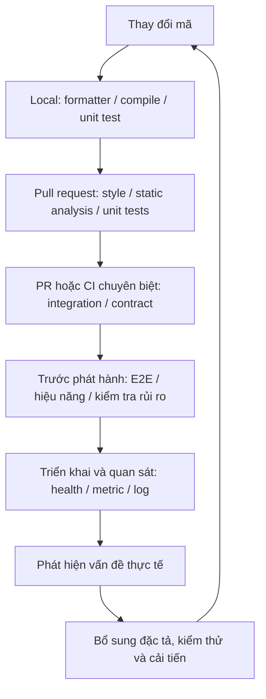
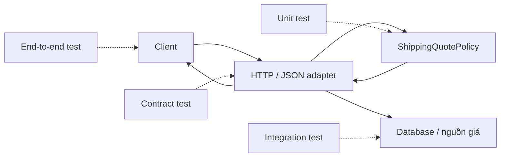
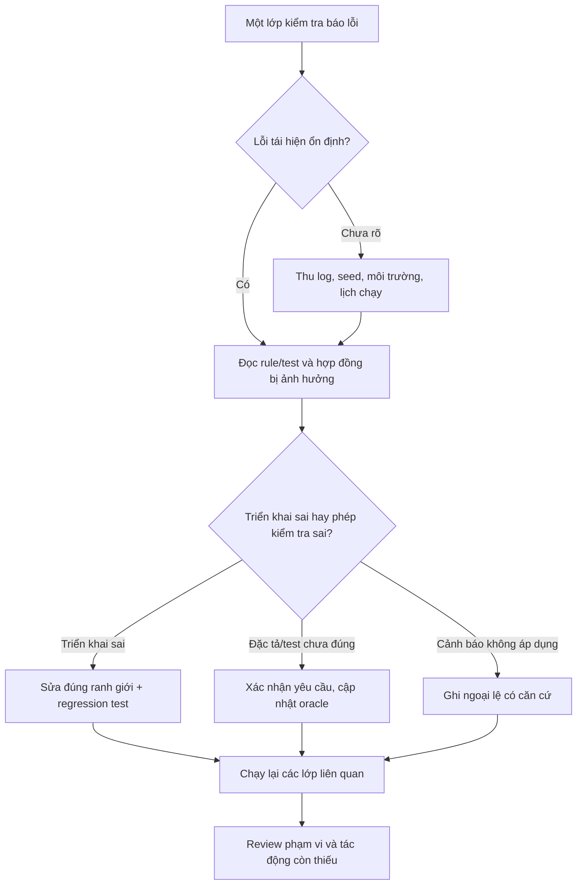

# Phối hợp các lớp kiểm tra thay vì trông chờ một công cụ

Một dự án Java có thể được định dạng hoàn hảo, không có cảnh báo Checkstyle và biên dịch thành công nhưng vẫn miễn phí vận chuyển sai ở đúng ngưỡng 500.000 VND. Dự án khác có hàng trăm unit test xanh nhưng vẫn tạo hai đơn hàng khi hai request trùng mã đến cùng lúc. Một hệ thống vượt qua kiểm thử tích hợp có thể chạy chậm, cạn bộ nhớ hoặc làm lộ bí mật khi triển khai thật.

Không có công cụ nào trong các ví dụ trên nhất thiết hoạt động sai. Mỗi công cụ chỉ nhìn thấy **một phần** của chất lượng mã nguồn. Trong chương **Kiểm tra tự động** của module **CODE_QUALITY_FUNDAMENTALS**, mục tiêu là biết cách **phối hợp các lớp kiểm tra có phạm vi khác nhau**, từ quy ước mã tới tính đúng đắn, tích hợp, vận hành và an toàn, để nguồn Java đáng tin cậy, dễ hiểu và dễ thay đổi.

Nguyên tắc quan trọng: **một lớp kiểm tra báo xanh là bằng chứng hữu ích trong phạm vi của nó, không phải chứng nhận toàn bộ hệ thống đúng**.

## 1. “Các lớp kiểm tra” là những lớp bằng chứng, không phải thư mục kiến trúc

Trong bài này, *lớp kiểm tra* không có nghĩa là package `controller`, `service` hay `repository`. Đó là một nhóm kỹ thuật xác minh giải quyết một loại câu hỏi riêng:

| Lớp kiểm tra | Câu hỏi nó giúp trả lời | Ví dụ công cụ hoặc kỹ thuật | Điều không tự chứng minh |
| --- | --- | --- | --- |
| **Định dạng và quy ước** | Mã có theo cách trình bày và quy ước tên đã thống nhất không? | Formatter, Spotless, Checkstyle | Công thức nghiệp vụ đúng |
| **Biên dịch và kiểm tra kiểu** | Mã có hợp cú pháp, đúng kiểu theo quy tắc Java và biên dịch được không? | `javac` qua Maven/Gradle | Kết quả chạy đúng với mọi đầu vào |
| **Phân tích tĩnh** | Có mẫu mã đáng ngờ hoặc vi phạm quy tắc phân tích được không? | PMD, SpotBugs, Error Prone và các rule phù hợp | Tất cả lỗi logic hoặc tương tác runtime |
| **Unit test** | Một đơn vị đáp ứng hợp đồng trên dữ liệu đã thử không? | JUnit 5, AssertJ hoặc thư viện assertion khác | DB, mạng và hợp đồng giữa các dịch vụ hoạt động thật |
| **Integration test** | Các thành phần kết nối, lưu trữ và giao dịch có tương tác đúng không? | Test với database, broker hoặc adapter thật trong môi trường thử | Mọi hành trình người dùng hoặc mọi tải sản xuất |
| **Contract test** | Bên cung cấp và bên tiêu thụ API hiểu cùng schema, lỗi, phiên bản không? | Kiểm tra OpenAPI/schema, consumer-driven contract | Tính đúng đắn nghiệp vụ trong mọi trạng thái |
| **End-to-end test** | Luồng người dùng quan trọng có đi qua các thành phần và kết thúc đúng không? | Test API/luồng nghiệp vụ xuyên hệ thống | Tất cả nhánh hiếm hoặc nguyên nhân bên trong |
| **Kiểm thử phi chức năng** | Dưới tải, lỗi, cạnh tranh, hệ thống giữ các giới hạn đã cam kết không? | Load test, concurrency test, failure injection | Chứng minh an toàn trong mọi điều kiện không được thử |
| **Kiểm tra bảo mật và chuỗi cung ứng** | Có lộ secret, phụ thuộc được biết có rủi ro hoặc cấu hình không phù hợp không? | Secret scanning, dependency scanning, kiểm tra cấu hình | Không tồn tại lỗ hổng mới hoặc lỗi phân quyền nghiệp vụ |

Đây không phải danh sách bắt buộc phải cài **một công cụ cho mỗi dòng**. Một công cụ có thể bao phủ nhiều nhóm, trong khi một nhóm có thể cần nhiều cách kiểm tra. Điều cần thiết là **câu hỏi quan trọng không bị bỏ sót**, và kết quả của mỗi lớp được diễn giải đúng phạm vi.

### 1.1. Vì sao các lớp phải bổ sung nhau?

Giả sử chương trình có:

```java
if (amountDueVnd > FREE_SHIPPING_THRESHOLD_VND) {
    shippingFeeVnd = 0L;
}
```

Nếu chính sách đã chốt là “**từ 500.000 VND trở lên**”, dấu `>` là sai ở giá trị biên. Formatter vẫn có thể trình bày nó đẹp, compiler vẫn chấp nhận cú pháp, nhiều rule phân tích tĩnh không thể biết yêu cầu nghiệp vụ và test chỉ dùng đơn 600.000 VND cũng có thể xanh.

Một kiểm thử được thiết kế **từ yêu cầu**, với `amountDueVnd == 500_000L`, có cơ sở phát hiện lỗi. Ngược lại, kiểm thử ấy chưa đủ để biết dữ liệu giảm giá lấy từ database có được ánh xạ đúng hay không.

### 1.2. Nhiều công cụ giống nhau chưa chắc tạo bằng chứng bổ sung

Chạy hai formatter khác nhau trên cùng tập nguồn có thể tạo diff luân phiên vì chúng có quy ước mâu thuẫn. Chạy năm bộ phân tích tĩnh cùng cấu hình tương tự có thể sinh hàng nghìn cảnh báo trùng nhưng không kiểm tra được tình huống timeout sau commit.

Cách chọn tốt hơn là hỏi:

1. **Rủi ro cụ thể nào cần ngăn hoặc phát hiện?**
2. **Bằng chứng nào đang có và còn thiếu?**
3. **Công cụ mới có kiểm tra một khả năng thất bại khác không?**
4. **Chi phí chạy và xử lý cảnh báo có tương xứng không?**
5. **Ai chịu trách nhiệm khi bước kiểm tra báo lỗi?**

Tính đa dạng của **khả năng phát hiện** quan trọng hơn số logo công cụ trên trang dự án.

## 2. Mô hình ba tầng phản hồi: nhanh, tích hợp và hệ thống

Có thể tổ chức các lớp kiểm tra theo thời điểm trả phản hồi:



**Vòng nhanh** nên giúp người viết phát hiện vấn đề trong phạm vi nhỏ: format, compile, các unit test liên quan. **Vòng tích hợp** kiểm tra các ranh giới như database, broker, HTTP, schema và giao dịch. **Vòng hệ thống** kiểm tra luồng quan trọng, tải, cách xử lý lỗi và khả năng quan sát khi chạy.

Sơ đồ không bắt buộc các bước chạy hoàn toàn nối tiếp. Nhiều việc có thể chạy song song; cách sắp xếp phụ thuộc chi phí và độ tin cậy. Chỉ có điều không nên đánh đồng **kiểm tra nhanh** với **kiểm tra đầy đủ**.

### 2.1. Ví dụ ma trận nơi chạy

| Loại kiểm tra | Máy lập trình viên | Mỗi pull request | Định kỳ hoặc trước phát hành |
| --- | --- | --- | --- |
| Format/style | Chạy thường xuyên, hỗ trợ tự sửa | Bắt buộc kiểm tra, không tự thay tệp | Chỉ khi thay cấu hình/tool |
| Compile/unit test | Chạy theo phạm vi vừa sửa | Bắt buộc các module liên quan | Có thể chạy toàn bộ |
| Phân tích tĩnh | Quy tắc nhanh khi phù hợp | Bắt buộc nhóm rule đã thống nhất | Quét sâu theo lịch nếu tốn thời gian |
| Integration/contract | Chạy theo yêu cầu, môi trường có kiểm soát | Chạy khi hạ tầng CI cho phép | Mở rộng nhiều cấu hình/phiên bản |
| E2E | Một số luồng khói (*smoke*) | Chọn luồng quan trọng và ổn định | Bộ đầy đủ theo chiến lược phát hành |
| Load/fault/concurrency | Test đơn vị cho bất biến nếu phù hợp | Chạy kiểm tra nhỏ cho thay đổi rủi ro | Thử tải và failure injection có kiểm soát |
| Dependency/secret scan | Kiểm tra nhanh khi thay phụ thuộc | Chặn rủi ro đã xác nhận theo chính sách | Quét lại khi có thông tin rủi ro mới |

Bảng là **gợi ý tổ chức**, không phải tiêu chuẩn bắt buộc. Đối với hệ thống điều khiển an toàn, thanh toán hoặc thay đổi hạ tầng quan trọng, có thể cần lớp kiểm tra sâu hơn trước mỗi lần merge.

## 3. Ví dụ xuyên suốt: báo giá vận chuyển

Giả sử API báo giá đã có các quy tắc được xác nhận:

- Tiền hàng và khoản giảm giá là số nguyên VND không âm.
- Khoản giảm giá không lớn hơn tiền hàng.
- Tiền hàng sau giảm giá bằng tiền hàng trừ khoản giảm.
- Giao nhanh luôn tính phí 30.000 VND.
- Giao tiêu chuẩn miễn phí cho thành viên khi **tiền hàng sau giảm giá từ 500.000 VND trở lên**, bao gồm đúng mốc.
- Các trường hợp giao tiêu chuẩn còn lại tính 15.000 VND.
- Tổng phải thanh toán bằng tiền hàng sau giảm giá cộng phí giao, và không được im lặng tràn kiểu `long`.

Bài học này chưa xét thuế, vùng xa hoặc nhiều tiền tệ. Việc nêu phạm vi tránh để một test giả định thêm các chính sách chưa được chốt.

### 3.1. Mã Java 17 làm đối tượng kiểm tra

Tệp `ShippingQuotePolicy.java`:

```java
package com.example.quality;

import java.util.Objects;

public final class ShippingQuotePolicy {
    private static final long FREE_THRESHOLD_VND = 500_000L;
    private static final long STANDARD_FEE_VND = 15_000L;
    private static final long EXPRESS_FEE_VND = 30_000L;

    public enum DeliverySpeed {
        STANDARD, EXPRESS
    }

    public record Request(
            long merchandiseSubtotalVnd,
            long discountAmountVnd,
            boolean member,
            DeliverySpeed speed) {}

    public record Quote(
            long amountDueVnd,
            long shippingFeeVnd,
            long totalChargeVnd) {}

    private ShippingQuotePolicy() {}

    public static Quote quote(Request request) {
        Objects.requireNonNull(request, "request");
        Objects.requireNonNull(request.speed(), "speed");

        if (request.merchandiseSubtotalVnd() < 0
                || request.discountAmountVnd() < 0
                || request.discountAmountVnd()
                > request.merchandiseSubtotalVnd()) {
            throw new IllegalArgumentException("invalid amounts");
        }

        long amountDueVnd = request.merchandiseSubtotalVnd()
                - request.discountAmountVnd();

        long shippingFeeVnd;
        if (request.speed() == DeliverySpeed.EXPRESS) {
            shippingFeeVnd = EXPRESS_FEE_VND;
        } else if (request.member()
                && amountDueVnd >= FREE_THRESHOLD_VND) {
            shippingFeeVnd = 0L;
        } else {
            shippingFeeVnd = STANDARD_FEE_VND;
        }

        long totalChargeVnd =
                Math.addExact(amountDueVnd, shippingFeeVnd);

        return new Quote(
                amountDueVnd, shippingFeeVnd, totalChargeVnd);
    }
}
```

Trong phạm vi mô hình đã nêu, lớp không có I/O hay trạng thái mutable dùng chung, nên các đơn vị có thể được kiểm tra độc lập. Những lớp kiểm tra khác nhau đặt ra những câu hỏi khác nhau cho **chính đoạn mã này**.

| Câu hỏi kiểm tra | Ví dụ bằng chứng |
| --- | --- |
| Mã có biên dịch trên JDK được chọn? | Compile thành công |
| Tên kiểu, khoảng trắng, import có đúng quy ước? | Formatter/style check báo đạt |
| Có đường xử lý `null` hoặc lỗi số học cần xem? | Static analysis và review đối chiếu hợp đồng |
| Ngưỡng 500.000 có bao gồm đúng mốc? | Unit test tại 499.999, 500.000 và 500.001 |
| Giao nhanh có bỏ qua ưu đãi thành viên? | Unit test kết hợp điều kiện |
| Giao diện HTTP có truyền đúng loại giao hàng? | Contract/integration test cho mapping request |
| Khi lưu báo giá có bị sai đơn vị, lệch giá? | Integration test với schema và dữ liệu thật |
| Dưới tải, API có vượt thời gian phản hồi? | Load test theo workload và ngưỡng đã đặt |

### 3.2. Unit test bảo vệ quy tắc mà formatter không thấy

Tệp `ShippingQuotePolicyTest.java`, cùng package, dùng JUnit 5:

```java
package com.example.quality;

import static org.junit.jupiter.api.Assertions.assertEquals;
import static org.junit.jupiter.api.Assertions.assertThrows;

import org.junit.jupiter.api.Test;
import org.junit.jupiter.params.ParameterizedTest;
import org.junit.jupiter.params.provider.CsvSource;

class ShippingQuotePolicyTest {
    @ParameterizedTest
    @CsvSource({
        "STANDARD, true, 499999, 0, 15000",
        "STANDARD, true, 500000, 0,     0",
        "STANDARD, true, 500001, 0,     0",
        "STANDARD, false, 600000, 0, 15000",
        "EXPRESS, true, 600000, 0,  30000",
        "STANDARD, true, 600000, 100000, 0",
        "STANDARD, true, 600000, 100001, 15000"
    })
    void shippingFeeFollowsConfirmedRules(
            ShippingQuotePolicy.DeliverySpeed speed,
            boolean member,
            long subtotalVnd,
            long discountVnd,
            long expectedFeeVnd) {

        var request = new ShippingQuotePolicy.Request(
                subtotalVnd, discountVnd, member, speed);
        var result = ShippingQuotePolicy.quote(request);

        long expectedAmountDueVnd = subtotalVnd - discountVnd;
        assertEquals(expectedAmountDueVnd, result.amountDueVnd());
        assertEquals(expectedFeeVnd, result.shippingFeeVnd());
        assertEquals(expectedAmountDueVnd + expectedFeeVnd,
                result.totalChargeVnd());
    }

    @Test
    void rejectsDiscountGreaterThanSubtotal() {
        assertThrows(IllegalArgumentException.class,
                () -> ShippingQuotePolicy.quote(
                        new ShippingQuotePolicy.Request(
                                100_000L, 100_001L, true,
                                ShippingQuotePolicy.DeliverySpeed.STANDARD)));
    }

    @Test
    void rejectsUnknownDeliverySpeed() {
        assertThrows(NullPointerException.class,
                () -> ShippingQuotePolicy.quote(
                        new ShippingQuotePolicy.Request(
                                100_000L, 0L, true, null)));
    }

    @Test
    void rejectsOverflowInsteadOfReturningWrongCharge() {
        assertThrows(ArithmeticException.class,
                () -> ShippingQuotePolicy.quote(
                        new ShippingQuotePolicy.Request(
                                Long.MAX_VALUE, 0L, false,
                                ShippingQuotePolicy.DeliverySpeed.EXPRESS)));
    }
}
```

Các case trong `@CsvSource` được chọn từ **quy tắc đã chốt**, không phải lấy kết quả từ mã sản xuất làm đáp án. Bài test đúng ngưỡng sẽ phát hiện nếu ai đó vô tình đổi `>=` thành `>`, dù formatter, compiler và nhiều rule phân tích tĩnh vẫn báo đạt.

Trong bài test, phép cộng để tạo `expected` chỉ dùng với những giá trị nhỏ không tràn `long`. Ca tràn số được tách riêng và kỳ vọng `ArithmeticException`. Điều này tránh tạo ra một test mà giá trị mong đợi vô tình tràn số như mã đang được kiểm tra.

### 3.3. Phân tích tĩnh và review bổ sung điều gì?

Một analyzer có thể phát hiện **mẫu lỗi tiềm năng** như dereference `null`, tài nguyên không đóng hoặc sai cách sử dụng một API. Nó cũng có thể đưa ra cảnh báo cần xem xét nhưng không phải lỗi thực tế trong ngữ cảnh đang xét.

Với `ShippingQuotePolicy`, không nên kết luận “đã kiểm tra mọi lỗi” chỉ vì không có cảnh báo. Cần có:

- Kiểm thử đầu vào sai để xác nhận hợp đồng lỗi.
- Kiểm thử đúng ngưỡng, loại giao hàng và giảm giá.
- Review xem cách dùng số nguyên VND có khớp với dữ liệu tại biên API không.
- Kiểm tra nơi ứng dụng thực tế tạo `Request` để tránh truyền nhầm số tiền **trước** và **sau** voucher.

**Đơn vị phân tích** và **cấp kiểm thử** có thể cùng quan tâm một đoạn mã, nhưng câu hỏi chúng trả lời khác nhau. Khi kết hợp, kết quả sẽ có ích hơn một mình bất kỳ lớp nào.

## 4. Cùng một tính năng nhưng lỗi có thể xuất hiện ở ranh giới khác

Giả sử endpoint `POST /quotes` nhận JSON, chuyển thành `Request`, dùng `ShippingQuotePolicy.quote(...)` rồi trả JSON.



Ngay cả khi `ShippingQuotePolicy` đúng, những lỗi khác vẫn có thể xảy ra:

| Tình huống lỗi | Lớp kiểm tra thích hợp | Vì sao unit test của `quote` chưa đủ |
| --- | --- | --- |
| JSON gửi `"EXPRESS"` nhưng adapter ánh xạ sai thành `STANDARD` | Contract/integration test request mapping | Unit test nhận enum đã hợp lệ, không đi qua JSON |
| SQL lưu tiền bằng đơn vị khác với Java | Integration test dữ liệu và schema | Unit test không dùng cơ sở dữ liệu |
| Hai yêu cầu cùng mã tạo hai bản ghi báo giá/đơn | Kiểm tra ràng buộc DB và concurrency/idempotency | Phép tính thuần không tạo bản ghi |
| Lỗi serialization làm thiếu trường `totalChargeVnd` | Contract test response JSON | Unit test chỉ đọc record |
| HTTP timeout sau khi tạo đơn | Failure/integration/E2E test trạng thái và retry | Chưa mô phỏng mạng hoặc commit |
| Độ trễ p99 tăng khi DB tải cao | Load test + metric | Một lời gọi đơn vị nhanh không thể suy ra toàn luồng nhanh |
| Đầu vào không được xác thực quyền truy cập | Test phân quyền, security review | `quote` không biết danh tính người dùng |

Điều cần nhớ là một lỗi **được phát hiện ở tầng nào** không nhất thiết là nơi **nguyên nhân gốc** nằm. E2E test có thể báo sai kết quả vì adapter ánh xạ sai, còn sửa lỗi cần thực hiện ở adapter và bổ sung kiểm thử cấp thấp để phát hiện sớm lần sau.

### 4.1. Kiểm thử tích hợp phải dùng những đặc tính thật cần kiểm tra

Ví dụ một dịch vụ giữ tồn kho dùng database. Nếu hai request cùng tranh một chỗ cuối, hai bước riêng lẻ kiểu “`SELECT remaining`, sau đó `UPDATE`” có thể bị race khi không có cơ chế nguyên tử thích hợp.

Một hướng thiết kế SQL mang tính ý tưởng:

```sql
-- Nằm trong transaction thích hợp theo DBMS:
UPDATE course_capacity
SET remaining = remaining - 1
WHERE course_id = :courseId
  AND remaining > 0;

-- Tiếp tục tạo enrollment CHỈ NẾU cập nhật đúng 1 dòng.
-- Nếu tạo enrollment lỗi: rollback cùng transaction.
-- Áp ràng buộc UNIQUE(course_id, student_id)
-- để ngăn hai đăng ký trùng nhau.
```

Unit test với repository giả có thể xác nhận `Service` gọi `reserve` theo chính sách. Nhưng chỉ **integration test với database thật hoặc môi trường tương thích đủ sâu** mới kiểm tra được transaction, constraint, race và cách ánh xạ lỗi của driver. Đoạn SQL trên chưa phải triển khai độc lập đầy đủ: còn cần transaction boundaries, isolation, kiểm tra số dòng, lỗi trùng và cơ chế rollback.

### 4.2. Contract test kiểm tra lời hứa tại biên

Ví dụ JSON phản hồi báo giá được công bố:

```json
{
  "amountDueVnd": 500000,
  "shippingFeeVnd": 0,
  "totalChargeVnd": 500000
}
```

Nếu client cần ba trường này với tên và đơn vị đã thống nhất, **tên field là một phần của hợp đồng**. Refactor biến Java nội bộ thường không cần sửa contract test; đổi `totalChargeVnd` thành `total` trong API có thể phá client dù tính tiền không đổi.

Một contract test nên kiểm tra kiểu dữ liệu, tên field, trường bắt buộc, mã lỗi và tính tương thích. Nó **không tự chứng minh** quy tắc miễn phí vận chuyển đúng ở mọi mốc; vẫn cần kiểm thử nghiệp vụ.

## 5. Tổ chức các lớp kiểm tra trong Gradle và CI

Các lệnh dưới đây là **mẫu cách tổ chức**, không khẳng định repository đang có sẵn các plugin hoặc task được nhắc tới. Cần cấu hình và kiểm tra phiên bản tương thích trước khi áp dụng.

### 5.1. Chọn một lệnh có vai trò rõ cho mỗi bước

```bash
# Nếu đã cài Spotless: xác nhận mã đúng format.
./gradlew spotlessCheck

# Nếu đã cài Checkstyle: kiểm tra các quy ước đã bật.
./gradlew checkstyleMain checkstyleTest

# Compile và chạy unit test theo cấu hình build hiện tại.
./gradlew test

# Nếu đã định nghĩa task integrationTest riêng:
./gradlew integrationTest

# Chạy các bước mặc định thuộc vòng kiểm tra của Gradle:
./gradlew check
```

Trên Windows, dùng Gradle Wrapper `gradlew.bat` tương ứng. `integrationTest` **không phải task tự có ở mọi dự án**; nó chỉ chạy được khi build định nghĩa test suite hoặc task tương ứng. `check` chạy những việc đã được liên kết trong cấu hình Gradle, không mặc nhiên bao phủ E2E, quét dependency, thử tải hay mọi integration test.

### 5.2. Một pipeline có thể chạy sớm bước rẻ và song song bước độc lập

Ví dụ phân nhóm bằng pseudo-pipeline, **không phải cú pháp của một nhà cung cấp CI cụ thể**:

```text
Pull request
  ├─ Fast checks:
  │    format-check
  │    style-check
  │    compile
  │    unit-tests
  │
  ├─ Integration checks:
  │    database-migrations
  │    database-integration-tests
  │    api-contract-tests
  │
  ├─ Risk checks:
  │    dependency/secret scan
  │    architecture boundaries
  │
  └─ Review gate:
       các bước bắt buộc đạt
       không còn cảnh báo chặn chưa xử lý
       người review xác nhận nghiệp vụ và rủi ro

Trước khi phát hành hoặc theo lịch:
  ├─ end-to-end critical journeys
  ├─ load / soak / fault injection
  └─ kiểm tra cấu hình môi trường triển khai
```

Một chính sách hợp lý phải nêu **những job nào chặn merge, những job nào chỉ cảnh báo**, cách xử lý flaky test và ai được phép chấp thuận ngoại lệ. Nếu pipeline có 20 bước nhưng 10 bước thường xuyên bị bỏ qua, nó có thể tạo cảm giác an toàn giả.

### 5.3. Không để CI âm thầm sửa nguồn rồi báo xanh

Trong CI, formatter nên chạy ở chế độ **check**. Nếu CI tự format rồi không lưu thay đổi vào commit được review, nguồn trong repository vẫn có thể sai quy ước dù job báo thành công. Lập trình viên có thể dùng chế độ `apply` ở local; PR chứa diff định dạng để được xem xét.

Tương tự, nếu analyzer sinh báo cáo nhưng CI luôn trả mã thành công bất kể rule mức nghiêm trọng cao, nhóm cần hiểu đó là **cảnh báo**, không phải **quality gate**.

## 6. Cách chọn lớp kiểm tra từ một bảng rủi ro

Thay vì mở đầu bằng “cài công cụ nào?”, bắt đầu với các lỗi mà sản phẩm không chấp nhận:

| Rủi ro | Hợp đồng cần bảo vệ | Bằng chứng ưu tiên | Lớp kiểm tra hỗ trợ thêm |
| --- | --- | --- | --- |
| Đổi ngưỡng ưu đãi làm sai báo giá | Đúng các mốc biên và loại khách | Unit test theo bảng quyết định | Review quy tắc nghiệp vụ |
| Rò rỉ kết nối khi DB ném lỗi | Tài nguyên được trả về pool | Integration test, failure injection | Static analysis và review `try-with-resources` |
| Xử lý hai thanh toán trùng | Một `requestId` không thu hai lần | Integration/concurrency/idempotency test | Schema constraints, observability |
| Đổi schema làm hỏng client | Field và lỗi công khai tương thích | Contract tests giữa provider/consumer | Versioning review |
| Mã mỗi người một kiểu | Định dạng và tên theo quy ước | Formatter/linter gate | Review tên miền nghiệp vụ |
| Thay đổi gây p99 tăng mạnh | SLO được xác định rõ | Load test dưới workload phù hợp | Profiling, metrics |
| Phụ thuộc có rủi ro đã công bố | Không phát hành phụ thuộc vượt chính sách rủi ro | Dependency scan và triage | Review phương án nâng phiên bản |
| Logic phân quyền sai | Không đọc/sửa dữ liệu trái quyền | Test negative authorization | Threat modeling, security review |

Một rủi ro có thể cần **hơn một bằng chứng**. Ví dụ, chống thanh toán trùng cần hợp đồng về khóa idempotency, ràng buộc dữ liệu nguyên tử, test cạnh tranh và cách đối soát khi timeout. Không có một câu lệnh “scan toàn bộ” có thể thay tất cả.

### 6.1. Phân biệt lỗi mà máy phát hiện với khoảng trống trong đặc tả

Nếu yêu cầu nghiệp vụ chỉ ghi “miễn phí vận chuyển với đơn lớn”, không công cụ nào biết “lớn” nghĩa là mốc bao nhiêu và tính trước hay sau voucher. Viết thêm unit test khi đặc tả mơ hồ có thể chỉ củng cố một cách hiểu sai.

Trình tự phù hợp:

1. Xác nhận quy tắc và trường hợp biên với bên chịu trách nhiệm.
2. Ghi tiêu chí chấp nhận có thể kiểm tra.
3. Chọn kiểm thử/hợp đồng tương ứng.
4. Chạy chúng cùng các bước biên dịch, format và phân tích cần thiết.
5. Rà soát tác động đối với những ranh giới khác.

**Chất lượng của test oracle** — căn cứ xác định kết quả đúng — quan trọng không kém số lượng test.

## 7. Khi công cụ báo mâu thuẫn hoặc tất cả đều xanh

### 7.1. Một công cụ cảnh báo, test vẫn xanh

Ví dụ static analyzer nghi ngờ một `InputStream` không được đóng, nhưng unit test của chức năng đọc tệp vẫn xanh. Không nên tắt cảnh báo chỉ vì test xanh: test có thể chỉ kiểm tra nội dung và không quan sát vòng đời stream.

Hành động tốt hơn là:

- Xác định tài nguyên do ai sở hữu và khi nào phải đóng.
- Xem cảnh báo có phản ánh đường mã thật không.
- Viết hoặc bổ sung test đóng tài nguyên ở cả đường thành công và đường lỗi.
- Sửa bằng `try-with-resources` nếu phù hợp, hoặc ghi suppression có phạm vi và lý do cụ thể nếu cảnh báo sai.

Ở chiều ngược lại, nếu analyzer không cảnh báo mà unit test đúng mốc 500.000 thất bại, cần ưu tiên xử lý hành vi vì hợp đồng đã bị vi phạm.

### 7.2. Mọi công cụ đều xanh nhưng sản phẩm vẫn lỗi

Có thể xảy ra nếu:

- Đặc tả sai hoặc chưa rõ, mọi test cùng dựa trên giả định sai.
- Test chỉ dùng dữ liệu quá đơn giản và thiếu ca biên.
- Repository giả không phản ánh transaction/constraint thật.
- Contract test chỉ kiểm tra schema mà không kiểm tra ý nghĩa dữ liệu.
- E2E test bỏ qua nhánh thất bại hiếm.
- Dưới tải hoặc cạnh tranh, lịch xen kẽ tạo lỗi không xuất hiện khi chạy tuần tự.
- Cấu hình sản xuất khác môi trường test.

Kết quả xanh cần được đọc như **“những phép kiểm tra đã chạy không phát hiện vi phạm trong phạm vi đã thử”**, không phải “phần mềm không còn lỗi”.

### 7.3. Báo lỗi từ E2E không tự chỉ ra nguyên nhân gốc

E2E kiểm tra một hành trình xuyên hệ thống. Khi thất bại, cần phân rã: request/response, logic nghiệp vụ, DB, giao tiếp giữa dịch vụ, thời gian chờ và cấu hình.

Một chiến lược cải thiện là **sửa tại nguồn**, rồi bổ sung test thấp nhất có thể phát hiện cùng loại lỗi một cách đáng tin. Ví dụ E2E phát hiện trường `deliverySpeed` bị ánh xạ sai: sửa adapter, thêm contract/integration test của adapter, giữ một E2E cho hành trình chính.

## 8. Tránh ba bẫy: trùng lặp, cảnh báo nhiễu và kiểm thử không ổn định

### 8.1. Trùng lặp chi phí mà không có bằng chứng mới

Không cần kiểm tra cùng một phép tính ở hàng trăm E2E test nếu unit test đã bao phủ đầy đủ các nhánh chính và chỉ cần một vài E2E để xác nhận đường tích hợp. Ngược lại, cũng không nên xóa mọi E2E chỉ vì nhiều unit test đã xanh.

**Thang kiểm thử** là mô hình cân bằng: nhiều phép kiểm tra rẻ, ổn định ở cấp đơn vị; số lượng có chọn lọc các kiểm tra tích hợp và toàn luồng. Tỷ lệ cụ thể tùy sản phẩm, rủi ro và chi phí, không có con số cố định cho mọi nhóm.

### 8.2. Cảnh báo quá nhiều khiến nhóm bỏ qua

Một analyzer có thể báo nhiều cảnh báo không liên quan. Cách xử lý:

- Chọn rule theo rủi ro và giá trị thực.
- Phân mức lỗi chặn merge và cảnh báo để review.
- Dùng baseline để không làm nợ cũ che khuất vấn đề mới.
- Ghi lý do và phạm vi suppression.
- Theo dõi rule có false positive cao để điều chỉnh.
- Tránh thay đổi hàng loạt định dạng trong cùng PR sửa nghiệp vụ.

Mục tiêu không phải “0 cảnh báo bằng mọi giá”, mà là **mọi cảnh báo còn lại đều được hiểu và xử lý theo chính sách**.

### 8.3. Flaky test làm giảm độ tin vào pipeline

Kiểm thử phụ thuộc `Thread.sleep(...)`, thời gian thật, dữ liệu dùng chung hoặc trạng thái dịch vụ ngoài dễ lúc xanh lúc đỏ. Không nên mặc định bỏ qua mọi thất bại là “flaky”.

Cách cải thiện:

- Điều khiển đồng hồ bằng `Clock` khi thời gian là đầu vào.
- Dùng latch/barrier hoặc chờ điều kiện quan sát được cho test đồng thời.
- Cô lập dữ liệu, tài nguyên và cấu hình giữa các test.
- Đặt timeout hữu hạn, cleanup trong `finally`.
- Với lỗi ngẫu nhiên, giữ dấu vết và phân loại nguyên nhân.
- Nếu test cần cách ly tạm thời, ghi người chịu trách nhiệm và điều kiện khôi phục.

**Tự động retry test cho đến khi xanh** có thể che một lỗi race thực. Việc retry phục vụ chẩn đoán cần khác với chính sách cho phép merge.

## 9. Coverage, điểm phân tích và số lượng test phải được diễn giải đúng

Một số chỉ số giúp quan sát chất lượng kiểm tra nhưng không thể thay đặc tả và lập luận:

| Chỉ số | Nó cho biết điều gì | Không đủ để khẳng định |
| --- | --- | --- |
| Line/branch coverage | Bao nhiêu dòng/nhánh được chạy trong bộ test | Các assertion đúng hoặc đủ ca biên |
| Mutation score | Bao nhiêu biến đổi mã được bộ test phát hiện trong phạm vi công cụ | Mọi bug thật sẽ bị phát hiện |
| Số test | Có bao nhiêu ca được chạy | Tính độc lập, giá trị hay chất lượng oracle |
| Static analysis warnings | Rule hiện hành tìm thấy bao nhiêu mẫu đáng ngờ | Không có cảnh báo nghĩa là không có bug |
| Cyclomatic complexity | Số đường điều khiển độc lập theo cách tính công cụ | Phương thức chắc chắn sai nếu điểm cao |
| E2E pass rate | Tỷ lệ kịch bản được chạy đạt theo điều kiện test | Mọi đường nghiệp vụ và môi trường đều đúng |
| Thời gian pipeline | Chi phí phản hồi tự động | Một pipeline nhanh thì đủ kiểm tra |

Ví dụ, `100% line coverage` trên `if (amount > 500_000)` vẫn có thể đạt khi test chỉ dùng 400.000 và 600.000. Nếu đặc tả là “từ 500.000 trở lên”, thiếu ca đúng ngưỡng là khoảng trống logic không thể hiện qua line coverage.

Tương tự, mutation testing có thể hữu ích để phát hiện test thiếu sức phân biệt, nhưng cần cấu hình mức biến đổi, xử lý mutation tương đương và giới hạn tài nguyên phù hợp. Không nên coi một điểm số duy nhất là chuẩn tuyệt đối của chất lượng.

## 10. Xây dựng quy trình triage khi một lớp kiểm tra thất bại

Một pipeline hữu ích không chỉ báo đỏ; nó phải giúp người phát triển đi từ bằng chứng đến quyết định.



**Mục tiêu triage** là tìm rủi ro thật và làm bằng chứng tốt hơn, không chỉ khiến badge CI chuyển sang màu xanh. Ví dụ khi checkstyle báo tên không theo quy ước, có thể sửa tên nội bộ; nhưng nếu đó là field API công khai cần tương thích, phải xem xét phiên bản hoặc adapter thay vì đổi bừa.

### 10.1. Mẫu ghi nhận kết quả kiểm tra trong pull request

```text
Thay đổi: sửa ngưỡng miễn phí vận chuyển
Hợp đồng: thành viên giao STANDARD, amountDueVnd >= 500000
          thì shippingFeeVnd = 0

Local:
  formatter-check: PASS
  compile: PASS
  unit tests: PASS (ca dưới/đúng/trên ngưỡng)

CI:
  style/static analysis: PASS theo rule hiện hành
  API contract: PASS (field và kiểu không đổi)
  database integration: NOT APPLICABLE (thay đổi không đụng lưu trữ)
  E2E critical quote: PASS

Giới hạn:
  Chưa kiểm chứng thử tải vì không thay đổi đường I/O;
  theo dõi hiệu năng hiện có và đánh giá nếu phạm vi đổi.
```

Đây là **mẫu cách báo cáo**, không phải kết quả thật từ việc chạy một dự án. Trong báo cáo thực tế nên ghi ID commit, phiên bản công cụ, cấu hình, thời điểm chạy và đường dẫn log/test report. Trường `NOT APPLICABLE` phải có **lý do**, không được dùng làm cách bỏ qua một rủi ro chưa xử lý.

## 11. Quy trình chọn các lớp kiểm tra cho một chức năng mới

Một chuỗi quyết định có thể áp dụng trước khi viết mã:

1. **Chốt hợp đồng:** đầu vào, đầu ra, trường hợp lỗi, bất biến, tương thích và yêu cầu phi chức năng.
2. **Phân tích rủi ro:** vấn đề nào xảy ra với dữ liệu, đồng thời, hạ tầng, bảo mật và vận hành?
3. **Chọn bằng chứng rẻ nhất có ý nghĩa:** unit test cho quy tắc thuần, integration cho DB, contract cho API, E2E cho hành trình.
4. **Bổ sung kiểm tra tự động lặp lại:** formatter, linter, compile và những rule phân tích tĩnh phù hợp.
5. **Chọn quality gate theo mức độ quan trọng:** quy định bước bắt buộc cho PR, kiểm tra chuyên sâu theo lịch/đợt phát hành.
6. **Đảm bảo tái hiện:** cố định phiên bản công cụ, dữ liệu thử, cấu hình và môi trường ở mức cần thiết.
7. **Review khoảng trống:** còn lỗi nào không lớp hiện tại phát hiện được? Có cần thêm quan sát thực tế sau phát hành?
8. **Cập nhật khi gặp bug:** từ lỗi thực tế bổ sung quy tắc, ca biên hoặc hợp đồng thích hợp để phòng tái diễn.

Không nhất thiết thêm mọi công cụ ngay từ đầu. **Tăng chiều sâu kiểm tra theo rủi ro**, giữ pipeline dễ hiểu và ổn định, thường hữu ích hơn cài một danh sách dài nhưng không có người chịu trách nhiệm.

## 12. Những ngộ nhận thường gặp

| Ngộ nhận | Vì sao chưa đúng | Cách nhìn phù hợp |
| --- | --- | --- |
| “Không có cảnh báo linter nghĩa là mã đúng.” | Linter chỉ biết các quy tắc được cấu hình | Kiểm thử hành vi và xác nhận đặc tả |
| “Unit test xanh nghĩa là DB an toàn.” | Fake không mô phỏng transaction, constraint hay race thực | Integration và concurrency test |
| “E2E kiểm tra hết mọi thứ.” | Chi phí cao, ít kịch bản, khó bắt lỗi biên | Kết hợp unit/contract/integration |
| “Coverage 100% đảm bảo không lỗi.” | Mỗi dòng có thể được chạy mà không kiểm tra đúng ý nghĩa | Oracle tốt, dữ liệu biên, bất biến |
| “Cứ thêm nhiều analyzer là chất lượng tăng.” | Rule chồng lấp và cảnh báo nhiễu | Chọn theo rủi ro và phạm vi phát hiện |
| “CI xanh nghĩa là đã QA mọi môi trường.” | CI chỉ kiểm tra cấu hình, dữ liệu, workload cụ thể | Nêu giới hạn và thử môi trường cần thiết |
| “Test flaky cứ chạy lại đến khi xanh.” | Che giấu race, timing bug, lỗi tài nguyên | Tìm nguyên nhân, kiểm soát môi trường |
| “Chỉ cần kiểm tra trước merge.” | Rủi ro phụ thuộc và cấu hình có thể xuất hiện về sau | Kết hợp kiểm tra định kỳ và quan sát |
| “Một bug bị E2E bắt thì chỉ cần thêm E2E.” | Lỗi tương tự có thể phát hiện sớm, rẻ hơn ở lớp thấp | Thêm regression test đúng ranh giới |
| “Có task `check` là đã chạy mọi kiểm tra.” | Gradle `check` chỉ gồm task được cấu hình | Xác nhận pipeline và report thật |

## 13. Bài tập vận dụng

**Tình huống:** hệ thống đăng ký khóa học có API `POST /enrollments`. Quy tắc được xác nhận: mỗi lớp tối đa 30 học viên, một học viên chỉ có một đăng ký hợp lệ trên một lớp; khi thành công, hệ thống tạo bản ghi, gửi sự kiện `EnrollmentCreated`; khi hết chỗ không tạo đăng ký mới. Hệ thống chạy nhiều instance ứng dụng dùng chung database và broker.

Hiện có pipeline với formatter, Checkstyle và 20 unit test dùng fake repository. Tất cả đều xanh, nhưng đã xảy ra hai lỗi sản xuất: hai người cùng lấy một suất cuối, và email xác nhận được gửi trùng khi broker gửi lại sự kiện.

Hãy thực hiện:

1. **Lập ma trận rủi ro:** đối với sức chứa, đăng ký trùng, xử lý sự kiện, tương thích API và hiệu năng, chỉ ra lớp kiểm tra có thể phát hiện từng lỗi.
2. **Thiết kế unit test:** chọn ba trường hợp biên hoặc từ chối nghiệp vụ; nêu vì sao fake repository chưa chứng minh không vượt sức chứa dưới cạnh tranh.
3. **Thiết kế integration test:** mô tả hai request đồng thời tranh suất cuối, yêu cầu constraint và transaction; xác định trạng thái DB cần kiểm tra sau chạy.
4. **Thiết kế contract test:** xác định schema phản hồi thành công/hết chỗ, mã lỗi và các trường client phải được phép dựa vào.
5. **Thiết kế failure test:** broker phát lại sự kiện `EnrollmentCreated` với cùng ID; kiểm tra side effect gửi thông báo không lặp trái hợp đồng.
6. **Đề xuất quality gate:** bước nào bắt buộc mỗi PR, bước nào định kỳ; xử lý ra sao khi test concurrency flaky?
7. **Đánh giá bằng chứng:** nếu mọi bước trên xanh, những rủi ro nào vẫn cần theo dõi khi hệ thống chạy thật?

**Hướng tự đối chiếu:** formatter và Checkstyle giúp quy ước nhất quán chứ không kiểm tra sức chứa. Unit test xác nhận quy tắc nhưng không chứng minh transaction của DB thật. Giới hạn 30 chỗ cần thao tác ghi có điều kiện/ràng buộc và kiểm thử cạnh tranh tại kho dữ liệu. Consumer sự kiện cần cơ chế xử lý trùng theo ID nếu hợp đồng yêu cầu không gửi email trùng; chỉ đếm lời gọi `send()` trong một unit test không chứng minh chính sách retry của broker. Contract test bảo vệ phản hồi API; E2E kiểm tra hành trình chính; monitoring giúp nhận diện rủi ro vượt phạm vi thử nghiệm.

## 14. Ghi nhớ

- **Mỗi lớp kiểm tra chỉ có phạm vi phát hiện nhất định.** Đạt một lớp không chứng minh đạt mọi lớp.
- **Kết hợp bằng chứng khác nhau:** định dạng, biên dịch, phân tích tĩnh, unit, integration, contract, E2E và kiểm tra phi chức năng.
- **Bắt đầu từ rủi ro và hợp đồng**, không từ danh sách công cụ; đảm bảo có oracle đúng và các trường hợp biên có ý nghĩa.
- **Tổ chức phản hồi nhanh và kiểm tra sâu có chọn lọc**, để CI vừa đáng tin cậy vừa đủ thuận tiện cho nhóm.
- **Đọc chỉ số đúng phạm vi:** coverage, mutation score và số cảnh báo không thay thế tính đúng đắn thực tế.
- **Dùng lỗi thực tế để cải thiện lớp kiểm tra còn thiếu**, thay vì chỉ chạy lại cho xanh hoặc bổ sung thêm một công cụ tương tự.

Chất lượng mã nguồn không được tạo ra bởi một “công cụ thần kỳ”. Nó đến từ một chuỗi quyết định có căn cứ: **xác định điều phải đúng, chọn những cách quan sát độc lập phù hợp, tự động hóa kiểm tra lặp lại được và xem xét trung thực phần còn chưa có bằng chứng**. Khi các lớp kiểm tra hỗ trợ nhau, nhóm có thể sửa mã với niềm tin dựa trên hợp đồng và kết quả kiểm chứng, thay vì dựa vào một dấu tích xanh duy nhất.
