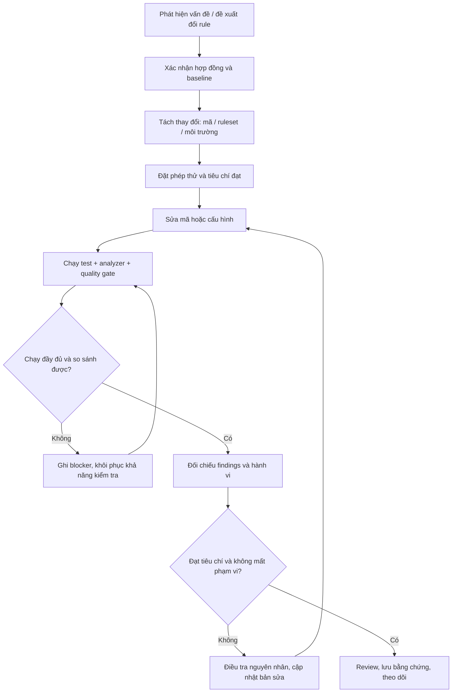

# Xác minh bản sửa và kết quả sau khi thay đổi bộ quy tắc

Trong module `CODE_QUALITY_FUNDAMENTALS`, chúng ta học cách đánh giá những thuộc tính quyết định mã nguồn có **đáng tin cậy, dễ hiểu và dễ thay đổi** hay không. Ở chương **Kiểm tra tự động**, một kết quả “đã hết cảnh báo” chỉ có giá trị khi ta biết **điều gì đã thay đổi** và **bằng chứng nào chứng minh bản sửa thực sự cải thiện chất lượng**.

Giả sử hệ thống phân tích tĩnh báo một điều kiện có khả năng gây `NullPointerException`. Lập trình viên thay mã, chạy lại bộ kiểm tra và thấy cảnh báo biến mất. Điều này là tín hiệu tốt, nhưng vẫn có nhiều câu hỏi: logic nghiệp vụ có giữ nguyên không? Cảnh báo biến mất vì mã đã được xử lý đúng, vì dòng code bị đưa ra ngoài phạm vi phân tích, hay vì quy tắc đã bị vô hiệu hóa? Nếu cùng lúc nhóm phát triển nâng phiên bản analyzer hoặc thay bộ quy tắc, số cảnh báo trước/sau còn so sánh trực tiếp được không?

Ngược lại, đổi một quy tắc để phát hiện thêm lỗi có thể khiến dashboard từ 20 cảnh báo tăng lên 35, trong khi **mã nguồn không thay đổi**. Việc tăng đó không nhất thiết chứng minh mã xấu đi: nó có thể cho biết phạm vi phát hiện đã được mở rộng. Vì thế, cần xác minh **hai loại thay đổi có quan hệ nhưng độc lập**: bản sửa của mã hoặc quy trình, và thay đổi của **bộ quy tắc kiểm tra**.

Sau bài học, người học có thể:

- Phân biệt kết quả kiểm tra, hành vi sản phẩm và mức độ bao phủ của cơ chế phát hiện.
- Tạo mốc đo (*baseline*) có thể tái lập trước khi sửa hoặc đổi quy tắc.
- Xác định cảnh báo đã được khắc phục thực chất hay chỉ bị ẩn, đổi mức độ hoặc mất khỏi phạm vi kiểm tra.
- So sánh kết quả khi cùng lúc có thay đổi mã nguồn, cấu hình, phiên bản công cụ và đường chạy CI.
- Xác minh bản sửa bằng kiểm thử hồi quy, bằng chứng analyzer, review và kiểm thử tích hợp phù hợp.
- Thiết kế quality gate và báo cáo thay đổi mà không chạy theo số lượng cảnh báo một cách máy móc.

## 1. Thế nào là một kết quả xác minh đáng tin?

Một **kết quả kiểm tra tự động** là quan sát của một bộ kiểm tra khi chạy trên **một phiên bản mã**, với **một cấu hình quy tắc**, **một môi trường** và **một tập đầu vào hoặc phạm vi phân tích** cụ thể.

Ta có thể mô hình hóa đơn giản:

\[
R = Check(S, Q, T, E, P)
\]

Trong đó:

- `S` (*source*) là phiên bản mã và các tệp được phân tích.
- `Q` (*quality rules*) là bộ quy tắc, mức nghiêm trọng, ngưỡng, ngoại lệ và cách phân loại.
- `T` (*toolchain*) gồm công cụ/phiên bản analyzer, trình biên dịch và plugin cần thiết.
- `E` (*environment*) là JDK, hệ điều hành, biến môi trường, dependency và các điều kiện thực thi liên quan.
- `P` (*pipeline/scope*) là lệnh chạy, nhánh, module, tập bài kiểm thử, loại trừ và quality gate được áp dụng.
- `R` là kết quả: những cảnh báo, trạng thái pass/fail, báo cáo bao phủ và các dữ liệu cần chẩn đoán.

Đây là **mô hình suy luận**, không phải API hay công thức thống kê của một công cụ cụ thể. Nếu nhiều đầu vào thay đổi cùng lúc, hiệu số giữa hai kết quả **không thể tự động quy về một bản sửa mã**.

### Ba mệnh đề không tương đương

| Mệnh đề | Đã chứng minh được gì? | Điều chưa chứng minh |
| --- | --- | --- |
| “Analyzer không còn báo cảnh báo A” | Trong lần chạy này, công cụ không tạo finding A theo cấu hình hiện tại | Hành vi đã đúng; rule còn bật; đường code còn trong phạm vi |
| “Test hồi quy cho lỗi A đã pass” | Các assertion của ca test đã thỏa ở những điều kiện được kiểm tra | Không có lỗi ở mọi đầu vào hoặc mọi môi trường |
| “Bản sửa đã được xác minh” | Có tập bằng chứng đủ với tiêu chí chấp nhận đã định, bao gồm hành vi và tác động tới kiểm tra | Không có rủi ro nào còn tồn tại tuyệt đối |

Không một bằng chứng đơn lẻ nào thay thế được những bằng chứng còn lại. Một warning không phải test, test không phải đặc tả đầy đủ và quality gate xanh không phải giấy chứng nhận hệ thống chắc chắn đúng.

## 2. Bản sửa mã và thay đổi quy tắc là hai trục khác nhau

Để suy luận đúng nguyên nhân thay đổi, nên tách `S` (mã) và `Q` (bộ quy tắc) khi so sánh:

| Mã nguồn | Bộ quy tắc | Câu hỏi có thể trả lời |
| --- | --- | --- |
| Không đổi | Không đổi | Có thể tái lập kết quả baseline không? Môi trường hoặc dữ liệu có gây biến động không? |
| **Đổi** | Giữ nguyên | Bản sửa mã làm findings, test hoặc hành vi thay đổi như thế nào? |
| Giữ nguyên | **Đổi** | Quy tắc mới phát hiện, loại bỏ hoặc phân loại lại điều gì trên cùng mã? |
| **Đổi** | **Đổi** | Kết quả cuối thay đổi, nhưng cần thêm thí nghiệm để phân biệt ảnh hưởng của từng trục |

Khi cả mã và ruleset đổi trong một PR, cách so sánh thuyết phục thường là chạy **cả hai bộ quy tắc trên cùng mã** hoặc chạy **mã trước/sau với cùng bộ quy tắc**. Nếu có thể, hình thành ma trận:

| | Quy tắc cũ `Q0` | Quy tắc mới `Q1` |
| --- | --- | --- |
| Mã cũ `S0` | `R00`: baseline | `R01`: tác động của ruleset trên mã cũ |
| Mã mới `S1` | `R10`: tác động của bản sửa dưới ruleset cũ | `R11`: kết quả đề xuất phát hành |

Từ ma trận này có thể phân tích:

- `R10` so với `R00`: tác động của việc sửa mã **khi giữ cố định quy tắc cũ**.
- `R01` so với `R00`: tác động của việc đổi quy tắc **khi giữ mã cũ**.
- `R11` so với `R10`: tác động của quy tắc mới **trên mã mới**.
- `R11` so với `R00`: thay đổi tổng hợp; **không** tự tiết lộ toàn bộ nguyên nhân.

Trong thực tế không phải pipeline nào cũng dễ chạy đủ bốn tổ hợp. Nếu thiếu tổ hợp nào, cần ghi rõ giới hạn. Ví dụ, một quy tắc mới chỉ hỗ trợ cú pháp Java mới không thể chạy đáng tin trên phiên bản analyzer cũ; khi đó cần giữ các yếu tố khác cố định tối đa và không khẳng định sự phân rã đã được chứng minh.

### Ví dụ “ít warning hơn” chưa chắc tốt hơn

Giả sử trước khi cập nhật analyzer có 80 findings, sau cập nhật có 50. Các nguyên nhân có thể là:

- 30 lỗi thực sự đã được sửa.
- Một nhóm cảnh báo bị đổi severity và không còn nằm trong bộ lọc dashboard.
- Một thư mục quan trọng bị thêm vào danh sách exclude.
- Các rule cũ bị bỏ, đổi ID hoặc ngừng hỗ trợ.
- Công cụ phân tích không chạy hết vì timeout nhưng pipeline vẫn thu được báo cáo một phần.
- Bộ lọc chỉ hiển thị cảnh báo *new code* thay vì toàn bộ codebase.

Vì vậy, phải kiểm tra **danh sách rule đang áp dụng, phạm vi tệp, trạng thái thực thi và các finding cụ thể**, không chỉ tổng số.

## 3. Tạo baseline trước khi thay đổi

Baseline là một mốc so sánh **có thể tái lập**, không đơn thuần là ảnh chụp dashboard hôm trước. Ít nhất cần ghi:

1. **Định danh mã:** commit hash, nhánh, module và phạm vi tệp.
2. **Công cụ:** analyzer, phiên bản, plugin, runtime Java và dependency liên quan.
3. **Ruleset:** file cấu hình, định danh phiên bản hoặc checksum, rule IDs, mức nghiêm trọng, tham số, suppressions.
4. **Lệnh chạy:** nhiệm vụ build/test/analyze, các tham số, biến môi trường có ảnh hưởng và thời điểm đo.
5. **Kết quả có cấu trúc:** trạng thái thành công/thất bại, tổng finding theo rule/severity, định danh finding, những tệp bị phân tích, thông tin các trường hợp skip.
6. **Bằng chứng kiểm thử:** ca hồi quy liên quan, số test đã thực thi, trạng thái skipped, báo cáo lỗi và độ bao phủ nếu có.

Một bản ghi baseline mang tính minh họa:

```yaml
sourceRevision: a1b2c3d
module: checkout
analysis:
  engine: example-analyzer
  version: "4.2"
  rulesetRevision: quality-rules-v3
  includedPaths:
    - src/main/java
  excludedPaths:
    - generated-sources
  completed: true
tests:
  executed: 182
  failed: 0
  skipped: 2
findings:
  total: 14
  byRule:
    NULL_DEREFERENCE: 2
    COMPLEX_METHOD: 7
    UNUSED_CODE: 5
```

Đây là dữ liệu **giả định** để trình bày phương pháp, không phải định dạng cấu hình hay report chuẩn của một sản phẩm cụ thể. Với một công cụ thật, trích xuất định dạng mà công cụ hỗ trợ và tránh ghi dữ liệu nhạy cảm hoặc bí mật vào artifact công khai.

### Các câu hỏi cần trả lời trước khi đọc số liệu

- Analyzer có chạy **thành công và đầy đủ** không, hay bước phân tích bị bỏ qua hoặc report lỗi?
- Phạm vi tệp có bao gồm mã đang sửa không?
- Có rule nào được bật/tắt, đổi severity hoặc chuyển từ cảnh báo sang lỗi chặn build không?
- Các kết quả đến từ **cùng nhánh, cùng phạm vi** (toàn dự án hay chỉ new code) không?
- Các test nào thực sự **được chạy**, test nào skip/disabled, test nào thất bại ở setup?
- Đang so sánh các lần chạy có công cụ/phiên bản giống nhau không?

Nếu không biết các thông tin trên, câu “tổng warning đã giảm 20%” có thể là số liệu đúng về giao diện hiển thị nhưng không có ý nghĩa đáng tin về bản sửa.

## 4. Xác minh một bản sửa cảnh báo trong Java

Giả sử một phương thức đăng ký khách hàng tra cứu email nhưng chưa kiểm tra giá trị trả về từ repository.

### 4.1. Mã ban đầu và hành vi lỗi

```java
interface CustomerRepository {
    Customer findById(String customerId); // Có thể trả null nếu không tìm thấy
}

record Customer(String id, String email) {}

final class CustomerNotifier {
    private final CustomerRepository repository;

    CustomerNotifier(CustomerRepository repository) {
        this.repository = repository;
    }

    String recipient(String customerId) {
        Customer customer = repository.findById(customerId);
        return customer.email().trim(); // Có thể ném NullPointerException
    }
}
```

Một rule phân tích tĩnh có thể cảnh báo **khả năng dereference null** tại `customer.email()`. Nhưng trước khi sửa, cần xác nhận **hợp đồng của repository**: trả `null` khi không tìm thấy, hay luôn trả đối tượng hợp lệ và ném lỗi khi không có? Trong ví dụ này, hợp đồng comment ghi rõ có thể trả null.

Yêu cầu nghiệp vụ: khi không tìm thấy khách hàng, phương thức phải trả một lỗi **có ngữ nghĩa rõ**, không làm phát sinh `NullPointerException` ngoài dự kiến. Hành vi với email rỗng hoặc không hợp lệ cần được quy định riêng; ví dụ này chỉ tập trung trường hợp không tìm thấy.

### 4.2. Bản sửa có chủ đích

```java
import java.util.Objects;

final class CustomerNotifier {
    private final CustomerRepository repository;

    CustomerNotifier(CustomerRepository repository) {
        this.repository = Objects.requireNonNull(repository);
    }

    String recipient(String customerId) {
        Customer customer = repository.findById(customerId);
        if (customer == null) {
            throw new CustomerNotFoundException(customerId);
        }
        return customer.email().trim();
    }
}

final class CustomerNotFoundException extends RuntimeException {
    CustomerNotFoundException(String customerId) {
        super("Customer not found");
        // Không tự động chép customerId vào thông điệp công khai/log đại trà.
    }
}
```

Tại nơi trình bày API, lỗi này có thể được chuyển thành mã nghiệp vụ ổn định như `CUSTOMER_NOT_FOUND` theo hợp đồng, không gửi stack trace cho người dùng. Nếu ứng dụng cần phân biệt lỗi email `null` hoặc không hợp lệ thì phải bổ sung logic và ca kiểm thử tương ứng; việc sửa một dereference không có nghĩa tất cả dữ liệu liên quan đã được xác thực.

**Cảnh báo biến mất chưa đủ để xác nhận bản sửa.** Ta còn cần:

- Cơ chế khi không tìm thấy khách hàng đúng với yêu cầu.
- Hành vi với khách hàng tồn tại không bị đổi ngoài ý muốn.
- Analyzer vẫn bật rule null-dereference và vẫn phân tích phương thức.
- Không thay thế lỗi bằng cách nuốt exception, bỏ qua tình huống hoặc tắt rule.

### 4.3. Kiểm thử hồi quy hai nhánh

```java
import static org.junit.jupiter.api.Assertions.assertEquals;
import static org.junit.jupiter.api.Assertions.assertThrows;

import org.junit.jupiter.api.Test;

class CustomerNotifierTest {
    @Test
    void returnsNormalizedEmailForExistingCustomer() {
        CustomerRepository repository =
                id -> new Customer(id, "  alice@example.test  ");
        CustomerNotifier notifier = new CustomerNotifier(repository);

        assertEquals(
                "alice@example.test",
                notifier.recipient("customer-1"));
    }

    @Test
    void failsExplicitlyWhenCustomerIsMissing() {
        CustomerRepository repository = id -> null;
        CustomerNotifier notifier = new CustomerNotifier(repository);

        assertThrows(
                CustomerNotFoundException.class,
                () -> notifier.recipient("missing"));
    }
}
```

Đây là các ca kiểm thử đơn vị JUnit 5 **minh họa**. Khi code được đặt trong dự án thực, kiểu repository có thể là interface với nhiều phương thức, và cần adapter/fake tương ứng. Hai ca này chứng minh hành vi với hai đầu vào được mô phỏng; chúng không chứng minh mọi trạng thái của DB thật hoặc mọi dữ liệu email đều hợp lệ.

Sau khi chạy kiểm thử, cần kiểm tra **danh sách test thật sự được thực thi** thay vì chỉ đọc chữ `BUILD SUCCESS`. Nếu nhiệm vụ test bị skip, bộ test không chạy hoặc analyzer không có quyền đọc tệp, kết luận xác minh phải phản ánh khoảng trống đó.

## 5. Khi bộ quy tắc đổi, ý nghĩa của kết quả cũng có thể đổi

Một “bộ quy tắc” không chỉ là danh sách bật/tắt của analyzer. Những yếu tố sau đều ảnh hưởng cách hệ thống đưa ra kết luận:

- **Rule ID và phiên bản thuật toán:** cùng một ID nhưng analyzer phiên bản mới có thể phát hiện các mẫu mã khác.
- **Mức nghiêm trọng và danh mục:** `ERROR`, `WARNING`, `INFO` hoặc nhãn bảo mật/khả năng bảo trì tùy nền tảng; việc đổi nhãn không nhất thiết đổi hiện tượng trong mã.
- **Tham số ngưỡng:** chẳng hạn độ phức tạp chu trình được phép tối đa là 10 hay 15.
- **Phạm vi:** tệp mã sản phẩm, tệp kiểm thử, code sinh tự động, thư mục bên thứ ba, phần mã cũ hay phần mã mới.
- **Suppressions/waivers:** các ngoại lệ có lý do, thời hạn và chủ sở hữu; bao gồm annotation trong mã và danh sách bỏ qua ở cấu hình.
- **Quality gate:** điều kiện làm pipeline fail, ví dụ “không có finding nghiêm trọng mới”, khác với toàn bộ tập finding công cụ phát hiện.
- **Chính sách xử lý false positive:** phương thức xác nhận, lưu bằng chứng và xem xét lại khi nâng phiên bản analyzer.

Ví dụ một analyzer phát hiện độ phức tạp chu trình cao khi `V(G)>10`. Nhóm đổi ngưỡng thành `V(G)>15`; phương thức có giá trị 12 sẽ **không còn bị cảnh báo**, nhưng cấu trúc luồng điều khiển của phương thức không tự nhiên trở nên dễ hiểu hơn. Sự thay đổi phản ánh **chính sách ngưỡng**, không phải bản sửa mã.

### 5.1. Phân loại thay đổi finding theo nguyên nhân

Khi so sánh hai báo cáo, một finding không còn xuất hiện có thể thuộc nhiều loại:

| Loại thay đổi | Ví dụ | Kết luận hợp lý |
| --- | --- | --- |
| **Fixed by source** | Đã thêm kiểm tra `null` giữ đúng hành vi | Có bằng chứng sửa lỗi nếu test và rule tiếp tục áp dụng |
| **No longer applicable** | Đã xóa chức năng không còn sử dụng theo yêu cầu | Finding biến mất vì phạm vi hành vi được loại bỏ hợp lệ |
| **Rule disabled or threshold changed** | Tăng ngưỡng độ phức tạp từ 10 lên 15 | Kết quả đổi do chính sách, không chứng minh mã đã tốt hơn |
| **Severity/category changed** | Finding cũ chuyển từ cảnh báo sang thông tin | Số lỗi trong dashboard đổi nhưng vấn đề có thể còn |
| **File/path excluded** | Thêm cả `src/main/java` vào danh sách exclude | Báo cáo sạch một cách giả tạo; kiểm tra không còn bao phủ mã chính |
| **Suppressed/accepted risk** | Thêm suppression có lý do được chấp thuận | Rủi ro được chấp nhận, **không** đồng nghĩa vấn đề đã sửa |
| **Analyzer upgraded** | Phiên bản mới nhận diện khác hoặc đổi fingerprint | Cần đối chiếu thuật toán/định danh mới trước khi kết luận |
| **Analysis incomplete** | Bộ phân tích timeout và xuất báo cáo thiếu | Chưa đủ bằng chứng, quality gate không nên xem là pass |

Ngược lại, finding **mới** có thể do mã mới thực sự tạo nguy cơ, do rule mới bật, do analyzer phát hiện được mẫu trước đây bị bỏ sót hoặc do đổi phạm vi. Cần phân loại nguyên nhân trước khi yêu cầu nhóm phát triển “sửa hết lỗi mới”.

### 5.2. Không nhầm đếm finding với theo dõi cùng một vấn đề

Kết quả phân tích có thể xác định finding bằng tổ hợp rule, đường dẫn, dòng, vị trí và dấu vân tay (*fingerprint*) do công cụ cung cấp. Khi refactor làm dịch chuyển dòng hoặc đổi tên file, finding cũ có thể được xem thành “đã hết”, còn finding mới mang nội dung gần như giống hệt.

Vì vậy, khi ghép hai báo cáo:

1. Ưu tiên dùng **định danh ổn định** hoặc cơ chế tracking của công cụ nếu có.
2. Khi định danh đổi, dùng rule, đoạn mã/ngữ nghĩa, vị trí tương đối và commit diff để đối chiếu thủ công các trường hợp quan trọng.
3. Tách **đối chiếu được**, **không đối chiếu được** và **đã được xác minh giải quyết**.
4. Không biến việc đổi tên tệp, đổi số dòng hoặc đổi format báo cáo thành thành tích “đã xử lý hàng trăm lỗi”.

Không có thuật toán ghép finding nào luôn chính xác; khi so sánh kết quả liên quan bảo mật hoặc dữ liệu quan trọng, cần người hiểu nghiệp vụ xác nhận.

### 5.3. Ví dụ thay rule trên cùng mã nguồn

Cho một tập mã không đổi, báo cáo trước/sau nâng bộ quy tắc như sau (số minh họa):

| Chỉ tiêu | Quy tắc cũ `Q0` | Quy tắc mới `Q1` | Diễn giải ban đầu |
| --- | ---: | ---: | --- |
| Null-dereference | 3 | 3 | Không đổi số lượng, nhưng vẫn cần đối chiếu từng vị trí |
| Complexity | 12 | 5 | Có thể do nâng ngưỡng hoặc thay cách đếm |
| Hardcoded secret | 0 | 4 | Có thể do mới bật rule bảo mật |
| Tổng findings | 15 | 12 | Tổng giảm 3, nhưng xuất hiện 4 cảnh báo bảo mật cần phân loại |
| File được phân tích | 80 | 80 | Phạm vi đếm tệp có vẻ giữ nguyên; cần kiểm tra danh sách cụ thể |

Nếu chỉ báo “giảm từ 15 xuống 12”, đội phát triển có thể bỏ sót bốn cảnh báo bảo mật mới. Cách báo tốt hơn là: **“Trong cùng mã nguồn, bộ Q1 bớt bảy finding complexity và thêm bốn finding hardcoded secret; ba finding null vẫn còn. Cần xác minh từng finding bảo mật, đồng thời giải thích thay đổi ngưỡng/cách tính complexity.”**

## 6. Xác minh rằng thay đổi bộ quy tắc có chủ đích

Thay đổi ruleset cũng giống sửa mã: cần **mục tiêu, test, dấu vết review và phương án khôi phục**.

Một checklist cho PR đổi ruleset:

1. **Nêu lý do:** giảm false positive lặp lại, tăng phát hiện lỗi bảo mật, hỗ trợ phiên bản Java mới hay chuẩn hóa các module?
2. **Chỉ rõ diff:** những rule ID bật/tắt, tham số, severity, suppression, đường dẫn, ngưỡng và phiên bản công cụ thay đổi.
3. **Dự kiến tác động:** loại finding nào sẽ xuất hiện/mất đi, có dự án nào chịu ảnh hưởng khác nhau không?
4. **Chạy so sánh trên mã cố định:** nếu khả thi, chạy `Q0` và `Q1` trên cùng commit và cùng môi trường.
5. **Phân loại finding mới:** lỗi thật, false positive có bằng chứng, hành vi được chấp nhận, hay cần thay đổi cấu trúc mã?
6. **Kiểm tra coverage:** bảo đảm không vô tình loại mất mã chính hoặc vô hiệu hóa bước phân tích.
7. **Đánh giá quality gate:** thay đổi về điều kiện chặn có hợp lý không, có chính sách chuyển tiếp cho mã cũ không?
8. **Ghi nhận quyết định:** người review, lý do, vấn đề còn tồn tại, thời hạn và cách đo tác động sau triển khai.

### Những thay đổi “nhỏ” nhưng có thể làm yếu kiểm soát

Ví dụ cấu hình sau chỉ là **minh họa khái niệm**, không phải cú pháp của Checkstyle, SpotBugs, PMD hoặc SonarQube:

```yaml
rulesetRevision: quality-rules-v4
rules:
  NULL_DEREFERENCE:
    enabled: true
    severity: error
  COMPLEX_METHOD:
    enabled: true
    severity: warning
    maxCyclomaticComplexity: 15
qualityGate:
  failOnNewErrors: true
scope:
  include:
    - src/main/java
  exclude:
    - generated-sources
```

Nếu trước đó `maxCyclomaticComplexity` bằng 10, đổi thành 15 cần được review như một **quyết định chính sách**. Có thể nhóm đã xác nhận rule ở ngưỡng 10 gây quá nhiều cảnh báo không hữu ích trong miền nghiệp vụ; cũng có thể chỉ đang cố làm pipeline xanh. Chỉ số cảnh báo không thay thế được lập luận thiết kế.

Nếu thay `exclude` thành `src/main/java`, quality gate có thể pass vì gần như toàn bộ mã sản phẩm không còn được phân tích. Một bước kiểm tra tốt nên **xác minh phạm vi** hoặc có điều kiện cảnh báo khi số tệp được phân tích đột ngột giảm, không chỉ kiểm tra “không có ERROR”.

### 6.1. Test cơ chế phát hiện bằng mẫu dương và mẫu âm

Khi có khả năng kiểm thử rule analyzer, dùng những đoạn mã nhỏ có **finding kỳ vọng** và **không có finding kỳ vọng**:

- **Mẫu dương (positive fixture):** đoạn mã cố tình chứa mẫu vi phạm mà rule phải phát hiện.
- **Mẫu âm (negative fixture):** đoạn mã có hình dạng gần giống nhưng đúng, không nên bị báo sai.
- **Mẫu biên:** trường hợp ngay tại ngưỡng và ngay vượt ngưỡng, hoặc cú pháp Java mới mà analyzer hỗ trợ.

Ví dụ, với rule “khả năng dereference null”, mẫu dương có thể là `Customer customer = repository.findById(id); customer.email();` khi hợp đồng cho phép `null`. Mẫu âm có kiểm tra `customer == null` và xử lý rõ trước khi gọi `email()`. Analyzer khác nhau có thể nhận biết hợp đồng null theo annotation, cách xây dựng CFG và mức phân tích liên thủ tục khác nhau; test phải phù hợp năng lực công cụ thực.

Một rule không phát hiện mẫu dương sau nâng cấp là tín hiệu đáng điều tra: rule bị tắt, mẫu không nằm trong phạm vi, cách diễn giải thay đổi hay engine gặp lỗi. Tương tự, mẫu âm bị báo là bằng chứng cần phân tích false positive, không phải lý do tự động tắt rule trên toàn dự án.

### 6.2. Suppression là chấp nhận hoặc trì hoãn, không phải sửa lỗi

Nếu một finding là false positive hoặc có ngoại lệ chính đáng, suppression có thể hợp lý. Nhưng mỗi suppression nên có:

- Rule ID và phạm vi nhỏ nhất có thể.
- Lý do kỹ thuật/nghiệp vụ cụ thể; khi được phép có liên kết tới vấn đề hoặc quyết định review.
- Người chịu trách nhiệm hoặc quy trình xem xét.
- Điều kiện hoặc thời điểm kiểm tra lại nếu nguy cơ có thể thay đổi.
- Xác minh rằng suppression **không** che những lỗi khác cùng nhóm.

Không dùng suppression tràn lan để lách quality gate hoặc thay cho sửa lỗi bảo mật có thật. Ngay cả khi rule không còn hiển thị một vấn đề đã được chấp nhận rủi ro, báo cáo chất lượng phải phân biệt **resolved** và **accepted/suppressed**.

## 7. Quality gate: chặn đúng rủi ro, không chạy theo số lượng

**Quality gate** là điều kiện CI/CD dùng để quyết định một thay đổi có đáp ứng yêu cầu kiểm soát tối thiểu hay không. Nó có thể kết hợp nhiều tín hiệu: biên dịch, test tự động, kiểm tra style, bug patterns, kiểm tra an toàn, rủi ro phụ thuộc, các tiêu chí về phạm vi mã mới...

Ví dụ một chính sách nội bộ có thể yêu cầu:

| Điều kiện | Tín hiệu cần kiểm tra | Điều không nên suy ra |
| --- | --- | --- |
| Build/compile thành công | Mã có thể biên dịch với toolchain đã chọn | Hành vi nghiệp vụ chắc chắn đúng |
| Test hồi quy bắt buộc thành công | Những ca được chạy và assertion đạt | Không có lỗi ngoài tập ca đó |
| Không xuất hiện lỗi nghiêm trọng mới đã xác minh | Findings ở phần mã mới theo ruleset đang áp dụng | Mã cũ tự động hết nợ kỹ thuật |
| Phân tích tĩnh hoàn tất đúng phạm vi | Analyzer hoàn thành, tệp và rule phù hợp | Không có false negative |
| Không tăng suppression không có lý do | Ngoại lệ được review và có dấu vết | Mọi vấn đề đã được xử lý tận gốc |
| Hợp đồng API/DB liên quan được kiểm thử | Những tích hợp cụ thể được kiểm chứng | Tất cả môi trường production đều giống test |

**Fail closed hay fail open khi công cụ kiểm tra không chạy được?** Đây là quyết định về rủi ro và khả năng vận hành:

- Với kiểm soát bắt buộc, không nên đánh dấu thay đổi đạt chỉ vì analyzer bị lỗi, timeout hoặc không tải được rule.
- Nếu quy trình có cơ chế ngoại lệ khi hạ tầng kiểm tra gặp sự cố, ngoại lệ cần có người phê duyệt, phạm vi/hạn dùng và bằng chứng kiểm tra bù; không được đánh đồng “tool unavailable” với “no findings”.
- Với kiểm tra tư vấn không chặn, trạng thái nên thể hiện **không có kết quả**, thay vì hiển thị như đã chạy thành công.

Quality gate hữu ích khi nó **bảo vệ rủi ro thực** mà người phát triển hiểu được. Một ngưỡng quá nhiều false positive có thể khiến mọi người quen với việc bỏ qua cảnh báo; một ngưỡng quá lỏng sẽ tạo cảm giác an toàn giả. Việc hiệu chỉnh cần dựa trên kết quả điều tra, không chỉ tỷ lệ pass mong muốn.

## 8. Quy trình xác minh trước và sau một thay đổi

Một quy trình có thể áp dụng trong code review hoặc CI, với phạm vi tùy theo rủi ro:

**Bước 1 — Mô tả vấn đề và tiêu chí thành công.** Cảnh báo ban đầu là gì, có tác động nghiệp vụ hay rủi ro gì? Bản sửa nhằm thay đổi hành vi nào? Nếu đổi ruleset, mục tiêu là phát hiện điều gì tốt hơn hoặc giảm cảnh báo sai nào?

**Bước 2 — Chốt baseline.** Ghi commit, tập tệp, rule, version tool, cấu hình, số test thực thi và danh sách findings liên quan. Lưu kết quả có thể đối chiếu lại, không chỉ ảnh chụp số tổng.

**Bước 3 — Xác định biến thay đổi.** Ghi rõ PR sửa mã, đổi rule, đổi toolchain, đổi phạm vi phân tích hay kết hợp. Nếu kết hợp, thiết kế phép so sánh tách ảnh hưởng theo ma trận ở mục 2 khi khả thi.

**Bước 4 — Thiết kế phép xác minh.** Viết hoặc chọn test hồi quy mô tả lỗi thực; giữ ca đối chứng để phát hiện sửa sai phạm vi. Khi thay rule, chọn mẫu dương, mẫu âm và các finding tiêu biểu để đối chiếu.

**Bước 5 — Thực hiện bản sửa hoặc cập nhật cấu hình.** Giữ diff nhỏ và dễ review. Nếu phải đổi cả luật lẫn mã, giải thích vì sao và cố gắng tách commit hoặc tách pha đo.

**Bước 6 — Chạy lại cùng điều kiện.** Xác nhận **mọi bước bắt buộc thật sự chạy và hoàn tất**: compile, unit test, integration test phù hợp, analyzer, quality gate và xuất báo cáo. Nếu điều kiện không tương đương, ghi sự khác biệt.

**Bước 7 — Đối chiếu từng finding và kết quả test.** Phân loại resolved, new, persistent, reclassified, suppressed, out-of-scope, unmatched; kiểm tra cảnh báo cũ đã được sửa hay chỉ đổi cách hiển thị.

**Bước 8 — Review bằng chứng và quyết định.** Không chỉ đọc màu pipeline. Reviewer xác nhận mục tiêu, rủi ro, hành vi nghiệp vụ và các trường hợp còn thiếu.

**Bước 9 — Giữ dấu vết sau merge.** Lưu phiên bản ruleset và report đủ để điều tra khi cảnh báo mới phát sinh. Nếu thay ruleset ảnh hưởng nhiều repo hoặc nhiều nhóm, theo dõi số false positive, thời gian xử lý, lỗi bị bỏ sót và điều chỉnh có kiểm soát.

### Sơ đồ quá trình



Sơ đồ nhấn mạnh hai điều kiện độc lập: **bản kiểm tra đã chạy đúng** và **kết quả đã đáp ứng tiêu chí**. Một pipeline có analyzer bị bỏ qua mà vẫn trả màu xanh không được xem là bằng chứng đạt yêu cầu kiểm soát đã đặt ra.

## 9. Dùng báo cáo kết quả để giải thích thay đổi, không chỉ đếm số

Một báo cáo sau thay đổi nên làm rõ:

| Nhóm dữ liệu | Câu hỏi cần trả lời |
| --- | --- |
| Phạm vi nguồn | Những file/module nào thay đổi và file nào thực sự được phân tích? |
| Công cụ và ruleset | Version công cụ, checksum/config, rule IDs/threshold/severity trước/sau có gì khác? |
| Trạng thái pipeline | Compile/test/analyzer có chạy hết không, có skip hoặc hạ cấp lỗi không? |
| Lỗi gốc | Finding ban đầu có còn xuất hiện trên cùng mã và rule phù hợp không? |
| Bằng chứng hành vi | Ca hồi quy nào fail trước và pass sau; test đối chứng nào vẫn pass? |
| Findings mới | Rule mới phát hiện gì; trường hợp nào là lỗi thật, false positive hay cần review? |
| Suppressions | Bao nhiêu ngoại lệ thêm/bỏ và mỗi ngoại lệ có lý do gì? |
| Rủi ro còn lại | Chưa chạy integration test nào, còn cảnh báo nào chưa phân loại, phụ thuộc môi trường nào? |
| Quyết định | Ai đã review, chấp nhận hay yêu cầu sửa, hành động theo dõi sau merge? |

### Báo cáo minh họa cho một bản sửa và thay ruleset

Giả sử team nâng cấp ruleset từ `v3` lên `v4`, đồng thời sửa null dereference của `CustomerNotifier`. Báo cáo tóm tắt phù hợp có thể là:

> **Phạm vi:** mã checkout từ commit `C0` sang `C1`; ruleset từ `v3` sang `v4`; cùng toolchain và tập tệp sản phẩm đã được xác minh.
>
> **Lỗi mục tiêu:** ở `C0/v3`, rule null-dereference báo `CustomerNotifier.recipient` khi khách hàng không tồn tại. Ở `C1/v3` và `C1/v4`, finding này không còn; rule vẫn bật, phương thức vẫn được phân tích.
>
> **Kiểm thử hồi quy:** ca khách hàng không tồn tại fail trước khi sửa vì `NullPointerException`, pass sau khi sửa vì `CustomerNotFoundException`; ca khách hàng có email hợp lệ vẫn pass.
>
> **Ảnh hưởng ruleset:** khi giữ mã `C1`, `v4` bổ sung hai cảnh báo mới về cách xử lý tài nguyên. Một finding là lỗi thật đã được ghi nhận để sửa; finding còn lại đang được review, chưa đánh dấu false positive.
>
> **Giới hạn:** chưa kiểm thử repository và giao thức API thực tế ở môi trường tích hợp; không kết luận toàn bộ tính đúng đắn của dịch vụ chỉ từ unit test và analyzer.

Đây là ví dụ giả định cho phương pháp báo cáo, không phải kết quả thật của một repository. Điểm quan trọng là người đọc phân biệt được **hiệu quả bản sửa**, **ảnh hưởng ruleset** và **khoảng trống kiểm chứng**.

### Đừng coi phần trăm giảm cảnh báo là thước đo duy nhất

Nếu số findings giảm từ 50 xuống 40 khi công cụ và phạm vi thực sự giữ nguyên, ta có thể nói **số findings được báo giảm 10 (20%)**. Nhưng cần đối chiếu loại và mức độ:

- Một cảnh báo bảo mật nghiêm trọng mới có thể quan trọng hơn nhiều cảnh báo style đã biến mất.
- Một suppression mới có thể khiến cảnh báo “khỏi báo” nhưng rủi ro không đổi.
- Đổi cách nhóm/định danh findings có thể làm số lượng tổng khác.
- Khi ruleset thay đổi, mẫu số và ý nghĩa thống kê thường không còn tương đương.

Vì vậy, dùng xu hướng về **finding được xác minh**, **mật độ trong phạm vi rõ ràng**, **thời gian khắc phục**, **tỷ lệ false positive** và **sự cố thực tế** nếu tổ chức có dữ liệu phù hợp. Không biến metric thành mục tiêu để đội chỉ tối ưu con số hiển thị.

## 10. Ví dụ CI: giữ kiểm tra bắt buộc và hiển thị rõ trạng thái

Trong một dự án Java, quy trình tự động thường có các nhóm bước:

```text
1. Checkout mã đúng commit
2. Chuẩn bị toolchain và dependency xác định được phiên bản
3. Compile và chạy test liên quan
4. Chạy analyzer với ruleset có phiên bản
5. Xuất báo cáo findings, phạm vi và trạng thái hoàn tất
6. So sánh finding mục tiêu và áp dụng quality gate
7. Gắn artifact/report vào PR để review
```

Các bước phải được cấu hình để **failure của một bước bắt buộc không biến thành pass**. Tùy nền tảng CI, cần kiểm tra cách xử lý lỗi lệnh, điều kiện chạy tiếp, cache, artifact thiếu và việc xuất kết quả cuối.

Ví dụ cấu trúc giả định, không phải cấu hình YAML của một CI cụ thể:

```yaml
pipeline:
  revision: pinned-commit-revision
  toolchain:
    java: "21"
    analyzer: "pinned-version"
  steps:
    - name: compile
      required: true
    - name: unit-tests
      required: true
    - name: static-analysis
      required: true
      ruleset: quality-rules-v4
      assertScopeContains:
        - src/main/java
    - name: quality-gate
      required: true
  evidence:
    keep:
      - test-results
      - analysis-report
      - analyzed-file-list
      - ruleset-metadata
```

Trong sản phẩm CI thật, cần chuyển các ý tưởng trên sang cú pháp được hỗ trợ, bảo đảm các bước tạo artifact có tên thật, không để biến chưa khai báo và không lộ secret. Ví dụ trên giải thích **những thông tin cần giữ**, không phải đoạn cấu hình có thể dán nguyên vào bất kỳ nền tảng nào.

### Các trạng thái cần tách rõ

| Trạng thái | Ý nghĩa |
| --- | --- |
| `PASSED` | Bước đã chạy và đạt điều kiện trong phạm vi xác định |
| `FAILED` | Bước đã chạy nhưng vi phạm điều kiện kiểm tra |
| `SKIPPED` | Bước không chạy theo điều kiện cấu hình |
| `ERROR/BLOCKED` | Không thể thực hiện đầy đủ phép kiểm tra do toolchain, môi trường hoặc lỗi chạy |
| `INCONCLUSIVE` | Kết quả có được nhưng không đủ căn cứ để kết luận, ví dụ report bị thiếu phần quan trọng |

Nhãn có thể khác theo công cụ, nhưng điều quan trọng là không đánh đồng **chưa chạy** với **đã chạy và không có lỗi**. Nếu một tác vụ phân tích bị lỗi khi truy cập license server hoặc kho dependency, không được coi báo cáo rỗng như xác nhận “không phát hiện vấn đề”.

### Chiến lược khi ruleset mới gây nhiều finding

Khi đưa một rule mới vào hệ thống có nhiều mã cũ, có thể cân nhắc cách chuyển tiếp:

1. Chạy thử trên baseline để đo ảnh hưởng và phân loại mẫu.
2. Ưu tiên sửa finding nghiêm trọng hoặc có rủi ro thật, không bỏ qua chỉ vì tồn tại từ trước.
3. Nếu có chính sách cho phép, quản lý phần nợ cũ bằng baseline được review và đặt quality gate cho **phần mã mới hoặc thay đổi**.
4. Ghi chủ sở hữu, mức ưu tiên và lộ trình giảm nợ cũ; tránh baseline trở thành nơi chôn vĩnh viễn mọi cảnh báo.
5. Sau một thời gian, đo tỷ lệ false positive, việc phát hiện lỗi thực và điều chỉnh rule có căn cứ.

Chính sách “new code only” có thể phù hợp để giữ tốc độ phát triển trong khi xử lý nợ kỹ thuật, nhưng không có nghĩa các vấn đề nguy hiểm ở mã cũ được phép tồn tại vô hạn. Phạm vi áp dụng cần dựa vào hậu quả rủi ro.

## 11. Những sai lầm phổ biến trong xác minh sau thay đổi

| Sai lầm | Vì sao kết luận không đáng tin | Cách làm phù hợp hơn |
| --- | --- | --- |
| Chỉ nhìn badge xanh ở PR | Không biết công cụ nào bị skip hoặc chạy thiếu phạm vi | Kiểm tra logs, trạng thái mỗi bước, số test và tệp phân tích |
| Sửa code và tắt rule trong cùng PR, rồi nói lỗi đã hết | Không phân biệt tác động mã và cấu hình | Chạy so sánh tách trục và giữ dấu vết rule |
| Tăng ngưỡng để warning biến mất | Thay chính sách phát hiện, chưa cải thiện hành vi | Giải thích ngưỡng và tác động; chỉ sửa mã khi có lợi ích thực |
| Dùng suppression chung cho cả package | Có thể che nhiều lỗi mới không liên quan | Suppression nhỏ nhất, có lý do và lịch review |
| Test pass sau khi xóa assertion | Đánh mất bằng chứng cho hành vi cần bảo vệ | Giữ assertion có căn cứ; xác nhận hợp đồng nếu kỳ vọng thay đổi |
| Analyzer bị lỗi nhưng xuất report rỗng | Tạo false pass và làm kết quả trước/sau không so sánh được | Ghi BLOCKED/INCONCLUSIVE cho kiểm tra bắt buộc |
| So sánh warning count khác tool version như số tương đương | Thuật toán phát hiện và rule ID có thể đổi | Giữ cùng tool hoặc công bố ranh giới không tương đương |
| Chỉ chạy test tại trường hợp lỗi, bỏ ca đối chứng | Bản sửa có thể làm hỏng luồng hợp lệ | Thêm kiểm thử hồi quy cả trường hợp lỗi và thành công |
| Chỉ kiểm tra vị trí dòng trong report | Refactor dịch chuyển dòng làm tracking sai | Dùng fingerprint/semantics và review finding quan trọng |
| Gộp mọi finding mới thành lỗi code | Rule mới bật hoặc phạm vi đổi có thể là nguyên nhân | Phân loại nguyên nhân và mức rủi ro trước khi xử lý |
| Chỉ tối ưu tỷ lệ pass của gate | Dễ khuyến khích tắt kiểm tra khó hoặc bỏ qua rủi ro | Theo dõi chất lượng bằng chứng, findings thật và hậu quả thực tế |

Mỗi sai lầm trên có một điểm chung: **nhìn một con số hoặc trạng thái cuối mà không kiểm tra điều kiện tạo ra nó**. Xác minh đáng tin đòi hỏi nhìn được chuỗi từ lý do thay đổi tới phép đo, bản sửa, kết quả và giới hạn kết luận.

## 12. Bài tập thực hành

### Bài 1 — Phân biệt bốn tổ hợp mã và quy tắc

Giả sử mã `S0` có ba cảnh báo null và năm cảnh báo complexity với quy tắc `Q0`. Khi giữ mã nhưng nâng lên `Q1`, analyzer phát hiện thêm hai điểm null và bỏ ba cảnh báo complexity vì đổi ngưỡng. Khi sửa mã thành `S1` dưới `Q0`, hai trong ba điểm null cũ được xử lý.

Hãy tạo bảng bốn ô `S0/Q0`, `S0/Q1`, `S1/Q0`, `S1/Q1`. Chỉ điền những ô có dữ liệu đã biết, không suy đoán ô thiếu. Nêu rõ muốn xác định kết quả của `S1/Q1` phải chạy phép kiểm tra bổ sung nào.

### Bài 2 — Cảnh báo biến mất nhưng không phải được sửa

Một PR thêm annotation suppression lên toàn bộ lớp và tăng ngưỡng complexity từ 10 lên 20. Trước PR có bốn findings, sau PR không còn finding nào. Hãy viết nhận định kỹ thuật không đánh đồng “không còn hiển thị” với “mã đã tốt hơn”, và nêu những bằng chứng cần có trước khi chấp nhận PR.

### Bài 3 — Từ null warning đến ca hồi quy

Dựa trên `CustomerNotifier`, viết các ca kiểm thử cho khách hàng tồn tại, khách hàng không tồn tại và địa chỉ email không hợp lệ theo hợp đồng bạn đề xuất. Phân biệt lỗi mà analyzer có thể cảnh báo với lỗi nghiệp vụ cần kiểm thử. Kiểm tra rule null vẫn được bật sau bản sửa.

### Bài 4 — Analyzer đổi thuật toán

Cùng một commit, analyzer phiên bản mới báo nhiều findings hơn phiên bản cũ dù file cấu hình rule không đổi. Hãy lập danh sách các biến cần kiểm tra: rule implementation, plugin, scope, annotation hỗ trợ, fingerprint, loại tệp được phân tích và trạng thái hoàn tất. Viết kết luận phù hợp khi chưa có bằng chứng quy lỗi cho mã nguồn.

### Bài 5 — Quality gate xanh vì kiểm tra bị skip

Một pipeline chỉ báo `BUILD SUCCESSFUL`; kiểm tra log thấy test task và static analysis task đều bị skip vì điều kiện cấu hình. Hãy xác định trạng thái chính xác của từng loại bằng chứng và đề xuất cách làm để quality gate bắt buộc **không** pass trong tình huống đó.

### Bài 6 — Nâng bộ quy tắc bảo mật

Sau khi bật rule phát hiện hardcoded secret, công cụ báo một khóa thực, hai dữ liệu giả trong unit test và một chuỗi trùng mẫu trong tài liệu. Hãy đề xuất cách xác minh, ưu tiên xử lý, giới hạn quyền xem và suppression có lý do khi phù hợp. Nêu vì sao không nên tắt hẳn rule chỉ vì có false positive.

### Bài 7 — Báo cáo thay đổi có bằng chứng

Soạn báo cáo cho PR sửa mã và thay bộ quy tắc theo mẫu mục 9. Tối thiểu ghi commit trước/sau, quy tắc trước/sau, phạm vi phân tích, tình trạng test, danh sách finding được giải quyết, finding mới, suppression, rủi ro còn lại và quyết định review. Người khác phải có khả năng giải thích **vì sao** kết quả khác nhau.

### Bài 8 — Đánh giá chính sách “new code only”

Một repository tồn tại hàng trăm cảnh báo cũ và nhóm muốn đặt gate chỉ chặn cảnh báo nghiêm trọng trên mã mới. Hãy đề xuất điều kiện để dùng chính sách chuyển tiếp, cách quản lý nợ cũ, trường hợp rủi ro không được trì hoãn và tiêu chí rà soát lại sau một thời gian.

### Bài 9 — Thử mẫu dương và mẫu âm cho rule

Thiết kế hai đoạn Java nhỏ cho một rule về truy cập có thể `null` và hai đoạn cho ngưỡng complexity: một trường hợp đúng ngưỡng, một trường hợp vượt ngưỡng. Nêu expected finding theo quy ước đếm của analyzer đang thử; nếu công cụ cho kết quả khác, cần thu thập thông tin gì để phân biệt bug của rule với cách hiểu sai quy ước?

**Tiêu chí tự đánh giá:** có thể xác định biến thay đổi, tạo baseline tái lập, phân loại finding dựa trên bằng chứng, viết test hồi quy phù hợp, xác minh phạm vi analyzer, giải thích quality gate và nêu rõ điều chưa được kiểm chứng. Một câu trả lời chỉ nói “warning đã giảm” hoặc “CI xanh” là chưa đủ.

## Ghi nhớ

**Xác minh bản sửa** đòi hỏi chứng minh hành vi quan trọng vẫn đúng hoặc đã được sửa theo hợp đồng, chứ không chỉ nhìn cảnh báo biến mất. **Xác minh sau thay đổi bộ quy tắc** đòi hỏi giữ được mốc so sánh và giải thích sự khác biệt trong tập rule, phiên bản công cụ, phạm vi, ngưỡng, severity và suppression. Khi cả mã và ruleset cùng thay đổi, hãy tách ảnh hưởng của từng trục nếu khả thi. Kết hợp kiểm thử hồi quy, kết quả analyzer đầy đủ, quality gate có ý nghĩa và review bằng chứng để kết luận đúng mức. Mục tiêu là mã nguồn **đáng tin cậy, dễ hiểu và dễ thay đổi**, không phải dashboard có càng ít cảnh báo càng tốt.
