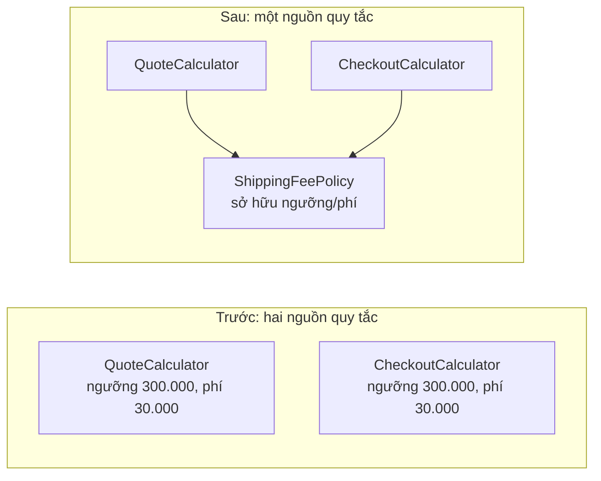
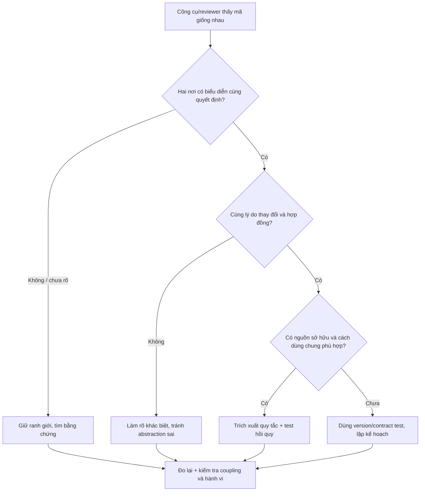

# Mức lặp mã và phân biệt lặp cú pháp với lặp tri thức

Hai phương thức Java có thể chứa những câu lệnh gần giống nhau. Một công cụ kiểm tra chất lượng đánh dấu cả hai là **duplicated code** và báo tỷ lệ lặp tăng. Phản ứng đầu tiên thường là “tách thành một hàm dùng chung để giảm số dòng”. Nhưng nếu hai phương thức thuộc **hai quy tắc nghiệp vụ độc lập**, việc gom chúng có thể khiến mỗi lần thay đổi một quy tắc đều gây ảnh hưởng tới quy tắc còn lại.

Ngược lại, hai đoạn mã có thể khác nhau về vòng lặp, tên biến và cách viết điều kiện, nhưng thực hiện **cùng một chính sách miễn phí giao hàng**. Công cụ dò lặp dựa trên văn bản có thể không nhận ra, trong khi người bảo trì phải sửa cả hai nơi mỗi khi chính sách đổi. Đó là một hình thức lặp nguy hiểm hơn việc có vài dòng giống nhau.

Trong chương **Chỉ số chất lượng** của `CODE_QUALITY_FUNDAMENTALS`, chúng ta học cách đo **mức lặp mã**, phân biệt **lặp cú pháp** với **lặp tri thức**, rồi sử dụng chỉ số như tín hiệu để đặt câu hỏi thay vì một mục tiêu phải tối ưu bằng mọi giá. Chủ đề gắn với việc xác định mã nguồn có **đáng tin cậy, dễ hiểu và dễ thay đổi** hay không.

Sau bài này, bạn có thể đọc một báo cáo duplication đúng phạm vi, nhận diện quy tắc nghiệp vụ bị sao chép dưới nhiều hình thức, quyết định khi nào nên trích xuất abstraction, viết kiểm thử bảo vệ một lần refactor và giải thích những đánh đổi của mã dùng chung.

## 1. “Lặp mã” không phải chỉ có một ý nghĩa

Khi nói mã bị lặp, chúng ta cần phân biệt ít nhất hai góc nhìn:

- **Lặp cú pháp (syntactic duplication):** Hai hoặc nhiều đoạn nguồn giống nhau hoặc có cấu trúc đủ gần để công cụ phát hiện qua văn bản, token hoặc cây cú pháp.
- **Lặp tri thức (knowledge duplication):** Cùng một **quy tắc, quyết định, bất biến hoặc sự thật có thẩm quyền** được biểu diễn và bảo trì độc lập ở nhiều nơi. Khi sự thật đó đổi, có nguy cơ phải sửa nhiều chỗ và làm chúng sai lệch nhau.

Hai góc nhìn có liên hệ nhưng **không tương đương**:

| Tình huống | Có thể trông lặp về cú pháp? | Có thể lặp tri thức? | Hướng suy nghĩ |
| --- | --- | --- | --- |
| Hai nơi cùng viết “khách VIP miễn phí giao hàng” | Có | Có, nếu cùng chính sách được áp dụng | Tìm chủ sở hữu chính sách và gom quyết định |
| Hai validator có điều kiện giống nhau nhưng kiểm tra hai định danh độc lập | Có | Không nhất thiết | Xác minh nguồn yêu cầu và lý do thay đổi của từng loại |
| Một chỗ dùng `if`, chỗ khác dùng toán tử ba ngôi để biểu diễn cùng ngưỡng phí | Có thể không | Có | Ưu tiên loại bỏ nhiều nguồn biểu diễn cùng quy tắc |
| Code sinh tự động giống nhau trong nhiều file | Có | Thường nguồn tri thức nằm ở generator/schema | Quản lý generator, không nhất thiết sửa các file sinh |
| Hai test tự chứa cùng tạo dữ liệu mẫu | Có | Chưa chắc | Cân nhắc độ rõ ràng và tính độc lập của test |
| Hai service giữ bản sao quy tắc tỷ giá không có cơ chế đồng bộ | Không nhất thiết | Có nguy cơ lớn | Làm rõ nguồn có thẩm quyền và hợp đồng đồng bộ dữ liệu |

Từ “tri thức” không có nghĩa là kiến thức nằm trong đầu lập trình viên. Trong thiết kế phần mềm, nó chỉ **một quyết định hoặc quy tắc mà hệ thống cần phản ánh đúng**, ví dụ:

- Mức phí vận chuyển và điều kiện miễn phí.
- Giới hạn số lượng được phép đặt.
- Định nghĩa trạng thái “đơn đã thanh toán”.
- Quy tắc chuyển đổi đơn vị tiền hoặc múi giờ.
- Cấu trúc hợp đồng API hoặc quyền truy cập tài nguyên.

**Một nguồn chân lý (single source of truth)** là nơi có thẩm quyền đối với một quyết định cụ thể. Mục tiêu không phải ép mọi thông tin vào một lớp trung tâm, mà là tránh để **cùng một quyết định** có nhiều bản triển khai độc lập không được đồng bộ.

### DRY nói đến điều gì?

Nguyên tắc **Don't Repeat Yourself (DRY)** thường bị hiểu đơn giản là “đừng lặp lại dòng code”. Ý quan trọng hơn là tránh **lặp lại tri thức có thẩm quyền** trong hệ thống. Nếu một quy tắc phải được chỉnh ở ba nơi, nguy cơ bỏ sót một nơi sẽ tăng ngay cả khi ba đoạn mã có hình dạng hoàn toàn khác nhau.

Tuy nhiên, DRY không yêu cầu mọi đoạn giống nhau đều phải dùng một helper. Một abstraction sai có thể làm hai trách nhiệm độc lập **bị buộc phải thay đổi cùng nhau**. Đó cũng là một dạng chi phí chất lượng.

## 2. Các mức giống nhau mà công cụ có thể nhận diện

Công cụ dò lặp thường tìm những **code clone** — các đoạn mã giống hoặc gần giống theo quy tắc so sánh. Có nhiều cách phân loại clone trong tài liệu kỹ thuật; tên và thuật toán cụ thể có thể khác nhau giữa các công cụ.

Một hệ phân loại thường gặp:

| Nhóm | Dấu hiệu | Ví dụ | Giới hạn của phép đo |
| --- | --- | --- | --- |
| **Giống hệt hoặc gần hệt văn bản (thường gọi Type 1)** | Khác biệt chủ yếu ở khoảng trắng, comment, định dạng | Sao chép cả khối `if` và phép gán | Dễ tìm nhưng không biết vì sao đoạn mã giống |
| **Cùng cấu trúc, đổi tên hoặc hằng số (thường gọi Type 2)** | Khác định danh/literal nhưng mẫu xử lý tương tự | Hai hàm duyệt danh sách rồi cộng giá trị | Có thể là hai nghiệp vụ độc lập |
| **Gần giống, có thêm/bớt/chỉnh câu lệnh (thường gọi Type 3)** | Nhiều phần giống, một số câu lệnh khác | Hai luồng kiểm tra đơn với một bước ngoại lệ | Cần điều tra phần khác biệt là chủ đích hay lỗi |
| **Tương đương về hành vi/ý nghĩa (thường gọi Type 4)** | Cấu trúc khác nhưng thực hiện cùng hành vi | `if/else` và toán tử `?:` cho cùng chính sách | Rất khó xác định chỉ bằng cú pháp; đòi hỏi bối cảnh ngữ nghĩa |

**Tên Type 1–4 mang tính mô hình tham khảo, không phải khả năng mặc định của mọi công cụ.** Một bộ dò lặp dựa trên token thường không thể kết luận hai đoạn khác cú pháp là một tri thức nghiệp vụ. Ngay cả bộ phân tích mạnh hơn cũng có thể nhầm hai hành vi tình cờ cho cùng kết quả ở dữ liệu mẫu với hai quy tắc thật sự giống nhau.

Ví dụ hai cách viết cùng điều kiện:

```java
// Cách A
long feeVnd = (vip || subtotalVnd >= 300_000L)
        ? 0L : 30_000L;

// Cách B
long feeVnd = 30_000L;
if (subtotalVnd >= 300_000L) {
    feeVnd = 0L;
}
if (vip) {
    feeVnd = 0L;
}
```

Hai đoạn có thể **khác đủ nhiều về token** để một công cụ không đánh dấu, nhưng nếu đều áp dụng **cùng chính sách giao hàng**, chúng đang lặp tri thức. Ngược lại, hai phương thức dùng chung vòng lặp `for`, `Objects.requireNonNull` hoặc mẫu xử lý `try-with-resources` không tự chứng minh có chính sách cần gom chung.

## 3. Đo mức lặp mã: con số nói gì và không nói gì?

Các công cụ có thể báo số khối lặp, nhóm clone, số dòng lặp, số file bị ảnh hưởng hoặc tỷ lệ lặp. Tên chỉ số và cách đếm phụ thuộc công cụ và cấu hình: một số dùng dòng mã, một số dùng token, khoảng giống tối thiểu và quy tắc bỏ qua khác nhau.

Một định nghĩa **minh họa** về mật độ lặp theo dòng:

\[
\text{Tỷ lệ dòng lặp (\%)} =
\frac{\text{Số dòng được công cụ xếp vào các khối lặp}}
{\text{Tổng số dòng thuộc phạm vi được đo}}
\times 100
\]

Cần biết công cụ đếm những dòng nào và khối được tính thế nào. Không thể lấy số từ hai công cụ khác nhau rồi mặc định chúng có cùng mẫu số và tiêu chí phát hiện.

### 3.1. Ví dụ đọc báo cáo

Giả sử công cụ phân tích một vùng mã được thống nhất là **2.000 dòng**, trong đó **160 dòng** được xếp là lặp.

\[
\frac{160}{2\,000}\times100 = 8\%
\]

Kết quả **8%** là một tín hiệu để xem xét các khối mà công cụ đã phát hiện. Nó **không có nghĩa** 8% mã đang chứa bug, cũng không có nghĩa xóa 160 dòng ấy sẽ nâng chất lượng đúng 8%.

Nếu cùng một lần đo sau refactor còn **100 dòng lặp** trên **1.900 dòng**, tỷ lệ xấp xỉ:

\[
\frac{100}{1\,900}\times100 \approx 5{,}26\%
\]

Sự giảm từ 8% xuống khoảng 5,26% có thể phản ánh việc đã gom mã hữu ích. Nhưng cũng có thể xảy ra do đổi thuật toán dò, loại thư mục khỏi phạm vi phân tích hoặc làm một abstraction phức tạp thay cho hai đoạn độc lập. **Cần xem diff và hành vi, không chỉ xem phần trăm.**

### 3.2. Những câu hỏi bắt buộc trước khi so sánh

| Câu hỏi | Vì sao quan trọng? |
| --- | --- |
| **Phạm vi đo là gì?** | Production source, test source, file sinh tự động, migration và ví dụ có thể được tính khác nhau |
| **Đơn vị đo là gì?** | Dòng, token, block hay số nhóm clone không thể cộng hoặc so sánh tùy ý |
| **Cách chuẩn hóa thế nào?** | Công cụ có bỏ khoảng trắng, comment, tên biến, hằng số hoặc cấu trúc tương tự không? |
| **Ngưỡng phát hiện là gì?** | Đoạn giống 4 dòng có thể không được báo nếu công cụ yêu cầu một khối tối thiểu lớn hơn |
| **Có thay đổi phiên bản/cấu hình công cụ không?** | Tỷ lệ có thể thay đổi dù mã không đổi |
| **Đo toàn bộ code hay chỉ code mới?** | Baseline lịch sử và lặp do thay đổi gần đây trả lời hai câu hỏi khác nhau |
| **Tỷ lệ tăng do lặp mới hay do mẫu số giảm?** | Xóa mã không lặp có thể làm tỷ lệ lặp tăng dù số dòng lặp giữ nguyên |
| **Những đoạn lặp có cùng tri thức không?** | Đây mới là câu hỏi quyết định nên refactor hay để nguyên |

Vì vậy, một báo cáo tốt nên đi kèm **đường dẫn/khối mã liên quan, tiêu chí đo và diễn giải theo ngữ cảnh**. Số liệu chỉ giúp ưu tiên nơi đọc mã; nó không thể thay phần phán đoán kỹ thuật.

### 3.3. Chỉ số về lặp cú pháp khác chỉ số về lặp tri thức

Có thể tự đo số **điểm biểu diễn một quy tắc** sau khi đã xác định quy tắc đó. Ví dụ:

- Chính sách “khách VIP được miễn phí giao hàng” xuất hiện trong `QuoteCalculator`, `CheckoutCalculator` và một job báo cáo.
- Khi ngưỡng phí đổi, cả ba nơi cần sửa.
- Rủi ro không chỉ là số dòng giống nhau, mà là **ba điểm thay đổi cho một quyết định**.

Số vị trí chứa một quy tắc được phát hiện qua review không phải metric chuẩn hóa tự động như tỷ lệ dòng lặp; nó là **bằng chứng bảo trì**. Có thể bổ sung lịch sử thay đổi cùng lúc, lỗi do thiếu đồng bộ và mức độ thường xuyên đổi quy tắc để quyết định mức ưu tiên.

## 4. Cách nhận diện lặp tri thức: “có cùng lý do thay đổi không?”

Giả sử thấy hai đoạn giống nhau. Trước khi trích xuất helper, hãy hỏi:

1. **Hai đoạn thuộc cùng quy tắc hay hai quy tắc khác nhau?** Ví dụ “đủ điều kiện miễn phí giao hàng” và “đủ điều kiện nhận voucher” có ngưỡng giống nhau hôm nay nhưng có thể do hai chính sách độc lập.
2. **Ai sở hữu quyết định?** Một nhóm quản lý chính sách giao hàng, hay hai nhóm nghiệp vụ khác nhau?
3. **Khi yêu cầu đổi, hai nơi có phải luôn đổi cùng nhau không?** Nếu có, đây là dấu hiệu mạnh của một tri thức cần được tập trung.
4. **Các ngoại lệ có thật sự giống nhau không?** Một nhánh có quy tắc cho đối tác, chiến dịch hoặc lịch sử giao dịch riêng?
5. **Hai chỗ có cùng tiền điều kiện và đơn vị đo không?** Cùng số tiền VND hay khác tiền tệ, trước hay sau giảm giá?
6. **Dùng chung sẽ tạo thêm phụ thuộc nào?** Hai module có cần xây dựng và phát hành độc lập không?

Câu hỏi **“cùng lý do thay đổi?”** thường hữu ích hơn **“cùng cấu trúc?”**.

Một cách kiểm tra thực tế là nhìn lịch sử yêu cầu: nếu trong nhiều lần thay đổi quy tắc, cả hai vị trí đều cần sửa cùng nhau, khả năng có lặp tri thức tăng. Tuy nhiên, **lịch sử thay đổi cùng lúc chưa đủ chứng minh** — chúng có thể tình cờ được sửa trong một đợt refactor lớn. Vẫn cần hiểu ý nghĩa nghiệp vụ.

### 4.1. Hai đoạn giống nhau nhưng không nên vội gom

Ví dụ yêu cầu minh họa:

- Mã vùng kho `WarehouseZoneCode` hiện có dạng `AA-123`.
- Mã lô khuyến mãi `CouponBatchCode` hiện cũng có dạng `AA-123`.

Cả hai cùng sử dụng regex:

```java
import java.util.Objects;

record WarehouseZoneCode(String value) {
    WarehouseZoneCode {
        Objects.requireNonNull(value, "value");
        if (!value.matches("[A-Z]{2}-[0-9]{3}")) {
            throw new IllegalArgumentException("Invalid warehouse zone");
        }
    }
}

record CouponBatchCode(String value) {
    CouponBatchCode {
        Objects.requireNonNull(value, "value");
        if (!value.matches("[A-Z]{2}-[0-9]{3}")) {
            throw new IllegalArgumentException("Invalid coupon batch");
        }
    }
}
```

Cùng một regex **không tự chứng minh** hai quy tắc thuộc một tri thức. Hình dạng mã vùng kho có thể thay do hệ thống quản lý kho, còn mã lô khuyến mãi thay do hệ thống marketing. Nếu gom thành một `CommonCodeValidator` chỉ vì hiện tại hai mẫu giống nhau, thay đổi riêng một định dạng sau này có thể khiến cả hai bị ảnh hưởng.

Những gì có thể chia sẻ an toàn hơn:

- Thư viện hoặc API chuẩn để **so khớp regex**, nếu cần và thật sự tiết kiệm.
- Một kiểu hằng hoặc validator chung **chỉ khi hợp đồng miền nghiệp vụ tuyên bố cả hai dùng chung một tiêu chuẩn định danh có thẩm quyền**.

Trong ví dụ, giữ hai constructor riêng có thể là cách thiết kế đúng: **lặp vài ký tự để tránh ghép hai quyết định độc lập**.

### 4.2. Khi một đoạn code giống nhau lại là kiến thức chung thật sự

Nếu cùng một schema do một cơ quan có thẩm quyền quy định được dùng cho nhiều loại bản ghi, và **mọi thay đổi schema phải áp dụng đồng thời**, các vị trí tự chép lại quy tắc có thể là lặp tri thức. Khi đó một parser/validator dùng chung có hợp đồng rõ thường đáng cân nhắc.

Vì vậy, **không có kết luận chỉ dựa trên số dòng hoặc regex giống nhau**. Phải hiểu nguồn quyết định và vòng đời thay đổi.

## 5. Ví dụ Java: hai bản chính sách giao hàng được viết khác nhau

Giả sử hệ thống có hai luồng:

- `QuoteCalculator` tính tổng tiền báo giá.
- `CheckoutCalculator` tính tổng tiền khi xác nhận mua.

Cả hai, theo giả định của ví dụ, **phải dùng cùng một chính sách phí giao hàng** do nhóm vận hành bán hàng duy trì:

- Khách VIP được miễn phí.
- Khách thường có tổng tiền hàng từ **300.000 VND** được miễn phí.
- Khách thường dưới ngưỡng chịu **30.000 VND**.
- Tổng tiền hàng không âm; phép cộng không được âm thầm tràn `long`.

### 5.1. Trước: trùng tri thức, dù cú pháp khác nhau

```java
// Ví dụ trước refactor: hai lớp đặt trong cùng package.
final class QuoteCalculator {
    long totalVnd(long subtotalVnd, boolean vip) {
        if (subtotalVnd < 0) {
            throw new IllegalArgumentException("Negative subtotal");
        }

        long fee = (vip || subtotalVnd >= 300_000L)
                ? 0L : 30_000L;

        return Math.addExact(subtotalVnd, fee);
    }
}

final class CheckoutCalculator {
    long totalVnd(long subtotalVnd, boolean vip) {
        if (subtotalVnd < 0) {
            throw new IllegalArgumentException("Negative subtotal");
        }

        long fee = 30_000L;
        if (subtotalVnd >= 300_000L) {
            fee = 0L;
        }
        if (vip) {
            fee = 0L;
        }

        return Math.addExact(subtotalVnd, fee);
    }
}
```

Hai lớp dùng những **cấu trúc điều kiện khác nhau** để quyết định cùng một mức phí. Công cụ đo lặp cú pháp có thể báo một phần giống hoặc không báo, tùy thuật toán. Nhưng với điều kiện nghiệp vụ đã thống nhất, cả hai đang giữ **bản sao của cùng một chính sách**.

Hệ quả: nếu ngưỡng miễn phí đổi thành 350.000 VND, người bảo trì có thể sửa `QuoteCalculator` mà quên `CheckoutCalculator`. Khi đó, khách nhìn thấy phí trong báo giá khác phí khi checkout. Đây là lỗi **bất nhất tri thức**, không phải vấn đề thẩm mỹ về số dòng code.

### 5.2. Sau: một nơi sở hữu quyết định, nhiều nơi sử dụng

Trích xuất chính sách về một lớp có trách nhiệm rõ:

```java
final class ShippingFeePolicy {
    private static final long FREE_THRESHOLD_VND = 300_000L;
    private static final long STANDARD_FEE_VND = 30_000L;

    long calculate(long subtotalVnd, boolean vip) {
        if (subtotalVnd < 0) {
            throw new IllegalArgumentException("Negative subtotal");
        }

        return (vip || subtotalVnd >= FREE_THRESHOLD_VND)
                ? 0L : STANDARD_FEE_VND;
    }
}

final class QuoteCalculator {
    private final ShippingFeePolicy shipping;

    QuoteCalculator(ShippingFeePolicy shipping) {
        this.shipping = java.util.Objects.requireNonNull(shipping);
    }

    long totalVnd(long subtotalVnd, boolean vip) {
        long fee = shipping.calculate(subtotalVnd, vip);
        return Math.addExact(subtotalVnd, fee);
    }
}

final class CheckoutCalculator {
    private final ShippingFeePolicy shipping;

    CheckoutCalculator(ShippingFeePolicy shipping) {
        this.shipping = java.util.Objects.requireNonNull(shipping);
    }

    long totalVnd(long subtotalVnd, boolean vip) {
        long fee = shipping.calculate(subtotalVnd, vip);
        return Math.addExact(subtotalVnd, fee);
    }
}
```

Ở phiên bản này:

- `ShippingFeePolicy` **sở hữu điều kiện miễn phí và mức phí chuẩn**.
- `QuoteCalculator` và `CheckoutCalculator` **sử dụng chính sách**, không sao chép các ngưỡng.
- Khi đổi chính sách, thay đổi tập trung vào một nơi và các bài kiểm thử của chính sách.
- Hai calculator có thể vẫn cùng công thức `subtotal + fee`. Trong bài học, phần này có thể xem là **một công thức tổng tiền dùng chung**, nhưng không nên vội tạo thêm abstraction nếu mỗi calculator sắp có trách nhiệm hoặc đầu ra khác nhau. Cần đánh giá việc chúng có cùng hợp đồng thay đổi hay không.

**Lưu ý kỹ thuật:** Mã trước và sau là **hai phương án độc lập để so sánh**, không đặt đồng thời trong cùng package với các tên lớp trùng. Ví dụ dùng Java 17 và giả định đơn vị tiền là VND với `long` cho số tiền nguyên. Ứng dụng đa tiền tệ cần mô hình và quy tắc làm tròn riêng.

### 5.3. Sơ đồ trước và sau



Trước refactor, hai khối chứa cùng thông tin phải cùng thay đổi. Sau refactor, cả hai phụ thuộc vào một hợp đồng chung. **Đây là một sự đánh đổi có chủ đích:** giảm nguy cơ lệch chính sách nhưng tăng sự phụ thuộc của hai luồng vào `ShippingFeePolicy`. Nếu hai luồng thật sự cần áp dụng chính sách khác nhau ở tương lai, phải thiết kế ranh giới khác thay vì ép chúng chia sẻ mọi quy tắc.

### 5.4. Kiểm thử bảo vệ refactor

```java
import static org.junit.jupiter.api.Assertions.assertEquals;
import static org.junit.jupiter.api.Assertions.assertThrows;

import org.junit.jupiter.api.Test;

class ShippingFeePolicyTest {
    private final ShippingFeePolicy policy = new ShippingFeePolicy();

    @Test
    void standardCustomerPaysBelowThreshold() {
        assertEquals(30_000L, policy.calculate(299_999L, false));
    }

    @Test
    void thresholdIsInclusive() {
        assertEquals(0L, policy.calculate(300_000L, false));
    }

    @Test
    void vipGetsFreeShippingBelowThreshold() {
        assertEquals(0L, policy.calculate(50_000L, true));
    }

    @Test
    void negativeSubtotalIsRejected() {
        assertThrows(IllegalArgumentException.class,
                () -> policy.calculate(-1L, false));
    }

    @Test
    void quoteAndCheckoutUseSamePolicy() {
        QuoteCalculator quote = new QuoteCalculator(policy);
        CheckoutCalculator checkout = new CheckoutCalculator(policy);

        assertEquals(329_999L, quote.totalVnd(299_999L, false));
        assertEquals(329_999L, checkout.totalVnd(299_999L, false));
        assertEquals(300_000L, quote.totalVnd(300_000L, false));
        assertEquals(300_000L, checkout.totalVnd(300_000L, false));
        assertEquals(50_000L, quote.totalVnd(50_000L, true));
        assertEquals(50_000L, checkout.totalVnd(50_000L, true));
    }
}
```

Các ca JUnit 5 trên kiểm chứng:

- Ranh giới `299_999` và `300_000`, giúp phát hiện việc nhầm `>` với `>=`.
- Quy tắc VIP được ưu tiên khi tổng tiền dưới ngưỡng.
- Tổng báo giá và tổng checkout dùng cùng chính sách trong các trường hợp được chọn.
- Dữ liệu âm bị từ chối.

**Giới hạn:** Các test không tự chứng minh hai luồng HTTP thật đã được cấu hình để cùng sử dụng `ShippingFeePolicy`, không xác minh giá được lấy từ catalog đáng tin cậy, và không kiểm thử lưu đơn hoặc thanh toán. Cần integration/contract test ở ranh giới tương ứng.

### 5.5. Tại sao “giảm số dòng lặp” không phải kết quả duy nhất?

Phiên bản sau vẫn có những dòng giống nhau ở hai calculator. Nếu cố loại bỏ **tất cả** đoạn giống, ta có thể đưa logic tính tổng của báo giá và checkout vào một helper chung. Điều này chỉ hữu ích khi **hợp đồng tổng tiền của hai luồng thực sự giống nhau và sẽ thay đổi cùng nhau**.

Một tình huống thực tế có thể khác:

- Báo giá cho phép hiển thị tổng tiền ước tính, chưa khóa giá.
- Checkout cần xác thực lại giá, tồn kho, khuyến mãi, thuế hoặc phí xử lý tại thời điểm cam kết.

Khi đó ép toàn bộ quy trình vào một helper “đa năng” có nhiều cờ có thể làm ranh giới mờ đi. **Bài học quan trọng là gom quyết định thật sự chung, không gom bằng mọi giá mọi cấu trúc có vẻ tương tự.**

## 6. Lặp tri thức có thể xuất hiện ngoài các phương thức Java

Một số dạng lặp có ảnh hưởng lớn **không xuất hiện như hai khối Java giống nhau**:

### 6.1. Cùng một giới hạn được định nghĩa ở nhiều tầng

Ví dụ form web giới hạn số lượng mặt hàng ở 20, backend dùng hằng số 30 và database áp đặt một giới hạn khác. Người dùng thấy giao diện cho phép nhưng API từ chối, hoặc hai phía cho phép số lượng khác nhau.

Nếu cả ba con số là **một quy tắc sản phẩm duy nhất**, chúng phải được đồng bộ theo một hợp đồng có nguồn rõ. Điều này không nhất thiết nghĩa là JavaScript và Java phải import cùng một hằng số; giữa các công nghệ có thể dùng schema, metadata do server công bố, cấu hình sinh từ một nguồn hoặc contract test để ngăn sai lệch.

**Đừng nhầm “một nguồn chân lý” với “chỉ tồn tại đúng một bản sao byte ở runtime”.** Nhiều bản sao dữ liệu có thể tồn tại vì cache, deployment hoặc khác công nghệ, miễn là quy trình tạo, cập nhật và kiểm chứng chúng dựa trên nguồn có thẩm quyền.

### 6.2. Cùng một trạng thái nghiệp vụ được diễn đạt khác nhau

Một service định nghĩa đơn “đã thanh toán” khi `status == PAID`, service khác định nghĩa khi `paidAt != null`. Nếu hệ thống quy định hai tiêu chí phải tương đương, việc duy trì cả hai mà không có hợp đồng kiểm chứng có thể gây lỗi. Nếu chúng có ngữ nghĩa khác nhau, **không nên** ép hợp nhất chỉ vì cả hai thường cùng đúng.

Cần hỏi: quy tắc chính thức nằm ở đâu, cơ chế cập nhật trạng thái là gì, và khi một thao tác thanh toán thất bại giữa chừng thì hai biểu diễn có thể khác nhau không?

### 6.3. API schema, tài liệu và kiểm thử

Một API có DTO Java, đặc tả OpenAPI, tài liệu bảng trường và ví dụ JSON. Những biểu diễn này có thể cần tồn tại vì phục vụ các đối tượng khác nhau, nhưng nếu chỉnh sửa độc lập, chúng dễ không còn nhất quán.

Những cách giảm lặp tri thức:

- Sinh tài liệu hoặc client từ một schema có thẩm quyền khi phù hợp.
- Dùng contract test kiểm chứng provider thực đáp ứng schema và các kỳ vọng quan trọng.
- Cập nhật tài liệu, ví dụ và test **trong cùng thay đổi** khi hợp đồng đổi.
- Ghi rõ phần nào là ví dụ, phần nào là quy tắc bắt buộc.

Không nên gom mọi hình thức tài liệu vào một file khổng lồ chỉ để không “lặp câu chữ”. Mục tiêu là giữ **cùng ý nghĩa** được đồng bộ.

### 6.4. Quy tắc được sao chép giữa microservice

Hai dịch vụ triển khai độc lập có thể cần một phần cùng chính sách, nhưng việc dùng **thư viện chung** cũng tạo coupling về phát hành và phiên bản.

Các lựa chọn gồm: thư viện version hóa, một service chuyên trách chính sách, một schema/quy tắc được công bố rồi sinh artefact, hoặc dữ liệu được phân phối có cơ chế cập nhật. Không có lựa chọn nào đúng tuyệt đối. Phải cân nhắc độ trễ mạng, tính khả dụng, quyền sở hữu, khả năng thay đổi độc lập và mức nhất quán mà nghiệp vụ yêu cầu.

Nếu một quy tắc bắt buộc phải nhất quán ngay lập tức trong giao dịch tài chính, việc sao chép bản cấu hình tới hai nơi với cập nhật không đồng bộ có thể chưa đủ. Nếu đó là dữ liệu tham khảo ít thay đổi, cache có version và cơ chế làm mới có thể hợp lý hơn.

## 7. Khi nào trích xuất abstraction, khi nào giữ mã tách biệt?

Một cách ra quyết định là xem **ba yếu tố đồng thời**:

1. **Cùng tri thức:** Hai đoạn có phải hai biểu diễn của **một quyết định**?
2. **Ranh giới thay đổi:** Mỗi khi quyết định đổi, có cần cập nhật cả hai theo cùng cách?
3. **Chi phí phụ thuộc:** Dùng chung sẽ khiến các module có phụ thuộc ngoài ý muốn, nhiều tham số đặc biệt hoặc thứ tự triển khai phức tạp không?

Nếu cả hai cùng tri thức, thay đổi cùng nhau và abstraction có thể diễn đạt rõ, **trích xuất có cơ sở**. Nếu mới chỉ giống về hình dạng, giữ riêng và quan sát thêm có thể tốt hơn.

| Dấu hiệu | Hướng xử lý thường phù hợp |
| --- | --- |
| Cùng công thức phí do một chính sách sở hữu, áp dụng cho nhiều luồng | Tạo `ShippingFeePolicy` có API rõ và test riêng |
| Hai bộ validator giống regex nhưng thuộc hai chuẩn độc lập | Giữ ranh giới riêng; không gom chỉ vì giống |
| Một thuật toán biến đổi dữ liệu thuần túy giống hệt, có hợp đồng ổn định | Cân nhắc hàm dùng chung với tên và kiểu rõ |
| Một helper mới cần hàng loạt cờ `isQuote`, `isCheckout`, `isAdmin` | Xem lại trách nhiệm; abstraction có thể đang gom sai |
| Hai đoạn giống trong test nhưng mỗi test cần tự chứa để dễ đọc | Có thể giữ một phần lặp; chỉ chia sẻ fixture khi thật sự có ích |
| Code giống trong nhiều file do generator tạo | Sửa generator/schema hoặc nguồn sinh, không chỉnh tay bản sinh |
| Migration cũ và migration mới có cấu trúc gần giống | Thận trọng: migration lịch sử có thể cần bất biến để tái hiện hệ thống |
| Hai service cần cùng quy tắc nhưng triển khai/phát hành khác nhau | Quyết định theo ownership, version, contract và yêu cầu nhất quán |

### 7.1. Nguy cơ của abstraction quá sớm

Một helper như:

```java
long calculate(
        long amount,
        boolean specialCustomer,
        boolean useNewRules,
        boolean quoteMode,
        boolean roundUp) {
    // Nhiều nhánh để phục vụ các nghiệp vụ đang dần khác nhau.
    return amount; // Chỉ minh họa hình dạng API, không phải triển khai tính tiền.
}
```

có thể giảm số dòng trùng nhưng tăng số tổ hợp hành vi phải hiểu. Caller phải biết ý nghĩa của năm tham số, và mỗi nhánh mới có thể làm thay đổi hành vi những nhánh cũ. **Tỷ lệ lặp thấp hơn không bảo đảm API dễ bảo trì hơn.**

Một thiết kế thường tốt hơn là đặt tên theo trách nhiệm: `ShippingFeePolicy`, `QuoteCalculator`, `CheckoutCalculator` và những hợp đồng nhỏ thực sự chung.

### 7.2. Không được xóa khác biệt nghiệp vụ chỉ để “deduplicate”

Nếu một phiên bản chính sách áp dụng cho đơn hàng đã chốt và một phiên bản áp dụng cho báo giá chưa chốt, chúng có thể cố tình khác nhau vì thời điểm, phiên bản quy tắc hoặc hợp đồng với khách hàng. Việc ép cả hai dùng **chính sách hiện tại** có thể làm sai đơn lịch sử.

Trước khi gom, phải kiểm tra:

- Đơn vị và thời điểm áp dụng quy tắc.
- Phiên bản chính sách nào được dùng cho dữ liệu cũ.
- Phương thức có tác dụng phụ hoặc yêu cầu transaction khác nhau không.
- Có yêu cầu tương thích với API và dữ liệu đã lưu không.

Một abstraction an toàn có thể cần **version rõ ràng hoặc giá trị chính sách được lưu cùng giao dịch**, chứ không chỉ một hằng số toàn cục.

## 8. Vì sao lặp mã ảnh hưởng đến chất lượng?

Lặp mã không tự động là bug, nhưng có thể tăng những rủi ro cụ thể.

### 8.1. Sai lệch khi thay đổi

Khi một quyết định có nhiều bản triển khai, sửa một nơi nhưng quên nơi khác tạo ra hành vi không nhất quán. Điều này đặc biệt nghiêm trọng với chính sách quyền truy cập, tính tiền, trạng thái giao dịch hoặc quy tắc tính hạn.

### 8.2. Chi phí hiểu và review

Người đọc phải so sánh các đoạn gần giống để xác định **chỗ nào là khác biệt có chủ đích**. Nếu khác biệt chỉ là do một nơi chưa được cập nhật, việc đọc tốn thời gian hơn và lỗi khó nhìn hơn.

### 8.3. Chi phí kiểm thử và bảo trì

Một bug fix áp dụng cho nhiều bản sao có thể cần nhiều test và nhiều thay đổi cùng lúc. Ngược lại, trích xuất vào một module chung có thể giảm test lặp cho quy tắc, nhưng các consumer vẫn cần kiểm chứng rằng chúng **gọi đúng abstraction** và tuân thủ hợp đồng.

### 8.4. Nguy cơ coupling khi gom không đúng

Dồn các đoạn giống nhau vào một thư viện chung có thể tạo ra phụ thuộc giữa các module vốn không cần thay đổi cùng nhau. Khi đó vấn đề đã chuyển từ **lặp cú pháp** sang **kết nối trách nhiệm sai**.

Vì thế, đánh giá duplication phải đi cùng **cohesion, coupling, khả năng kiểm thử và rủi ro thay đổi**. Mục tiêu là thay đổi an toàn, không phải tỷ lệ lặp bằng 0.

## 9. Cách dùng công cụ dò lặp trong quy trình review

Công cụ phân tích có thể rất hữu ích để tìm nhanh những đoạn có dấu hiệu sao chép. Nhưng nên dùng kết quả theo một quy trình điều tra.

### 9.1. Phân loại phát hiện

Với mỗi clone group, xác định:

- **Nó nằm ở đâu?** Cùng một lớp, hai module khác nhau, test, mã sinh hay migration?
- **Đoạn nào giống?** Chỉ cấu trúc vòng lặp/boilerplate hay cả các hằng số, điều kiện và thông báo lỗi?
- **Quy tắc nào đang được biểu diễn?** Ai sở hữu quyết định này?
- **Có khác biệt có chủ đích không?** Ví dụ xử lý tenant, thị trường, phiên bản hợp đồng?
- **Tần suất thay đổi và mức tác động?** Nếu thay một ngưỡng, bao nhiêu nơi phải chỉnh?
- **Nên sửa ở đâu?** Trích xuất policy, tạo kiểu dữ liệu, sinh từ schema, hay giữ nguyên?

Đừng coi công cụ đã “chỉ ra câu trả lời”. Nó chủ yếu **chỉ ra vị trí cần đọc**.

### 9.2. Chú ý phát hiện trùng lặp giả và bỏ sót

**False positive theo ý nghĩa bảo trì:** Hai khối `try-with-resources` có hình dạng giống nhau nhưng xử lý hai nguồn dữ liệu khác nhau, có quyền sở hữu và lỗi khác nhau. Công cụ đánh dấu đúng về cú pháp, nhưng chưa chắc chúng là một tri thức cần gom.

**False negative theo ý nghĩa nghiệp vụ:** Hai công thức dùng cùng ngưỡng nhưng được viết bằng cấu trúc khác hoặc nằm trong hai hệ công nghệ khác nhau. Công cụ không báo, nhưng code review hoặc dữ liệu thay đổi cho thấy chúng cần cùng thay khi chính sách đổi.

Không thể có một công cụ chỉ dựa trên chuỗi token mà hiểu đầy đủ **chủ sở hữu nghiệp vụ, lịch sử và lý do của mọi đoạn mã**.

### 9.3. So sánh có cùng nền đo

Nếu đang theo dõi một chỉ số trên dashboard:

1. Cố định công cụ, phiên bản và cấu hình hoặc ghi rõ khi thay đổi.
2. Nêu phạm vi: production, test, mã sinh, file loại trừ.
3. Theo dõi cả **số dòng lặp** và **tỷ lệ**, vì mẫu số có thể thay đổi.
4. Phân biệt **legacy** với duplication mới được đưa vào.
5. Liên kết số liệu với các khối cần review, không chỉ một dấu hiệu màu.
6. Ghi quyết định khi chấp nhận một đoạn giống nhau có lý do hợp lệ.
7. Kiểm tra ảnh hưởng của refactor bằng test và thay đổi thực tế.

Một **quality gate** trên code mới có thể giúp ngăn tình trạng lặp tiếp tục tích lũy. Nhưng nếu gate chỉ đo lặp cú pháp, nó không thay thế việc review chính sách nghiệp vụ bị sao chép. Và nếu ngưỡng quá máy móc, nhóm có thể tìm cách làm thay đổi hình dạng mã chỉ để qua gate.

## 10. Đo và ưu tiên xử lý: ví dụ một báo cáo giả định

Giả sử một module có các phát hiện sau:

| Nhóm phát hiện | Mức giống cú pháp | Cùng một tri thức? | Tác động | Quyết định ban đầu |
| --- | --- | --- | --- | --- |
| A. `QuoteCalculator` và `CheckoutCalculator` có hai ngưỡng phí | Trung bình | **Có**, theo chính sách đã xác nhận | Báo giá lệch checkout khi thay ngưỡng | Ưu tiên gom chính sách và thêm test |
| B. Hai regex mã vùng kho và mã lô khuyến mãi | Cao | **Không rõ / có thể độc lập** | Nguy cơ coupling nếu dùng chung sai | Xác minh chủ sở hữu; tạm giữ riêng |
| C. Các file mapper được sinh từ một schema | Cao | Nguồn tri thức đã ở schema/generator | Sửa tay bị ghi đè hoặc tạo lệch bản sinh | Không sửa file sinh; quản lý nguồn sinh |
| D. Hai đoạn test tạo cùng dữ liệu 3 dòng | Cao | Chưa chắc | Refactor có thể làm test khó đọc | Giữ nếu giúp test tự chứa |
| E. Hai service cùng tính “đã thanh toán” bằng quy tắc khác | Thấp | Có thể cùng quy tắc | Sai trạng thái tài chính/quyền xử lý | Điều tra hợp đồng, ưu tiên theo rủi ro |

**Không có xếp hạng tuyệt đối chỉ từ số dòng.** Nhóm E có thể quan trọng hơn nhóm C dù công cụ phát hiện ít cú pháp giống nhau, vì nó ảnh hưởng tới trạng thái thanh toán. Mức ưu tiên nên kết hợp:

- **Tác động nếu sai**: mất tiền, lộ dữ liệu, sai thông báo hay chỉ tăng chi phí bảo trì.
- **Khả năng thay đổi**: quy tắc có hay được sửa không, có đang mở rộng sản phẩm không.
- **Số điểm biểu diễn cùng tri thức** và mức lệch hiện có.
- **Độ khó refactor** và khả năng kiểm thử hồi quy.
- **Phụ thuộc tạo ra sau khi gom**: package, library version, deployment hoặc hợp đồng API.

### Trường hợp không có quyền sửa toàn bộ bản sao

Nếu hai service do các đội khác nhau quản lý và chưa thể gom chính sách ngay, vẫn có thể giảm rủi ro bằng **contract test, dữ liệu kiểm chứng chung, version hóa quy tắc và quy trình phối hợp thay đổi**. Đây là biện pháp trung gian; nếu một hệ thống đòi nhất quán chặt, cần thiết kế ranh giới sở hữu phù hợp về lâu dài.

## 11. Quy trình refactor lặp tri thức an toàn

Khi đã xác nhận nhiều đoạn chứa cùng một quyết định, có thể làm theo các bước:

1. **Xác định quy tắc chính thức.** Viết lại bằng ngôn ngữ nghiệp vụ, làm rõ điều kiện, dữ liệu đầu vào, đơn vị đo, ngoại lệ và nguồn có thẩm quyền.
2. **Liệt kê mọi điểm sử dụng đã biết.** Không chỉ các clone được công cụ báo: tìm những biểu diễn khác cú pháp, cấu hình, tài liệu và API liên quan trong phạm vi được phép.
3. **Ghi nhận hành vi hiện tại.** Tạo test đặc trưng cho trường hợp biên, lỗi và những khác biệt cần giữ. Nếu hai bản đã lệch, cần quyết định bản nào đúng thay vì hợp nhất tùy tiện.
4. **Chọn chỗ sở hữu abstraction.** Một lớp chính sách, module miền nghiệp vụ, schema, nguồn cấu hình hoặc service có thẩm quyền — tùy kiến trúc.
5. **Thay từng điểm gọi.** Tạo API rõ ý nghĩa, giữ tương thích nếu cần, không lộ chi tiết hạ tầng không liên quan.
6. **Kiểm thử nhiều cấp.** Unit test cho quy tắc chung; test cho consumer sử dụng đúng; integration/contract test nếu có nhiều ứng dụng, dữ liệu hoặc quy trình triển khai.
7. **Đo lại và review ranh giới.** Xem giảm lặp cú pháp có đi kèm giảm số nguồn tri thức hay không; kiểm tra coupling, độ phức tạp và hành vi.
8. **Cập nhật tài liệu và quy trình thay đổi.** Ghi nơi sở hữu chính sách, cách kiểm tra và điều kiện cần xem lại thiết kế.

Không cần làm đủ tám bước theo một quy trình hành chính cứng cho vài dòng nhỏ. Ý chính là **không sửa hàng loạt chỉ dựa vào hình dạng**, đặc biệt với quy tắc ảnh hưởng dữ liệu, tiền và quyền truy cập.

### Một sơ đồ quyết định



Các câu hỏi trong hình giúp tránh hai cực đoan: **xem mọi đoạn giống nhau là lỗi** hoặc **bỏ qua mọi hình thức sao chép vì sợ abstraction**.

## 12. Các sai lầm khi tối ưu chỉ số lặp

### 12.1. Dùng “duplication = 0%” làm mục tiêu duy nhất

Tỷ lệ 0% không bảo đảm hệ thống dễ bảo trì. Một lớp helper rất lớn với nhiều cờ và nhánh có thể tránh clone detection nhưng khiến mọi thay đổi tác động đến nhiều consumer. Chỉ số cần được xem cùng chất lượng abstraction và mức độ rõ ràng của hợp đồng.

### 12.2. Đổi tên biến hoặc đảo thứ tự câu lệnh để qua gate

Nếu mục đích chỉ là làm công cụ không nhận ra clone, tri thức có thể vẫn bị sao chép. Thay đổi hình dạng mà không thống nhất nguồn chính sách sẽ không giảm nguy cơ sai lệch khi quy tắc đổi.

### 12.3. Sao chép vì “chỉ vài dòng”

Có thể chấp nhận vài dòng giống nhau nếu chúng thuộc hai trách nhiệm độc lập. Nhưng **kích thước nhỏ không làm một quy tắc trùng trở nên vô hại**. Hai chữ `>=` và `>` ở ngưỡng tiền có thể tạo sai lệch lớn dù chỉ khác một ký tự.

### 12.4. Trích xuất helper khi chưa hiểu khác biệt

Nếu hai luồng có ngoại lệ khác nhau mà người sửa chưa nhận diện, refactor có thể xóa mất quy tắc hợp lệ. Hãy kiểm tra các tình huống thực tế, test và chủ sở hữu nghiệp vụ trước.

### 12.5. Dùng một superclass hoặc generic helper quá rộng

Kế thừa chỉ vì các lớp giống vài dòng có thể đưa đến cấu trúc khó thay đổi. Một hàm chung có quá nhiều tham số hoặc interface mô phỏng toàn bộ hệ thống cũng có chi phí. **Trừu tượng hóa theo hành vi và lý do thay đổi**, không theo số dòng lặp.

### 12.6. Chỉ nhìn clone report của mã Java

Quy tắc có thể bị lặp giữa Java, frontend, SQL, JSON schema, cấu hình và tài liệu. Một báo cáo chỉ quét `.java` không thể thay việc review các nguồn tri thức liên hệ.

### 12.7. Bỏ qua rủi ro sau khi gom

Đưa quy tắc vào module chung cần kiểm tra vòng đời phát hành, quyền sở hữu, cách xử lý lỗi và khả năng tương thích. Nếu sửa một chính sách làm hai dịch vụ phải phát hành đồng thời dù trước đây độc lập, chi phí coupling có thể đã tăng.

### 12.8. Xóa code sinh hoặc migration lịch sử để giảm tỷ lệ

Đây thường là tối ưu nhầm đối tượng. Mã sinh nên được quản lý từ generator/schema; migration lịch sử cần giữ khả năng tái hiện đúng dữ liệu. Quy tắc loại trừ khỏi metric nên được **ghi rõ, nhất quán và có lý do**, không chỉnh tùy hứng để dashboard đẹp.

## 13. Checklist code review khi gặp báo cáo duplication

Với mỗi khối bị đánh dấu, hãy kiểm tra:

1. **Đang so sánh gì?** Cùng ngôn ngữ, cùng phiên bản công cụ, cùng phạm vi và đơn vị đo?
2. **Khối lặp thuộc loại nào?** Sao chép nguyên văn, đổi tên, gần giống, hay giống về ngữ nghĩa?
3. **Quy tắc nào được biểu diễn?** Nó là một quyết định có nguồn sở hữu rõ hay chỉ mẫu cú pháp?
4. **Hai vị trí có cùng lý do thay đổi không?** Có bằng chứng từ yêu cầu và lịch sử sửa đổi không?
5. **Các trường hợp biên và ngoại lệ có thật sự giống không?** Có khác đơn vị tiền, thời điểm, tenant hoặc phiên bản?
6. **Dùng chung sẽ tạo phụ thuộc nào?** Hướng import, thư viện chung, phiên bản API hoặc triển khai độc lập?
7. **Có thể bảo vệ hành vi bằng test không?** Unit test quy tắc, consumer test, integration/contract test khi cần?
8. **Có phương án tốt hơn xóa code không?** Chẳng hạn sinh từ schema, dùng policy object hoặc quản lý dữ liệu cấu hình?
9. **Sau thay đổi, ai sở hữu quy tắc?** Người khác có biết cần sửa ở đâu và kiểm tra gì không?
10. **Tác động chất lượng có thực không?** Số nguồn tri thức giảm, lỗi lệch chính sách giảm, hay chỉ tỷ lệ dòng lặp giảm?

Một phản hồi code review tốt có thể là:

> “Công cụ báo hai khối giống nhau, nhưng chúng xử lý hai loại định danh khác chủ sở hữu. Trước khi gom validator, ta cần xác nhận hai loại thật sự dùng chung tiêu chuẩn và sẽ đổi cùng nhau.”

Hoặc:

> “Hai chỗ tính phí giao hàng khác cú pháp nhưng cùng áp dụng một ngưỡng do chính sách bán hàng quyết định. Nên đưa ngưỡng và điều kiện miễn phí vào một policy có test ở giá trị biên.”

Những nhận xét này tập trung vào **quyết định cần bảo trì**, thay vì chỉ yêu cầu giảm chỉ số.

## 14. Bài tập tự đánh giá

**Câu 1.** Một công cụ báo 12% dòng lặp trong module. Có thể kết luận module “kém chất lượng 12%” không?

*Gợi ý:* Không. Chỉ số nói về một cách đếm lặp cú pháp trong phạm vi và cấu hình cụ thể; không đo tỷ lệ bug hay chất lượng tổng thể. Cần xem các clone group và ngữ cảnh.

**Câu 2.** Một nhóm đổi tên biến và tách một `if` thành hai `if`, làm công cụ ngừng báo lặp. Tri thức đã hết bị sao chép chưa?

*Gợi ý:* Chưa chắc. Nếu hai đoạn vẫn giữ cùng chính sách và phải cùng thay khi chính sách đổi, lặp tri thức vẫn tồn tại dù hình dạng khác.

**Câu 3.** Hai regex hiện giống nhau nhưng do hai nhóm nghiệp vụ độc lập quyết định. Có bắt buộc tạo `CommonValidator` không?

*Gợi ý:* Không. Cần hiểu tiêu chuẩn có thật sự chung hay chỉ tình cờ giống. Việc gom có thể tạo coupling và khiến thay đổi một quy tắc ảnh hưởng quy tắc khác.

**Câu 4.** `QuoteCalculator` và `CheckoutCalculator` dùng hai cách viết cùng mức phí giao hàng và đã từng lệch ngưỡng khi cập nhật. Đây là dấu hiệu gì?

*Gợi ý:* Lặp tri thức mạnh: cùng quyết định có nhiều nơi bảo trì. Nên xác định nguồn chính sách, đưa về một policy/hợp đồng dùng chung phù hợp và bổ sung test biên.

**Câu 5.** Sau refactor, tỷ lệ dòng lặp giảm từ 8% xuống 5%, nhưng helper mới có bảy cờ boolean và nhiều nhánh. Có thể kết luận refactor tốt không?

*Gợi ý:* Chưa. Cần đánh giá khả năng đọc, cohesion, coupling, số tổ hợp hành vi, chi phí test và những thay đổi có phải đi cùng nhau không.

**Câu 6.** Một `List` trong hai test đều chứa ba sản phẩm giống nhau. Có cần tạo một `GlobalTestFixture` cho tất cả test không?

*Gợi ý:* Không nhất thiết. Test tự chứa có thể dễ đọc, ít phụ thuộc vào fixture toàn cục. Chỉ chia sẻ khi nó thể hiện một khái niệm chung ổn định và giúp test rõ hơn.

**Câu 7.** Cùng một quy tắc về số lượng tối đa nằm trong Java backend và JavaScript frontend. Vì khác ngôn ngữ nên không thể là lặp tri thức?

*Gợi ý:* Sai. Nếu đây là một quy tắc sản phẩm duy nhất, vẫn có nguy cơ lệch. Cân nhắc nguồn schema/cấu hình có thẩm quyền và contract test; không nhất thiết phải dùng cùng một file nhị phân.

**Câu 8.** Vì sao code generator có thể tạo ra nhiều dòng giống nhau mà người bảo trì không nên sửa từng bản sinh?

*Gợi ý:* Nguồn tri thức có thể nằm ở template/schema. Sửa bản sinh dễ bị ghi đè; nên chỉnh nguồn và tái sinh theo quy trình.

**Câu 9.** Hai service cùng cần chính sách tính phí nhưng triển khai độc lập. Có nên luôn chia sẻ một thư viện Java chung?

*Gợi ý:* Không có đáp án cố định. Cần cân nhắc version, ownership, lịch phát hành, tính nhất quán, coupling và khả năng kiểm thử hợp đồng; thư viện chung chỉ là một phương án.

**Câu 10.** Một module có 100 dòng lặp trên 1.900 dòng được đo. Tỷ lệ lặp theo định nghĩa minh họa ở mục 3 là bao nhiêu?

*Gợi ý:* `100 / 1.900 × 100 ≈ 5,26%`. Phải ghi rõ phạm vi/mẫu số và không hiểu con số này là mức độ sai của mã.

**Câu 11.** Một báo cáo không phát hiện hai nơi cùng tính “đơn đã thanh toán” bằng hai điều kiện khác nhau. Điều này chứng minh không có lặp tri thức không?

*Gợi ý:* Không. Công cụ dò lặp cú pháp có thể bỏ sót biểu diễn khác cấu trúc; phải phân tích quy tắc và các điểm quyết định dựa trên hợp đồng nghiệp vụ.

**Câu 12.** Sau khi gom hai nơi tính phí vào một policy, các unit test của policy đều xanh. Có thể bỏ mọi test của quote và checkout không?

*Gợi ý:* Không. Cần kiểm tra consumer gọi đúng policy và kết quả được chuyển qua ranh giới thật; unit test của policy không chứng minh wiring và dữ liệu đầu vào đúng trong hệ thống.

## Ghi nhớ

**Mức lặp mã là chỉ số hữu ích để tìm nơi có dấu hiệu sao chép, nhưng không phải thước đo trực tiếp của lặp tri thức hay chất lượng tổng thể.** Lặp cú pháp là sự giống nhau về hình dạng mã; lặp tri thức là việc cùng một quyết định hoặc quy tắc có nhiều bản biểu diễn cần đồng bộ. Chúng có thể cùng tồn tại, cũng có thể không.

Khi đánh giá một clone, hãy hỏi **“đây có phải cùng một sự thật, do cùng một nơi quyết định và phải đổi cùng nhau không?”**. Nếu đúng, cân nhắc một nguồn chính sách có hợp đồng rõ và kiểm thử bảo vệ. Nếu không, giữ các trách nhiệm tách biệt có thể tốt hơn việc gom chỉ để giảm phần trăm.

Sử dụng chỉ số cùng **bối cảnh thay đổi, mức độ ảnh hưởng, cohesion, coupling, kiểm thử và bằng chứng vận hành** sẽ giúp nhóm tránh cả sao chép nguy hiểm lẫn abstraction quá sớm, từ đó làm mã nguồn **đáng tin cậy, dễ hiểu và dễ thay đổi an toàn hơn**.
