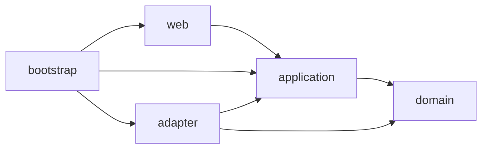
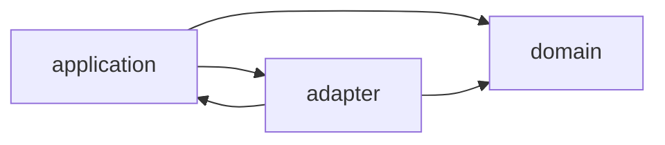

# Phụ thuộc, chu kỳ và mức độ tập trung trách nhiệm

## 1. Mục tiêu bài học

Trong chương **Chỉ số chất lượng** của module **CODE_QUALITY_FUNDAMENTALS**, chúng ta tìm hiểu cách sử dụng số liệu về **quan hệ phụ thuộc**, **chu kỳ phụ thuộc** và **mức độ tập trung trách nhiệm** để nhận diện những khu vực mã nguồn có thể khó hiểu, khó kiểm thử hoặc khó thay đổi.

Module hướng đến việc **hiểu những thuộc tính quyết định mã nguồn có đáng tin cậy, dễ hiểu và dễ thay đổi hay không**. Các chỉ số giúp đặt câu hỏi và theo dõi xu hướng, nhưng không tự đưa ra phán quyết rằng một thiết kế “tốt” hay “xấu”. Để diễn giải đúng, ta phải xác định **đơn vị đo**, **chiều phụ thuộc**, **phạm vi dữ liệu** và **lý do một thành phần tồn tại**.

Sau bài học, bạn có thể:

- Giải thích **fan-in**, **fan-out**, các phép đếm phụ thuộc vào/ra và chỉ số bất ổn định phụ thuộc.
- Xác định **chu kỳ** trong đồ thị có hướng, phân biệt chu kỳ ở cấp lớp, package và artifact.
- Phân tích **cohesion** (tính kết dính trách nhiệm) bằng các nhóm hành vi và lý do thay đổi, thay vì chỉ dựa vào số phương thức hoặc một điểm LCOM.
- Đọc, so sánh và kiểm chứng số liệu trước/sau một thay đổi kiến trúc.
- Dùng ví dụ Java 17 để tính chỉ số trên đồ thị package nhỏ và viết JUnit 5 kiểm tra trường hợp có/không có chu kỳ.
- Đề xuất cải tiến thiết kế dựa trên **rủi ro thực tế**, không chạy theo điểm số.

## 2. Vì sao cần đo quan hệ giữa các phần mã?

Giả sử một đội bảo trì ứng dụng bán hàng với các thành phần:

- **domain:** khái niệm và quy tắc nghiệp vụ.
- **application:** điều phối use case và định nghĩa các port cần dùng.
- **adapter:** hiện thực các port bằng database hoặc dịch vụ ngoài.
- **web:** nhận request và trả response.
- **bootstrap:** lắp ghép các hiện thực tại điểm khởi tạo.

Một thay đổi nhỏ ở loại dữ liệu trong `domain` có thể buộc nhiều nơi chỉnh theo. Điều này không nhất thiết là lỗi: các phần khác **cần** biết mô hình nghiệp vụ. Ngược lại, nếu `domain` phải import lớp JDBC hoặc HTTP framework, một cập nhật hạ tầng có thể khiến lõi nghiệp vụ bị ảnh hưởng — dấu hiệu đáng điều tra.

Số liệu phụ thuộc giúp trả lời:

1. **Ai đang phụ thuộc vào ai?** Phần nào có nhiều bên dùng, phần nào phải biết nhiều chi tiết bên ngoài?
2. **Có đường phụ thuộc vòng không?** Có thể tách, build, kiểm thử hoặc thay thế một phần độc lập không?
3. **Một thành phần có chứa các trách nhiệm liên quan không?** Hay nhiều lý do thay đổi khác nhau bị đặt chung?
4. **Khu vực nào có rủi ro lan truyền thay đổi cao?** Nên ưu tiên review, kiểm thử hoặc tách ranh giới ở đâu?

Những câu hỏi này hữu ích hơn câu hỏi “Làm sao để tất cả chỉ số về 0?”.

## 3. Đồ thị phụ thuộc là nền tảng của phép đo

Ta biểu diễn cấu trúc bằng một **đồ thị có hướng**:

- **Đỉnh (node):** một lớp, package, module build, hoặc service — phải chọn *một loại* rõ ràng cho từng phép đo.
- **Cạnh có hướng** `A -> B`: thành phần `A` **phụ thuộc vào** thành phần `B` theo quy tắc đo đã chọn.
- **Đường đi:** một chuỗi phụ thuộc, chẳng hạn `web -> application -> domain`.
- **Chu kỳ:** một đường có hướng quay lại đỉnh bắt đầu, ví dụ `application -> adapter -> application`.



Trong sơ đồ, `application` phụ thuộc vào `domain`, còn `adapter` phụ thuộc vào `application` để hiện thực hợp đồng. Tại runtime, một đối tượng application có thể gọi phương thức trên adapter được truyền vào; **hướng lời gọi lúc chạy** không đồng nghĩa mã application phải **import lớp adapter**.

### Phạm vi đo phải được xác định trước

Cùng một hệ thống có nhiều đồ thị hợp lệ:

| Đơn vị đỉnh | Cạnh phụ thuộc ví dụ | Phù hợp để quan sát |
| --- | --- | --- |
| **Class** | Lớp A có trường, tham số hoặc lời gọi dùng lớp B | Liên kết giữa các lớp, nguy cơ lớp phụ thuộc quá nhiều kiểu |
| **Package** | Có ít nhất một lớp của package A dùng lớp thuộc package B | Ranh giới package, chiều phụ thuộc giữa các nhóm trách nhiệm |
| **Build module/artifact** | Artifact A khai báo hoặc thực tế phụ thuộc artifact B | Mức cô lập và chi phí build/phát hành |
| **JPMS named module** | A khai báo `requires B` | Hợp đồng module path và việc đọc module khác |
| **Service** | Service A gọi HTTP hoặc gửi yêu cầu đến service B | Phụ thuộc vận hành và rủi ro khi triển khai phân tán |

Một kết quả “package A có fan-out bằng 4” **không thể** so trực tiếp với “class X có fan-out bằng 4” vì chúng là những đơn vị đo khác nhau. Tương tự, phụ thuộc khai báo trong build không giống quan hệ class đã biên dịch hoặc cuộc gọi HTTP lúc chạy.

Để theo dõi xu hướng, hãy giữ **cùng cách xác định đỉnh, cạnh, package nguồn, nguồn dữ liệu và phiên bản công cụ** giữa các lần đo.

## 4. Fan-in, fan-out và ý nghĩa của chiều phụ thuộc

Với đồ thị có hướng, ở một đỉnh `P`:

- **Fan-in(P)**: số **đỉnh khác nhau** có cạnh trực tiếp trỏ **vào P**.
- **Fan-out(P)**: số **đỉnh khác nhau** mà `P` có cạnh trực tiếp trỏ **ra ngoài**.

Trong bài học, ta đếm **đỉnh phụ thuộc duy nhất**: nếu package A có 12 lớp cùng dùng package B, đồ thị package vẫn chỉ có **một cạnh A -> B**. Một công cụ khác có thể đếm số tham chiếu hoặc số lớp liên quan và cho kết quả khác.

Xét đồ thị ở mục 3 với năm package:

| Package | Package phụ thuộc vào nó | Fan-in | Package nó phụ thuộc | Fan-out |
| --- | --- | ---: | --- | ---: |
| `domain` | `application`, `adapter` | **2** | Không có | **0** |
| `application` | `adapter`, `web`, `bootstrap` | **3** | `domain` | **1** |
| `adapter` | `bootstrap` | **1** | `application`, `domain` | **2** |
| `web` | `bootstrap` | **1** | `application` | **1** |
| `bootstrap` | Không có | **0** | `web`, `application`, `adapter` | **3** |

**Diễn giải không máy móc:**

- `domain` có fan-in cao hơn fan-out là **hợp lý** nếu nó biểu diễn mô hình ổn định mà nhiều thành phần cần dùng.
- `bootstrap` có fan-out lớn vì cần biết các hiện thực để lắp ghép. Đây là **trách nhiệm của composition root**, không phải lập tức là lỗi.
- `application` có nhiều bên phụ thuộc: khi thay đổi API của nó, tác động tiềm năng có thể rộng. Cần quản lý tương thích và kiểm thử tốt.
- `adapter` phụ thuộc hai nhóm khác vì nó cần biết cả hợp đồng application và kiểu domain. Con số này tự nó không nói adapter thiết kế sai.

### Afferent và efferent coupling

Trong một số mô hình đo ở mức package, ta gặp:

- **Afferent coupling (Ca)**: mức các thành phần **bên ngoài phụ thuộc vào** package.
- **Efferent coupling (Ce)**: mức các thành phần **bên trong package phụ thuộc ra bên ngoài**.

Những định nghĩa/triển khai phổ biến của `Ca` và `Ce` có thể **đếm số lớp tham gia quan hệ**, không phải số package kề. Vì vậy **fan-in/fan-out cấp package** trong bảng ở trên là một phép đo đơn giản trên đồ thị package, **không mặc nhiên đồng nhất** với các giá trị Ca/Ce do công cụ khác báo cáo. Chỉ dùng số liệu để so sánh khi định nghĩa phép đếm giống nhau.

Fan-in lớn là dấu hiệu “nhiều nơi biết đến P”, còn fan-out lớn là dấu hiệu “P biết nhiều thứ khác”. Cả hai cần bối cảnh: một lớp điều phối có thể cần nhiều cổng tích hợp; một kiểu giá trị dùng rộng rãi có thể có fan-in cao mà vẫn dễ hiểu.

## 5. Tỷ lệ bất ổn định phụ thuộc: hữu ích nhưng dễ bị diễn giải sai

Một chỉ số thường dùng trong phân tích package là:

\[
I = \frac{Ce}{Ca + Ce}
\]

Trong đó `Ca` và `Ce` phải được tính theo **cùng một định nghĩa coupling**, trên cùng phạm vi phân tích. Khi tổng lớn hơn 0, tỷ lệ nằm trong khoảng từ `0` đến `1`:

- **Gần 0:** nhiều thành phần khác phụ thuộc vào package hơn số phụ thuộc mà package tạo ra; nó có thể khó thay đổi hợp đồng mà không ảnh hưởng bên dùng.
- **Gần 1:** package phụ thuộc ra ngoài nhiều nhưng ít thành phần khác phụ thuộc vào nó; nó có thể dễ bị tác động bởi thay đổi từ các thành phần mà nó sử dụng.
- **Không có cạnh nào:** `Ca = Ce = 0`, phép chia `0/0` **không xác định**. Không tự điền `I = 0` hoặc `I = 1` để biến “không có dữ liệu liên kết” thành một kết luận về tính ổn định.

Từ **“bất ổn định”** trong tên chỉ số mô tả **cấu trúc phụ thuộc**, không đo trực tiếp số lần có bug, tốc độ thay đổi thực tế hay khả năng uptime của dịch vụ.

Để minh họa trên **đồ thị package đơn giản** trong mục 4, ta có thể tự định nghĩa một tỷ lệ tương tự:

\[
I_{\text{graph}}(P) =
\frac{\operatorname{fanOut}(P)}
{\operatorname{fanIn}(P) + \operatorname{fanOut}(P)}
\]

Đây là **chỉ số minh họa dùng bậc vào/ra của đỉnh package**, không được coi là kết quả Ca/Ce chuẩn của mọi công cụ. Từ bảng ở mục 4:

| Package | Fan-in | Fan-out | `I_graph` |
| --- | ---: | ---: | ---: |
| `domain` | 2 | 0 | **0,00** |
| `application` | 3 | 1 | **0,25** |
| `adapter` | 1 | 2 | **0,67** (làm tròn) |
| `web` | 1 | 1 | **0,50** |
| `bootstrap` | 0 | 3 | **1,00** |

Không có lý do để “sửa” `bootstrap` thành `I_graph = 0,5` chỉ vì số 1,00 trông xấu. Nhiệm vụ của nó là phụ thuộc vào các hiện thực để tạo hệ thống. Chỉ số gợi câu hỏi **“package này có đang phụ thuộc đúng những gì vai trò của nó cần?”**, không cung cấp đáp án.

### Đừng nhầm chiều nhân quả

Nếu sau khi tách module một cách hợp lý mà fan-out giảm, thay đổi đó **có thể** giảm phạm vi tác động — nhưng số giảm không tự chứng minh việc refactor cải thiện tính đúng đắn hoặc hiệu năng. Ngược lại, việc thêm một abstraction có thể tạo thêm cạnh phụ thuộc trong khi **giảm sự phụ thuộc vào công nghệ dễ thay đổi**. Chất lượng ranh giới quan trọng hơn số cạnh tuyệt đối.

## 6. Chu kỳ phụ thuộc: một rủi ro khác với số lượng phụ thuộc

Đồ thị `A -> B -> C -> A` có **chu kỳ** vì có đường đi theo hướng cạnh quay lại điểm xuất phát. Một chu kỳ có thể xuất hiện ở nhiều mức:

- **Class:** các lớp gọi hoặc giữ tham chiếu kiểu lẫn nhau.
- **Package:** có đường phụ thuộc khép kín giữa các package.
- **Build module:** các subproject cần nhau theo vòng, có thể khiến công cụ build không thể sắp xếp thứ tự.
- **Service/runtime:** các service phụ thuộc nhau để hoàn thành một thao tác, có thể gây chuỗi lỗi khi một service không sẵn sàng.

Chu kỳ package là tín hiệu đáng điều tra vì có thể khiến **việc thay đổi một package lan qua cả nhóm**. Tuy nhiên, nó **không đồng nghĩa** có deadlock luồng hoặc stack overflow: lỗi runtime phụ thuộc hành vi gọi, đồng bộ và trạng thái thật. Một vòng giữa các kiểu dữ liệu cũng không luôn là bug; cần đánh giá ranh giới trách nhiệm và tác động.

### Thêm một cạnh sai làm xuất hiện chu kỳ

Ban đầu:

```text
application --> domain
adapter     --> application, domain
```

Nếu ai đó cho `application` tạo trực tiếp `JdbcOrderRepository` trong `adapter`, đồ thị có thêm cạnh `application -> adapter`:



Lúc đó `application` và `adapter` nằm trong cùng một **thành phần liên thông mạnh (strongly connected component — SCC)** gồm nhiều đỉnh: từ một đỉnh trong nhóm có thể đi theo cạnh có hướng đến đỉnh còn lại và trở về.

Một SCC có từ hai đỉnh trở lên chứa chu kỳ. **Một SCC chỉ có một đỉnh** cũng tạo chu kỳ nếu đỉnh đó có **self-loop**. Để đánh giá phạm vi liên kết thành nhóm không thể tách đơn giản, SCC hữu ích hơn chỉ đếm “có ít nhất một chu kỳ”.

### Cách xử lý theo trách nhiệm

Trong ví dụ, thay vì để `application` biết `JdbcOrderRepository`:

1. Định nghĩa interface `OrderReader` trong phạm vi application hoặc một hợp đồng mà application được phép biết.
2. Cho `JdbcOrderRepository` ở adapter **hiện thực** interface đó.
3. Truyền đối tượng cụ thể vào service qua constructor hoặc cấu hình dependency injection ở `bootstrap`.
4. Kiểm tra lại: `adapter -> application` còn hợp lý, `application -> adapter` không còn.
5. Chạy kiểm thử hành vi và quy tắc kiến trúc; việc bỏ chu kỳ **không bảo đảm** tự động rằng use case chạy đúng.

Một cách “giảm số liệu” không đúng là dùng reflection hoặc chuỗi tên lớp để giấu import trong khi logic application vẫn phụ thuộc vào adapter. Đồ thị tĩnh có thể bớt một cạnh, nhưng quan hệ thiết kế và rủi ro thay đổi vẫn còn.

## 7. Mức độ tập trung trách nhiệm (cohesion): nhìn vào lý do thay đổi

**Cohesion** nói về mức các thành phần bên trong một lớp hoặc module **phục vụ cùng một mục đích rõ ràng**. Một lớp có tính kết dính tốt thường có những dữ liệu và hành vi cùng góp phần vào một trách nhiệm có thể diễn đạt được, thay vì là tập hợp các chức năng không liên quan.

Ví dụ lớp tiện ích sau có hai nhóm công việc không gắn với nhau về chính sách:

```java
// Ví dụ thiếu tập trung trách nhiệm.
public final class ShopHelpers {
    private ShopHelpers() {}

    public static long feeVnd(long subtotalVnd) {
        if (subtotalVnd < 0) {
            throw new IllegalArgumentException("subtotal must be non-negative");
        }
        return subtotalVnd >= 500_000 ? 0 : 30_000;
    }

    public static String normalizeContactName(String name) {
        if (name == null || name.isBlank()) {
            throw new IllegalArgumentException("name must not be blank");
        }
        return name.strip();
    }
}
```

Một nhóm sản phẩm có thể thay **ngưỡng miễn phí vận chuyển** mà không hề thay quy tắc **chuẩn hóa tên liên hệ**. Nếu hai chính sách luôn được sửa vì lý do khác nhau, chúng nên được đặt tại **hai trách nhiệm riêng**:

```java
// ShippingFeePolicy.java
public final class ShippingFeePolicy {
    public long feeVnd(long subtotalVnd) {
        if (subtotalVnd < 0) {
            throw new IllegalArgumentException("subtotal must be non-negative");
        }
        return subtotalVnd >= 500_000 ? 0 : 30_000;
    }
}
```

```java
// ContactNameNormalizer.java
public final class ContactNameNormalizer {
    public String normalize(String name) {
        if (name == null || name.isBlank()) {
            throw new IllegalArgumentException("name must not be blank");
        }
        return name.strip();
    }
}
```

Đây là **hai ví dụ thay thế** cho lớp `ShopHelpers` cũ, không phải lời kêu gọi tạo thêm class cho mọi phương thức nhỏ. Nếu hai phép tính đơn giản thực sự thuộc cùng một khái niệm được nhóm dùng chung, việc giữ chúng trong một lớp có thể hợp lý. Điều cần tìm là **lý do thay đổi**, không phải một ngưỡng cứng về số phương thức.

### Hai dấu hiệu thực hành về trách nhiệm

**1. Các nhóm phương thức ít liên hệ:** một số phương thức chỉ dùng dữ liệu về vận chuyển, các phương thức khác chỉ dùng dữ liệu về hồ sơ liên hệ, không cùng thực hiện một mục đích của lớp.

**2. Lịch sử thay đổi theo các nguyên nhân không liên quan:** cùng một lớp liên tục được sửa bởi các yêu cầu khác nhau (giá, email, phân quyền, lưu trữ). Đây có thể là dấu hiệu nhiều trách nhiệm bị đặt chung, nhưng cũng có thể chỉ là **composition root** hoặc orchestrator có nhiệm vụ phối hợp nhiều bước. Cần đọc cả mục đích lớp và bối cảnh thay đổi.

Nguyên tắc “một trách nhiệm” không đồng nghĩa “mỗi lớp chỉ có một phương thức”. Một aggregate nghiệp vụ có thể có nhiều phương thức nhằm bảo vệ **cùng một tập bất biến**; tách chúng một cách máy móc có thể làm giảm tính đóng gói.

## 8. Chỉ số cohesion: LCOM và những giới hạn cần biết

Một số công cụ đưa ra số đo **LCOM — Lack of Cohesion of Methods**. Các biến thể của LCOM xét mức độ phương thức chia sẻ trường dữ liệu hoặc mức kết nối giữa các phương thức; **không có một công thức LCOM duy nhất được mọi công cụ áp dụng như nhau**.

Tùy biến thể, điểm LCOM cao thường được diễn giải là dấu hiệu **các nhóm phương thức ít kết nối thông qua trạng thái dùng chung**. Nhưng kết luận “LCOM cao chắc chắn là lớp có quá nhiều trách nhiệm” là không đủ cơ sở.

Ví dụ gây hiểu nhầm:

- Một lớp **toàn phương thức static thuần** có thể không có trường dữ liệu; LCOM dựa trên chia sẻ trường không phản ánh tốt việc các hàm có cùng khái niệm nghiệp vụ hay không.
- Một **data transfer object** chỉ giữ dữ liệu, hoặc một `record` có vài accessor, cần được đánh giá theo mục đích lưu chuyển giá trị.
- Một **controller/facade** được thiết kế để điều phối nhiều use case có thể không truy cập chung nhiều field, nhưng vẫn có ranh giới rõ.
- Một “god class” có mọi phương thức đều đọc một field `logger` hoặc `config` có thể trông liên kết hơn trong một cách tính dựa vào trường chung, dù các hành vi không cùng trách nhiệm.

Vì vậy, khi dùng LCOM:

1. Ghi rõ **biến thể, phạm vi và cách diễn giải** của công cụ.
2. Đánh giá song song **tên lớp, cụm phương thức, bất biến và lý do thay đổi**.
3. Không so sánh điểm giữa các công cụ hoặc phiên bản có công thức khác nhau.
4. Không đặt một ngưỡng dùng cho mọi loại lớp mà không xét DTO, adapter, service, domain aggregate hay generated code.

**Cohesion là đặc tính thiết kế có ý nghĩa nghiệp vụ**, còn LCOM là tín hiệu cấu trúc dùng để tìm nơi cần đọc kỹ.

## 9. Ví dụ Java 17: tính chỉ số và phát hiện chu kỳ trên đồ thị nhỏ

Để thấy cách các phép đo vận hành, ta xây một công cụ minh họa nhận đồ thị các **package**. Đồ thị ở đây được cung cấp sẵn dưới dạng `Map<String, Set<String>>`:

- Khóa là tên package đã đưa vào phạm vi đo.
- Giá trị là **tập package mà khóa phụ thuộc trực tiếp**.
- Mọi đỉnh đích phải có mặt như một khóa; không cho tên trống hoặc phần tử `null`.
- Một cạnh giữa hai package chỉ được tính một lần.
- Kết quả gồm bậc vào, bậc ra, `I_graph` và cờ cho biết đồ thị có chu kỳ hay không.

Đây là **công cụ học thuật tính trên đồ thị đã chuẩn bị**, **không tự phân tích bytecode hoặc đọc repository**. Với hệ thống lớn, các công cụ phân tích chuyên dụng cung cấp dữ liệu đầu vào và phát hiện SCC hiệu quả hơn.

### 9.1. Hiện thực tính chỉ số

```java
// PackageGraphMetrics.java
import java.util.HashMap;
import java.util.Map;
import java.util.Objects;
import java.util.OptionalDouble;
import java.util.Set;

public final class PackageGraphMetrics {
    private PackageGraphMetrics() {}

    public record NodeMetric(
            int fanIn, int fanOut, OptionalDouble instability) {}

    public record Report(
            Map<String, NodeMetric> nodes, boolean hasCycle) {}

    public static Report analyze(Map<String, Set<String>> dependencies) {
        Map<String, Set<String>> graph = normalize(dependencies);
        Map<String, Integer> incoming = new HashMap<>();
        for (String node : graph.keySet()) {
            incoming.put(node, 0);
        }
        for (Set<String> targets : graph.values()) {
            for (String target : targets) {
                incoming.merge(target, 1, Integer::sum);
            }
        }

        Map<String, NodeMetric> metrics = new HashMap<>();
        for (var entry : graph.entrySet()) {
            int fanIn = incoming.get(entry.getKey());
            int fanOut = entry.getValue().size();
            int total = Math.addExact(fanIn, fanOut);
            OptionalDouble instability = total == 0
                    ? OptionalDouble.empty()
                    : OptionalDouble.of((double) fanOut / total);
            metrics.put(
                    entry.getKey(),
                    new NodeMetric(fanIn, fanOut, instability));
        }
        return new Report(Map.copyOf(metrics), hasCycle(graph));
    }

    private static Map<String, Set<String>> normalize(
            Map<String, Set<String>> input) {
        Objects.requireNonNull(input, "input");
        Map<String, Set<String>> result = new HashMap<>();
        for (var entry : input.entrySet()) {
            String node = Objects.requireNonNull(entry.getKey(), "node");
            if (node.isBlank()) {
                throw new IllegalArgumentException("node must not be blank");
            }
            Set<String> targets = Set.copyOf(
                    Objects.requireNonNull(entry.getValue(), "targets"));
            for (String target : targets) {
                if (!input.containsKey(target)) {
                    throw new IllegalArgumentException(
                            "unknown dependency target: " + target);
                }
            }
            result.put(node, targets);
        }
        return Map.copyOf(result);
    }

    private static boolean hasCycle(Map<String, Set<String>> graph) {
        Map<String, Integer> state = new HashMap<>();
        for (String node : graph.keySet()) {
            if (state.getOrDefault(node, 0) == 0
                    && visit(node, graph, state)) {
                return true;
            }
        }
        return false;
    }

    private static boolean visit(
            String node,
            Map<String, Set<String>> graph,
            Map<String, Integer> state) {
        state.put(node, 1); // Đang thăm (trên nhánh DFS hiện tại).
        for (String target : graph.get(node)) {
            int next = state.getOrDefault(target, 0);
            if (next == 1 || (next == 0 && visit(target, graph, state))) {
                return true;
            }
        }
        state.put(node, 2); // Đã xét hết các cạnh đi ra.
        return false;
    }
}
```

**Cách hiểu thuật toán:**

- Tính `fanOut` bằng kích thước tập đích của một đỉnh.
- Tính `fanIn` bằng cách cộng 1 vào mỗi đích của các cạnh có hướng.
- Nếu không có cạnh vào/ra, dùng `OptionalDouble.empty()` thay vì tự đặt tỷ lệ bằng 0.
- DFS ghi `state = 1` cho đỉnh đang nằm trên nhánh duyệt, `state = 2` cho đỉnh đã xử lý. Đi đến một đỉnh `state = 1` chứng tỏ tồn tại **đường quay lại trong chuỗi phụ thuộc có hướng**.

Với đồ thị đã ở trong bộ nhớ có `V` đỉnh và `E` cạnh, phần đếm bậc và DFS có chi phí thời gian **`O(V + E)`**, cùng bộ nhớ phụ trội **`O(V + E)`** cho bản sao dữ liệu và trạng thái. DFS dùng đệ quy có thể gây tràn ngăn xếp khi đồ thị cực sâu; đây là ví dụ cho đồ thị nhỏ, không phải công cụ production tối ưu cho mọi quy mô.

Thuật toán trả **có hoặc không có chu kỳ**, chưa liệt kê các SCC. Khi cần biết **nhóm package nào dính với nhau**, có thể dùng Tarjan/Kosaraju hoặc tính năng cung cấp bởi công cụ phân tích kiến trúc.

### 9.2. Kiểm thử JUnit 5 cho chỉ số và chu kỳ

```java
import static org.junit.jupiter.api.Assertions.assertEquals;
import static org.junit.jupiter.api.Assertions.assertFalse;
import static org.junit.jupiter.api.Assertions.assertThrows;
import static org.junit.jupiter.api.Assertions.assertTrue;

import java.util.Map;
import java.util.Set;
import org.junit.jupiter.api.Test;

class PackageGraphMetricsTest {
    private static Map<String, Set<String>> validGraph() {
        return Map.of(
                "domain", Set.of(),
                "application", Set.of("domain"),
                "adapter", Set.of("application", "domain"),
                "web", Set.of("application"),
                "bootstrap", Set.of("web", "application", "adapter"));
    }

    @Test
    void countsIncomingAndOutgoingPackageDependencies() {
        var report = PackageGraphMetrics.analyze(validGraph());
        assertFalse(report.hasCycle());

        var domain = report.nodes().get("domain");
        assertEquals(2, domain.fanIn());
        assertEquals(0, domain.fanOut());
        assertEquals(0.0,
                domain.instability().orElseThrow(), 0.000001);

        var application = report.nodes().get("application");
        assertEquals(3, application.fanIn());
        assertEquals(1, application.fanOut());
        assertEquals(0.25,
                application.instability().orElseThrow(), 0.000001);

        var bootstrap = report.nodes().get("bootstrap");
        assertEquals(0, bootstrap.fanIn());
        assertEquals(3, bootstrap.fanOut());
        assertEquals(1.0,
                bootstrap.instability().orElseThrow(), 0.000001);
    }

    @Test
    void detectsAnAccidentalReverseDependencyCycle() {
        var graph = Map.of(
                "domain", Set.<String>of(),
                "application", Set.of("domain", "adapter"),
                "adapter", Set.of("application", "domain"));

        assertTrue(PackageGraphMetrics.analyze(graph).hasCycle());
    }

    @Test
    void isolatedPackageHasNoInstabilityRatio() {
        var report = PackageGraphMetrics.analyze(
                Map.of("standalone", Set.<String>of()));

        assertFalse(report.hasCycle());
        assertTrue(report.nodes().get("standalone")
                .instability().isEmpty());
    }

    @Test
    void selfDependencyAndUnknownTargetAreNotSilentlyIgnored() {
        assertTrue(PackageGraphMetrics.analyze(
                Map.of("self", Set.of("self"))).hasCycle());
        assertThrows(IllegalArgumentException.class,
                () -> PackageGraphMetrics.analyze(
                        Map.of("application", Set.of("missing"))));
    }
}
```

Những ca này minh họa **một cách xác minh phép đo**, không chứng minh dữ liệu đầu vào từ repository đã được thu thập đúng. Nếu công cụ quét thiếu package hoặc bỏ qua quan hệ phát sinh từ reflection/config, cả chương trình phân tích lẫn test ở trên vẫn có thể xanh nhưng báo cáo kiến trúc sẽ thiếu thông tin.

Điểm cần quan sát ở test chu kỳ: khi thêm cạnh `application -> adapter`, **một điều kiện cấu trúc bị phá**. Đây là cảnh báo về ranh giới phụ thuộc; nó không tự xác nhận rằng chương trình bị deadlock hoặc mọi hành vi nghiệp vụ đều sai.

## 10. Đo mức độ tập trung trách nhiệm bằng bằng chứng phù hợp

Không có một chỉ số duy nhất diễn tả đầy đủ “lớp này làm quá nhiều việc”. Thay vì chọn số tùy ý rồi ép thiết kế, hãy phối hợp các góc nhìn:

| Góc nhìn | Tín hiệu có thể hữu ích | Cần xác minh thêm |
| --- | --- | --- |
| **Số nhóm phương thức ít liên quan** | Các phương thức chia thành cụm độc lập theo dữ liệu/hành vi | Các cụm có thuộc các lý do thay đổi khác nhau không? |
| **LCOM theo một biến thể xác định** | Nhiều phương thức không chia sẻ dữ liệu nội bộ | Loại lớp có phù hợp với cách đo ấy không? |
| **Lịch sử thay đổi** | Một lớp thường bị sửa cho các yêu cầu khác nhau | Đó là nhiều trách nhiệm hay một điểm điều phối có chủ đích? |
| **Kích thước và độ phức tạp** | Nhiều nhánh, nhiều phương thức khó theo dõi | Có phải một quy tắc nghiệp vụ duy nhất nhưng thật sự phức tạp? |
| **Fan-out của lớp** | Lớp biết nhiều kiểu/đối tác | Là orchestrator được thiết kế để phối hợp hay đang ôm cả việc chi tiết? |
| **Phụ thuộc vào các tầng khác nhau** | Cùng một lớp biết database, HTTP, trình bày và quy tắc giá | Có ranh giới nào đang bị vượt qua? |

### Phân biệt thiếu cohesion với điều phối hợp lệ

Một `CheckoutService` có thể phụ thuộc vào kho sản phẩm, bộ tính giá và cổng tạo đơn vì trách nhiệm của nó là **điều phối checkout**. Lớp này có fan-out tương đối cao, nhưng có thể vẫn tập trung vào **một use case**.

Ngược lại, một lớp `CommonManager` vừa quản lý user, tính thuế, gửi thông báo và đọc báo cáo có thể có rất nhiều lý do thay đổi khác nhau. Tên chung và fan-out cao là dấu hiệu, nhưng bằng chứng thuyết phục hơn là **các nhóm hành vi độc lập, yêu cầu đổi riêng và các ranh giới bị trộn lẫn**.

Nếu tách lớp chỉ nhằm làm đẹp LCOM, có thể tạo thêm nhiều lớp chuyển tiếp không làm rõ trách nhiệm. Nếu gom phương thức không liên quan chỉ để chúng chia sẻ một `config`, điểm LCOM có thể giảm nhưng sự tập trung trách nhiệm không cải thiện.

## 11. Khi sử dụng công cụ đo: đọc đúng nhãn và phạm vi

Các công cụ phân tích tĩnh, kiến trúc và báo cáo chất lượng có thể đưa ra:

- Số lớp/package mà một thành phần phụ thuộc vào hoặc bị phụ thuộc.
- Số lượng chu kỳ hoặc SCC trong phạm vi phân tích.
- Mức độ tập trung/thiếu kết dính theo một phép đo LCOM cụ thể.
- Số phụ thuộc giữa module, vi phạm quy tắc tầng hoặc mức ảnh hưởng thay đổi.
- Thay đổi chỉ số qua các commit, đợt phát hành hoặc vùng mã.

Trước khi tin một dashboard, hãy xác minh:

1. **Định nghĩa thước đo:** fan-out đếm loại khác nhau hay mọi lần tham chiếu? Ca/Ce có đếm class, package hay cạnh?
2. **Đơn vị được đo:** class, package, build module, service; có gom package con vào cha không?
3. **Tập dữ liệu được quét:** mã sản xuất, test, generated sources, thư viện thứ ba, các module độc lập có được đưa vào không?
4. **Nguồn đo:** mã nguồn, bytecode, file build, JPMS descriptor hay trace lúc chạy?
5. **Điểm mù:** reflection, ServiceLoader, cấu hình, HTTP/messaging, annotation processor hoặc code chưa build có bị bỏ qua không?
6. **Tính so sánh:** hai lần đo có cùng phiên bản công cụ, cách nhóm và tập module không?

Một chu kỳ bị xóa khỏi báo cáo có thể là thành công về thiết kế. Nhưng nó cũng có thể đơn giản vì một package được đổi tên, test không còn quét đúng path hoặc một dependency chuyển thành chuỗi cấu hình. **Báo cáo xanh chưa chứng minh ranh giới thực tế đã được sửa.**

## 12. Dùng xu hướng và ngưỡng cảnh báo một cách thận trọng

Một chỉ số đo được có ích nhất khi gắn với **vấn đề cụ thể**:

| Quan sát | Giả thuyết cần kiểm tra | Hành động có thể phù hợp |
| --- | --- | --- |
| Fan-out của module core tăng liên tục | Core đang biết thêm chi tiết ngoài trách nhiệm | Review import mới, gom phụ thuộc qua hợp đồng ổn định nếu có lý do |
| Package API có fan-in cao và thay đổi thường xuyên | Nhiều bên có thể chịu ảnh hưởng mỗi lần đổi hợp đồng | Kiểm tra tương thích, review API, test contract và phân phiên bản |
| Xuất hiện SCC mới giữa application và adapter | Có phụ thuộc ngược từ nghiệp vụ sang hạ tầng | Xác định đường cạnh, sửa theo port/adapter nếu đúng chính sách |
| Một lớp có LCOM cao và nhiều nhóm phương thức | Các nhóm trách nhiệm độc lập có thể đang bị trộn | Đọc lịch sử thay đổi, tách theo lý do thay đổi nếu hợp lý |
| Một class rất lớn nhưng chỉ chứa mô hình quy tắc phức tạp | Độ phức tạp có thể là từ chính bài toán | Ưu tiên làm rõ bất biến, tên gọi, test thay vì ép nhỏ theo số dòng |
| Số vi phạm kiến trúc giảm nhưng các lỗi tích hợp tăng | Tối ưu cấu trúc có thể chưa bảo vệ hành vi cần thiết | Bổ sung kiểm thử tích hợp và xem lại mục tiêu refactor |

**Ngưỡng cảnh báo** nên là dấu hiệu cần review, không tự động là bản án. Nếu nhóm chọn “fan-out trên 8 phải xem xét”, cần nêu đây là **ngưỡng quy ước cục bộ** cùng những ngoại lệ như composition root, facade hoặc generated code. Không có con số 8 phổ quát cho mọi module Java.

Một chính sách gate hữu ích có thể là:

- **Không chấp nhận chu kỳ mới** giữa những tầng đã được định nghĩa là phải độc lập.
- **Cảnh báo và yêu cầu giải thích** khi fan-out tăng mạnh hoặc API phụ thuộc thêm vào loại công nghệ dễ thay đổi.
- **Theo dõi nợ hiện có** bằng baseline có chủ sở hữu, thay vì tắt kiểm tra chỉ vì còn nhiều vi phạm cũ.
- **Không ép LCOM về một ngưỡng tuyệt đối** nếu chưa đánh giá công thức và loại lớp.

Đích đến là **giảm rủi ro thay đổi**, không biến quá trình thiết kế thành cuộc thi điểm số.

## 13. Checklist đánh giá một báo cáo chỉ số

Khi một pull request làm biến động các chỉ số phụ thuộc và cohesion, có thể review theo thứ tự:

1. **Bối cảnh:** thay đổi nào được thực hiện, ranh giới nghiệp vụ nào phải giữ?
2. **Phạm vi:** các số đang đo class, package hay artifact? Có đủ class trong đồ thị không?
3. **Định nghĩa:** fan-in/fan-out, Ca/Ce, `I` và LCOM được tính chính xác thế nào?
4. **Chiều phụ thuộc:** có cạnh nào từ phần ổn định sang chi tiết dễ thay đổi hoặc đi ngược kiến trúc đã thống nhất không?
5. **Chu kỳ:** có SCC mới không? Những đỉnh và cạnh cụ thể nào gây ra nó?
6. **Cohesion:** các phương thức có phục vụ cùng một trách nhiệm không? Có lý do thay đổi độc lập nào bị đặt chung?
7. **Tác động:** hợp đồng công khai, kiểm thử, khả năng thay thế hạ tầng và phạm vi refactor bị ảnh hưởng ra sao?
8. **Bằng chứng:** có test hành vi, kiểm thử kiến trúc và đánh giá dữ liệu vận hành phù hợp không?
9. **Đánh đổi:** số liệu giảm có làm phát sinh lớp trung gian, gọi mạng hoặc chi phí vận hành không cần thiết không?
10. **Theo dõi:** nếu chưa sửa ngay, rủi ro tồn lại, người phụ trách và điều kiện cần xét lại là gì?

Có thể đưa phần **“cạnh phụ thuộc mới và lý do”** vào phần mô tả thay đổi lớn. Điều đó giúp review đi thẳng vào quyết định thay vì tranh luận rằng một con số tăng 1 tự động là xấu.

## 14. Bài tập tự kiểm tra

### Bài tập 1 — đọc đồ thị

Cho đồ thị package:

```text
api       --> domain
service   --> api, domain
persistence --> api, domain
bootstrap --> service, persistence
domain    --> (không có cạnh đi ra)
```

Hãy trả lời:

1. Fan-in và fan-out của `domain` lần lượt là bao nhiêu?
2. `bootstrap` có tỷ lệ `I_graph` là bao nhiêu? Có thể kết luận nó thiết kế sai chỉ từ tỷ lệ ấy không?
3. Nếu thêm cạnh `api -> persistence`, đồ thị xuất hiện chu kỳ nào?

**Gợi ý:** `domain` nhận cạnh từ `api`, `service` và `persistence` nên fan-in bằng **3**, fan-out bằng **0**. `bootstrap` không có cạnh đi vào và có hai cạnh đi ra nên `I_graph = 1`; cần xét nhiệm vụ lắp ghép mới kết luận. Khi thêm `api -> persistence` và đã có `persistence -> api`, xuất hiện chu kỳ **hai đỉnh**.

### Bài tập 2 — đánh giá trách nhiệm

Một lớp `ReportService` có 14 phương thức. Chín phương thức dùng dữ liệu để xây báo cáo thống kê; năm phương thức còn lại đổi mật khẩu và phân quyền người dùng. Công cụ báo một giá trị LCOM cao.

Hãy phân tích:

- Điều gì khiến bạn nghi ngờ lớp đang giữ quá nhiều trách nhiệm?
- Tại sao chỉ số LCOM một mình chưa đủ để quyết định tách lớp?
- Nếu tách thành `ReportService` và `AccessAdministrationService`, những hợp đồng, kiểm thử và ranh giới nào cần giữ?

**Gợi ý:** Hai nhóm hành vi có **lý do thay đổi khác nhau** và trách nhiệm nghiệp vụ khác nhau; đó là cơ sở mạnh hơn số lượng phương thức. Cần hiểu variant LCOM và loại lớp; sau khi tách phải giữ quyền truy cập, thông báo lỗi, tính đúng đắn và kiểm thử tương ứng.

### Bài tập 3 — chỉ số tốt lên nhưng thiết kế tệ hơn

Một người thay import `JdbcOrderRepository` bằng `Class.forName("...JdbcOrderRepository")`. Báo cáo static coupling cho thấy application không còn cạnh đến adapter.

**Hỏi:** Số liệu nào đã thay đổi? Vì sao đây không phải bằng chứng đã sửa phụ thuộc kiến trúc? Bạn sẽ dùng kiểm tra nào bổ sung?

**Gợi ý:** Cạnh được công cụ phân tích tĩnh nhìn thấy có thể biến mất, nhưng dependency động vẫn tồn tại. Cần review thiết kế, xem cấu hình/reflection và kiểm thử tích hợp; ưu tiên loại bỏ quan hệ sai bằng hợp đồng rõ, không giấu nó khỏi công cụ.

## 15. Ghi nhớ

**Phụ thuộc, chu kỳ và mức độ tập trung trách nhiệm** là ba lăng kính bổ sung cho nhau khi đánh giá chất lượng thiết kế. **Fan-in/fan-out** cho biết một phần mã biết ai và bị ai biết đến; **chu kỳ/SCC** cho biết các thành phần khó tách rời; **cohesion** giúp xét hành vi có cùng một lý do thay đổi hay không. Các chỉ số chỉ đáng tin khi đơn vị đo, định nghĩa, phạm vi và hạn chế được nêu rõ. Hãy dùng chúng để **đặt câu hỏi, tìm rủi ro, hướng dẫn review và đo tác động của thay đổi**, rồi đối chiếu với hợp đồng nghiệp vụ, kiểm thử và mục tiêu kiến trúc trước khi kết luận. Mã nguồn chất lượng là mã có **ranh giới dễ hiểu, phụ thuộc có chủ đích và trách nhiệm được tổ chức để thay đổi an toàn**.
