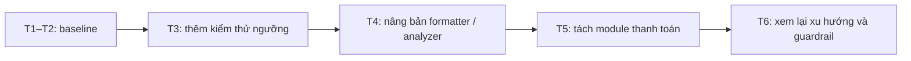
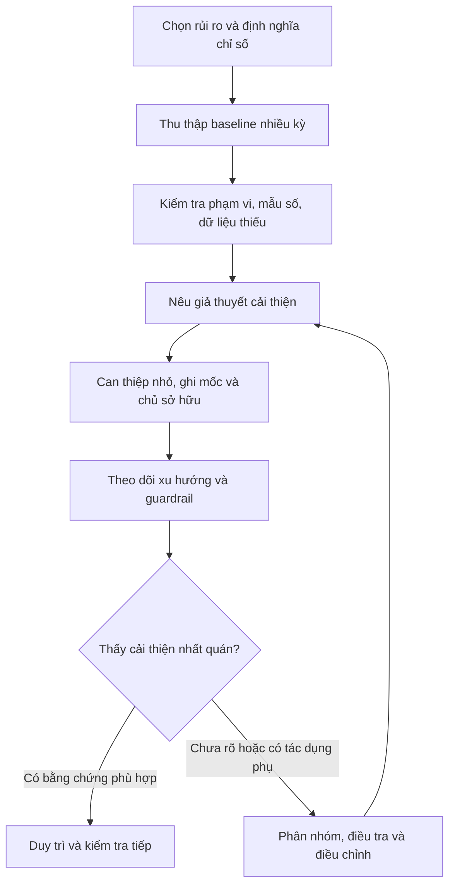

# Xu hướng theo thời gian thay vì một ảnh chụp đơn lẻ

Một nhóm mở bảng điều khiển chất lượng mã nguồn vào chiều thứ Sáu và thấy **82% độ bao phủ kiểm thử**, **14 cảnh báo phân tích tĩnh**, **4 lỗi sản xuất**. Những con số ấy trông có vẻ cụ thể, nhưng chưa cho biết phần mềm đang tốt lên hay xấu đi. Tuần trước có bao nhiêu cảnh báo? Độ bao phủ tăng do thêm kiểm thử hữu ích hay do xóa mã khó kiểm thử? Bốn lỗi là kết quả của 10 lần phát hành hay 200 lần phát hành? Có công cụ nào vừa thay cách đếm không?

Trong chương **Chỉ số chất lượng** của module **CODE_QUALITY_FUNDAMENTALS**, mục tiêu là sử dụng số liệu để hiểu mã nguồn có ngày càng **đáng tin cậy, dễ hiểu và dễ thay đổi** hay không. Thay vì kết luận từ **một ảnh chụp đơn lẻ**, ta theo dõi **xu hướng theo thời gian**, kiểm tra cách đo, giải thích biến động và tìm bằng chứng về tác động của thay đổi kỹ thuật.

Một xu hướng có ích không chỉ là đường biểu đồ đi lên hoặc đi xuống. Nó phải trả lời: **đang đo điều gì, trên đối tượng nào, trong khoảng thời gian nào, với mẫu số gì, và điều gì đã thay đổi giữa các lần đo?**

## 1. Vì sao một con số tại một thời điểm dễ gây hiểu lầm?

Xét ba nhận định thường gặp:

- “Độ bao phủ kiểm thử đạt 85% nên hệ thống an toàn.”
- “Số lỗi sản xuất tăng từ 2 lên 5, nghĩa là chất lượng giảm.”
- “Cảnh báo tĩnh giảm từ 100 xuống 20, nghĩa là đã sửa được 80 vấn đề.”

Cả ba đều **có thể sai**, dù số liệu được ghi lại chính xác.

| Ảnh chụp | Thông tin còn thiếu | Vì sao có thể kết luận sai |
| --- | --- | --- |
| Coverage = 85% | Mức trước đó, loại coverage, phạm vi mã và giá trị assertion | 85% dòng được chạy không chứng minh các ca biên được kiểm tra đúng |
| 5 lỗi sản xuất | Số người dùng, số thay đổi phát hành, mức độ nghiêm trọng, kỳ quan sát | Sản phẩm tăng gấp nhiều lần quy mô có thể có nhiều lỗi tuyệt đối hơn nhưng tỷ lệ lỗi thấp hơn |
| 20 cảnh báo tĩnh | Cấu hình rule, phiên bản tool, tệp được quét và số cảnh báo mới | Đổi bộ lọc hoặc loại nhiều tệp khỏi scan cũng làm số cảnh báo giảm |
| Độ phức tạp trung bình = 8 | Phân bố theo phương thức, module nào thay đổi, cách tính chỉ số | Một vài phương thức cực khó hiểu có thể bị che trong trung bình |
| p95 = 160 ms | Workload, thời gian đo, cách xử lý timeout và môi trường | Đổi tải từ 500 xuống 50 request/s có thể làm p95 đẹp hơn mà mã không cải thiện |

**Ảnh chụp vẫn hữu ích**: nó giúp kiểm tra một giới hạn tại thời điểm cụ thể, ví dụ “không có secret bị phát hiện trong commit sắp phát hành”. Vấn đề nảy sinh khi dùng một điểm đo để trả lời câu hỏi **đang tiến bộ hay không**, hoặc dùng xu hướng mà không kiểm soát sự thay đổi trong cách thu thập dữ liệu.

### 1.1. Ba câu hỏi cần tách riêng

1. **Hiện trạng:** ở thời điểm đo, hệ thống có thỏa điều kiện chấp nhận đã công bố không?
2. **Xu hướng:** so với các thời điểm tương đương, chất lượng có đang thay đổi theo hướng nào?
3. **Nguyên nhân:** thay đổi ấy có liên quan đến hành động kỹ thuật nào, hay do tải, cơ cấu công việc, cách đo hoặc yếu tố khác?

Một chuỗi số liệu có thể giúp trả lời câu 2. Nhưng để kết luận câu 3, thường cần thêm **thời điểm can thiệp**, so sánh nhóm tương đương, kiểm tra các yếu tố gây nhiễu và bằng chứng từ kiểm thử/review. **Tương quan theo thời gian không tự chứng minh quan hệ nhân quả.**

## 2. Định nghĩa chỉ số trước khi vẽ đường xu hướng

Muốn hai điểm trên biểu đồ so sánh được, phải giữ **định nghĩa và phạm vi** nhất quán. Một bản ghi định nghĩa chỉ số tối thiểu nên có:

| Thành phần | Câu hỏi cần chốt | Ví dụ |
| --- | --- | --- |
| **Tên và mục đích** | Chỉ số hỗ trợ quyết định nào? | Tỷ lệ thay đổi gây sự cố sau phát hành |
| **Tử số** | Điều gì được đếm là một trường hợp? | Số lần thay đổi được xác nhận gây thất bại |
| **Mẫu số** | Một trường hợp được so với tổng cơ hội nào? | Số thay đổi được phát hành thuộc cùng nhóm quan sát |
| **Đơn vị** | Đếm, %, lỗi/100 thay đổi, ngày, ms hay MiB? | Tỷ lệ từ 0 đến 1; có thể hiển thị theo % |
| **Cửa sổ thời gian** | Tuần, sprint, tháng, 7 ngày sau phát hành? | Các cohort phát hành hằng tuần có đủ 7 ngày theo dõi |
| **Phạm vi** | Module, sản phẩm, môi trường và nhóm thay đổi nào? | Dịch vụ tạo đơn trên production |
| **Nguồn dữ liệu** | CI, issue tracker, deployment log hay APM? | Deployment + incident records đã đối soát |
| **Quy tắc loại trừ** | Có bỏ thay đổi cấu hình, rollback, hotfix, dữ liệu thiếu không? | Có quy định và ghi nhận rõ ràng |
| **Chủ sở hữu** | Ai chịu trách nhiệm xác nhận cách đếm khi thay đổi? | Nhóm kỹ thuật và người phụ trách sự cố |
| **Giới hạn diễn giải** | Chỉ số không thể nói điều gì? | Không phản ánh trực tiếp độ nghiêm trọng hoặc mức rủi ro của mỗi thay đổi |

**Không đổi định nghĩa giữa hai điểm đo mà không đánh dấu.** Nếu tuần trước tính cả lỗi severity thấp, tuần này chỉ tính sự cố nghiêm trọng, đường xu hướng giảm không đủ chứng minh phần mềm tốt lên.

### 2.1. Những chỉ số thường phối hợp để nhìn chất lượng

| Góc nhìn chất lượng | Chỉ số có thể theo dõi | Cách đọc đúng phạm vi |
| --- | --- | --- |
| **Độ tin cậy** | Thay đổi gây thất bại, lỗi lọt ra production, mức độ nghiêm trọng, thời gian phục hồi | Cần tử số/mẫu số, kỳ ghi nhận và quy tắc quy trách nhiệm |
| **Khả năng kiểm thử** | Branch coverage, số ca biên được kiểm chứng, test flakiness, mutation score | Coverage cao không chứng minh test oracle đúng |
| **Khả năng bảo trì** | Điểm nóng phức tạp, duplication, nợ phân tích tĩnh, mức lan truyền khi sửa | Tách cảnh báo mới và nợ cũ; xét phạm vi module |
| **Khả năng thay đổi** | Lead time cho thay đổi, thời gian review, số lần sửa lại sau review | Cần phân biệt thay đổi nhỏ/lớn, quy trình và tải của nhóm |
| **Hiệu năng/tài nguyên** | p95/p99, lỗi/timeout, RSS/heap, queue depth | Cần so cùng workload, môi trường và cách đo |
| **An toàn** | Phát hiện bảo mật đã xác nhận, thời gian xử lý theo mức độ, lỗi phân quyền | Số phát hiện còn phụ thuộc phạm vi quét và mức độ tìm kiếm |

Không nên gom mọi chỉ số vào **một điểm “chất lượng tổng hợp”** nếu không giải thích rõ trọng số và đánh đổi. Một dự án có coverage tăng nhưng lỗi sản xuất tăng không thể được gọi “tốt hơn” chỉ vì công thức điểm tổng hợp cộng trừ cho ra số dương.

### 2.2. Chỉ số dẫn dắt và chỉ số kết quả

Một số chỉ số thường phản ánh hoạt động **gần với cách nhóm làm việc**: chất lượng kiểm thử trong PR, số cảnh báo mới, khả năng chạy test ổn định. Những chỉ số khác phản ánh **hậu quả ở thực tế**: lỗi sản xuất, thời gian phục hồi, mức ảnh hưởng người dùng.

Có thể gọi chúng là *leading indicators* và *lagging indicators*, nhưng cách phân loại phụ thuộc mục tiêu và độ trễ thực tế. Tăng coverage hôm nay **không đảm bảo** số lỗi production sẽ giảm ngày mai. Sự kết hợp hữu ích là:

- **Tín hiệu sớm:** cảnh báo mới có mức rủi ro cao được giải quyết trước merge, có ca biên cho quy tắc vừa sửa.
- **Bằng chứng kết quả:** số sự cố có liên quan sau phát hành, tỷ lệ thay đổi phải rollback, thời gian phát hiện và khôi phục.
- **Chỉ số bảo vệ (*guardrails*):** thời gian chạy pipeline, test flakiness, thông lượng phát hành, độ ổn định dưới tải.

Nhờ guardrail, nhóm không “tối ưu” một chỉ số bằng cách làm tổn hại chỉ số khác, chẳng hạn tăng coverage bằng test rất chậm và không ổn định khiến mọi PR bị chặn kéo dài.

## 3. Ví dụ xuyên suốt: sáu cohort phát hành

Giả sử một dịch vụ Java theo dõi **mỗi thay đổi đã phát hành**. Một thay đổi được tính là *gây thất bại* nếu có sự cố được xác nhận liên quan trong **7 ngày sau khi phát hành**. Một thay đổi chỉ được đếm **một lần** dù gây nhiều sự cố. Chỉ đưa cohort vào báo cáo khi đã qua đủ 7 ngày quan sát.

Dữ liệu sau **hoàn toàn giả định** để học cách phân tích, không phải số đo của một dự án thật:

| Cohort tuần | Thay đổi phát hành | Thay đổi gây thất bại | Tỷ lệ thất bại | Branch coverage | Tỷ lệ test flaky |
| --- | ---: | ---: | ---: | ---: | ---: |
| T1 | 10 | 3 | 30,0% | 74% | 0,8% |
| T2 | 20 | 4 | 20,0% | 77% | 0,9% |
| T3 | 25 | 3 | 12,0% | 80% | 1,0% |
| T4 | 30 | 3 | 10,0% | 82% | 1,6% |
| T5 | 35 | 2 | 5,7% | 84% | 1,8% |
| T6 | 40 | 2 | 5,0% | 85% | 2,0% |

Với tỷ lệ lỗi của một cohort:

```text
changeFailureRate = failedChanges / releasedChanges
```

**Quan sát sơ bộ:** tỷ lệ thay đổi gây thất bại giảm từ 30% ở T1 xuống 5% ở T6, trong khi coverage tăng từ 74% lên 85%. Tuy nhiên, **test flakiness tăng** từ 0,8% lên 2,0%; đó là tín hiệu cần xem nguyên nhân chứ không nên chỉ báo cáo đường cải thiện.

Vì T1 chỉ có 10 thay đổi, một thay đổi thất bại tăng hoặc giảm sẽ làm tỷ lệ T1 thay đổi **10 điểm phần trăm**. Dữ liệu với mẫu số nhỏ dễ biến động mạnh: đường đi xuống sáu tuần đáng quan tâm nhưng không đủ để tuyên bố chắc chắn một biện pháp đã tạo ra xu hướng dài hạn.

### 3.1. So hai giai đoạn theo tổng tử số và mẫu số

Với ba tuần đầu:

```text
T1–T3:
failedChanges = 3 + 4 + 3 = 10
releasedChanges = 10 + 20 + 25 = 55
pooledFailureRate = 10 / 55 ≈ 18,2%
```

Ba tuần cuối:

```text
T4–T6:
failedChanges = 3 + 2 + 2 = 7
releasedChanges = 30 + 35 + 40 = 105
pooledFailureRate = 7 / 105 ≈ 6,7%
```

Chênh lệch xấp xỉ **-11,5 điểm phần trăm**. Đây là **mô tả số liệu giả định**, chưa phải bằng chứng nhân quả rằng coverage tăng đã khiến tỷ lệ thất bại giảm. Cơ cấu thay đổi, độ khó, quy trình vận hành và cách ghi nhận sự cố cũng có thể khác giữa hai giai đoạn.

### 3.2. Không lấy trung bình các tỷ lệ khi mẫu số khác nhau

Giả sử hai tuần khác chỉ có:

| Tuần | Thay đổi | Thất bại | Tỷ lệ |
| --- | ---: | ---: | ---: |
| A | 2 | 1 | 50% |
| B | 100 | 2 | 2% |

Trung bình số học của hai tỷ lệ là `(50% + 2%) / 2 = 26%`. Nhưng nếu hỏi **bao nhiêu phần trăm của tất cả 102 thay đổi đã thất bại**, câu trả lời là:

```text
pooledRate = (1 + 2) / (2 + 100)
           = 3 / 102
           ≈ 2,94%
```

Hai con số **trả lời hai câu hỏi khác nhau**:

- 26%: trung bình tỷ lệ theo **tuần**, mỗi tuần trọng số ngang nhau.
- 2,94%: tỷ lệ theo **thay đổi**, mỗi thay đổi đóng góp vào mẫu số chung.

Với câu hỏi “rủi ro trên mỗi thay đổi phát hành”, tỷ lệ gộp từ **tổng số thất bại / tổng số thay đổi** phù hợp hơn. Nếu mục tiêu thật sự là đo “tuần điển hình” thì trung bình tỷ lệ theo tuần có thể là một thống kê riêng, nhưng phải ghi rõ ý nghĩa và không gọi nó là tỷ lệ của mọi thay đổi.

Đặc biệt, **không cộng hoặc lấy trung bình p95/p99** giữa các tuần rồi coi đó là p95/p99 của toàn bộ yêu cầu. Phân vị của dữ liệu gộp phải được tính từ phân bố/histogram phù hợp; phép trung bình p95 không tái tạo được phân vị chung.

## 4. Chọn cửa sổ và làm mượt xu hướng

Có ba cách nhìn thường dùng:

| Cách nhìn | Ưu điểm | Điểm cần cảnh giác |
| --- | --- | --- |
| **Điểm từng tuần/tháng** | Thấy biến động và mốc xảy ra vấn đề | Dễ nhiễu khi số mẫu nhỏ hoặc kỳ có nghỉ lễ |
| **Cửa sổ trượt (*rolling window*)** | Giảm dao động ngắn hạn, hỗ trợ phát hiện xu hướng | Có độ trễ; một sự cố nghiêm trọng có thể bị làm mờ |
| **Cohort theo thời điểm phát hành** | Gắn kết quả với nhóm thay đổi đã triển khai | Cần chờ đủ thời gian phát hiện lỗi; dữ liệu tuần mới có thể chưa hoàn chỉnh |

Ví dụ, **tỷ lệ thất bại của 3 cohort gần nhất** có thể tính bằng tổng thất bại chia tổng thay đổi **trong đúng ba cohort ấy**, không phải lấy trung bình không trọng số của ba tỷ lệ.

### 4.1. Cửa sổ quan sát chưa đủ chín không phải là “không có lỗi”

Nếu chỉ số quy định quan sát 7 ngày sau phát hành, một thay đổi mới triển khai hôm qua **chưa có đủ 7 ngày** để kết luận nó có gây thất bại hay không. Có hai cách phổ biến:

1. **Chỉ tính cohort đã đủ 7 ngày:** rõ ràng, nhưng xu hướng luôn chậm hơn thời điểm thực.
2. **Hiển thị cohort chưa hoàn chỉnh với nhãn riêng:** tiện theo dõi sớm, nhưng không so trực tiếp như các cohort đã chốt.

Đừng mặc định các cohort mới thiếu dữ liệu là **0% lỗi**. Điều đó làm đồ thị “cải thiện” giả tạo ở cuối chuỗi.

### 4.2. Đơn vị thời gian và số ngày làm việc

Tuần có kỳ nghỉ dài, lịch phát hành hạn chế hoặc đợt cấm triển khai sẽ khác tuần bình thường. Đếm “số lỗi mỗi tuần” mà không xét số thay đổi hoặc số người dùng có thể phản ánh **mức hoạt động**, không phải chất lượng.

Tùy mục tiêu, có thể dùng số lỗi trên mỗi 100 thay đổi, trên mỗi triệu yêu cầu, trên mỗi 1.000 người dùng hoạt động hoặc mức ảnh hưởng người dùng. **Chọn mẫu số gắn với cơ hội phát sinh lỗi**, nhưng không trộn hai mẫu số thành một đường xu hướng.

## 5. Ví dụ Java 17: tính tỷ lệ gộp theo cửa sổ

Ta xây dựng một công cụ nhỏ chỉ xử lý **cohort đã hoàn tất kỳ theo dõi**. Đầu vào được sắp theo ngày kết thúc tăng dần. Mỗi cohort gồm ngày kết thúc, số thay đổi phát hành và số thay đổi thất bại.

Tệp `QualityTrend.java`:

```java
package com.example.qualitymetrics;

import java.time.LocalDate;
import java.util.List;
import java.util.Objects;
import java.util.OptionalDouble;

public final class QualityTrend {
    private QualityTrend() {}

    public record ReleaseWindow(
            LocalDate endDate,
            int releasedChanges,
            int failedChanges) {

        public ReleaseWindow {
            Objects.requireNonNull(endDate, "endDate");

            if (releasedChanges < 0
                    || failedChanges < 0
                    || failedChanges > releasedChanges) {
                throw new IllegalArgumentException(
                        "invalid release counts");
            }
        }
    }

    /**
     * Tỷ lệ thất bại của một cohort đã đủ kỳ theo dõi.
     * Nếu không phát hành thay đổi nào, không có tỷ lệ để tính.
     */
    public static OptionalDouble failureRate(ReleaseWindow window) {
        Objects.requireNonNull(window, "window");

        if (window.releasedChanges() == 0) {
            return OptionalDouble.empty();
        }

        return OptionalDouble.of(
                (double) window.failedChanges()
                        / window.releasedChanges());
    }

    /**
     * Tỷ lệ gộp của N cohort cuối, với mỗi thay đổi có
     * trọng số bằng nhau. Danh sách phải theo ngày tăng dần.
     */
    public static OptionalDouble trailingFailureRate(
            List<ReleaseWindow> windows, int lookback) {

        Objects.requireNonNull(windows, "windows");
        if (lookback <= 0 || lookback > windows.size()) {
            throw new IllegalArgumentException("invalid lookback");
        }

        LocalDate previous = null;
        for (ReleaseWindow window : windows) {
            Objects.requireNonNull(window, "window");
            if (previous != null
                    && !window.endDate().isAfter(previous)) {
                throw new IllegalArgumentException(
                        "windows must have increasing dates");
            }
            previous = window.endDate();
        }

        long released = 0L;
        long failed = 0L;
        for (int index = windows.size() - lookback;
                index < windows.size(); index++) {

            ReleaseWindow window = windows.get(index);
            released = Math.addExact(
                    released, window.releasedChanges());
            failed = Math.addExact(
                    failed, window.failedChanges());
        }

        if (released == 0L) {
            return OptionalDouble.empty();
        }
        return OptionalDouble.of((double) failed / released);
    }
}
```

Thiết kế này có một số chủ ý quan trọng:

- `failedChanges <= releasedChanges` là **bất biến của dữ liệu đầu vào**. Nó ngăn tỷ lệ vượt 100% do đếm trùng thay đổi thất bại.
- `releasedChanges == 0` cho **không có tỷ lệ**, không phải 0% thất bại. Số 0% chỉ có nghĩa khi mẫu số dương và tử số bằng 0.
- `trailingFailureRate` dùng **tổng số thay đổi**, không lấy trung bình tỷ lệ theo tuần.
- Ngày của cohort phải **tăng nghiêm ngặt**, tránh vô tình dùng dữ liệu đảo thứ tự hoặc lặp ngày trong cửa sổ mới nhất.
- `Math.addExact` báo lỗi nếu tổng `long` vượt miền biểu diễn, thay vì im lặng tràn số.

Hàm **không tự tìm sự cố trong production**, không đối soát trách nhiệm của từng thay đổi và không quyết định một cohort đã đủ 7 ngày theo dõi hay chưa. Những điều đó thuộc **pipeline thu thập dữ liệu** ở bên ngoài. Việc tách ranh giới này giúp kiểm thử phần tổng hợp số liệu mà không cần dựng hệ thống CI hay theo dõi sự cố thật.

### 5.1. Kiểm thử các tình huống dễ suy luận sai

Tệp `QualityTrendTest.java` cùng package, dùng JUnit 5:

```java
package com.example.qualitymetrics;

import static org.junit.jupiter.api.Assertions.assertEquals;
import static org.junit.jupiter.api.Assertions.assertThrows;
import static org.junit.jupiter.api.Assertions.assertTrue;

import java.time.LocalDate;
import java.util.List;
import org.junit.jupiter.api.Test;

class QualityTrendTest {
    private static QualityTrend.ReleaseWindow period(
            int day, int released, int failed) {

        return new QualityTrend.ReleaseWindow(
                LocalDate.of(2026, 10, day), released, failed);
    }

    @Test
    void poolsCountsInsteadOfAveragingWeeklyRates() {
        var windows = List.of(
                period(4, 2, 1),
                period(11, 100, 2));

        double rate = QualityTrend
                .trailingFailureRate(windows, 2)
                .orElseThrow();

        assertEquals(3.0 / 102.0, rate, 1e-12);
    }

    @Test
    void trailingWindowUsesOnlyLatestCohorts() {
        var windows = List.of(
                period(4, 10, 3),
                period(11, 20, 4),
                period(18, 25, 3));

        double rate = QualityTrend
                .trailingFailureRate(windows, 2)
                .orElseThrow();

        assertEquals(7.0 / 45.0, rate, 1e-12);
    }

    @Test
    void noReleasesDoesNotBecomeZeroPercent() {
        var empty = period(4, 0, 0);

        assertTrue(QualityTrend.failureRate(empty).isEmpty());
        assertTrue(QualityTrend.trailingFailureRate(
                List.of(empty), 1).isEmpty());
    }

    @Test
    void rejectsImpossibleCounts() {
        assertThrows(IllegalArgumentException.class,
                () -> period(4, 10, 11));
        assertThrows(IllegalArgumentException.class,
                () -> period(4, -1, 0));
    }

    @Test
    void rejectsUnorderedWindowsAndInvalidLookback() {
        var ordered = List.of(
                period(4, 10, 3),
                period(11, 20, 4));

        assertThrows(IllegalArgumentException.class,
                () -> QualityTrend.trailingFailureRate(
                        List.of(ordered.get(1), ordered.get(0)), 2));
        assertThrows(IllegalArgumentException.class,
                () -> QualityTrend.trailingFailureRate(ordered, 0));
    }
}
```

Bộ kiểm thử minh họa **định nghĩa số liệu**: mẫu số 0 không biến thành 0%; cửa sổ trượt lấy cohort cuối; tỷ lệ gộp có trọng số theo thay đổi; dữ liệu không hợp lệ bị từ chối. Nếu người sửa đổi logic thành trung bình các tỷ lệ, ca đầu tiên sẽ có cơ sở phát hiện sai khác.

**Đây là mã học tập; không có tuyên bố rằng JUnit đã được chạy.** Thêm kiểm thử tích hợp cho pipeline tính tử số/mẫu số từ nguồn thật sẽ cần thiết trước khi dùng số liệu cho quyết định sản phẩm.

## 6. Hiệu ứng Simpson: xu hướng tổng thể có thể ngược với từng nhóm

Một đồ thị gộp có thể thay đổi chỉ vì **tỷ trọng các nhóm công việc** thay đổi. Xét dữ liệu giả định về hai loại thay đổi: **A – mức rủi ro cao**, **B – mức rủi ro thấp**.

| Nhóm | Kỳ 1: thất bại/thay đổi | Tỷ lệ kỳ 1 | Kỳ 2: thất bại/thay đổi | Tỷ lệ kỳ 2 |
| --- | ---: | ---: | ---: | ---: |
| A | 8/20 | 40% | 14/40 | 35% |
| B | 1/80 | 1,25% | 0/10 | 0% |
| **Tất cả** | **9/100** | **9%** | **14/50** | **28%** |

**Trong từng nhóm**, tỷ lệ thất bại đều giảm. Nhưng **tỷ lệ gộp** tăng từ 9% lên 28% vì kỳ 2 có tỷ trọng thay đổi rủi ro cao lớn hơn nhiều.

Hiện tượng này thường được gọi là **nghịch lý Simpson**: quan hệ quan sát trong các nhóm có thể khác chiều với quan hệ ở dữ liệu gộp.

Bài học không phải “đừng bao giờ gộp chỉ số”. Cần báo **cả mức tổng thể và phân nhóm phù hợp** khi sự khác biệt về loại công việc có thể làm thay đổi ý nghĩa. Ví dụ:

- Module có giao dịch tiền khác module chỉ hiển thị thông tin.
- Thay đổi backend cấu trúc dữ liệu khác chỉnh sửa văn bản giao diện.
- Sự cố severity cao khác lỗi trình bày nhỏ.
- Dịch vụ có 50 người dùng khác dịch vụ có hàng triệu request mỗi ngày.

Không nên tạo quá nhiều lát cắt nhỏ đến mức mỗi nhóm chỉ còn một hoặc hai trường hợp. Với mẫu nhỏ, xu hướng của từng nhóm có thể bất ổn và dễ lộ thông tin không cần thiết. Chỉ phân nhóm theo **câu hỏi quyết định thực tế**.

## 7. Đánh dấu sự kiện để diễn giải xu hướng

Một biểu đồ theo thời gian sẽ hữu ích hơn nếu có **annotation** cho những thay đổi quan trọng:



Ví dụ, khi thêm kiểm thử ngưỡng ở T3, nhóm có thể kỳ vọng giảm lỗi liên quan mốc điều kiện. Nhưng để nói “kiểm thử ngưỡng làm lỗi giảm”, cần kiểm tra **loại lỗi liên quan**, số thay đổi, tác động từ các biện pháp khác và tính ổn định qua nhiều lần đo.

Khi nâng công cụ phân tích tĩnh ở T4, số cảnh báo có thể tăng chỉ vì rule mới phát hiện thêm trường hợp. Đó là **thay đổi hệ thống đo**, phải đánh dấu trên biểu đồ; không nên diễn giải trực tiếp như chất lượng nguồn giảm.

### 7.1. Cần cẩn trọng với các yếu tố gây nhiễu

Những thay đổi sau có thể làm đường xu hướng lệch so với chất lượng thực:

| Yếu tố | Tác động có thể xảy ra | Cách xử lý |
| --- | --- | --- |
| Nâng phiên bản analyzer | Cảnh báo tăng hoặc giảm vì rule khác | Ghi mốc đổi tool và có thể tính lại baseline nhất quán |
| Thay số module được scan | Tổng cảnh báo thay theo phạm vi | Theo dõi tỷ lệ và phạm vi, tránh ghép chuỗi không tương thích |
| Xóa nhiều mã cũ | Coverage tăng vì mẫu số thay đổi | Xem coverage theo module, các ca kiểm thử mới và phần mã bị xóa |
| Đợt phát hành rất nhỏ | Tỷ lệ lỗi dao động mạnh với một lỗi | Hiển thị số lượng gốc và mở rộng cửa sổ |
| Tăng gấp nhiều lần lượng truy cập | Số lỗi tuyệt đối tăng dù tỷ lệ ổn định | Ghi lượng tải và lỗi trên đơn vị sử dụng |
| Đổi định nghĩa severity | Đường lỗi “nghiêm trọng” đứt đoạn | Đánh dấu mốc và giữ tài liệu cách phân loại |
| Đổi quy trình ghi bug | Báo cáo có thể tăng vì phát hiện tốt hơn | Đối chiếu cả nguồn dữ liệu và hành vi người dùng |

Nếu không thể làm cho các điểm trước/sau tương thích, hãy **bắt đầu một chuỗi mới có chú thích** hoặc trình bày hai giai đoạn riêng. Nối chúng bằng một đường liền như cùng một phép đo có thể gây quyết định sai.

## 8. Nhận diện tín hiệu thay vì phản ứng với mọi dao động

Chuỗi số liệu luôn có dao động. Không nên coi mọi điểm tăng trong một tuần là bằng chứng có bug mới, cũng không nên đợi sáu tháng mới xem lại khi có tín hiệu bất thường.

Một vài cách tiếp cận:

- **Baseline:** ghi nhận một giai đoạn đủ đại diện trước thay đổi.
- **Cửa sổ trượt:** dùng tổng các cohort gần nhất để giảm nhiễu mẫu nhỏ.
- **Biểu đồ kiểm soát (*control chart*):** với loại dữ liệu và giả định phù hợp, dùng giới hạn biến động thống kê để phân biệt dao động thông thường với tín hiệu cần điều tra.
- **Phân tích theo severity và tác động:** một sự cố rất nghiêm trọng không nên bị bỏ qua chỉ vì tỷ lệ lỗi tổng thể thấp.
- **Đối chiếu diễn biến nhiều chỉ số:** tỷ lệ lỗi giảm trong khi flakiness tăng có thể là tiến bộ kèm rủi ro mới.

Không có một giới hạn kiểu “cứ vượt trung bình 20% là phải rollback” đúng cho mọi chỉ số. Những phép đo tỷ lệ có mẫu số thay đổi cần phương pháp phù hợp với dữ liệu đếm và phân bố, không tự dùng công thức dành cho dữ liệu liên tục chuẩn.

### 8.1. Không nhầm một ngưỡng vận hành với chứng minh xu hướng

**Quality gate** tại PR có thể đặt “không tạo mới cảnh báo blocker” hay “unit test liên quan phải xanh”. Nó quyết định **một thay đổi cụ thể có được chấp nhận**. Còn biểu đồ ba tháng trả lời **quy trình và hệ thống có đang đi theo hướng mong muốn**.

Một lần PR qua quality gate không đảm bảo chất lượng dài hạn. Một đường xu hướng đẹp không cho phép bỏ qua việc một PR mới vi phạm điều kiện nghiêm trọng. **Hai cấp quyết định hỗ trợ nhau**.

## 9. Đọc xu hướng cùng chỉ số bảo vệ để tránh “tối ưu số đo”

Khi một chỉ số trở thành mục tiêu duy nhất, nhóm có thể vô tình hoặc cố ý tối ưu cách đo thay vì kết quả thật. Những tình huống đáng cảnh giác:

| Chỉ số đang được thưởng | Cách nó có thể bị “cải thiện” sai | Guardrail cần theo dõi |
| --- | --- | --- |
| Coverage | Bỏ mã khó kiểm thử hoặc viết assertion không có giá trị | Test oracle, ca biên, mutation test và lỗi hồi quy |
| Số cảnh báo analyzer | Tắt rule, loại module hoặc suppression diện rộng | Cảnh báo mới, phạm vi scan, chính sách ngoại lệ |
| Số bug production | Hạn chế ghi nhận bug hoặc đổi nhãn severity | Incident review, phản hồi người dùng, lỗi theo tác động |
| Tỷ lệ thất bại trên thay đổi | Chỉ phát hành thay đổi nhỏ, hoãn chức năng khó | Lead time, giá trị bàn giao và backlog |
| Thời gian sửa lỗi | Chỉ đóng ticket nhanh, chưa xử lý tận gốc | Tỷ lệ mở lại, lỗi tái phát và hậu quả thực tế |
| p95 latency | Bỏ qua timeout hoặc từ chối yêu cầu chậm | Lỗi, offered/completed throughput và p99 |
| Test flakiness | Xóa hoặc bỏ qua test khó | Phạm vi kiểm thử, test bị quarantine và sự cố lọt |

**Một nhóm không phải cải thiện mọi chỉ số cùng lúc.** Cần chọn một số mục tiêu gắn với rủi ro đang ưu tiên và giữ các guardrail đủ để phát hiện đánh đổi bất lợi.

## 10. Từ xu hướng đến quyết định cải thiện có bằng chứng

Một vòng cải thiện thực dụng có thể đi theo sơ đồ:



Ví dụ, giả thuyết:

> “Nếu bổ sung kiểm thử cho tất cả điều kiện biên khi tính tiền, số lỗi production **liên quan điều kiện biên** trên mỗi 100 thay đổi vào module pricing sẽ giảm trong các cohort đã đủ kỳ theo dõi, mà không làm flakiness hoặc thời gian CI tăng bất thường.”

Điều này tốt hơn mục tiêu “đưa coverage lên 90%” vì nó gắn **động tác kỹ thuật** với **loại lỗi muốn giảm**, **mẫu số** và **chỉ số bảo vệ**.

### 10.1. Một bản ghi theo dõi thay đổi mẫu

```text
Mục tiêu:
  Giảm lỗi điều kiện biên trong module pricing.

Định nghĩa:
  failedPricingChanges / releasedPricingChanges.
  Đếm từng thay đổi một lần nếu gây lỗi xác nhận
  trong 7 ngày sau phát hành. Chỉ dùng cohort đã chín.

Baseline:
  6 cohort trước thay đổi, kèm số lượng gốc và severity.

Can thiệp:
  Bổ sung bảng quyết định + test ngưỡng cho policy.
  Ghi ngày/commit và người chịu trách nhiệm.

Guardrail:
  Test flakiness; thời gian CI; lead time;
  số cảnh báo tĩnh mới; số lỗi nghiêm trọng.

Đánh giá:
  So các cohort tương đương và phân nhóm theo độ rủi ro;
  ghi yếu tố gây nhiễu và kết quả chưa đủ mẫu.
```

Đây là **mẫu kế hoạch đo**, không phải một lần nghiên cứu đã thực hiện. Nếu sau can thiệp tỷ lệ giảm, ta có cơ sở cân nhắc hiệu quả, nhưng vẫn nên xem liệu chất lượng yêu cầu, mức độ khó thay đổi hay quy trình ghi lỗi có thay đổi cùng lúc không.

## 11. Kiểm tra chất lượng dữ liệu trước khi tin biểu đồ

Một dashboard có thể vẽ chính xác **dữ liệu sai**. Chất lượng phép đo cần được kiểm chứng như phần mềm:

| Rủi ro dữ liệu | Biểu hiện | Kiểm tra phù hợp |
| --- | --- | --- |
| Ghi trùng thay đổi | Một deploy được tính nhiều lần | Khóa định danh duy nhất và đối soát |
| Thiếu sự cố | Tỷ lệ thất bại thấp giả | Đối chiếu incident tracker và log vận hành |
| Lỗi quy trách nhiệm | Sự cố không gắn đúng cohort | Quy tắc attribution, review trường hợp tranh chấp |
| Cửa sổ chưa đủ 7 ngày | Tuần mới nhìn “không có lỗi” | Cờ `matured` / nhãn dữ liệu chưa chốt |
| Dữ liệu trễ hoặc sửa lại | Xu hướng lịch sử bất ngờ thay đổi | Ghi thời điểm snapshot và phiên bản định nghĩa |
| Mẫu số bằng 0 | Báo 0% thay cho không có quan sát | Dùng “N/A” hoặc trạng thái không tính được |
| Thay cấu hình tool | Tăng/giảm cảnh báo không do mã | Ghi phiên bản, phạm vi quét và mốc đổi rule |
| Gộp phân vị sai | “p95 toàn hệ thống” tính bằng trung bình p95 tuần | Gộp histogram/mẫu phù hợp hoặc không tuyên bố p95 chung |

### 11.1. Khi nguồn dữ liệu cập nhật lại quá khứ

Một sự cố có thể được xác nhận muộn và gắn ngược vào cohort đã phát hành. Vì vậy báo cáo nên phân biệt:

- **Event time:** thời điểm phát hành hoặc thời điểm sự cố xảy ra.
- **Processing time:** thời điểm hệ thống đo ghi nhận hoặc phân loại sự kiện.
- **Snapshot time:** thời điểm xuất bảng điều khiển/báo cáo.

Nếu một cohort “đã chín” nhưng sự cố có thể được xác nhận muộn hơn 7 ngày, nhóm cần công bố chính sách **cập nhật hồi tố** và khi cần lưu phiên bản snapshot. Không được coi dữ liệu quá khứ bất biến chỉ vì đã vẽ xong biểu đồ.

### 11.2. Kiểm thử pipeline đo lường

Ngoài các unit test `QualityTrend` ở phần 5, nên có kiểm thử dữ liệu cho:

1. Một deploy được đếm đúng một lần.
2. Một thay đổi có nhiều sự cố vẫn chỉ tăng `failedChanges` một lần.
3. Sự cố không xác nhận không bị tính như một lỗi đã chứng minh.
4. Cohort chưa hết kỳ quan sát được gắn nhãn và không bị gộp như đã chốt.
5. Mã định danh, múi giờ và ranh giới ngày nhất quán.
6. Khi đổi bộ rule phân tích tĩnh, các lần đo trước/sau được đánh dấu khác phương pháp.

Các kiểm thử này giúp đảm bảo **chỉ số được tính đúng theo định nghĩa**, nhưng vẫn cần kiểm tra **định nghĩa có phục vụ quyết định đúng hay không**.

## 12. Trình bày báo cáo xu hướng cho người ra quyết định

Một báo cáo tốt nên có **bằng chứng gốc và diễn giải giới hạn**, không chỉ tô xanh/đỏ một con số.

Ví dụ báo cáo giả định:

| Thành phần | Nội dung cần thể hiện |
| --- | --- |
| **Thông điệp chính** | Tỷ lệ thay đổi gây thất bại trong cohort chín giảm giữa hai giai đoạn |
| **Số liệu gốc** | T1–T3: 10/55 = 18,2%; T4–T6: 7/105 = 6,7% |
| **Phạm vi** | Dịch vụ tạo đơn, production, sự cố xác nhận trong 7 ngày |
| **Biến động khác** | Branch coverage tăng 74% → 85%; flaky rate tăng 0,8% → 2,0% |
| **Cảnh báo diễn giải** | Số thay đổi mỗi tuần tăng, có thể đổi cơ cấu rủi ro; chưa suy ra nhân quả |
| **Hành động tiếp** | Phân loại lỗi theo nhóm, điều tra flakiness, tiếp tục theo dõi các cohort đủ kỳ |
| **Dữ liệu kiểm chứng** | Định nghĩa chỉ số, nguồn deploy/incident, phiên bản tool và ngày snapshot |

Khi trình bày biểu đồ thật, nên hiển thị **tử số và mẫu số** khi trỏ vào từng điểm, đánh dấu mốc đổi tool, nêu cửa sổ quan sát và không nối thiếu dữ liệu thành giá trị 0. Nếu mẫu nhỏ, nên thể hiện độ bất định thay vì biến đường dao động thành một câu chuyện chắc chắn.

### 12.1. Không che số liệu bất lợi

Nếu tỷ lệ lỗi giảm nhưng người dùng phải chờ lâu hơn hoặc pipeline trở nên flaky, báo cáo cần thể hiện cả hai. Nhận định có thể là: “Tín hiệu độ tin cậy tốt lên trong sáu cohort giả định; tuy nhiên tính ổn định kiểm thử giảm và phải điều tra”. Cách diễn đạt này hỗ trợ quyết định hơn kết luận “chất lượng đã tốt lên toàn diện”.

## 13. Những ngộ nhận thường gặp

| Ngộ nhận | Vì sao thiếu cơ sở | Cách làm phù hợp |
| --- | --- | --- |
| “Một điểm coverage 90% chứng minh mã chất lượng.” | Coverage chỉ đo phần mã chạy theo phép đo đã chọn | Theo dõi độ hữu ích test, ca biên và lỗi thực tế |
| “Đường số lỗi đi xuống chứng minh refactor thành công.” | Có thể do lượng phát hành, dữ liệu và quy trình ghi lỗi đổi | Đặt mốc can thiệp, phân nhóm, đối chiếu mẫu số |
| “Hai tuần có tỷ lệ 50% và 2% thì tổng là 26%.” | Trung bình theo tuần khác tỷ lệ theo mọi thay đổi | Gộp đúng tử số/mẫu số cho câu hỏi cần trả lời |
| “Không có deploy tức là 0% lỗi.” | Mẫu số bằng 0 không cho phép tính tỷ lệ | Báo N/A và số thay đổi bằng 0 |
| “p95 theo tháng là trung bình p95 theo tuần.” | Phân vị không cộng tuyến tính | Gộp phân bố phù hợp |
| “Cảnh báo giảm nghĩa là đã sửa mã.” | Có thể thay rule hoặc loại tệp khỏi quét | Theo dõi cấu hình và cảnh báo mới |
| “Càng ít bug được báo càng tốt.” | Có thể chỉ là giảm khả năng phát hiện/ghi nhận | Đối chiếu nguồn và tác động người dùng |
| “Đã có dashboard thì dữ liệu chính xác.” | Pipeline có thể trùng, thiếu hoặc quy trách nhiệm sai | Kiểm thử dữ liệu và audit nguồn |
| “Biến động một tuần là xu hướng dài hạn.” | Mẫu nhỏ và nhiễu thời gian gây chênh lệch | Quan sát nhiều kỳ và ghi bất định |
| “Chỉ số tổng thể đủ để quyết định.” | Simpson và cơ cấu module có thể che sự khác biệt | Phân nhóm theo rủi ro có ý nghĩa |
| “Tăng mọi chỉ số cùng lúc là mục tiêu.” | Các chỉ số có đánh đổi và hướng tốt khác nhau | Chọn mục tiêu và guardrail phù hợp |

## 14. Bài tập vận dụng

Một sản phẩm có hai module: **checkout** (xử lý thanh toán, rủi ro cao) và **catalog** (hiển thị sản phẩm, rủi ro thấp). Nhóm triển khai quy tắc review mới và muốn biết chất lượng có cải thiện sau hai tháng.

Dữ liệu giả định:

| Module | Tháng 1: thay đổi/lỗi | Tháng 2: thay đổi/lỗi |
| --- | --- | --- |
| Checkout | 20 thay đổi, 8 thất bại | 40 thay đổi, 14 thất bại |
| Catalog | 80 thay đổi, 1 thất bại | 10 thay đổi, 0 thất bại |

Ngoài ra, coverage toàn dự án từ **78% lên 86%**; số cảnh báo tĩnh từ **120 xuống 60** nhưng nhóm vừa nâng analyzer và thay một số rule. Test flakiness từ **0,6% lên 1,8%**. Một phần sự cố tháng 2 có thể chưa được xác nhận đủ kỳ.

Hãy thực hiện:

1. **Tính tỷ lệ gộp** của hai tháng và tỷ lệ riêng từng module. Vì sao xu hướng gộp có thể ngược xu hướng từng module?
2. **Định nghĩa lại chỉ số:** chọn tử số, mẫu số, thời gian quan sát và quy tắc cho thay đổi có nhiều sự cố.
3. **Kiểm tra độ chín của dữ liệu:** xử lý các cohort chưa đủ kỳ theo dõi thế nào để tháng 2 không có tỷ lệ thấp giả?
4. **Giải thích coverage:** nêu ba lý do coverage tăng chưa chứng minh độ tin cậy tăng, và hai bằng chứng bổ sung cần thu thập.
5. **Đánh giá số cảnh báo:** cần những thông tin nào về phiên bản/rule/phạm vi quét để so 120 với 60?
6. **Chọn guardrail:** với thay đổi quy trình review, theo dõi thêm gì để tránh làm lead time hoặc test flakiness xấu đi?
7. **Đề xuất báo cáo xu hướng:** vẽ hoặc mô tả bảng điều khiển ba tháng tiếp theo gồm cả số lượng gốc, tỷ lệ theo module, mốc thay đổi và giới hạn diễn giải.

**Hướng tự đối chiếu:** tháng 1 có tổng `9/100 = 9%`; tháng 2 có `14/50 = 28%`. Nhưng riêng checkout giảm từ `8/20 = 40%` xuống `14/40 = 35%`; catalog giảm từ `1/80 = 1,25%` xuống `0/10 = 0%`. Kết quả gộp đảo chiều do tỷ trọng công việc thay đổi. Do analyzer vừa đổi rule, không thể quy toàn bộ mức giảm cảnh báo cho việc sửa mã. Nếu cohort chưa đủ kỳ theo dõi, phải ghi thiếu dữ liệu thay vì tự điền 0%. Flakiness tăng là tín hiệu guardrail cần điều tra.

## 15. Ghi nhớ

- **Ảnh chụp đơn lẻ cho biết hiện trạng, chuỗi thời gian mới giúp xem xu hướng**, và xu hướng cũng chưa tự chứng minh nguyên nhân.
- **Mỗi điểm phải cùng định nghĩa, phạm vi, đơn vị và kỳ quan sát**; mọi thay đổi cách đo cần được ghi dấu.
- **Giữ tử số/mẫu số**, xử lý mẫu số bằng 0 và cohort chưa hoàn chỉnh; tỷ lệ gộp phải tính theo câu hỏi phân tích, không trung bình tùy tiện.
- **Phân nhóm khi cơ cấu công việc thay đổi**, vì số tổng thể có thể che xu hướng ngược ở từng nhóm.
- **Đặt mốc can thiệp và chỉ số bảo vệ**, không tối ưu coverage, số cảnh báo hoặc số bug như mục tiêu tách rời kết quả thật.
- **Kiểm thử chính pipeline đo lường và ghi rõ giới hạn bằng chứng**, để dashboard không trở thành nguồn quyết định sai.

Theo dõi chất lượng không phải cuộc thi tạo biểu đồ đẹp. Giá trị thật nằm ở việc nhóm có thể nói: **điều gì đang thay đổi, bằng chứng mạnh đến đâu, điều gì chưa thể kết luận và bước cải thiện tiếp theo là gì**. Khi có định nghĩa nhất quán, nhiều kỳ quan sát và cách diễn giải thận trọng, chỉ số trở thành công cụ học hỏi và cải thiện mã nguồn thay vì một con số chụp tại một thời điểm.
