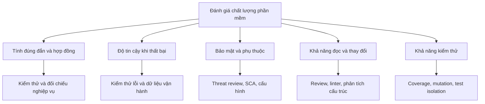
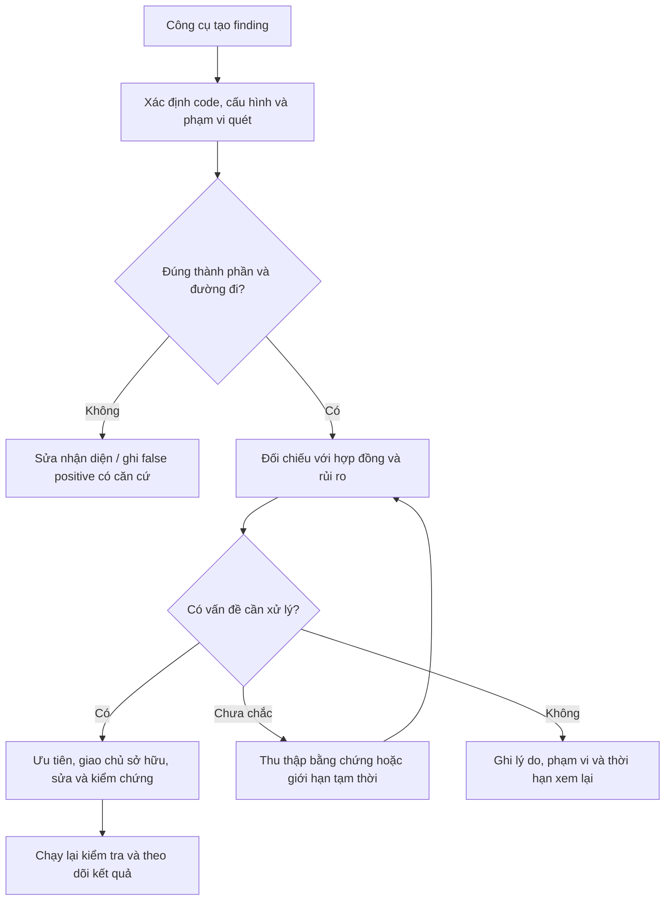

# Không suy ra chất lượng từ số lượng cảnh báo riêng lẻ

> **Chương:** Chỉ số chất lượng  
> **Học phần:** CODE_QUALITY_FUNDAMENTALS — Hiểu những thuộc tính quyết định mã nguồn có đáng tin cậy, dễ hiểu và dễ thay đổi hay không.

Một dashboard kiểm tra mã hiển thị “120 cảnh báo”. Nhóm sửa một số quy tắc, chạy lại và chỉ còn “45 cảnh báo”. Có phải chất lượng mã đã tăng tương ứng? **Không thể kết luận chỉ từ hai con số đó.** Phạm vi quét có thể đã bị thu hẹp, bộ quy tắc đã đổi, một số cảnh báo có thể bị ẩn, hoặc các cảnh báo nhỏ được xử lý trong khi một lỗi phân quyền nghiêm trọng vẫn tồn tại.

Chiều ngược lại cũng có thể xảy ra: sau khi thêm công cụ phân tích, số cảnh báo tăng từ 15 lên 80 vì công cụ mới phát hiện những vấn đề trước đó chưa được nhìn thấy. **Khả năng quan sát tốt hơn không tự động đồng nghĩa mã vừa trở nên tệ hơn.**

Trong quản lý chất lượng phần mềm, số lượng cảnh báo (*warning count*) là **một tín hiệu từ quá trình kiểm tra**, không phải phép đo đầy đủ của chất lượng. Nó có giá trị nếu được đặt trong ngữ cảnh **phạm vi, loại lỗi, độ tin cậy của phát hiện, mức độ ảnh hưởng, trạng thái xử lý và những bằng chứng khác**.

Mục tiêu bài học là xây dựng cách đọc chỉ số có trách nhiệm: biết **số đếm nói được gì, chưa nói được gì, điều gì cần điều tra và cách kết hợp nó với bằng chứng về tính đúng đắn, độ tin cậy, bảo mật và khả năng thay đổi**.

Sau bài học, bạn có thể:

- Giải thích vì sao nhiều hay ít cảnh báo chưa đủ để đánh giá chất lượng mã.
- Phân biệt cảnh báo về phong cách, khả năng bảo trì, lỗi tiềm tàng, bảo mật và phụ thuộc.
- So sánh kết quả quét qua các lần build khi **phạm vi và cấu hình** đã được xác định.
- Ưu tiên xử lý theo **rủi ro và bằng chứng**, không theo số lượng đơn thuần.
- Thiết kế quality gate và bảng theo dõi hữu ích, có quy tắc xử lý false positive và ngoại lệ rõ ràng.

## 1. “Cảnh báo” là gì và vì sao nó không đồng nghĩa “lỗi đã xảy ra”?

Một **cảnh báo** là thông tin công cụ hoặc quy trình kiểm tra tạo ra khi phát hiện một mẫu, một điều kiện hoặc một dấu hiệu cần chú ý. Nó có thể chỉ ra lỗi rất rõ, một nguy cơ cần xác minh, một vi phạm quy ước hoặc một vấn đề từ thành phần bên ngoài.

| Nguồn cảnh báo | Ví dụ | Điều cảnh báo thể hiện | Điều chưa thể kết luận |
| --- | --- | --- | --- |
| Formatter/linter | Tên biến hoặc cách đặt dấu ngoặc không theo chuẩn nhóm | Mã chưa theo quy ước được chọn | Chương trình trả kết quả sai |
| Static analyzer | Có nhánh có thể dereference `null` | Tồn tại đường thực thi đáng xem xét | Đường đó chắc chắn xảy ra trong mọi ngữ cảnh |
| SCA/dependency scanner | Một phiên bản thư viện khớp advisory | Có vấn đề đã biết cần xác minh phạm vi ảnh hưởng | Ứng dụng chắc chắn khai thác được |
| Kiểm tra API/schema | DTO thiếu trường hoặc dùng kiểu khác hợp đồng | Có khả năng không tương thích giao tiếp | Mọi client đang hỏng |
| Kiểm tra cấu hình | Endpoint có cấu hình đáng nghi | Có bề mặt rủi ro cần điều tra | Đã xảy ra sự cố bảo mật |
| Bộ kiểm thử | Một assertion thất bại | Hành vi đã quan sát không khớp kỳ vọng của test | Nguyên nhân chắc chắn nằm trong một dòng mã cụ thể |

Đừng đánh đồng **warning**, **finding**, **defect**, **incident** và **risk**:

- *Warning/finding*: tín hiệu được ghi nhận, có thể cần review.
- *Defect*: sai sót được xác minh so với yêu cầu hoặc hợp đồng.
- *Incident*: vấn đề thực tế đã gây ảnh hưởng hoặc làm gián đoạn hệ thống.
- *Risk*: khả năng và hậu quả của một sự kiện không mong muốn, có thể tồn tại trước khi có defect hoặc incident được xác nhận.

Một cảnh báo có thể dẫn tới việc xác minh một defect, nhưng quá trình xác minh là **một bước riêng**. Ngược lại, một defect có thể không tạo bất kỳ cảnh báo tự động nào.

## 2. Chất lượng mã có nhiều chiều, còn số cảnh báo chỉ nhìn qua một lăng kính

Chất lượng mã liên quan đến nhiều khả năng: **đúng theo hợp đồng, hoạt động đáng tin cậy, dễ đọc, dễ kiểm thử, dễ thay đổi, phù hợp giới hạn tài nguyên và có kiểm soát bảo mật**. Mỗi công cụ kiểm tra chỉ quan sát được một phần trong số đó.



Các nhánh này bổ sung cho nhau; không có nhánh nào là một chứng nhận chất lượng toàn diện. Chẳng hạn:

1. Một phương thức tính tiền có thể đạt chuẩn formatter nhưng sai đúng tại giá trị ngưỡng.
2. Một lớp chứa vài cảnh báo tên biến có thể vẫn đáp ứng đầy đủ hợp đồng nghiệp vụ.
3. Một bộ test đạt 100% line coverage vẫn có thể thiếu assertion để phát hiện sai phép tính.
4. Một scanner dependency không thấy advisory không chứng minh mọi thư viện và đường tích hợp an toàn.
5. Một hệ thống có code sạch vẫn có thể thất bại khi cơ sở dữ liệu không khả dụng vì cách xử lý lỗi sai.

Vì thế, câu hỏi “còn bao nhiêu cảnh báo?” chỉ là điểm khởi đầu. Cần hỏi tiếp: **những cảnh báo đó thuộc thuộc tính chất lượng nào và còn lỗ hổng quan sát nào ngoài phạm vi công cụ?**

## 3. Bảy lý do số lượng cảnh báo riêng lẻ dễ gây hiểu lầm

### 3.1. Mức độ nghiêm trọng không đồng đều

Một cảnh báo về khoảng trắng và một cảnh báo về khả năng bỏ qua kiểm tra quyền không có cùng tác động. Đếm cả hai là “1” rồi cộng lại sẽ làm mất thông tin quan trọng.

Đừng chỉ dựa vào nhãn `HIGH`, `MEDIUM` hoặc `LOW` của công cụ: nhãn này được định nghĩa theo **loại rule và mô hình đánh giá của chính công cụ**, không tự chuyển thành mức ảnh hưởng của sản phẩm. Cần xét dữ liệu, người dùng và đường khai thác thực tế.

### 3.2. Một lỗi có thể tạo nhiều cảnh báo

Một nhánh kiểm tra `null` sai có thể được nhiều rule hoặc nhiều công cụ báo. Một thư viện có thể được nhiều module sử dụng và xuất hiện ở nhiều kết quả scan. Cộng tất cả sẽ đếm **lượt phát hiện**, không chắc là **số lỗi độc lập**.

Ngược lại, một cảnh báo duy nhất ở hàm dùng chung có thể tác động tới hàng chục luồng nghiệp vụ.

### 3.3. Công cụ có thể báo sai hoặc bỏ sót

*False positive* là phát hiện không tương ứng với vấn đề thực tế trong phạm vi hợp đồng đã đánh giá. *False negative* là vấn đề có thật nhưng công cụ không phát hiện. Cả hai có thể xảy ra do hạn chế phân tích, dữ liệu không đầy đủ, cấu hình hoặc điều kiện runtime.

**0 cảnh báo không đồng nghĩa 0 lỗi.** Nó chỉ cho biết công cụ đã không tạo cảnh báo trong **phạm vi, cấu hình và dữ liệu** của lần chạy đó.

### 3.4. Phạm vi quét có thể thay đổi

Nếu lần đầu scan toàn bộ module, lần sau chỉ scan thư mục `src/main/java` hoặc loại khỏi phạm vi các file phức tạp, số cảnh báo giảm mà **mã có thể không hề tốt hơn**.

Quy mô cũng quan trọng: 20 finding trong 2.000 dòng mã và 20 finding trong 100.000 dòng là hai ngữ cảnh khác nhau. Tuy nhiên, chia cảnh báo cho số dòng mã cũng chỉ tạo **một tỷ lệ tham khảo**, chưa đo rủi ro hay chất lượng tổng thể.

### 3.5. Bộ rule hoặc phiên bản công cụ có thể đổi

Thêm rule, bật phân tích luồng dữ liệu, nâng scanner hoặc cập nhật cơ sở dữ liệu advisory có thể làm số cảnh báo tăng **dù mã không đổi**. Tắt rule hay đổi ngưỡng lọc có thể làm số cảnh báo giảm.

Khi so sánh các lần đo, cần lưu **phiên bản công cụ, ruleset, mức độ bật/tắt, scope và dữ liệu đầu vào**.

### 3.6. Cảnh báo cũ và cảnh báo mới không giống nhau về quản lý

Một codebase lâu năm có thể chứa backlog đã được đánh giá và có kế hoạch sửa, trong khi một pull request mới đưa vào một lỗi nguy hiểm. Nếu chỉ nhìn tổng số, lỗi mới có thể bị chìm giữa các cảnh báo cũ.

Đếm **new findings**, **resolved findings**, **open findings**, trạng thái đã triage và thời gian tồn đọng giúp hiểu diễn biến hơn một tổng duy nhất.

### 3.7. Việc ẩn cảnh báo có thể cải thiện điểm số nhưng không cải thiện sản phẩm

Tắt rule, thêm suppression diện rộng, bỏ hẳn đường quét hoặc chuyển lỗi thành “không cần kiểm tra” sẽ làm dashboard đẹp hơn. Nếu không có bằng chứng về việc rủi ro đã được xử lý, **số đếm giảm chỉ thể hiện thay đổi trong cơ chế quan sát**.

Đây là lý do chỉ số phải được thiết kế sao cho khuyến khích **giải quyết vấn đề**, không khuyến khích **làm mất dấu vấn đề**.

## 4. Ví dụ: ít cảnh báo hơn nhưng rủi ro có thể cao hơn

Giả sử hai phiên bản của một dịch vụ bán hàng được kiểm tra với cùng phạm vi và quy tắc, cho kết quả **hoàn toàn minh họa**:

| Loại finding | Bản A | Bản B |
| --- | ---: | ---: |
| Vi phạm định dạng/tên gọi | 60 | 8 |
| Dấu hiệu khó bảo trì | 15 | 6 |
| Lỗi đúng đắn tiềm tàng cần review | 2 | 3 |
| Cảnh báo bảo mật cần ưu tiên đánh giá | 0 | 1 |
| **Tổng** | **77** | **18** |

Bản B có số cảnh báo **thấp hơn 59**. Nhưng một finding bảo mật ở đường truy cập dữ liệu khách hàng, nếu được xác nhận, có thể nghiêm trọng hơn hàng chục cảnh báo định dạng trong bản A. Ngoài ra, số dấu hiệu lỗi đúng đắn còn tăng từ 2 lên 3.

Ta có thể nói chắc rằng **số finding trong báo cáo này giảm**. Chưa đủ để nói chắc rằng **chất lượng hoặc rủi ro tổng thể của bản B tốt hơn**.

### 4.1. Ngược lại, nhiều cảnh báo hơn có thể do quan sát tốt hơn

Giả sử từ bản C sang bản D, nhóm bật thêm SCA cho phụ thuộc bắc cầu. Số finding tăng từ 12 lên 35, dù không thêm dependency mới. Khi đó, phép đo mới có thể đang phát hiện **vấn đề trước đây nằm ngoài tầm nhìn**.

Đánh giá hợp lý cần phân biệt:

```text
Số cảnh báo thay đổi
   = ảnh hưởng của thay đổi mã / phụ thuộc
   + ảnh hưởng của phạm vi và cấu hình kiểm tra
   + ảnh hưởng của dữ liệu và phiên bản công cụ
   + ảnh hưởng của cách nhóm phân loại/ẩn finding
```

Biểu thức trên là **sơ đồ tư duy**, không phải công thức số học tách được chính xác từng thành phần. Nó nhắc rằng nguyên nhân thay đổi số đếm có thể đến từ **hệ thống đo** chứ không chỉ từ **hệ thống được đo**.

## 5. So sánh theo thời gian: phải giữ được ngữ cảnh đo

Để nhận xét “tình trạng cảnh báo đã tốt lên”, hãy lưu lại điều kiện của từng lần quét:

| Metadata cần có | Vì sao quan trọng? |
| --- | --- |
| Commit, nhánh, bản build và artifact | Biết chính xác đối tượng được đo |
| Module, đường dẫn và loại mã trong scope | Tránh so số đếm của hai tập mã khác nhau |
| Công cụ và phiên bản | Nhận biết thay đổi khả năng phân tích |
| Ruleset và cấu hình bật/tắt | Nhận biết thay đổi số loại phát hiện |
| Cơ sở advisory / thời điểm cập nhật | Quan trọng với scan dependency |
| Số finding theo loại, mức nghiêm trọng, trạng thái | Không làm mất bối cảnh khi cộng tổng |
| Quy tắc suppression và baseline | Biết cảnh báo giảm vì sửa hay vì bị ẩn |
| Kết quả kiểm thử và dữ liệu rủi ro liên quan | Bổ sung bằng chứng ngoài static findings |

### 5.1. Ví dụ số liệu tỷ lệ có thể gây đảo chiều nhận định

Giả sử cùng một bộ rule cho hai scope:

| Lần đo | Tổng cảnh báo | Số dòng mã thuộc scope (LOC) | Cảnh báo trên 1.000 LOC |
| --- | ---: | ---: | ---: |
| A | 40 | 20.000 | 2,0 |
| B | 25 | 10.000 | 2,5 |

Số đếm giảm từ 40 xuống 25, nhưng tỷ lệ lại tăng từ 2,0 lên 2,5 cảnh báo/1.000 LOC:

```text
A: 40 / 20.000 * 1.000 = 2,0
B: 25 / 10.000 * 1.000 = 2,5
```

Tuy nhiên, **không được kết luận B chắc chắn tệ hơn** chỉ vì mật độ tăng. Nếu B bỏ một module có cấu trúc rất khác, phép chia LOC không làm hai tập mã trở nên tương đương. LOC cũng không phản ánh độ phức tạp hay mức tác động của từng cảnh báo.

**Bài học:** phép chuẩn hóa bằng quy mô giúp đặt thêm câu hỏi; nó không loại bỏ nhu cầu so sánh đúng phạm vi và đúng ngữ nghĩa.

### 5.2. So sánh “phát hiện mới” với baseline có thể hữu ích hơn

Với một codebase có backlog lớn, nhóm có thể:

1. **Ghi nhận baseline** đã review ở thời điểm bắt đầu.
2. Tập trung chặn **finding mới có mức rủi ro không chấp nhận được**.
3. Lập kế hoạch xử lý backlog theo khu vực rủi ro và nguồn lực.
4. Không cho phép baseline biến thành **danh sách bỏ qua vĩnh viễn**.

Một backlog giảm chậm chưa nhất thiết chứng minh chất lượng phát triển mới kém; ngược lại, backlog giữ nguyên không bảo đảm không có lỗi mới. Cần theo dõi cả **dòng vào, dòng ra và trạng thái đánh giá**.

## 6. Ví dụ Java: không có cảnh báo style vẫn có thể sai nghiệp vụ

Giả sử quy tắc: một đơn hàng chỉ được giao đi nếu **đã thanh toán**, **chưa hủy**, và **người thao tác là chủ đơn**. Để thấy rõ giới hạn của số cảnh báo, xét một lớp Java được định dạng gọn gàng:

```java
// ShippingPermission.java
import java.util.Objects;

public final class ShippingPermission {
    private ShippingPermission() {
    }

    public static final class OrderSnapshot {
        private final boolean paid;
        private final boolean cancelled;
        private final String ownerId;

        public OrderSnapshot(boolean paid, boolean cancelled, String ownerId) {
            this.paid = paid;
            this.cancelled = cancelled;
            this.ownerId = Objects.requireNonNull(ownerId, "ownerId");
        }

        public boolean isPaid() {
            return paid;
        }

        public boolean isCancelled() {
            return cancelled;
        }

        public String ownerId() {
            return ownerId;
        }
    }

    public static boolean canShip(OrderSnapshot order, String requesterId) {
        if (order == null || requesterId == null) {
            return false;
        }

        return (order.isPaid() || !order.isCancelled())
                && requesterId.equals(order.ownerId());
    }
}
```

Mã có tên tương đối rõ, không cần dùng nhiều nhánh lồng nhau, và có thể vượt qua một bộ kiểm tra định dạng. Nhưng biểu thức:

```java
order.isPaid() || !order.isCancelled()
```

cho phép một đơn **chưa thanh toán nhưng chưa hủy**, hoặc **đã thanh toán nhưng đã hủy**, được xử lý nếu đúng chủ đơn. Hợp đồng yêu cầu **cả hai điều kiện** nên toán tử đúng là `&&`.

Đây là **lỗi đúng đắn có hậu quả nghiệp vụ**, thậm chí có thể ảnh hưởng kiểm soát quy trình. Không thể suy ra lỗi có hay không từ số lượng cảnh báo style; một số static analyzer có thể nhận diện mẫu đáng ngờ, nhưng không công cụ nào tự hiểu mọi đặc tả nghiệp vụ.

### 6.1. Test theo hợp đồng phát hiện điều mà số đếm không nói

```java
import static org.junit.jupiter.api.Assertions.assertFalse;
import static org.junit.jupiter.api.Assertions.assertTrue;

import org.junit.jupiter.api.Test;

class ShippingPermissionTest {
    @Test
    void paidActiveOrderOwnedByRequesterCanShip() {
        ShippingPermission.OrderSnapshot order =
                new ShippingPermission.OrderSnapshot(true, false, "customer-1");

        assertTrue(ShippingPermission.canShip(order, "customer-1"));
    }

    @Test
    void unpaidOrderCannotShipEvenWhenNotCancelled() {
        ShippingPermission.OrderSnapshot order =
                new ShippingPermission.OrderSnapshot(false, false, "customer-1");

        assertFalse(ShippingPermission.canShip(order, "customer-1"));
    }

    @Test
    void cancelledOrderCannotShipEvenWhenPaid() {
        ShippingPermission.OrderSnapshot order =
                new ShippingPermission.OrderSnapshot(true, true, "customer-1");

        assertFalse(ShippingPermission.canShip(order, "customer-1"));
    }

    @Test
    void differentRequesterCannotShip() {
        ShippingPermission.OrderSnapshot order =
                new ShippingPermission.OrderSnapshot(true, false, "customer-1");

        assertFalse(ShippingPermission.canShip(order, "customer-2"));
    }

    @Test
    void nullInputDoesNotGrantPermission() {
        assertFalse(ShippingPermission.canShip(null, "customer-1"));
    }
}
```

Với phiên bản sai ở trên, hai test về **đơn chưa thanh toán** và **đơn đã hủy** sẽ thất bại; đó là bằng chứng cụ thể hơn một dashboard không có cảnh báo style.

Sửa biểu thức theo hợp đồng:

```java
return order.isPaid()
        && !order.isCancelled()
        && requesterId.equals(order.ownerId());
```

Bản sửa thay đổi hành vi và cần được xem là **bug fix**, không phải đổi định dạng. Các test minh họa giúp bảo vệ những trường hợp đã nêu; chúng không tự chứng minh toàn bộ quy trình giao hàng an toàn trong hệ thống thật, nơi còn có dữ liệu lưu trữ, xác thực, đồng thời và tác dụng phụ.

### 6.2. Ngược lại, cảnh báo style chưa chắc là sai nghiệp vụ

```java
// Ví dụ dễ nhận một số cảnh báo về quy ước:
long f(long n) {
    if (n >= 500000L) return 0L;
    return 30000L;
}
```

Mã có thể bị nhắc về tên `f`, tên `n`, hằng số “ma thuật”, cách dùng dấu ngoặc hoặc format. Nếu hợp đồng của phép tính đúng là “miễn phí từ 500.000 VND, phí 30.000 VND dưới ngưỡng”, riêng biểu thức điều kiện ở đây **có thể đúng cho đầu vào hợp lệ** dù khó đọc và chưa kiểm tra đầu vào âm.

Cần đánh giá **hợp đồng cụ thể** để xác định thiếu kiểm tra đầu vào âm có phải là lỗi hay không. Việc chỉnh quy ước vẫn có ích cho khả năng bảo trì, nhưng không nên tự tuyên bố mọi cảnh báo là bug nghiêm trọng.

## 7. Phân loại finding để quyết định ưu tiên hợp lý

Một câu hỏi tốt hơn “cảnh báo nào nhiều nhất?” là “**cảnh báo nào có khả năng gây sai khác quan trọng nhất và bằng chứng về nó mạnh đến đâu?**”

### 7.1. Tách mức độ ảnh hưởng khỏi độ tin cậy của phát hiện

| Yếu tố | Câu hỏi |
| --- | --- |
| **Ảnh hưởng** (*impact*) | Nếu vấn đề xảy ra, hậu quả tới dữ liệu, tiền, quyền truy cập, độ sẵn sàng hoặc người dùng là gì? |
| **Khả năng xảy ra/điều kiện kích hoạt** | Đường mã có được sử dụng thường xuyên, tiếp xúc với đầu vào không tin cậy hay điều kiện đặc biệt không? |
| **Độ tin cậy của finding** (*confidence*) | Công cụ có bằng chứng cụ thể về đường thực thi hay chỉ nhận diện mẫu có thể đúng/sai? |
| **Phạm vi ảnh hưởng** (*blast radius*) | Lỗi nằm ở một helper cục bộ hay một thư viện/luồng dùng chung? |
| **Khả năng phát hiện và phục hồi** | Có kiểm thử, log, cảnh báo vận hành, cơ chế rollback hoặc đối soát không? |
| **Chi phí và rủi ro sửa** | Có bản vá tương thích? Sửa ngay có thể tạo regression nào? |

Một finding có điểm tool thấp vẫn có thể cần ưu tiên nếu nó nằm trên đường thu tiền hoặc kiểm soát truy cập. Một finding gắn nhãn “high” cũng cần xác minh danh tính thành phần, phiên bản và đường khai thác.

### 7.2. Ví dụ ưu tiên trong cùng một pull request

| Finding giả định | Mức ưu tiên để điều tra | Lý do |
| --- | --- | --- |
| Điều kiện phân quyền sai, người dùng khác có thể xem đơn | **Rất cao** | Có thể gây truy cập trái phép vào dữ liệu |
| Bộ giải mã tệp tải lên khớp advisory đã biết | **Cao, cần xác minh** | Đầu vào không tin cậy và đường sử dụng có ý nghĩa |
| Ngoại lệ database bị bắt rồi trả danh sách rỗng | **Cao hoặc trung bình tùy tác động** | Che thất bại bằng kết quả hợp lệ |
| Trùng logic tính phí giữa checkout và báo cáo | **Cần xem hợp đồng** | Có thể lệch chính sách, nhưng dữ liệu lịch sử có thể có lý do khác |
| 30 cảnh báo format do chưa chạy formatter | **Thấp về rủi ro nghiệp vụ riêng lẻ** | Có thể sửa tự động, có giá trị nhất quán |

Các mức ưu tiên ở bảng là định hướng minh họa. Không phải một hệ thống chấm điểm hay chính sách áp dụng cho mọi sản phẩm; kết luận cuối phải dựa trên ngữ cảnh và chứng cứ cụ thể.

## 8. Triage: từ số cảnh báo sang danh sách vấn đề có thể hành động

Một quy trình triage giúp tránh hai cực đoan: “đã thấy warning thì tất cả đều lỗi” và “scanner hay báo nhiễu nên bỏ qua hết”.



Một bản ghi finding có thể chứa:

```yaml
# MẪU MINH HỌA, không phải định dạng bắt buộc của công cụ nào.
id: CHECK-042
source: static-analysis
rule: potential-null-dereference
scope: checkout-service/src/main
component: OrderTotalsService
detectedIn: build-184
status: confirmed
impact: payment-total-can-fail
owner: checkout-team
action: validate-input-before-access
verification: boundary-test-and-re-scan
```

Các tên và ID chỉ phục vụ ví dụ. Hồ sơ thực tế cần phù hợp quy trình tổ chức và tránh đưa thông tin nhạy cảm không cần thiết vào dashboard công khai.

### Các trạng thái nên phân biệt

| Trạng thái | Ý nghĩa |
| --- | --- |
| **Mới phát hiện** | Có tín hiệu cần review, chưa đủ bằng chứng |
| **Đã xác nhận** | Vấn đề tồn tại theo hợp đồng hoặc rủi ro đã đánh giá |
| **Không bị ảnh hưởng có căn cứ** | Có bằng chứng rằng điều kiện gây lỗi không áp dụng trong phạm vi nhất định |
| **False positive** | Phát hiện sai về đối tượng/đường đi theo bằng chứng đã kiểm tra |
| **Đang xử lý** | Có chủ sở hữu và hành động cụ thể |
| **Đã xử lý và xác minh** | Mã/phụ thuộc/cấu hình đã sửa, kiểm tra lại theo phạm vi |
| **Ngoại lệ được chấp nhận** | Có người duyệt, lý do, thời hạn và điều kiện đánh giá lại |

Đừng cộng tất cả các trạng thái trên thành “lỗi còn tồn tại”. Việc phân loại đúng giúp dashboard phản ánh **tình trạng quản lý rủi ro**, không chỉ hiển thị số dòng trong report.

## 9. Kết hợp cảnh báo với các bằng chứng khác

Không có chỉ số nào thay thế tất cả. Cần chọn những chỉ số **đo được câu hỏi cần ra quyết định**.

| Loại bằng chứng | Cho biết gì | Giới hạn |
| --- | --- | --- |
| Cảnh báo static analysis | Mẫu mã hoặc đường lỗi tiềm tàng đã phát hiện | Có thể báo sai hoặc bỏ sót nghiệp vụ |
| Cảnh báo dependency/SCA | Vấn đề đã biết ở phiên bản thành phần trong scope | Không chứng minh khả năng khai thác trong ứng dụng |
| Line/branch coverage | Những dòng và nhánh được test đi qua | Không cho biết assertion có mạnh không |
| Mutation testing | Các biến đổi lỗi được chọn có bị test phát hiện không | Bị giới hạn bởi loại mutant và equivalent mutant |
| Test pass/fail | Hành vi có khớp kỳ vọng trong ca đã chạy không | Không bao phủ những tình huống chưa được mô tả |
| Review thiết kế/API | Ranh giới trách nhiệm, hợp đồng và thay đổi có phù hợp không | Cần kiến thức bối cảnh và bằng chứng từ mã |
| Dữ liệu lỗi production | Những vấn đề xảy ra trong vận hành | Phụ thuộc khả năng quan sát, lưu lượng và thời gian |
| Chỉ số bảo trì | Thời gian xử lý lỗi, độ phức tạp, phạm vi thay đổi | Có thể bị ảnh hưởng bởi tổ chức và độ khó nghiệp vụ |

### 9.1. Không tạo “điểm chất lượng tổng hợp” thiếu giải thích

Một công thức kiểu:

```text
qualityScore = 100 - warningCount
```

không có cơ sở để so sánh hai module khác quy mô hoặc rủi ro. Nó còn khiến người dùng có động lực loại bớt cảnh báo khỏi cấu hình hơn là giải quyết vấn đề.

Ngay cả nếu gán trọng số như “high = 10 điểm, low = 1 điểm”, điểm tổng cũng dễ gây hiểu lầm: **một lỗi phân quyền duy nhất không thể được coi là được “bù” bởi việc sửa nhiều lỗi format**. Nếu dùng điểm tổng để tham khảo, cần công bố cách tính, các giới hạn và những điều kiện **không được cộng bù**, đồng thời giữ thông tin thành phần để người xem có thể kiểm tra.

### 9.2. Chọn bằng chứng theo loại rủi ro

Với tính tiền: test ngưỡng, phép tính, tràn số và đối soát.  
Với phân quyền: kiểm thử âm tính, xác thực danh tính và kiểm soát ranh giới.  
Với thư viện xử lý tệp: SCA, dữ liệu lỗi, giới hạn tài nguyên và kiểm thử tích hợp.  
Với độ khó bảo trì: xem luồng xử lý, phụ thuộc, testability, lịch sử thay đổi và review của người hiểu module.

**Số cảnh báo đóng góp vào bức tranh**, không thay thế việc xác định bức tranh cần thể hiện điều gì.

## 10. Thiết kế quality gate trong CI có trách nhiệm

Một cổng kiểm soát chất lượng (*quality gate*) giúp ngăn những thay đổi có rủi ro không chấp nhận được, nhưng nếu chỉ đặt “warning count phải bằng 0” có thể tạo ra hai vấn đề:

- Chặn cả những cảnh báo định dạng ít tác động trong khi lỗi nghiệp vụ không có cảnh báo vẫn lọt.
- Khuyến khích tắt rule hoặc tăng suppression để đạt mục tiêu số.

Một quality gate hợp lý có thể dùng **nhiều điều kiện độc lập**:

1. Build và những bài kiểm thử bắt buộc phải đạt.
2. Thay đổi API/hợp đồng quan trọng phải được kiểm tra tương thích phù hợp.
3. Finding mới liên quan bảo mật hoặc dữ liệu nhạy cảm phải được triage theo chính sách rủi ro.
4. Quy tắc formatter/linters đã thống nhất phải được thực thi ổn định và dễ sửa bằng công cụ.
5. Không được thêm suppression không có lý do hoặc mở rộng vùng không scan mà không review.
6. Scanner lỗi hoặc thiếu dữ liệu không được báo giả thành “0 finding”; pipeline phải ghi rõ **chưa kiểm tra được**.

### Ví dụ chính sách minh họa

| Tín hiệu CI | Hành động mẫu | Ý nghĩa |
| --- | --- | --- |
| Unit test trọng yếu thất bại | Chặn merge | Hành vi không khớp kỳ vọng đang kiểm tra |
| Có finding bảo mật mới ở đường nhạy cảm | Chặn hoặc yêu cầu phê duyệt rủi ro theo quy trình | Cần xác minh mức ảnh hưởng trước phát hành |
| Một số cảnh báo formatter có thể tự sửa | Yêu cầu chạy formatter | Giữ tính nhất quán với chi phí thấp |
| Backlog cảnh báo bảo trì cũ chưa được giải quyết hết | Theo dõi kế hoạch giảm dần | Không bỏ qua, nhưng tránh khiến mọi PR đều bất khả thi |
| Công cụ SCA không cập nhật được advisory | Ghi scan không hoàn chỉnh; xử lý theo chính sách | Không giả định không có rủi ro |
| Có suppression mới không được giải thích | Yêu cầu review | Tránh làm số đếm đẹp giả |

Đây là ví dụ quyết định kỹ thuật, **không phải ngưỡng mặc định bắt buộc**. Độ nghiêm ngặt của gate phải phù hợp loại sản phẩm, khả năng tác động và những yêu cầu kiểm soát thực tế.

### 10.1. Bảo vệ “new code” mà không bỏ quên nợ kỹ thuật cũ

Một chiến lược hữu ích là:

- Không cho phép thêm **finding mới không được chấp nhận** trong mã đang thay đổi.
- Giữ backlog tồn tại với chủ sở hữu và ưu tiên theo rủi ro.
- Chọn những khu vực rủi ro cao để cải thiện có chủ đích, thay vì buộc mọi thành viên sửa toàn bộ warning của codebase trước một thay đổi nhỏ.
- Định kỳ đánh giá backlog và suppression hết hạn.

Chiến lược này có thể giảm rào cản phát triển nhưng không được dùng làm lý do để **tạm hoãn vĩnh viễn lỗi nghiêm trọng đã biết**.

## 11. False positive, suppression và “điểm số đẹp”

Không phải mọi cảnh báo đều phải sửa mã. Một rule có thể đưa ra kết quả không phù hợp do thiếu ngữ cảnh hoặc cách phân tích. Nhưng cách xử lý nên minh bạch.

Một suppression có trách nhiệm cần nêu:

| Nội dung | Ví dụ câu hỏi |
| --- | --- |
| Finding cụ thể | Rule nào, ở đoạn mã hoặc component nào? |
| Lý do | Vì sao đây là false positive, không bị ảnh hưởng hoặc rủi ro được chấp nhận? |
| Bằng chứng | Có test, log, đồ thị phụ thuộc, hợp đồng hay phân tích đường thực thi không? |
| Phạm vi | Chỉ suppress vị trí cần thiết hay đang tắt cả rule? |
| Người chịu trách nhiệm | Ai duyệt và ai theo dõi? |
| Thời hạn hoặc điều kiện xem lại | Khi nào phải đánh giá lại nếu mã, dependency hoặc môi trường đổi? |

Ví dụ một bình luận giả định:

```java
// Scanner rule XYZ là false positive tại đây vì input đã được
// validate trong constructor bất biến; xem test constructorRejectsNull().
// Chỉ áp dụng ngoại lệ tại vị trí này, review lại nếu hợp đồng thay đổi.
```

Đoạn trên là **mẫu thông tin giải thích**, không phải annotation hay cú pháp suppression của một công cụ cụ thể. Trong dự án thật, dùng đúng cơ chế suppress có phạm vi tối thiểu mà công cụ hỗ trợ.

Nếu nhiều cảnh báo giống nhau xuất hiện vì công cụ không hiểu mô hình mã, nên xem lại cấu hình rule, khả năng phân tích hoặc cách thiết kế API. Nhưng **tắt toàn bộ nhóm rule để đạt 0 warning** không phải bằng chứng rằng vấn đề đã biến mất.

## 12. Sai lầm khi dùng số cảnh báo làm mục tiêu thành tích

Khi một chỉ số trở thành mục tiêu duy nhất, người chịu đo lường có thể vô tình tối ưu **hình thức số liệu** thay vì thuộc tính chất lượng cần quan tâm.

Ví dụ:

- Chuyển mã khó sang thư mục không được scan.
- Thay rule nghiêm ngặt bằng rule ít phát hiện hơn.
- Dùng suppression diện rộng.
- Chọn những cảnh báo dễ xử lý nhất để làm tổng giảm nhanh, bỏ qua vấn đề tác động cao.
- Gộp mọi lỗi thành một khối helper lớn khiến scanner bớt báo một số rule nhưng code khó hiểu và khó kiểm thử hơn.
- Ngừng mở rộng công cụ quét vì sợ “cảnh báo tăng”.

Những hành vi này có thể xảy ra ngay cả khi mọi người đều muốn cải thiện chất lượng, bởi mục tiêu “ít cảnh báo nhất” không phản ánh mục tiêu thực **giảm sai sót và giảm rủi ro**.

### 12.1. Chỉ số tốt phải hỗ trợ quyết định cụ thể

Thay vì hỏi “đã giảm được bao nhiêu warning?”, hỏi:

1. Finding mới nào đã được xác nhận và xử lý?
2. Những rủi ro tác động lớn còn mở nằm ở đâu, ai sở hữu?
3. Các báo cáo có cùng phạm vi và cấu hình để so sánh không?
4. Bộ test có thể phát hiện loại lỗi quan trọng nào?
5. Có bằng chứng sản phẩm chạy đúng khi lỗi hệ thống và đầu vào bất thường không?
6. Những suppression đã được xem lại hay đang tích tụ?

Số cảnh báo vẫn hữu ích cho việc **phát hiện xu hướng và phân bổ công sức**, nếu nó luôn đi kèm thông tin giúp tránh kết luận quá mức.

## 13. Đọc một dashboard chất lượng có ý nghĩa

Một dashboard tốt không cần nhiều hiệu ứng. Nó cần giúp người xem thấy **phạm vi, trạng thái và việc phải làm tiếp theo**.

Ví dụ báo cáo **giả định** cho một module:

| Nhóm tín hiệu | Kết quả minh họa | Cách đọc có trách nhiệm |
| --- | --- | --- |
| Phạm vi | 18.000 LOC, runtime dependencies, Java main sources | Không bao gồm plugin build và integration environment |
| Static findings đang mở | 23 | Xem phân loại và độ tin cậy, không chỉ tổng |
| Finding mới trong PR | 2 | Cần xem mức ảnh hưởng trước merge |
| Finding đã xác nhận tác động cao | 1 | Có chủ sở hữu, phương án và kỳ xử lý |
| Finding đã đánh giá là false positive | 3 | Có bằng chứng và suppression đúng phạm vi |
| Unit tests | 418/418 đạt | Chưa suy ra các tình huống không test cũng đúng |
| Branch coverage | 78% | Có nhánh chưa được thực thi; chưa đo sức phát hiện của assertion |
| Mutation score của phần mã ưu tiên | 72% theo quy ước công cụ | Cần xem mutant sống sót và phạm vi |
| Finding dependency | 4 cần review | Cần xác minh đường sử dụng, phiên bản và bản vá |
| Scan plugin CI | Chưa có | Đây là **khoảng trống quan sát**, không phải “0 vấn đề” |

Từ bảng này, quyết định tiếp theo có thể là **xác minh finding có tác động cao**, review hai finding mới, và mở rộng kiểm tra plugin CI. Không nhất thiết nên dành toàn bộ thời gian để giảm 23 cảnh báo xuống 20 trước khi xử lý ba việc trên.

### 13.1. Khi thay đổi dashboard, phải ghi thay đổi phương pháp

Nếu sprint mới bật thêm rule phát hiện race condition, số cảnh báo tăng cần được chú thích “đã mở rộng rule”. Nếu thay bộ scanner, cần kiểm tra khả năng ánh xạ finding cũ/mới trước khi vẽ biểu đồ xu hướng. Nếu thu hẹp scope do tái cấu trúc module, phải điều chỉnh baseline hoặc báo rõ hai tập đo không tương đương.

Một biểu đồ đẹp nhưng không có chú thích phương pháp có thể dẫn đến quyết định sai, đặc biệt khi các nhóm bị đánh giá chỉ bằng tổng số cảnh báo.

## 14. Checklist review khi ai đó kết luận chất lượng từ số cảnh báo

Khi nghe câu “module này tốt vì chỉ có 3 warning” hoặc “bản mới kém vì có 40 warning”, hãy hỏi:

1. **Đang đo thuộc tính nào?** Style, maintainability, correctness, security hay dependency?
2. **Công cụ và ruleset là gì?** Những rule nào bị tắt hoặc thay đổi?
3. **Phạm vi có đủ và tương đương không?** Module, đường dẫn, runtime/test/build, file sinh?
4. **Báo cáo gắn với bản nào?** Commit, build, artifact, môi trường?
5. **Số đếm có bị lặp không?** Một lỗi có sinh nhiều finding?
6. **Mức tác động và độ tin cậy ra sao?** Có review từng finding quan trọng?
7. **Finding nào mới, tồn đọng, đã xử lý hoặc bị suppress?**
8. **Có false positive và false negative đã biết không?** Bằng chứng là gì?
9. **Kết quả kiểm thử và bằng chứng nghiệp vụ có nói gì khác không?**
10. **Việc giảm cảnh báo là do sửa mã hay đổi cách quan sát?**
11. **Rủi ro nào vẫn còn ở nơi công cụ chưa quét?**
12. **Hành động nào tạo ra cải thiện quan sát được cho người dùng hoặc người bảo trì?**

Nếu chưa trả lời được những câu hỏi quan trọng, hãy mô tả kết luận ở mức đúng với dữ liệu: **“Số cảnh báo của lần quét này giảm”**, không nâng nó thành **“chất lượng toàn hệ thống chắc chắn tốt hơn”**.

## 15. Bài tập thực hành

Hai nhóm báo cáo kết quả sau khi hoàn thành một đợt thay đổi. Các số liệu **hoàn toàn giả định**:

| Thông tin | Nhóm A — Module checkout | Nhóm B — Module báo cáo |
| --- | --- | --- |
| Cảnh báo static analysis | 12 | 65 |
| Trong đó cảnh báo format | 3 | 54 |
| Finding đúng đắn chưa được triage | 2 | 1 |
| Finding liên quan bảo mật | 1 | 0 |
| Độ phủ nhánh | 88% | 92% |
| Test đạt | 210/210 | 380/380 |
| Phạm vi scan | Chỉ `src/main/java` | `src/main/java` và phần mã sinh |
| Quét phụ thuộc bắc cầu | Chưa có | Có |
| Cảnh báo mới từ đợt thay đổi | 3 | 2 |

Nhóm A tuyên bố “checkout có ít cảnh báo hơn nên tốt hơn”. Nhóm B tuyên bố “báo cáo có coverage cao hơn nên test của chúng tôi chắc chắn mạnh hơn”.

Hãy thực hiện:

1. Chỉ ra **ít nhất bốn lý do** hai kết luận trên chưa đủ cơ sở.
2. Xác định những thông tin còn thiếu trước khi so sánh: quy mô, công cụ, ruleset, trạng thái triage, độ nghiêm trọng, ngữ cảnh dữ liệu và thời gian quét.
3. Giải thích vì sao một finding bảo mật ở checkout cần được xem xét riêng, dù tổng số warning của A thấp hơn.
4. Lập bảng phân loại **new / open / confirmed / false positive / suppressed / resolved** cho hai nhóm bằng các trạng thái giả định hợp lý, không được tự khẳng định các finding chưa triage là lỗi thật.
5. Đề xuất tối thiểu ba bằng chứng bổ sung cho checkout: kiểm thử giá trị biên tính tiền, kiểm thử phân quyền âm tính, kiểm thử thất bại của dependency hoặc dữ liệu thanh toán.
6. Đề xuất cách kiểm tra sức phát hiện của test ở module báo cáo thay vì chỉ nhìn 92% branch coverage.
7. Thiết kế một quality gate cho pull request có phân biệt **cảnh báo định dạng** với **finding mới có rủi ro cao**. Ngoại lệ cần ghi thông tin gì?
8. Nếu số cảnh báo của B giảm từ 65 xuống 20 sau khi loại phần mã sinh khỏi scan, bạn sẽ mô tả kết quả đó thế nào để không gây hiểu lầm?
9. Giả sử A bật quét dependency bắc cầu và phát hiện thêm 8 advisory mới dù code không đổi. Việc tăng số cảnh báo có chứng minh chất lượng A vừa giảm không? Nhóm cần hành động gì?
10. Chọn một câu kết luận ngắn cho báo cáo quản lý, vừa phản ánh những gì đã biết vừa nêu **khoảng trống bằng chứng** quan trọng nhất của mỗi nhóm.

**Gợi ý:** kết luận tốt không nhất thiết chọn A hoặc B là “nhóm có mã tốt hơn”. Nó phân biệt **số liệu đã quan sát**, **cách dữ liệu được tạo ra**, **rủi ro có thể ảnh hưởng người dùng** và **những kiểm tra còn thiếu**.

## Ghi nhớ

**Số lượng cảnh báo là một tín hiệu, không phải thước đo độc lập của chất lượng mã.** Muốn đọc đúng, phải biết công cụ đã kiểm tra gì, theo quy tắc nào, trên bản build nào và mức độ ảnh hưởng của từng finding. Hãy phân biệt số đếm với lỗi đã xác nhận; ưu tiên rủi ro theo hợp đồng và ngữ cảnh; theo dõi finding mới, backlog và suppression; kết hợp kiểm thử, review, dữ liệu vận hành và bằng chứng từ phụ thuộc bên ngoài. Chất lượng được cải thiện khi **hành vi đáng tin cậy hơn và rủi ro được kiểm soát tốt hơn**, không đơn thuần khi dashboard hiển thị một con số nhỏ.
