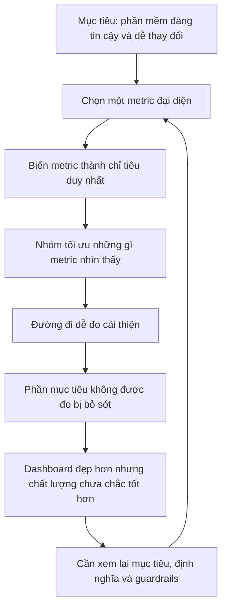
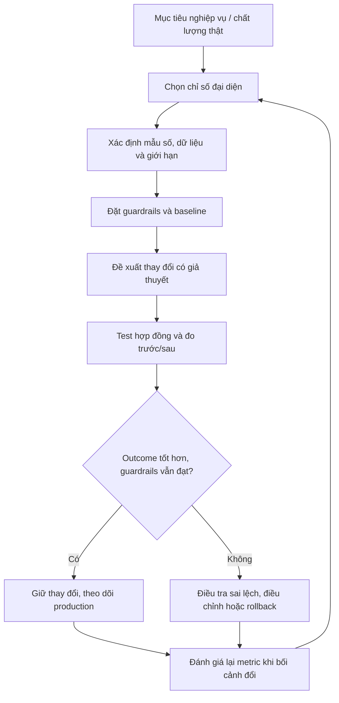

# Nguy cơ tối ưu chỉ số mà làm lệch mục tiêu thực tế

## 1. Khi một con số đẹp lên nhưng chất lượng thật đi xuống

Một nhóm phát triển có thể ăn mừng vì **test coverage** tăng từ 75% lên 95%, trong khi những lỗi thanh toán quan trọng vẫn lọt production. Một dịch vụ có thể báo “tỷ lệ thành công 99,9%” vì đã chuyển các lỗi database thành HTTP 200 với thông điệp “không có dữ liệu”. Một nhóm khác có thể giảm số cảnh báo của trình phân tích tĩnh bằng cách tắt rule thay vì sửa nguyên nhân.

Trong cả ba tình huống, **chỉ số đã cải thiện nhưng mục tiêu ban đầu có thể không được cải thiện, thậm chí bị tổn hại**.

Trong module `CODE_QUALITY_FUNDAMENTALS`, chúng ta tìm hiểu **những thuộc tính quyết định mã nguồn có đáng tin cậy, dễ hiểu và dễ thay đổi hay không**. Thuộc chương **Chỉ số chất lượng**, bài này phân tích nguy cơ **tối ưu chỉ số mà làm lệch mục tiêu thực tế**: làm sao nhận ra khi metric chỉ còn là mục tiêu bề mặt, cách ngăn động cơ sai lệch và cách thiết kế hệ thống đo lường giúp ra quyết định kỹ thuật tốt hơn.

Chủ đề không nhằm phủ nhận các chỉ số. Coverage, lỗi production, latency, thời gian review, độ phức tạp và cảnh báo bảo mật đều có ích **khi được định nghĩa rõ và đặt đúng ngữ cảnh**. Vấn đề phát sinh khi một con số đại diện cho mục tiêu rộng hơn nhưng dần được đối xử như chính mục tiêu đó.

Sau bài học, người học có thể:

- Phân biệt **mục tiêu chất lượng thật**, **chỉ báo đại diện** (*proxy metric*) và **hành động tối ưu**.
- Giải thích vì sao việc biến một metric thành chỉ tiêu cứng có thể làm thay đổi hành vi đo lường.
- Nhận diện các dạng sai lệch: chọn mẫu có lợi, đổi mẫu số, làm đẹp báo cáo, tối ưu phần dễ đo và chuyển rủi ro sang nơi khác.
- Đọc metric code quality, testing, reliability, performance và delivery mà không suy luận vượt quá bằng chứng.
- Thiết kế **bộ chỉ số cân bằng**, điều kiện bảo vệ (*guardrails*) và cách phân tích theo nhóm dữ liệu.
- Kiểm tra một ví dụ Java/JUnit trong đó “giảm lỗi” bằng cách che giấu lỗi lại làm API kém tin cậy.
- Xây quy trình review quyết định tối ưu dựa trên tác động thực tế, chất lượng dữ liệu và khả năng phát hiện hậu quả ngoài ý muốn.

## 2. Mục tiêu, chỉ số và cách can thiệp không phải một thứ

Giả sử mục tiêu là **người dùng có thể đặt hàng thành công, đúng số tiền, trong thời gian chấp nhận được**. Nhóm có thể theo dõi một số chỉ số:

- Tỷ lệ đơn hàng hoàn tất đúng nghiệp vụ.
- Latency p95 của endpoint đặt hàng.
- Tỷ lệ HTTP 5xx.
- Tỷ lệ timeout từ cổng thanh toán.
- Số lỗi production có ảnh hưởng đến thanh toán.
- Test coverage và số bài test của module đặt hàng.

Những chỉ số này đo các khía cạnh khác nhau. Chúng **không thay thế lẫn nhau**, và không con số riêng lẻ nào chứng minh mục tiêu rộng đã đạt.

| Khái niệm | Ví dụ | Câu hỏi cần trả lời |
| --- | --- | --- |
| **Mục tiêu thực tế** (*outcome*) | Đặt hàng đúng, an toàn, ít lỗi và có thể phục hồi | Người dùng và hệ thống có nhận giá trị cần thiết không? |
| **Chỉ số đại diện** (*proxy*) | HTTP success rate hoặc test coverage | Chỉ số phản ánh được phần nào của mục tiêu? |
| **Biện pháp can thiệp** | Thêm test ranh giới, sửa transaction, tối ưu truy vấn | Thay đổi này có giải quyết nguyên nhân thật không? |
| **Điều kiện bảo vệ** (*guardrail*) | Không tăng lỗi dữ liệu, không giảm tỷ lệ đơn hoàn tất | Có hậu quả xấu nào không được metric chính phản ánh? |
| **Nguồn bằng chứng** | Logs, metrics, traces, test, dữ liệu nghiệp vụ, phản hồi người dùng | Con số có thể được tái kiểm tra như thế nào? |

Ví dụ: giảm HTTP 5xx có thể là **bằng chứng tốt** nếu giảm được lỗi thật, nhưng cũng có thể là **bằng chứng giả** nếu các exception đã bị bắt rồi trả HTTP 200 mà yêu cầu vẫn thất bại.

### 2.1. Chỉ số là một mô hình thu nhỏ của thực tế

Mỗi metric đều phải bỏ qua một số thông tin. Coverage đo phần code được chạy khi test, không đo test có assertion đúng hay không. Số bug được báo đo phần lỗi **được phát hiện và ghi nhận**, không phải toàn bộ lỗi đang tồn tại. Latency đo thời gian, không đo dữ liệu trả về có đúng hay không.

Vì vậy, khi đọc metric, luôn hỏi: **Nó đại diện cho điều gì, nó bỏ sót điều gì, và nếu chỉ tối ưu con số này thì có thể gây hậu quả gì?**

### 2.2. Chỉ số dẫn dắt và chỉ số kết quả

- **Chỉ số hoạt động / dẫn dắt** (*leading indicator*, tùy ngữ cảnh) như tỷ lệ PR có chạy test hoặc số rủi ro được review có thể gợi ý khả năng phòng ngừa.
- **Chỉ số kết quả** (*lagging/outcome indicator*) như số giao dịch sai hoặc mức ảnh hưởng người dùng phản ánh điều đã xảy ra.

Không phải lúc nào một metric cũng nằm cố định ở một nhóm. “Tỷ lệ test thất bại trước merge” có thể là dấu hiệu hệ thống kiểm thử phát hiện vấn đề hoặc là dấu hiệu chất lượng code đang giảm; muốn biết phải phân tích nguyên nhân. Đừng coi số lượng hoạt động là kết quả chất lượng.

## 3. Vì sao tối ưu metric có thể làm lệch mục tiêu?

Một cách diễn đạt thường được gọi là **định luật Goodhart**: khi một chỉ số trở thành mục tiêu để tối ưu, quan hệ giữa nó và điều cần đo có thể yếu đi. Đây là nguyên tắc cảnh báo, không phải kết luận rằng mọi chỉ số gắn mục tiêu đều vô dụng.

Có ít nhất bốn cơ chế đáng nhận diện.

### 3.1. Tối ưu thứ dễ đo thay vì thứ có ích

Nhóm đẩy coverage lên cao bằng cách test getter, setter và constructor đơn giản, trong khi logic nghiệp vụ nhiều nhánh và hậu quả cao vẫn ít được kiểm thử. **Các dòng chạy qua test** tăng, nhưng khả năng phát hiện một bug thanh toán quan trọng có thể gần như không đổi.

### 3.2. Chọn lại mẫu hoặc thay định nghĩa để con số đẹp hơn

Một nhóm chỉ đo latency của request thành công, bỏ những request timeout khỏi bộ dữ liệu. p95 có thể giảm dù nhiều người dùng hơn không nhận được phản hồi. Nếu định nghĩa “thành công” còn đổi giữa hai lần đo, việc so sánh càng thiếu cơ sở.

### 3.3. Dịch rủi ro sang phần không được đo

Một sửa đổi giảm thời gian chạy endpoint bằng cách đưa công việc sang queue. Endpoint trả nhanh hơn, nhưng queue xử lý chậm khiến người dùng nhận kết quả cuối cùng muộn hơn. Nếu chỉ đo thời gian HTTP request, nhóm sẽ bỏ sót thời gian hoàn thành nghiệp vụ từ đầu đến cuối.

### 3.4. Thay đổi hành vi vì cơ chế đánh giá

Nếu mỗi cá nhân được thưởng theo **số ticket đóng**, họ có thể chia một công việc thành nhiều ticket hoặc tránh nhận lỗi khó. Nếu nhóm bị đánh giá bằng **số bug production**, có thể phát sinh áp lực phân loại lại bug hoặc ngừng ghi nhận. Không cần giả định ai đó cố tình gian lận: cơ chế khuyến khích sai có thể dẫn đến lựa chọn hợp lý ở cấp cá nhân nhưng bất lợi ở cấp hệ thống.

### 3.5. Mô hình vòng lệch mục tiêu



Bài học không phải “không đo”. Bài học là **đo theo mục tiêu trước, rồi kiểm tra liên tục xem hành vi do metric khuyến khích có còn phù hợp mục tiêu hay không**.

## 4. Những metric chất lượng mã thường bị hiểu sai

| Metric | Điều nó có thể cho biết | Cách tối ưu sai lệch | Bằng chứng bổ sung cần xem |
| --- | --- | --- | --- |
| **Line/branch coverage** | Những dòng/nhánh nào được test đi qua | Viết test không có assertion có nghĩa; bỏ phần khó test khỏi thống kê | Mutation testing, test biên, lỗi hồi quy, kiểm thử bất biến |
| **Số lượng test** | Quy mô suite và hoạt động kiểm thử | Tạo nhiều test trùng lặp hoặc chỉ kiểm tra getter | Test có phát hiện lỗi thật không, tốc độ và độ ổn định |
| **Tỷ lệ test pass** | Kết quả suite ở một lần chạy | Bỏ test flaky/nguy hiểm, sửa expected theo implementation sai | Tính đầy đủ của suite, lịch sử test bị loại, lỗi lọt |
| **Cognitive/cyclomatic complexity** | Tín hiệu về luồng điều khiển khó hiểu | Chia một hàm thành nhiều helper vô nghĩa, đổi cấu trúc mà không giảm gánh nặng suy luận | Review đường đi, bảng quyết định, thay đổi thực tế |
| **Số cảnh báo static analysis** | Vi phạm các rule đã bật | Tắt rule, suppress rộng, đổi severity | Rule được bật, chất lượng triage và lỗi thực |
| **Số bug production** | Sự cố được phát hiện/ghi nhận | Giảm ghi nhận, phân loại lại hoặc né phát hành | Mức tác động, lỗi chưa được báo, incident và feedback |
| **Thời gian đóng bug** | Tốc độ xử lý ticket được ghi nhận | Đóng ticket sớm khi chưa sửa nguyên nhân hoặc chưa theo dõi | Tỷ lệ reopen, dữ liệu bị ảnh hưởng, regression test |
| **Số dòng code** | Kích thước thay đổi ở mức thô | Tăng code để tỏ ra năng suất hoặc xóa code quá mức | Hành vi đúng, độ dễ hiểu, phạm vi ảnh hưởng |
| **Số PR/commit** | Tần suất hoạt động phát triển | Chia nhỏ hoặc tạo commit không có giá trị | Thời gian đến giá trị thực, review và chất lượng release |
| **Lead time** | Thời gian qua một đoạn workflow đã định | Bỏ review hoặc chuyển kiểm tra sang sau merge để giảm thời gian | Định nghĩa điểm bắt đầu/kết thúc, change failure và tác động |
| **Latency p95** | Phân vị thời gian của các thao tác đã quan sát | Bỏ timeout khỏi mẫu hoặc trả kết quả thiếu | Tỷ lệ lỗi, end-to-end completion, phân bố theo nhóm |
| **Số dependency mới** | Mức mở rộng bề mặt tích hợp | Tránh thư viện hữu ích nhưng tự viết giải pháp lỗi | Rủi ro bảo mật, độ tin cậy, chi phí bảo trì |

Một số công cụ cho phép cấu hình rất chi tiết cách đếm coverage, độ phức tạp và cảnh báo. Vì thế, cùng một tên metric nhưng cách tính khác nhau **không phải lúc nào so sánh trực tiếp được**.

### 4.1. Coverage cao không đồng nghĩa kiểm thử mạnh

Ví dụ một phương thức tính giảm giá có ba nhánh có thể được chạy qua bởi test nhưng expected vẫn được lấy từ chính phương thức đó. Coverage tăng mà test không thể phát hiện thay đổi sai.

```java
// Test vô nghĩa: expected và actual đều tính từ cùng code đang kiểm thử.
double expected = discountCalculator.calculate(order);
double actual = discountCalculator.calculate(order);
assertEquals(expected, actual);
```

Một test hữu ích hơn xác nhận **giá trị nghiệp vụ độc lập** theo quy tắc đã được duyệt, gồm giá trị dưới, bằng và trên ngưỡng cùng lỗi đầu vào. Có thể dùng mutation testing để xem test có bắt được một thay đổi sai như `>=` thành `>`, nhưng ngay cả mutation score cao cũng không chứng minh mọi yêu cầu đã được mô hình đúng.

### 4.2. Điểm complexity thấp không đồng nghĩa dễ bảo trì

Một phương thức dài được tách thành 10 phương thức có tên `step1`, `step2`,... có thể khiến điểm complexity **mỗi phương thức** thấp hơn. Tuy nhiên, người đọc phải nhảy qua nhiều file và vẫn cần giữ nguyên toàn bộ bối cảnh. Chất lượng không được cải thiện nếu không làm rõ trách nhiệm và hợp đồng.

Chỉ số complexity là **tín hiệu chọn nơi review**, không nên là mục tiêu duy nhất để thay cấu trúc mã.

### 4.3. Số cảnh báo bằng 0 có thể là kết quả của việc không đo

Nếu một nhóm tắt Checkstyle, SpotBugs hoặc các rule liên quan để pipeline xanh, số cảnh báo giảm nhưng mức bảo vệ biến mất. Một dashboard về warnings cần đi kèm **phiên bản công cụ, tập rule, severity, phạm vi quét và suppression**. Một cải thiện có ý nghĩa phải giải thích được cảnh báo nào đã được sửa và rủi ro nào đã giảm.

## 5. Ví dụ thực tế giả định: tỷ lệ lỗi giảm nhưng người dùng nhận kết quả sai

Giả sử API kiểm tra hàng còn đủ để đặt hay không. Khi đọc kho thất bại, service phiên bản cũ bắt mọi exception rồi trả `false`:

```java
// Ví dụ anti-pattern; không phải giải pháp nên triển khai.
boolean isAvailable(String sku, int requestedUnits) {
    try {
        return stockGateway.availableUnits(sku) >= requestedUnits;
    } catch (Exception exception) {
        return false;
    }
}
```

Một HTTP controller có thể ánh xạ `false` thành phản hồi “hết hàng” với status 200. Khi database lỗi, backend gần như không trả 5xx, khiến **HTTP 5xx rate trông đẹp hơn**. Nhưng khách hàng thấy sản phẩm “hết hàng” giả, người vận hành khó phát hiện database đang gặp sự cố và dữ liệu phân tích nhu cầu trở nên sai.

Đây là tối ưu metric bằng cách **đổi loại sự cố**, không phải giải quyết sự cố.

### 5.1. Bài toán cần ba trạng thái, không phải hai

Trong ví dụ, có ba tình huống khác nhau:

1. **AVAILABLE:** dữ liệu đáng tin cho thấy số hàng ít nhất bằng yêu cầu.
2. **INSUFFICIENT_STOCK:** dữ liệu đáng tin cho thấy không đủ hàng.
3. **CANNOT_VERIFY:** hệ thống chưa thể xác minh do nguồn dữ liệu tạm không sẵn sàng.

Trạng thái thứ ba là **sự cố kỹ thuật/chưa xác minh được**, không phải một kết quả “hết hàng” hợp lệ. Hợp đồng HTTP có thể ánh xạ trạng thái này thành lỗi tạm thời thích hợp và hướng dẫn retry an toàn, thay vì trả thành công giả.

Một lưu ý quan trọng: **kiểm tra số hàng có sẵn chỉ là một phép đọc tại một thời điểm**. Nó không thay thế thao tác *giữ hàng nguyên tử* khi người dùng thực sự đặt mua. Nếu nhiều người mua cùng lúc, trạng thái AVAILABLE không bảo đảm lượng hàng vẫn còn ở bước tiếp theo.

## 6. Java 17: thiết kế kết quả tường minh để metric không che giấu sự cố

Đặt lớp sau trong tệp `StockAvailabilityService.java`. Đây là một ví dụ Java 17 tự chứa, có thể được kiểm thử độc lập với database thật.

```java
import java.util.Objects;

public final class StockAvailabilityService {
    public record CheckRequest(String sku, int requestedUnits) {
        public CheckRequest {
            if (sku == null || sku.isBlank()) {
                throw new IllegalArgumentException("sku must not be blank");
            }
            if (requestedUnits <= 0) {
                throw new IllegalArgumentException(
                        "requestedUnits must be positive");
            }
        }
    }

    public enum Decision {
        AVAILABLE,
        INSUFFICIENT_STOCK,
        CANNOT_VERIFY
    }

    public static final class StockSourceUnavailableException
            extends Exception {
        public StockSourceUnavailableException(String message) {
            super(message);
        }
    }

    public interface StockGateway {
        int availableUnits(String sku)
                throws StockSourceUnavailableException;
    }

    private final StockGateway gateway;

    public StockAvailabilityService(StockGateway gateway) {
        this.gateway = Objects.requireNonNull(gateway, "gateway");
    }

    public Decision check(CheckRequest request) {
        Objects.requireNonNull(request, "request");

        final int availableUnits;
        try {
            availableUnits = gateway.availableUnits(request.sku());
        } catch (StockSourceUnavailableException exception) {
            // Không biến lỗi hạ tầng thành kết quả nghiệp vụ "hết hàng".
            return Decision.CANNOT_VERIFY;
        }

        // Dữ liệu âm vi phạm hợp đồng của adapter và cần được điều tra.
        if (availableUnits < 0) {
            throw new IllegalStateException(
                    "Stock gateway returned negative units");
        }

        return availableUnits >= request.requestedUnits()
                ? Decision.AVAILABLE
                : Decision.INSUFFICIENT_STOCK;
    }
}
```

Lớp chỉ bắt **loại lỗi hạ tầng đã được định nghĩa là không thể xác minh nguồn hàng**, không bắt mọi `RuntimeException` rồi biến thành một kết quả bình thường. Nếu adapter cung cấp số hàng âm, đây là vi phạm hợp đồng riêng và cần bị phát hiện.

| Quyết định thiết kế | Rủi ro được giảm |
| --- | --- |
| `CheckRequest` kiểm tra SKU và số lượng | Không cho đầu vào vô nghĩa đi sâu vào truy vấn |
| Enum `Decision` có ba trạng thái | Không nhầm lỗi hạ tầng với không đủ hàng |
| Exception chuyên biệt cho nguồn tạm không sẵn sàng | Không gom lỗi lập trình vào kết quả nghiệp vụ |
| Không có HTTP response trong service | Ranh giới HTTP có thể ánh xạ status theo hợp đồng rõ |
| Kiểm tra số lượng từ gateway không âm | Không âm thầm chấp nhận dữ liệu trái hợp đồng |
| Không triển khai giữ hàng trong phép đọc | Không giả vờ kiểm tra có thể bảo đảm tồn kho dưới concurrency |

**Giới hạn:** ví dụ không định nghĩa retry, circuit breaker, transaction, metrics implementation hoặc cách ánh xạ HTTP thực tế. Các trách nhiệm ấy cần được thiết kế ở adapter, controller và tầng vận hành. Không được suy ra rằng việc tạo enum đã khiến ứng dụng tự động có resilience.

### 6.1. JUnit 5: bảo vệ sự phân biệt mà metric đơn lẻ không nhìn thấy

Trong tệp `StockAvailabilityServiceTest.java`:

```java
import static org.junit.jupiter.api.Assertions.*;
import org.junit.jupiter.api.Test;

class StockAvailabilityServiceTest {
    @Test
    void reportsAvailableWhenQuantityIsExactlyEnough() {
        StockAvailabilityService.StockGateway gateway = sku -> 3;
        var service = new StockAvailabilityService(gateway);
        var request = new StockAvailabilityService.CheckRequest("sku-1", 3);

        assertEquals(StockAvailabilityService.Decision.AVAILABLE,
                service.check(request));
    }

    @Test
    void reportsInsufficientStockForConfirmedShortage() {
        StockAvailabilityService.StockGateway gateway = sku -> 1;
        var service = new StockAvailabilityService(gateway);
        var request = new StockAvailabilityService.CheckRequest("sku-1", 3);

        assertEquals(StockAvailabilityService.Decision.INSUFFICIENT_STOCK,
                service.check(request));
    }

    @Test
    void doesNotReportOutOfStockWhenSourceIsUnavailable() {
        StockAvailabilityService.StockGateway gateway = sku -> {
            throw new StockAvailabilityService
                    .StockSourceUnavailableException("database timeout");
        };
        var service = new StockAvailabilityService(gateway);
        var request = new StockAvailabilityService.CheckRequest("sku-1", 3);

        assertEquals(StockAvailabilityService.Decision.CANNOT_VERIFY,
                service.check(request));
    }

    @Test
    void rejectsNegativeQuantityReportedByGateway() {
        StockAvailabilityService.StockGateway gateway = sku -> -1;
        var service = new StockAvailabilityService(gateway);
        var request = new StockAvailabilityService.CheckRequest("sku-1", 1);

        assertThrows(IllegalStateException.class,
                () -> service.check(request));
    }

    @Test
    void rejectsInvalidRequestBeforeAccessingGateway() {
        assertThrows(IllegalArgumentException.class,
                () -> new StockAvailabilityService.CheckRequest("sku-1", 0));
    }

    @Test
    void doesNotSwallowUnexpectedProgrammingFailure() {
        StockAvailabilityService.StockGateway brokenGateway = sku -> {
            throw new IllegalStateException("unexpected adapter bug");
        };
        var service = new StockAvailabilityService(brokenGateway);
        var request = new StockAvailabilityService.CheckRequest("sku-1", 1);

        assertThrows(IllegalStateException.class,
                () -> service.check(request));
    }
}
```

Những test này bảo vệ **ý nghĩa của trạng thái**, không chỉ số lượng dòng code được chạy. Nếu người sửa “đơn giản hóa” bằng cách gom `CANNOT_VERIFY` và `INSUFFICIENT_STOCK` thành một giá trị để giảm số nhánh, test `doesNotReportOutOfStockWhenSourceIsUnavailable` sẽ chỉ ra hành vi nghiệp vụ đã bị phá.

Các test này **không đo hiệu năng hay chứng minh adapter database thật tuân thủ hợp đồng**. Cần contract/integration test cho adapter, và test concurrency cho thao tác giữ hàng thật nếu nghiệp vụ yêu cầu.

## 7. Đo kết quả của ví dụ một cách không che giấu lỗi

Một thiết kế metric sai có thể chỉ đếm:

```text
http_success_rate = number_of_2xx_responses / number_of_http_responses
```

Nếu controller trả 200 cả khi `CANNOT_VERIFY`, số đo trông như thành công dù thông tin hàng hóa chưa được xác minh. Để đo đáng tin hơn, cần phân biệt **HTTP transport response** với **kết quả nghiệp vụ** và **lỗi kỹ thuật**.

Ví dụ khái niệm:

```text
stock_checks_total{outcome="available"}
stock_checks_total{outcome="insufficient"}
stock_checks_total{outcome="cannot_verify"}
stock_checks_total{outcome="invalid_input"}
stock_gateway_failures_total{kind="timeout"}
stock_gateway_failures_total{kind="contract_violation"}
```

Trong thực tế, số lần đếm và nhãn phải được định nghĩa nhất quán ở đúng ranh giới. Không được vừa đếm lỗi gateway ở adapter vừa đếm lại ở controller rồi cộng hai metric khác nhau như thể đó là hai yêu cầu độc lập.

### 7.1. Mẫu số và cách phân loại quan trọng không kém tử số

Giả sử có **1.000 lần kiểm tra hợp lệ**:

- 760 lần nguồn xác nhận đủ hàng.
- 200 lần nguồn xác nhận không đủ hàng.
- 40 lần không thể xác minh do lỗi nguồn dữ liệu.

Ta có thể nói:

- **Tỷ lệ có kết quả xác minh được:** \((760 + 200)/1000 = 96\%\).
- **Tỷ lệ không thể xác minh:** \(40/1000 = 4\%\).
- **Tỷ lệ đủ hàng trong số các kết quả xác minh được:** \(760/960 \approx 79{,}17\%\).

Ba tỷ lệ có **mẫu số khác nhau** và mang ý nghĩa khác nhau. Nếu báo “hệ thống đáp ứng đúng 100% vì mọi lời gọi đều trả được một enum” thì đã nhầm giữa trả về một giá trị và trả được **thông tin đáng tin cậy**.

Một metric về **tỷ lệ đặt hàng thành công** lại cần dữ liệu thực tế từ luồng giữ hàng/thanh toán và trạng thái hoàn tất, không thể suy trực tiếp từ API chỉ kiểm tra số lượng.

### 7.2. Metric cần tránh đánh đồng lỗi với khách hàng từ chối

Các tình huống khác nhau đòi các tín hiệu khác nhau:

| Kết quả | Có thể là lỗi kỹ thuật? | Cách diễn giải |
| --- | --- | --- |
| `AVAILABLE` | Không, nếu dữ liệu được xác minh và hợp đồng đúng | Thông tin hiện tại cho phép bước tiếp theo |
| `INSUFFICIENT_STOCK` | Không nhất thiết | Kết quả nghiệp vụ bình thường; có thể theo dõi xu hướng hàng hóa |
| `CANNOT_VERIFY` | Có | Nguồn dữ liệu không sẵn sàng; cần theo dõi lỗi và thời gian phục hồi |
| Đầu vào sai | Thường là lỗi request | Cần theo dõi client hoặc thay đổi hợp đồng, không coi là lỗi DB |
| Adapter trả số âm | Có | Vi phạm hợp đồng nội bộ hoặc dữ liệu hỏng, cần điều tra |

Không nên ép mọi tình huống thành một boolean `success`. Tên metric và nhãn cần giúp người vận hành **lựa chọn hành động đúng**.

## 8. Tối ưu latency nhưng âm thầm thay đổi tập request được đo

Giả sử một API có 1.000 request, trong đó 950 trả về bình thường và 50 timeout. Nếu dashboard chỉ thu latency của 950 request thành công, việc tăng số timeout có thể làm p95 của tập “thành công” giảm, đặc biệt nếu các request chậm nhất bị loại khỏi mẫu.

Kết luận “p95 giảm nên trải nghiệm tốt hơn” khi đó thiếu cơ sở.

Một bộ đánh giá phải nhìn cùng lúc:

- Latency p50/p95/p99 với **định nghĩa tập quan sát rõ ràng**.
- Tỷ lệ lỗi, timeout và yêu cầu bị hủy.
- Thời gian hoàn tất nghiệp vụ **đầu cuối**, kể cả công việc bất đồng bộ nếu người dùng còn phải chờ.
- Tỷ lệ thực hiện đủ hợp đồng: có trả đúng dữ liệu, đủ phân trang, đủ kiểm tra quyền và lưu trạng thái hay không.
- Tài nguyên CPU, memory, GC và queue depth khi thay đổi có ảnh hưởng.

### 8.1. Dời tác vụ sang queue không làm tác vụ tự biến mất

Trước khi đổi kiến trúc:

```text
HTTP request: xác thực -> xử lý -> lưu dữ liệu -> trả kết quả đã hoàn tất
```

Sau khi đổi:

```text
HTTP request: xác thực -> đẩy job -> trả "đã tiếp nhận"
Worker: nhận job -> xử lý -> lưu dữ liệu -> hoàn tất
```

HTTP latency có thể giảm đáng kể, nhưng kết quả đã đổi từ **“hoàn tất”** sang **“đã tiếp nhận”**. Nếu UI vẫn nói “giao dịch hoàn tất” ngay khi job mới vào queue, hệ thống đang **vi phạm hợp đồng**, dù dashboard response time đẹp hơn.

Muốn đánh giá cải tiến này cần đo thêm thời gian từ lúc tiếp nhận tới lúc hoàn thành, thất bại của worker, retry, backlog, idempotency và cách người dùng biết kết quả cuối cùng.

## 9. Đọc báo cáo theo từng nhóm, tránh tỷ lệ tổng gây ảo giác

Ngay cả khi định nghĩa và cách đo không thay đổi, **thay đổi cơ cấu lưu lượng** có thể khiến tỷ lệ tổng tăng trong khi chất lượng từng nhóm giảm.

Ví dụ giả định về tỷ lệ yêu cầu hoàn tất đúng hạn:

| Giai đoạn | Nhóm nhẹ | Nhóm nặng | Tỷ lệ tổng |
| --- | --- | --- | --- |
| **Trước** | 90/100 = 90% | 20/100 = 20% | 110/200 = **55%** |
| **Sau** | 780/1.000 = 78% | 15/100 = 15% | 795/1.100 ≈ **72,27%** |

Tỷ lệ tổng tăng từ 55% lên khoảng 72,27%. Nhưng **cả hai nhóm đều giảm chất lượng**: nhóm nhẹ từ 90% xuống 78%, nhóm nặng từ 20% xuống 15%. Nguyên nhân là giai đoạn sau có tỷ trọng request nhẹ cao hơn nhiều.

Đây là một ví dụ về **hiệu ứng trộn nhóm** có thể tạo kết luận ngược khi nhìn dữ liệu gộp (liên quan nghịch lý Simpson). Những con số là dữ liệu minh họa, không phải đo đạc thực tế.

### 9.1. Những chiều phân nhóm thường có ích

- Loại request: đọc đơn, tạo đơn, thanh toán, tìm kiếm.
- Kích thước dữ liệu hoặc lượng hàng hóa.
- Phiên bản client, API hoặc schema.
- Nhà cung cấp ngoài hoặc khu vực triển khai.
- Nhóm người dùng theo hành vi liên quan đến mục tiêu, trong giới hạn riêng tư.
- Thời điểm tải cao/thấp và phiên bản đang rollout.

Không nên phân đoạn bằng cách đưa thông tin định danh người dùng hoặc dữ liệu nhạy cảm trực tiếp vào nhãn metric. Chọn nhóm có kích thước đủ ý nghĩa, quyền truy cập phù hợp và điều kiện so sánh ổn định.

### 9.2. Cần kiểm tra cả mức thay đổi và độ tin cậy của số đo

Một thay đổi p99 dựa trên 30 request có thể dao động mạnh. Một mức giảm lỗi nhỏ trên một triệu request có ý nghĩa khác mức giảm tương tự trên vài chục request. Khi báo cáo, ghi **số lượng quan sát, thời gian đo, phân bố mẫu và độ dao động**; đừng chỉ công bố phần trăm cải thiện.

Nếu dữ liệu chịu ảnh hưởng mùa vụ, thay đổi cơ cấu người dùng hoặc rollout không đồng nhất, không được khẳng định thay đổi code là nguyên nhân duy nhất chỉ từ tương quan.

## 10. Thiết kế bộ chỉ số cân bằng thay vì một con số thống trị

Một bộ đánh giá tốt liên kết **mục tiêu thực tế**, **chỉ số chính** và **guardrails**. Mỗi chỉ số phải có ý nghĩa, phương pháp tính và giới hạn sử dụng riêng.

Ví dụ cho mục tiêu “luồng đặt hàng nhanh nhưng đúng và phục hồi được”:

| Vai trò | Chỉ số | Ý nghĩa và lưu ý |
| --- | --- | --- |
| **Outcome chính** | Tỷ lệ đơn hoàn tất đúng nghiệp vụ | Phải xác định rõ điểm hoàn tất, loại giao dịch và mẫu số |
| **Trải nghiệm** | Latency đầu cuối p95/p99 | Không bỏ qua timeout hoặc thời gian job nền mà người dùng phải chờ |
| **Độ tin cậy** | Tỷ lệ lỗi hạ tầng, thao tác chưa đối soát | Không gộp với từ chối nghiệp vụ bình thường |
| **Tính đúng đắn** | Lỗi sai tiền, đơn trùng, tồn kho âm | Có thể hiếm nhưng hậu quả lớn; cần test và invariant |
| **Chất lượng thay đổi** | Regression test quan trọng, contract checks | Không chỉ đếm số test hoặc coverage |
| **Nguồn lực** | CPU/RAM/GC, queue saturation | Tránh tăng chi phí hoặc tạo bottleneck mới |
| **Khả năng vận hành** | Thời gian phát hiện, xử lý và khôi phục sự cố | Định nghĩa sự cố và cách bắt đầu/kết thúc nhất quán |
| **Khả năng bảo trì** | Phạm vi sửa, độ rõ hợp đồng, review rủi ro | Cần nhận xét định tính và quan sát thay đổi thật |

Không nhất thiết triển khai mọi metric trong bảng cho một ứng dụng nhỏ. Chọn **vài chỉ số sát mục tiêu và một số bảo vệ đủ quan trọng**, rồi mở rộng khi có bằng chứng cần thêm.

### 10.1. Guardrail là giới hạn không được đánh đổi tùy tiện

Giả sử nhóm muốn giảm latency p95. Guardrails có thể là:

- Không tăng tỷ lệ đơn sai trạng thái hoặc bị ghi hai lần.
- Không bỏ qua xác thực/phân quyền.
- Không làm tăng rõ rệt tỷ lệ timeout.
- Không thay đổi kết quả tính phí hoặc dữ liệu đầu ra ngoài hợp đồng.
- Không vượt ngân sách tài nguyên đã phê duyệt.

Guardrail phải có **cách kiểm tra thực tế** (test, metric, giám sát) và **hành động khi vi phạm**. Một dòng tài liệu “không làm giảm chất lượng” mà không ai đo hoặc review chưa phải cơ chế bảo vệ hiệu quả.

### 10.2. Trọng số tổng hợp dễ che mất vấn đề nghiêm trọng

Nếu một scorecard gộp mọi thứ thành “Quality Score = 92/100”, điểm này có thể tăng nhờ format trong khi lỗ hổng bảo mật nghiêm trọng vẫn chưa xử lý. Những ràng buộc không được phép đánh đổi, như mất dữ liệu hoặc thanh toán trùng, nên được xem như **điều kiện độc lập**, không bị bù trừ bằng điểm cao ở hạng mục ít rủi ro.

Số điểm tổng có thể giúp quan sát xu hướng, nhưng cần giải thích thành phần, cách tính và điều kiện nghiêm trọng khiến đánh giá tổng không còn đủ.

## 11. Tránh biến metric thành động cơ làm sai hành vi nhóm

Chỉ số không chỉ tác động tới code; nó ảnh hưởng việc chọn công việc, cách báo cáo sự cố và mức sẵn sàng thừa nhận sai sót.

### 11.1. Đừng thưởng cho việc giấu lỗi

Nếu “ít bug được ghi nhận” là chỉ tiêu duy nhất, việc ghi nhận lỗi có thể trở nên bất lợi. Một nhóm phát hiện và báo cáo nhiều vấn đề qua kiểm thử chủ động **có thể đang cải thiện quá trình phát hiện**, không nhất thiết đang viết mã kém hơn.

Nên tách:

- Số lỗi **được phát hiện**.
- Số lỗi **lọt đến người dùng**.
- **Mức tác động** và thời gian tồn tại của sự cố.
- Khả năng tạo regression test, xử lý nguyên nhân và ngăn lặp lại.

Các tín hiệu này kết hợp tốt hơn một chỉ tiêu “càng ít ticket càng tốt”.

### 11.2. Không dùng một metric làm bảng xếp hạng năng suất cá nhân

Số commit, số dòng code, số PR hoặc ticket đóng phản ánh **loại và cách ghi nhận công việc**, không phải thước đo hoàn chỉnh về đóng góp. Người giải quyết một lỗi hiếm ở hệ thống phân tán có thể mất nhiều thời gian hơn người chỉnh sửa nhiều lỗi giao diện nhỏ.

Khi metric bị gắn trực tiếp với đánh giá cá nhân, nhóm có thể ngại nhận việc khó, cắt nhỏ ticket hoặc né báo cáo rủi ro. Nên dùng số liệu chủ yếu để **chẩn đoán hệ thống và cải thiện workflow**, kết hợp thông tin định tính, độ khó và hậu quả công việc.

### 11.3. Tạo môi trường có thể phản biện metric

Khi một chỉ số tăng nhưng kỹ sư hoặc người dùng vẫn thấy chất lượng xấu đi, cần có đường để xem lại định nghĩa, mẫu số, phân nhóm và cách thu thập. Không xem những phản biện có bằng chứng như chống đối mục tiêu; chính chúng giúp ngăn dashboard trở thành một hình thức tự đánh lừa.

## 12. Kiểm tra chất lượng của chính metric

Một dashboard có thể chính xác về phép tính nhưng vẫn sai về điều nó được dùng để kết luận. Trước khi tin vào con số, hãy kiểm tra các lớp sau.

### 12.1. Định nghĩa

- Metric tên gì và **đại lượng thật** là gì?
- Tử số và mẫu số gồm những trường hợp nào?
- Timeout, retry, request bị hủy, cache hit, background job có được tính không?
- Dữ liệu thiếu hoặc không thu được xử lý thế nào?
- Có thay đổi cách tính giữa hai giai đoạn không?

### 12.2. Thu thập

- Instrumentation ở đâu: client, gateway, service, queue hay database?
- Một yêu cầu có bị đếm hai lần không?
- Trường hợp fail có khả năng ghi metric giống thành công không?
- Khi hệ thống quá tải, công cụ đo có mất dữ liệu hay giảm sample không?
- Có phần lưu lượng nào thiếu quyền thu thập hoặc bị bỏ sót có hệ thống không?

### 12.3. Ngữ cảnh

- Số mẫu, cửa sổ thời gian và phiên bản code có đủ rõ không?
- Có biến động về tải, dữ liệu, client, nhà cung cấp hoặc khu vực không?
- Có cần phân đoạn theo các nhóm khác nhau không?
- Kết quả có thể do thay đổi định tuyến hoặc cách lựa chọn người dùng thay vì sửa mã không?

### 12.4. Kiểm chứng độc lập

- Có thể đối chiếu tỷ lệ thành công với dữ liệu giao dịch đã hoàn tất không?
- Có thể đối chiếu coverage với test bắt được lỗi hồi quy thực tế không?
- Có thể đối chiếu latency với synthetic check hay trải nghiệm người dùng không?
- Có thể đối chiếu số cảnh báo với mức độ nghiêm trọng và rule thực sự đã bật không?
- Nếu con số thay đổi rất mạnh, có thể xác minh thay đổi không chỉ do instrumentation không?

Một metric tốt nên có **người sở hữu định nghĩa**, lịch sử thay đổi và khả năng truy xuất nguồn khi có tranh luận. Với chỉ số dùng trong quyết định phát hành, việc định nghĩa là một phần của hợp đồng vận hành.

## 13. Quy trình quyết định tối ưu có kiểm chứng

### Bước 1 — Viết mục tiêu bằng hành vi thực

Đừng bắt đầu bằng “đẩy coverage lên 90%”. Hãy bắt đầu bằng “giảm lỗi phát sinh khi thay đổi luồng thanh toán; có bằng chứng cho các trạng thái timeout, retry và đối soát”. Coverage có thể là một tín hiệu, nhưng không phải đích cuối.

### Bước 2 — Chọn metric có liên quan và ghi giới hạn của nó

Nếu dùng coverage, nêu nó đo phần code chạy qua. Nếu dùng latency, nói rõ đường đi và mẫu số. Nếu dùng số bug, nói rõ định nghĩa severity, kênh phát hiện và cửa sổ thời gian.

### Bước 3 — Đặt guardrails trước khi can thiệp

Một tối ưu performance không được bỏ xác thực; một nỗ lực tăng test pass rate không được xóa test rủi ro cao; một mục tiêu giảm số lỗi không được chặn người báo sự cố. Ràng buộc này nên được review trước khi thay đổi.

### Bước 4 — Thiết lập baseline và phân nhóm

Ghi số đo ban đầu, số lượng mẫu, tải, phiên bản và cách thu thập. Xem nhóm người dùng/loại request nào chịu tác động. Không dùng hai cửa sổ thiếu tương đồng rồi tuyên bố cải thiện do code.

### Bước 5 — Nêu giả thuyết có thể bác bỏ

Ví dụ: “Thời gian xử lý chậm chủ yếu do N+1 queries; giảm số round-trip sẽ làm giảm latency đầu cuối ở tập request có nhiều dòng hàng, không thay đổi số dòng và thứ tự trả về.”

Nếu metrics không cải thiện như dự kiến, phải chấp nhận giả thuyết ban đầu có thể sai.

### Bước 6 — Thay đổi nhỏ và kiểm tra hành vi

Dùng test, profiling hoặc integration test tương ứng để bảo vệ hợp đồng. Tách thay đổi của logic với thay đổi của instrumentation nếu có thể, vì khi cả hai cùng đổi sẽ khó phân biệt con số thay đổi do đâu.

### Bước 7 — So sánh trước/sau trong phạm vi tương thích

Đánh giá metric chính, guardrails, phân nhóm và tác dụng phụ về tài nguyên. Khi có thể, dùng canary hoặc nhóm đối chứng phù hợp, nhưng vẫn phải xét sự khác nhau về tải và người dùng.

### Bước 8 — Giữ hoặc hoàn nguyên theo kết quả thật

Nếu điểm complexity giảm nhưng phạm vi sửa rộng hơn và bug tăng, không nên giữ refactor chỉ để đạt điểm. Nếu latency giảm nhưng giao dịch sai, rollback hoặc sửa ngay theo mức nguy cơ. Nếu lợi ích nhỏ mà code phức tạp thêm nhiều, có thể chọn giải pháp dễ hiểu hơn.

### Bước 9 — Ghi lại quyết định và học từ sự cố

Lưu giả thuyết, dữ liệu nền, thay đổi, kết quả, rủi ro còn lại và điều kiện xem lại. Khi có lỗi đã xác nhận, chuyển thành regression test và cập nhật metric để tránh lặp lại cách diễn giải sai.



## 14. Mẫu báo cáo đánh giá một cải thiện metric

Mẫu sau giúp PR hoặc quyết định kỹ thuật không dừng ở câu “score tăng 20 điểm”.

```text
MỤC TIÊU THẬT
  Người dùng cần hoàn tất đặt hàng đúng và ổn định.

METRIC CHÍNH
  Tỷ lệ đơn hoàn tất theo hợp đồng.
  Tử số: đơn có trạng thái hoàn tất được xác nhận.
  Mẫu số: các yêu cầu hợp lệ đã được tiếp nhận trong cửa sổ đo.

METRIC PHỤ / GUARDRAILS
  Latency đầu cuối, lỗi DB, timeout, thao tác chờ đối soát,
  đơn trùng, tồn kho âm, CPU/bộ nhớ.

BASELINE
  [Chỉ điền số liệu thực sau khi đo]
  Phiên bản, thời gian, số mẫu, phân nhóm, nguồn dữ liệu.

GIẢ THUYẾT
  [Nguyên nhân cụ thể có thể được kiểm chứng hoặc bác bỏ].

THAY ĐỔI
  [Diff/code/configuration, không chỉ nêu “tối ưu”].

KIỂM CHỨNG TÍNH ĐÚNG
  [Unit/contract/integration/failure tests đã chạy thực tế].
  [Các tình huống chưa có bằng chứng].

SO SÁNH TRƯỚC/SAU
  [Tử số, mẫu số, độ dao động, phân nhóm, điều kiện tải].
  [Không thay định nghĩa metric giữa hai lần đo].

ĐÁNH ĐỔI
  [Độ phức tạp mã, tài nguyên, tính tương thích, rủi ro].

QUYẾT ĐỊNH
  [Giữ, chỉnh tiếp, hoặc rollback; lý do dựa trên bằng chứng].

THEO DÕI
  [Chỉ số production, ngưỡng cảnh báo, người chịu trách nhiệm].
```

Các dòng trong ngoặc vuông là **chỗ cần điền bằng chứng thực**, không phải kết quả đã đo. Không nên ghi “PASS” cho một test hoặc hệ thống chỉ vì ví dụ trong tài liệu dự kiến đúng.

## 15. Những dấu hiệu cảnh báo khi đánh giá mục tiêu chất lượng

Một cuộc review nên xem kỹ hơn khi xuất hiện các dấu hiệu:

- Dashboard tốt lên ngay sau khi **định nghĩa metric, bộ lọc hoặc sampling thay đổi** nhưng không có giải thích.
- Tỷ lệ lỗi thấp đi vì lỗi giờ được mã hóa thành một kết quả “thành công” mơ hồ.
- Coverage cao lên đồng thời **test biên bị bỏ** hoặc assertion chỉ kiểm tra khác null.
- Điểm complexity giảm nhưng phải mở nhiều file hơn để hiểu một hành vi.
- Số cảnh báo bằng 0 vì toàn bộ rule nghiêm trọng đã bị disable.
- Số bug giảm nhưng người dùng phản ánh nhiều hơn và tỷ lệ reopen tăng.
- Lead time giảm nhờ bỏ một bước kiểm thử quan trọng, trong khi tỷ lệ rollback tăng.
- p95 giảm nhưng tỷ lệ timeout hoặc thời gian hoàn tất job nền tăng.
- Một chỉ số tăng trong tổng hợp nhưng giảm trong những nhóm chịu ảnh hưởng cao.
- Nhóm thay đổi nhãn/tên trạng thái mà không kiểm tra tương thích của log, dashboard và alert.
- Số liệu được dùng để đánh giá cá nhân mà không xét độ khó, mức độ rủi ro hay tính chất công việc.
- “Quality score” tổng hợp che mất một lỗi dữ liệu, bảo mật hoặc giao dịch không thể đánh đổi.

Các dấu hiệu này **không tự chứng minh có hành vi gian lận**. Chúng là lý do để xác minh cách đo và hậu quả, thay vì kết luận ngay về động cơ của người tham gia.

## 16. Bài tập tình huống

### Bài 1 — Coverage tăng, bug vẫn lọt

Một module thanh toán tăng line coverage từ 70% lên 95% nhờ hàng trăm test cho các getter và mapping đơn giản. Sau phát hành, một timeout làm thu tiền hai lần. Hãy giải thích coverage đo điều gì, chỉ ra test/ràng buộc nào đang thiếu và đề xuất guardrails cho mục tiêu chất lượng thanh toán.

### Bài 2 — Giảm số lỗi bằng cách trả thành công giả

Một nhóm sửa endpoint đọc tồn kho bằng cách bắt mọi `Exception` và trả `OUT_OF_STOCK` với HTTP 200. Dashboard báo tỷ lệ 5xx giảm mạnh, nhưng khách hàng báo sản phẩm hết hàng bất thường. Hãy xác định mục tiêu, metric bị tối ưu sai, thiết kế kết quả phân biệt lỗi hạ tầng và tập test cần có.

### Bài 3 — Độ phức tạp thấp hơn nhưng code khó đọc hơn

Một phương thức có nhiều nhánh được tách thành 15 helper có tên `processStepA`, `processStepB`... Điểm cognitive complexity mỗi phương thức giảm, nhưng thời gian sửa bug tăng. Hãy đề xuất cách đánh giá chất lượng sau refactor và khi nào nên đổi cấu trúc theo khái niệm nghiệp vụ.

### Bài 4 — Đảo ngược do cơ cấu dữ liệu

Dựa vào bảng nhóm nhẹ và nhóm nặng ở phần 9, hãy tính tỷ lệ tổng trước/sau và giải thích tại sao kết luận “chất lượng cả hai loại request đều tốt hơn” là sai. Nêu thêm thông tin cần thu thập trước khi kết luận bản phát hành có cải thiện thật.

### Bài 5 — Tối ưu latency bằng queue

Một endpoint chuyển từ xử lý đồng bộ sang đẩy hàng đợi rồi trả HTTP 202. p95 HTTP giảm từ 600 ms xuống 40 ms, nhưng nhiều job mất hơn 30 giây để hoàn thành. Hãy xác định thay đổi về hợp đồng, metric đầu cuối cần theo dõi và những điều kiện bảo vệ phải kiểm tra.

### Bài 6 — Tắt rule để vượt quality gate

CI báo 120 cảnh báo phân tích tĩnh. Một người đề xuất disable plugin để số warning thành 0 và cho phép merge. Hãy mô tả cách triage theo mức độ nghiêm trọng, phân biệt false positive với lỗi thật, chọn suppression hẹp và minh chứng cải thiện chất lượng thay vì cải thiện số hiển thị.

### Bài 7 — Đóng ticket nhanh nhưng sửa lỗi chưa xong

Một nhóm giảm thời gian đóng ticket từ trung bình ba ngày xuống một ngày bằng cách đóng ngay sau khi PR được merge, không kiểm tra kết quả production. Tỷ lệ reopen tăng. Hãy thiết kế lại định nghĩa “đã giải quyết”, chọn outcome và guardrails phù hợp, đồng thời tránh dùng số ticket làm thước đo cá nhân.

### Bài 8 — Thiết kế scorecard không che rủi ro nghiêm trọng

Một dịch vụ có test coverage cao, p95 tốt và số cảnh báo thấp, nhưng phát hiện dữ liệu khách hàng bị truy cập ngoài quyền trong một đường hiếm. Hãy giải thích vì sao điểm tổng hợp không đủ, đặt điều kiện bảo vệ không thể bù trừ, và đề xuất test/giám sát hỗ trợ đúng rủi ro.

### Bài 9 — Chỉ số từ hai nguồn không khớp

Dashboard gateway báo 99,9% HTTP 2xx nhưng hệ thống đơn hàng chỉ ghi nhận 97% yêu cầu hợp lệ hoàn tất. Hãy liệt kê các giả thuyết: chênh điểm cam kết, công việc bất đồng bộ, retry, timeout, mẫu số, mất log hoặc lỗi phân loại; thiết kế phép đối chiếu không cần đưa thông tin cá nhân vào nhãn metric.

Với mỗi bài, câu trả lời nên nêu **mục tiêu thật → metric đại diện → cách metric có thể lệch → bằng chứng cần đo → guardrails → quyết định có thể kiểm chứng**.

## 17. Ghi nhớ

- **Metric là công cụ hỗ trợ quyết định, không phải mục tiêu cuối.** Một chỉ số đo được chỉ là một lát cắt của chất lượng mã nguồn và hệ thống.
- **Khi metric trở thành chỉ tiêu duy nhất, hành vi có thể lệch.** Tăng coverage bằng test yếu, giảm lỗi bằng cách che giấu exception hoặc giảm latency bằng cách đổi hợp đồng đều là những ví dụ cần cảnh giác.
- **Hiểu định nghĩa trước khi so sánh:** tử số, mẫu số, loại request, phân nhóm, thời điểm, nguồn dữ liệu và phiên bản công cụ có thể làm thay đổi ý nghĩa số đo.
- **Không đánh đổi những bất biến quan trọng.** Độ đúng của tiền, phân quyền, dữ liệu và trạng thái giao dịch cần guardrails riêng, không được bù bằng điểm format hay throughput.
- **Kiểm thử phải bảo vệ hành vi, không chỉ tăng số lượng.** Test biên, contract, integration và failure tests bổ sung cho coverage và static analysis.
- **Đánh giá cả mức hệ thống và tác động người dùng.** Một phương thức chạy nhanh hơn, một PR được merge sớm hơn hoặc một dashboard xanh hơn chưa chắc mang lại kết quả tốt hơn.
- **Phân tích dữ liệu theo nhóm và điều kiện đo tương đương.** Tỷ lệ tổng có thể gây ảo giác khi cơ cấu lưu lượng thay đổi.
- **Chọn bộ chỉ số cân bằng và có thể phản biện.** Metric chính, guardrails, đánh giá định tính và đối chiếu dữ liệu giúp phát hiện sớm sự lệch mục tiêu.
- **Dựa vào bằng chứng để giữ hoặc bỏ tối ưu.** Đặt giả thuyết, đo baseline, kiểm thử hợp đồng, xem tác dụng phụ rồi quyết định.

Một đội kỹ thuật trưởng thành không cố làm mọi chỉ số đẹp bằng mọi giá. Họ sử dụng số đo để nhận ra nơi đang cần cải thiện, **kiểm tra xem cải thiện ấy có phục vụ mục tiêu thật hay không**, và giữ lại đủ bằng chứng để người tiếp theo hiểu được quyết định. Đó là cách dùng chỉ số để nâng cao **độ tin cậy, khả năng đọc và khả năng thay đổi** của phần mềm thay vì để chính chỉ số dẫn dắt sai hướng.
