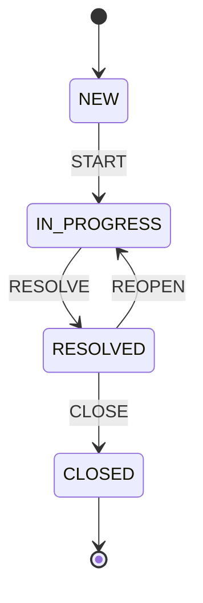
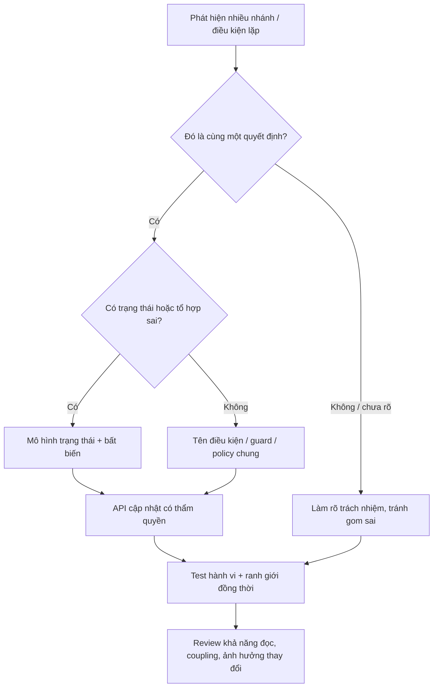

# Điều kiện lặp lại, nhiều nhánh và trạng thái khó theo dõi

Một chức năng có thể chạy đúng trong nhiều tháng nhưng mỗi yêu cầu sửa nhỏ lại khiến lập trình viên mất rất nhiều thời gian đọc những khối `if/else` lồng nhau. Một trạng thái như “đang xử lý” được kiểm tra ở ba phương thức khác nhau; thêm một trạng thái mới phải tìm và cập nhật tất cả. Đôi khi, đối tượng còn chứa nhiều cờ `boolean` có thể kết hợp thành những trạng thái vô lý, chẳng hạn một yêu cầu hỗ trợ vừa “đã đóng” vừa “chưa từng được xử lý”.

Các dấu hiệu ấy thuộc nhóm **mùi mã (code smells)** liên quan đến **điều kiện lặp lại, nhiều nhánh và trạng thái khó theo dõi**. Chúng không tự động chứng minh mã đang có lỗi, nhưng cảnh báo rằng **ý định nghiệp vụ, quy tắc chuyển trạng thái và tác động của thay đổi** có thể đang bị phân tán trong nhiều nhánh điều kiện.

Trong chương **Mùi mã** của `CODE_QUALITY_FUNDAMENTALS`, bài học này giúp bạn phân tích những cấu trúc điều khiển có nguy cơ làm mã nguồn khó đọc và khó bảo trì. Mục tiêu phù hợp với định hướng của module: hiểu những thuộc tính khiến mã nguồn **đáng tin cậy, dễ hiểu và dễ thay đổi**. Chúng ta sẽ phân biệt triệu chứng với nguyên nhân, xem ví dụ Java 17 trước–sau, viết kiểm thử JUnit 5 và lựa chọn refactor có căn cứ.

Sau bài học, bạn có thể:

- Nhận ra cùng một điều kiện nghiệp vụ đang được sao chép hoặc diễn giải khác nhau ở nhiều nơi.
- Phân biệt nhiều nhánh **cần thiết** với nhiều nhánh **khó theo dõi** do trách nhiệm hoặc cấu trúc chưa rõ.
- Chỉ ra rủi ro từ nhiều cờ trạng thái, boolean parameter và các bước gọi phụ thuộc thứ tự.
- Sử dụng tên có nghĩa, guard clause, phương thức quyết định thuần, kiểu `enum` hoặc state machine khi phù hợp.
- Viết kiểm thử bảo vệ chuyển trạng thái và đánh giá xem việc giảm nhánh có thật sự cải thiện chất lượng không.

> **Nguyên tắc:** Đừng refactor chỉ vì thấy nhiều `if`. Hãy tìm **quy tắc nào đang khó xác định nơi sở hữu**, những trạng thái nào không hợp lệ, và một thay đổi nghiệp vụ sẽ ảnh hưởng đến bao nhiêu vị trí.

## 1. Mùi mã là tín hiệu điều tra, không phải phán quyết

**Code smell** là một đặc điểm trong cấu trúc mã cho thấy có thể tồn tại vấn đề thiết kế hoặc bảo trì. Nó không giống một lỗi đã được chứng minh bằng hành vi sai (**defect**).

Ví dụ, một phương thức có 12 nhánh có thể là trình phân tích một giao thức với 12 loại bản tin thật sự khác nhau. Các nhánh có thể cần thiết và được kiểm thử đầy đủ. Ngược lại, một phương thức chỉ có ba nhánh nhưng phải phối hợp năm cờ trạng thái và cập nhật dữ liệu qua nhiều đối tượng có thể rất nguy hiểm.

| Dấu hiệu | Điều có thể ẩn phía sau | Câu hỏi nên hỏi |
| --- | --- | --- |
| **Cùng điều kiện xuất hiện nhiều nơi** | Một quy tắc được bảo trì ở nhiều chỗ | Hai điều kiện có cùng nguồn quyết định và phải đổi cùng nhau không? |
| **Nhiều tầng `if/else` lồng nhau** | Người đọc phải giữ nhiều điều kiện trong đầu | Có thể kiểm tra đầu vào sớm, đặt tên điều kiện hoặc tách mức trừu tượng không? |
| **Nhiều nhánh dựa trên chuỗi/trạng thái** | Quy trình nghiệp vụ chưa được mô hình hóa rõ | Tập trạng thái và các bước chuyển hợp lệ nằm ở đâu? |
| **Nhiều cờ `boolean`** | Cho phép các tổ hợp trạng thái không có ý nghĩa | Có thể biểu diễn trạng thái bằng một kiểu chuyên biệt không? |
| **Tham số cờ `true/false`** | Một phương thức đảm nhiệm nhiều chế độ hoặc tên lời gọi khó hiểu | Đây là một lựa chọn có tên hay hai hành vi thực sự độc lập? |
| **Nhánh đặc biệt tăng liên tục** | Abstraction đang gộp những trách nhiệm khác nhau | Các ngoại lệ có cùng lý do thay đổi không? |
| **Cùng một kiểm tra trước khi sửa ở nhiều nơi** | Không rõ thành phần nào có quyền thay đổi trạng thái | Có một điểm kiểm tra có thẩm quyền tại ranh giới cập nhật không? |

Điều quan trọng là **ngữ cảnh**: tần suất sửa, khả năng kiểm thử, tác động khi sai và mức độ hiểu của người bảo trì. Không có một con số `if` hoặc một độ sâu lồng nhau áp dụng được cho mọi dự án.

### 1.1. Nhìn mùi mã qua chi phí thay đổi

Giả sử sản phẩm bổ sung yêu cầu: “Một yêu cầu hỗ trợ đã được đóng không được mở lại”. Nếu quy tắc này nằm ở ba controller, hai service và một job nền, nguy cơ bỏ sót cao. Mùi mã nằm ở việc **một quyết định có nhiều nơi thực thi**, không chỉ nằm ở số nhánh điều kiện.

Nếu một thay đổi chỉ cần sửa một bảng chuyển trạng thái và các test liên quan, người bảo trì dễ xác định tác động hơn. Tuy nhiên, việc tập trung quy tắc cũng phải giữ đúng ranh giới quyền truy cập và đồng thời; chỉ gom câu lệnh thành một helper chưa đủ.

## 2. Điều kiện lặp lại: một quy tắc có nhiều bản sao

Xem hai phương thức minh họa trong một hệ thống quản lý yêu cầu hỗ trợ:

```java
boolean canResolve(LegacyTicket ticket) {
    return ticket.started
            && !ticket.resolved
            && !ticket.closed;
}

void resolve(LegacyTicket ticket) {
    if (ticket.started
            && !ticket.resolved
            && !ticket.closed) {
        ticket.resolved = true;
        return;
    }

    throw new IllegalStateException("Cannot resolve ticket");
}
```

Cả hai đều diễn đạt cùng một quy tắc: **chỉ được hoàn tất yêu cầu đang xử lý và chưa hoàn tất/đóng**. Nếu sau này bổ sung trạng thái “đang chờ khách phản hồi”, việc sửa `canResolve` nhưng quên `resolve` có thể khiến giao diện báo “không được” trong khi API vẫn cho thao tác, hoặc ngược lại.

Đây là **lặp tri thức nghiệp vụ**: cùng một điều kiện quyết định được cài đặt hai lần. Nó có thể đồng thời là lặp cú pháp vì các biểu thức trông giống nhau, nhưng hai khái niệm không hoàn toàn trùng nhau.

### 2.1. Vì sao hai bản sao dễ lệch?

Một phiên bản có thể viết:

```java
return ticket.started && !ticket.resolved && !ticket.closed;
```

Phiên bản khác viết:

```java
if (ticket.closed) {
    return false;
}
if (ticket.resolved) {
    return false;
}
return ticket.started;
```

Hai đoạn **tương đương trong trạng thái đã dự kiến** nhưng khác cú pháp. Một công cụ dò lặp dựa trên token có thể không đánh dấu chúng. Nếu cả hai thuộc cùng quy tắc, chúng vẫn cần được đồng bộ khi quy tắc thay đổi.

Hãy hỏi:

1. **Có cùng quyết định hay không?** Ví dụ quyền hoàn tất yêu cầu hỗ trợ.
2. **Có cùng nơi sở hữu quyết định không?** Ví dụ chính sách của workflow hỗ trợ.
3. **Khi quy tắc đổi, hai chỗ có phải đổi cùng nhau không?**
4. **Có ngoại lệ khác nhau thật sự không?** Ví dụ một job quản trị có quyền riêng đã được quy định.
5. **Điều kiện đang được dùng để hiển thị gợi ý, hay để thực thi cập nhật thật?**

Nếu chỉ có cùng hình dạng nhưng thuộc **hai quy tắc độc lập**, gom chúng có thể tạo phụ thuộc sai. Ví dụ điều kiện “không quá 20 mục” ở giỏ hàng và “không quá 20 tệp” ở biểu mẫu hỗ trợ có thể trùng con số hôm nay nhưng do hai bộ phận quyết định khác nhau.

### 2.2. Đặt tên cho quyết định nhưng vẫn phải giữ một nơi có thẩm quyền

Một phương thức có tên như `canResolve(ticket)` có thể giúp câu lệnh dễ đọc hơn. Tuy nhiên, nếu caller gọi `canResolve` rồi ở nơi khác sửa trường `resolved` trực tiếp, ranh giới trách nhiệm vẫn bị rò rỉ:

```java
if (workflow.canResolve()) {
    // Thời điểm giữa hai thao tác có thể xuất hiện thay đổi trạng thái.
    workflow.markResolvedDirectly();
}
```

Ngay cả khi điều kiện được viết một lần, kiểu **check-then-act** này có thể sai nếu trạng thái được nhiều luồng hoặc tiến trình thay đổi. **Điểm thực thi thao tác** phải kiểm tra lại điều kiện theo cơ chế nguyên tử thích hợp. Các phương thức `can...` dùng cho UI chỉ nên được xem là **gợi ý khả năng hiện tại**, không thay thế quy tắc ở nơi cập nhật.

Trong các mục sau, chúng ta sẽ đưa quy tắc chuyển trạng thái về một nơi duy nhất để tránh phân tán quyết định.

## 3. Nhiều nhánh và lồng sâu: vấn đề là gánh nặng nhận thức

Điều kiện phân nhánh là một phần tự nhiên của chương trình. Mùi mã thường xuất hiện khi:

- Nhánh được lồng qua nhiều tầng nên người đọc phải nhớ tất cả tiền điều kiện bên ngoài.
- Một phương thức trộn kiểm tra dữ liệu, phân quyền, quyết định nghiệp vụ, truy cập dữ liệu và gửi thông báo.
- Nhiều `else` chứa logic hoàn toàn khác trách nhiệm.
- Thứ tự kiểm tra quyết định tác dụng phụ nhưng không được nói rõ.
- Một thay đổi nhỏ đòi hỏi lần theo nhiều điểm `return`, `break` và cập nhật trạng thái ẩn.

### 3.1. Ví dụ trước: lồng nhau dù chỉ cần từ chối sớm

```java
record TicketRequest(String title, String requesterId, int priority) {}

final class NestedTicketRequestValidator {
    static void validate(TicketRequest request) {
        if (request != null) {
            if (request.title() != null) {
                if (!request.title().isBlank()) {
                    if (request.requesterId() != null
                            && !request.requesterId().isBlank()) {
                        if (request.priority() >= 1
                                && request.priority() <= 5) {
                            return;
                        }
                    }
                }
            }
        }

        throw new IllegalArgumentException("Invalid ticket request");
    }
}
```

Phần lớn thân phương thức nằm trong nhiều lớp điều kiện lồng nhau. Các nhánh không có xử lý riêng; chúng chỉ phục vụ một quyết định: **từ chối request không hợp lệ**.

Có thể viết lại bằng **guard clauses**:

```java
final class TicketRequestValidator {
    static void validate(TicketRequest request) {
        if (request == null) {
            throw new IllegalArgumentException("Request is required");
        }
        if (request.title() == null || request.title().isBlank()) {
            throw new IllegalArgumentException("Title is required");
        }
        if (request.requesterId() == null
                || request.requesterId().isBlank()) {
            throw new IllegalArgumentException("Requester is required");
        }
        if (request.priority() < 1 || request.priority() > 5) {
            throw new IllegalArgumentException("Priority must be 1..5");
        }
    }
}
```

Hai phương thức có cùng quy tắc chấp nhận dữ liệu minh họa. Phiên bản sau diễn đạt rõ **mỗi điều kiện đầu vào không hợp lệ dẫn đến việc từ chối**, giảm lồng nhau và cung cấp thông báo lỗi cụ thể hơn.

**Điểm cần thận trọng:** Ví dụ này sử dụng cả hai phiên bản validator để so sánh, không bắt buộc thêm cả hai vào ứng dụng. Nếu một API công khai đang cam kết một mã lỗi hoặc kiểu exception cụ thể, thay thông báo/kiểu lỗi cũng có thể là thay đổi hợp đồng; refactor sản phẩm thật cần kiểm tra yêu cầu tương thích.

### 3.2. Guard clause không phải quy tắc “càng nhiều return càng tốt”

Nếu một phương thức đang quản lý transaction, resource hoặc tác dụng phụ, chuyển nhánh thành nhiều `return` có thể bỏ qua bước ghi nhận hoặc giải phóng **nếu mã cũ không được cấu trúc an toàn**. Cần giữ vòng đời bằng `try-with-resources`, `finally` hoặc transaction boundary phù hợp.

Một câu hỏi review hữu ích là: **Sau khi rẽ nhánh, bất biến nào vẫn phải đúng?** Nếu không thể trả lời, việc chỉnh hình dạng `if` chưa đủ.

### 3.3. Điều kiện dài cần tên có nghĩa, không chỉ tách dòng

Một biểu thức:

```java
if ((user.active() && user.verified() && !user.suspended())
        && request.priority() >= 4
        && ticket.status() == TicketStatus.IN_PROGRESS) {
    // ...
}
```

có thể khó đọc vì trộn **điều kiện người dùng**, **độ ưu tiên** và **trạng thái yêu cầu**. Khi cùng phục vụ một quyết định, có thể đặt tên rõ cho các phần:

```java
boolean requesterEligible =
        user.active() && user.verified() && !user.suspended();
boolean isHighPriority = request.priority() >= 4;
boolean ticketInProgress =
        ticket.status() == TicketStatus.IN_PROGRESS;

if (requesterEligible && isHighPriority && ticketInProgress) {
    // ...
}
```

Ở đây `user`, `request` và `ticket` là các đối tượng minh họa có phương thức tương ứng; đoạn này không phải chương trình Java hoàn chỉnh. Tên biến giúp giải thích *ý định*, nhưng những điều kiện phân quyền quan trọng không được chỉ tính một lần ở UI rồi tin rằng nó vẫn đúng ở bước cập nhật. Quyết định cần được thực thi tại nơi có thẩm quyền.

**Không nên tách mọi phép so sánh thành một phương thức** nếu điều đó khiến người đọc phải nhảy nhiều file để hiểu quy tắc đơn giản. Tên và abstraction chỉ có ích nếu làm giảm thông tin phải ghi nhớ.

## 4. Nhiều cờ `boolean` làm nổ số tổ hợp trạng thái

Xét một yêu cầu hỗ trợ có ba cờ:

```java
final class LegacyTicket {
    boolean started;
    boolean resolved;
    boolean closed;
}
```

Về mặt cấu trúc dữ liệu, ba cờ độc lập có thể tạo:

\[
2^3 = 8 \text{ tổ hợp giá trị}
\]

Trong khi đó, nghiệp vụ minh họa chỉ mong bốn trạng thái:

| Trạng thái dự kiến | `started` | `resolved` | `closed` |
| --- | --- | --- | --- |
| Mới tạo (`NEW`) | `false` | `false` | `false` |
| Đang xử lý (`IN_PROGRESS`) | `true` | `false` | `false` |
| Đã giải quyết (`RESOLVED`) | `true` | `true` | `false` |
| Đã đóng (`CLOSED`) | `true` | `true` | `true` |

Bốn tổ hợp còn lại **không có ý nghĩa** theo mô hình này. Ví dụ `started == false` và `closed == true` khiến mã khác phải đoán đây là “yêu cầu đã đóng” hay “yêu cầu lỗi dữ liệu”.

Khi thêm cờ thứ tư, số tổ hợp có thể tăng lên `2^4 = 16`. Nếu hệ thống cần kiểm tra sự hợp lệ của từng tổ hợp trong nhiều phương thức, chi phí bảo trì tăng rất nhanh.

**Lưu ý:** Không phải mọi tập boolean đều là một trạng thái duy nhất. Các thuộc tính độc lập thật sự, như `emailOptIn` và `smsOptIn`, có thể hợp lệ ở mọi tổ hợp. Chỉ nên thay bằng một `enum` khi các cờ thực chất đang biểu diễn **một tập trạng thái loại trừ nhau**.

### 4.1. Tại sao một `enum` có ích?

Thay ba cờ bằng:

```java
enum TicketStatus {
    NEW,
    IN_PROGRESS,
    RESOLVED,
    CLOSED
}
```

Lúc này, một biến kiểu `TicketStatus` chỉ biểu diễn một trong bốn trạng thái được khai báo, thay vì tám tổ hợp cờ. `enum` còn hỗ trợ `switch` rõ nghĩa và khiến trình biên dịch phát hiện một số trường hợp thiếu khi dùng `switch expression` không có `default`.

Nhưng `enum` **không tự cưỡng chế mọi bước chuyển hợp lệ**: mã vẫn có thể gán `status = CLOSED` trực tiếp ở vị trí không phù hợp nếu trường bị lộ quyền sửa. Cần kiểm soát đường thay đổi trạng thái qua một API có hợp đồng rõ ràng.

## 5. Ví dụ Java 17: mô hình một quy trình hỗ trợ bằng bảng chuyển trạng thái

Giả sử sản phẩm yêu cầu vòng đời:

- `NEW`: yêu cầu vừa tạo, có thể bắt đầu xử lý (`START`).
- `IN_PROGRESS`: đang xử lý, có thể đánh dấu đã giải quyết (`RESOLVE`).
- `RESOLVED`: có thể mở lại để xử lý thêm (`REOPEN`) hoặc đóng (`CLOSE`).
- `CLOSED`: kết thúc, không cho thực hiện chuyển trạng thái nữa.

Các quy tắc trên chỉ là **mô hình bài học**, không tự áp dụng cho mọi hệ thống chăm sóc khách hàng. Nếu sản phẩm cho phép đóng ngay từ `NEW` hoặc yêu cầu đã đóng được mở lại, bảng chuyển cần khác.

### 5.1. Sơ đồ trạng thái



Sơ đồ đưa ra một tập bước chuyển **được phép**, không chỉ danh sách trạng thái. Nó cho người review thấy nhanh khi nào `CLOSE` hợp lệ và tại sao `RESOLVE` sau `CLOSED` phải bị từ chối.

### 5.2. Tập trung quy tắc vào một bảng

Đây là triển khai Java 17 với `Map.of` bất biến, giữ bảng chuyển tại một nơi:

```java
import java.util.Map;
import java.util.Objects;
import java.util.Set;

enum TicketStatus {
    NEW, IN_PROGRESS, RESOLVED, CLOSED
}

enum TicketAction {
    START, RESOLVE, REOPEN, CLOSE
}

final class TicketTransitions {
    private static final Map<TicketStatus,
            Map<TicketAction, TicketStatus>> ALLOWED = Map.of(
            TicketStatus.NEW,
                    Map.of(TicketAction.START, TicketStatus.IN_PROGRESS),
            TicketStatus.IN_PROGRESS,
                    Map.of(TicketAction.RESOLVE, TicketStatus.RESOLVED),
            TicketStatus.RESOLVED,
                    Map.of(
                            TicketAction.REOPEN, TicketStatus.IN_PROGRESS,
                            TicketAction.CLOSE, TicketStatus.CLOSED),
            TicketStatus.CLOSED,
                    Map.of());

    private TicketTransitions() {}

    static Set<TicketAction> allowedActions(TicketStatus status) {
        Objects.requireNonNull(status, "status");
        return ALLOWED.get(status).keySet();
    }

    static TicketStatus next(TicketStatus current, TicketAction action) {
        Objects.requireNonNull(current, "current");
        Objects.requireNonNull(action, "action");

        TicketStatus target = ALLOWED.get(current).get(action);
        if (target == null) {
            throw new IllegalStateException(
                    "Action " + action + " not allowed from " + current);
        }
        return target;
    }
}
```

Ở đây, **một bảng duy nhất** quyết định:

- Mỗi trạng thái cho phép những hành động nào.
- Mỗi hành động hợp lệ chuyển đến trạng thái nào.
- Một hành động không nằm trong bảng phải bị từ chối.

`allowedActions` có thể phục vụ UI hoặc tài liệu hiển thị những thao tác hiện có; `next` dùng chính bảng ấy để ra quyết định. Vì vậy, hai phương thức không sao chép những biểu thức kiểm tra riêng.

### 5.3. Đóng gói nơi cập nhật trạng thái

```java
final class TicketWorkflow {
    private TicketStatus status = TicketStatus.NEW;

    synchronized TicketStatus status() {
        return status;
    }

    synchronized Set<TicketAction> allowedActions() {
        return TicketTransitions.allowedActions(status);
    }

    /**
     * Thực hiện một chuyển trạng thái trên cùng instance.
     *
     * @throws IllegalStateException nếu hành động không hợp lệ
     *         ở trạng thái hiện tại; trạng thái được giữ nguyên khi bị từ chối
     */
    synchronized TicketStatus apply(TicketAction action) {
        TicketStatus next = TicketTransitions.next(status, action);
        status = next;
        return next;
    }
}
```

Phương thức `apply` kiểm tra và gán trong cùng một khối `synchronized` trên **instance hiện tại**. Nếu hành động không hợp lệ, `TicketTransitions.next` ném exception **trước khi** cập nhật `status`, nên trạng thái vẫn giữ nguyên.

Một tác dụng khác của thiết kế là **các nơi sử dụng không được gán trực tiếp trạng thái**. Mã ngoài lớp không thể đặt `status = CLOSED` để đi tắt qua `RESOLVED`.

Các đoạn Java ở mục 5.2 và 5.3 thuộc **cùng một ví dụ**, nên cần đặt trong cùng package và import `java.util.Set` cho file chứa `TicketWorkflow` nếu tách file. Nếu đặt các loại này cùng trong một file thực hành, chỉ giữ một định nghĩa cho mỗi `enum`/`class` và tổ chức import ở đầu file.

### 5.4. Điều mà ví dụ chưa bảo đảm

Bảng chuyển trạng thái làm rõ **quy tắc luồng**, nhưng không tự giải quyết mọi vấn đề:

- **Không có lưu bền vững:** `TicketWorkflow` chỉ giữ trạng thái trong bộ nhớ. Khởi động lại ứng dụng sẽ tạo đối tượng mới ở `NEW` nếu không có kho lưu trữ.
- **Không kiểm tra phân quyền:** `TicketAction.CLOSE` hợp lệ từ `RESOLVED` chưa chứng minh người gọi có quyền đóng. Quyền cần được kiểm tra tại điểm có đủ thông tin xác thực và ngữ cảnh.
- **Không có giao dịch phân tán:** `synchronized` chỉ bảo vệ các luồng trên cùng instance trong một JVM. Hai server sửa cùng ticket trong database vẫn cần cơ chế đồng bộ/cạnh tranh ở nơi sở hữu trạng thái lưu trữ.
- **Không có tác dụng phụ bên ngoài:** Các hành động không gửi email, tạo hóa đơn hoặc gọi API ngoài. Nếu bổ sung các thao tác này, phải thiết kế rõ thời điểm commit, xử lý lỗi và retry.

Đây là một điểm học quan trọng: **giảm số nhánh và số cờ không đồng nghĩa tự động đạt tính đúng của toàn hệ thống**. Refactor làm quy tắc dễ nhìn hơn, còn tính đúng cần được bảo vệ bằng hợp đồng và kiểm thử ở đúng ranh giới.

### 5.5. Kiểm thử JUnit 5 bảo vệ đường đi hợp lệ và bất biến

```java
import static org.junit.jupiter.api.Assertions.assertEquals;
import static org.junit.jupiter.api.Assertions.assertFalse;
import static org.junit.jupiter.api.Assertions.assertThrows;
import static org.junit.jupiter.api.Assertions.assertTrue;

import org.junit.jupiter.api.Test;

class TicketWorkflowTest {
    @Test
    void supportsResolveReopenAndCloseLifecycle() {
        TicketWorkflow ticket = new TicketWorkflow();

        assertEquals(TicketStatus.NEW, ticket.status());
        assertEquals(TicketStatus.IN_PROGRESS,
                ticket.apply(TicketAction.START));
        assertEquals(TicketStatus.RESOLVED,
                ticket.apply(TicketAction.RESOLVE));
        assertEquals(TicketStatus.IN_PROGRESS,
                ticket.apply(TicketAction.REOPEN));
        assertEquals(TicketStatus.RESOLVED,
                ticket.apply(TicketAction.RESOLVE));
        assertEquals(TicketStatus.CLOSED,
                ticket.apply(TicketAction.CLOSE));
    }

    @Test
    void rejectsInvalidActionWithoutChangingState() {
        TicketWorkflow ticket = new TicketWorkflow();

        assertThrows(IllegalStateException.class,
                () -> ticket.apply(TicketAction.CLOSE));
        assertEquals(TicketStatus.NEW, ticket.status());

        ticket.apply(TicketAction.START);
        ticket.apply(TicketAction.RESOLVE);
        ticket.apply(TicketAction.CLOSE);

        assertThrows(IllegalStateException.class,
                () -> ticket.apply(TicketAction.REOPEN));
        assertEquals(TicketStatus.CLOSED, ticket.status());
    }

    @Test
    void advertisedActionsAndActualTransitionUseSameRule() {
        TicketWorkflow ticket = new TicketWorkflow();

        assertTrue(ticket.allowedActions().contains(TicketAction.START));
        assertFalse(ticket.allowedActions().contains(TicketAction.CLOSE));

        ticket.apply(TicketAction.START);
        assertTrue(ticket.allowedActions().contains(TicketAction.RESOLVE));
        assertFalse(ticket.allowedActions().contains(TicketAction.START));
    }
}
```

Bộ test xác nhận:

1. Những bước chuyển hợp lệ tạo đúng trạng thái.
2. Những bước chuyển bị cấm ném lỗi và **không thay đổi** trạng thái.
3. Tập hành động được hiển thị và hành động được thực thi xuất phát từ **cùng nguồn quy tắc**.

Bộ test này **không** kiểm chứng transaction database, đồng bộ nhiều JVM, quyền tài khoản hay giao tiếp HTTP. Đối với hệ thống thật, các ranh giới ấy cần integration, contract hoặc concurrency tests phù hợp.

## 6. Vì sao một bảng chuyển giúp hơn nhiều `if` — và khi nào thì không?

Đưa điều kiện vào bảng là một phương án khi **đầu ra của quyết định chủ yếu là trạng thái kế tiếp**. Nó có một số lợi ích:

| Trước | Sau khi mô hình hóa đúng ranh giới |
| --- | --- |
| Mỗi phương thức tự kiểm tra `started/resolved/closed` | Một `TicketStatus` biểu diễn trạng thái hợp lệ |
| Mỗi nơi có một phiên bản `canResolve` | `allowedActions` và `next` dùng chung quy tắc |
| Có thể gán cờ theo thứ tự gây trạng thái trung gian vô lý | `apply` thực hiện một chuyển trạng thái có kiểm soát |
| Thêm trạng thái phải tìm nhiều biểu thức logic | Có thể rà soát bảng chuyển và các test theo trạng thái mới |
| Khó trả lời “từ trạng thái này làm gì được?” | Có thể nhìn trực tiếp vào bảng hoặc sơ đồ trạng thái |

Nhưng bảng chuyển không phải phương án bắt buộc. Nếu mỗi nhánh cần:

- Xác thực quyền theo ngữ cảnh rất khác;
- Thực thi nhiều bước nghiệp vụ khác nhau;
- Điều phối transaction hoặc dịch vụ ngoài riêng;
- Trả về những loại kết quả có ý nghĩa khác nhau;

thì một bảng `Map` đơn giản có thể che mất nội dung quan trọng. Có thể cần các **phương thức hành vi riêng** (`resolve`, `close`) hoặc **state pattern/strategy**, miễn là quy tắc chung vẫn có chủ sở hữu rõ.

**Không nên tạo một engine workflow tổng quát** chỉ để thay cho ba câu lệnh `if`. Mục tiêu là giảm chi phí hiểu quy tắc và tránh trạng thái không hợp lệ, không phải tăng số lớp hay mức trừu tượng.

## 7. Boolean parameter và “mode flag” làm ý nghĩa lời gọi mờ đi

Một phương thức có tên như:

```java
sendTicketNotification(ticket, true, false);
```

buộc người đọc mở chữ ký mới biết hai giá trị boolean nghĩa là gì. Tệ hơn, nếu chúng điều khiển hai chế độ nghiệp vụ độc lập, phương thức có thể chứa nhiều nhánh như:

```java
void sendTicketNotification(
        Ticket ticket,
        boolean urgent,
        boolean silent) {
    if (urgent && !silent) {
        // ...
    } else if (urgent) {
        // ...
    } else if (silent) {
        // ...
    } else {
        // ...
    }
}
```

Các kiểu `Ticket` và thao tác gửi ở đây chỉ mang tính minh họa. Đoạn này cho thấy **hai cờ đã tạo bốn tổ hợp hành vi**. Với ba cờ độc lập là tám tổ hợp; nhiều tổ hợp có thể chưa được kiểm thử hoặc thậm chí không có ý nghĩa.

Nếu hai cờ là **một lựa chọn loại trừ nhau**, có thể dùng một `enum`:

```java
enum NotificationMode {
    NORMAL,
    URGENT,
    SILENT
}

void sendTicketNotification(Ticket ticket, NotificationMode mode) {
    // Chọn triển khai phù hợp với mode.
}
```

Lời gọi trở nên có nghĩa:

```java
sendTicketNotification(ticket, NotificationMode.URGENT);
```

Nếu các thuộc tính thật sự độc lập, một **options object** có tên rõ hoặc những thao tác riêng có thể hợp lý hơn việc ép chúng thành một enum. Điều cần kiểm tra là **các tổ hợp nào thực sự hợp lệ**, ai quyết định và chúng có cùng trách nhiệm thay đổi không.

**Tránh tạo mode chỉ để che một phương thức làm nhiều việc khác nhau.** Nếu `urgent` thay cách gửi tin, còn `silent` thay toàn bộ việc ghi log và audit, có thể cần tách chính sách gửi thông báo và chính sách theo dõi thay vì nhét tất cả vào một hàm.

## 8. Trạng thái ngầm còn nguy hiểm hơn trạng thái boolean

Không phải lúc nào trạng thái cũng được lưu trong trường `status`. Đôi khi nó được suy từ:

- Một tập cờ như `processed`, `approved`, `sent`.
- Tham số `null` hoặc đối tượng chưa được khởi tạo.
- Thứ tự lời gọi `init() → setConfig() → execute()`.
- Sự hiện diện của một bản ghi trong cache hoặc database.
- Một callback đã chạy hay chưa.
- Một danh sách mutable bị nhiều nơi chia sẻ.

Ví dụ một API có dạng:

```java
JobRunner runner = new JobRunner();
runner.setRepository(repository);
runner.setTimeout(timeout);
runner.execute();
```

Nếu gọi `execute()` trước `setRepository()` thì chương trình có thể gặp lỗi lúc chạy. Kiểu Java không tự buộc người gọi phải thực hiện đúng trình tự. Đó là **temporal coupling**: tính hợp lệ của lời gọi phụ thuộc vào thứ tự các thao tác trước đó.

Khi thiết kế phù hợp, có thể yêu cầu phụ thuộc ngay từ constructor:

```java
final class JobRunner {
    private final Repository repository;
    private final java.time.Duration timeout;

    JobRunner(Repository repository, java.time.Duration timeout) {
        this.repository = java.util.Objects.requireNonNull(repository);
        this.timeout = java.util.Objects.requireNonNull(timeout);
        if (timeout.isNegative() || timeout.isZero()) {
            throw new IllegalArgumentException("Timeout must be positive");
        }
    }

    void execute() {
        // Có thể dựa vào phụ thuộc đã được khởi tạo hợp lệ.
    }
}
```

`Repository` trong ví dụ là một interface giả định của ứng dụng; ví dụ tập trung vào hợp đồng khởi tạo, không định nghĩa toàn bộ job. Việc đưa phụ thuộc bắt buộc vào constructor **giảm số bước hợp lệ mà người gọi phải nhớ**. Nó không tự bảo đảm `execute()` không gặp lỗi I/O hoặc phụ thuộc ngoài.

### 8.1. Phân biệt trạng thái vòng đời với trạng thái dữ liệu

Không nên gom mọi thuộc tính thành một enum khổng lồ. Ví dụ `priority` có thể là mức ưu tiên độc lập, còn `status` mô tả vòng đời; tổ hợp `HIGH + RESOLVED` có thể hoàn toàn hợp lệ. Nếu tạo enum `HIGH_RESOLVED`, `LOW_RESOLVED`, `HIGH_CLOSED`…, ta lại tạo **tích Descartes của các trạng thái độc lập**, khiến số hằng tăng không cần thiết.

Nguyên tắc tốt là:

- Dùng **một kiểu trạng thái** cho những lựa chọn **loại trừ nhau** thuộc cùng một vòng đời.
- Dùng **các thuộc tính riêng** cho chiều dữ liệu thực sự độc lập.
- Đặt **bất biến liên quan giữa các trường** tại nơi sở hữu dữ liệu.
- Chỉ tạo **state machine** khi thứ tự chuyển và trạng thái hợp lệ thật sự có ý nghĩa nghiệp vụ.

## 9. Dùng `switch` và đa hình đúng lúc

Khi nhiều nhánh dựa vào **một loại giá trị hữu hạn**, `switch expression` có thể làm rõ tập trường hợp:

```java
static String labelOf(TicketStatus status) {
    return switch (status) {
        case NEW -> "Mới";
        case IN_PROGRESS -> "Đang xử lý";
        case RESOLVED -> "Đã giải quyết";
        case CLOSED -> "Đã đóng";
    };
}
```

Ví dụ cần nằm trong một lớp hoặc `record` để biên dịch khi đưa vào dự án. Vì không có nhánh `default`, khi thêm giá trị mới vào `TicketStatus` rồi **biên dịch lại** switch expression, compiler có thể yêu cầu xử lý trường hợp mới. Đây là lợi ích của một tập trạng thái tường minh.

Tuy nhiên, `switch` không tự biến mã thành tốt. Nếu mỗi `case` dài hàng trăm dòng, gọi database, gửi thông báo và sửa nhiều đối tượng, vấn đề về trách nhiệm và tác dụng phụ vẫn còn.

### 9.1. Khi nào cân nhắc strategy hoặc state pattern?

Các phương án đa hình có ích khi:

- Nhiều nhánh đại diện cho các thuật toán khác nhau có logic đủ lớn.
- Mỗi thuật toán có trách nhiệm, phụ thuộc và vòng đời thay đổi riêng.
- Thêm hành vi mới thường làm phải sửa nhiều `switch` trong các thành phần khác nhau.
- Một interface có thể diễn đạt hợp đồng chung ổn định mà không thêm hàng loạt cờ.

Ví dụ trong một hệ thống lớn, các loại thông báo có thể có adapter khác nhau (`EmailSender`, `SmsSender`) cùng triển khai một hợp đồng nhỏ. Nhưng với hai nhánh chỉ trả một nhãn, `switch` có thể rõ hơn việc tạo một hệ phân cấp lớp.

**Không có thứ tự “switch kém hơn polymorphism” áp dụng cho mọi bài toán.** Hãy ưu tiên mức trừu tượng mà người bảo trì hiểu được và phù hợp với hướng thay đổi thực tế.

## 10. Điều kiện lặp trong nhiều tầng: ai là nơi có thẩm quyền?

Giả sử giao diện chỉ bật nút “Đóng” khi ticket đã `RESOLVED`. Controller cũng kiểm tra, service tiếp tục kiểm tra và repository cập nhật trạng thái. Có phải mọi điều kiện lặp đều nên bị loại bỏ?

Không nhất thiết. Cần phân biệt **mục đích khác nhau của các phép kiểm tra**:

| Tầng | Vì sao có thể cần kiểm tra? | Có được là nguồn quyết định cuối? |
| --- | --- | --- |
| **UI** | Hỗ trợ người dùng, ẩn hoặc vô hiệu hóa thao tác không hợp lệ | Không |
| **Controller/adapter** | Kiểm tra định dạng request, xác thực người gọi, giới hạn tải | Không thay quyền và bất biến nghiệp vụ |
| **Service/domain** | Thực thi hành động theo quyền và trạng thái nghiệp vụ hiện tại | Có thể là nơi sở hữu quy tắc nghiệp vụ |
| **Repository/database** | Bảo vệ cập nhật có điều kiện, transaction và cạnh tranh trên trạng thái lưu trữ | Có thể là nơi cưỡng chế nguyên tử cho dữ liệu lưu |
| **Test** | Kiểm chứng quy tắc và ranh giới qua các ca cụ thể | Không phải nguồn quy tắc production |

UI và server có thể cùng biết rằng trạng thái `RESOLVED` là điều kiện để hiện nút `CLOSE`. Đó có thể là **một thông tin được phản ánh ở nhiều tầng vì mục đích khác nhau**. Vấn đề phát sinh khi mỗi tầng duy trì một bản chính sách độc lập, không có nguồn có thẩm quyền hoặc hợp đồng kiểm chứng.

### 10.1. Khi concurrent request làm thay đổi trạng thái

Giả sử hai người cùng mở màn hình ticket lúc nó đang `RESOLVED`:

1. Người A bấm `CLOSE`.
2. Người B bấm `REOPEN` gần như đồng thời.

Cả hai UI đều có thể hiển thị thao tác hợp lệ tại thời điểm tải trang. Nếu server xử lý yêu cầu A trước, yêu cầu B có thể phải bị từ chối theo trạng thái đã đổi. **Không thể tin trạng thái đã đọc trước đó vẫn đúng khi cập nhật**.

Nếu trạng thái nằm trong database và nhiều server có thể xử lý cùng ticket, có thể dùng **cập nhật có điều kiện theo trạng thái/version** trong transaction phù hợp:

```sql
UPDATE tickets
SET status = 'CLOSED'
WHERE id = ?
  AND status = 'RESOLVED';
```

Đây là SQL minh họa. Ứng dụng cần dùng tham số được bind, kiểm tra số hàng bị tác động và xử lý trường hợp `0 rows affected` như “trạng thái không còn phù hợp” hoặc “không tồn tại”, theo hợp đồng đã công bố. Câu lệnh minh họa chưa bao gồm **kiểm tra quyền người gọi**, ràng buộc tenant hay lưu lịch sử sự kiện; những phần ấy vẫn bắt buộc khi nghiệp vụ yêu cầu.

**Bài học:** Việc gom điều kiện để dễ đọc chỉ là một nửa. Nơi thực hiện cập nhật phải giữ bất biến an toàn trong phạm vi đồng thời thực tế.

## 11. Đo “nhiều nhánh” thế nào cho có ích?

Các công cụ chất lượng mã thường hỗ trợ chỉ số liên quan luồng điều khiển:

| Chỉ số hoặc quan sát | Gợi ý điều gì? | Giới hạn |
| --- | --- | --- |
| **Cyclomatic complexity** | Số đường đi độc lập về luồng điều khiển theo mô hình đo | Không trực tiếp đo mức khó hiểu hoặc số lỗi; cách tính điều kiện phức hợp tùy công cụ |
| **Cognitive complexity** | Mức khó theo dõi dòng điều khiển, thường phạt lồng nhau và một số cấu trúc | Là heuristic, không phải đo sự hiểu biết của lập trình viên |
| **Độ sâu lồng nhau** | Bao nhiêu điều kiện phải được giữ đồng thời trong đầu | Có thể giảm bằng guard clause, nhưng chưa chắc sửa được trách nhiệm |
| **Số nhánh/trạng thái** | Số trường hợp mà hệ thống cần xử lý | Có thể đúng bằng độ phức tạp thật của nghiệp vụ |
| **Số điều kiện lặp** | Quy tắc có nhiều điểm triển khai hay không | Công cụ cú pháp có thể bỏ sót trùng tri thức khác hình dạng |
| **Số tổ hợp cờ** | Không gian trạng thái có thể rất lớn | Các cờ độc lập thật sự không nhất thiết là mùi mã |
| **Phạm vi test/branch coverage** | Những nhánh nào được thực thi trong bộ kiểm thử | Không chứng minh assertion đúng hoặc hành vi nghiệp vụ đúng |

Không cần một ngưỡng “phương thức có hơn N nhánh là sai” dùng cho mọi module. Với mã xử lý trạng thái giao dịch, **hai nhánh sai** có thể nguy hiểm hơn mười nhánh đều rõ và được kiểm thử.

### 11.1. Đọc con số theo bối cảnh thay đổi

Giả sử một phương thức có cyclomatic complexity cao. Trước khi tách, hãy xác định:

- Nó đang diễn đạt **một tập luật có thể liệt kê** hay nhiều trách nhiệm bị trộn?
- Có bao nhiêu nhánh xử lý lỗi, điều kiện đầu vào hoặc trạng thái thực?
- Mỗi nhánh có thể kiểm thử trực tiếp không?
- Người mới sửa một quy tắc có tìm đúng nơi sửa không?
- Việc tách sẽ giảm sự phụ thuộc hay chỉ di chuyển nhánh sang helper?
- Có dấu hiệu bug do sửa thiếu một nhánh trong lịch sử không?

Giảm complexity của một phương thức bằng cách chuyển toàn bộ `if` sang ba helper khó đọc có thể khiến metric đẹp hơn mà **chi phí hiểu toàn luồng không giảm**. Đánh giá refactor bằng **hành vi, ranh giới trách nhiệm, khả năng test và tác động của thay đổi**, không chỉ số đo.

## 12. Refactor theo từng bước và bảo vệ hành vi

Đối với một hệ thống nhiều nhánh có trạng thái đang phục vụ người dùng, không nên viết lại toàn bộ ngay từ đầu. Một tiến trình thận trọng thường gồm:

1. **Vẽ hiện trạng.** Liệt kê những trạng thái đang có, chuyển đổi, điều kiện và tác dụng phụ. Phân biệt quy tắc được yêu cầu với hành vi tình cờ của mã cũ.
2. **Nhận diện tổ hợp không hợp lệ.** Nếu ba boolean tạo tám tổ hợp nhưng nghiệp vụ chỉ có bốn trạng thái, xác định điều gì phải xảy ra khi dữ liệu cũ chứa trạng thái ngoài dự kiến.
3. **Xác nhận nguồn quyết định.** Ai có thẩm quyền đặt quy tắc? Có hai nhánh giống nhau vì cùng chính sách hay vì trùng cú pháp?
4. **Viết test đặc trưng cho hành vi quan trọng.** Bao gồm trạng thái hợp lệ, chuyển bị cấm, dữ liệu biên và đường lỗi. Nếu mã cũ có bug, cần xác định **hành vi mong muốn** thay vì khóa bug vào test vĩnh viễn.
5. **Cô lập quyết định khỏi tác dụng phụ.** Trích xuất điều kiện có tên, tạo hàm tính trạng thái kế tiếp hoặc bảng chuyển ở nơi có trách nhiệm.
6. **Thay nơi gọi theo phạm vi nhỏ.** Chuyển các thao tác sang API có thẩm quyền, hạn chế setter hoặc field mutable công khai; cập nhật test.
7. **Xác minh nhiều tầng.** Unit test cho quyết định, integration test nếu đổi lưu trữ/trạng thái, kiểm thử concurrent nếu có rủi ro tranh chấp, contract test nếu thay phản hồi công khai.
8. **Đọc lại độ phức tạp tổng thể.** Số nhánh có giảm không, nhưng quan trọng hơn: người mới có biết trạng thái hợp lệ và nơi sửa quy tắc không?
9. **Dọn mã cũ và cập nhật tài liệu.** Bỏ các đường sửa trạng thái trực tiếp, giữ sơ đồ và comment phù hợp với triển khai.

Với refactor nhỏ như guard clause, quá trình có thể ngắn hơn. Với thay đổi mô hình dữ liệu từ nhiều cờ sang enum trong database, cần cân nhắc **migration, dữ liệu lịch sử, tương thích API và triển khai theo giai đoạn**.

### 12.1. Sơ đồ ra quyết định



Mục đích của sơ đồ là **đặt câu hỏi đúng trước khi sửa**. Không có yêu cầu mọi trường hợp phải xây state machine hoặc một bộ quy tắc tổng quát.

## 13. Những sai lầm khi xử lý mùi mã

### 13.1. Xem mọi `if` là thiết kế xấu

Một phép kiểm tra đơn giản có tên rõ, ít nhánh và được dùng ở đúng nơi có thể là cách biểu diễn tốt nhất. Xóa nó để dùng factory, strategy hoặc map phức tạp đôi khi làm mã khó hiểu hơn.

### 13.2. Chỉ tách helper nhưng vẫn để trạng thái bị sửa từ nhiều nơi

Đổi điều kiện thành `canClose(ticket)` nhưng mọi controller vẫn có thể gán `ticket.closed = true` không tạo ranh giới an toàn. Cần đóng gói điểm thay đổi và bảo vệ bất biến.

### 13.3. Dùng một `enum` cho những chiều dữ liệu độc lập

Nếu `priority`, `channel` và `status` thực sự độc lập, gộp thành hàng chục hằng kết hợp có thể làm số trạng thái tăng nhanh hơn. Chỉ gom các cờ biểu diễn **cùng một lựa chọn loại trừ nhau**.

### 13.4. Trích xuất helper có quá nhiều cờ chế độ

Một phương thức `process(ticket, isClose, isReopen, isAdmin, skipAudit)` có thể giảm dòng trùng nhưng làm lời gọi khó hiểu và tăng tổ hợp hành vi. Hãy xét những hành động/ngữ cảnh thật sự khác nhau và dùng API có tên.

### 13.5. Refactor làm thay đổi thứ tự tác dụng phụ ngoài ý muốn

Chuyển `if` thành guard clause có thể làm một bước ghi dữ liệu hoặc ghi audit không còn được gọi, nếu logic cũ phụ thuộc thứ tự. Phải xác định **điểm có tác dụng phụ**, giữ transaction/resource cleanup và kiểm thử đường lỗi.

### 13.6. Bỏ qua dữ liệu lịch sử không hợp lệ

Nếu database từng lưu được tổ hợp `started=false, closed=true`, chuyển ngay sang `enum` mà không có kế hoạch mapping sẽ khiến không đọc được hoặc đọc sai dữ liệu cũ. Cần quyết định cách phân loại, báo lỗi hoặc sửa dữ liệu theo yêu cầu sản phẩm.

### 13.7. Cho rằng `synchronized` trên một object đã đủ cho mọi server

Khóa instance chỉ bảo vệ luồng trên đúng object trong một JVM. Nếu nhiều server xử lý cùng ticket, cần kiểm tra và cập nhật ở nơi sở hữu dữ liệu chung, theo transaction/version phù hợp.

### 13.8. Cho rằng metric giảm là bằng chứng refactor thành công

Cyclomatic complexity giảm không đảm bảo test đủ, quyền đúng hoặc không có race. Một abstraction nhiều lớp có thể làm số nhánh trong từng phương thức nhỏ đi nhưng tăng gánh nặng tìm hiểu toàn hệ thống.

### 13.9. Biến bảng chuyển trạng thái thành nơi đặt mọi nghiệp vụ

Bảng `Map` phù hợp với các chuyển trạng thái đơn giản. Nếu một hành động liên quan tới billing, quyền, I/O và thông báo, không nên nhét mọi tác dụng phụ vào cấu trúc map khó kiểm soát. Hãy dùng bảng cho **quy tắc chuyển**, còn hiệu lực giao dịch ở service/adapter phù hợp.

## 14. Checklist khi code review

Khi gặp phương thức nhiều `if` hoặc đối tượng nhiều cờ, có thể kiểm tra:

1. **Đây là một hành vi hay nhiều trách nhiệm?** Có tên gọi và mục tiêu nhất quán không?
2. **Có điều kiện nghiệp vụ lặp ở nhiều nơi không?** Các chỗ đó có cùng lý do thay đổi không?
3. **Có thể diễn đạt điều kiện bằng tên rõ ràng không?** Tên có giúp đọc nhanh hơn mà không làm mất bối cảnh?
4. **Nhiều nhánh có thực sự cần thiết không?** Có thể từ chối đầu vào sớm bằng guard clause không?
5. **Có tổ hợp trạng thái vô lý không?** Nhiều boolean có đang mô tả một vòng đời loại trừ nhau?
6. **Ai sở hữu quyền thay đổi trạng thái?** Có setter, field hoặc lối tắt bỏ qua kiểm tra?
7. **Lời gọi có phụ thuộc thứ tự không?** Có yêu cầu khởi tạo, đóng, commit hoặc hủy?
8. **Các trường hợp biên và chuyển sai có được test không?** Có test xác nhận không sửa trạng thái khi từ chối?
9. **Có đồng thời hoặc nhiều tiến trình không?** Check-then-act có được bảo vệ đúng phạm vi?
10. **Refactor có tăng coupling không?** Có gom những quy tắc độc lập hoặc tạo helper quá tổng quát?
11. **Tác dụng phụ và hợp đồng lỗi có được bảo toàn không?** Ghi dữ liệu, gửi thông báo, exception, audit?
12. **Sơ đồ và tài liệu đã theo kịp thay đổi chưa?** Trạng thái mới, thao tác bị cấm và nguồn quy tắc có rõ?

Một nhận xét review hữu ích thường có dạng:

> “Điều kiện `started && !resolved && !closed` xuất hiện ở hai phương thức thực thi cùng quy tắc. Nếu thêm trạng thái chờ, hai chỗ có thể lệch. Có thể xác định một nơi sở hữu chuyển trạng thái và cho cả UI lẫn lệnh cập nhật tham chiếu cùng quy tắc không?”

Nó chỉ rõ **rủi ro thay đổi** và một phương án cần đánh giá, thay vì kết luận “có ba if nên code xấu”.

## 15. Bài tập tự kiểm tra

**Câu 1.** Một phương thức có sáu nhánh `switch` nhưng mỗi nhánh chỉ trả một nhãn trạng thái rõ ràng. Có bắt buộc chuyển sang strategy pattern không?

*Gợi ý:* Không. Nếu tập trạng thái hữu hạn, code dễ đọc và có test, `switch` có thể là cách biểu diễn phù hợp. Đánh giá theo rủi ro và khả năng thay đổi.

**Câu 2.** Hai controller dùng cùng điều kiện `ticket.status() == RESOLVED` để bật nút đóng, nhưng service không kiểm tra trạng thái khi cập nhật. Rủi ro là gì?

*Gợi ý:* Người gọi có thể gửi request trực tiếp hoặc trạng thái đã đổi sau khi UI tải. Điều kiện có thẩm quyền phải được kiểm tra tại nơi xử lý cập nhật.

**Câu 3.** Ba boolean `started`, `resolved` và `closed` tạo bao nhiêu tổ hợp? Tại sao mô hình này có thể khó bảo trì?

*Gợi ý:* `2^3 = 8`. Nếu nghiệp vụ chỉ cho phép bốn trạng thái, còn bốn tổ hợp không hợp lệ cần được ngăn hoặc xử lý. Một enum với API chuyển trạng thái có thể làm mô hình rõ hơn.

**Câu 4.** Dùng một `enum` duy nhất cho `status` và `priority` có chắc giảm phức tạp không?

*Gợi ý:* Không. Hai thuộc tính có thể độc lập; việc kết hợp chúng thành các hằng duy nhất tạo tích số trạng thái mà không mang thêm lợi ích.

**Câu 5.** `allowedActions()` trả `CLOSE` cho ticket `RESOLVED`. Sau đó một người khác đã `REOPEN`, người dùng đầu tiên bấm đóng. Có nên cho `CLOSE` thành công vì UI từng hiển thị nút không?

*Gợi ý:* Không. Phải kiểm tra lại trạng thái hiện tại khi xử lý cập nhật. Quy tắc tại UI không phải quyền quyết định cuối.

**Câu 6.** Một refactor dùng guard clause làm số tầng lồng nhau giảm, nhưng vô tình bỏ qua việc đóng file trên đường lỗi. Có thể coi refactor thành công không?

*Gợi ý:* Không. Cải thiện khả năng đọc không được vi phạm vòng đời tài nguyên. Cần dùng `try-with-resources`/`finally` và kiểm thử các đường thoát.

**Câu 7.** Hai phương thức đều dùng điều kiện `quantity > 0`. Có nên luôn trích xuất một validator chung?

*Gợi ý:* Không nhất thiết. Nếu là hai quy tắc độc lập, việc chia sẻ có thể tạo coupling. Nếu điều kiện thuộc cùng một kiểu số lượng được quản lý bởi một miền nghiệp vụ, có thể dùng kiểu giá trị có validation tại constructor.

**Câu 8.** Vì sao JUnit test cho `TicketWorkflow` không chứng minh trạng thái đã được lưu đúng khi hai server cùng sửa một ticket?

*Gợi ý:* Ví dụ chỉ giữ trạng thái trong một instance và khóa chỉ áp dụng trong một JVM. Cần kiểm thử tích hợp với transaction/concurrency trên nơi lưu trữ chung.

**Câu 9.** Thêm trạng thái `WAITING_FOR_CUSTOMER` vào mô hình ticket. Cần xem lại những gì?

*Gợi ý:* Các bước chuyển hợp lệ, nơi hiển thị hành động, kiểm thử, quyền truy cập, mapping dữ liệu lưu và những client đang dùng enum/trạng thái qua API.

**Câu 10.** Một helper mới `process(ticket, true, false, true)` làm giảm 20 dòng trùng. Điều gì nên kiểm tra trước khi chấp nhận?

*Gợi ý:* Ý nghĩa từng cờ, tổ hợp hợp lệ, nơi sở hữu quy tắc, khả năng kiểm thử, coupling giữa các hành vi và liệu một API có tên hoặc các thành phần trách nhiệm riêng có rõ hơn không.

**Câu 11.** Cyclomatic complexity giảm nhưng những quy tắc cho phép đóng ticket vẫn nằm ở ba service. Mùi mã nào chưa được giải quyết?

*Gợi ý:* Lặp tri thức và thiếu nơi sở hữu quyết định. Giảm nhánh trong từng phương thức chưa giải quyết nguy cơ chính sách bị cập nhật không đồng bộ.

**Câu 12.** Một đối tượng lưu `status = CLOSED` nhưng `resolvedAt = null`. Có thể kết luận ngay rằng dữ liệu sai không?

*Gợi ý:* Chưa đủ. Cần xem hợp đồng dữ liệu: có phải mọi yêu cầu đóng đều phải được giải quyết trước và có thời điểm `resolvedAt` không? Nếu đó là bất biến thật, cần validation/migration và kiểm thử; nếu có đường đóng đặc biệt hợp lệ, mô hình phải thể hiện rõ.

## Ghi nhớ

**Điều kiện lặp lại, nhiều nhánh và trạng thái khó theo dõi là các dấu hiệu đáng điều tra vì chúng có thể làm quyết định nghiệp vụ bị phân tán, cho phép tổ hợp dữ liệu vô nghĩa và khiến thay đổi nhỏ lan rộng.** Không phải mọi nhánh điều kiện đều xấu; vấn đề là khả năng người bảo trì xác định **quy tắc, nguồn sở hữu, trạng thái hợp lệ và hậu quả của từng bước chuyển**.

Khi refactor, hãy ưu tiên làm rõ trách nhiệm, giảm lặp tri thức, đặt tên điều kiện, dùng guard clause phù hợp và mô hình hóa vòng đời bằng kiểu cùng API chuyển trạng thái nếu cần. Đồng thời, giữ nguyên hợp đồng lỗi, xử lý tác dụng phụ và kiểm thử đường thành công/thất bại; không nhầm khóa trong bộ nhớ với đảm bảo khi nhiều server chạy song song.

**Thành công không được đo chỉ bằng số `if` đã xóa**, mà bằng việc mã trở nên **dễ hiểu hơn, dễ kiểm chứng hơn và an toàn hơn khi yêu cầu thay đổi**.
