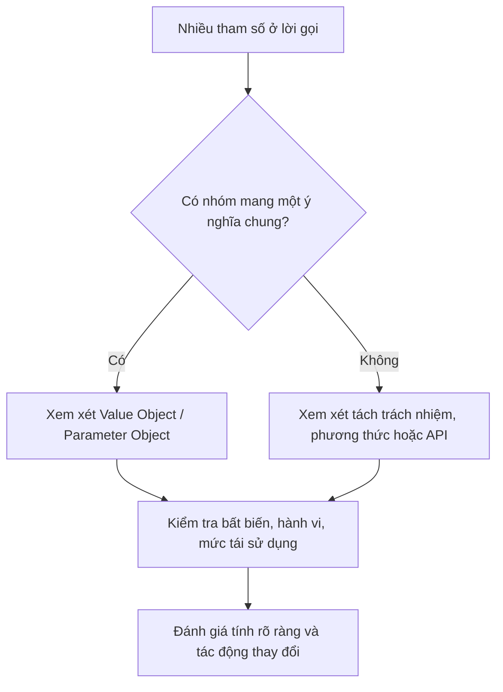
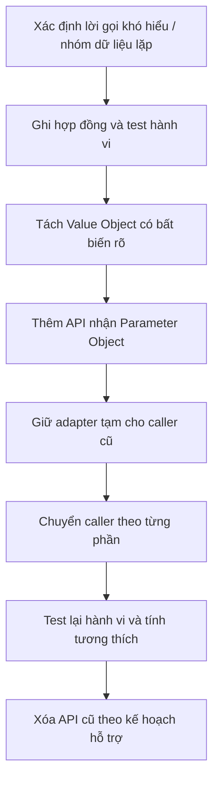

# Danh sách tham số dài và nhóm dữ liệu đi cùng nhau

Một lời gọi Java có chín tham số có thể khiến người đọc phải mở định nghĩa phương thức để biết từng giá trị có nghĩa gì. Nghiêm trọng hơn, cùng một bộ ba `countryCode`, `city`, `postalCode` lặp lại trong nhiều phương thức có thể cho thấy chương trình đang thiếu khái niệm **địa chỉ**. Khi sửa quy tắc hợp lệ của địa chỉ, người bảo trì phải tìm và cập nhật từng nơi riêng lẻ.

Đó là hai dấu hiệu thường được gọi là **Long Parameter List** (danh sách tham số dài) và **Data Clumps** (những nhóm dữ liệu thường đi cùng nhau). Chúng thuộc chương **Mùi mã** của **CODE_QUALITY_FUNDAMENTALS**, học phần giúp hiểu những thuộc tính quyết định mã nguồn có **đáng tin cậy, dễ hiểu và dễ thay đổi** hay không.

Mùi mã (*code smell*) **không tự chứng minh một lỗi đang tồn tại**. Nó là tín hiệu nên xem xét cấu trúc: người sử dụng API có đang phải ghi nhớ quá nhiều chi tiết không, các trường có bất biến chung không, và một thay đổi nhỏ có lan sang nhiều chữ ký phương thức không?

## Mục tiêu học tập

Sau bài này, bạn có thể:

1. Nhận diện danh sách tham số khó hiểu và những nhóm trường lặp lại theo cùng một ý nghĩa.
2. Phân biệt **tham số nhiều nhưng hợp lý** với **tham số đang che giấu một khái niệm miền**.
3. Áp dụng *Introduce Parameter Object*, *Extract Value Object* và những kỹ thuật liên quan đúng bối cảnh.
4. Dùng Java `record` để đóng gói dữ liệu, kiểm tra bất biến và làm rõ ngữ nghĩa ở nơi gọi.
5. Chuyển đổi API từng bước, giữ hành vi và tương thích với những caller đã tồn tại.
6. Tránh giải pháp quá tay như “God parameter object”, đối tượng cấu hình chứa mọi thứ hoặc abstraction chỉ nhằm giảm số tham số.

## 1. Long Parameter List là gì?

Hãy nhìn một lời gọi minh họa trong ứng dụng đặt phòng:

```java
Reservation reservation = factory.create(
        "GUEST-42",
        checkIn,
        checkOut,
        2,
        1,
        "VN",
        "Da Nang",
        "550000",
        true
);
```

Người đọc có thể đoán hai tham số ngày, nhưng khó trả lời ngay:

- `2` là số người lớn, số trẻ em hay số đêm?
- `1` là số phòng hay số trẻ em?
- `true` có nghĩa trả trước, cần ăn sáng hay đồng ý gửi email?
- `"VN"` là mã quốc gia của địa chỉ thanh toán, nơi lưu trú hay quốc tịch?
- Hai ngày có được bằng nhau không? Số trẻ em có thể âm không?

Ở nơi gọi, những giá trị khác loại thì dễ nhận ra hơn, còn **nhiều tham số cùng kiểu** khiến lỗi đảo thứ tự khó bị trình biên dịch phát hiện:

```java
// Cùng kiểu int: compiler không biết thứ tự đã bị đảo.
factory.create(
        "GUEST-42",
        checkIn,
        checkOut,
        1,  // Người gọi tưởng đây là số trẻ em.
        2,  // Người gọi tưởng đây là số người lớn.
        "VN",
        "Da Nang",
        "550000",
        true
);
```

**Định nghĩa thực dụng:** danh sách tham số trở thành *mùi mã* khi số lượng, sự giống nhau về kiểu hoặc quan hệ giữa các tham số làm việc sử dụng và thay đổi API dễ sai hơn. Không có một con số cố định (ví dụ “quá bốn tham số”) áp dụng đúng cho mọi phương thức.

### Khi nào nhiều tham số không nhất thiết là xấu?

Một hàm thuần phục vụ một phép toán đặc thù có thể cần nhiều thành phần độc lập và có chữ ký rõ ràng. Một API ở ranh giới giao thức đôi khi phải phản ánh chính xác một schema bên ngoài. Tạo thêm kiểu dữ liệu chỉ để giảm “độ dài” có thể khiến người đọc phải đi qua nhiều lớp mà không hiểu rõ hơn.

Vì vậy, thay vì chỉ đếm, hãy hỏi **các tham số có hình thành những nhóm ý nghĩa chung và được dùng chung lâu dài hay không**.

## 2. Data Clumps là gì?

**Data Clumps** là hiện tượng một nhóm trường thường xuất hiện cạnh nhau trong nhiều khai báo, lời gọi, lớp dữ liệu hoặc bước xử lý, chẳng hạn:

```java
void validateAddress(
        String countryCode, String city, String postalCode);

void printInvoice(
        String countryCode, String city, String postalCode);

void updateBillingAddress(
        String customerId,
        String countryCode, String city, String postalCode);
```

Ba trường `countryCode`, `city` và `postalCode` lặp lại theo cùng một ý nghĩa: **địa chỉ**. Nếu nghiệp vụ yêu cầu tất cả địa chỉ thanh toán phải có mã quốc gia và thành phố, quy tắc ấy có thể bị kiểm tra ở phương thức đầu nhưng bỏ sót trong phương thức cuối.

Một dấu hiệu khác là khi sửa một trường, ta thường phải sửa **cả nhóm**. Ví dụ, đổi ngày bắt đầu đặt phòng đôi khi phải kiểm tra ngày kết thúc; đổi số người lớn/trẻ em cần xem giới hạn số khách chung.

### Cách nhận diện theo ngữ nghĩa

| Dấu hiệu | Ví dụ | Điều cần xem xét |
| --- | --- | --- |
| **Đi cùng nhau** trong nhiều chữ ký. | `checkIn`, `checkOut`. | Có một khái niệm `StayPeriod` không? |
| **Được truyền nguyên bộ** qua nhiều tầng. | `street`, `city`, `postalCode`, `countryCode`. | Có một value object `PostalAddress` không? |
| **Được kiểm tra cùng nhau**. | `min`, `max` với điều kiện `min <= max`. | Một kiểu `Range` có thể giữ bất biến? |
| **Thay đổi cùng lý do**. | `currency` và `amountMinor`. | Có nên biểu diễn chung thành `Money`? |
| **Có nguy cơ đảo vị trí**. | `startDate`, `endDate` cùng kiểu `LocalDate`. | Tên kiểu mới và factory có làm caller rõ hơn? |
| **Có hành vi tự nhiên riêng**. | Ngày nhận/trả phòng quyết định số đêm. | `StayPeriod.nights()` có thể là hành vi của nhóm dữ liệu. |

**Phép thử gợi ý:** nếu bỏ một trường khỏi nhóm, những trường còn lại có mất bớt ý nghĩa hoặc không còn kiểm tra hợp lệ được không? Nếu có, đó là một lý do để xem xét tạo kiểu giá trị chung. Đây chỉ là câu hỏi định hướng, không phải luật.

## 3. Hai mùi mã có liên hệ nhưng không đồng nghĩa

Long Parameter List chú ý tới **một phương thức có bao nhiêu đầu vào và caller phải hiểu chúng ra sao**. Data Clumps chú ý tới **những dữ liệu nào thường cùng xuất hiện ở nhiều nơi**.



Một phương thức có nhiều tham số nhưng không có data clump nào: có thể nó đang làm **quá nhiều việc** và cần tách trách nhiệm. Ngược lại, data clump có thể xuất hiện trong nhiều phương thức chỉ có ba tham số: từng chữ ký ngắn nhưng hệ thống vẫn lặp đi lặp lại cùng một nhóm dữ liệu.

Điều cần tối ưu không phải “làm chữ ký trông ngắn nhất”, mà là **tạo một API diễn đạt ý định của người dùng và giảm số nơi cần giữ đồng bộ khi nghiệp vụ thay đổi**.

## 4. Trước khi refactor: làm rõ hợp đồng thực tế

Giả sử một chương trình tạo **đối tượng đặt phòng trong bộ nhớ** từ thông tin khách, kỳ lưu trú, số khách, địa chỉ thanh toán và tùy chọn ăn sáng:

```java
Reservation create(
        String guestId,
        LocalDate checkIn,
        LocalDate checkOut,
        int adults,
        int children,
        String countryCode,
        String city,
        String postalCode,
        boolean breakfast);
```

Theo **quy tắc minh họa** của bài:

1. `guestId` không rỗng.
2. `checkOut` phải sau `checkIn`; số đêm là hiệu giữa hai ngày.
3. Có ít nhất một người lớn; số trẻ em không âm.
4. Địa chỉ thanh toán cần mã quốc gia, thành phố và mã bưu chính không rỗng.
5. Giá phòng là **800.000 đơn vị tiền nhỏ nhất mỗi đêm**; nếu có ăn sáng, cộng **50.000 mỗi người mỗi đêm**.
6. Hàm chỉ **tạo giá trị Reservation**, chưa gửi email, chưa giữ chỗ trong database và chưa thu tiền.

Các mức giá này chỉ dùng để minh họa cấu trúc; trong hệ thống thật phải mô hình hóa tiền tệ, thuế, chính sách giá và xác nhận chỗ trống tương ứng.

Chữ ký ban đầu chứa những nhóm:

| Nhóm | Trường | Khái niệm có thể đặt tên |
| --- | --- | --- |
| Kỳ lưu trú | `checkIn`, `checkOut` | `StayPeriod`. |
| Nhóm khách | `adults`, `children` | `GuestCount`. |
| Địa chỉ thanh toán | `countryCode`, `city`, `postalCode` | `BillingAddress`. |
| Danh tính và lựa chọn đặt phòng | `guestId`, `breakfast` cùng các nhóm trên | `ReservationRequest` ở ranh giới use case. |

Đây là cơ hội **biểu diễn ý nghĩa** và tập trung quy tắc liên trường, không chỉ thay chín tham số bằng một tên `data`.

## 5. Trích nhóm dữ liệu thành value object Java 17

Java `record` thích hợp cho các nhóm giá trị có tên rõ ràng: nó cung cấp constructor, accessor, so sánh bằng giá trị, `hashCode` và `toString` mặc định.

### 5.1. `StayPeriod`: hai ngày tạo thành một bất biến

**`StayPeriod.java`:**

```java
import java.time.LocalDate;
import java.time.temporal.ChronoUnit;
import java.util.Objects;

public record StayPeriod(LocalDate checkIn, LocalDate checkOut) {
    public StayPeriod {
        Objects.requireNonNull(checkIn, "checkIn");
        Objects.requireNonNull(checkOut, "checkOut");
        if (!checkOut.isAfter(checkIn)) {
            throw new IllegalArgumentException(
                    "Check-out must be after check-in");
        }
    }

    public long nights() {
        return ChronoUnit.DAYS.between(checkIn, checkOut);
    }
}
```

Điểm thay đổi quan trọng là **không thể tạo một `StayPeriod` hợp lệ với ngày trả trước hoặc bằng ngày nhận**. Bất biến nằm ở nơi tạo nhóm dữ liệu, thay vì lặp lại `if (!checkOut.isAfter(checkIn))` ở mọi phương thức.

Đưa `nights()` vào `StayPeriod` cũng hợp lý vì số đêm là thông tin được tính **chỉ từ hai ngày**. Nếu chính sách tính đêm còn phụ thuộc múi giờ, giờ nhận/trả hoặc quy tắc khách sạn, mô hình phải được mở rộng theo hợp đồng thực tế thay vì áp dụng phép tính này máy móc.

### 5.2. `GuestCount`: hai số lượng mang ngữ nghĩa khác nhau

**`GuestCount.java`:**

```java
public record GuestCount(int adults, int children) {
    public GuestCount {
        if (adults <= 0 || children < 0) {
            throw new IllegalArgumentException(
                    "At least one adult and no negative child count");
        }
    }

    public long totalGuests() {
        return (long) adults + children;
    }
}
```

`totalGuests()` trả `long` để tổng của hai giá trị `int` không bị tràn trong phép cộng. Bản ví dụ chưa đặt giới hạn tối đa sức chứa của phòng; ràng buộc đó có thể phụ thuộc hạng phòng hoặc chính sách khách sạn, nên không được tự thêm một con số cố định nếu chưa có yêu cầu.

### 5.3. `BillingAddress`: nhóm trường lặp lại

**`BillingAddress.java`:**

```java
public record BillingAddress(
        String countryCode,
        String city,
        String postalCode) {

    public BillingAddress {
        if (countryCode == null || countryCode.isBlank()
                || city == null || city.isBlank()
                || postalCode == null || postalCode.isBlank()) {
            throw new IllegalArgumentException(
                    "Billing address fields are required");
        }
    }
}
```

Kiểu này diễn đạt **địa chỉ thanh toán**. Không nhất thiết địa chỉ giao hàng, địa chỉ cư trú và địa chỉ thanh toán có cùng quy tắc. Gộp tất cả vào một kiểu `Address` chung chỉ vì cùng có các trường giống nhau có thể làm mất sự khác biệt nghiệp vụ.

Ví dụ cũng không khẳng định mã bưu chính của mọi quốc gia có cùng định dạng. Nếu cần validation theo từng quốc gia, hãy định nghĩa và kiểm thử chính sách riêng. Một value object nên **giữ đúng bất biến đã biết**, không tự bịa ràng buộc.

### 5.4. `ReservationRequest`: input của use case

**`ReservationRequest.java`:**

```java
import java.util.Objects;

public record ReservationRequest(
        String guestId,
        StayPeriod stay,
        GuestCount guests,
        BillingAddress billingAddress,
        boolean breakfast) {

    public ReservationRequest {
        if (guestId == null || guestId.isBlank()) {
            throw new IllegalArgumentException("Guest ID is required");
        }
        Objects.requireNonNull(stay, "stay");
        Objects.requireNonNull(guests, "guests");
        Objects.requireNonNull(billingAddress, "billingAddress");
    }
}
```

Chú ý sự phân biệt:

- `StayPeriod`, `GuestCount` và `BillingAddress` là những **khái niệm có bất biến riêng**.
- `ReservationRequest` là **một thông điệp yêu cầu** gom những dữ liệu cần thiết cho thao tác tạo đặt phòng.

Chúng có thể được dùng cùng nhau; không cần cố coi mọi parameter object là thực thể miền sâu sắc. Một request object mỏng vẫn có ích nếu nó làm rõ **ranh giới sử dụng** và có phạm vi hẹp.

## 6. Sau refactor: API thể hiện ý định

Ví dụ mã ứng dụng có thể dùng một tham số có tên:

```java
ReservationRequest request = new ReservationRequest(
        "GUEST-42",
        new StayPeriod(checkIn, checkOut),
        new GuestCount(2, 1),
        new BillingAddress("VN", "Da Nang", "550000"),
        true);

Reservation reservation = factory.create(request);
```

Lời gọi dài hơn về số ký tự, nhưng **ít mơ hồ hơn về cấu trúc**. Các giá trị `2` và `1` nằm trong `GuestCount`; hai ngày nằm trong `StayPeriod`; ba chuỗi địa chỉ có phạm vi rõ. Khi một phương thức khác cũng cần kỳ lưu trú, nó chỉ nhận `StayPeriod` thay vì phải nhận hai `LocalDate` độc lập rồi tự kiểm tra lại.

### Hiện thực ví dụ đầy đủ

**`Reservation.java`:**

```java
public record Reservation(
        String guestId,
        StayPeriod stay,
        GuestCount guests,
        BillingAddress billingAddress,
        boolean breakfast,
        long totalMinor) {}
```

**`ReservationFactory.java`:**

```java
import java.util.Objects;

public final class ReservationFactory {
    private static final long ROOM_PER_NIGHT = 800_000L;
    private static final long BREAKFAST_PER_GUEST_NIGHT = 50_000L;

    public Reservation create(ReservationRequest request) {
        Objects.requireNonNull(request, "request");

        long nights = request.stay().nights();
        long roomTotal = Math.multiplyExact(
                nights, ROOM_PER_NIGHT);

        long breakfastTotal = 0L;
        if (request.breakfast()) {
            long guestNights = Math.multiplyExact(
                    nights, request.guests().totalGuests());
            breakfastTotal = Math.multiplyExact(
                    guestNights, BREAKFAST_PER_GUEST_NIGHT);
        }

        return new Reservation(
                request.guestId(),
                request.stay(),
                request.guests(),
                request.billingAddress(),
                request.breakfast(),
                Math.addExact(roomTotal, breakfastTotal));
    }
}
```

Hàm `create` chỉ dựng một giá trị đặt phòng. Nó dùng `Math.multiplyExact` và `Math.addExact` để **không âm thầm trả số tiền sai nếu phép tính `long` bị tràn**. Nếu yêu cầu thực tế có giá theo nhiều tiền tệ, nhiều phòng hoặc chương trình khuyến mãi, cần mô hình khác thay vì xem hai hằng số trong ví dụ là quy tắc có thể dùng trực tiếp ở production.

### Điều đã cải thiện

1. **Điểm tạo dữ liệu được kiểm tra tập trung.** Không thể tạo `StayPeriod` có ngày kết thúc trước ngày bắt đầu qua constructor thông thường.
2. **Caller ít phụ thuộc thứ tự các giá trị cùng kiểu.** `GuestCount(2, 1)` vẫn cần chú ý, nhưng sai sót được giới hạn ở một khái niệm, không phải toàn chữ ký chín tham số.
3. **Chữ ký phương thức phản ánh ranh giới use case.** `create(ReservationRequest request)` thể hiện đang nhận một yêu cầu đặt phòng.
4. **Quy tắc chung có nơi sở hữu.** `nights()` và `totalGuests()` không bị nhân bản ở nhiều service.
5. **Refactor về sau có phạm vi rõ hơn.** Nếu dữ liệu khách cần mở rộng, có thể sửa kiểu liên quan và những caller thực sự sử dụng nó.

Tuy nhiên, việc thêm field vào `ReservationRequest` cũng có thể ảnh hưởng constructor, serializer và caller. **Tạo một object không tự động bảo đảm tương thích API hay ít thay đổi**; lợi ích chỉ xuất hiện khi ranh giới và quy tắc nhóm phù hợp.

## 7. Kiểm thử các bất biến và hành vi sau refactor

Khi gom tham số, rủi ro thường gặp là **làm thay đổi thứ tự giá trị, điều kiện biên hoặc cách tính**. Do đó cần có kiểm thử kết quả trước và sau khi chuyển đổi.

**`ReservationFactoryTest.java` — JUnit 5:**

```java
import static org.junit.jupiter.api.Assertions.*;

import java.time.LocalDate;
import org.junit.jupiter.api.Test;

class ReservationFactoryTest {
    private final ReservationFactory factory = new ReservationFactory();

    @Test
    void createsReservationWithRoomAndBreakfastCost() {
        StayPeriod stay = new StayPeriod(
                LocalDate.of(2026, 11, 16),
                LocalDate.of(2026, 11, 18));
        GuestCount guests = new GuestCount(2, 1);
        BillingAddress address = new BillingAddress(
                "VN", "Da Nang", "550000");

        Reservation result = factory.create(new ReservationRequest(
                "GUEST-42", stay, guests, address, true));

        // 2 đêm x 800_000 + 2 đêm x 3 khách x 50_000.
        assertEquals(1_900_000L, result.totalMinor());
        assertEquals("GUEST-42", result.guestId());
        assertEquals(stay, result.stay());
        assertEquals(guests, result.guests());
        assertEquals(address, result.billingAddress());
        assertTrue(result.breakfast());
    }

    @Test
    void withoutBreakfastChargesOnlyRoomRate() {
        ReservationRequest request = new ReservationRequest(
                "GUEST-42",
                new StayPeriod(
                        LocalDate.of(2026, 11, 16),
                        LocalDate.of(2026, 11, 18)),
                new GuestCount(2, 0),
                new BillingAddress("VN", "Da Nang", "550000"),
                false);

        assertEquals(1_600_000L,
                factory.create(request).totalMinor());
    }

    @Test
    void stayPeriodRejectsEqualOrReversedDates() {
        LocalDate start = LocalDate.of(2026, 11, 16);

        assertThrows(IllegalArgumentException.class,
                () -> new StayPeriod(start, start));
        assertThrows(IllegalArgumentException.class,
                () -> new StayPeriod(start, start.minusDays(1)));
    }

    @Test
    void guestCountAndAddressEnforceTheirOwnRules() {
        assertThrows(IllegalArgumentException.class,
                () -> new GuestCount(0, 1));
        assertThrows(IllegalArgumentException.class,
                () -> new GuestCount(2, -1));
        assertThrows(IllegalArgumentException.class,
                () -> new BillingAddress("VN", "", "550000"));
    }
}
```

Các assertion kiểm tra **quy tắc nghiệp vụ đã nêu**, không chỉ xác nhận hàm “chạy được” hoặc trả object khác `null`. Nếu làm refactor mà tính số đêm thành `checkOut - checkIn + 1` hoặc đảo `adults` với `children`, những test có dữ liệu đủ phân biệt sẽ giúp phát hiện thay đổi không mong muốn.

### Test nên bao phủ những điểm nào?

| Nhóm | Ca có giá trị | Vì sao? |
| --- | --- | --- |
| Tính hợp lệ | Ngày kết thúc bằng/trước ngày bắt đầu. | Bất biến giữa hai ngày. |
| Giá trị biên | Một đêm, nhiều đêm, không ăn sáng. | Kiểm tra phép tính không âm và cờ lựa chọn. |
| Tương quan số lượng | Ít nhất một người lớn; không có số trẻ em âm. | Ngăn trạng thái không hợp lệ. |
| Dữ liệu theo nhóm | Địa chỉ có đúng quốc gia, thành phố, bưu chính. | Phát hiện đảo vị trí hoặc bỏ sót khi dựng object. |
| Chuyển đổi API | Lời gọi kiểu cũ và mới cho cùng kết quả theo hợp đồng. | Bảo vệ tương thích trong giai đoạn di trú. |
| Giá trị lớn | Phép nhân/cộng vượt `long` bị từ chối bằng exception. | Tránh âm thầm tính sai vì tràn số. |

Không nhất thiết tạo một test cho **mọi field giống hệt nhau** nếu không mang thêm bằng chứng, nhưng các trường dễ bị đảo thứ tự và các bất biến liên trường cần được kiểm tra rõ ràng.

## 8. Refactor an toàn khi API đã có nhiều caller

Thay thẳng chữ ký public từ chín tham số thành một tham số có thể làm hàng loạt caller không biên dịch, thậm chí phá tương thích nhị phân đối với thư viện đã phát hành.

Một cách chuyển đổi tăng dần:

1. Viết **characterization tests** cho hành vi hiện tại cần bảo toàn; đánh dấu rõ hành vi nào đang sai yêu cầu để không vô tình “đóng băng” bug.
2. Tạo những value object nhỏ với bất biến có chủ đích.
3. Thêm phương thức mới nhận `ReservationRequest`; giữ phương thức cũ tạm thời dưới dạng adapter.
4. Chuyển caller theo từng phần sang API mới; bổ sung test so sánh và test biên.
5. Đánh dấu phương thức cũ là deprecated, công bố kế hoạch bỏ nếu có consumer bên ngoài.
6. Chỉ xóa API cũ khi hết thời gian hỗ trợ và các caller thuộc phạm vi trách nhiệm đã di trú.

### Adapter tương thích để di trú

Thêm overload sau vào bên trong lớp `ReservationFactory` ở mục 6:

```java
@Deprecated(since = "2.0", forRemoval = false)
public Reservation create(
        String guestId,
        java.time.LocalDate checkIn,
        java.time.LocalDate checkOut,
        int adults,
        int children,
        String countryCode,
        String city,
        String postalCode,
        boolean breakfast) {

    return create(new ReservationRequest(
            guestId,
            new StayPeriod(checkIn, checkOut),
            new GuestCount(adults, children),
            new BillingAddress(countryCode, city, postalCode),
            breakfast));
}
```

Đây là **đoạn phương thức để chèn vào lớp**, không phải một file Java độc lập. `since = "2.0"` chỉ là ví dụ cho một kế hoạch versioning; phải dùng phiên bản thực tế của thư viện khi áp dụng.

Adapter đưa dữ liệu qua **cùng constructor và invariant mới**. Nếu API cũ từng chấp nhận dữ liệu mà API mới từ chối, đó có thể là **thay đổi hành vi**, không đơn thuần là refactor. Khi ấy cần xác định hợp đồng cũ đúng hay sai, cách chuyển đổi dữ liệu và chính sách tương thích trước khi gộp hai đường.

### Test so sánh hai đường gọi

```java
@Test
@SuppressWarnings("deprecation")
void oldAndNewApiCreateEquivalentReservation() {
    LocalDate start = LocalDate.of(2026, 11, 16);
    LocalDate end = LocalDate.of(2026, 11, 18);

    Reservation fromOld = factory.create(
            "GUEST-42", start, end, 2, 1,
            "VN", "Da Nang", "550000", true);

    Reservation fromNew = factory.create(
            new ReservationRequest(
                    "GUEST-42",
                    new StayPeriod(start, end),
                    new GuestCount(2, 1),
                    new BillingAddress("VN", "Da Nang", "550000"),
                    true));

    assertEquals(fromNew, fromOld);
}
```

Đoạn test này giả định được đặt trong `ReservationFactoryTest`, có sẵn biến `factory` và import JUnit 5, `LocalDate` như ở mục 7. Nó giúp phát hiện sai lệch **giữa hai đường API**, nhưng **không đủ để chứng minh cả hai cùng đúng nghiệp vụ**, vì cùng có thể đi qua một implementation sai. Cần giữ những test có kết quả kỳ vọng độc lập.

## 9. Chọn kỹ thuật nào cho từng nguyên nhân?

Không phải danh sách tham số dài nào cũng nên được giải quyết bằng một record duy nhất.

| Kỹ thuật | Phù hợp khi | Cẩn trọng |
| --- | --- | --- |
| **Introduce Parameter Object** | Nhiều giá trị luôn đi cùng trong một thao tác và cần tên chung. | Đừng tạo object chứa mọi trường không liên quan chỉ để chữ ký ngắn. |
| **Extract Value Object / Class** | Nhóm dữ liệu có ý nghĩa và bất biến riêng, xuất hiện nhiều nơi. | Đừng nhầm những khái niệm có trường giống nhau nhưng quy tắc khác nhau. |
| **Preserve Whole Object** | Caller đã có đối tượng chứa chính những dữ liệu callee cần. | Đừng truyền cả entity/aggregate nếu chỉ cần hai trường; tăng coupling. |
| **Replace Parameter with Query** | Callee có thể lấy một giá trị đáng tin cậy từ đối tượng đã nhận. | Query có I/O, side effect, chi phí lớn hoặc phụ thuộc ngầm có thể làm code khó hiểu hơn. |
| **Extract Method / Split Responsibilities** | Danh sách dài vì phương thức đang giải quyết nhiều việc khác nhau. | Đừng tách máy móc khiến một use case bị chia vụn và khó đọc. |
| **Builder** | Nhiều tùy chọn độc lập hoặc trường tùy chọn, cần lời gọi dễ đọc. | Builder không tự kiểm soát bất biến; phải validate khi `build()`. |
| **Đổi boolean thành enum** | Một cờ không rõ nghĩa hoặc sắp có nhiều trạng thái. | Với một cờ thật sự đơn giản và ổn định, enum có thể là dư thừa. |

Ví dụ:

```java
// Khó đọc nếu caller chỉ thấy các giá trị:
send(message, true, false, true);

// Dễ thể hiện ý định hơn khi hành vi thực sự có các chế độ:
send(message, DeliveryMode.EXPRESS, ReceiptPolicy.NONE);
```

`DeliveryMode` và `ReceiptPolicy` là kiểu minh họa, không phải Java API chuẩn. Nếu có ba boolean có ý nghĩa **độc lập**, một options object với các trường đặt tên rõ có thể hợp lý hơn một enum trộn mọi tổ hợp.

### Parameter Object khác “túi dữ liệu” vô hạn

Một giải pháp kém:

```java
class EverythingContext {
    String guestId;
    String countryCode;
    String postalCode;
    boolean breakfast;
    String adminToken;
    java.sql.Connection connection;
    Object debugMetadata;
    // Sau vài tháng: nhiều chục trường của nhiều use case.
}

void create(EverythingContext context);
```

Chữ ký mới nhìn rất ngắn, nhưng:

- Callee có thể đọc dữ liệu không liên quan, khiến phụ thuộc khó nhận diện.
- Trạng thái mutable được chia sẻ qua nhiều nơi và thiếu invariant chung.
- Một object chứa cả token và connection tăng rủi ro tài nguyên/bảo mật.
- Cùng một kiểu được đưa vào nhiều lớp chỉ để tránh khai báo tham số rõ ràng.

Đó là **dịch chuyển độ phức tạp khỏi chữ ký**, không phải giảm coupling. `ReservationRequest` tốt hơn vì chỉ chứa dữ liệu của **một use case rõ ràng**, và các thành phần có trách nhiệm riêng.

## 10. Khi nào nên giữ tham số riêng?

Không phải cứ hai dữ liệu thường xuất hiện cùng nhau là phải tạo kiểu mới.

Ví dụ:

```java
double interpolate(double start, double end, double factor);
```

Ba tham số này có một công thức toán học rõ ràng; một lớp `InterpolationArguments` có thể chỉ làm API dài thêm mà không bổ sung bất biến hay ý nghĩa mới. Nếu `start` và `end` về sau được dùng như một khoảng có quy tắc riêng, khi ấy mới có lý do tạo `Range`.

Một ví dụ khác:

```java
void setViewport(int x, int y, int width, int height);
```

Đây có thể là API đồ họa tiêu chuẩn, quen thuộc với người dùng thư viện. Một `Rectangle` hay `Viewport` có thể có ích nếu cần tái sử dụng và kiểm tra `width > 0`, `height > 0`, nhưng lợi ích phải cân đối với khả năng tương thích API, chi phí chuyển đổi dữ liệu và cách sử dụng thực tế.

### Hãy đánh giá theo tác động thay đổi

Nếu nhiều phương thức phải sửa đồng thời mỗi khi thêm `postalCode`, việc tạo `BillingAddress` có thể giúp **gom thay đổi vào một khái niệm có tên**. Nhưng nếu chỉ một phương thức nhận bốn giá trị hiếm khi thay đổi và caller rất ít, thêm nhiều record có thể chưa cải thiện khả năng bảo trì.

Kỹ thuật tốt là kỹ thuật làm cho mã **dễ hiểu hơn khi đọc từ nơi gọi** và **ít chỗ phải giữ đồng bộ hơn khi yêu cầu thay đổi**.

## 11. Bất biến, bất biến sâu và dữ liệu có thể sửa

Java `record` tạo ra đối tượng mà các trường thành phần là `final`, nhưng **không tự biến mọi đối tượng được tham chiếu thành bất biến sâu**. Trong ví dụ trước, `LocalDate` và `String` là kiểu bất biến nên khá phù hợp.

Nếu một request chứa danh sách mutable:

```java
record BookingBatch(java.util.List<String> guestIds) {
    BookingBatch {
        guestIds = java.util.List.copyOf(guestIds);
    }
}
```

`List.copyOf` tạo danh sách không cho sửa qua tham chiếu trả về và không chấp nhận phần tử `null`; nó **không bảo đảm bất biến sâu** nếu phần tử là object mutable. Với `String` trong ví dụ, các phần tử cũng bất biến. Nếu yêu cầu cho phép phần tử `null`, phải thiết kế một hợp đồng khác thay vì dùng `List.copyOf` vô điều kiện.

### Tránh truyền cả entity chỉ để giảm tham số

```java
// Hai giá trị thực sự cần cho phép tính:
long daysBetween(LocalDate start, LocalDate end);

// Không tự động tốt hơn nếu chỉ để che hai giá trị:
long daysBetween(CustomerAccount entireAccount);
```

Truyền toàn bộ aggregate khiến hàm thời gian phụ thuộc vào entity khác, vòng đời ORM hoặc dữ liệu mutable ngoài nhu cầu. **Tính đóng gói tốt không đồng nghĩa truyền đối tượng càng lớn càng tốt**.

### Chú ý API serialization và compatibility

Khi `ReservationRequest` được dùng trong JSON/HTTP hoặc message, thay constructor Java bằng record có thể cần:

- Cập nhật mapping JSON và quy tắc required/nullable.
- Xác định shape schema có thay đổi hay không; nội bộ có thể dùng record nhưng hợp đồng HTTP vẫn giữ cấu trúc phẳng.
- Kiểm tra khách hàng cũ, version, backward compatibility và migration.
- Tránh vô tình để `toString()` của record chứa thông tin nhạy cảm rồi bị log toàn bộ.

Refactor trong bộ nhớ không nhất thiết phải thay đổi **hợp đồng ngoài hệ thống**. Có thể dùng adapter để map JSON phẳng hiện tại sang value object nội bộ cho đến khi có quyết định chuyển đổi API công khai.

## 12. Cách kiểm chứng refactor thực sự cải thiện chất lượng

Đếm số tham số trước/sau là dễ, nhưng **không đủ**. Nên đánh giá nhiều tín hiệu:

| Câu hỏi | Dấu hiệu có cải thiện | Dấu hiệu cần xem lại |
| --- | --- | --- |
| Caller có hiểu ý nghĩa ngay không? | `new StayPeriod(start, end)`, `new GuestCount(2, 1)`. | `new Data(a, b, c, d, e)` với tên chung chung. |
| Bất biến còn bị lặp không? | Kiểm tra ngày ở constructor `StayPeriod`. | Mỗi service vẫn có cùng đoạn kiểm tra ngày. |
| Thay đổi lan bao xa? | Thay quy tắc kỳ lưu trú không phải sửa mọi chữ ký. | Thêm field vô nghĩa vào object chung gây sửa hàng loạt nơi. |
| Coupling có giảm không? | Callee chỉ biết `BillingAddress` khi cần địa chỉ. | Callee nhận cả `BookingContext` chứa token, DB, flags. |
| Test có rõ hơn không? | Kiểm thử giá trị, ranh giới và constructor riêng. | Chỉ assert object khác `null`. |
| Có giữ hành vi và compatibility không? | Test biên/tương thích đạt, caller cũ di trú có kiểm soát. | API công khai bị đổi ngoài kế hoạch. |

Static analyzer có thể đánh dấu phương thức có quá nhiều tham số, nhưng **không quyết định được** một nhóm giá trị có cùng ý nghĩa nghiệp vụ hay không. Một cảnh báo “Parameter count: 9” nên khởi đầu cuộc điều tra, không phải mục tiêu tự động biến mọi chữ ký thành một object.

### Quy trình refactor từng bước



Nếu chưa có test, ưu tiên bổ sung test cho hành vi quan trọng trước khi refactor. Nếu mã ban đầu đã sai yêu cầu, phải phân biệt **sửa bug** với **tái cấu trúc giữ nguyên hành vi**, vì hai thay đổi có rủi ro và cách review khác nhau.

## 13. Những sai lầm phổ biến

**“Cứ trên bốn tham số là mùi mã chắc chắn.”** Không có ngưỡng tuyệt đối. Cần xem ngữ nghĩa, độ rõ nơi gọi và chi phí thay đổi.

**“Gom tất cả tham số vào một lớp là đã giải quyết vấn đề.”** Một data bag quá rộng có thể tăng coupling và khiến invariant khó quản lý hơn.

**“Hai trường cùng kiểu thì phải thành value object.”** Chưa đủ. Chúng phải có ý nghĩa chung hoặc quy tắc liên quan có giá trị thực sự.

**“Những trường đi cùng nhau ở một DTO luôn là một khái niệm miền.”** DTO do giao thức quy định có thể chứa nhiều trách nhiệm; không nên trộn boundary contract với domain model mà không suy xét.

**“Dùng `record` tự động tạo dữ liệu bất biến an toàn.”** `record` không có bất biến sâu đối với collection hay object mutable; cần defensive copy và hợp đồng rõ.

**“Không cần test vì chỉ đổi chữ ký.”** Chuyển nhầm thứ tự `int` hoặc `String`, thay logic validation và serialization vẫn có thể gây lỗi.

**“Thêm enum cho mọi boolean.”** Enum hữu ích khi làm rõ ý định hoặc mở rộng trạng thái, nhưng không phải lúc nào cũng cần thiết.

**“Truyền cả entity sẽ giảm nhiều tham số, nên luôn tốt.”** Nó có thể khiến callee phụ thuộc vào rất nhiều dữ liệu không cần thiết và vòng đời của entity.

**“Bất biến nhóm dữ liệu càng nhiều càng tốt.”** Thêm ràng buộc không có trong yêu cầu có thể làm từ chối dữ liệu hợp lệ. Value object cần đúng với hợp đồng.

**“Đã refactor xong khi code biên dịch.”** Cần kiểm tra hành vi, trường hợp biên, API compatibility và dữ liệu được chuyển qua đúng vị trí.

## 14. Checklist cho code review

Khi gặp một phương thức có nhiều tham số, hãy hỏi:

1. **Tham số nào luôn đi cùng nhau?** Có một thuật ngữ miền chính xác để gọi nhóm đó không?
2. **Những trường nào được kiểm tra chung?** Có bất biến như `start < end`, `discount <= subtotal` không?
3. **Caller có thể truyền nhầm thứ tự không?** Đặc biệt `String`, `int`, `boolean` và những kiểu giống nhau.
4. **Phương thức có đang làm nhiều trách nhiệm?** Nếu có, tạo parameter object thôi chưa chắc đủ.
5. **Nhóm mới đặt ở tầng nào?** Value object của miền hay DTO/parameter object của một use case?
6. **Có dữ liệu không cần thiết bị kéo theo không?** Tránh truyền toàn bộ entity hoặc context quá rộng.
7. **Có đường tương thích cho caller cũ không?** Public API và serialized schema cần kế hoạch di trú.
8. **Refactor có giữ kết quả và side effect không?** Unit, integration và contract test cần kiểm chứng đúng tầng.
9. **Có tăng số lớp mà không tăng ý nghĩa không?** Không tạo abstraction chỉ để qua một ngưỡng metric.
10. **Sau sửa, người mới đọc nơi gọi có hiểu nhanh hơn không?** Đây là phép kiểm thực tế quan trọng.

## 15. Câu hỏi tự kiểm tra

**Câu 1.** Một hàm nhận chín tham số, trong đó ba giá trị `countryCode`, `city`, `postalCode` luôn xuất hiện cùng ở bốn hàm khác. Có những dấu hiệu nào?

*Gợi ý:* Long Parameter List tại từng lời gọi và Data Clumps ở nhóm địa chỉ. Có thể tạo `BillingAddress` hoặc một kiểu địa chỉ phù hợp hợp đồng, sau đó kiểm tra phạm vi sử dụng.

**Câu 2.** Vì sao `new GuestCount(2, 1)` thường rõ hơn truyền hai `int` đứng liền giữa chín tham số?

*Gợi ý:* Nó đặt tên cho ý nghĩa của cặp số và chuyển kiểm tra số lượng về một điểm, dù constructor của `GuestCount` vẫn cần tuân thủ đúng thứ tự.

**Câu 3.** Sau refactor, một phương thức `create(EverythingContext context)` nhận object chứa mọi dữ liệu ứng dụng. Danh sách tham số đã ngắn; vì sao thiết kế vẫn có thể kém?

*Gợi ý:* Coupling với dữ liệu không liên quan, trạng thái mutable, trách nhiệm không rõ và nguy cơ làm lộ thông tin.

**Câu 4.** Hai ngày `checkIn` và `checkOut` có mối quan hệ gì khiến việc tạo `StayPeriod` hữu ích?

*Gợi ý:* Điều kiện ngày trả phải sau ngày nhận và phép tính số đêm chỉ có nghĩa với cả hai giá trị.

**Câu 5.** Một API Java đã được nhiều module bên ngoài sử dụng. Có nên xóa ngay phương thức chín tham số khi thêm `ReservationRequest`?

*Gợi ý:* Cần đánh giá tương thích nguồn và nhị phân, giữ overload adapter tạm thời và kế hoạch deprecation/migration phù hợp.

**Câu 6.** Bộ test so sánh kết quả gọi overload cũ với overload mới, hai kết quả bằng nhau. Đã chứng minh nghiệp vụ đúng chưa?

*Gợi ý:* Chưa. Cả hai có thể cùng đi qua logic sai. Vẫn cần test có expected lấy từ quy tắc nghiệp vụ, nhất là giá trị biên.

**Câu 7.** Một hàm nội bộ tính công thức với ba tham số độc lập và tên rõ, hiếm khi thay đổi. Có cần tạo parameter object?

*Gợi ý:* Không nhất thiết. Chỉ tạo kiểu mới nếu nó làm rõ ngữ nghĩa, giúp giữ invariant hoặc giảm chi phí thay đổi thực tế.

## Ghi nhớ

- **Long Parameter List** cảnh báo về chữ ký khó sử dụng; **Data Clumps** cảnh báo những nhóm dữ liệu có thể đang thiếu một tên gọi và ranh giới chung.
- **Gom theo ý nghĩa, không chỉ theo số lượng.** Value object nên sở hữu những bất biến tự nhiên, còn parameter object gom dữ liệu đúng phạm vi một thao tác.
- Java `record` có thể giúp biểu diễn những nhóm giá trị nhỏ, rõ, nhưng cần chú ý validation, bất biến sâu và hợp đồng serialization.
- **Không biến mọi lời gọi thành một context khổng lồ.** Giảm coupling và tăng khả năng hiểu mã là mục tiêu, không phải tối thiểu hóa số tham số bằng mọi giá.
- **Refactor cần bằng chứng:** test kết quả, bất biến, dữ liệu biên, tác dụng phụ và tương thích caller trước/sau.

**Câu hỏi khi quyết định tách nhóm tham số:** “Các giá trị này có cùng đại diện một khái niệm mà người dùng hoặc lập trình viên cần hiểu, kiểm tra và thay đổi như một đơn vị không?”
