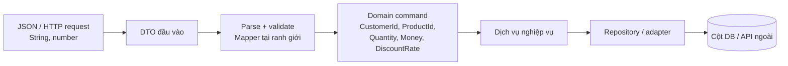

# Dùng kiểu nguyên thủy thay cho khái niệm miền cần ràng buộc

Trong module `CODE_QUALITY_FUNDAMENTALS`, chúng ta tìm hiểu những thuộc tính quyết định mã nguồn có **đáng tin cậy, dễ hiểu và dễ thay đổi** hay không. Ở chương **Mùi mã**, một dấu hiệu thiết kế thường gặp là dùng những kiểu dữ liệu quá chung như `int`, `long`, `String`, `BigDecimal` hoặc `Map<String, Object>` để biểu diễn **khái niệm nghiệp vụ có ý nghĩa và ràng buộc riêng**. Mùi mã này thường được gọi là **Primitive Obsession** — *lạm dụng kiểu nguyên thủy hoặc kiểu giá trị quá chung*.

Điều đáng chú ý: `String` và `BigDecimal` **không phải kiểu nguyên thủy của ngôn ngữ Java**. Nhưng trong ngữ cảnh mùi mã, chúng vẫn có thể được dùng như các “vật chứa dữ liệu thô” khi chương trình cần một **kiểu miền (domain type)** có hợp đồng cụ thể. Vấn đề không nằm ở việc sử dụng `int` hay `String` tự thân, mà ở chỗ **ý nghĩa nghiệp vụ, đơn vị đo và điều kiện hợp lệ chỉ tồn tại trong trí nhớ của người lập trình**, thay vì được biểu đạt tại ranh giới dữ liệu.

Ví dụ, một phương thức nhận:

```java
BigDecimal calculateTotal(
        String customerId,
        String productId,
        int quantity,
        BigDecimal unitPrice,
        String currencyCode,
        BigDecimal discountRate);
```

Chữ ký cho biết *kiểu Java* nhưng chưa bảo đảm:

- `customerId` và `productId` không bị truyền nhầm vì đều là `String`.
- `quantity` phải lớn hơn 0.
- `unitPrice` không âm và có số chữ số thập phân phù hợp với tiền tệ.
- `currencyCode` là đơn vị được hệ thống hỗ trợ, chẳng hạn VND hoặc USD.
- `discountRate` biểu diễn tỷ lệ `0.20` hay phần trăm `20`; có nằm trong khoảng cho phép không.

Một lời gọi có thể **biên dịch thành công** dù ý nghĩa sai, ví dụ truyền đổi chỗ hai ID dạng chuỗi, cho số lượng âm hoặc giảm giá `20` với nơi triển khai đang hiểu tỷ lệ là từ 0 đến 1. Mã kiểm tra các điều kiện đó sau mỗi lần gọi thường lặp lại, và chỉ một đường xử lý quên kiểm tra đã có thể gây lỗi.

**Mục tiêu bài học:** nhận diện khi dữ liệu thô đang che giấu khái niệm miền, quyết định có nên tạo kiểu giá trị riêng hay không, triển khai bất biến bằng Java, và đánh giá bản sửa qua tính đúng đắn, khả năng hiểu và chi phí bảo trì.

Sau bài học, bạn có thể:

- Phân biệt primitive obsession với việc sử dụng kiểu cơ bản một cách hợp lý.
- Xác định **đơn vị**, **miền giá trị**, **định dạng**, **quy tắc so sánh** và **phép toán hợp lệ** của một khái niệm nghiệp vụ.
- Sử dụng Java `record` hoặc lớp giá trị bất biến để bảo vệ bất biến ngay khi khởi tạo.
- Thiết kế các kiểu như `CustomerId`, `ProductId`, `Quantity`, `Money` và `DiscountRate` để tránh tráo nghĩa dữ liệu.
- Đặt chuyển đổi dữ liệu từ JSON/DB vào ranh giới phù hợp, giữ thông điệp lỗi rõ ràng.
- Refactor từng bước và kiểm thử được hành vi cũ lẫn những đầu vào không hợp lệ.

## 1. Nhận diện Primitive Obsession

Một kiểu dữ liệu quá rộng thường “cho phép” nhiều giá trị mà miền nghiệp vụ **không cho phép**. Chẳng hạn `int` cho phép số âm và 0, nhưng **số lượng cần mua** phải là số nguyên dương. `BigDecimal` có thể là số âm, nhưng **đơn giá bán** thông thường không được âm. `String` có thể là chuỗi trống hoặc văn bản bất kỳ, nhưng **mã đơn hàng** có định dạng và ngữ nghĩa riêng.

### Các dấu hiệu thường gặp

| Dấu hiệu trong mã | Nguy cơ thực tế | Câu hỏi cần đặt ra |
| --- | --- | --- |
| Nhiều tham số cùng kiểu `String` hoặc `long` | Đổi chỗ ID mà compiler không báo lỗi | Mỗi giá trị đại diện thực thể miền nào? |
| Kiểm tra `quantity > 0` rải rác ở controller, service và repository | Một đường xử lý quên validate hoặc kiểm tra không thống nhất | Có một ranh giới tạo ra “số lượng hợp lệ” không? |
| Các phép nhân `price.multiply(rate)` ở nhiều chỗ | Dùng nhầm đơn vị, làm tròn hoặc tiền tệ | Phép toán này thuộc về khái niệm miền nào? |
| `String status` được so với nhiều giá trị viết tay | Sai chính tả, bỏ sót trạng thái, chuyển trạng thái bất hợp lệ | Có thể dùng enum và mô hình chuyển trạng thái không? |
| Dùng `Map<String, Object>` làm dữ liệu nghiệp vụ | Ép kiểu động, thiếu khóa, lỗi chỉ xuất hiện khi chạy | Có cấu trúc/hợp đồng dữ liệu ổn định nào không? |
| Tên `value`, `amount`, `number` không kèm đơn vị | Nhầm đồng với xu, giây với mili giây, 0,2 với 20% | Đơn vị và chính sách chuyển đổi nằm ở đâu? |
| Một nhóm trường luôn được truyền cùng nhau | Trường liên quan dễ bị tách rời hoặc cập nhật không nhất quán | Nhóm đó có thể là một giá trị miền không? |

**Đừng chỉ đếm số tham số** để kết luận. Một hàm toán học nội bộ nhận hai `double` có thể hoàn toàn rõ ràng. Mùi mã xuất hiện mạnh khi các giá trị có **hợp đồng miền khác nhau** nhưng được biểu diễn giống nhau, hoặc khi hành vi đúng phụ thuộc vào quy tắc không được bảo vệ.

### Khái niệm miền khác kiểu dữ liệu lưu trữ

Một số ví dụ:

| Khái niệm | Kiểu lưu trữ thường gặp | Ràng buộc/ý nghĩa cần xem xét |
| --- | --- | --- |
| Số lượng mua `Quantity` | `int` | Lớn hơn 0; có ngưỡng tối đa theo nghiệp vụ không? |
| Số điểm khả dụng `AvailablePoints` | `long` | Không âm; cập nhật phải bảo vệ bất biến khi đồng thời |
| Mã sản phẩm `ProductId` | `String` hoặc `UUID` | Không rỗng, đúng định dạng, không tráo với `CustomerId` |
| Tiền `Money` | `BigDecimal` + loại tiền | Đơn vị tiền, số chữ số, làm tròn, quy tắc phép cộng |
| Tỷ lệ giảm `DiscountRate` | `BigDecimal` | Giá trị từ 0 đến 1; khác phần trăm từ 0 đến 100 |
| Ngày giao `DeliveryDate` | `LocalDate` | Múi giờ/địa bàn áp dụng và ngày có được phép theo quy tắc không |
| Địa chỉ email `EmailAddress` | `String` | Quy tắc cú pháp phù hợp; không đồng nghĩa quyền sở hữu đã xác minh |
| Trạng thái đơn `OrderStatus` | `String` | Danh sách trạng thái và chuyển tiếp hợp lệ |

Lưu ý: “có thể tạo một kiểu riêng” **không đồng nghĩa phải làm cho tất cả**. Một ngày giao có thể đủ rõ bằng `LocalDate` nếu hợp đồng ở ranh giới đã bảo vệ tốt. Mục tiêu là chọn đúng kiểu và ranh giới để **ngăn lỗi có khả năng xảy ra**, không tối đa hóa số lớp.

## 2. Hậu quả: kiểu dữ liệu hợp lệ nhưng giá trị miền sai

Xem phương thức tính đơn giản sau:

```java
import java.math.BigDecimal;

final class UnsafePricing {
    BigDecimal total(
            BigDecimal unitPrice,
            int quantity,
            BigDecimal discountRate) {
        BigDecimal subtotal =
                unitPrice.multiply(BigDecimal.valueOf(quantity));
        return subtotal.multiply(BigDecimal.ONE.subtract(discountRate));
    }
}
```

Java chấp nhận các lời gọi như:

```java
UnsafePricing pricing = new UnsafePricing();

pricing.total(new BigDecimal("100000"), -2, new BigDecimal("0.10"));
pricing.total(new BigDecimal("100000"),  2, new BigDecimal("10"));
pricing.total(new BigDecimal("-100000"), 2, new BigDecimal("0.10"));
```

Những lời gọi đó **không sai kiểu Java**, nhưng sai đối với hợp đồng minh họa “đơn giá không âm, số lượng dương, tỷ lệ giảm từ 0 đến 1”. Kết quả có thể âm hoặc vô lý. Nếu code ở nhiều tầng tự sửa bằng `Math.max`, `abs()` hoặc mặc định giảm giá 0, hệ thống có thể che mất đầu vào sai thay vì báo đúng nguyên nhân.

### Compiler bảo vệ kiểu nhưng không tự hiểu nghiệp vụ

`int` bảo đảm dữ liệu là số nguyên 32-bit, nhưng không bảo đảm `quantity > 0`. `BigDecimal` bảo đảm cách biểu diễn số thập phân, nhưng không bảo đảm đây là tiền, đơn vị nào hoặc cần làm tròn ra sao. `String` bảo đảm chuỗi ký tự, nhưng không phân biệt mã sản phẩm với mã khách hàng.

Vì thế cần bảo vệ hai lớp hợp đồng:

1. **Hợp đồng cấu trúc:** đúng kiểu Java, đúng hình dạng dữ liệu.
2. **Hợp đồng miền:** giá trị, đơn vị và cách biến đổi được phép theo quy tắc nghiệp vụ.

Tạo kiểu miền giúp đưa một phần hợp đồng miền từ comment hoặc lời nhắc sang **API có thể đọc và kiểm tra**, nhưng nó không tự loại bỏ mọi kiểm thử hay mọi rủi ro.

## 3. Value Object: biểu diễn khái niệm bằng giá trị và bất biến

**Value Object** là một đối tượng được nhận diện bởi **giá trị** hơn là vòng đời độc lập của một thực thể. Hai đối tượng `Money` cùng số tiền và loại tiền có thể được coi là bằng nhau về giá trị. Ngược lại, hai `Customer` có cùng tên chưa chắc là cùng một thực thể; chúng có ID và vòng đời riêng.

Trong Java hiện đại, `record` phù hợp cho nhiều value object vì:

- Thành phần được khai báo tường minh.
- Có constructor, accessor, `equals`, `hashCode` và `toString` theo các thành phần.
- Các trường thành phần là `final`, không có setter mặc định.
- Có thể đặt **kiểm tra và chuẩn hóa** trong compact constructor.

Tuy nhiên, `record` chỉ bảo đảm **bất biến nông** (*shallow immutability*). Nếu record chứa `List` có thể sửa, mảng hoặc một đối tượng mutable khác, bản thân dữ liệu vẫn có thể thay đổi qua tham chiếu. Cần dùng thành phần bất biến hoặc sao chép phòng vệ phù hợp.

### Ví dụ 1: định danh mạnh kiểu

```java
import java.util.Objects;
import java.util.UUID;

record CustomerId(UUID value) {
    CustomerId {
        Objects.requireNonNull(value, "customer id");
    }

    static CustomerId parse(String raw) {
        return new CustomerId(UUID.fromString(raw));
    }
}

record ProductId(UUID value) {
    ProductId {
        Objects.requireNonNull(value, "product id");
    }

    static ProductId parse(String raw) {
        return new ProductId(UUID.fromString(raw));
    }
}

final class PurchaseLookup {
    void reserveFor(CustomerId customerId, ProductId productId) {
        Objects.requireNonNull(customerId);
        Objects.requireNonNull(productId);
        // Tra cứu và áp dụng nghiệp vụ liên quan.
    }
}
```

Với API này, compiler **không cho** truyền `ProductId` vào vị trí `CustomerId`:

```java
CustomerId customer =
        new CustomerId(UUID.fromString("123e4567-e89b-12d3-a456-426614174000"));
ProductId product =
        new ProductId(UUID.fromString("123e4567-e89b-12d3-a456-426614174001"));

PurchaseLookup lookup = new PurchaseLookup();
lookup.reserveFor(customer, product); // Đúng

// lookup.reserveFor(product, customer);
// Không biên dịch: ProductId không thể dùng thay CustomerId.
```

Đây là một lợi ích quan trọng: loại lỗi đổi chỗ tham số **bị chặn ở thời điểm biên dịch** thay vì chỉ được phát hiện qua test hoặc dữ liệu sản xuất. Dù cả hai cuối cùng đều lưu `UUID` ở DB, chúng đại diện hai khái niệm khác nhau trong miền nghiệp vụ.

**Giới hạn:** kiểu `CustomerId` có thể xác minh định dạng UUID và tránh tráo loại ID, nhưng không tự chứng minh ID đó tồn tại trong DB hoặc người gọi có quyền truy cập khách hàng đó. Những điều kiện phụ thuộc trạng thái bên ngoài vẫn cần được kiểm tra ở ranh giới nghiệp vụ thích hợp.

### Ví dụ 2: số lượng chỉ nhận giá trị dương

```java
record Quantity(int value) {
    Quantity {
        if (value <= 0) {
            throw new IllegalArgumentException(
                    "Quantity must be positive");
        }
    }

    Quantity plus(Quantity other) {
        return new Quantity(Math.addExact(value, other.value()));
    }
}
```

`new Quantity(0)` và `new Quantity(-5)` sẽ bị từ chối **ngay lúc tạo**. Phương thức `plus` dùng `Math.addExact` để không âm thầm tràn số `int` thành một giá trị sai. Người gọi không cần lặp lại `if (quantity <= 0)` sau mỗi bước nếu dữ liệu luôn đi qua constructor của `Quantity`.

Không nên gắn toàn bộ kiểm tra nghiệp vụ vào `Quantity`. Ví dụ, **số lượng đặt hàng có vượt số tồn kho hiện tại không** là điều kiện phụ thuộc trạng thái kho và giao dịch đang xảy ra; nó phải được kiểm tra ở thao tác đặt hàng, không thể được bảo đảm chỉ bằng việc tạo một đối tượng `Quantity`.

### Ví dụ 3: tỷ lệ giảm có ngữ nghĩa rõ

```java
import java.math.BigDecimal;
import java.util.Objects;

record DiscountRate(BigDecimal fraction) {
    DiscountRate {
        Objects.requireNonNull(fraction, "discount rate");
        if (fraction.compareTo(BigDecimal.ZERO) < 0
                || fraction.compareTo(BigDecimal.ONE) > 0) {
            throw new IllegalArgumentException(
                    "Discount fraction must be in [0, 1]");
        }
        fraction = fraction.stripTrailingZeros();
    }

    static DiscountRate fromPercent(BigDecimal percent) {
        Objects.requireNonNull(percent, "percent");
        return new DiscountRate(
                percent.movePointLeft(2));
    }
}
```

Giờ API phân biệt **tỷ lệ** và **phần trăm khi nhập**:

```java
DiscountRate rate1 =
        new DiscountRate(new BigDecimal("0.20")); // 20%
DiscountRate rate2 =
        DiscountRate.fromPercent(new BigDecimal("20")); // 20%

// new DiscountRate(new BigDecimal("20"));
// Ném IllegalArgumentException: không âm thầm hiểu 20 là 20%.
```

Hàm `fromPercent` làm bước chuyển đổi đơn vị **tường minh**. Cách chuẩn hóa `stripTrailingZeros` giúp các giá trị như `0.20` và `0.2` có biểu diễn số học nhất quán cho kiểm tra bằng nhau trong record; việc so sánh miền giá trị vẫn dùng `compareTo`. Nếu hệ thống cần giữ nguyên số chữ số đầu vào để phục vụ hiển thị, nên tách dữ liệu hiển thị khỏi giá trị đã chuẩn hóa thay vì suy lại định dạng nhập từ `DiscountRate`.

## 4. Tiền là ví dụ điển hình: con số chưa đủ để định nghĩa giá trị

Một giá trị `new BigDecimal("100")` tự thân không nói rõ đó là 100 đồng, 100 USD, 100 xu, hay một điểm thưởng. Nếu hệ thống lưu `amount` và `currencyCode` như hai tham số rời, người lập trình có thể vô tình cộng hai loại tiền khác nhau. Khi có tỷ lệ giảm, thuế, hoàn tiền và làm tròn, cách diễn đạt càng quan trọng.

### Thiết kế một kiểu `Money` có đơn vị

Ví dụ minh họa dưới đây chọn chính sách:

- Dùng `BigDecimal`, **không** biểu diễn tiền bằng `double` hoặc `float`.
- Lưu cùng một đối tượng cả `amount` và `Currency`.
- Chuẩn hóa `scale` theo số chữ số thập phân chuẩn của tiền tệ từ `Currency.getDefaultFractionDigits()`.
- **Không âm thầm làm tròn khi khởi tạo**: một số không có biểu diễn hợp lệ theo đơn vị tiền đã chọn sẽ bị từ chối.
- Chỉ cộng hai số tiền **cùng loại tiền**.
- `Money` cho phép số âm vì hoàn tiền và điều chỉnh công nợ đôi khi cần nó; riêng **đơn giá bán** phải không âm.

```java
import java.math.BigDecimal;
import java.math.RoundingMode;
import java.util.Currency;
import java.util.Objects;

record Money(BigDecimal amount, Currency currency) {
    Money {
        Objects.requireNonNull(amount, "amount");
        Objects.requireNonNull(currency, "currency");

        int digits = currency.getDefaultFractionDigits();
        if (digits < 0) {
            throw new IllegalArgumentException(
                    "Currency has no supported fraction digits");
        }
        amount = amount.setScale(digits, RoundingMode.UNNECESSARY);
    }

    Money plus(Money other) {
        Objects.requireNonNull(other, "other");
        if (!currency.equals(other.currency())) {
            throw new IllegalArgumentException(
                    "Cannot add different currencies");
        }
        return new Money(amount.add(other.amount()), currency);
    }
}

record UnitPrice(Money value) {
    UnitPrice {
        Objects.requireNonNull(value, "unit price");
        if (value.amount().signum() < 0) {
            throw new IllegalArgumentException(
                    "Unit price cannot be negative");
        }
    }

    Money discountedLineTotal(Quantity quantity, DiscountRate rate) {
        Objects.requireNonNull(quantity, "quantity");
        Objects.requireNonNull(rate, "discount rate");

        BigDecimal subtotal = value.amount()
                .multiply(BigDecimal.valueOf(quantity.value()));
        BigDecimal discounted = subtotal
                .multiply(BigDecimal.ONE.subtract(rate.fraction()))
                .setScale(
                        value.currency().getDefaultFractionDigits(),
                        RoundingMode.HALF_UP);
        return new Money(discounted, value.currency());
    }
}
```

Một số lời gọi:

```java
Currency vnd = Currency.getInstance("VND");
Currency usd = Currency.getInstance("USD");

UnitPrice price = new UnitPrice(
        new Money(new BigDecimal("100000"), vnd));
Money lineTotal = price.discountedLineTotal(
        new Quantity(2),
        DiscountRate.fromPercent(new BigDecimal("20")));
// lineTotal = Money(160000 VND).

Money oneDollar = new Money(new BigDecimal("1.00"), usd);
Money tenThousandDong =
        new Money(new BigDecimal("10000"), vnd);
// oneDollar.plus(tenThousandDong) ném IllegalArgumentException.

// new UnitPrice(new Money(new BigDecimal("-1"), vnd));
// Ném IllegalArgumentException: không có đơn giá âm.
```

Đoạn mã này minh họa **một chính sách làm tròn**: làm tròn `HALF_UP` sau khi tính tổng dòng đã giảm giá. Trong nghiệp vụ thật, có thể phải làm tròn theo từng đơn vị hàng, theo từng mức thuế hoặc theo quy định tài chính khác. Sự khác biệt giữa “làm tròn từng dòng” và “làm tròn trên tổng đơn” có thể thay đổi số tiền. Chính sách phải được xác nhận, đặt tên, tài liệu hóa và kiểm thử — không suy rằng `HALF_UP` là lựa chọn phổ quát.

**Ranh giới của mô hình:** `Currency.getDefaultFractionDigits()` phản ánh quy ước chữ số của tiền tệ trong JDK, không thay thế mọi yêu cầu của nhà cung cấp thanh toán hoặc quy định làm tròn tiền mặt. Một số API thanh toán nhận **đơn vị nhỏ nhất** dạng số nguyên; adapter phải chuyển đổi có kiểm tra, không tự truyền thẳng giá trị từ `BigDecimal` nếu chưa xác nhận đơn vị.

### Vì sao tách `Money` và `UnitPrice`?

`Money` bảo vệ quan hệ giữa lượng tiền và đơn vị; số tiền âm vẫn có ý nghĩa với một **khoản điều chỉnh**. `UnitPrice` là khái niệm hẹp hơn, thêm bất biến “không âm”. Nếu đặt điều kiện `amount >= 0` trong `Money`, hệ thống có thể bị ép tạo kiểu khác hoặc dùng mẹo `abs()` để biểu diễn các khoản âm hợp lệ.

Từ đó rút ra một nguyên tắc: **đừng nhồi mọi ràng buộc của mọi hoàn cảnh vào kiểu giá trị chung**. Hãy phân biệt quy tắc bất biến của chính giá trị với những quy tắc chỉ đúng trong **một ngữ cảnh sử dụng**.

Ví dụ, hai `Money` cùng tiền tệ có thể cộng được. Nhưng việc chuyển tiền giữa hai tài khoản còn cần kiểm tra số dư, quyền truy cập, idempotency và giao dịch đồng thời. Một `Money` đúng kiểu **không tự làm thao tác chuyển tiền an toàn**.

## 5. Những bất biến nên đặt ở đâu?

Khi thấy nhiều điều kiện kiểm tra cùng một dữ liệu, cần phân loại chúng trước khi chuyển hết vào constructor.

| Loại ràng buộc | Ví dụ | Nơi phù hợp để thực thi |
| --- | --- | --- |
| **Hợp lệ nội tại của giá trị** | `Quantity > 0`, `DiscountRate` từ 0 đến 1 | Constructor/factory của value object |
| **Quan hệ giữa thành phần của một giá trị** | `Money` gồm số tiền và loại tiền; khoảng thời gian có `start < end` | Constructor của value object chứa nhóm trường |
| **Quy tắc phụ thuộc đối tượng khác** | Số lượng mua không vượt tồn kho còn lại | Nghiệp vụ đặt hàng, tại nguồn dữ liệu chung với cơ chế đồng bộ phù hợp |
| **Quy tắc phụ thuộc thời điểm** | Mã giảm giá chưa hết hạn | Nghiệp vụ dùng thời gian được cung cấp rõ ràng, có kiểm thử biên |
| **Quy tắc phân quyền** | Người gọi được xem khách hàng đó không | Ranh giới xác thực/phân quyền của thao tác |
| **Quy tắc trạng thái vòng đời** | Đơn đã thanh toán không thể chuyển về nháp | Entity/aggregate hoặc service miền nắm quyền thay đổi trạng thái |
| **Quy tắc bên ngoài** | Email có thực sự thuộc về người dùng | Quy trình xác minh qua email, không thể đảm bảo chỉ bằng regex |

Một value object tốt làm cho **trạng thái không hợp lệ về mặt nội tại khó hoặc không thể được tạo**, nhưng không thay thế việc kiểm tra trong giao dịch khi thông tin phụ thuộc hệ thống khác hoặc thay đổi theo thời gian.

### Kiểu miền có thể có các mức hợp lệ khác nhau

Ví dụ địa chỉ email:

1. `String` đầu vào từ JSON có thể rỗng, sai định dạng hoặc chỉ chứa khoảng trắng.
2. `EmailAddress` có thể biểu diễn cú pháp được ứng dụng chấp nhận.
3. `VerifiedEmailAddress` hoặc trạng thái xác minh trong hồ sơ có thể biểu thị đã hoàn tất quy trình kiểm tra quyền sở hữu.

Đừng đặt tên `VerifiedEmailAddress` chỉ vì chuỗi khớp một biểu thức chính quy. Cú pháp hợp lệ **không chứng minh hộp thư tồn tại hoặc người dùng kiểm soát nó**. Đồng thời, các quy tắc địa chỉ email ngoài thực tế khá phức tạp; một regex tự viết đơn giản không thể thay thế hoàn toàn kiểm thử tích hợp và chính sách chấp nhận phù hợp.

Ví dụ miền đơn giản có thể dùng factory:

```java
import java.util.Objects;

record EmailAddress(String value) {
    EmailAddress {
        Objects.requireNonNull(value, "email");
        value = value.strip();
        if (value.isEmpty()
                || value.chars().anyMatch(Character::isWhitespace)
                || value.indexOf('@') <= 0
                || value.indexOf('@') == value.length() - 1) {
            throw new IllegalArgumentException(
                    "Email must satisfy application format");
        }
    }
}
```

Đây là **kiểm tra cú pháp tối thiểu để minh họa ranh giới**, không phải bộ kiểm tra email đầy đủ theo mọi tiêu chuẩn. Quy tắc có chấp nhận địa chỉ quốc tế, tên miền đặc biệt, ký tự trích dẫn hoặc cách chuẩn hóa nào phải do ứng dụng quyết định. Đặc biệt, không tự động viết thường toàn bộ email nếu chưa có hợp đồng tương ứng: phần tên hộp thư có thể có quy tắc phân biệt chữ hoa/chữ thường tùy hệ thống nhận.

### Trạng thái có kiểu rõ chưa chắc có chuyển trạng thái hợp lệ

Thay `String orderStatus` bằng `enum OrderStatus { DRAFT, CONFIRMED, PAID, CANCELLED }` loại bỏ lỗi gõ sai tên trạng thái. Nhưng nếu đối tượng cho phép gọi setter để đổi trực tiếp từ `CANCELLED` sang `PAID`, chương trình vẫn có thể vi phạm quy tắc vòng đời.

Giải pháp có thể là để entity/aggregate cung cấp các thao tác có tên như `confirm()`, `markPaid()`, `cancel()` và tự xác minh điều kiện trước khi đổi trạng thái. **Kiểu trạng thái** bảo vệ danh sách giá trị; **hành vi chuyển trạng thái** bảo vệ quy tắc quan hệ giữa các giá trị theo thời gian.

## 6. Value Object cần bất biến thực sự

Java `record` rất tiện nhưng không tự bảo vệ phần tử mutable:

```java
import java.util.List;

// Không an toàn: bên ngoài có thể sửa nội dung danh sách.
record UnsafeTags(List<String> values) {}

// Tốt hơn với danh sách các String bất biến:
record ProductTags(List<String> values) {
    ProductTags {
        values = List.copyOf(values);
    }
}
```

`List.copyOf` tạo ra danh sách không cho sửa qua API của danh sách và không chấp nhận phần tử `null`. Vì phần tử ở đây là `String` bất biến, `ProductTags` tránh được trường hợp người gọi sửa dữ liệu sau khi tạo. Nếu danh sách chứa những **đối tượng mutable**, chỉ `List.copyOf` vẫn là sao chép nông; cần có chính sách sao chép sâu hoặc chuyển các phần tử thành kiểu bất biến.

Trước khi dùng một value object làm khóa của `HashMap` hoặc phần tử `HashSet`, hãy chắc rằng các thành phần tạo nên `equals`/`hashCode` không thay đổi trong vòng đời khóa. Nếu giá trị bên trong thay đổi sau khi đưa vào map, việc tra cứu có thể trở nên khó đoán.

### Các quyết định về equality và chuẩn hóa

`record` sinh `equals` theo thành phần, nên:

- `new Money(new BigDecimal("1.00"), USD)` và `new Money(new BigDecimal("1.0"), USD)` bằng nhau trong thiết kế ở mục 4 vì constructor đưa cả hai về `scale=2`.
- Hai `Money` có cùng `amount` nhưng khác `currency` **không bằng nhau**.
- Hai `CustomerId` và `ProductId` dù chứa cùng UUID vẫn là hai **kiểu khác**, không thể so sánh như cùng một loại định danh miền.
- Hai địa chỉ email chỉ khác chữ hoa/chữ thường có thể được coi là khác trong kiểu `EmailAddress` minh họa, vì chúng ta **không** đặt quy tắc chuẩn hóa case; muốn thay đổi hành vi equality phải dựa trên hợp đồng cụ thể.

**Chuẩn hóa không phải việc vô hại.** Tự ý trim, lower-case, đổi múi giờ hoặc làm tròn có thể sửa nghĩa dữ liệu. Chỉ chuẩn hóa khi việc đó đã được quy định rõ. Nếu hệ thống cần giữ dữ liệu nguyên gốc để audit hoặc hiển thị đúng thứ người dùng nhập, có thể lưu riêng *raw input* ở ranh giới thích hợp và *validated domain value* bên trong.

## 7. Đặt chuyển đổi dữ liệu ở ranh giới API và lưu trữ

Khi API nhận JSON, nhiều giá trị ban đầu chỉ là chuỗi hoặc số. Khi đọc một hàng DB, cột tiền cũng có thể được trả bằng `DECIMAL` và mã tiền bằng `VARCHAR`. Điều này **không buộc** mọi tầng của chương trình phải tiếp tục truyền dữ liệu thô.

Một ranh giới hợp lý:



**DTO (Data Transfer Object)** phục vụ việc giao tiếp với bên ngoài; **value object miền** phục vụ hợp đồng bên trong. Các lớp có thể khác nhau mà không phải trùng lặp vô ích: DTO cần tương thích định dạng JSON, còn kiểu miền cần ngăn giá trị không hợp lệ đi sâu vào hệ thống.

### Ví dụ Java: ánh xạ dữ liệu đầu vào thành lệnh miền

Giả sử API nhận thông tin đơn hàng ở dạng chuỗi cho mã ID, tiền và phần trăm giảm giá:

```java
import java.math.BigDecimal;
import java.util.Currency;
import java.util.Objects;
import java.util.UUID;

record CreateOrderRequest(
        String customerId,
        String productId,
        int quantity,
        String unitPrice,
        String currencyCode,
        String discountPercent) {}

record CreateOrderCommand(
        CustomerId customerId,
        ProductId productId,
        Quantity quantity,
        UnitPrice unitPrice,
        DiscountRate discountRate) {
    CreateOrderCommand {
        Objects.requireNonNull(customerId);
        Objects.requireNonNull(productId);
        Objects.requireNonNull(quantity);
        Objects.requireNonNull(unitPrice);
        Objects.requireNonNull(discountRate);
    }
}

final class CreateOrderMapper {
    static CreateOrderCommand toDomain(CreateOrderRequest request) {
        Objects.requireNonNull(request, "request");
        return new CreateOrderCommand(
                new CustomerId(UUID.fromString(request.customerId())),
                new ProductId(UUID.fromString(request.productId())),
                new Quantity(request.quantity()),
                new UnitPrice(new Money(
                        new BigDecimal(request.unitPrice()),
                        Currency.getInstance(request.currencyCode()))),
                DiscountRate.fromPercent(
                        new BigDecimal(request.discountPercent())));
    }
}
```

Ví dụ cố ý giữ mapper đơn giản để thể hiện **thời điểm chuyển đổi**. Dữ liệu sai hoặc thiếu có thể gây `IllegalArgumentException`, `NumberFormatException`, `NullPointerException` hay `ArithmeticException`; trong API thật, tầng nhận request phải **phân loại chúng thành lỗi nhập liệu có cấu trúc**, chỉ rõ trường nào cần sửa, thay vì trả nguyên exception kỹ thuật cho người dùng.

Khi đã có `CreateOrderCommand` hợp lệ, mã phía trong có thể dựa vào bất biến cục bộ của `Quantity`, `DiscountRate`, `Money` và `UnitPrice`. Nó vẫn phải kiểm tra **điều kiện đang thay đổi**: sản phẩm có tồn tại, người dùng có quyền mua, giá hiện tại có hợp lệ cho đơn, tồn kho đủ và những giao dịch đồng thời có được kiểm soát hay không.

### Đừng cố biến giá trị miền thành định dạng JSON mặc định

Với API đã công bố, có thể cần giữ nguyên định dạng:

```json
{
  "customerId": "123e4567-e89b-12d3-a456-426614174000",
  "productId": "123e4567-e89b-12d3-a456-426614174001",
  "quantity": 2,
  "unitPrice": "100000",
  "currencyCode": "VND",
  "discountPercent": "20"
}
```

Đừng mặc định rằng đổi tham số `String` thành `CustomerId` trong Java thì JSON, schema OpenAPI, DB và ứng dụng khách cũng phải đổi. Có thể giữ nguyên hợp đồng bên ngoài nhưng **kiểu hóa ngay khi vào miền nghiệp vụ**. Nếu chủ đích thay API, cần quản lý thay đổi tương thích và tài liệu công khai một cách riêng biệt.

Với JPA/ORM, kiểu giá trị custom có thể cần `AttributeConverter`, custom mapping hoặc cách đóng gói nhiều cột phù hợp. Một record `Money` chứa hai thành phần không nhất thiết tự ánh xạ vào một cột DECIMAL. Hãy quyết định rõ: tiền được lưu thành cột `amount` và `currency`, hay theo quy ước khác; việc đọc dữ liệu trở lại cũng phải xây dựng đối tượng qua ranh giới kiểm tra bất biến.

**Dữ liệu cũ có thể không hợp lệ.** Khi áp dụng kiểu miền cho database đã tồn tại, cần khảo sát dữ liệu hiện có và kế hoạch xử lý bản ghi sai, ví dụ số lượng bằng 0 hoặc mã tiền lạ. Không nên bật ràng buộc mới ở mọi đường đọc rồi để hệ thống sản xuất bất ngờ không thể đọc các đơn hàng lịch sử.

## 8. Kiểm thử Value Object và các điểm kết hợp

Một value object hữu ích vì bất biến của nó **có thể kiểm thử độc lập**, còn thao tác nghiệp vụ dùng những bất biến đó cũng phải có ca kiểm thử phù hợp.

### Ví dụ kiểm thử với JUnit 5

Các test bên dưới sử dụng những kiểu đã trình bày ở các mục trước:

```java
import static org.junit.jupiter.api.Assertions.assertEquals;
import static org.junit.jupiter.api.Assertions.assertThrows;

import java.math.BigDecimal;
import java.util.Currency;
import org.junit.jupiter.api.Test;

class DomainValueTest {
    private static final Currency VND = Currency.getInstance("VND");
    private static final Currency USD = Currency.getInstance("USD");

    @Test
    void quantityMustBePositive() {
        assertThrows(IllegalArgumentException.class,
                () -> new Quantity(0));
        assertThrows(IllegalArgumentException.class,
                () -> new Quantity(-2));
        assertEquals(3, new Quantity(1).plus(new Quantity(2)).value());
    }

    @Test
    void quantityAdditionDoesNotSilentlyOverflow() {
        assertThrows(ArithmeticException.class,
                () -> new Quantity(Integer.MAX_VALUE)
                        .plus(new Quantity(1)));
    }

    @Test
    void discountMakesPercentConversionExplicit() {
        DiscountRate a = new DiscountRate(new BigDecimal("0.20"));
        DiscountRate b =
                DiscountRate.fromPercent(new BigDecimal("20"));
        assertEquals(a, b);

        assertThrows(IllegalArgumentException.class,
                () -> new DiscountRate(new BigDecimal("20")));
        assertThrows(IllegalArgumentException.class,
                () -> new DiscountRate(new BigDecimal("-0.01")));
    }

    @Test
    void moneyNormalizesScaleAndRejectsMixedCurrency() {
        Money first = new Money(new BigDecimal("1.0"), USD);
        Money second = new Money(new BigDecimal("1.00"), USD);
        assertEquals(first, second);

        assertThrows(IllegalArgumentException.class,
                () -> first.plus(new Money(
                        new BigDecimal("1"), VND)));
        assertThrows(ArithmeticException.class,
                () -> new Money(new BigDecimal("1.234"), USD));
    }

    @Test
    void unitPriceCannotBeNegative() {
        assertThrows(IllegalArgumentException.class,
                () -> new UnitPrice(
                        new Money(new BigDecimal("-1"), VND)));
    }

    @Test
    void lineTotalUsesTheDefinedRoundingPolicy() {
        UnitPrice unitPrice = new UnitPrice(
                new Money(new BigDecimal("100000"), VND));
        Money result = unitPrice.discountedLineTotal(
                new Quantity(2),
                DiscountRate.fromPercent(new BigDecimal("20")));

        assertEquals(
                new Money(new BigDecimal("160000"), VND),
                result);
    }
}
```

Các ca kiểm thử này có chủ đích bao phủ:

- **Giá trị hợp lệ**, bao gồm số lượng dương và tỷ lệ đúng.
- **Giá trị biên**: 0, âm, mức tối đa, tỷ lệ lớn hơn 1.
- **Quy tắc chuẩn hóa**: tiền 1,0 USD và 1,00 USD thành cùng đối tượng về giá trị.
- **Lỗi đơn vị**: không cộng USD và VND.
- **Tràn số**: không âm thầm tạo số lượng sai khi cộng.
- **Hành vi tính toán**: giá trị cuối phản ánh đúng tỷ lệ và chính sách làm tròn đã chọn.

Vẫn cần nhiều ca nếu nghiệp vụ có thuế, phí, hoàn tiền, mức giảm tối đa hoặc cách phân bổ giảm giá cho từng dòng. Không một bộ test nhỏ nào chứng minh mọi cách kết hợp dữ liệu đều đúng.

### Test điều mà compiler đã bảo vệ bằng kiểu

Một unit test chạy bình thường không thể trực tiếp gọi `reserveFor(productId, customerId)` để chứng minh sai kiểu, vì đoạn đó **không biên dịch**. Có thể minh họa trong tài liệu hoặc sử dụng cơ chế compile-time testing nếu dự án cần xác minh API ở mức compiler. Đó là khác biệt giữa **bảo đảm bởi hệ thống kiểu** và **bằng chứng từ assertion lúc chạy**.

Kiểu hóa cũng không chứng minh việc xử lý concurrency đúng. Khi hai request cùng đặt hàng, vẫn cần kiểm tra ranh giới cập nhật tồn kho hoặc giao dịch DB, số đơn được xác nhận và cơ chế chống trùng. `Quantity` chỉ bảo vệ ý nghĩa và phạm vi của một giá trị.

### Kiểm tra hợp đồng chuyển đổi tại ranh giới

Nên kiểm thử mapper và API adapter cho các trường hợp:

| Dữ liệu vào | Kỳ vọng ở ranh giới |
| --- | --- |
| ID không đúng định dạng UUID | Trả lỗi validation có tên trường, không gọi sâu vào nghiệp vụ |
| `quantity=0` hoặc số âm | Không tạo `Quantity`; phản hồi đầu vào không hợp lệ |
| `unitPrice="-1"` | Từ chối nếu đây là đơn giá bán |
| `currencyCode` không được hỗ trợ | Không tạo `Money` dùng trong nghiệp vụ |
| `unitPrice="1.234"` với USD | Báo không thể biểu diễn chính xác theo chính sách scale |
| `discountPercent="20"` | Chuyển thành tỷ lệ `0.2` một cách tường minh |
| `discountPercent="200"` | Từ chối, không âm thầm coi là 200% hay 2% |
| Thiếu trường bắt buộc | Lỗi nhập liệu rõ ràng; không trả stack trace công khai |

Phân biệt **kiểm thử mapper** với **kiểm thử tích hợp JSON/HTTP**: mapper có thể xử lý chính xác nhưng bộ giải mã JSON lại chuyển số không đúng, bỏ trường hoặc dùng default gây hiểu lầm. Cần kiểm chứng hợp đồng ở nơi tiếp nhận request thật khi rủi ro yêu cầu.

## 9. Refactor từ dữ liệu thô sang kiểu miền mà không phá hợp đồng

Chuyển một tham số `String` thành một value object có vẻ đơn giản, nhưng ở hệ thống đang vận hành nó có thể tác động tới API, JSON, cơ sở dữ liệu, ORM, log, các thư viện dùng chung và các bên gọi. Một quy trình nhỏ, có bằng chứng thường an toàn hơn một lần thay đổi đồng loạt.

### Bước 1 — Xác định triệu chứng và lỗi muốn ngăn

Không mở đầu bằng “hãy tạo `Money` vì sách khuyên vậy”. Hãy tìm những bằng chứng cụ thể:

- Đã từng có lỗi nhầm `customerId` với `productId`.
- Nhiều tầng kiểm tra `quantity > 0` theo cách khác nhau.
- Phần lớn bug giá đến từ nhầm `0.2` với `20` hoặc cách làm tròn.
- Các phép cộng tiền khác loại xảy ra ở một luồng quan trọng.
- Những trường dữ liệu liên quan thường bị truyền thiếu một trường hoặc cập nhật không đồng bộ.

Nếu không có nguy cơ rõ, hãy xem một kiểu riêng có làm tăng tính diễn đạt thật không hay chỉ thêm tầng đóng gói.

### Bước 2 — Chốt hợp đồng miền

Trước khi viết record, trả lời:

| Câu hỏi | Ví dụ với `UnitPrice` |
| --- | --- |
| Những giá trị nào hợp lệ? | Có tiền tệ hợp lệ, số tiền không âm |
| Đơn vị là gì? | VND và USD có quy tắc scale khác nhau |
| Có được chuẩn hóa không? | Chuẩn hóa scale nếu biểu diễn chính xác, không làm tròn ẩn |
| Có phép toán nào hợp lệ? | Nhân số lượng, giảm giá theo quy tắc được xác nhận |
| Khi nào phải báo lỗi? | Giá âm, thiếu tiền tệ, nhiều chữ số hơn đơn vị cho phép |
| Có phụ thuộc trạng thái ngoài không? | Giá hiện tại từ bảng giá không phải bất biến nội tại của `UnitPrice` |

Đây cũng là lúc chọn **ranh giới dữ liệu**: parse JSON, ánh xạ DB, kiểm tra điều kiện nghiệp vụ và tính toán phải nằm đúng nơi chịu trách nhiệm.

### Bước 3 — Bổ sung test đặc tả hành vi trước thay đổi

Với code đang tồn tại, cần ghi rõ các trường hợp mà hệ thống hiện xử lý đúng, các giá trị biên và các hành vi đang bị nghi là lỗi. Ví dụ:

- Đơn giá 100.000 VND, số lượng 2, giảm 20% cho kết quả 160.000 VND.
- Với số lượng 0, yêu cầu phải bị từ chối và không tạo đơn.
- Không cộng USD vào VND mà không có thao tác chuyển đổi tiền tệ riêng.
- Nếu API nhận phần trăm 20, phải chuyển thành tỷ lệ 0,2 trước khi tính.

Nếu code cũ đang chấp nhận dữ liệu sai, phải phân biệt **refactor giữ hành vi** với **sửa lỗi có chủ đích**. Không âm thầm thay đổi hợp đồng bên ngoài rồi gọi đó là refactor thuần.

### Bước 4 — Tạo kiểu nhỏ và chuyển đổi tại một ranh giới

Bắt đầu bằng một khái niệm có giá trị rõ nhất, ví dụ `Quantity` hoặc `DiscountRate`. Giữ nguyên DTO và JSON bên ngoài, chuyển sang kiểu miền ở điểm tiếp nhận. Các tầng sâu hơn dùng value object thay vì tiếp tục truyền số thô.

Nếu đang có nhiều bên gọi, có thể tạm duy trì một adapter:

```java
import java.math.BigDecimal;

final class PricingFacade {
    // API tạm thời nhận dữ liệu thô của các bên gọi cũ.
    BigDecimal totalForLegacyCaller(
            BigDecimal unitAmount,
            int rawQuantity,
            BigDecimal rawDiscountFraction) {
        UnitPrice price = new UnitPrice(
                new Money(unitAmount,
                        java.util.Currency.getInstance("VND")));
        Quantity quantity = new Quantity(rawQuantity);
        DiscountRate discount = new DiscountRate(rawDiscountFraction);
        return price.discountedLineTotal(quantity, discount).amount();
    }
}
```

Adapter trên minh họa cách cô lập **một hợp đồng cũ được định nghĩa rõ**; nó giả định tất cả bên gọi cũ thực sự dùng VND và tỷ lệ từ 0 đến 1. Nếu dữ liệu cũ đôi khi là phần trăm 20 hoặc có nhiều tiền tệ, không được cứng mã hóa VND và âm thầm diễn giải khác. Trước khi dùng adapter, phải kiểm chứng hợp đồng cũ và những đường vào đang tồn tại.

### Bước 5 — Dần thay đổi các bên gọi và loại bỏ kiểm tra trùng lặp

Sau khi một đường xử lý đã dùng kiểu miền, chuyển những lời gọi khác theo phạm vi nhỏ và chạy test mỗi lần. Có thể loại bỏ các kiểm tra mà value object đã bảo vệ nhưng phải giữ những kiểm tra phụ thuộc trạng thái sống, quyền truy cập hoặc giao dịch.

Không nên bắt mọi tầng lại gọi `quantity.value()` rồi lập tức truyền `int` sang tầng kế tiếp: như vậy kiểu miền chỉ còn là lớp vỏ ở bề mặt mà lợi ích truyền thông tin qua API bị mất. Tuy nhiên, việc lấy giá trị nguyên thủy để đưa vào SQL, serializer hoặc thuật toán của thư viện bên thứ ba tại **ranh giới adapter** là bình thường.

### Bước 6 — Đo lợi ích và đánh đổi

Sau bản sửa, đánh giá:

- Trường hợp nhầm ID hoặc sai đơn vị có bị compiler/constructor từ chối sớm không?
- Quy tắc validate có tập trung và test dễ hơn không?
- Phương thức nghiệp vụ có diễn đạt đúng nghĩa hơn không?
- Có phát sinh nhiều lớp không cần thiết, chuyển đổi vòng vo hoặc lệ thuộc framework không?
- API/DB/JSON có giữ đúng hợp đồng đã công bố không?
- Những dữ liệu lịch sử không hợp lệ đã được xử lý đúng chiến lược chưa?

Kết luận “refactor thành công” nên dựa trên **rủi ro giảm và khả năng thay đổi cải thiện**, không phải đếm số kiểu mới được tạo.

## 10. Khi nào dùng kiểu cơ bản vẫn là lựa chọn tốt?

Primitive Obsession **không đồng nghĩa với lệnh cấm primitive**. Hệ thống Java vẫn cần `int`, `long`, `boolean`, `String` và các lớp cơ bản. Việc thay mọi tham số bằng một wrapper riêng có thể làm mã dài hơn, tăng chi phí chuyển đổi và che mất luồng xử lý.

| Trường hợp | Thường có thể giữ kiểu cơ bản | Khi nào nên cân nhắc kiểu miền |
| --- | --- | --- |
| Chỉ số vòng lặp, offset trong một hàm nhỏ | `int i` và `int index` rõ nghĩa tại chỗ | Khi index đại diện đơn vị miền hoặc có giới hạn cần bảo vệ xuyên API |
| Kích thước tập dữ liệu của một thư viện | `int size` theo hợp đồng thư viện | Khi số lượng đại diện quy tắc kinh doanh như `Quantity` đặt hàng |
| Chuỗi dùng để ghi nhãn hoặc log cục bộ | `String label`, `String message` | Khi chuỗi là ID, trạng thái nghiệp vụ, địa chỉ đã xác thực hay mã có định dạng đặc thù |
| Mốc thời gian | `Instant`, `Duration`, `LocalDate` đã diễn đạt đơn vị tốt | Khi miền cần loại thời điểm đặc thù hoặc bất biến giữa nhiều mốc |
| Phép toán nội bộ trong thuật toán | `double` hoặc `int` phù hợp với độ chính xác đã xác định | Khi dữ liệu là tiền, tỷ lệ, đơn vị đo có ràng buộc chặt |
| Một trường đơn giản trong DTO ngoài hệ thống | Kiểu dữ liệu hợp với JSON/DB và schema | Khi bắt đầu xử lý logic miền cần bảo vệ ngữ nghĩa |

Các kiểu chuẩn như `Duration`, `Instant`, `UUID`, `BigDecimal` và `Currency` đã loại bỏ một số nhập nhằng của dữ liệu thô; không nhất thiết tạo bản sao của chúng nếu không thêm hợp đồng miền có giá trị. Ví dụ, dùng `Duration` thay cho `long timeout` có thể làm rõ đơn vị so với việc tạo `TimeoutMillis` trong từng module.

### Cảnh báo khi tạo abstraction quá sớm

- Có 20 wrapper khác nhau cho những số đếm mà không có ràng buộc khác biệt.
- Mỗi phép cộng phải đi qua nhiều factory chỉ để lấy lại `int`.
- Một thay đổi DTO nhỏ buộc sửa hàng loạt lớp domain do trộn ranh giới API và miền.
- Constructor “thông minh” tự gọi mạng hoặc DB để validate, khiến tạo một giá trị cũng có tác dụng phụ và khó kiểm thử.
- Cần tạo đối tượng chỉ để gắn nhãn một biến cục bộ trong hai dòng mã.
- Những kiểu riêng đều có cùng quy tắc nhưng không có lý do miền để phân biệt, làm hệ thống phân mảnh vô ích.

Trước khi tạo thêm kiểu, hãy hỏi: **nó có ngăn một trạng thái sai, một phép toán sai hoặc một sự nhầm lẫn thật sự có thể xảy ra không?** Nếu không, tên biến rõ, hàm nhỏ hoặc kiểm tra tại ranh giới có thể là lựa chọn tốt hơn.

## 11. Code review: chẩn đoán mùi mã và giới hạn của bản sửa

Khi thấy một API nhận nhiều `String`, số nguyên hoặc `BigDecimal`, reviewer có thể đặt các câu hỏi:

1. **Ý nghĩa có bị ẩn không?** Người đọc có biết giá trị nào là phần trăm, tỷ lệ, đơn vị nhỏ nhất của tiền, hay thời gian tính bằng mili giây?
2. **Có nguy cơ tráo tham số không?** Hai ID cùng `String` có đại diện thực thể khác nhau và thường xuất hiện cạnh nhau không?
3. **Bất biến có được thực thi nhất quán không?** Một giá trị âm hoặc rỗng có thể lọt tới tầng sâu không?
4. **Nên dùng kiểu có sẵn nào?** `Duration`, `Instant`, `Currency`, enum có đủ diễn đạt không?
5. **Có phép toán thuộc về khái niệm giá trị không?** Cộng tiền, kiểm tra cùng tiền tệ, cộng số lượng có tràn?
6. **Kiểu mới được tạo ở đâu?** Dữ liệu ngoài có qua validation trước khi vào miền không?
7. **Có ràng buộc phụ thuộc trạng thái không?** Việc tạo `Quantity` có đang bị dùng sai như “bảo đảm đủ hàng” không?
8. **Bản sửa có giữ hợp đồng không?** DTO/JSON/DB/serializer và dữ liệu lịch sử có bị thay đổi ngoài dự kiến không?

Một đề xuất refactor tốt có thể viết:

> “Thay tham số `int quantity` trên đường đặt hàng bằng `Quantity` để mọi đường xử lý đều từ chối số không dương tại cùng ranh giới. Giữ nguyên trường `quantity` trong JSON, chuyển đổi ở mapper, bổ sung test giá trị biên và giữ kiểm tra tồn kho trong giao dịch.”

Đề xuất này mô tả **vấn đề, phạm vi, cách bảo vệ và tiêu chí kiểm chứng**, thay vì chỉ nói “áp dụng DDD” hoặc “loại primitive”.

### Những vấn đề không biến mất chỉ vì thay kiểu

- **Sai lệch cạnh tranh:** hai request cùng giữ hàng vẫn cần cập nhật nguyên tử hoặc giao dịch phù hợp.
- **Phân quyền:** `CustomerId` hợp lệ vẫn có thể thuộc về người khác.
- **Sai quy tắc thay đổi theo thời gian:** giá được xác nhận hôm qua có thể khác bảng giá hôm nay.
- **Sai thứ tự nghiệp vụ:** đơn đã hủy có thể không được trả về đã thanh toán.
- **Rò dữ liệu:** `EmailAddress` đúng cú pháp không bảo vệ thông tin cá nhân khỏi bị ghi log công khai.
- **Tương thích dữ liệu:** serializer có thể bỏ qua hoặc không hỗ trợ constructor giá trị tùy cấu hình; phải kiểm thử adapter.

Value object là một **hàng rào đối với giá trị cục bộ**, không phải lời đảm bảo tổng thể về chất lượng toàn hệ thống.

## 12. Bài tập thực hành

### Bài 1 — Phát hiện mùi mã

Cho phương thức:

```java
void reserve(
        String accountId,
        String itemId,
        int quantity,
        long timeout,
        String status);
```

Hãy chỉ ra những khái niệm miền có thể bị biểu diễn thiếu chặt chẽ: loại ID, số lượng, đơn vị của timeout và trạng thái. Đề xuất kiểu Java hoặc value object phù hợp cho từng trường, nêu **một lỗi cụ thể** mà mỗi thay đổi muốn ngăn. Giải thích vì sao không cần tạo wrapper riêng cho mọi biến cục bộ.

### Bài 2 — Ràng buộc số lượng

Thiết kế `Quantity` chỉ chấp nhận số nguyên dương. Bổ sung `plus` có xử lý tràn số và viết test cho 0, -1, 1, `Integer.MAX_VALUE`. Phân biệt ràng buộc nội tại của `Quantity` với yêu cầu tồn kho đủ khi đặt hàng.

### Bài 3 — Đơn vị của giảm giá

API nhận `discountPercent` với giá trị 20, nhưng service tính toán dùng tỷ lệ từ 0 đến 1. Hãy viết mapper chuyển đổi tường minh thành `DiscountRate`, kiểm thử với 0%, 20%, 100% và 200%. Nêu nguy cơ nếu giữ tất cả dưới dạng `BigDecimal` có tên chung `discount`.

### Bài 4 — Kiểm tra tiền và làm tròn

Đặt giá 1,23 USD, số lượng 3 và giảm giá 10%. Theo chính sách làm tròn `HALF_UP` **sau khi tính tổng dòng**, kết quả phải là bao nhiêu? Hãy dùng `Money`, `UnitPrice`, `Quantity` và `DiscountRate` để tính, đồng thời viết test không cho cộng USD với VND. Giải thích vì sao không được mặc định có thể cộng hai tiền tệ chỉ vì cả hai dùng `BigDecimal`.

### Bài 5 — Định danh mạnh kiểu

Thiết kế hai kiểu `CustomerId` và `OrderId` đều bọc `UUID`. Viết một API cần hai kiểu này và minh họa lời gọi tráo tham số mà compiler không chấp nhận. Nêu trường hợp dùng ID đúng kiểu nhưng vẫn bị từ chối vì quyền truy cập.

### Bài 6 — Tách DTO khỏi domain

Một endpoint đang nhận `String amount`, `String currency` và `int quantity` rồi truyền thẳng qua ba service. Đề xuất vị trí mapper, kiểu miền và đường xử lý lỗi validation. Yêu cầu giữ nguyên JSON bên ngoài. Xác định những kiểm thử API/serializer và rủi ro với dữ liệu cũ.

### Bài 7 — Record chứa dữ liệu mutable

Giải thích vì sao `record Tags(List<String> values) {}` chưa bảo đảm bất biến sâu. Thiết kế cách sao chép phòng vệ, viết test rằng sửa danh sách nguồn không làm thay đổi value object. Nếu phần tử là đối tượng mutable, cần bổ sung điều gì?

### Bài 8 — Chọn mức abstraction

So sánh ba trường hợp: `int i` trong vòng lặp, `Duration` cho timeout và `BigDecimal` cho tiền đơn hàng đa tiền tệ. Hãy chỉ ra trường hợp nào không cần kiểu riêng, trường hợp nào thư viện chuẩn đã có kiểu hợp lý và trường hợp nào nên có value object để bảo vệ miền.

### Bài 9 — Refactor một đường xử lý có thật

Chọn một API nhận dữ liệu thô với ít nhất hai ràng buộc miền. Viết kế hoạch sáu bước ở mục 9: hợp đồng, baseline test, kiểu mới, mapper, chuyển các bên gọi, test/hồi quy. Ghi rõ chỗ nào refactor **giữ hành vi** và chỗ nào là **sửa lỗi**.

**Tiêu chí tự đánh giá:** người học phân biệt được *kiểu Java* và *ý nghĩa miền*, nhận ra lỗi do sai đơn vị hoặc sai phạm vi, bảo vệ bất biến nội tại trong constructor, tách những điều kiện phụ thuộc trạng thái ra đúng ranh giới, và chứng minh refactor giữ tính đúng đắn với kiểm thử thích hợp.

## Ghi nhớ

**Primitive Obsession là tín hiệu rằng một khái niệm miền đang bị thu gọn thành dữ liệu quá chung.** Khi số lượng, đơn giá, tiền tệ, tỷ lệ hoặc ID có quy tắc riêng, một kiểu giá trị có tên và bất biến rõ ràng có thể ngăn nhiều lỗi ngay ở ranh giới tạo dữ liệu. Với Java, `record` và các lớp bất biến giúp biểu đạt hợp đồng, nhưng phải chú ý chuẩn hóa, bình đẳng giá trị, đơn vị, phép toán và dữ liệu mutable bên trong. Không cần tạo wrapper cho mọi primitive: hãy chọn nơi có rủi ro cụ thể, giữ DTO và lưu trữ tương thích, refactor từng bước và kiểm chứng hành vi. Mục tiêu cuối cùng là mã **dễ hiểu, đáng tin cậy và thay đổi an toàn**, không phải có càng nhiều kiểu dữ liệu càng tốt.
