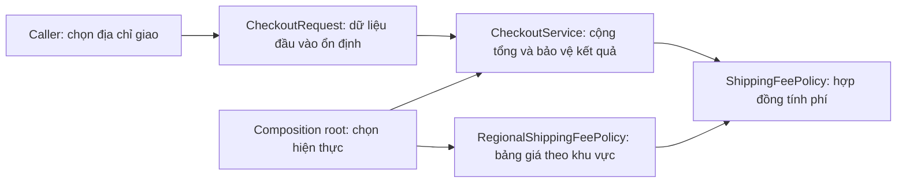

# Phụ thuộc sâu vào chi tiết của đối tượng khác

## 1. Mục tiêu bài học

Trong chương **Mùi mã** của module **CODE_QUALITY_FUNDAMENTALS**, chúng ta tìm hiểu một dấu hiệu thường gặp khi thiết kế mã hướng đối tượng: **một thành phần phải đi qua nhiều đối tượng trung gian hoặc biết quá nhiều chi tiết nội bộ của thành phần khác chỉ để hoàn thành nhiệm vụ của mình**.

Mục tiêu chung của module là **hiểu những thuộc tính quyết định mã nguồn có đáng tin cậy, dễ hiểu và dễ thay đổi hay không**. Phụ thuộc quá sâu có thể khiến một thay đổi nhỏ ở mô hình dữ liệu lan đến nhiều nơi, làm tăng nguy cơ sai nghiệp vụ và khiến việc kiểm thử phải dựng những đồ thị đối tượng lớn không cần thiết.

Sau bài học, bạn có thể:

- Nhận diện **chuỗi lời gọi/truy cập nhiều tầng** (*message chain*), **feature envy** và sự biết quá nhiều về nội bộ của đối tượng khác (*inappropriate intimacy*) như những **tín hiệu cần phân tích**.
- Giải thích vì sao mức phụ thuộc quan trọng hơn độ dài biểu thức trên một dòng.
- Phân biệt dữ liệu mà bên gọi **thực sự cần theo hợp đồng** với cấu trúc lưu trữ hoặc tổ chức nội bộ mà bên gọi **không nên biết**.
- Thiết kế lại một ví dụ Java 17 từ chuỗi truy cập khách hàng–địa chỉ–vùng–bảng giá sang hợp đồng tính phí có trách nhiệm rõ ràng.
- Viết kiểm thử JUnit 5 giữ nguyên hành vi và xác minh điểm biên khi refactor.
- Biết lúc nào việc truy cập nhiều tầng là hợp lý, và khi nào việc thêm nhiều lớp chuyển tiếp chỉ che giấu mùi mã thay vì giải quyết nguyên nhân.

## 2. “Phụ thuộc sâu” nghĩa là gì?

Xét một biểu thức như:

```java
long fee = order.customer().profile()
        .defaultAddress().region().rateCard()
        .standardFeeVnd();
```

Để lấy phí vận chuyển, mã tính tổng đơn hàng phải biết lần lượt:

1. Đơn hàng chứa một khách hàng.
2. Khách hàng chứa hồ sơ.
3. Hồ sơ chứa địa chỉ mặc định.
4. Địa chỉ chứa vùng.
5. Vùng chứa bảng phí.
6. Bảng phí có trường phí chuẩn.

Đây là một **chuỗi truy cập nhiều tầng**. Nếu ngày mai nhóm thay địa chỉ mặc định bằng địa chỉ giao được chọn cho từng đơn, chuyển thông tin vùng sang dịch vụ khác hoặc tách bảng phí theo chiến dịch, mã tính tổng có thể phải sửa dù mục tiêu của nó vẫn chỉ là **cộng tiền hàng với phí giao hàng**.

Điểm nguy hiểm không nằm ở số dấu chấm đơn thuần. Vấn đề là bên gọi đang **lập trình theo cấu trúc bên trong của các đối tượng khác**, thay vì dựa trên một năng lực hoặc dữ liệu đầu vào có ý nghĩa ổn định.

### Ba mùi mã thường xuất hiện cùng nhau

| Mùi mã | Dấu hiệu | Câu hỏi cần hỏi |
| --- | --- | --- |
| **Message chain** | `a.getB().getC().getD()` hoặc chuỗi accessor tương tự | Vì sao bên gọi phải biết toàn bộ đường đi đó? |
| **Feature envy** | Một phương thức liên tục đọc dữ liệu của đối tượng khác để quyết định hành vi | Trách nhiệm có đang nằm sai nơi, gần dữ liệu hoặc chính sách cần dùng hơn không? |
| **Inappropriate intimacy** | Hai lớp biết nhiều trường, quy tắc, kiểu nội bộ hoặc trạng thái riêng của nhau | Chi tiết nào nên được đóng gói sau hợp đồng rõ ràng? |

Ba dấu hiệu có thể cùng xuất hiện, nhưng **không hoàn toàn đồng nghĩa**. Một chuỗi getter dài có thể phục vụ công việc ánh xạ dữ liệu hợp lệ, trong khi một lớp chỉ gọi một getter vẫn có thể phụ thuộc sai tầng nếu getter trả về đối tượng persistence mà tầng nghiệp vụ không nên thấy.

## 3. Hậu quả thực tế: vì sao khó bảo trì?

### 3.1. Thay đổi cấu trúc lan rộng

Nếu nhiều service đều tự đi qua `customer.profile.address.region`, việc đổi mô hình khách hàng có thể khiến nhiều nơi phải sửa. Khi cùng một chính sách được tính ở nhiều nơi, một số chỗ có thể được cập nhật còn số khác vẫn dùng quy tắc cũ.

**Số nơi cần sửa là một tín hiệu**, không phải bằng chứng tuyệt đối. Một thay đổi nghiệp vụ thực sự có thể hợp lý khi tác động đến nhiều hợp đồng. Nhưng nếu chỉ đổi cách lưu thông tin vùng mà logic tính tổng cũng phải sửa, cần xem lại ranh giới.

### 3.2. Quy tắc nghiệp vụ bị phân tán

Ví dụ controller, màn hình xem trước và quy trình tạo đơn đều đọc `region.rateCard.standardFeeVnd` rồi tự áp dụng giảm giá. Khi chính sách miễn phí vận chuyển xuất hiện, ba nơi có thể tính ra ba kết quả khác nhau.

Một nơi tập trung **ý nghĩa “phí áp dụng cho yêu cầu này”** thường dễ kiểm thử và thay đổi hơn việc để mọi caller tự suy ra từ dữ liệu thô.

### 3.3. Tăng giả định ngầm và xử lý `null`

Mỗi chặng có thể vắng mặt: khách chưa có hồ sơ, địa chỉ chưa xác nhận hoặc vùng chưa được cấu hình. Việc thêm `if (x != null)` rải rác khiến mỗi caller tự định nghĩa ý nghĩa của trạng thái thiếu dữ liệu.

Đoạn mã như:

```java
if (order.customer() == null
        || order.customer().profile() == null
        || order.customer().profile().defaultAddress() == null) {
    return 0; // Không chắc "không có địa chỉ" nghĩa là miễn phí.
}
```

còn có nguy cơ **giấu lỗi dữ liệu thành kết quả nghiệp vụ hợp lệ**. Không thể tự mặc định “thiếu địa chỉ thì phí bằng 0” nếu chính sách chưa nói vậy.

### 3.4. Kiểm thử khó và dễ bám vào triển khai

Để test phép cộng đơn giản, nhóm có thể phải dựng `Customer`, `Profile`, `Address`, `Region` và `RateCard` chỉ để đưa vào một số phí. Test bắt đầu phụ thuộc các constructor và cấu trúc có thể đổi khi refactor, dù hành vi người dùng chưa đổi.

Nếu test chỉ cần kiểm tra “dịch vụ cộng đúng phí do chính sách cung cấp”, một hợp đồng tính phí có thể thay thế cho việc dựng toàn bộ đồ thị bên trong.

### 3.5. Ranh giới sở hữu dữ liệu bị mờ

Nguy cơ còn cao hơn nếu getter trả về đối tượng mutable:

```java
order.customer().profile().getSettings().put("shippingFee", "0");
```

Giờ một thành phần bên ngoài có thể **thay trạng thái** của hồ sơ khách hàng mà không qua kiểm tra bất biến. Đây không chỉ là mùi mã về phụ thuộc mà còn liên quan **đóng gói trạng thái và quyền sở hữu dữ liệu**.

## 4. Nguyên tắc hỗ trợ: Law of Demeter và “tell, don't ask”

**Law of Demeter** thường được diễn giải theo tinh thần: một phương thức nên chủ yếu tương tác với các đối tượng mà nó **trực tiếp biết hoặc có trách nhiệm làm việc cùng**, hạn chế lần theo một chuỗi đối tượng để truy cập nội bộ của các đối tượng xa hơn.

Diễn giải này là **heuristic thiết kế**, không phải luật cú pháp: Java không cấm gọi nhiều dấu chấm, và không phải mọi chuỗi truy cập đều có hại.

**“Tell, don't ask”** nhắc rằng thay vì thường xuyên kéo trạng thái của đối tượng khác ra rồi tự quyết định cách xử lý, hãy cân nhắc gửi cho **đối tượng hoặc dịch vụ có trách nhiệm** một yêu cầu hành vi.

Ví dụ khác biệt:

```java
// Bên gọi tự tìm trạng thái bên trong và quyết định.
if (wallet.getAccount().getBalanceVnd() >= amountVnd) {
    wallet.getAccount().setBalanceVnd(
            wallet.getAccount().getBalanceVnd() - amountVnd);
}

// Ý tưởng đúng hướng: đặt phép thay đổi ở ranh giới có trách nhiệm.
wallet.debit(amountVnd);
```

Đoạn thứ hai **chỉ là phác họa API**, không phải định nghĩa đầy đủ của `Wallet`. Một `debit` đúng còn phải bảo vệ số dư không âm, xử lý đồng thời và lưu dữ liệu bền vững khi cần. Di chuyển phép trừ vào một phương thức không tự giải quyết mọi vấn đề.

**Lựa chọn vị trí hành vi phụ thuộc vào trách nhiệm:** phép thay đổi số dư có thể thuộc aggregate ví; chính sách giá phụ thuộc chiến dịch có thể thuộc một **domain service/strategy** riêng, không nhất thiết nằm trong đối tượng khách hàng chỉ vì dữ liệu khách hàng được đọc.

## 5. Ví dụ Java 17: tính phí giao hàng với một chuỗi phụ thuộc sâu

Giả sử ứng dụng báo giá thanh toán có yêu cầu đơn giản:

- Tổng tiền hàng là số nguyên VND, không âm.
- Đơn có **địa chỉ giao hàng được chọn cho lần thanh toán này**.
- Phí chuẩn theo khu vực: `AREA-A` là **20.000 VND**, `AREA-B` là **40.000 VND**.
- Không tự mặc định phí bằng 0 khi thiếu khu vực; khu vực không được hỗ trợ phải báo lỗi.
- Tổng thanh toán bằng tiền hàng cộng phí vận chuyển; phép cộng tràn `long` phải bị phát hiện.

Ta dùng mã khu vực mang tính minh họa, **không phải mã địa lý chính thức**. Ví dụ chưa xét VAT, voucher, miễn phí vận chuyển, đặt chỗ hay lưu đơn vào database.

### 5.1. Phiên bản có mùi mã

Các kiểu dữ liệu sau chỉ phục vụ việc minh họa cấu trúc sâu:

```java
// Mô hình giả định trước khi cải tiến (Java 17).
record RateCard(long standardFeeVnd) {}
record Region(String code, RateCard rateCard) {}
record DeliveryAddress(Region region) {}
record CustomerProfile(DeliveryAddress defaultAddress) {}
record Customer(CustomerProfile profile) {}
record OrderDraft(long subtotalVnd, Customer customer) {}

final class CheckoutServiceBefore {
    long totalVnd(OrderDraft draft) {
        long feeVnd = draft.customer().profile()
                .defaultAddress().region()
                .rateCard().standardFeeVnd();
        return Math.addExact(draft.subtotalVnd(), feeVnd);
    }
}
```

**Điểm bất ổn:**

1. Dịch vụ thanh toán biết **sáu bước tổ chức dữ liệu** chỉ để lấy một mức phí.
2. Nó dùng **địa chỉ mặc định** của khách hàng thay vì địa chỉ được chọn riêng cho đơn, có thể tạo lỗi nghiệp vụ dù tính cộng vẫn đúng.
3. `RateCard` được nhúng vào `Region` làm giả định rằng vùng địa lý luôn sở hữu chính sách phí. Nếu phí do nhà vận chuyển, phương thức giao hoặc chiến dịch quyết định, các caller cũng bị tác động.
4. Các `record` minh họa chưa xác thực đầu vào; `null` và phí âm có thể lọt vào rồi gây lỗi muộn hoặc sai kết quả.
5. Việc nhiều caller tự lấy `rateCard.standardFeeVnd` có thể làm lặp chính sách và khiến thay đổi lan rộng.

**Không nên chỉ đếm dấu chấm rồi kết luận thiết kế sai.** Những lập luận quan trọng ở đây là **trách nhiệm thanh toán**, **nguồn của chính sách phí** và **mô hình địa chỉ được dùng khi chốt đơn**.

## 6. Thiết kế lại: dữ liệu đầu vào có ý nghĩa và hợp đồng tính phí

Một cách refactor là tách ba trách nhiệm:

1. **`CheckoutRequest`:** diễn đạt dữ liệu đã được chọn cho lần báo giá, không buộc dịch vụ lần theo hồ sơ khách.
2. **`ShippingFeePolicy`:** chịu trách nhiệm xác định phí từ thông tin yêu cầu, che giấu bảng giá và cách tra cứu.
3. **`CheckoutService`:** điều phối báo giá, kiểm tra bất biến kết quả từ chính sách và cộng tổng.



Sơ đồ mô tả phụ thuộc vào hợp đồng và cách lắp ghép. `CheckoutService` có thể **gọi** đối tượng `RegionalShippingFeePolicy` tại runtime qua interface `ShippingFeePolicy` nhưng không cần biết lớp hiện thực hoặc truy cập `Map` bảng giá của nó.

### 6.1. Giá trị đầu vào theo nghiệp vụ

```java
// Destination.java
import java.util.Objects;

public record Destination(String areaCode) {
    public Destination {
        Objects.requireNonNull(areaCode, "areaCode");
        if (areaCode.isBlank()) {
            throw new IllegalArgumentException(
                    "areaCode must not be blank");
        }
    }
}
```

```java
// CheckoutRequest.java
import java.util.Objects;

public record CheckoutRequest(
        long subtotalVnd, Destination destination) {
    public CheckoutRequest {
        if (subtotalVnd < 0) {
            throw new IllegalArgumentException(
                    "subtotalVnd must not be negative");
        }
        Objects.requireNonNull(destination, "destination");
    }
}
```

`Destination` là giá trị đại diện cho **điểm giao đã được chọn**. Ví dụ dùng `areaCode` vì đó là thông tin đầu vào nghiệp vụ mà chính sách hiện tại cần; nếu sau này phí dựa vào tọa độ hoặc địa chỉ đầy đủ, hợp đồng phải được xem lại một cách minh bạch.

Chỉ đưa trường vào yêu cầu vì nó **cần thiết**, không sao chép nguyên cả đồ thị `CustomerProfile` vào `CheckoutRequest` “để dùng cho tương lai”.

### 6.2. Hợp đồng và hiện thực chính sách

```java
// ShippingFeePolicy.java
@FunctionalInterface
public interface ShippingFeePolicy {
    // Với yêu cầu hợp lệ, trả phí vận chuyển không âm, đơn vị VND.
    // Không lưu đơn hoặc gây tác dụng phụ bên ngoài.
    long feeVnd(CheckoutRequest request);
}
```

```java
// RegionalShippingFeePolicy.java
import java.util.Map;
import java.util.Objects;

public final class RegionalShippingFeePolicy
        implements ShippingFeePolicy {
    private static final Map<String, Long> FEES_BY_AREA =
            Map.of("AREA-A", 20_000L, "AREA-B", 40_000L);

    @Override
    public long feeVnd(CheckoutRequest request) {
        Objects.requireNonNull(request, "request");
        Long feeVnd = FEES_BY_AREA.get(
                request.destination().areaCode());
        if (feeVnd == null) {
            throw new IllegalArgumentException(
                    "unsupported areaCode: "
                            + request.destination().areaCode());
        }
        return feeVnd;
    }
}
```

Ở đây, **chính sách phí** vẫn phải đọc `request.destination().areaCode()`. Đó không nhất thiết là mùi mã: `CheckoutRequest` và `Destination` là **những giá trị đầu vào đã công bố**, còn chính sách được thiết kế chính để đọc chúng. Khác với phiên bản cũ, nó không phải đi qua hồ sơ khách, địa chỉ mặc định, vùng rồi bảng giá nội bộ của một đối tượng khác.

**Hợp đồng là phần cần ổn định tương đối; chi tiết như map, database hoặc hệ thống định giá có thể thay đổi.** Nếu bảng giá cần cập nhật động, hiện thực có thể nhận cấu hình hoặc phụ thuộc vào một port khác. Tuy nhiên, không nên tự thêm truy cập mạng mà không cập nhật hợp đồng về lỗi, độ trễ và thời điểm tính.

### 6.3. Dịch vụ thanh toán chỉ điều phối báo giá

```java
// CheckoutQuote.java
public record CheckoutQuote(
        long subtotalVnd, long shippingFeeVnd, long totalVnd) {}
```

```java
// CheckoutService.java
import java.util.Objects;

public final class CheckoutService {
    private final ShippingFeePolicy shippingFeePolicy;

    public CheckoutService(ShippingFeePolicy shippingFeePolicy) {
        this.shippingFeePolicy = Objects.requireNonNull(
                shippingFeePolicy, "shippingFeePolicy");
    }

    public CheckoutQuote quote(CheckoutRequest request) {
        Objects.requireNonNull(request, "request");
        long feeVnd = shippingFeePolicy.feeVnd(request);
        if (feeVnd < 0) {
            throw new IllegalStateException(
                    "shipping policy returned a negative fee");
        }
        long totalVnd = Math.addExact(request.subtotalVnd(), feeVnd);
        return new CheckoutQuote(
                request.subtotalVnd(), feeVnd, totalVnd);
    }
}
```

`CheckoutService` **không biết** phí đến từ khu vực, hội viên, nhà vận chuyển hay chương trình khuyến mãi. Nó chỉ phụ thuộc vào năng lực “tính phí cho yêu cầu hợp lệ”. Nếu hiện thực vi phạm bất biến phí không âm, service từ chối kết quả; `Math.addExact` phát hiện tràn số thay vì âm thầm làm sai tổng tiền.

Các phương thức trên **chưa thực hiện transaction hoặc ghi thanh toán**; tên `quote` thể hiện đây là tính báo giá, không phải thu tiền.

### 6.4. Lắp ghép ở một nơi có trách nhiệm

```java
// ShopApplication.java
public final class ShopApplication {
    public static void main(String[] args) {
        ShippingFeePolicy feePolicy = new RegionalShippingFeePolicy();
        CheckoutService checkout = new CheckoutService(feePolicy);

        var request = new CheckoutRequest(
                120_000L, new Destination("AREA-A"));
        CheckoutQuote quote = checkout.quote(request);

        System.out.println(quote.shippingFeeVnd()); // 20000
        System.out.println(quote.totalVnd());       // 140000
    }
}
```

Ứng dụng tạo hiện thực cụ thể tại **composition root**, còn mã tính tổng chỉ làm việc với hợp đồng. Việc này có ý nghĩa khi có ranh giới biến động thật; một dự án rất nhỏ, một chính sách duy nhất và không có nhu cầu thay thế vẫn có thể dùng một lớp đơn giản thay vì tạo nhiều interface.

## 7. Kiểm thử hồi quy: bảo vệ hành vi, không bảo vệ chuỗi getter

Một refactor đúng phải phân biệt:

- **Hành vi cần giữ:** thành tiền bằng tổng tiền hàng cộng phí theo chính sách đã xác nhận, không nhận phí âm, xử lý lỗi và dữ liệu biên.
- **Chi tiết có thể đổi:** cách tra cứu phí, nơi lưu bảng giá, có bao nhiêu lớp dữ liệu trung gian.
- **Hành vi cần sửa có chủ đích:** nếu phiên bản cũ lấy **địa chỉ mặc định** nhưng yêu cầu là **địa chỉ giao được chọn**, đó là sửa lỗi nghiệp vụ, không phải refactor thuần túy.

Ví dụ kiểm thử JUnit 5 cho hiện thực mới, giả sử các lớp nằm trong cùng package hoặc được import phù hợp:

```java
import static org.junit.jupiter.api.Assertions.assertEquals;
import static org.junit.jupiter.api.Assertions.assertThrows;

import org.junit.jupiter.api.Test;

class CheckoutServiceTest {
    @Test
    void usesSelectedDestinationAndRegionalFee() {
        CheckoutService service = new CheckoutService(
                new RegionalShippingFeePolicy());
        var request = new CheckoutRequest(
                120_000L, new Destination("AREA-A"));

        assertEquals(
                new CheckoutQuote(120_000L, 20_000L, 140_000L),
                service.quote(request));
    }

    @Test
    void supportsAnotherAreaWithoutChangingCheckoutLogic() {
        CheckoutService service = new CheckoutService(
                new RegionalShippingFeePolicy());

        assertEquals(
                new CheckoutQuote(120_000L, 40_000L, 160_000L),
                service.quote(new CheckoutRequest(
                        120_000L, new Destination("AREA-B"))));
    }

    @Test
    void rejectsUnsupportedAreaAndInvalidInput() {
        CheckoutService service = new CheckoutService(
                new RegionalShippingFeePolicy());

        assertThrows(IllegalArgumentException.class,
                () -> service.quote(new CheckoutRequest(
                        0L, new Destination("UNKNOWN"))));
        assertThrows(IllegalArgumentException.class,
                () -> new CheckoutRequest(-1L, new Destination("AREA-A")));
        assertThrows(IllegalArgumentException.class,
                () -> new Destination(" "));
    }

    @Test
    void canTestCheckoutWithAControlledFeePolicy() {
        ShippingFeePolicy fake = request -> 12_000L;
        CheckoutService service = new CheckoutService(fake);

        assertEquals(
                new CheckoutQuote(50_000L, 12_000L, 62_000L),
                service.quote(new CheckoutRequest(
                        50_000L, new Destination("AREA-A"))));
    }

    @Test
    void detectsBrokenPolicyAndOverflow() {
        CheckoutService negativePolicy =
                new CheckoutService(request -> -1L);
        assertThrows(IllegalStateException.class,
                () -> negativePolicy.quote(new CheckoutRequest(
                        0L, new Destination("AREA-A"))));

        CheckoutService positivePolicy =
                new CheckoutService(request -> 1L);
        assertThrows(ArithmeticException.class,
                () -> positivePolicy.quote(new CheckoutRequest(
                        Long.MAX_VALUE, new Destination("AREA-A"))));
    }
}
```

Test dùng fake ở trên xác nhận **`CheckoutService` sử dụng kết quả của hợp đồng tính phí**, không cần dựng sáu cấp đối tượng. Nhưng fake **không chứng minh** `RegionalShippingFeePolicy` hoặc adapter production khác áp dụng đúng bảng giá — cần kiểm tra riêng các hiện thực và cấu hình lắp ghép.

Nếu sửa từ mô hình cũ sang mô hình mới, hãy bảo vệ những hành vi **đã được yêu cầu**. Đừng giữ một assertion “luôn dùng địa chỉ mặc định” chỉ để nói rằng refactor không đổi kết quả, khi đó vốn là lỗi trái hợp đồng.

## 8. Không sửa mùi mã bằng cách chỉ thêm phương thức chuyển tiếp

Một biện pháp đôi khi được đề xuất là thay:

```java
long fee = order.customer().profile()
        .defaultAddress().region()
        .rateCard().standardFeeVnd();
```

bằng:

```java
long fee = order.standardShippingFeeVnd();
```

Cách thứ hai **chỉ cải thiện thiết kế nếu** `Order` thực sự có trách nhiệm bảo đảm ý nghĩa của “phí vận chuyển chuẩn cho đơn này”. Nếu phương thức mới chỉ ẩn nguyên chuỗi getter, vẫn dùng sai địa chỉ mặc định và để bảng phí sống bên trong `Region`, vấn đề nghiệp vụ chưa được giải quyết.

Các phương thức **ủy quyền (delegation)** vẫn có giá trị khi chúng tạo một hợp đồng bền vững và bảo vệ bất biến:

- `order.totalVnd()` có thể hợp lý nếu `Order` sở hữu cách xác định tổng sau khi phí đã được chốt.
- `customer.canUseLoyaltyBenefit(...)` có thể hợp lý nếu đó thực sự là hành vi của chính sách hội viên mà đối tượng/aggregate sở hữu.
- `shippingFeePolicy.feeVnd(request)` phù hợp khi phí phụ thuộc các chính sách có thể thay đổi độc lập với hồ sơ khách.

Ngược lại, thêm hàng loạt `getProfile()`, `getRegion()` và `getRateCard()` dưới tên khác chỉ làm **dài đường truyền dữ liệu** mà không rõ thêm trách nhiệm nào.

## 9. Những trường hợp truy cập nhiều tầng có thể hợp lý

Một nguyên tắc hữu ích không nên trở thành lệnh cấm máy móc.

| Tình huống | Vì sao có thể chấp nhận | Điều vẫn cần kiểm tra |
| --- | --- | --- |
| **Ánh xạ DTO tại ranh giới API** | Adapter cần đọc cấu trúc JSON/DTO để chuyển thành kiểu nội bộ | Chỉ adapter biết cấu trúc ngoài; xử lý trường thiếu và lỗi rõ |
| **Truy vấn dữ liệu hoặc phép biến đổi thuần** | Đầu vào là cây dữ liệu/record bất biến được thiết kế để đọc | Getter thuộc hợp đồng ổn định; không làm lộ cấu trúc mutable |
| **Builder/DSL fluent** | `builder.withA(...).withB(...).build()` được thiết kế như một chuỗi trên giao diện công khai | Không nhầm chuỗi fluent với việc đào sâu qua đối tượng sở hữu khác nhau |
| **Test fixture** | Dựng dữ liệu lồng nhau để xác minh serialization hoặc định dạng đầu ra | Test không khóa chi tiết bên trong khi không cần thiết |
| **Parser của cấu trúc phân cấp** | Công việc thực sự là duyệt cây AST, XML hoặc JSON | Có chiến lược với nút thiếu, vòng (nếu có) và độ sâu dữ liệu |
| **Đường truy cập được công bố là hợp đồng** | Một SDK cam kết một mô hình object graph đọc được | Theo dõi tương thích khi SDK đổi và tránh mutate ngoài hợp đồng |

Ví dụ `response.customer().address().city()` trong một **adapter chuyển DTO bên ngoài sang `DeliveryAddress` nội bộ** có thể là công việc chính của adapter. Chuyển toàn bộ logic đó vào một domain service chỉ để giảm dấu chấm lại có thể làm rò rỉ cấu trúc API bên ngoài vào lõi nghiệp vụ.

### Dấu chấm không phải thước đo coupling

`Math.max(a, b)`, `builder.withName("A").withCount(2).build()` hay `stream.filter(...).map(...).toList()` có nhiều phép gọi theo cú pháp khác nhau nhưng không nhất thiết tạo **phụ thuộc sâu vào nội bộ một đối tượng khác**.

Ngược lại, một dòng `repository.getRawEntity()` chỉ có một dấu chấm vẫn có thể là rò rỉ nếu nó đưa một `JpaEntity` đặc thù lưu trữ vào public API của phần nghiệp vụ.

**Hãy xem loại phụ thuộc và trách nhiệm, không chấm điểm theo độ dài chuỗi gọi.**

## 10. Những hướng xử lý khác tùy nguyên nhân

Không có một phép refactor luôn đúng cho mọi chuỗi getter. Chọn cách thay đổi theo **lý do phát sinh mùi mã**:

| Nguyên nhân chính | Hướng xử lý có thể phù hợp | Điều cần thận trọng |
| --- | --- | --- |
| Một đối tượng tự xử lý quy tắc dựa trên bất biến nó sở hữu | **Move Method / Encapsulate Behavior**: đưa hành vi về đúng aggregate/value object | Không nhét chính sách ngoài phạm vi vào entity chỉ vì nó có dữ liệu |
| Nhiều caller cùng diễn giải một chính sách biến đổi | Tạo **domain service, strategy hoặc policy port** với hợp đồng rõ | Không tạo interface chỉ vì có một phép tính rất nhỏ |
| Caller cần dữ liệu đầu vào, nhưng đang đi qua cây hồ sơ | Cung cấp **request/value object** thể hiện dữ liệu cần thiết | Đừng nhân bản toàn bộ dữ liệu nội bộ vào request |
| Truy cập trực tiếp collection hoặc trạng thái có thể sửa | Đóng gói thao tác thay đổi; trả snapshot/kiểu giá trị phù hợp | `unmodifiableView` vẫn có thể phản ánh thay đổi qua nguồn mutable |
| Adapter đi theo cấu trúc payload ngoài hệ thống | Giữ việc ánh xạ tại **boundary adapter** | Không để DTO ngoài rò rỉ vào domain/application |
| Quá nhiều đối tượng trung gian vô nghĩa | Đơn giản hóa mô hình hoặc gom các giá trị thực sự thuộc cùng khái niệm | Không bỏ đi ranh giới cần cho độc lập nghiệp vụ |
| Chuỗi truy cập chỉ tồn tại trong test | Dùng builder/factory fixture hoặc kiểm thử qua API công khai | Không biến test helper thành một API công khai mới không cần thiết |

Nên luôn so sánh **chi phí thay đổi trước/sau** và **tính đúng đắn nghiệp vụ**. Một thiết kế có nhiều kiểu hơn nhưng ranh giới rõ hơn có thể dễ bảo trì; ngược lại, một phép tính nhỏ đơn giản hóa quá mức thành nhiều tầng delegate có thể khiến code khó theo dõi.

## 11. Phát hiện mùi mã trong code review

Một quy trình thực tế có thể thực hiện theo các bước:

1. **Khoanh vùng chuỗi phụ thuộc:** bên gọi đang sử dụng đối tượng nào, đi qua các lớp nào, có đụng trạng thái mutable không?
2. **Gọi tên nhiệm vụ của bên gọi:** đang báo giá, xác thực, ánh xạ DTO hay điều phối một luồng nghiệp vụ?
3. **Tìm lý do thay đổi độc lập:** nếu cấu trúc profile, chính sách phí hoặc ORM đổi, bên gọi có bắt buộc phải sửa không?
4. **Xác định chủ sở hữu hành vi:** một value object, aggregate, service chính sách hay adapter nào có đủ thông tin và trách nhiệm để thực hiện?
5. **Kiểm tra hợp đồng còn thiếu:** input, output, lỗi, trường hợp dữ liệu chưa có, đơn vị tiền và tác dụng phụ được xác định chưa?
6. **Viết hoặc củng cố kiểm thử hành vi:** trường hợp thường, trường hợp biên, lỗi và tính nhất quán quan trọng.
7. **Thay đổi từng bước:** đưa logic về đúng ranh giới, cập nhật caller và xóa nhánh truy cập sâu cũ khi đã có bằng chứng.
8. **Đo lại ảnh hưởng:** còn bao nhiêu nơi cần biết bảng giá, cấu trúc bên trong hoặc loại dữ liệu lưu trữ?

Để tránh kiểm tra hình thức, thay vì nhận xét:

> “Dòng này có sáu dấu chấm, sai Law of Demeter.”

hãy nhận xét:

> “`CheckoutService` đang phụ thuộc cấu trúc hồ sơ khách và bảng phí nằm trong `Region`. Nếu nguồn phí hoặc địa chỉ được chọn đổi, dịch vụ tính tổng sẽ phải sửa. Ta có thể chuyển việc tính phí thành một hợp đồng nhận địa chỉ giao của đơn và giữ phần tra bảng giá ở một chính sách riêng không?”

Nhận xét thứ hai nêu **lý do thay đổi, rủi ro và hướng giải quyết**, hữu ích hơn một quy tắc chỉ dựa trên cú pháp.

## 12. Công cụ tự động có thể giúp đến đâu?

Static analysis hoặc linter có thể phát hiện một số **chuỗi lời gọi dài**, biến được truy cập quá nhiều hoặc phương thức dùng nhiều thông tin từ lớp khác. Các công cụ phân tích kiến trúc có thể chỉ ra phụ thuộc sai chiều giữa package/module.

Tuy nhiên:

- Công cụ thường **không biết** một chuỗi truy cập là ánh xạ DTO hợp lệ hay đang làm lộ một bất biến nghiệp vụ.
- Một số phụ thuộc có thể xuất hiện qua reflection, cấu hình hoặc DTO sinh tự động.
- Các mức ngưỡng như “tối đa ba dấu chấm” có thể tạo cảnh báo giả và bỏ sót các phụ thuộc có hại chỉ với một lời gọi.
- Không có cảnh báo **không chứng minh** mã dễ bảo trì hoặc ranh giới đã đúng.

Sử dụng cảnh báo như **điểm bắt đầu để review**. Nếu một quy tắc thực sự phản ánh kiến trúc đã chấp thuận, có thể bổ sung kiểm tra package dependency hoặc contract test để ngăn tái diễn. Không nên dập tắt cảnh báo bằng cách đổi tên hoặc giấu lời gọi mà không xử lý nguyên nhân.

## 13. Bài tập tự kiểm tra

### Bài tập 1 — tìm đúng nguyên nhân

Một use case chứa:

```java
boolean eligible = order.customer().membership()
        .benefits().returnPolicy().allowsReturn();
```

Hãy trả lời: Use case có cần biết cây `membership -> benefits -> returnPolicy` không? Quy tắc trả hàng thuộc hồ sơ hội viên, thuộc đơn hàng hay một chính sách bên ngoài? Dữ liệu nào còn thiếu (ngày giao, ngày yêu cầu, tình trạng hàng) trước khi có thể thiết kế một API đúng?

**Gợi ý:** Không nên tự động chuyển toàn bộ chuỗi thành `customer.allowsReturn()` nếu quyết định cần cả dữ liệu đơn hàng. Cần làm rõ trách nhiệm và hợp đồng trước khi chọn domain service hoặc phương thức của aggregate.

### Bài tập 2 — phân biệt mùi mã với công việc hợp lệ

Một adapter HTTP ánh xạ:

```java
String city = response.getCustomer()
        .getShippingAddress().getCity();
```

Trong khi một domain service cũng dùng đúng chuỗi trên để quyết định phí. Trường hợp nào đáng nghi hơn và vì sao?

**Gợi ý:** Adapter có nhiệm vụ hiểu định dạng phản hồi bên ngoài; domain service nên nhận dữ liệu/vùng đã chuẩn hóa hoặc hỏi một chính sách phù hợp, không phụ thuộc cấu trúc DTO ngoài.

### Bài tập 3 — đánh giá refactor

Nhóm đổi `a.getB().getC().calculate()` thành `a.calculate()` nhưng phương thức mới vẫn gọi nguyên chuỗi cũ. Hỏi: đã giảm coupling thực sự chưa? Điều kiện nào khiến phương thức chuyển tiếp vẫn là cải tiến?

**Gợi ý:** Chưa chắc. Nếu `a.calculate()` là một hợp đồng ổn định được `a` sở hữu và bên dùng không phải thay theo cấu trúc bên dưới, cải tiến có thể có thật. Nếu hành vi thuộc trách nhiệm khác hoặc tiếp tục dùng sai dữ liệu, mùi mã vẫn còn.

### Bài tập 4 — đưa kiểm thử về đúng hợp đồng

Trước refactor, test của `CheckoutService` dựng sáu cấp record, gán `standardFeeVnd = 20_000` và kiểm tra tổng. Sau refactor, test dùng `ShippingFeePolicy` fake trả `20_000`. Test mới chứng minh điều gì, và thiếu điều gì?

**Gợi ý:** Test mới chứng minh service **cộng đúng kết quả của hợp đồng** và có thể kiểm tra xử lý phí âm/tràn số. Nó **không** chứng minh hiện thực policy sản xuất tính đúng phí cho từng vùng hay composition root chọn đúng hiện thực; cần test riêng các phần ấy.

## 14. Những ngộ nhận cần tránh

**“Cứ có chuỗi dài là sai.”** Sai. Truy cập DTO, duyệt cây dữ liệu hoặc fluent API có thể hợp lý; xem hợp đồng và ranh giới.

**“Thêm getter cấp cao là hết mùi mã.”** Chưa chắc. Nếu getter chỉ ẩn cấu trúc sai và không tạo hành vi có trách nhiệm, độ phức tạp vẫn ở đó.

**“Mọi hành vi phải nằm trong đối tượng giữ dữ liệu.”** Không. Nhiều chính sách phụ thuộc đa nguồn hoặc thay đổi độc lập nên thuộc domain service/strategy.

**“Đóng gói càng sâu càng tốt.”** Quá nhiều lớp trung gian có thể tăng chi phí đọc hiểu. Chỉ thêm ranh giới khi có ý nghĩa nghiệp vụ hoặc trách nhiệm kỹ thuật.

**“Không còn import lớp nội bộ thì chắc chắn không còn phụ thuộc.”** Không. Reflection, config string hoặc DTO có thể vẫn tạo ràng buộc ngầm; cần review cả hành vi thực tế.

**“Refactor đẹp là đủ, không cần test.”** Không. Có thể thay đổi ngầm dữ liệu được chọn, đơn vị tiền, lỗi hoặc thứ tự tác dụng phụ; cần bảo vệ hợp đồng đã xác nhận.

**“Mùi mã luôn là bug.”** Mùi mã là **tín hiệu rủi ro và chi phí thay đổi**, không tự chứng minh đang có lỗi. Có trường hợp giữ nguyên là hợp lý vì chi phí refactor lớn hơn lợi ích.

## 15. Checklist ngắn trước khi quyết định sửa

Khi gặp `a.b().c().d()`, hãy hỏi:

1. **Bên gọi đang cần kết quả gì?** Hành vi hay dữ liệu nào thực sự thuộc hợp đồng?
2. **Các đối tượng trung gian là nội bộ hay public value/DTO được thiết kế để đọc?**
3. **Nếu một tầng trung gian thay đổi, bao nhiêu bên gọi phải sửa?** Có đang lặp chính sách?
4. **Có đang bỏ qua bất biến, quyền sở hữu hoặc dữ liệu được chọn cho một giao dịch cụ thể không?**
5. **Ai nên sở hữu hành vi?** Aggregate, policy, application service hay adapter?
6. **API mới có làm rõ ngữ nghĩa, lỗi và tác dụng phụ không?** Hay chỉ đổi tên chuỗi getter?
7. **Cần test điều gì trước và sau refactor?** Giá trị biên, dữ liệu thiếu, tính đúng đắn và các điểm tích hợp?
8. **Đánh đổi có phù hợp không?** Refactor có thực sự giảm phụ thuộc sai và giúp mã dễ thay đổi không?

Một câu trả lời tốt không chỉ là “giảm được năm dấu chấm xuống một dấu chấm”, mà là **giảm số quyết định nội bộ mà người dùng thành phần phải hiểu và giảm rủi ro khi một chính sách thay đổi**.

## 16. Ghi nhớ

**Phụ thuộc sâu vào chi tiết của đối tượng khác** là mùi mã khi một thành phần phải hiểu quá nhiều cấu trúc hoặc quy tắc bên trong của đối tượng khác để thực hiện trách nhiệm của mình. Chuỗi getter chỉ là **dấu hiệu trực quan**; nguyên nhân thật thường nằm ở **ranh giới trách nhiệm, hợp đồng dữ liệu và chiều phụ thuộc**. Hãy xác định hành vi cần bảo vệ, đưa chính sách hoặc bất biến về đúng nơi sở hữu, dùng giá trị đầu vào có ý nghĩa và kiểm thử các trường hợp biên. Đồng thời, tránh áp dụng Law of Demeter máy móc với DTO, parser hoặc fluent API. Khi giảm sự biết quá nhiều **đúng chỗ**, mã trở nên **dễ hiểu, đáng tin cậy và an toàn hơn khi thay đổi**.
