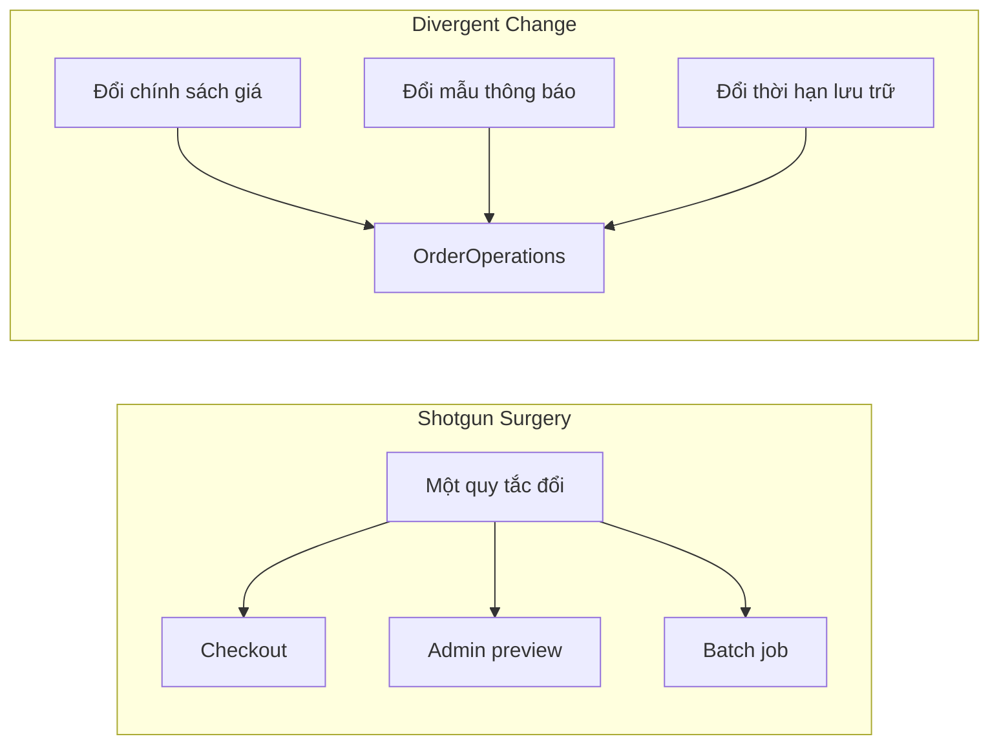
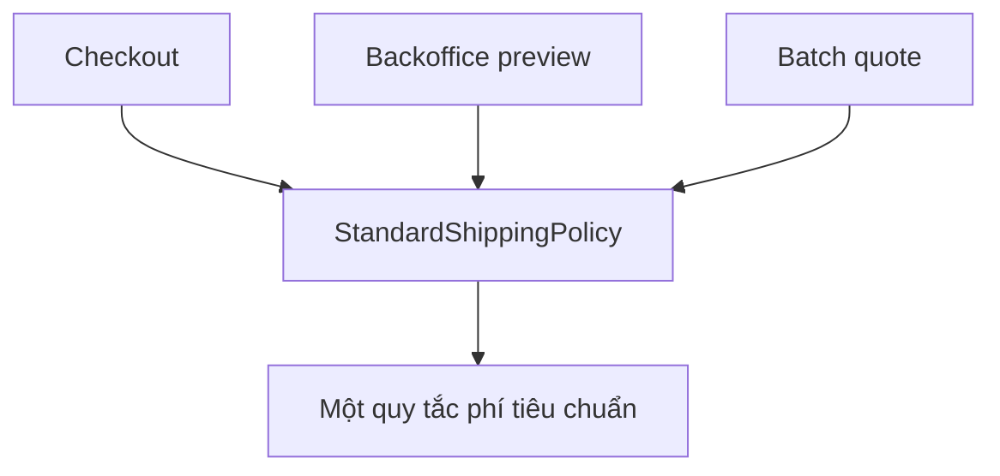
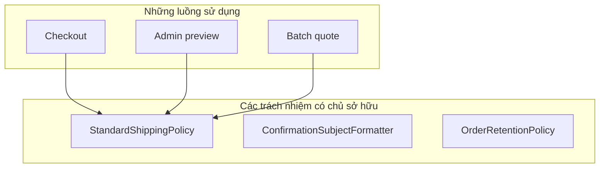
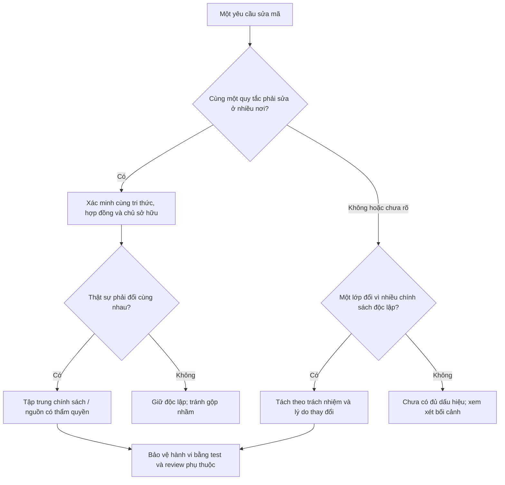

# Một thay đổi phải sửa nhiều nơi hoặc nhiều thay đổi dồn vào một nơi

> **Chương:** Mùi mã  
> **Học phần:** CODE_QUALITY_FUNDAMENTALS — Hiểu những thuộc tính quyết định mã nguồn có đáng tin cậy, dễ hiểu và dễ thay đổi hay không.

Một lỗi nhỏ trong phần mềm đôi khi cần sửa hàng loạt lớp không liên quan. Trường hợp khác, một lớp duy nhất luôn xuất hiện trong mọi pull request: đổi chính sách giá phải sửa nó, thay mẫu email cũng sửa nó, thêm quy tắc lưu trữ lại sửa chính nó. Hai hiện tượng này thường là dấu hiệu cấu trúc mã đang khiến **những lý do thay đổi** và **những nơi phải thay đổi** không khớp với nhau.

Trong thuật ngữ *code smell* (mùi mã), hai dấu hiệu thường được gọi là:

- **Shotgun Surgery — sửa rải rác:** một thay đổi về cùng một quy tắc hoặc trách nhiệm phải chỉnh nhiều vị trí phân tán.
- **Divergent Change — thay đổi phân kỳ:** một lớp hoặc module phải sửa vì nhiều lý do độc lập, vốn nên thuộc các trách nhiệm khác nhau.

Đây là **dấu hiệu cần điều tra**, không phải kết luận tự động rằng hệ thống sai. Một chức năng mới hợp lý có thể phải thay đổi API, backend, frontend, tài liệu và test; nhiều thay đổi như thế không mặc nhiên là *Shotgun Surgery*. Tương tự, một lớp điều phối đơn hàng có thể thay đổi khi luồng đơn hàng thực sự thay đổi mà không nhất thiết vi phạm thiết kế.

Mục tiêu là nhận ra **đâu là phụ thuộc thay đổi không cần thiết**, xác định nguồn gốc và chọn refactor giúp mã dễ hiểu, dễ kiểm thử, đáng tin cậy hơn — không phải giảm số file được sửa bằng mọi giá.

Sau bài học, bạn có thể:

1. Phân biệt hai mùi mã thông qua mối quan hệ giữa **lý do thay đổi** và **vị trí mã**.
2. Xác định một quy tắc nghiệp vụ đang bị phân tán và tập trung nó đúng ranh giới.
3. Nhận ra một lớp có nhiều trách nhiệm thay đổi độc lập và tách theo khái niệm nghiệp vụ.
4. Dùng lịch sử commit, bản đồ phụ thuộc và kiểm thử để kiểm tra giả thuyết thay vì chỉ nhìn độ dài file.
5. Tránh tạo trừu tượng dùng chung sai hoặc chia lớp quá nhỏ gây tăng coupling.

## 1. Hai mùi mã nhìn từ chiều thay đổi

Hãy đặt hai câu hỏi:

**Câu hỏi A:** Khi **một chính sách** thay đổi, phải sửa ở bao nhiêu nơi?

**Câu hỏi B:** Một **lớp** có phải thay đổi vì bao nhiêu chính sách hoặc trách nhiệm độc lập?

| Mùi mã | Chiều thay đổi | Dấu hiệu điển hình | Rủi ro chính |
| --- | --- | --- | --- |
| **Shotgun Surgery** | **Một lý do → nhiều nơi** | Đổi một ngưỡng phí phải tìm và sửa trong checkout, admin, batch | Bỏ sót nơi sửa, các bản cài đặt lệch nhau |
| **Divergent Change** | **Nhiều lý do → một nơi** | Lớp đơn hàng cùng chịu thay đổi về phí, email và thời hạn lưu trữ | Xung đột chỉnh sửa, phạm vi hồi quy rộng, trách nhiệm khó hiểu |



Sơ đồ diễn tả **lý do phải sửa mã**, không phải luồng gọi phương thức. Một module có thể có nhiều caller mà không mắc mùi mã; điều cần quan tâm là **khi một quyết định nghiệp vụ thay đổi, bao nhiêu bản độc lập của quyết định đó phải được chỉnh**.

### Mùi mã không đồng nghĩa lỗi chức năng hiện tại

Hôm nay cả ba luồng có thể cùng tính đúng phí. Nhưng ngày mai chính sách đổi, một nơi bị bỏ sót và hai màn hình cho kết quả khác nhau. Mùi mã báo hiệu **rủi ro bảo trì trong tương lai**, không nhất thiết đã gây lỗi ở thời điểm review.

Ngược lại, một file nhỏ không có hai mùi mã này vẫn có thể sai về phân quyền, ngoại lệ hoặc phép tính. Chất lượng không được suy ra từ số file, số dòng hay tên pattern.

## 2. Shotgun Surgery: một quy tắc bị rải khắp hệ thống

Giả sử ứng dụng có chính sách **minh họa**:

- Phí giao hàng tiêu chuẩn là **30.000 VND**.
- Tổng tiền hàng **sau giảm giá từ 500.000 VND trở lên** được miễn phí tiêu chuẩn.
- Tổng tiền sau giảm giá phải là giá trị **không âm**.

Checkout tính báo giá, giao diện quản trị xem trước đơn và batch tạo báo giá đều cần cùng một quy tắc cho **đơn hàng mới**.

### 2.1. Dấu hiệu trước khi refactor

```java
// CheckoutQuoteService.java
final class CheckoutQuoteService {
    long standardShippingFeeVnd(long subtotalAfterDiscountVnd) {
        if (subtotalAfterDiscountVnd < 0L) {
            throw new IllegalArgumentException("Negative subtotal");
        }
        return subtotalAfterDiscountVnd >= 500_000L ? 0L : 30_000L;
    }
}
```

```java
// BackofficePreviewService.java
final class BackofficePreviewService {
    long standardShippingFeeVnd(long subtotalAfterDiscountVnd) {
        if (subtotalAfterDiscountVnd < 0L) {
            throw new IllegalArgumentException("Negative subtotal");
        }
        return subtotalAfterDiscountVnd >= 500_000L ? 0L : 30_000L;
    }
}
```

```java
// BatchQuoteGenerator.java
final class BatchQuoteGenerator {
    long standardShippingFeeVnd(long subtotalAfterDiscountVnd) {
        if (subtotalAfterDiscountVnd < 0L) {
            throw new IllegalArgumentException("Negative subtotal");
        }
        return subtotalAfterDiscountVnd >= 500_000L ? 0L : 30_000L;
    }
}
```

Ba lớp có **mục đích vận hành khác nhau** nhưng độc lập lưu cùng:

- Ngưỡng miễn phí `500_000L`.
- Mức phí `30_000L`.
- Ý nghĩa đầu vào là tiền **sau giảm giá**.
- Quy tắc điều kiện `>=` và xử lý đầu vào âm.

Nếu ngưỡng đổi thành 600.000 VND, một thay đổi nghiệp vụ đòi hỏi sửa và xác minh **ba bản triển khai**. Tìm đúng ba file đã khó; ứng dụng lớn còn có thể có SQL, tác vụ nền, client hoặc cấu hình cùng lặp lại tri thức.

### 2.2. Nguyên nhân sâu hơn sự giống nhau về ký tự

Vấn đề không chỉ là ba đoạn code được copy-paste. **Cùng một sự thật nghiệp vụ đang có ba nơi sở hữu**. Ngay cả khi một nơi dùng `if`, một nơi dùng toán tử ba ngôi và một nơi dùng bảng điều kiện, đó vẫn có thể là Shotgun Surgery nếu chính sách của cả ba phải thay đổi cùng nhau.

Ở chiều ngược lại, hai hàm trông giống nhau nhưng mô tả **hai chính sách độc lập** không nhất thiết cần gộp. Chẳng hạn, quy tắc miễn phí vận chuyển của kênh bán lẻ và mức phụ phí của một đối tác có thể tình cờ cùng là 30.000 VND hôm nay nhưng được quyết định và thay đổi bởi hai bên khác nhau.

**Câu hỏi xác minh:** Nếu một người có thẩm quyền đổi chính sách, liệu mọi vị trí đó bắt buộc phải thay đổi để tiếp tục đúng hợp đồng hay không?

## 3. Refactor Shotgun Surgery bằng một nơi sở hữu chính sách

Nếu đã xác nhận ba luồng thực sự dùng **cùng chính sách**, có thể đưa chính sách vào một thành phần có tên rõ và cho các nơi sử dụng phụ thuộc vào nó.

### 3.1. Thành phần sở hữu quy tắc

```java
// StandardShippingPolicy.java
public final class StandardShippingPolicy {
    private static final long STANDARD_FEE_VND = 30_000L;
    private static final long FREE_THRESHOLD_VND = 500_000L;

    /**
     * Tính phí giao hàng tiêu chuẩn của báo giá mới, đơn vị VND.
     *
     * @param subtotalAfterDiscountVnd tổng tiền hàng sau giảm giá, không âm
     * @return 0 nếu đạt ngưỡng; nếu không, trả phí tiêu chuẩn
     * @throws IllegalArgumentException nếu tổng tiền âm
     *
     * Không đọc dữ liệu ngoài và không thay đổi trạng thái.
     */
    public long calculateFeeVnd(long subtotalAfterDiscountVnd) {
        if (subtotalAfterDiscountVnd < 0L) {
            throw new IllegalArgumentException("Negative subtotal");
        }
        return subtotalAfterDiscountVnd >= FREE_THRESHOLD_VND
                ? 0L
                : STANDARD_FEE_VND;
    }
}
```

Hàm này là **phép tính thuần theo một chính sách cố định**. Không cần giao diện phức tạp chỉ để bọc hai hằng số; một lớp nhỏ có trách nhiệm rõ đã đủ tạo ra ranh giới hữu ích trong ví dụ.

### 3.2. Các luồng dùng chung nhưng giữ trách nhiệm riêng

```java
// CheckoutQuoteService.java
import java.util.Objects;

final class CheckoutQuoteService {
    private final StandardShippingPolicy shippingPolicy;

    CheckoutQuoteService(StandardShippingPolicy shippingPolicy) {
        this.shippingPolicy = Objects.requireNonNull(shippingPolicy);
    }

    long standardShippingFeeVnd(long subtotalAfterDiscountVnd) {
        return shippingPolicy.calculateFeeVnd(subtotalAfterDiscountVnd);
    }
}
```

```java
// BackofficePreviewService.java
import java.util.Objects;

final class BackofficePreviewService {
    private final StandardShippingPolicy shippingPolicy;

    BackofficePreviewService(StandardShippingPolicy shippingPolicy) {
        this.shippingPolicy = Objects.requireNonNull(shippingPolicy);
    }

    long previewStandardFeeVnd(long subtotalAfterDiscountVnd) {
        return shippingPolicy.calculateFeeVnd(subtotalAfterDiscountVnd);
    }
}
```

```java
// BatchQuoteGenerator.java
import java.util.Objects;

final class BatchQuoteGenerator {
    private final StandardShippingPolicy shippingPolicy;

    BatchQuoteGenerator(StandardShippingPolicy shippingPolicy) {
        this.shippingPolicy = Objects.requireNonNull(shippingPolicy);
    }

    long standardFeeForNewQuoteVnd(long subtotalAfterDiscountVnd) {
        return shippingPolicy.calculateFeeVnd(subtotalAfterDiscountVnd);
    }
}
```

Các ví dụ trên giữ những phương thức wrapper để thể hiện ranh giới sử dụng. **Trong dự án thật, nếu wrapper chỉ truyền tiếp mà không phục vụ API hay tổ chức trách nhiệm, nơi gọi có thể dùng trực tiếp `StandardShippingPolicy`**. Đừng thay ba bản sao quy tắc bằng ba lớp ủy quyền vô nghĩa chỉ để tăng số abstraction.

Những việc nên tập trung là **tri thức chung và hợp đồng tính phí**, không phải toàn bộ luồng checkout, quản trị và batch. Mỗi luồng vẫn quản lý việc lấy dữ liệu, hiển thị hoặc tạo báo giá trong phạm vi của nó.



### 3.3. Kiểm thử tại nơi sở hữu và nơi sử dụng

Ví dụ JUnit 5 bảo vệ điều kiện biên của chính sách:

```java
import static org.junit.jupiter.api.Assertions.assertEquals;
import static org.junit.jupiter.api.Assertions.assertThrows;
import org.junit.jupiter.api.Test;

class StandardShippingPolicyTest {
    private final StandardShippingPolicy policy = new StandardShippingPolicy();

    @Test
    void belowThresholdPaysStandardFee() {
        assertEquals(30_000L, policy.calculateFeeVnd(499_999L));
    }

    @Test
    void atThresholdShippingIsFree() {
        assertEquals(0L, policy.calculateFeeVnd(500_000L));
    }

    @Test
    void aboveThresholdShippingIsFree() {
        assertEquals(0L, policy.calculateFeeVnd(600_000L));
    }

    @Test
    void rejectsNegativeSubtotal() {
        assertThrows(IllegalArgumentException.class,
                () -> policy.calculateFeeVnd(-1L));
    }
}
```

Một kiểm thử tích hợp hoặc kiểm thử nơi gọi vẫn cần thiết nếu checkout có bước tính giảm giá:

```java
// Giả sử đã có phép tính sau giảm giá đúng theo hợp đồng.
long subtotalAfterDiscountVnd = subtotalVnd - discountVnd;
long shippingFeeVnd =
        shippingPolicy.calculateFeeVnd(subtotalAfterDiscountVnd);
```

Unit test của `StandardShippingPolicy` **không chứng minh caller đã truyền đúng tổng tiền sau giảm giá**. Khi refactor, các test cần kiểm tra cả **chính sách dùng chung** lẫn **đường chuyển dữ liệu** từ từng nơi sử dụng có rủi ro.

### 3.4. Tránh gộp nhầm dữ liệu lịch sử

Một trường hợp rất dễ nhầm với Shotgun Surgery: báo cáo hóa đơn cũ có thể chứa logic phí trông giống checkout, nhưng **hóa đơn đã chốt phải giữ số tiền thực tế từng thu**.

```java
// Báo giá mới: dùng chính sách hiện hành.
long quotedFeeVnd = shippingPolicy.calculateFeeVnd(newQuoteSubtotalVnd);

// Hóa đơn cũ: đọc giá trị đã chốt và lưu tại thời điểm giao dịch.
long chargedFeeVnd = invoice.getShippingFeeChargedVnd();
```

Hai giá trị có thể bằng nhau hôm nay nhưng phục vụ **hai hợp đồng khác nhau**. Nếu thay mọi chỗ có biểu thức tính phí bằng chính sách mới, báo cáo lịch sử có thể bị tính lại và sai. Đây là ví dụ tại sao **không phải mọi đoạn giống nhau đều phải chia sẻ một cách tính**.

## 4. Divergent Change: một lớp bị kéo bởi nhiều lý do độc lập

Giả sử `OrderOperations` ban đầu gom tất cả logic liên quan tới đơn hàng:

```java
// OrderOperations.java
import java.time.LocalDate;

public final class OrderOperations {
    public long standardShippingFeeVnd(long subtotalAfterDiscountVnd) {
        if (subtotalAfterDiscountVnd < 0L) {
            throw new IllegalArgumentException("Negative subtotal");
        }
        return subtotalAfterDiscountVnd >= 500_000L ? 0L : 30_000L;
    }

    public String confirmationSubject(String orderId) {
        return "Order " + orderId + " confirmed";
    }

    public boolean eligibleForArchive(
            LocalDate completedAt, LocalDate today) {
        return !completedAt.plusDays(365).isAfter(today);
    }
}
```

Đây là một ví dụ đơn giản hóa, với các quyết định giả định:

- **Chính sách giao hàng:** ngưỡng miễn phí và mức phí.
- **Mẫu thông báo:** tiêu đề email xác nhận.
- **Lưu trữ:** đơn đã hoàn thành từ **365 ngày trở lên** đủ điều kiện lưu trữ.

Ba quyết định không cùng người sở hữu hoặc lý do thay đổi. Đổi ngưỡng phí, đổi lời văn email và đổi thời hạn lưu trữ đều buộc sửa cùng `OrderOperations`.

| Yêu cầu mới | Thành phần chịu ảnh hưởng thật sự | Nếu mọi logic nằm trong `OrderOperations` |
| --- | --- | --- |
| Chính sách phí đổi từ 500.000 lên 600.000 VND | Chính sách giao hàng | Sửa cùng lớp |
| Mẫu tiêu đề email cần hỗ trợ ngôn ngữ khác | Định dạng thông báo | Sửa cùng lớp |
| Thời gian lưu trữ từ 365 thành 730 ngày | Chính sách lưu trữ | Sửa cùng lớp |

Đó là mùi **Divergent Change**: một đơn vị mã trở thành nơi chứa quá nhiều **lý do thay đổi độc lập**.

### 4.1. Vấn đề không phải lớp có ba phương thức

Một lớp có nhiều phương thức vẫn có thể rất gắn kết nếu tất cả phục vụ **một trách nhiệm có nghĩa**. Ví dụ một `Money` value object có phương thức cộng, trừ và so sánh cùng thực hiện quy tắc về số tiền.

Ngược lại, một lớp chỉ có ba phương thức nhưng sở hữu ba chính sách độc lập vẫn có thể khó bảo trì. **Số phương thức không xác định trách nhiệm.** Điều quan trọng là những thay đổi nào phải đến cùng lớp và liệu chúng có liên hệ từ một khái niệm nghiệp vụ nhất quán hay không.

### 4.2. Các hậu quả thường thấy

- Thay đổi không liên quan liên tục cùng chỉnh một tệp, tăng xung đột merge và phạm vi review.
- Kiểm thử cho các trách nhiệm khác nhau trở nên lẫn lộn, khó thiết lập dữ liệu độc lập.
- Lớp dễ tích tụ nhiều dependency: repository, mail client, cấu hình phí, đồng hồ và logger.
- Để sử dụng một chức năng nhỏ, caller có thể phải khởi tạo một đối tượng chứa nhiều phụ thuộc không cần thiết.
- Khi một nhóm muốn tái sử dụng chính sách lưu trữ, họ phải kéo theo cả lớp chứa logic email và tính phí.

Không phải mọi xung đột merge đều chứng minh Divergent Change; file cấu hình hoặc lớp điều phối cốt lõi có thể hợp lý khi nhiều công việc đụng tới. Cần hiểu **lý do** của các thay đổi, không chỉ đếm chúng.

## 5. Refactor Divergent Change theo trách nhiệm

Với ví dụ trên, có thể tách ba quy tắc thành những thành phần có tên phù hợp.

**Chính sách giao hàng** đã có `StandardShippingPolicy` ở mục trước. Hai trách nhiệm còn lại:

```java
// ConfirmationSubjectFormatter.java
public final class ConfirmationSubjectFormatter {
    public String format(String orderId) {
        return "Order " + orderId + " confirmed";
    }
}
```

```java
// OrderRetentionPolicy.java
import java.time.LocalDate;

public final class OrderRetentionPolicy {
    private static final long RETENTION_DAYS = 365L;

    public boolean eligibleForArchive(
            LocalDate completedAt, LocalDate today) {
        return !completedAt.plusDays(RETENTION_DAYS).isAfter(today);
    }
}
```

Việc tách này bảo toàn **quy tắc minh họa** của các phương thức ban đầu:

- `ConfirmationSubjectFormatter` quyết định cách đặt tiêu đề, không biết phí vận chuyển.
- `OrderRetentionPolicy` quyết định điều kiện thời gian, không biết mẫu email.
- `StandardShippingPolicy` quyết định phí, không biết lưu trữ.

Nếu phần mềm thật cho phép `null` hoặc có yêu cầu bảo mật cho định danh đơn, việc thêm validation phải được đặc tả và kiểm thử riêng; **đừng vô tình đưa thay đổi hành vi vào một refactor được mô tả là giữ nguyên hợp đồng**.

### 5.1. Kiểm thử từng chính sách trong phạm vi thích hợp

```java
import static org.junit.jupiter.api.Assertions.assertFalse;
import static org.junit.jupiter.api.Assertions.assertTrue;
import java.time.LocalDate;
import org.junit.jupiter.api.Test;

class OrderRetentionPolicyTest {
    private final OrderRetentionPolicy policy = new OrderRetentionPolicy();

    @Test
    void beforeThreeHundredSixtyFiveDaysCannotArchive() {
        LocalDate completedAt = LocalDate.of(2026, 1, 1);

        assertFalse(policy.eligibleForArchive(
                completedAt, completedAt.plusDays(364)));
    }

    @Test
    void atThreeHundredSixtyFiveDaysCanArchive() {
        LocalDate completedAt = LocalDate.of(2026, 1, 1);

        assertTrue(policy.eligibleForArchive(
                completedAt, completedAt.plusDays(365)));
    }
}
```

Các test nêu rõ ý nghĩa **365 ngày đã trôi qua**, không tự diễn giải thành “một năm lịch” (hai cách có thể khác nhau quanh năm nhuận). Kiểm thử kiểm tra một hợp đồng nhỏ và không cần khởi tạo đối tượng email hay phí vận chuyển.

### 5.2. Có cần một lớp điều phối?

Nếu một quy trình đặt hàng thật sự phải tính phí, giữ tồn kho và gửi xác nhận, sẽ có một nơi **điều phối các bước**. Điều này không đồng nghĩa một lớp phải **sở hữu và tự cài đặt** mọi chính sách.

Ví dụ ở mức khái niệm:

```java
final class OrderWorkflow {
    private final StandardShippingPolicy shippingPolicy;
    private final InventoryReservation inventory;
    private final OrderNotification notification;

    // Constructor cung cấp các dependency cần thiết.
    // Workflow quyết định thứ tự thực hiện, còn các thành phần
    // chuyên trách sở hữu quy tắc tính phí, giữ kho và thông báo.
}
```

`InventoryReservation` và `OrderNotification` là các interface hoặc kiểu giả định chưa triển khai trong đoạn code; ví dụ này dùng để minh họa **hướng phụ thuộc**, không phải một file có thể chạy độc lập.

**Điểm phân biệt:** lớp điều phối có thể thay đổi khi **chính luồng nghiệp vụ thay đổi**. Nhưng đổi mẫu thông báo không nên bắt buộc sửa thuật toán tính phí hoặc mã orchestration nếu API thông báo vẫn giữ hợp đồng.

Trong thực tế, điều phối các thao tác có tác dụng phụ còn cần xử lý giao dịch, lỗi sau từng bước, retry/idempotency và trạng thái chưa xác định. Tách trách nhiệm không tự cung cấp những bảo đảm đó.

## 6. Hai mùi mã có thể cùng xuất hiện

Một hệ thống có thể đồng thời:

- **Rải chính sách miễn phí giao hàng** ở nhiều module — Shotgun Surgery.
- **Dồn phí, email và lưu trữ** vào một lớp nghiệp vụ lớn — Divergent Change.

Hai mùi mã không phải hai cực loại trừ nhau. Refactor thiếu suy nghĩ còn có thể chuyển vấn đề từ dạng này sang dạng khác:

**Từ Shotgun Surgery sang Divergent Change:** gom mọi quy tắc rải rác thành một `CommonBusinessUtils` duy nhất. Dù số bản sao giảm, file tiện ích lại phải sửa vì mọi loại chính sách và trở thành điểm phụ thuộc lớn.

**Từ Divergent Change sang Shotgun Surgery:** chia một lớp thành nhiều file nhưng mỗi file vẫn tự sao chép cùng điều kiện nghiệp vụ. Trách nhiệm có vẻ được tách nhưng một thay đổi chính sách vẫn phải sửa ở nhiều nơi.

Một thiết kế tốt cần đồng thời:

1. **Tập trung tri thức thực sự chung** tại một nơi có thẩm quyền.
2. **Phân tách những lý do thay đổi độc lập** thành các trách nhiệm phù hợp.
3. **Giữ ranh giới phụ thuộc rõ** để thành phần dùng chính sách không bị buộc biết chi tiết của nhau.
4. **Kiểm thử hợp đồng** giúp chứng minh các đường sử dụng vẫn đúng sau thay đổi.



Sơ đồ chỉ diễn tả ví dụ về trách nhiệm và phụ thuộc. Không có nghĩa mọi hệ thống đều phải tạo đúng ba lớp này hoặc mọi chính sách đều phải có một lớp Java riêng.

## 7. Phân biệt mùi mã với những thay đổi đa tệp hợp lý

Không phải “sửa nhiều file” nào cũng là Shotgun Surgery:

| Tình huống | Có tự động là Shotgun Surgery không? | Lý do |
| --- | --- | --- |
| Đổi một quy tắc phí và phải sửa ba bản cài đặt độc lập | **Có dấu hiệu mạnh** | Cùng tri thức bị rải ở nhiều nơi |
| Đổi API công khai, cập nhật caller, test và tài liệu | **Không tự động** | Hợp đồng thay đổi hợp lý kéo theo sửa các nơi phụ thuộc |
| Thêm một tính năng xuyên frontend, backend và database | **Không tự động** | Các lớp có trách nhiệm khác nhau trong cùng feature |
| Sửa bug trong lớp, đồng thời thêm regression test | **Không tự động** | Mã và test cần thay đổi cùng nhau |
| Cập nhật cùng một ngưỡng ở code, SQL và cấu hình do nhóm tự duy trì | **Cần điều tra** | Có thể là nhiều biểu diễn của cùng tri thức |
| Migration schema đòi sửa model và truy vấn | **Không tự động** | Có thể là hệ quả hợp lý của thay đổi dữ liệu |
| Cập nhật vài bản copy của cùng rule phân quyền | **Rủi ro cao** | Một nơi bỏ sót có thể tạo lỗ hổng truy cập |

Tương tự, một file được sửa thường xuyên **không tự động** là Divergent Change. Một file cấu hình endpoint có thể cần cập nhật khi nhiều luồng thêm route; một entrypoint dùng để **kết nối các thành phần** có thể bị chạm trong nhiều thay đổi hợp lý. Hãy hỏi nó có **tự chứa nhiều quyết định nghiệp vụ độc lập** hay chỉ thực hiện vai trò kết nối.

### 7.1. Tên file và số dòng chỉ là tín hiệu ban đầu

Một lớp 1.000 dòng có thể khó bảo trì, nhưng chưa đủ chứng minh nó đổi vì nhiều lý do. Một lớp 80 dòng cũng có thể là Divergent Change nếu có ba nhóm chính sách độc lập. Một commit chỉnh 12 file có thể là bổ sung hợp đồng API, không phải sửa rải rác.

**Chỉ đếm số file thay đổi sẽ làm mất ngữ nghĩa của lý do thay đổi.** Cần đọc nội dung thay đổi và hiểu ranh giới nghiệp vụ.

## 8. Dùng lịch sử thay đổi để tìm dấu hiệu có bằng chứng

Đồ thị phụ thuộc tĩnh giúp thấy **ai gọi ai**; lịch sử commit giúp thấy **những file nào thường thay đổi cùng nhau** và **vì lý do gì**.

Một bảng giả định:

| Yêu cầu/commit | `CheckoutQuoteService` | `BackofficePreviewService` | `BatchQuoteGenerator` | `OrderOperations` |
| --- | :---: | :---: | :---: | :---: |
| Đổi ngưỡng giao hàng | ✓ | ✓ | ✓ | ✓ |
| Đổi mẫu thông báo |  |  |  | ✓ |
| Đổi chính sách lưu trữ |  |  |  | ✓ |
| Sửa tính phí giao nhanh | ✓ | ✓ | ✓ | ✓ |

Từ bảng này có thể **đặt giả thuyết**:

- Chính sách giao hàng hiện bị lặp ở nhiều luồng.
- `OrderOperations` có nhiều lý do thay đổi.

Nhưng bảng **chưa chứng minh** ngay: các commit có thể gồm thay đổi test, tài liệu hoặc chuyển đổi API có chủ đích. Cần đọc diff và xác định mọi nơi có **tự triển khai một quy tắc** hay chỉ đang dùng chung hợp đồng.

### 8.1. Quy trình điều tra lịch sử

1. Chọn một thay đổi nghiệp vụ cụ thể, ví dụ “nâng ngưỡng miễn phí”.
2. Tìm các file phải sửa và đánh dấu phần nào là **cài đặt chính sách**, phần nào chỉ là **caller/test/doc**.
3. Kiểm tra những thay đổi tương tự trong lịch sử, không chỉ một commit hiếm gặp.
4. Vẽ mối quan hệ giữa **lý do thay đổi**, **thành phần sở hữu** và **những nơi sử dụng**.
5. Xác minh bằng cách đọc hợp đồng nghiệp vụ và trao đổi với người sở hữu nếu ngữ cảnh chưa rõ.
6. Chỉ sau đó quyết định có nên di chuyển chính sách, trích lớp hay điều chỉnh interface.

Khi tìm các file thường thay đổi cùng nhau, cần cảnh giác với **trùng hợp do cùng một tính năng lớn**, commit format hàng loạt hoặc quy trình release. *Co-change* là tín hiệu, không phải chứng cứ kết luận.

## 9. Refactor phải bảo toàn hành vi quan trọng

Di chuyển một quy tắc sang lớp chung có thể đổi thứ tự kiểm tra, ngoại lệ và dữ liệu mà caller truyền vào. Tách lớp lớn cũng có thể thay cách khởi tạo đối tượng hoặc thời điểm xảy ra tác dụng phụ. Vì vậy, “mã đã sạch hơn” chưa đủ để kết luận refactor an toàn.

Một checklist bảo toàn hợp đồng:

| Khía cạnh | Cần kiểm tra |
| --- | --- |
| **Đầu vào** | Đơn vị, giới hạn, giá trị `null`, trạng thái hợp lệ |
| **Giá trị trả về** | Chính sách, giá trị biên, danh sách rỗng, thứ tự nếu cần |
| **Ngoại lệ** | Loại lỗi, thời điểm ném, nguyên nhân có được giữ lại không |
| **Tác dụng phụ** | Có ghi dữ liệu, gửi sự kiện, gọi hệ thống ngoài nhiều lần không |
| **Thứ tự** | Guard clause và các bước có tác dụng phụ có đổi không |
| **Phụ thuộc** | Có xuất hiện vòng phụ thuộc, phụ thuộc vào lớp UI hoặc công cụ ngoài không |
| **Tương thích** | Caller cũ, DTO, dữ liệu lịch sử, API và bản phát hành độc lập |
| **Kiểm thử** | Có test biên và regression test trên các luồng sử dụng không |

### 9.1. Tránh đổi nghĩa khi chuyển dữ liệu

Ví dụ:

```java
long afterDiscountVnd = subtotalVnd - discountVnd;
long feeVnd = shippingPolicy.calculateFeeVnd(afterDiscountVnd);
```

Nếu một caller vô tình truyền `subtotalVnd` trước giảm giá, chính sách dùng chung vẫn có thể **đúng trong phạm vi riêng** nhưng luồng tổng thể sai. Do đó, test chính sách chưa đủ: phải có test tại nơi kết nối để đảm bảo biến đầu vào có **đúng nghĩa**.

### 9.2. Không tự ý gộp lỗi với trường hợp hợp lệ

Giả sử trước đây một API báo giá ném lỗi khi kết nối không khả dụng. Khi trích helper, ai đó thêm:

```java
try {
    return remoteQuoteClient.quote(order);
} catch (RuntimeException ignored) {
    return 0L;
}
```

Điều đó có thể biến **lỗi dịch vụ** thành **phí miễn phí hợp lệ**. Đây là thay đổi hành vi sai tiềm tàng, không phải phần bắt buộc của việc chữa mùi mã. Các loại lỗi, quy tắc retry và trạng thái giao dịch phải được giữ hoặc thay đổi có chủ đích với hợp đồng rõ.

### 9.3. Tách thay đổi cấu trúc khỏi thay đổi nghiệp vụ khi phù hợp

Nếu đồng thời phải nâng ngưỡng từ 500.000 lên 600.000 VND, có thể tổ chức:

```text
Bước A: Di chuyển chính sách 500.000 VND sang một nơi sở hữu chung;
        test hồi quy chứng minh các caller giữ hành vi cũ.

Bước B: Đổi chính sách chung sang ngưỡng 600.000 VND;
        cập nhật kiểm thử biên theo yêu cầu mới.
```

Cách tách này giúp reviewer biết phần nào là **refactor** và phần nào là **thay đổi nghiệp vụ**. Không phải mọi dự án đều cần hai pull request riêng, nhưng diff và bằng chứng nên phân biệt được hai ý định.

## 10. Khi trừu tượng hóa sai còn tệ hơn mùi mã

### 10.1. “Cứ giống nhau là phải gộp”

```java
String normalizeCouponCode(String value) {
    return value.trim().toUpperCase(java.util.Locale.ROOT);
}

String normalizeWarehouseCode(String value) {
    return value.trim().toUpperCase(java.util.Locale.ROOT);
}
```

Hai hàm hiện giống cú pháp, nhưng quy tắc coupon và mã kho có thể do **hai miền độc lập** quyết định. Nếu gộp thành một helper chung `normalizeAnyCode()`, khi một miền đổi quy tắc, miền kia có thể bị ảnh hưởng ngoài ý muốn.

**DRY là tránh trùng tri thức phải giữ nhất quán**, không phải xóa mọi chuỗi ký tự lặp lại.

### 10.2. “Tách mọi phương thức thành lớp riêng”

Một lớp có ba phương thức cộng/trừ/so sánh số tiền không nhất thiết có ba lý do thay đổi độc lập. Tách chúng thành ba lớp có thể khiến người đọc phải nhảy qua quá nhiều tệp, tăng cấu hình dependency và khó thấy bất biến chung của giá trị tiền.

Tách theo **trách nhiệm và lý do thay đổi**, không chỉ theo số phương thức.

### 10.3. “Tạo một lớp dùng chung cho tất cả”

Một `CommonUtil`, `BusinessHelper` hoặc `AppService` chứa mọi quyết định có thể chuyển Shotgun Surgery thành Divergent Change. Tên mơ hồ cũng khiến người sử dụng khó biết thành phần sở hữu quy tắc nào và có được sửa nó không.

Ưu tiên các tên gắn với **khái niệm nghiệp vụ thật** như `StandardShippingPolicy` hoặc `OrderRetentionPolicy` thay vì một “thùng chứa tiện ích”.

### 10.4. “Tăng mức chia sẻ là luôn giảm chi phí”

Một thư viện chính sách dùng chung giữa nhiều dịch vụ có thể giảm trùng quy tắc nhưng tạo nghĩa vụ **quản lý phiên bản và triển khai đồng bộ**. Nếu dịch vụ A chạy phiên bản mới còn B dùng phiên bản cũ, hệ thống vẫn có thể cho kết quả lệch.

Với hệ thống phân tán, có thể cần dịch vụ chính sách, cấu hình được quản lý phiên bản hoặc hợp đồng dữ liệu có thẩm quyền. “Một nơi sở hữu tri thức” không nhất thiết là **một file Java được mọi tiến trình import**, và không nên thêm một lời gọi mạng chỉ để giảm ba dòng code nếu nó làm tăng rủi ro không đáng có.

## 11. Liên hệ với cohesion, coupling và Single Responsibility

Hai mùi mã phản ánh phần nào quan hệ giữa:

- **Cohesion (độ gắn kết):** những việc nằm cùng một thành phần có thật sự phục vụ một trách nhiệm không?
- **Coupling (độ kết dính/phụ thuộc giữa thành phần):** khi một thành phần thay đổi, những nơi khác bị buộc thay đổi vì biết quá nhiều chi tiết của nó không?
- **Single Responsibility Principle:** một thành phần nên có **một lý do thay đổi có ý nghĩa** trong ranh giới thiết kế, không phải bắt buộc chỉ có một phương thức.

Với **Divergent Change**, nhiều lý do thay đổi độc lập cùng nằm trong một thành phần — dấu hiệu độ gắn kết yếu.

Với **Shotgun Surgery**, một trách nhiệm bị phân bố hoặc phụ thuộc rải rác — dấu hiệu ranh giới tri thức chưa rõ, khiến thay đổi lan truyền.

Nhưng không phải mọi coupling đều xấu. Những thành phần cùng tham gia một use case cần cộng tác. Mục tiêu là tránh **phụ thuộc không cần thiết giữa những quyết định vốn có thể thay đổi độc lập**.

### Khi nào một lớp điều phối là hợp lý?

Một `CheckoutApplicationService` có thể điều phối xác minh giỏ hàng, lấy báo giá, giữ kho và gửi yêu cầu thanh toán. Nếu luồng checkout thay đổi, lớp đó phải thay đổi; điều này có thể đúng trách nhiệm.

Vấn đề xuất hiện nếu chính lớp điều phối tự cài đặt **thuật toán phí, nội dung email, truy vấn kho và quy tắc lưu trữ**, khiến những thay đổi nhỏ của từng chính sách đều phải sửa nó.

## 12. Quy trình thực hành để cải thiện cấu trúc

Một phương pháp ít rủi ro hơn việc vội vàng chia hoặc gộp file:

### Bước 1 — Chọn một thay đổi có ý nghĩa

Ví dụ: nâng ngưỡng miễn phí giao hàng; đổi thông điệp xác nhận; thêm quy tắc lưu trữ. Hãy nói rõ **ai có thẩm quyền quyết định** thay đổi này.

### Bước 2 — Vẽ bản đồ lý do và nơi thay đổi

Ghi những file phải sửa, phân biệt **logic chính sách** với **caller, test, tài liệu, cấu hình**. Kiểm tra xem một thay đổi có buộc chỉnh nhiều **biểu diễn độc lập của cùng quy tắc** không.

### Bước 3 — Tìm ranh giới khái niệm chung

Nếu nhiều nơi cùng cần một chính sách, xác định đầu vào, đầu ra, ngoại lệ và thời điểm hiệu lực. Nếu một lớp chứa nhiều chính sách, nhóm các phương thức theo **cùng lý do thay đổi**.

### Bước 4 — Viết hoặc giữ kiểm thử hồi quy

Kiểm tra trường hợp biên, ngoại lệ, trạng thái sau lỗi, nơi dùng và những dữ liệu có thể bị nhầm. Không lấy chính thuật toán làm oracle của nó.

### Bước 5 — Refactor từng bước có thể review

Di chuyển hoặc trích logic, chuyển caller sang ranh giới mới, đối chiếu hành vi, loại bản cài đặt cũ khi an toàn. Tránh vừa di chuyển logic vừa đổi chính sách mà không giải thích.

### Bước 6 — Kiểm tra phụ thuộc và chi phí vận hành

Đảm bảo không tạo vòng phụ thuộc, không kéo UI hoặc hạ tầng vào lớp chính sách thuần, và không phát sinh quá nhiều adapter/trạng thái. Trong hệ thống nhiều dịch vụ, xem xét phiên bản và phạm vi phát hành.

### Bước 7 — Đo kết quả từ thay đổi tiếp theo

Khi quy tắc đó đổi lần sau, có còn phải sửa nhiều bản triển khai độc lập không? Khi mẫu email đổi, lớp tính phí có bị đụng tới không? Kiểm thử và review có dễ tập trung hơn không?

**Giảm mùi mã cần được xác minh bằng chi phí thay đổi và tính rõ ràng của thiết kế**, không chỉ bằng số file giảm hoặc số lớp tăng.

## 13. Sơ đồ quyết định nhanh



Không áp dụng sơ đồ như một luật cứng. Tài liệu nghiệp vụ, quyền sở hữu module và cách triển khai có thể khiến một lựa chọn khác phù hợp hơn.

## 14. Checklist khi review code smell về chiều thay đổi

| Câu hỏi | Dấu hiệu đáng điều tra |
| --- | --- |
| Một chính sách nghiệp vụ đổi thì cần chỉnh bao nhiêu **bản triển khai**? | Nhiều vị trí tự lưu cùng rule hoặc hằng số |
| Các vị trí đó có cùng người sở hữu và cùng lý do thay đổi không? | Có khả năng trùng tri thức |
| Có nơi nào thực ra đang giữ giá trị **lịch sử** không? | Không được tính lại bằng chính sách hiện tại |
| Một lớp có phải sửa vì email, giá, quyền, lưu trữ… độc lập không? | Có thể có Divergent Change |
| Các phương thức trong lớp có chia sẻ bất biến nghiệp vụ thật không? | Nếu có, tách máy móc có thể làm mất cohesion |
| Lịch sử co-change có do cùng một quy tắc hay chỉ cùng feature không? | Đừng kết luận từ số file/commit |
| Ranh giới mới có tên và hợp đồng rõ không? | Tránh `CommonUtil` hoặc `execute(Object)` |
| Có thêm phụ thuộc vòng hoặc yêu cầu triển khai đồng bộ không? | Refactor có thể tăng coupling |
| Đã bảo vệ giá trị biên, lỗi và tác dụng phụ bằng test chưa? | Có nguy cơ đổi hành vi khi di chuyển code |
| Lần thay đổi tiếp theo có thể sửa đúng nơi với ít suy đoán hơn không? | Đây là mục tiêu của refactor |

## 15. Bài tập áp dụng: từ một thay đổi nhỏ tới cấu trúc đúng

Một ứng dụng quản lý đơn hàng có hai dấu hiệu:

**Dấu hiệu A:** ba thành phần `CheckoutService`, `AdminPreviewService` và `ScheduledQuoteJob` đều có điều kiện:

```java
return subtotalAfterDiscountVnd >= 500_000L ? 0L : 30_000L;
```

Khi đổi ngưỡng miễn phí lên 600.000 VND, một nơi đã bị bỏ sót. Màn hình checkout tính khác báo giá trong công cụ quản trị.

**Dấu hiệu B:** lớp `OrderManager` có phương thức:

```java
long calculateShippingFeeVnd(...);
String formatConfirmationEmail(...);
boolean canArchiveOrder(...);
boolean canRefund(...);
```

Mỗi phương thức có quy tắc riêng. Hầu như mọi thay đổi về phí, thông báo, lưu trữ và hoàn tiền đều đụng tới lớp đó. Một lịch sử commit cho thấy nhiều nhóm cùng chỉnh một file, nhưng chưa rõ đây là các trách nhiệm độc lập hay những nhánh của một use case duy nhất.

Hãy thực hiện:

1. **Gọi tên hai mùi mã** có khả năng xuất hiện và giải thích bằng quan hệ **lý do thay đổi ↔ nơi thay đổi**, không dựa trên độ dài lớp.
2. Với dấu hiệu A, xác định chính xác **tri thức chung** nào đang bị lặp. Đề xuất một API Java có tên rõ, đầu vào sau giảm giá tính bằng VND, kết quả và ngoại lệ cho đầu vào âm.
3. Viết các test JUnit cho **599.999**, **600.000** và **600.001 VND** sau khi chính sách đổi. Kiểm tra thêm một caller có truyền nhầm tiền trước giảm giá hay không.
4. Giả sử báo cáo hóa đơn cũ lưu mức phí **đã thu** là 30.000 VND. Có nên gọi chính sách hiện tại khi hiển thị lịch sử không? Vì sao?
5. Với dấu hiệu B, đề xuất nhóm trách nhiệm nào nên tách. Những bằng chứng bổ sung nào cần đọc trước khi quyết định, và lớp điều phối hợp lý khác một lớp “ôm mọi quy tắc” ra sao?
6. Vẽ sơ đồ phụ thuộc sau refactor. Nêu nơi sở hữu quy tắc miễn phí, thông báo, lưu trữ và hoàn tiền; không tạo một lớp `AllBusinessUtils` ôm cả bốn.
7. Nếu một API `calculateShippingFeeVnd(...)` được nhiều dịch vụ triển khai độc lập dùng, bạn sẽ quản lý thay đổi phiên bản chính sách và kiểm chứng tính nhất quán ra sao?
8. Giải thích vì sao thêm test và cập nhật tài liệu ở nhiều file khi sửa ngưỡng **không tự động** chứng minh Shotgun Surgery.
9. Chỉ ra một nguy cơ refactor làm đổi hành vi: đánh mất ngoại lệ, thay thứ tự tác dụng phụ, chuyển nhầm đầu vào hoặc tính lại dữ liệu lịch sử.
10. Đề xuất hai tiêu chí để đánh giá refactor thành công **sau lần thay đổi nghiệp vụ tiếp theo**.

**Gợi ý:** lời giải tốt không phải “gom mọi đoạn trùng vào một lớp” hay “mỗi phương thức thành một file”. Hãy xem xét **quyền sở hữu tri thức, lý do thay đổi, ranh giới hợp đồng và những hành vi phải bảo toàn**.

## Ghi nhớ

**Shotgun Surgery** là dấu hiệu **một lý do thay đổi khiến nhiều nơi phải sửa cùng một tri thức**. **Divergent Change** là dấu hiệu **một thành phần bị sửa vì nhiều trách nhiệm độc lập**. Cả hai làm tăng chi phí hiểu, kiểm thử và bảo trì, nhưng chỉ là lời mời điều tra chứ không phải kết luận từ số file hoặc số phương thức. Hãy tập trung quy tắc thực sự chung, tách những trách nhiệm thay đổi độc lập, giữ ranh giới phụ thuộc rõ và bảo vệ hành vi bằng kiểm thử. Thiết kế tốt cho phép **một quyết định được sửa đúng nơi và các quyết định không liên quan được thay đổi mà ít kéo theo nhau**.
