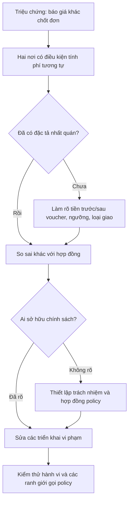

# Phân biệt mùi mã cục bộ với nguyên nhân ở thiết kế hoặc yêu cầu

Một phương thức dài, nhiều câu `if` lồng nhau hoặc một đoạn mã bị sao chép ở ba nơi thường được nhận diện là **mùi mã** (*code smell*). Nhóm có thể tách phương thức, bỏ mã trùng và đổi tên biến để mã trông gọn gàng hơn. Nhưng vài tuần sau, cùng một lỗi nghiệp vụ lại xuất hiện ở một chỗ khác. Lý do đôi khi là nhóm chỉ sửa **triệu chứng nhìn thấy trong mã**, trong khi nguyên nhân nằm ở **ranh giới thiết kế**, **quyền sở hữu quy tắc** hoặc **yêu cầu chưa được chốt**.

Trong chương **Mùi mã** của module **CODE_QUALITY_FUNDAMENTALS**, bài học này giúp phân biệt dấu hiệu cục bộ với vấn đề rộng hơn để mã nguồn trở nên **đáng tin cậy, dễ hiểu và dễ thay đổi**. Không phải mùi mã nào cũng chứng minh có lỗi; không phải mùi mã nào cũng cần một lần tái thiết kế lớn. Điều quan trọng là tìm **nguyên nhân có bằng chứng**, sửa ở đúng cấp độ và kiểm chứng rằng hành vi được yêu cầu vẫn đúng.

## 1. Mùi mã là tín hiệu cần điều tra, không phải bản án

**Mùi mã** là một dấu hiệu trong cấu trúc hoặc cách biểu đạt mã khiến người phát triển nghi ngờ mã đang khó hiểu, khó sửa, dễ sai hoặc khó kiểm thử. Ví dụ:

- Phương thức dài, nhiều nhánh hoặc quá nhiều tham số.
- Đoạn logic giống nhau xuất hiện ở nhiều vị trí.
- Một lớp có nhiều trách nhiệm không liên quan.
- Mã phụ thuộc sâu vào dữ liệu nội bộ của lớp khác.
- Một thay đổi nhỏ buộc sửa nhiều module.
- Tên biến hoặc phương thức không diễn đạt rõ ý nghĩa nghiệp vụ.

Một số dấu hiệu có thể được công cụ phân tích tĩnh phát hiện, nhưng **độ phức tạp cao, nhiều dòng mã hoặc mã lặp không tự chứng minh hệ thống sai**. Có thuật toán hợp lý dài vì cần xử lý nhiều trường hợp đã được đặc tả; có hai đoạn mã giống nhau hôm nay nhưng thuộc hai quy trình độc lập và sẽ thay đổi vì lý do khác nhau.

### 1.1. Ba khái niệm không nên trộn lẫn

| Khái niệm | Ý nghĩa | Ví dụ |
| --- | --- | --- |
| **Triệu chứng (symptom)** | Điều quan sát được đang gây khó khăn | Ba nơi tính phí giao hàng cho kết quả khác nhau |
| **Mùi mã cục bộ (local code smell)** | Dấu hiệu nghi ngờ trong một hàm/lớp/tệp | Hai câu điều kiện giống nhau, một biến `total` mơ hồ |
| **Nguyên nhân gốc có thể có (root cause)** | Yếu tố thực sự khiến triệu chứng phát sinh và tái diễn | Không có một nơi sở hữu chính sách, hoặc đặc tả chưa xác định tiền trước/sau giảm giá |

**Nguyên nhân gốc** không nhất thiết là một nguyên nhân duy nhất. Một lỗi có thể xuất phát từ yêu cầu mơ hồ **và** thiết kế tạo nhiều bản sao quy tắc **và** kiểm thử bỏ sót giá trị biên. Cần xem bằng chứng và mối quan hệ giữa các yếu tố, không ép mọi vấn đề vào một nhãn.

### 1.2. Ba cấp độ xử lý

| Cấp độ | Vấn đề thường gặp | Biện pháp có thể phù hợp | Giới hạn của biện pháp |
| --- | --- | --- | --- |
| **Mã cục bộ** | Tên khó hiểu, lồng nhánh sâu, biểu thức rối | Đổi tên, tách phép tính, guard clause, cải thiện kiểm thử | Không quyết định được quy tắc nghiệp vụ chưa rõ |
| **Thiết kế** | Quy tắc bị sao chép giữa các luồng, phụ thuộc sai chiều, trách nhiệm chồng lấn | Rõ quyền sở hữu, đặt hợp đồng tại ranh giới, tách adapter, giảm coupling | Nếu hai nhóm vẫn hiểu yêu cầu khác nhau, thiết kế đẹp vẫn cho kết quả sai |
| **Yêu cầu/hợp đồng** | Ngưỡng không rõ, thứ tự ưu tiên mâu thuẫn, trường hợp lỗi thiếu định nghĩa | Làm rõ đặc tả, bảng quyết định, tiêu chí chấp nhận, versioning | Tài liệu rõ nhưng triển khai không tuân theo vẫn tạo lỗi |

Một **refactor** theo nghĩa chặt là thay đổi cấu trúc nội bộ trong khi **giữ nguyên hành vi đã được cam kết**. Khi chính hành vi hiện tại đang sai hoặc đặc tả cần đổi, ta phải tách rõ **thay đổi yêu cầu/sửa lỗi** khỏi bước refactor, thay vì gọi mọi chỉnh sửa là “làm sạch mã”.

## 2. Cùng một mùi mã có thể xuất phát từ nhiều nguyên nhân

Bảng dưới đây là **gợi ý giả thuyết để kiểm tra**, không phải quy tắc “thấy mùi X thì nguyên nhân chắc chắn là Y”.

| Dấu hiệu quan sát | Giả thuyết cục bộ | Giả thuyết thiết kế | Giả thuyết yêu cầu | Bằng chứng cần thu thập |
| --- | --- | --- | --- | --- |
| Phương thức 200 dòng | Nhiều bước không được đặt tên | Một use case gánh nhiều trách nhiệm | Luồng có quá nhiều trường hợp chưa chốt thứ tự | Bảng nhánh, lý do thay đổi, test đường đi |
| Cùng điều kiện ở 4 nơi | Sao chép thuận tiện lúc sửa nhanh | Không có thành phần sở hữu chính sách | Các nhóm nhận yêu cầu không đồng nhất | So đầu vào/đầu ra, lịch sử sửa, nguồn đặc tả |
| `if` lồng nhiều tầng | Cách viết chưa rõ | Nhiều policy bị nhồi vào một lớp | Thứ tự ưu tiên và ngoại lệ chưa được diễn đạt | Decision table, ví dụ biên, người sở hữu quy tắc |
| Lớp có nhiều dependency | Khởi tạo hoặc tổ chức hàm chưa tốt | Trộn điều phối và chi tiết hạ tầng | Chưa phân định trách nhiệm giữa hệ thống | Dependency graph, thay đổi lan truyền |
| Nhiều tham số Boolean | Lời gọi khó đọc | Thiếu mô hình/kiểu biểu diễn trạng thái | Khái niệm nghiệp vụ chưa được đặt tên | Các tổ hợp hợp lệ, tên flag và ý nghĩa |
| Một sửa đổi chạm 10 tệp | Refactor chưa gom được biến thể | Shotgun surgery do coupling | Một thay đổi sản phẩm thật sự ảnh hưởng 10 hợp đồng | Phân loại tệp sửa theo lý do |
| Mã `shared` phình to | Helper chung thiếu tổ chức | Chia sẻ mô hình nội bộ xuyên ranh giới | Hai miền nghiệp vụ bị ép dùng cùng khái niệm | Mapping dữ liệu, vòng đời thay đổi của từng miền |

Trong thực tế, **chẩn đoán cấp độ trước khi chọn kỹ thuật** giúp tránh hai cực đoan: chỉ sửa vài dòng khi vấn đề nằm ở thiết kế, hoặc đập đi xây lại kiến trúc vì một tên biến khó đọc.

## 3. Tình huống xuyên suốt: hai đường tính phí giao hàng

Giả sử hệ thống có hai đường nghiệp vụ:

1. **Báo giá** trước khi khách bấm đặt hàng.
2. **Chốt đơn** và ghi tổng tiền phải trả.

Một yêu cầu người dùng được ghi ban đầu chỉ là:

> “Thành viên được miễn phí giao hàng khi đơn đạt 500.000 đồng.”

Câu này **chưa đủ rõ** để viết hai triển khai nhất quán: số tiền được xét trước hay sau voucher? Mốc 500.000 được tính hay không? Giao nhanh có được miễn phí? Khách không phải thành viên tính thế nào?

### 3.1. Mã cục bộ cho thấy dấu hiệu lặp và lệch

Đây là các **trích đoạn minh họa mã lỗi**, không phải thiết kế được khuyến nghị.

Trong đường báo giá:

```java
// QuoteService, chỉ minh họa một đoạn mã
long shippingFeeVnd = 15_000L;
if (member && merchandiseSubtotalVnd >= 500_000L) {
    shippingFeeVnd = 0L;
}
```

Trong đường chốt đơn:

```java
// PlaceOrderService, chỉ minh họa một đoạn mã
long payableVnd = merchandiseSubtotalVnd - voucherDiscountVnd;
long shippingFeeVnd = 15_000L;
if (member && payableVnd > 500_000L) {
    shippingFeeVnd = 0L;
}
```

Cả hai đoạn có thể qua formatter, compiler và style checker. Mùi mã dễ thấy là **điều kiện giảm phí bị lặp**. Nhưng vấn đề sâu hơn là chúng đang mô tả **hai chính sách khác nhau**:

- Báo giá xét **tiền trước voucher** và có tính đúng ngưỡng.
- Chốt đơn xét **tiền sau voucher** nhưng **không** tính đúng ngưỡng.

### 3.2. Bằng chứng phân biệt ba loại sai khác

| Tiền hàng | Voucher | Sau voucher | Thành viên? | Phí báo giá | Phí chốt đơn | Câu hỏi cần chốt |
| ---: | ---: | ---: | --- | ---: | ---: | --- |
| 600.000 | 100.000 | 500.000 | Có | 0 | 15.000 | Có tính đúng ngưỡng không? Xét trước/sau giảm giá? |
| 550.000 | 100.000 | 450.000 | Có | 0 | 15.000 | Voucher có làm mất điều kiện miễn phí không? |
| 500.000 | 0 | 500.000 | Có | 0 | 15.000 | Biểu thức `>=` hay `>` đúng? |
| 400.000 | 0 | 400.000 | Có | 15.000 | 15.000 | Hai triển khai trùng kết quả ở ca thường chưa đủ |
| 700.000 | 0 | 700.000 | Không | 15.000 | 15.000 | Điều kiện thành viên là bắt buộc? |

Chỉ lấy một bộ dữ liệu 400.000 VND để kiểm thử sẽ không phát hiện sai khác. Việc viết thêm 20 unit test với cùng kiểu đầu vào cũng không giải quyết khoảng trống về **đáp án đúng từ nghiệp vụ**.

### 3.3. Chuỗi nguyên nhân có thể có



Sơ đồ cho thấy **mùi mã sao chép là điểm xuất phát để điều tra**, không phải câu trả lời cuối. Nếu chỉ dùng “Extract Method” trong từng lớp, hai helper có thể trở nên rất đẹp nhưng vẫn khác nhau. Nếu gom cả hai đoạn thành một helper chung **trước khi xác nhận chính sách**, ta có thể tập trung **một quy tắc sai** ở một nơi.

## 4. Chốt hợp đồng nghiệp vụ rồi mới quyết định tái cấu trúc

Giả sử người phụ trách sản phẩm đã xác nhận **chính sách minh họa**:

- Tiền hàng và voucher không âm; voucher không vượt tiền hàng.
- Tiền dùng để xét miễn phí là **tiền hàng sau voucher**.
- Khách **thành viên**, **giao tiêu chuẩn**, tiền sau voucher **từ 500.000 VND trở lên** được miễn phí.
- Giao nhanh luôn tính **30.000 VND**, không thuộc ưu đãi miễn phí.
- Các trường hợp giao tiêu chuẩn còn lại tính **15.000 VND**.
- Tổng phải trả = tiền sau voucher + phí giao hàng; không được trả kết quả tràn số.
- Đây là phép tính báo giá, không tự giữ tồn kho, ghi DB hoặc thu tiền.

Những điều này là **giả định được đặt rõ cho ví dụ**, không phải chính sách phổ quát của một cửa hàng.

### 4.1. Viết bảng quyết định làm nguồn cho kiểm thử

| Mã | Loại giao | Thành viên | Tiền sau voucher | Phí giao |
| --- | --- | --- | --- | ---: |
| R1 | EXPRESS | Bất kỳ | Hợp lệ | 30.000 |
| R2 | STANDARD | Có | `>= 500_000` | 0 |
| R3 | STANDARD | Có | `< 500_000` | 15.000 |
| R4 | STANDARD | Không | Bất kỳ giá trị hợp lệ | 15.000 |
| R5 | Bất kỳ | Bất kỳ | Đầu vào tiền không hợp lệ | Từ chối trước khi tạo kết quả |
| R6 | Bất kỳ | Bất kỳ | Tổng tiền vượt `long` | `ArithmeticException` |

**Bảng quyết định** giải quyết một nguyên nhân ở cấp yêu cầu: các nhóm có một nguồn kỳ vọng có thể kiểm tra. Chỉ sau đó mới nên thiết kế một nơi sở hữu việc thực thi chính sách.

### 4.2. Đặt chính sách tại một thành phần có trách nhiệm rõ

Ví dụ Java 17, tệp `ShippingFeePolicy.java`:

```java
package com.example.codesmells;

import java.util.Objects;

public final class ShippingFeePolicy {
    private static final long FREE_THRESHOLD_VND = 500_000L;
    private static final long STANDARD_FEE_VND = 15_000L;
    private static final long EXPRESS_FEE_VND = 30_000L;

    public enum DeliverySpeed {
        STANDARD, EXPRESS
    }

    public record Request(
            long merchandiseSubtotalVnd,
            long voucherDiscountVnd,
            boolean member,
            DeliverySpeed deliverySpeed) {

        public Request {
            Objects.requireNonNull(deliverySpeed, "deliverySpeed");
            if (merchandiseSubtotalVnd < 0
                    || voucherDiscountVnd < 0
                    || voucherDiscountVnd > merchandiseSubtotalVnd) {
                throw new IllegalArgumentException("invalid amounts");
            }
        }
    }

    public record Quote(
            long payableVnd,
            long shippingFeeVnd,
            long totalChargeVnd) {}

    private ShippingFeePolicy() {}

    public static Quote calculate(Request request) {
        Objects.requireNonNull(request, "request");

        long payableVnd = request.merchandiseSubtotalVnd()
                - request.voucherDiscountVnd();

        long shippingFeeVnd;
        if (request.deliverySpeed() == DeliverySpeed.EXPRESS) {
            shippingFeeVnd = EXPRESS_FEE_VND;
        } else if (request.member() && payableVnd >= FREE_THRESHOLD_VND) {
            shippingFeeVnd = 0L;
        } else {
            shippingFeeVnd = STANDARD_FEE_VND;
        }

        long totalChargeVnd = Math.addExact(payableVnd, shippingFeeVnd);
        return new Quote(payableVnd, shippingFeeVnd, totalChargeVnd);
    }
}
```

**Vì sao cấu trúc này có ý nghĩa?**

1. `Request` bảo vệ hợp lệ của các số tiền và loại giao hàng ngay khi tạo dữ liệu. Phần nghiệp vụ tính phí không cần lặp lại validation tại mọi nơi gọi.
2. Tên `voucherDiscountVnd` và `payableVnd` nói rõ xét giá trị nào; enum `DeliverySpeed` tránh truyền các tham số Boolean khó hiểu.
3. Quy tắc giao nhanh và miễn phí giao tiêu chuẩn có **thứ tự ưu tiên rõ**.
4. `Math.addExact` phát hiện tràn số thay vì cho kết quả sai âm.
5. Thành phần chỉ tính toán, không biết HTTP, JDBC hoặc trạng thái của một đơn hàng lưu trong DB.
6. Báo giá và chốt đơn có thể **cùng dùng hợp đồng tính phí** mà không tự sao chép biểu thức so ngưỡng.

Tách một policy không có nghĩa **mọi** quy tắc cần thành một lớp riêng. Việc tách có giá trị ở đây vì chính sách đang được gọi từ **nhiều đường nghiệp vụ**, dễ phát sinh sai khác và có lý do thay đổi riêng.

### 4.3. Ranh giới sử dụng policy vẫn cần giữ đúng dữ liệu

Ví dụ ý tưởng:

```java
// Ở đường báo giá:
ShippingFeePolicy.Quote preview =
        ShippingFeePolicy.calculate(pricingRequest);

// Ở đường chốt đơn, sau khi xác nhận dữ liệu chốt giá:
ShippingFeePolicy.Quote committed =
        ShippingFeePolicy.calculate(confirmedRequest);
orderStore.save(orderId, committed.totalChargeVnd());
```

Các biến và `orderStore` ở trên là **đoạn ghép minh họa**, không phải chương trình hoàn chỉnh. Bảo đảm quan trọng là cả hai đường dùng **cùng chính sách với dữ liệu có cùng ngữ nghĩa**.

**Chú ý vấn đề sâu hơn:** nếu báo giá dùng voucher tại thời điểm T1, còn chốt đơn dùng voucher đã hết hạn tại T2, hai lần gọi đúng cùng policy vẫn có thể ra kết quả khác nhau. Cần xác nhận hợp đồng về **thời điểm tính giá, tính hiệu lực của voucher, phiên bản policy và giá trị nào được khóa khi chốt đơn**. Việc đưa phép tính vào một lớp chung không tự giải quyết tính nhất quán theo thời gian hoặc giao dịch.

## 5. Kiểm thử để phân biệt sửa triệu chứng với sửa nguyên nhân

Sau khi chốt yêu cầu, có thể tạo kiểm thử hành vi độc lập với cấu trúc `if` và helper nội bộ.

Tệp `ShippingFeePolicyTest.java` dùng JUnit 5, ở cùng package:

```java
package com.example.codesmells;

import static org.junit.jupiter.api.Assertions.assertEquals;
import static org.junit.jupiter.api.Assertions.assertThrows;

import org.junit.jupiter.api.Test;
import org.junit.jupiter.params.ParameterizedTest;
import org.junit.jupiter.params.provider.CsvSource;

class ShippingFeePolicyTest {
    @ParameterizedTest
    @CsvSource({
        "STANDARD, true,  499999, 0,      15000",
        "STANDARD, true,  500000, 0,          0",
        "STANDARD, true,  500001, 0,          0",
        "STANDARD, true,  600000, 100000,     0",
        "STANDARD, true,  600000, 100001, 15000",
        "STANDARD, false, 600000, 0,      15000",
        "EXPRESS,  true,  600000, 0,      30000"
    })
    void feeMatchesApprovedBusinessTable(
            ShippingFeePolicy.DeliverySpeed speed,
            boolean member,
            long subtotalVnd,
            long voucherVnd,
            long expectedFeeVnd) {

        var request = new ShippingFeePolicy.Request(
                subtotalVnd, voucherVnd, member, speed);

        var quote = ShippingFeePolicy.calculate(request);

        long expectedPayableVnd = subtotalVnd - voucherVnd;
        assertEquals(expectedPayableVnd, quote.payableVnd());
        assertEquals(expectedFeeVnd, quote.shippingFeeVnd());
        assertEquals(expectedPayableVnd + expectedFeeVnd,
                quote.totalChargeVnd());
    }

    @Test
    void negativeOrExcessiveVoucherIsRejected() {
        assertThrows(IllegalArgumentException.class,
                () -> new ShippingFeePolicy.Request(
                        100_000L, -1L, true,
                        ShippingFeePolicy.DeliverySpeed.STANDARD));

        assertThrows(IllegalArgumentException.class,
                () -> new ShippingFeePolicy.Request(
                        100_000L, 100_001L, true,
                        ShippingFeePolicy.DeliverySpeed.STANDARD));
    }

    @Test
    void overflowIsRejectedInsteadOfProducingWrongTotal() {
        var request = new ShippingFeePolicy.Request(
                Long.MAX_VALUE, 0L, false,
                ShippingFeePolicy.DeliverySpeed.EXPRESS);

        assertThrows(ArithmeticException.class,
                () -> ShippingFeePolicy.calculate(request));
    }
}
```

Các giá trị kỳ vọng đến từ **bảng chính sách đã xác nhận**. Trong những ca thành công được chọn, phép cộng trong test không tràn `long`; ca vượt miền số được kiểm tra riêng.

Bộ test này bảo vệ **phép tính cục bộ**. Nó **chưa chứng minh** đường HTTP báo giá và đường lưu đơn dùng cùng dữ liệu hoặc cùng phiên bản chính sách. Cần thêm kiểm thử tích hợp tại **hai điểm sử dụng** và kiểm tra cách ánh xạ JSON, dữ liệu voucher, thông tin thành viên, thời điểm và giao dịch khi các yếu tố ấy tham gia hệ thống thật.

### 5.1. Ma trận bằng chứng sau sửa

| Giả thuyết nguyên nhân | Bằng chứng cần sau thay đổi | Loại kiểm tra |
| --- | --- | --- |
| Dấu `>` gây sai đúng ngưỡng | Ca `500_000` được miễn phí theo quy tắc R2 | Unit test chính sách |
| Hai nơi tự tính phí | Không còn bản sao điều kiện ở quote và checkout | Review điểm sở hữu policy và dependency |
| Voucher được áp sai thời điểm | Hai đường dùng dữ liệu và thời điểm phù hợp hợp đồng | Integration/contract test |
| Tổng tiền có thể tràn số | `Math.addExact` và ca biên được bảo vệ | Unit test |
| Chính sách được thay mà client chưa biết | Hợp đồng thời điểm/phiên bản và dữ liệu chốt được ghi rõ | Review yêu cầu, API contract, test hồi quy |

Nhờ ma trận này, nhóm không chỉ hỏi “đã xóa mã trùng chưa?” mà hỏi “**loại lỗi khiến nhóm phải sửa** có còn con đường để tái diễn không?”.

## 6. Chẩn đoán mùi mã theo từng lớp nguyên nhân

Một cách thực hành là đi qua **ba vòng câu hỏi**, từ gần tới xa.

### Vòng A — Mã cục bộ

Xem trong một phương thức hoặc lớp:

- Có tên nào không cho biết mục đích không?
- Có nhánh, vòng lặp hoặc biểu thức nào khiến người đọc giữ quá nhiều ngữ cảnh không?
- Có kiểm tra đầu vào hoặc xử lý lỗi bị lặp không?
- Có trạng thái mutable, ngoại lệ hoặc tác dụng phụ bị che giấu không?
- Một thao tác có thể được kiểm thử qua hành vi công khai không?

**Biện pháp phù hợp** khi nguyên nhân thực sự cục bộ: đổi tên, đặt tên cho điều kiện có ý nghĩa, bỏ nhánh dư, tách phương thức mạch lạc hoặc đưa phép tính thuần ra khỏi I/O.

### Vòng B — Thiết kế và phụ thuộc

Nếu mùi liên quan nhiều phương thức/lớp/module:

- Một quy tắc có bị quyết định tại **nhiều nơi** không?
- Thành phần nào được giao trách nhiệm sở hữu quy tắc và bất biến?
- Khi đổi một điều kiện, cần sửa những module nào **vì coupling không cần thiết**?
- Một lớp nghiệp vụ có phải biết kiểu HTTP/SQL hoặc dữ liệu nội bộ của hệ khác không?
- Có lời gọi vòng, chia sẻ schema hoặc trạng thái khiến các thành phần không thể thay đổi độc lập không?
- Một “helper chung” có thực sự cùng ngữ nghĩa ở tất cả nơi sử dụng không?

**Biện pháp phù hợp** có thể là chuyển quyền sở hữu, tạo hợp đồng cho thành phần cần gọi, tách adapter, hoặc gom quy tắc vào nơi có trách nhiệm rõ. Tránh tạo hàng chục lớp mới chỉ để giảm số dòng của từng lớp.

### Vòng C — Yêu cầu, ngữ nghĩa và quy trình quyết định

Nếu cùng loại sai khác liên tục xuất hiện hoặc test không có đáp án chắc chắn:

- Có định nghĩa chính thức về **thuật ngữ và đơn vị** không?
- Ngưỡng bao gồm giá trị bằng hay không? Quy tắc nào ưu tiên?
- Khi thất bại có kết quả một phần hay mọi trạng thái giữ nguyên?
- Ai quyết định ý nghĩa của từ “đơn hoàn tất”, “thành viên”, “đã thanh toán”?
- Hai nhóm đang phục vụ **cùng một bounded context** hay hai ngữ cảnh có nghĩa khác nhau?
- Thay đổi yêu cầu có đi cùng cập nhật tài liệu, test và API contract không?

**Biện pháp phù hợp** là chốt ví dụ nghiệp vụ, bảng quyết định, tiền/hậu điều kiện, quyền sở hữu và cơ chế review thay đổi yêu cầu. Chưa có đáp án đúng thì refactor tự động có nguy cơ chuẩn hóa một quy tắc sai.

## 7. Các tình huống thường đánh lừa người refactor

### 7.1. “Mã lặp” nhưng thật ra là hai quy tắc khác nhau

Hai module có cùng điều kiện:

```java
return amountVnd >= 500_000L;
```

Một module dùng để kiểm tra **miễn phí giao hàng**, module khác dùng để xác định **mức phê duyệt hoàn tiền**. Hai điều kiện hôm nay giống nhau về giá trị, nhưng do **hai chính sách khác nhau** quyết định và có thể đổi ngưỡng độc lập.

Gom chúng thành `CommonRules.isAboveLimit(...)` có thể tạo **liên kết giả tạo**. Khi sửa ngưỡng giao hàng, người phát triển vô tình làm thay quy trình hoàn tiền. Mùi mã “trùng lặp ký tự” ở đây không đủ để kết luận phải trừu tượng hóa chung.

**Câu hỏi đúng:** hai đoạn có cùng ý nghĩa, cùng người sở hữu, cùng lý do thay đổi và cùng vòng đời không? Nếu không, sự trùng lặp hiện tại có thể chấp nhận được.

### 7.2. “Phương thức dài” vì nghiệp vụ có nhiều trạng thái hợp lệ

Một bộ xử lý hồ sơ có thể phải xét nhiều loại tài liệu, trạng thái xác minh và ngoại lệ pháp lý. Một phương thức dài có thể khó đọc, nhưng chia thành 30 helper không giúp ích nếu **trạng thái và quy tắc chuyển** chưa được biểu diễn rõ.

Hướng điều tra:
 
1. Lập bảng trạng thái và quy tắc chuyển.
2. Phân biệt các điều kiện độc lập và điều kiện có thứ tự ưu tiên.
3. Tạo mô hình hoặc policy có trách nhiệm rõ nếu số biến thể thật sự cần.
4. Kiểm thử các đường chuyển trạng thái hợp lệ và bị từ chối.
5. Chỉ sau đó chọn cấu trúc phương thức/lớp diễn đạt chúng dễ hiểu hơn.

**Mùi phương thức dài có thể là dấu hiệu thiếu mô hình nghiệp vụ**, không chỉ thiếu kỹ thuật Extract Method.

### 7.3. “Lớp có quá nhiều dependency” vì chưa phân định vai trò điều phối

Một lớp `CheckoutCoordinator` gọi pricing, inventory, payment và order repository có thể có fan-out cao vì nó thực sự **điều phối** quy trình. Không nên tự động coi fan-out cao là sai. Cần kiểm tra lớp ấy có chỉ điều phối qua hợp đồng hay đồng thời ôm logic SQL, gửi email, tính khuyến mãi và xử lý các chi tiết vendor.

Nếu tách quá mức thành nhiều coordinator gọi nhau vòng quanh, đường luồng lại khó theo dõi hơn. Biện pháp tốt là **phân định nơi quyết định và nơi thực hiện**, không phải làm mọi lớp có ít hơn ba dependency.

### 7.4. “Nhiều tham số Boolean” vì mô hình trạng thái chưa được chốt

Ví dụ:

```java
price(order, true, false, true);
```

Các giá trị `true`/`false` khó biết ý nghĩa. Thay bằng enum, record hoặc value object có thể tăng khả năng đọc. Nhưng nếu trạng thái có ràng buộc, ví dụ “giao nhanh thì không được dùng lịch giao cố định”, chỉ đổi Boolean thành enum **chưa đảm bảo** loại bỏ tổ hợp không hợp lệ. Cần định nghĩa **các trạng thái hợp lệ** rồi bảo vệ bằng constructor, validation hoặc kiểu dữ liệu phù hợp.

### 7.5. “Một thay đổi sửa nhiều tệp” không phải lúc nào cũng là shotgun surgery

Nếu thêm loại thanh toán mới, có thể cần sửa hợp đồng API, nghiệp vụ, adapter, schema, test và tài liệu. Đó là **hệ quả có thật của thay đổi**. Mùi *shotgun surgery* đáng điều tra khi một thay đổi cục bộ buộc chạm nhiều vị trí **không có lý do hợp đồng chính đáng**, thường vì cùng quyết định bị rải rác.

Để đánh giá, hãy phân loại từng tệp được sửa: cập nhật bắt buộc theo nghĩa nghiệp vụ hay sửa theo sự phụ thuộc nội bộ có thể tránh?

### 7.6. “Cần microservice vì module quá lớn”

Một ứng dụng có package lớn không đồng nghĩa phải tách dịch vụ. Chia thành microservice có thể biến phụ thuộc trong bộ nhớ thành **gọi mạng, retry, timeout và tính nhất quán phân tán**. Nếu yêu cầu về ownership và dữ liệu chưa rõ, tách tiến trình có thể làm khó truy nguyên lỗi hơn.

Trước tiên có thể tổ chức ranh giới ngay trong **modular monolith**, làm rõ hợp đồng và quyền sở hữu dữ liệu. Chỉ cân nhắc chia dịch vụ khi nhu cầu triển khai độc lập, vận hành, mở rộng hoặc tổ chức đủ rõ để bù chi phí.

## 8. Từ mùi mã đến giả thuyết nguyên nhân có thể bác bỏ

Một nhận định hữu ích không phải “lớp này xấu nên phải viết lại”, mà là **giả thuyết có thể kiểm tra**.

Ví dụ:

> “Các lỗi lệch phí giao hàng xuất hiện vì đường báo giá và chốt đơn sở hữu hai bản sao chính sách. Nếu chốt một bảng quyết định và dùng một policy chung, cùng dữ liệu hợp lệ sẽ cho cùng quyết định ở hai đường; thay ngưỡng chỉ cần sửa policy và test liên quan.”

Giả thuyết này có thể bị **bác bỏ**: nếu sau khi dùng policy chung, kết quả vẫn khác do voucher hết hạn giữa báo giá và chốt đơn, nguyên nhân chưa được xử lý hết. Đây là tiến bộ, không phải thất bại của việc điều tra: ta đã thu hẹp phạm vi và phát hiện vấn đề thời điểm.

### 8.1. Dùng “5 lần hỏi vì sao” như công cụ gợi ý, không phải công thức

Một chuỗi câu hỏi minh họa:

1. **Vì sao** báo giá và chốt đơn khác? Vì điều kiện tính phí khác.
2. **Vì sao** điều kiện khác? Vì mỗi luồng tự cài chính sách.
3. **Vì sao** tự cài? Vì chưa xác định nơi sở hữu quy tắc và API dùng chung.
4. **Vì sao** chưa xác định? Vì khi phát triển, yêu cầu được giao theo màn hình, không chốt quy tắc xuyên luồng.
5. **Vì sao** việc này không bị phát hiện? Vì kiểm thử chỉ dựa trên ví dụ phổ biến, không có test biên hay kiểm thử tính nhất quán giữa hai luồng.

Đây là **chuỗi giả thuyết cần xác nhận bằng lịch sử thay đổi và tài liệu**, không phải kết luận rằng “hỏi đủ năm lần sẽ luôn tìm được nguyên nhân gốc”. Một sự cố có thể có nhiều nhánh nguyên nhân; thay vì ép chuỗi tuyến tính, có thể vẽ sơ đồ nguyên nhân hoặc phân tích theo trách nhiệm/dữ liệu/thời gian.

### 8.2. Thu thập bằng chứng đúng chỗ

| Cần xác nhận | Bằng chứng có ích | Giới hạn |
| --- | --- | --- |
| Logic thật sự được sao chép | Các điểm tính phí và đường gọi | Cùng chuỗi mã chưa chứng minh cùng nghĩa |
| Hành vi thực tế khác | Đầu vào giống nhau qua hai đường và kết quả quan sát | Dữ liệu thời gian/cấu hình có thể khác |
| Quy tắc nghiệp vụ nào đúng | Đặc tả, quyết định của người sở hữu, bảng biên đã phê duyệt | Mã hiện tại không phải oracle độc lập |
| Thay đổi thường lan rộng | Diff và danh sách tệp qua nhiều lần sửa | Nhiều tệp có thể là cập nhật hợp đồng hợp lệ |
| Lỗi tái diễn | Bug report, regression test, test bị thiếu | Một vài lỗi không tự chứng minh thống kê |
| Tái cấu trúc có lợi | Giảm điểm sở hữu trùng, test biên xanh, review dễ hiểu hơn | Số dòng giảm không phải bằng chứng đủ |

**Số lượng mùi** hay số cảnh báo công cụ chỉ là **tín hiệu ưu tiên điều tra**, không phải thước đo trực tiếp của lợi ích nghiệp vụ.

## 9. Lựa chọn thay đổi phù hợp với cấp độ nguyên nhân

| Bằng chứng chính | Hướng thay đổi ưu tiên | Rủi ro nếu sửa sai cấp |
| --- | --- | --- |
| Tên và nhánh rối, hợp đồng đã rõ, chỉ một nơi dùng | Refactor cục bộ, đổi tên, guard clauses | Tạo quá nhiều lớp/interface không cần thiết |
| Cùng một chính sách ở nhiều nơi và thường lệch | Chốt nơi sở hữu, cùng policy/hợp đồng | Gom nhầm hai chính sách có vòng đời khác |
| Lớp nghiệp vụ import JDBC/HTTP cụ thể | Tách adapter, phụ thuộc vào hợp đồng cần thiết | Tăng độ gián tiếp nhưng không giảm phụ thuộc dữ liệu |
| Đa tầng `if` vì thiếu trạng thái chính thức | Xác định state machine/decision table, sau đó cải thiện cấu trúc | Chia helper vẫn không bảo đảm chuyển trạng thái hợp lệ |
| Ngưỡng, đơn vị hoặc thứ tự ưu tiên chưa rõ | Chốt đặc tả và test oracle trước | Chuẩn hóa một hành vi sai |
| Kết quả khác do dữ liệu đổi theo thời gian | Hợp đồng snapshot/version, transaction và consistency | Cùng policy vẫn cho kết quả khác nếu đầu vào khác |
| Sự cố lặp do timeout/retry | Hợp đồng idempotency, đối soát và trạng thái | Chỉ đổi tên/tách phương thức không chống tác dụng phụ lặp |

**Không nhất thiết chọn một hành động duy nhất.** Trường hợp lỗi báo giá có thể cần: (a) chốt yêu cầu; (b) đặt policy đúng trách nhiệm; (c) sửa dữ liệu truyền vào; (d) thêm unit và integration test. Điều nên tránh là gộp mọi thay đổi vào một PR khổng lồ không thể phân biệt lỗi được sửa ở đâu.

### 9.1. Quy trình theo từng lát cắt an toàn

1. **Ghi hiện tượng quan sát:** đầu vào, kết quả, điều kiện môi trường, nơi gọi.
2. **Khôi phục hợp đồng mong đợi:** tìm yêu cầu, xác nhận trường hợp biên và sai khác.
3. **Bổ sung regression test cho lỗi thực:** kiểm tra qua ranh giới công khai trước khi sửa.
4. **Phân loại vấn đề:** cục bộ, thiết kế, yêu cầu; ghi những gì chưa chắc chắn.
5. **Thực hiện thay đổi nhỏ nhất có tác dụng:** tách bước sửa bug và bước refactor khi có thể.
6. **Đánh giá chiều phụ thuộc và điểm sở hữu:** quy tắc đã hết trùng ở những nơi phải nhất quán chưa?
7. **Kiểm tra đường lỗi và dữ liệu thực:** các tác dụng phụ, version, transaction hoặc retry có bị ảnh hưởng?
8. **Chạy kiểm thử phù hợp và review kết quả:** unit, integration, contract hoặc toàn luồng tùy phạm vi.
9. **Ghi lý do quyết định:** vì sao thiết kế mới dễ thay đổi hơn, trường hợp nào cố ý không gom chung.
10. **Theo dõi sau thay đổi:** lỗi cùng loại có còn xảy ra, thời gian sửa chính sách có giảm, có mùi mới do trừu tượng hóa quá mức không?

Chỉ đổi cấu trúc và thấy test xanh là chưa đủ nếu bộ test chưa bao phủ **đúng loại sai khác ban đầu**.

## 10. Ma trận kiểm thử giúp chứng minh ta sửa đúng nguyên nhân

Khi thay đổi một policy được nhiều luồng sử dụng, có thể tổ chức bằng chứng như sau:

| Cấp kiểm chứng | Trọng tâm | Ví dụ |
| --- | --- | --- |
| **Unit test policy** | Cùng đầu vào cho quyết định đúng, giá trị biên, đầu vào sai | `payable = 500_000` miễn phí giao tiêu chuẩn cho thành viên |
| **Unit test adapter/use case** | Dùng policy đúng phạm vi; không tự cài công thức khác | `QuoteService` và `PlaceOrderService` chuyển dữ liệu chính xác |
| **Integration test** | Giá trị voucher, thành viên và phiên bản giá đi từ DB/API đến policy đúng | Hai đường nhận cùng trạng thái hợp lệ cho cùng kết quả |
| **Contract test** | Client biết đơn giá báo trước/chốt đơn có thể thay đổi khi nào | Schema, mã lỗi và ý nghĩa thông báo “giá đã thay đổi” |
| **End-to-end test** | Luồng đặt hàng từ báo giá đến chốt đơn xử lý khác biệt đúng | Khi voucher hết hạn, yêu cầu xác nhận lại thay vì âm thầm thu tiền khác |
| **Regression monitor** | Sai khác báo giá/chốt đơn còn tái diễn dưới dữ liệu thực không? | Theo dõi sự cố xác nhận, tách lỗi quy tắc khỏi lỗi dữ liệu |

**Một test không phải chứng cứ cho mọi tầng.** Unit test của chính sách không thể chứng minh cơ sở dữ liệu được khóa đúng khi chốt giá; test tích hợp database không tự chứng minh client hiểu chính sách giá thay đổi theo thời gian.

## 11. Khi nào nên để một mùi mã tồn tại?

Không phải mọi mùi đều đáng sửa ngay. Có thể ưu tiên theo **rủi ro**, **tần suất thay đổi**, **mức độ lan truyền**, **độ khó kiểm thử** và **chi phí sửa an toàn**.

| Tình huống | Quyết định có thể hợp lý | Lý do |
| --- | --- | --- |
| Đoạn thuật toán phức tạp nhưng ổn định và có test tốt | Để nguyên hoặc chỉ cải thiện tài liệu | Refactor lớn có rủi ro không tương xứng |
| Hai nhánh giống nhau thuộc hai miền nghiệp vụ độc lập | Giữ riêng, ghi rõ trách nhiệm | Tránh coupling giả tạo |
| Tên biến mơ hồ trong API được dùng rộng rãi | Giữ tương thích, tạo adapter hoặc lộ trình đổi | Đổi tên trực tiếp có thể phá client |
| Lớp lớn đang sửa thường xuyên, mọi thay đổi gây hồi quy | Ưu tiên chia trách nhiệm theo bằng chứng | Rủi ro tái diễn cao |
| Công cụ phát hiện 100 cảnh báo style ở mã sinh | Sửa cấu hình nguồn sinh hoặc phạm vi kiểm tra | Không sửa tay từng tệp sẽ được sinh lại |
| Một helper dài nhưng hành vi thuần, rõ và chỉ dùng một nơi | Chỉ tách nếu tăng khả năng hiểu/kiểm thử | Ít dòng không tự đồng nghĩa dễ bảo trì |

Một quyết định **chưa sửa** vẫn nên ghi lý do nếu mùi liên quan rủi ro đáng kể. “Để nguyên vì chưa thấy bug” khác với “đã xem, hiểu các ranh giới, có test bảo vệ và đánh giá chi phí refactor cao hơn lợi ích hiện tại”.

### 11.1. Đừng lấy chỉ số công cụ làm mục tiêu cuối

Cyclomatic complexity cao, duplicated lines tăng hay lớp có nhiều phụ thuộc là tín hiệu đáng xem xét. Nhưng:

- Một policy hợp lệ với nhiều quy tắc có thể cần nhiều nhánh.
- Một dòng mã lặp lại ngẫu nhiên không có nghĩa cùng ngữ nghĩa.
- Một coordinator có nhiều dependency có thể đúng trách nhiệm.
- Tách một phương thức chỉ để giảm điểm có thể tăng số lần người đọc phải chuyển tệp.
- Giảm số cảnh báo bằng suppression diện rộng không làm hệ thống an toàn hơn.

Mục tiêu là **giảm độ khó hiểu và rủi ro thay đổi có thật**, không phải đạt một ngưỡng số học tùy ý.

## 12. Bài tập vận dụng: dịch vụ hoàn tiền có mùi ở nhiều cấp

**Tình huống:** một hệ thống hoàn tiền Java có các dấu hiệu:

- Phương thức `refund()` dài khoảng 180 dòng, gồm kiểm tra đơn hàng, tính tiền được hoàn, gọi cổng thanh toán, cập nhật DB và gửi email.
- Web và mobile mỗi bên tự viết điều kiện “được hoàn trong 30 ngày”; web tính cả ngày thứ 30, mobile không tính.
- Hai nhóm chưa thống nhất “30 ngày” tính từ thời điểm **đặt hàng**, **thanh toán** hay **giao hàng**; có dữ liệu thời gian ở các múi giờ khác nhau.
- Khi cổng thanh toán timeout, client tự gửi yêu cầu mới với request ID khác và đôi khi tạo hai khoản hoàn.
- Có ba bản sao công thức tính số tiền còn được hoàn.
- Kiểm thử chủ yếu kiểm tra `refund()` có gọi đúng các helper nội bộ, ít kiểm tra trạng thái sau lỗi.

Hãy phân tích:

1. **Phân loại từng dấu hiệu** vào mùi cục bộ, vấn đề thiết kế hoặc khoảng trống yêu cầu. Dấu hiệu nào có thể có nhiều nguyên nhân?
2. **Viết ít nhất năm câu hỏi cần chốt** với người sở hữu nghiệp vụ: mốc bắt đầu, thời điểm kết thúc, múi giờ, cách xử lý đúng ngày thứ 30, hoàn từng phần, trạng thái thanh toán và retry.
3. **Đề xuất hợp đồng** gồm tiền điều kiện, hậu điều kiện thành công, trường hợp bị từ chối và trạng thái chưa rõ khi thanh toán timeout.
4. **Vẽ chiều trách nhiệm:** thành phần nào sở hữu chính sách đủ điều kiện hoàn tiền, số tiền được hoàn, việc điều phối và adapter thanh toán?
5. **Nêu ít nhất sáu ca kiểm thử hành vi**: trước/đúng/sau mốc ngày, số tiền quá hạn mức, đơn chưa thanh toán, timeout, lặp request ID, và tranh chấp giữa hai yêu cầu hoàn cùng số dư.
6. **Thiết kế hai lát cắt thay đổi an toàn:** ưu tiên điều kiện biên và đặc tả, sau đó tái cấu trúc; giải thích vì sao sửa helper trước có thể làm mâu thuẫn còn tồn tại.
7. **Đánh giá kết quả:** ngoài số dòng giảm, cần bằng chứng nào để xác nhận lỗi hoàn trùng và lệch quy tắc giữa web/mobile không còn tái diễn?

**Gợi ý tự đối chiếu:** `refund()` dài là mùi cục bộ và có thể phản ánh trách nhiệm bị trộn. Hai cách đếm “30 ngày” không giải quyết được chỉ bằng đổi tên hàm vì **mốc thời gian gốc và quy tắc biên còn mơ hồ**. Hai công thức hoàn tiền và các client tự tính chính sách cho thấy thiếu **quyền sở hữu quy tắc chung** nếu chúng thật sự cùng nghiệp vụ. Timeout là trạng thái kết quả chưa rõ, cần định danh yêu cầu ổn định, idempotency/đối soát và bảo vệ dữ liệu; chỉ tách `refund()` thành các helper nhỏ không chống được hoàn tiền hai lần.

## 13. Những ngộ nhận thường gặp

| Ngộ nhận | Vì sao không đủ | Cách suy nghĩ tốt hơn |
| --- | --- | --- |
| “Thấy mã lặp thì luôn phải gom.” | Hai đoạn giống cú pháp có thể khác ngữ nghĩa và vòng đời | Kiểm tra cùng lý do thay đổi và người sở hữu |
| “Phương thức dài nên tách càng nhỏ càng tốt.” | Có thể tăng nhảy qua nhiều hàm, che mối liên hệ | Đặt tên cho trách nhiệm có nghĩa và bảo vệ luồng |
| “Đặt tên đẹp là sửa được code smell.” | Vẫn có thể phụ thuộc sai ranh giới hoặc quy tắc mơ hồ | Xem cả trách nhiệm và hợp đồng |
| “Có interface nghĩa là thiết kế tốt.” | Interface có thể lộ JDBC, chỉ chuyển chỗ coupling | Kiểm tra chiều phụ thuộc và khả năng thay đổi |
| “Một rule chung giải quyết mọi sai khác.” | Quy tắc chung có thể sai hoặc dữ liệu đầu vào khác thời điểm | Chốt đặc tả, nhất quán dữ liệu và test đường gọi |
| “Test xanh chứng minh refactor an toàn.” | Test có thể bỏ qua biên, trạng thái sau lỗi hoặc tích hợp | Kiểm tra oracle và đúng lớp rủi ro |
| “Phân tích tĩnh báo mùi là phải sửa ngay.” | Công cụ không biết đầy đủ yêu cầu và bối cảnh | Ưu tiên theo rủi ro, mức thay đổi, bằng chứng |
| “Microservice giúp xử lý mọi lớp lớn.” | Có thể làm tăng vấn đề mạng và dữ liệu phân tán | Xác định bounded context và ownership trước |
| “Lỗi lặp lại nghĩa là một người viết mã sai.” | Hệ thống có thể thiếu đặc tả, review hoặc ownership | Phân tích cả quy trình và hệ thống kiểm chứng |
| “Đã tìm được một nguyên nhân thì dừng.” | Có thể còn nguyên nhân về dữ liệu, thời gian và retry | Giữ giả thuyết mở, xác nhận bằng nhiều loại bằng chứng |

## 14. Ghi nhớ

- **Mùi mã là dấu hiệu cần điều tra**, không phải bằng chứng tự động về lỗi hoặc nguyên nhân.
- **Phân biệt ba cấp**: cục bộ (cách diễn đạt), thiết kế (trách nhiệm/phụ thuộc), yêu cầu (quy tắc/hợp đồng).
- **Xác định hành vi đúng trước khi gom logic**. Hai bản sao sai khác nhau không tự trở thành một policy đúng khi được trích xuất.
- **Dùng dữ liệu thật, bảng quyết định và trường hợp biên** để tìm vị trí sai khác; xem cả dữ liệu, thời gian và ranh giới I/O.
- **Chọn thay đổi đúng cấp độ**, hạn chế trừu tượng hóa quá mức hoặc tái thiết kế toàn hệ thống khi chưa cần.
- **Kiểm chứng nguyên nhân được xử lý**, không chỉ đếm số dòng giảm, điểm complexity hay số cảnh báo biến mất.
- **Không mọi mùi đều cần sửa ngay**: cân nhắc rủi ro, lý do thay đổi và chi phí triển khai an toàn.

Một lần refactor có giá trị không chỉ làm mã **trông sạch hơn**. Nó giúp nhóm hiểu **vì sao lỗi dễ xuất hiện, ở đâu quy tắc phải được quyết định, hợp đồng nào cần giữ và bằng chứng nào cho thấy thay đổi đã giải quyết đúng vấn đề**. Khi phân biệt rõ triệu chứng cục bộ với nguyên nhân ở thiết kế hoặc yêu cầu, các cải thiện mới thực sự làm mã đáng tin cậy và dễ thay đổi hơn.
