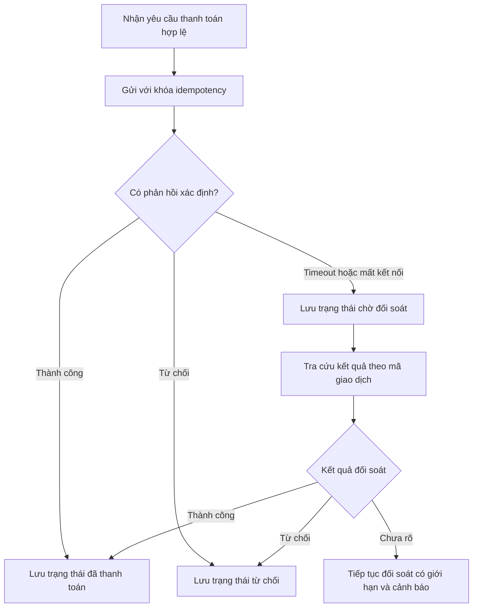

# Độ tin cậy khi gặp lỗi hoặc điều kiện bất thường

## 1. Vì sao đây là một chiều quan trọng của chất lượng mã nguồn?

Một chương trình chạy đúng với dữ liệu lý tưởng chưa chắc đáng tin cậy trong thực tế. Người dùng có thể nhập sai định dạng, một dịch vụ bên ngoài có thể phản hồi chậm, hai yêu cầu có thể đến cùng lúc, hoặc tiến trình có thể dừng sau khi đã thực hiện một phần thao tác. **Độ tin cậy (reliability)** thể hiện khả năng hệ thống tiếp tục đáp ứng những cam kết đã xác định trong các điều kiện vận hành dự kiến, bao gồm cả cách hệ thống xử lý khi gặp lỗi.

Trong học phần `CODE_QUALITY_FUNDAMENTALS`, mục tiêu là **hiểu những thuộc tính quyết định mã nguồn có đáng tin cậy, dễ hiểu và dễ thay đổi hay không**. Độ tin cậy liên quan trực tiếp đến mục tiêu đó: mã nguồn đáng tin cậy có quy tắc xử lý lỗi rõ ràng, bảo vệ tính đúng đắn của dữ liệu, cung cấp tín hiệu để phát hiện sự cố và giúp người khác sửa đổi mà không vô tình làm hỏng các trường hợp ngoại lệ.

Ví dụ, khi người dùng thanh toán mà kết nối bị ngắt sau khi gửi yêu cầu, một hệ thống đáng tin cậy không thể tự kết luận “chưa trừ tiền”. Cổng thanh toán có thể đã xử lý giao dịch. Hệ thống cần lưu trạng thái **chưa xác định**, kiểm tra kết quả và tránh thanh toán lặp.

Sau bài này, người học có thể:

- Phân biệt lỗi bên trong, sự cố quan sát được, độ tin cậy, khả năng chịu lỗi và khả năng phục hồi.
- Nhận diện những điều kiện bất thường thường gặp ở đầu vào, trạng thái, phụ thuộc mạng và xử lý đồng thời.
- Thiết kế cách xử lý lỗi nhất quán: phát hiện, giới hạn tác động, bảo toàn dữ liệu, thông báo và phục hồi.
- Đọc ví dụ Java để đánh giá ràng buộc dữ liệu, ngoại lệ và kết quả chưa xác định.
- Lựa chọn ca kiểm thử có chủ đích thay vì chỉ kiểm tra đường đi thành công.

## 2. Hiểu đúng “đáng tin cậy”

Hệ thống đáng tin cậy **không có nghĩa là không bao giờ xảy ra lỗi**. Điều quan trọng là hệ thống thực hiện đúng hành vi đã cam kết, và khi không thể thực hiện thì thất bại theo cách đã định nghĩa, có thể phát hiện và kiểm soát.

Một cách nhìn hữu ích:

| Khái niệm | Ý nghĩa | Ví dụ |
| --- | --- | --- |
| **Fault — nguyên nhân gây lỗi** | Khiếm khuyết hoặc điều kiện có khả năng gây sai lệch | Mạng chập chờn; lập trình viên bỏ qua trường hợp số lượng bằng 0 |
| **Error — trạng thái sai** | Trạng thái nội bộ lệch khỏi điều kiện đúng | Hai yêu cầu cùng đọc thấy ghế còn trống và đều chuẩn bị xác nhận |
| **Failure — thất bại quan sát được** | Hệ thống không đáp ứng cam kết tại ranh giới sử dụng | Hai khách đều nhận xác nhận cho cùng một ghế |
| **Robustness — tính vững trước đầu vào bất thường** | Không để dữ liệu sai gây hành vi mất kiểm soát | Từ chối số lượng âm, trả thông báo hợp lệ |
| **Fault tolerance — khả năng chịu lỗi** | Vẫn cung cấp chức năng đã định khi một bộ phận lỗi | Một nút dịch vụ hỏng, nút khác vẫn phục vụ |
| **Resilience — khả năng phục hồi** | Hấp thụ tác động, khôi phục và thích nghi sau sự cố | Hàng đợi lưu yêu cầu để xử lý lại khi hệ thống đối tác hoạt động |

Các khái niệm này liên quan nhưng không đồng nhất. **Availability** (khả dụng) mô tả mức độ dịch vụ sẵn sàng sử dụng; **reliability** rộng hơn ở khía cạnh dịch vụ có đưa ra **kết quả đúng theo cam kết** hay không. API luôn trả HTTP `200` nhưng ghi sai số tiền là khả dụng về mặt phản hồi, song không đáng tin cậy về mặt nghiệp vụ.

Một từ chối có kiểm soát có thể là **kết quả đúng**. Ví dụ, từ chối đơn hàng có số lượng âm hoặc thông báo “dịch vụ tạm thời không sẵn sàng, vui lòng thử lại” không nhất thiết là lỗi chất lượng; âm thầm nhận đơn rồi ghi dữ liệu sai mới là vấn đề nghiêm trọng.

### Cam kết hành vi cần được diễn đạt cụ thể

Không thể đánh giá độ tin cậy nếu chỉ nói “hệ thống phải ổn định”. Hãy mô tả điều kiện kiểm chứng được:

> Với yêu cầu đặt chỗ hợp lệ, hệ thống chỉ xác nhận khi ghế được giữ thành công; một ghế không thể được xác nhận đồng thời cho hai khách; nếu chưa xác định được kết quả, hệ thống không được thông báo chắc chắn rằng đặt chỗ đã thành công.

Cam kết bao gồm **đầu vào**, **kết quả hợp lệ**, **bất biến dữ liệu** và **hành vi khi thất bại**. Đây là nền tảng để viết code và kiểm thử.

## 3. Những tình huống bất thường phải dự liệu

| Nhóm | Tình huống | Nguy cơ nếu không xử lý | Hành vi nên thiết kế |
| --- | --- | --- | --- |
| Đầu vào | `null`, chuỗi rỗng, sai định dạng, số âm | Ngoại lệ không kiểm soát hoặc dữ liệu sai | Kiểm tra tại ranh giới, trả lỗi có thể hiểu được |
| Giá trị biên | Số quá lớn, tràn số, danh sách rỗng | Sai phép tính, mất dữ liệu | Xác định miền giá trị; dùng kiểu dữ liệu và phép tính phù hợp |
| Trạng thái nghiệp vụ | Hủy đơn đã giao, thanh toán đơn đã hoàn tiền | Chuyển trạng thái sai | Kiểm tra quy tắc và bất biến trước khi thay đổi |
| Phụ thuộc ngoài | Timeout, mất mạng, HTTP `503` | Yêu cầu treo hoặc không rõ kết quả | Đặt timeout; phân loại lỗi; đối soát nếu kết quả không xác định |
| Đồng thời | Hai yêu cầu đặt cùng một ghế | Ghi đè, bán trùng | Dùng ràng buộc dữ liệu và giao dịch/đồng bộ phù hợp |
| Tài nguyên | Đầy ổ đĩa, cạn kết nối, bộ nhớ hạn chế | Hệ thống ngừng phục vụ hàng loạt | Giới hạn tài nguyên, giám sát, từ chối có kiểm soát |
| Vận hành | Tiến trình dừng giữa thao tác | Cập nhật một phần, mất sự kiện | Giao dịch, cơ chế lưu bền, khôi phục và đối soát |

Không phải tình huống nào cũng cần cùng một cơ chế. Lỗi định dạng đầu vào nên được xử lý sớm; lỗi mất mạng cần chính sách timeout và retry; sai lệch dữ liệu khi đồng thời cần ràng buộc tại nơi lưu trữ. Một khối `try/catch` tổng quát không giải quyết được cả ba.

## 4. Các nguyên tắc thiết kế mã nguồn đáng tin cậy

### 4.1. Kiểm tra dữ liệu tại ranh giới, bảo vệ bất biến ở lõi

**Ranh giới** là nơi hệ thống tiếp nhận dữ liệu từ nguồn bên ngoài: HTTP request, file, message queue, database, dịch vụ khác. Dữ liệu ở đây cần được coi là chưa đáng tin cậy cho đến khi đã kiểm tra. **Bất biến (invariant)** là điều kiện luôn phải đúng của mô hình nghiệp vụ, dù dữ liệu đi qua giao diện nào.

Ví dụ, `quantity > 0` là điều kiện hợp lệ; `order.total >= 0` là một bất biến cần duy trì xuyên suốt. Kiểm tra ở API giúp trả lỗi thân thiện, nhưng chỉ kiểm tra ở API là chưa đủ nếu một batch job hay message consumer cũng có thể gọi vào cùng logic nghiệp vụ.

Đối với Java, hãy dùng kiểu dữ liệu thể hiện đúng ý nghĩa: `BigDecimal` cho số tiền thập phân, `enum` cho tập trạng thái hữu hạn, kiểu thời gian `java.time` cho ngày giờ. Không nên dựa vào `double` cho phép tính tiền cần độ chính xác thập phân. Vẫn cần quy định thêm đơn vị tiền tệ, cách làm tròn và giới hạn nghiệp vụ.

### 4.2. Phân biệt lỗi dự kiến với lỗi lập trình

- **Điều kiện nghiệp vụ dự kiến:** hết hàng, thẻ bị từ chối, tham số đầu vào không hợp lệ. Biểu diễn bằng kiểu kết quả hoặc ngoại lệ có ý nghĩa, để bên gọi quyết định phản hồi đúng.
- **Lỗi hạ tầng tạm thời:** timeout, quá tải, kết nối bị từ chối. Cần giới hạn thời gian chờ và chọn chiến lược phục hồi.
- **Lỗi lập trình hoặc vi phạm bất biến:** truy cập trạng thái không thể xảy ra, giả định sai, `NullPointerException` ngoài dự kiến. Cần sửa nguyên nhân và làm lỗi quan sát được; không nên âm thầm biến thành kết quả thành công.

Tránh `catch (Exception e) { return defaultValue; }` khi `defaultValue` khiến người dùng tưởng thao tác đã thành công. Cũng tránh bắt ngoại lệ chỉ để ghi log rồi ném lại mà không bổ sung ngữ cảnh; điều đó có thể tạo log trùng lặp. Hãy bắt đúng phạm vi có khả năng **xử lý** hoặc **chuyển đổi ngữ nghĩa** của lỗi.

### 4.3. Không làm mất ý nghĩa khi kết quả chưa rõ

Với thao tác qua mạng, **timeout không chứng minh thao tác đã thất bại ở phía nhận**. Phản hồi có thể mất sau khi yêu cầu đã được thực hiện. Do đó cần phân biệt ba trạng thái:

1. **Thành công đã xác nhận:** có bằng chứng giao dịch hoàn tất.
2. **Thất bại đã xác nhận:** nhận được kết quả từ chối có ý nghĩa.
3. **Chưa xác định:** chưa đủ thông tin để kết luận; cần kiểm tra, đối soát hoặc xử lý lại an toàn.

Nguyên tắc này đặc biệt quan trọng với chuyển tiền, đặt vé, tạo đơn hàng và gửi thông báo có tác động thực tế.

### 4.4. Retry phải có điều kiện và giới hạn

Retry chỉ hữu ích khi lỗi có khả năng tạm thời và thao tác an toàn nếu thực hiện lại. Một chính sách hợp lý thường gồm **timeout cho mỗi lần gọi**, **số lần thử tối đa**, **khoảng nghỉ tăng dần** và **jitter** (độ lệch ngẫu nhiên để tránh nhiều client thử lại cùng lúc).

Không retry vô hạn; không retry lỗi xác thực hay dữ liệu sai. Với thao tác có tác dụng phụ, dùng **idempotency key** hoặc cơ chế khử trùng lặp phía nhận để cùng một yêu cầu logic không tạo ra hai giao dịch. Chỉ gắn một mã định danh ở client chưa đủ: phía xử lý phải lưu và áp dụng đúng quy tắc khử trùng lặp. Trong môi trường quá tải, retry thiếu kiểm soát còn làm sự cố nghiêm trọng hơn.

### 4.5. Dữ liệu phải nhất quán trước và sau sự cố

Nếu một thao tác gồm nhiều bước liên quan, cần xác định bước nào phải diễn ra **nguyên tử**: hoặc tất cả hoàn tất, hoặc hệ thống có trạng thái rõ ràng để tiếp tục/hoàn tác. Trong một cơ sở dữ liệu quan hệ, transaction và ràng buộc unique có thể bảo vệ những bất biến cục bộ; kiểm tra ở mã Java rồi ghi sau không ngăn được hai luồng cùng vượt qua kiểm tra.

Khi thao tác liên quan nhiều dịch vụ, một transaction cục bộ không bao phủ toàn bộ hệ thống. Có thể cần **transactional outbox**, saga/compensation, hàng đợi bền vững hoặc đối soát định kỳ, tùy mức độ quan trọng. Không nên mặc định rằng “đã gửi sự kiện” đồng nghĩa với “bên nhận đã xử lý thành công”.

### 4.6. Giảm phạm vi ảnh hưởng và hỗ trợ phục hồi

Giới hạn số yêu cầu đồng thời, sử dụng circuit breaker khi một phụ thuộc liên tục lỗi, đặt hàng đợi có giới hạn và có phương án giảm chức năng trong trường hợp phù hợp. Ví dụ, trang danh mục có thể tạm hiển thị dữ liệu cache kèm thông báo độ trễ; nhưng số dư tài khoản hoặc kết quả thanh toán không nên được suy đoán từ dữ liệu cũ.

Một phương án dự phòng tốt phải nêu rõ **dữ liệu nào được phép cũ**, **chức năng nào có thể tạm dừng**, **khi nào khôi phục**, và **điều gì tuyệt đối không được sai**.

## 5. Ví dụ Java: bảo vệ hợp đồng tính tổng đơn hàng

Đoạn mã sau nhận danh sách dòng hàng, từ chối dữ liệu không hợp lệ và chỉ trả tổng khi có thể tính toán đúng. Sử dụng `BigDecimal` tránh sai số biểu diễn thập phân thường gặp với `double`.

```java
import java.math.BigDecimal;
import java.util.List;

public final class OrderTotals {
    private OrderTotals() {}

    public record Line(BigDecimal unitPrice, int quantity) {}

    public static BigDecimal calculate(List<Line> lines) {
        if (lines == null || lines.isEmpty()) {
            throw new IllegalArgumentException("Đơn hàng phải có ít nhất một dòng");
        }

        BigDecimal total = BigDecimal.ZERO;
        for (Line line : lines) {
            if (line == null || line.unitPrice() == null
                    || line.unitPrice().signum() < 0 || line.quantity() <= 0) {
                throw new IllegalArgumentException("Dòng hàng không hợp lệ");
            }

            BigDecimal subtotal = line.unitPrice()
                    .multiply(BigDecimal.valueOf(line.quantity()));
            total = total.add(subtotal);
        }
        return total;
    }
}
```

Các quyết định trong ví dụ có ý nghĩa:

- Không âm thầm bỏ qua dòng hàng bị lỗi vì như vậy có thể trả về một tổng thiếu mà vẫn trông hợp lệ.
- Từ chối số lượng không dương ngay tại logic miền nghiệp vụ; không phụ thuộc vào việc UI đã kiểm tra hay chưa.
- Dùng thông báo ngoại lệ có thể hiểu được và cho phép lớp API chuyển thành phản hồi lỗi đầu vào phù hợp.
- Không bắt ngoại lệ rồi trả `BigDecimal.ZERO` vì số 0 có thể bị hiểu thành đơn hàng miễn phí.

Ví dụ cố ý tập trung vào kiểm tra dữ liệu. Trong hệ thống thực tế cần bổ sung quy tắc về đơn vị tiền, mức giá tối đa, thuế, chiết khấu, làm tròn và quyền sử dụng mức giá được gửi lên; không mặc định giá do client cung cấp là đáng tin.

### Một số kiểm thử bằng JUnit 5

```java
import static org.junit.jupiter.api.Assertions.*;
import java.math.BigDecimal;
import java.util.List;
import org.junit.jupiter.api.Test;

class OrderTotalsTest {
    @Test
    void calculatesValidOrder() {
        BigDecimal total = OrderTotals.calculate(List.of(
                new OrderTotals.Line(new BigDecimal("125.00"), 2)));
        assertEquals(new BigDecimal("250.00"), total);
    }

    @Test
    void rejectsZeroQuantity() {
        assertThrows(IllegalArgumentException.class, () ->
                OrderTotals.calculate(List.of(
                        new OrderTotals.Line(BigDecimal.TEN, 0))));
    }

    @Test
    void rejectsMissingLines() {
        assertThrows(IllegalArgumentException.class, () ->
                OrderTotals.calculate(null));
    }
}
```

Những kiểm thử này xác nhận cả đường đi hợp lệ lẫn hành vi thất bại có chủ đích. Tuy nhiên, kiểm thử đơn vị không thay thế kiểm thử về cạnh tranh dữ liệu, cơ sở dữ liệu hay lỗi phụ thuộc mạng.

## 6. Ví dụ nghiệp vụ: timeout khi thanh toán

Xét luồng thanh toán. Đây là cách xử lý **nguy hiểm**:

```java
try {
    gateway.charge(paymentRequest);
    return "PAID";
} catch (Exception e) {
    return "FAILED"; // Timeout không chứng minh bên nhận chưa trừ tiền
}
```

Nếu cổng thanh toán đã trừ tiền nhưng phản hồi bị mất, hệ thống trả `FAILED` và người dùng có thể thử lại, gây thu tiền hai lần.

Một mô hình kết quả phù hợp hơn là:

```java
enum PaymentOutcome {
    PAID,
    DECLINED,
    PENDING_RECONCILIATION
}

// Mã minh họa: gateway, request và exception là các kiểu thuộc hệ thống thanh toán.
PaymentOutcome charge(PaymentRequest request) {
    try {
        // Gateway phải hỗ trợ idempotency key và xử lý trùng lặp thật sự.
        gateway.charge(request, request.orderId().toString());
        return PaymentOutcome.PAID;
    } catch (PaymentDeclinedException e) {
        return PaymentOutcome.DECLINED;
    } catch (GatewayTimeoutException e) {
        return PaymentOutcome.PENDING_RECONCILIATION;
    }
}
```

`PENDING_RECONCILIATION` **không** tự bảo đảm an toàn. Trạng thái này phải được lưu bền vững; một tiến trình khác phải tra cứu hoặc đối soát theo mã giao dịch; mọi lần gửi lại cần giữ đúng khóa idempotency. Việc lưu trạng thái và phát sự kiện đối soát cũng cần được thiết kế để không mất khi tiến trình dừng giữa chừng.

Luồng quyết định có thể mô tả như sau:



Trong thực tế, các mũi tên “lưu trạng thái” cũng có thể lỗi; vì thế cần transaction, quy tắc thử lại an toàn và khả năng xử lý lại khi tiến trình khởi động sau sự cố. Sơ đồ thể hiện quyết định nghiệp vụ, không thay thế thiết kế giao dịch chi tiết.

## 7. Đánh giá độ tin cậy bằng quan sát và kiểm thử

### 7.1. Kiểm thử theo hành vi khi xảy ra lỗi

Một bộ kiểm thử có giá trị cần bao phủ cả **hệ thống phải làm gì** và **hệ thống tuyệt đối không được làm gì**:

| Ca kiểm thử | Kỳ vọng |
| --- | --- |
| Đơn hàng có số lượng 0 hoặc âm | Từ chối đầu vào; không ghi đơn hàng sai |
| Thiếu trường bắt buộc | Trả lỗi hợp lệ; không phát sinh ngoại lệ không kiểm soát ra người dùng |
| Hai yêu cầu đặt ghế đồng thời | Tối đa một yêu cầu được xác nhận cho cùng ghế |
| Cổng thanh toán timeout sau khi đã xử lý | Không kết luận thất bại; đối soát, không thu trùng |
| Dịch vụ đối tác trả `503` kéo dài | Timeout và retry có giới hạn; hệ thống không tạo bão retry |
| Tiến trình dừng sau khi ghi DB nhưng trước khi phát sự kiện | Có cơ chế phát lại sự kiện mà không tạo tác dụng phụ trùng |
| Dịch vụ khôi phục sau sự cố | Các yêu cầu còn tồn đọng được xử lý hoặc báo trạng thái rõ ràng |
| Nhật ký chứa lỗi thanh toán | Có mã tương quan để truy vết, không ghi thông tin thẻ hoặc dữ liệu nhạy cảm |

Ngoài unit test, có thể cần **integration test** với database và phụ thuộc giả lập, **concurrency test** cho xung đột, **fault injection** để mô phỏng timeout/mất kết nối, và kiểm thử khôi phục sau khi tiến trình bị dừng. Test phải xác nhận bất biến cuối cùng, không chỉ xác nhận một ngoại lệ đã được ném.

### 7.2. Quan sát được sự cố khi vận hành

Thiết kế xử lý lỗi chưa đủ nếu không biết lỗi xảy ra thường xuyên đến đâu. Cần tạo log, metrics và trace phù hợp:

- **Log có ngữ cảnh:** loại thao tác, mã tương quan (`correlationId`), bước lỗi, trạng thái; tránh ghi mật khẩu, token, số thẻ hoặc dữ liệu riêng tư không cần thiết.
- **Metrics:** tỷ lệ thao tác thành công đúng nghiệp vụ, lỗi theo nguyên nhân, thời gian phản hồi, tỷ lệ timeout, số yêu cầu chờ đối soát, số lần retry.
- **Tracing:** theo dõi một yêu cầu qua nhiều dịch vụ để xác định thành phần gây chậm hoặc thất bại.
- **Alert:** gắn ngưỡng cảnh báo với tác động tới người dùng và các thao tác có nguy cơ mất tính đúng đắn, tránh cảnh báo dồn dập không thể hành động.

Có thể định nghĩa **SLI** (chỉ số độ tin cậy) và **SLO** (mục tiêu) dựa trên hành vi thực: chẳng hạn “tỷ lệ yêu cầu thanh toán được xử lý đúng, hoặc trả về trạng thái chờ đối soát chính xác, trong giới hạn thời gian đã công bố”. Khi tính tỷ lệ, phải định nghĩa mẫu số, cửa sổ thời gian và thế nào là thành công; phản hồi từ chối thanh toán hợp lệ không nên tự động bị tính như lỗi hệ thống.

## 8. Những đánh đổi cần cân nhắc

| Quyết định | Lợi ích | Rủi ro/giới hạn |
| --- | --- | --- |
| Kiểm tra sớm và từ chối dữ liệu sai | Giữ dữ liệu sạch, phản hồi rõ | Quy tắc quá chặt có thể loại dữ liệu hợp lệ nếu hợp đồng chưa rõ |
| Timeout ngắn | Giải phóng tài nguyên, phản hồi sớm | Có thể tăng số kết quả chưa xác định khi phía nhận vẫn xử lý |
| Retry có kiểm soát | Vượt qua lỗi mạng tạm thời | Có thể làm quá tải hoặc gây tác dụng phụ lặp nếu thiếu idempotency |
| Cache hoặc chế độ suy giảm | Duy trì một phần dịch vụ | Dữ liệu cũ có thể không phù hợp với nghiệp vụ cần tính chính xác cao |
| Fail fast khi vi phạm bất biến | Phát hiện lỗi nghiêm trọng sớm | Cần ranh giới cô lập để một lỗi không kéo sập cả hệ thống |
| Thêm bước đối soát, outbox, ràng buộc giao dịch | Bảo vệ tính đúng đắn khi có lỗi từng phần | Tăng độ phức tạp vận hành và chi phí xây dựng |

Không có cơ chế nào phù hợp cho mọi chức năng. Ví dụ, hiển thị gợi ý sản phẩm có thể chấp nhận dữ liệu cache cũ trong thời gian ngắn; thanh toán và trừ tồn kho thường đòi hỏi đảm bảo chặt chẽ hơn. Hãy bắt đầu từ **hậu quả khi sai** rồi mới chọn độ phức tạp kỹ thuật tương ứng.

## 9. Câu hỏi tự kiểm tra khi đọc hoặc sửa mã nguồn

1. Điều gì được xem là thành công, từ chối hợp lệ, lỗi tạm thời và kết quả chưa xác định?
2. Có đầu vào hoặc trạng thái biên nào khiến mã trả về dữ liệu có vẻ hợp lệ nhưng thực ra sai không?
3. Bất biến nào phải luôn đúng, kể cả khi hai yêu cầu chạy cùng lúc hoặc tiến trình dừng đột ngột?
4. Có đoạn `catch` nào nuốt lỗi, đổi lỗi thành thành công hoặc làm mất ngữ cảnh cần xử lý không?
5. Retry có giới hạn, chỉ dùng cho trường hợp phù hợp và bảo đảm không tạo tác dụng phụ trùng không?
6. Khi dependency chậm hoặc hỏng, tài nguyên nào bị giữ lại và người dùng nhìn thấy trạng thái gì?
7. Sau sự cố, hệ thống dựa vào dữ liệu bền vững nào để phục hồi và đối soát?
8. Kiểm thử có chủ động tạo lỗi, xung đột đồng thời và dừng giữa chừng để xác minh kết quả cuối không?
9. Người vận hành có đủ thông tin để nhận ra sự cố, đánh giá ảnh hưởng và xử lý mà không lộ dữ liệu nhạy cảm không?

**Ghi nhớ:** Độ tin cậy của mã nguồn thể hiện ở việc giữ đúng cam kết khi mọi thứ diễn ra thuận lợi **và** khi điều kiện bất thường xuất hiện. Mã chất lượng cao nêu rõ các bất biến, phân loại lỗi chính xác, không báo thành công khi chưa có cơ sở, không làm sai dữ liệu khi thử lại, và hỗ trợ kiểm thử cùng phục hồi khi sự cố xảy ra.
