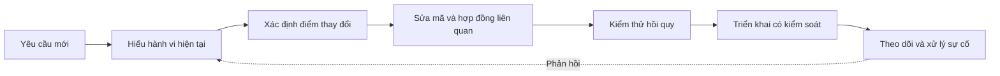

# Khả năng bảo trì và thay đổi an toàn

Trong module `CODE_QUALITY_FUNDAMENTALS`, chất lượng mã nguồn được nhìn qua những thuộc tính quyết định phần mềm có **đáng tin cậy, dễ hiểu và dễ thay đổi** hay không. Ở chương **Các chiều chất lượng**, khả năng bảo trì (maintainability) trả lời câu hỏi: *Khi yêu cầu thay đổi, người phát triển có thể hiểu đúng hệ thống, sửa đúng chỗ và kiểm chứng kết quả với mức công sức hợp lý không?* Thay đổi an toàn bổ sung câu hỏi: *Làm thế nào biết rằng thay đổi đó không vô tình làm hỏng hành vi đang được sử dụng?*

Một hệ thống chạy đúng hôm nay vẫn có thể tốn nhiều ngày để sửa một quy tắc nhỏ vào tháng sau. Ngược lại, mã được chia thành nhiều lớp, có tên gọi đẹp hoặc có nhiều bài kiểm thử chưa chắc đã dễ bảo trì nếu các lớp phụ thuộc chằng chịt, hợp đồng hành vi mơ hồ và không có cách xác minh tác động của thay đổi.

Sau bài học, người học có thể:

- Phân biệt khả năng bảo trì với tính đúng đắn, độ tin cậy và khả năng mở rộng.
- Nhận biết những đặc điểm làm thay đổi trở nên tốn kém hoặc dễ gây lỗi.
- Khoanh vùng ảnh hưởng khi sửa nghiệp vụ, hợp đồng API hoặc dữ liệu.
- Dùng ví dụ Java để tách trách nhiệm mà vẫn giữ hành vi hiện có.
- Thiết kế kiểm thử, quy trình triển khai và phương án phục hồi phù hợp với rủi ro thay đổi.
- Đánh giá khả năng bảo trì qua bằng chứng thực tế, tránh phụ thuộc vào một chỉ số đơn lẻ.

## 1. Khả năng bảo trì là gì?

**Khả năng bảo trì** là mức độ một hệ thống có thể được phân tích, sửa lỗi, điều chỉnh hoặc cải tiến một cách hiệu quả và có thể kiểm soát. “Bảo trì” ở đây không chỉ có nghĩa là vá lỗi sau khi đưa vào sản xuất; nó còn bao gồm đáp ứng yêu cầu mới, cải thiện thiết kế, cập nhật thư viện, tối ưu hiệu năng và điều chỉnh để phù hợp với môi trường vận hành.

Trong thực tế, khả năng bảo trì thể hiện qua một số khía cạnh gắn chặt với nhau:

| Khía cạnh | Câu hỏi thực tế | Dấu hiệu tích cực |
| --- | --- | --- |
| Dễ phân tích (analyzability) | Muốn biết quy tắc đang chạy ở đâu thì phải đọc bao nhiêu nơi? | Tên rõ nghĩa, luồng dữ liệu dễ lần theo, có log và tài liệu về hành vi quan trọng. |
| Dễ sửa đổi (modifiability) | Đổi một quy tắc có buộc sửa hàng loạt chức năng khác không? | Trách nhiệm có ranh giới rõ, ít phụ thuộc không cần thiết, hợp đồng ổn định. |
| Dễ kiểm thử (testability) | Có thể tạo đầu vào, quan sát đầu ra và cô lập phụ thuộc để xác minh không? | Logic quyết định tách khỏi I/O, phụ thuộc có thể thay thế, kiểm thử chạy lặp lại được. |
| Tính mô-đun (modularity) | Một thành phần có thể được hiểu và thay đổi tương đối độc lập không? | Các thành phần có tính gắn kết cao bên trong và ít kết nối bên ngoài. |
| Khả năng tái sử dụng phù hợp (reusability) | Có thể dùng lại một quy tắc chung mà không sao chép hoặc tạo khớp nối quá mức không? | Trừu tượng hóa dựa trên nhu cầu lặp lại thật sự. |

Các khía cạnh trên không hoàn toàn độc lập. Tách logic nghiệp vụ khỏi truy cập cơ sở dữ liệu thường làm thay đổi vừa dễ hiểu, vừa dễ thử nghiệm. Nhưng tách mọi câu lệnh thành một lớp riêng có thể khiến người đọc phải nhảy qua quá nhiều tệp, làm giảm khả năng phân tích.

**Thay đổi an toàn** là năng lực đưa một thay đổi từ ý tưởng đến vận hành với bằng chứng đủ tin cậy rằng các hành vi quan trọng vẫn đúng, tác động ngoài ý muốn đã được kiểm soát và có cách phát hiện, xử lý sự cố nếu xảy ra. “An toàn” không có nghĩa là rủi ro bằng không; nó nghĩa là rủi ro được nhận diện, giới hạn và giảm bằng những biện pháp thích hợp.

### Phân biệt với các chiều chất lượng liên quan

- **Tính đúng đắn (correctness):** Chương trình có thực hiện đúng quy tắc và hợp đồng được yêu cầu không? Một đoạn mã đúng vẫn có thể khó sửa.
- **Độ tin cậy (reliability):** Hệ thống có tiếp tục vận hành đúng trước lỗi, tải hoặc điều kiện bất lợi không? Một thay đổi nhỏ vẫn có thể làm giảm độ tin cậy nếu thiếu kiểm thử tích hợp.
- **Khả năng bảo trì (maintainability):** Khi cần thay đổi, việc hiểu, thực hiện và xác minh có dễ và ít rủi ro không?
- **Khả năng mở rộng (scalability):** Hệ thống có đáp ứng khối lượng công việc tăng lên không? Thêm tầng cache có thể cải thiện hiệu năng nhưng cũng làm mã và trạng thái khó bảo trì hơn.

Chất lượng tốt là sự cân bằng có chủ đích giữa các thuộc tính; không nên tối ưu riêng số lượng lớp, số dòng mã hoặc tỷ lệ bao phủ kiểm thử.

## 2. Vì sao một thay đổi nhỏ có thể gây rủi ro lớn?

Ví dụ: cửa hàng muốn nâng ngưỡng miễn phí vận chuyển từ 500.000 lên 600.000 đồng. Yêu cầu chỉ thay một con số, nhưng quy tắc có thể đang tồn tại trong trang thanh toán, dịch vụ tính tiền, ứng dụng di động, bộ nhớ đệm, báo cáo doanh thu và dữ liệu đơn hàng lưu trước đó.

Phạm vi ảnh hưởng (*blast radius*) phụ thuộc vào nơi quy tắc được sử dụng, kiểu phụ thuộc giữa các thành phần và những giả định ngầm. Rủi ro tăng khi người phát triển không nhìn thấy toàn bộ nơi áp dụng quy tắc hoặc không thể xác minh tác động.



Thay đổi có thể gặp vấn đề ở mỗi bước:

1. **Hiểu sai hành vi hiện tại:** không biết chương trình đang miễn phí tại đúng 500.000 đồng hay chỉ khi lớn hơn 500.000 đồng.
2. **Bỏ sót điểm sử dụng:** sửa backend nhưng frontend vẫn hiển thị thông báo ngưỡng cũ.
3. **Phá vỡ hợp đồng:** chuyển kiểu dữ liệu hoặc ý nghĩa trường API khiến bên gọi cũ xử lý sai.
4. **Thiếu bằng chứng:** kiểm thử chỉ dùng đơn hàng 700.000 đồng, không kiểm tra giá trị sát ngưỡng.
5. **Triển khai không đồng bộ:** nhiều phiên bản dịch vụ hoạt động cùng lúc với giả định khác nhau.
6. **Không phát hiện sớm:** không có chỉ số theo dõi tỷ lệ lỗi thanh toán hoặc lệch phí vận chuyển sau khi phát hành.

Vì vậy, khả năng bảo trì phải được xem xét trên **mã nguồn, phụ thuộc, hợp đồng, kiểm thử và quy trình vận hành**, chứ không chỉ ở hình thức của từng phương thức.

## 3. Đặc điểm thiết kế giúp mã dễ thay đổi

### 3.1. Trách nhiệm rõ ràng và tính gắn kết cao

Một thành phần nên có lý do thay đổi đủ rõ. Nếu lớp `CheckoutService` vừa tính phí, kết nối cổng thanh toán, gửi email, ghi log và dựng nội dung giao diện, một yêu cầu nhỏ có thể buộc người sửa phải hiểu toàn bộ các phần này.

Tách quy tắc tính phí thành `ShippingFeePolicy` giúp người đọc xác định nơi thực hiện thay đổi và thử nghiệm quy tắc bằng dữ liệu đầu vào. Tuy vậy, **trách nhiệm rõ ràng** không đồng nghĩa “mỗi lớp chỉ có một phương thức”. Các thao tác luôn thay đổi cùng nhau có thể thuộc cùng một thành phần.

### 3.2. Giảm phụ thuộc không cần thiết

*Coupling* là mức độ các thành phần phụ thuộc lẫn nhau. Khớp nối cao xuất hiện khi thay một cấu trúc dữ liệu nội bộ buộc sửa hàng loạt lớp hoặc khi logic nghiệp vụ biết chi tiết bảng dữ liệu, giao thức mạng hay cách hiển thị.

Cách giảm rủi ro thường dùng:

- Đặt một ranh giới rõ giữa quy tắc nghiệp vụ và thao tác I/O.
- Giao tiếp qua hợp đồng có ý nghĩa nghiệp vụ thay vì chia sẻ đối tượng chứa mọi trường.
- Chỉ cho phép thành phần bên ngoài truy cập những chi tiết thật sự cần thiết.
- Đưa phụ thuộc có tác dụng phụ (đồng hồ, truy cập mạng, dữ liệu, gửi thông báo) vào qua giao diện hoặc hàm gọi có thể kiểm soát trong kiểm thử.

Không cần tạo interface cho mọi lớp. Nếu chỉ có một cách triển khai đơn giản và không có nhu cầu thay thế, interface bổ sung có thể làm tăng số bước phải theo dõi mà không tạo lợi ích.

### 3.3. Hợp đồng và trạng thái tường minh

Một hợp đồng bao gồm **đầu vào hợp lệ, đầu ra, lỗi có thể xảy ra, tác dụng phụ và những bất biến cần giữ**. Ví dụ, phương thức tính phí phải quy định rõ tiền tệ, ngưỡng miễn phí, vùng giao hàng, cách xử lý dữ liệu không hợp lệ và quy tắc làm tròn nếu có.

Những điều dễ bị bỏ qua gồm:

- Giá trị `null` có hợp lệ không? Nếu không, lỗi nào được trả ra?
- Số tiền có thể âm hoặc có phần lẻ không?
- Mã vùng không nhận biết được sẽ bị từ chối hay được gán mặc định?
- Một thao tác ghi dữ liệu có thể được gọi lại mà không sinh đơn hàng trùng không?
- Quy tắc có phụ thuộc thời điểm, múi giờ, cấu hình hoặc trạng thái bên ngoài không?

Trong Java, enum, kiểu giá trị phù hợp, hàm bất biến và tên biểu đạt đơn vị thường giúp hợp đồng rõ hơn. Với tiền, `BigDecimal` phù hợp hơn `double` cho phần lớn phép tính tài chính vì tránh sai số biểu diễn nhị phân; nhưng vẫn phải nhất quán về thang số, quy tắc làm tròn và loại tiền tệ ở ranh giới hệ thống.

### 3.4. Tên, cấu trúc và mức độ phức tạp

Tên tốt cho biết *tại sao* một quy tắc tồn tại. `isEligibleForFreeShipping` truyền đạt ý định rõ hơn một điều kiện so sánh lặp đi lặp lại. Hàm ngắn có thể dễ đọc, nhưng nếu mọi dòng chỉ chuyển tiếp sang một hàm khác, sự phân mảnh sẽ gây khó khăn.

| Tín hiệu | Tác động khi thay đổi | Hướng cải thiện có thể cân nhắc |
| --- | --- | --- |
| Một quy tắc được sao chép ở nhiều nơi | Sửa thiếu một bản, hành vi lệch nhau | Đưa về nguồn quyết định chung khi các nơi thực sự dùng cùng quy tắc. |
| Hàm có nhiều nhánh lồng nhau và nhiều cờ boolean | Khó liệt kê đầy đủ đường đi | Làm rõ tình huống nghiệp vụ, tách các quyết định có tên và kiểm thử các tổ hợp quan trọng. |
| Một lớp biết chi tiết nhiều hệ thống ngoài | Thay API hoặc kho dữ liệu làm lan rộng bản sửa | Dùng lớp thích ứng ở ranh giới, giữ logic nghiệp vụ độc lập hơn. |
| Trạng thái thay đổi ngầm qua biến toàn cục | Kết quả phụ thuộc thứ tự gọi và môi trường | Giảm trạng thái dùng chung, truyền phụ thuộc tường minh, định nghĩa vòng đời trạng thái. |
| Kiểm thử cần khởi động cả hệ thống để thử một phép tính | Phản hồi chậm, khó xác định nguyên nhân | Tách tính toán thuần, bổ sung kiểm thử đơn vị và vẫn giữ kiểm thử tích hợp cần thiết. |
| Một thay đổi nhỏ thường gây lỗi ở nơi không liên quan | Khớp nối hoặc hợp đồng chưa rõ | Phân tích lịch sử sửa lỗi, bổ sung kiểm thử hồi quy tại ranh giới bị ảnh hưởng. |

Những dấu hiệu này giúp định hướng xem xét; chúng không tự động chứng minh thiết kế đang sai.

## 4. Ví dụ Java: tách quy tắc và giữ hành vi

Giả sử cửa hàng có quy tắc:

- Đơn hàng từ **500.000 đồng trở lên** được miễn phí vận chuyển.
- Đơn dưới ngưỡng trả **30.000 đồng** nếu giao nội thành hoặc **50.000 đồng** nếu giao ngoại thành.
- Mã vùng giao hàng không hợp lệ bị từ chối.

### 4.1. Thiết kế ban đầu

```java
import java.math.BigDecimal;

enum DeliveryZone {
    INNER_CITY, OUTER_CITY
}

final class CheckoutService {
    BigDecimal total(BigDecimal subtotal, String zoneCode) {
        DeliveryZone zone = DeliveryZone.valueOf(zoneCode);
        BigDecimal shippingFee;

        if (subtotal.compareTo(new BigDecimal("500000")) >= 0) {
            shippingFee = BigDecimal.ZERO;
        } else if (zone == DeliveryZone.INNER_CITY) {
            shippingFee = new BigDecimal("30000");
        } else {
            shippingFee = new BigDecimal("50000");
        }

        return subtotal.add(shippingFee);
    }
}
```

Mã trên đủ đơn giản để hoạt động. Vấn đề xuất hiện khi `CheckoutService` tăng thêm nhiều quy tắc như mã ưu đãi, thuế, điều kiện theo ngày hoặc loại khách hàng. Nếu mọi quyết định đều thêm vào cùng phương thức, việc thay đổi sẽ ngày càng khó rà soát. Giá trị tiền và ngưỡng cũng không có tên cho biết ý nghĩa của chúng.

Không cần viết lại toàn bộ chức năng ngay. Trước hết, ghi lại hành vi hiện có thành các trường hợp kiểm thử: dưới ngưỡng, đúng ngưỡng, trên ngưỡng và từng vùng giao hàng.

### 4.2. Refactor với ranh giới trách nhiệm

Giữ nguyên enum `DeliveryZone` và hợp đồng đầu vào `total(BigDecimal, String)` đã có; đưa riêng quy tắc vận chuyển sang một thành phần:

```java
import java.math.BigDecimal;
import java.util.Objects;

final class ShippingFeePolicy {
    private static final BigDecimal FREE_SHIPPING_MIN =
            new BigDecimal("500000");
    private static final BigDecimal INNER_CITY_FEE =
            new BigDecimal("30000");
    private static final BigDecimal OUTER_CITY_FEE =
            new BigDecimal("50000");

    BigDecimal calculate(BigDecimal subtotal, DeliveryZone zone) {
        if (subtotal.compareTo(FREE_SHIPPING_MIN) >= 0) {
            return BigDecimal.ZERO;
        }
        return zone == DeliveryZone.INNER_CITY
                ? INNER_CITY_FEE
                : OUTER_CITY_FEE;
    }
}

final class CheckoutService {
    private final ShippingFeePolicy shippingFeePolicy;

    CheckoutService(ShippingFeePolicy shippingFeePolicy) {
        this.shippingFeePolicy = Objects.requireNonNull(shippingFeePolicy);
    }

    BigDecimal total(BigDecimal subtotal, String zoneCode) {
        DeliveryZone zone = DeliveryZone.valueOf(zoneCode);
        return subtotal.add(shippingFeePolicy.calculate(subtotal, zone));
    }
}
```

Trong ví dụ này, `CheckoutService` giữ vai trò kết hợp tổng tiền và phí vận chuyển; `ShippingFeePolicy` quyết định mức phí. Người sửa quy tắc có vị trí rõ ràng để bắt đầu, còn người kiểm thử có thể truyền `subtotal` và `zone` trực tiếp vào logic tính phí.

**Giới hạn quan trọng:** đây là ví dụ minh họa cách giữ hành vi cho hợp đồng đầu vào hiện có; chưa định nghĩa toàn diện các quy tắc về tiền âm, thuế, đơn vị tiền tệ hoặc quy mô làm tròn. Không nên tự ý thêm kiểm tra dữ liệu mới trong một bản refactor được tuyên bố là “không đổi hành vi”; những thay đổi hợp đồng như vậy cần được quyết định và kiểm thử riêng.

### 4.3. Kiểm thử hành vi tại ranh giới

Ví dụ sử dụng JUnit 5. Bên cạnh việc thử tính phí độc lập, ta kiểm tra rằng lời gọi `CheckoutService.total` vẫn hoạt động với mã vùng dưới dạng chuỗi:

```java
import static org.junit.jupiter.api.Assertions.assertEquals;
import static org.junit.jupiter.api.Assertions.assertThrows;

import java.math.BigDecimal;
import org.junit.jupiter.api.Test;

class ShippingFeePolicyTest {
    private final ShippingFeePolicy policy = new ShippingFeePolicy();

    @Test
    void belowThresholdPaysTheCorrectFeeForEachZone() {
        BigDecimal subtotal = new BigDecimal("499999");

        assertEquals(new BigDecimal("30000"),
                policy.calculate(subtotal, DeliveryZone.INNER_CITY));
        assertEquals(new BigDecimal("50000"),
                policy.calculate(subtotal, DeliveryZone.OUTER_CITY));
    }

    @Test
    void freeShippingAppliesAtAndAboveThreshold() {
        assertEquals(BigDecimal.ZERO,
                policy.calculate(new BigDecimal("500000"),
                        DeliveryZone.INNER_CITY));
        assertEquals(BigDecimal.ZERO,
                policy.calculate(new BigDecimal("500001"),
                        DeliveryZone.OUTER_CITY));
    }

    @Test
    void checkoutContractStillCalculatesTheTotal() {
        CheckoutService checkout = new CheckoutService(policy);

        assertEquals(new BigDecimal("529999"),
                checkout.total(new BigDecimal("499999"), "INNER_CITY"));
        assertThrows(IllegalArgumentException.class,
                () -> checkout.total(new BigDecimal("100000"), "UNKNOWN"));
    }
}
```

Các ca sát ngưỡng phát hiện lỗi dùng `>` thay cho `>=`. Ca vùng không hợp lệ giúp quan sát hợp đồng đầu vào đang có. Trong thực tế cần bổ sung các ca cho điều kiện nghiệp vụ thật, như hoàn tiền, nhiều loại tiền tệ hoặc dữ liệu thiếu, nếu chúng thuộc phạm vi chức năng.

**Điểm cốt lõi của refactor:** đổi cấu trúc mà giữ hành vi được yêu cầu. Kiểm thử giúp cung cấp bằng chứng trong những tình huống đã được bao phủ, nhưng không thể tự chứng minh mọi hành vi đã giữ nguyên. Nếu sau đó nghiệp vụ **chủ động** đổi ngưỡng miễn phí thành 600.000 đồng, đây là thay đổi yêu cầu: phải sửa tiêu chí mong đợi và thêm ca 599.999/600.000/600.001 đồng, đồng thời rà soát nội dung hiển thị và hợp đồng với các hệ thống liên quan.

## 5. Quy trình thực hiện một thay đổi an toàn

Một luồng công việc phù hợp với mức rủi ro có thể gồm các bước sau.

### Bước 1 — Xác định hành vi cần thay đổi

Viết rõ điều kiện trước và sau thay đổi, ai sử dụng chức năng và điều gì phải tiếp tục đúng. Với quy tắc vận chuyển, hãy ghi cụ thể: “Từ 600.000 đồng được miễn phí; dưới ngưỡng, phí nội thành và ngoại thành không đổi”. Xác nhận trường hợp đúng bằng ngưỡng và những trường hợp không hợp lệ trước khi sửa mã.

Tránh yêu cầu mơ hồ như “cập nhật phí cho hợp lý”; những câu này không cho người triển khai và người kiểm thử cùng một tiêu chí hoàn thành.

### Bước 2 — Lập bản đồ phạm vi ảnh hưởng

Từ nơi nhận yêu cầu, lần theo:

- **Đầu vào:** API, form, sự kiện, dữ liệu nhập từ đối tác.
- **Quy tắc:** hàm tính toán, cấu hình, cờ tính năng, nơi lặp lại điều kiện tương tự.
- **Đầu ra:** phản hồi API, giao diện, thông báo, hóa đơn, báo cáo.
- **Trạng thái:** cơ sở dữ liệu, cache, hàng đợi, tác vụ chạy nền.
- **Người sử dụng hợp đồng:** phiên bản ứng dụng cũ, tích hợp bên thứ ba, job nội bộ.

Mức độ rà soát phụ thuộc vào thay đổi. Một hàm thuần chỉ dùng nội bộ khác với việc sửa ý nghĩa một trường trong sự kiện thanh toán đã được nhiều dịch vụ tiêu thụ.

### Bước 3 — Bảo vệ hành vi hiện tại

Nếu hệ thống thiếu kiểm thử, viết **kiểm thử đặc tả hành vi đang chạy** (*characterization test*) ở những điểm quan trọng trước khi refactor. Kiểm thử này ghi nhận điều hệ thống thực sự làm, kể cả khi hành vi đó có vẻ lạ; sau đó nhóm cần quyết định hành vi nào là hợp đồng phải giữ, hành vi nào là lỗi được sửa có chủ đích.

Ưu tiên các ranh giới dữ liệu (0, sát ngưỡng, bằng ngưỡng), tổ hợp có rủi ro cao, lỗi đầu vào và những tình huống từng gây sự cố. Không cần kiểm thử mọi tổ hợp vô nghĩa; chọn trường hợp dựa trên điều kiện và tác động nghiệp vụ.

### Bước 4 — Thay đổi nhỏ và có mục đích

Tách phần chuẩn bị cấu trúc khỏi phần thay đổi nghiệp vụ khi điều đó giúp dễ đánh giá. Ví dụ:

1. Tạo kiểm thử cho ngưỡng hiện tại 500.000 đồng.
2. Trích xuất `ShippingFeePolicy` và xác minh hành vi không đổi.
3. Đổi ngưỡng thành 600.000 đồng, cập nhật kiểm thử theo yêu cầu mới.
4. Sửa nội dung hiển thị và các nơi sử dụng cùng quy tắc.

Mỗi bản sửa có một mục tiêu rõ sẽ thuận tiện khi review, xác định lỗi và khôi phục. Tuy nhiên, không nên chia nhỏ đến mức một thay đổi dở dang gây hỏng build hoặc để hệ thống trong trạng thái không tương thích.

### Bước 5 — Kiểm chứng theo nhiều lớp

| Lớp kiểm chứng | Mục tiêu | Ví dụ |
| --- | --- | --- |
| Kiểm thử đơn vị | Xác minh quy tắc và giá trị ranh giới nhanh | `ShippingFeePolicy.calculate` với 599.999 và 600.000 đồng. |
| Kiểm thử tích hợp | Xác minh các thành phần và phụ thuộc tương tác đúng | Dịch vụ thanh toán đọc cấu hình phí và ghi tổng tiền đơn hàng. |
| Kiểm thử hợp đồng | Phát hiện thay đổi không tương thích giữa bên gọi và bên cung cấp | API vẫn trả các trường, kiểu dữ liệu và ý nghĩa đã cam kết. |
| Kiểm thử đầu cuối có chọn lọc | Xác nhận luồng quan trọng của người dùng | Tạo đơn, hiển thị phí, thanh toán và nhận xác nhận. |
| Kiểm tra phi chức năng khi cần | Bảo vệ thuộc tính có thể bị ảnh hưởng | Hiệu năng, bảo mật, khả năng xử lý đồng thời hoặc giám sát lỗi. |

Không có một tỷ lệ bao phủ kiểm thử nào tự động bảo đảm an toàn. Kiểm thử có thể đạt độ bao phủ cao nhưng chỉ khẳng định mã đã chạy, không kiểm tra kết quả có đúng hay không. Chất lượng ca kiểm thử phụ thuộc vào các giả định và hành vi được xác minh.

### Bước 6 — Review và triển khai theo tác động

Review nên tập trung vào các câu hỏi: yêu cầu đã được thể hiện đúng chưa, ảnh hưởng tới những bên gọi nào, ngoại lệ có được xử lý rõ không, có bỏ sót quy tắc ở nơi khác không, kiểm thử có bao phủ điểm rủi ro không?

Với thay đổi liên quan nhiều dịch vụ, dữ liệu hoặc doanh thu, có thể dùng phát hành theo đợt, cờ tính năng, giám sát sau triển khai và phương án phục hồi. Với bản sửa cục bộ ít rủi ro, những bước này có thể đơn giản hơn; quy trình cần tương xứng với mức ảnh hưởng.

## 6. An toàn khi thay đổi hợp đồng và dữ liệu

Tách logic thành lớp đẹp chưa đủ nếu thay đổi phá vỡ những bên sử dụng hiện có. Một số vùng cần đặc biệt lưu ý:

**API và sự kiện.** Đổi tên hoặc bỏ một trường có thể làm ứng dụng cũ hoặc dịch vụ khác lỗi. Khi cần chuyển đổi, cân nhắc giai đoạn tương thích: thêm cách biểu diễn mới, hỗ trợ cả cũ và mới trong thời gian chuyển tiếp, cập nhật các bên gọi, rồi mới loại bỏ đường cũ khi có đủ bằng chứng.

**Cơ sở dữ liệu.** Một quy trình thường dùng là *expand–migrate–contract*: thêm cột/cấu trúc mới theo cách các phiên bản hiện tại vẫn hoạt động; dịch chuyển hoặc điền dữ liệu và cập nhật mã; cuối cùng bỏ cấu trúc cũ sau khi đã xác minh các bên không còn sử dụng. Phải tính đến thời gian chạy migration, dữ liệu lịch sử và các phiên bản ứng dụng chạy đồng thời.

**Tác dụng phụ.** Với thanh toán, gửi email hoặc xử lý sự kiện, kiểm tra khả năng gọi lặp (*idempotency*) khi hệ thống thử lại. Một thay đổi làm tăng số lần gọi API có thể tạo giao dịch trùng dù logic tính phí riêng lẻ vẫn đúng.

**Cache và cấu hình.** Nhiều phiên bản dữ liệu hoặc cấu hình không đồng bộ có thể cho kết quả khác nhau trong một khoảng thời gian. Cần định nghĩa thời điểm áp dụng quy tắc, chính sách làm mới dữ liệu và cách nhận biết phiên bản.

**Rollback.** Quay lại phiên bản mã trước chưa chắc khôi phục được dữ liệu đã ghi hoặc những sự kiện đã phát ra. Với thay đổi không thể đảo ngược dễ dàng, cần phương án bù trừ, khôi phục dữ liệu hoặc cách tiếp tục an toàn được xác định trước.

Để giảm rủi ro trong giai đoạn sau phát hành, theo dõi tín hiệu liên quan trực tiếp đến thay đổi, chẳng hạn tỷ lệ đơn hàng bị từ chối, chênh lệch phí tính toán, lỗi thanh toán và cảnh báo từ bộ xử lý sự kiện. Cảnh báo phải giúp người vận hành biết lúc nào cần điều tra hoặc ngừng triển khai.

## 7. Đánh đổi giữa dễ bảo trì và sự phức tạp của thiết kế

Khả năng bảo trì không tăng tuyến tính theo số interface, pattern hoặc lớp trừu tượng. Mỗi lớp thêm vào đều có chi phí tìm kiếm, hiểu hợp đồng và truy vết.

Ví dụ, nếu cửa hàng chỉ có hai vùng giao hàng và một quy tắc ổn định, biểu thức điều kiện trong `ShippingFeePolicy` có thể đủ rõ. Tạo `ShippingStrategyFactory` cùng nhiều lớp triển khai sẽ chưa chắc giúp ích. Nếu các vùng dần có công thức khác nhau, do nhiều nhóm quản lý và thường thay đổi độc lập, một mô hình chiến lược khi đó có thể phù hợp.

Khi cân nhắc refactor, hỏi:

- Thay đổi nào thực sự thường xảy ra hoặc đang gây lỗi?
- Chi phí phải trả hôm nay là gì: thời gian tìm hiểu, lỗi hồi quy, kiểm thử chậm hay mã bị lặp?
- Giải pháp có giảm số vị trí phải sửa và số phụ thuộc phải hiểu không?
- Người mới có thể lần theo luồng xử lý dễ hơn sau khi đổi không?
- Rủi ro chuyển đổi có được kiểm soát bằng các kiểm thử và mốc triển khai không?

Một cải tiến hợp lý giải quyết **vấn đề thay đổi đã quan sát được** hoặc một rủi ro có bằng chứng, thay vì làm kiến trúc phức tạp chỉ để dự đoán mọi nhu cầu tương lai.

## 8. Đo và cải thiện khả năng bảo trì

Khả năng bảo trì khó đo bằng một con số duy nhất. Có thể kết hợp tín hiệu định lượng với phản hồi từ người trực tiếp làm việc với mã:

| Tín hiệu quan sát | Cách diễn giải thận trọng |
| --- | --- |
| Thời gian từ lúc hiểu yêu cầu đến bản sửa đã được xác minh | Nếu tăng liên tục với các thay đổi tương tự, có thể cần xem xét phụ thuộc hoặc mức dễ hiểu. |
| Số thành phần phải sửa cho một thay đổi nhỏ | Có thể cho thấy quy tắc bị phân tán; đôi khi nhiều vị trí là cần thiết do hợp đồng khác nhau. |
| Tỷ lệ thay đổi gây lỗi và số lần phải sửa lại | Gợi ý thiếu kiểm thử, hợp đồng hoặc kiểm soát triển khai; cần xem mức độ khó của các thay đổi. |
| Thời gian tìm nguyên nhân và khôi phục sau sự cố | Phản ánh khả năng quan sát, ranh giới trách nhiệm và quy trình vận hành. |
| Sự ổn định và tốc độ của bộ kiểm thử | Phản hồi nhanh giúp thay đổi tự tin hơn; kiểm thử chập chờn tạo tín hiệu khó tin. |
| Độ phức tạp, mức trùng lặp và phụ thuộc vòng | Hữu ích để tìm vùng nên điều tra, nhưng không tự quyết định có nên refactor. |

Để cải thiện, chọn một điểm đau cụ thể, đặt giả thuyết và kiểm tra bằng thay đổi có thể quan sát. Ví dụ: “Việc thay ngưỡng vận chuyển thường phải sửa bốn nơi và gây lệch giao diện; tập trung quy tắc ở một nơi sẽ giảm số điểm sửa và tăng độ tin cậy”. Sau khi cải thiện, theo dõi các thay đổi tương tự để biết kết quả có đúng kỳ vọng không.

## 9. Tình huống thực hành

Cho quy tắc vận chuyển trong ví dụ Java ở mục 4, thực hiện các nhiệm vụ sau trên một nhánh làm việc riêng:

1. **Ghi nhận hành vi cũ:** viết kiểm thử cho đơn 499.999, 500.000 và 500.001 đồng ở cả hai vùng. Giải thích vì sao 500.000 đồng là điểm ranh giới cần thử.
2. **Đổi yêu cầu:** cập nhật ngưỡng miễn phí thành 600.000 đồng. Bổ sung các ca 599.999, 600.000 và 600.001 đồng; xác nhận phí vùng dưới ngưỡng không đổi.
3. **Phân tích tác động:** giả sử frontend hiển thị dòng “Miễn phí vận chuyển từ 500.000đ” và API có trường `shippingFee`. Nêu vị trí cần rà soát và tiêu chí kiểm chứng sau khi sửa.
4. **Thiết kế mở rộng:** cửa hàng chuẩn bị thêm vùng giao hàng thứ ba, phí 70.000 đồng khi dưới ngưỡng. Đề xuất cách cập nhật hợp đồng vùng giao hàng và những ca kiểm thử cần có, đồng thời xem xét ứng dụng cũ chưa biết mã vùng mới.
5. **Đánh giá an toàn phát hành:** giả sử phí vận chuyển được chốt khi đơn hàng tạo thành công. Nêu rủi ro nếu quy tắc mới áp vào cả đơn hàng đã được tạo trước đó; đề xuất cách giữ giá đã chốt và cách theo dõi lỗi sau triển khai.

**Tiêu chí tự đánh giá:** người khác đọc bản sửa có xác định được quy tắc nghiệp vụ nằm ở đâu không; có chỉ ra được hành vi cần giữ và hành vi cố ý thay đổi không; kiểm thử có kiểm tra ranh giới không; có giải thích được tác động tới API, giao diện và dữ liệu không; nếu sự cố xảy ra có biết cách phát hiện và xử lý không?

## Ghi nhớ

**Dễ bảo trì** nghĩa là có thể hiểu và sửa đổi hệ thống với chi phí hợp lý. **Thay đổi an toàn** nghĩa là có bằng chứng phù hợp rằng yêu cầu mới hoạt động đúng, những hành vi cần giữ không bị phá vỡ và hậu quả ngoài ý muốn có thể được giới hạn, phát hiện, xử lý. Hai khả năng này hỗ trợ nhau: thiết kế rõ ràng giúp khoanh vùng bản sửa; kiểm thử, hợp đồng và quan sát khi vận hành giúp kiểm chứng bản sửa. Mục tiêu là giảm sự bất định mỗi khi hệ thống phải thay đổi, chứ không phải tối đa hóa số lượng lớp hay bài kiểm thử.
