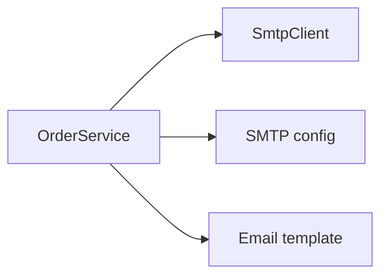
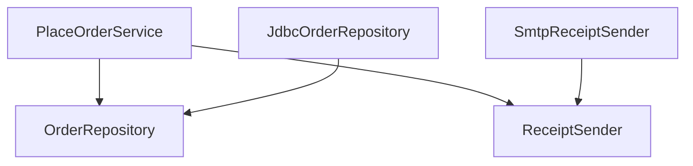
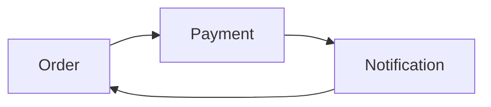

# Tính mô-đun và mức độ phụ thuộc

Một chức năng có thể chạy đúng hôm nay nhưng trở nên khó sửa ngày mai nếu thay đổi nhỏ ở một nơi buộc lập trình viên phải chỉnh sửa nhiều nơi khác. Một nguyên nhân thường gặp là **cách chia mô-đun và cách các mô-đun phụ thuộc lẫn nhau**.

Trong chương **Các chiều chất lượng** thuộc `CODE_QUALITY_FUNDAMENTALS`, chúng ta xem xét hai câu hỏi: *Mã nguồn đã được tổ chức thành những phần có trách nhiệm rõ ràng chưa?* và *Mỗi phần cần biết bao nhiêu về những phần còn lại?* Đây là các thuộc tính quan trọng để đánh giá mã có đáng tin cậy, dễ hiểu và dễ thay đổi hay không.

Sau bài này, bạn có thể nhận diện ranh giới mô-đun, phân biệt **tính gắn kết (cohesion)** với **mức độ liên kết/phụ thuộc (coupling)**, nhận biết các phụ thuộc gây rủi ro và áp dụng một số cách giảm phụ thuộc trong Java.

## 1. Mô-đun là gì và vì sao cần chia mô-đun?

**Mô-đun (module)** là một đơn vị tổ chức mã đảm nhận một nhóm trách nhiệm có liên quan và cung cấp cách tương tác được xác định rõ cho các phần khác. Tùy quy mô, mô-đun có thể là một lớp, một package, một thư viện, một phần nghiệp vụ lớn hoặc một thành phần triển khai độc lập.

Trong Java, từ *module* cũng có nghĩa kỹ thuật riêng khi nói về **Java Platform Module System (JPMS)** và tệp `module-info.java`. Bài học này dùng khái niệm mô-đun theo nghĩa thiết kế phần mềm nói chung: một ranh giới trách nhiệm, không bắt buộc phải dùng JPMS hay microservice.

Ví dụ một hệ thống bán hàng có các trách nhiệm:

- **Quản lý đơn hàng:** xác thực và ghi nhận đơn mới.
- **Tính giá:** áp dụng quy tắc giá và khuyến mãi.
- **Thanh toán:** kết nối cổng thanh toán và xử lý kết quả.
- **Thông báo:** gửi thông tin xác nhận tới khách hàng.

Nếu tất cả trách nhiệm nằm trong một lớp hàng nghìn dòng, người sửa thông báo có thể phải đọc cả logic tính giá và thanh toán. Chia theo ranh giới hợp lý giúp người phát triển tập trung vào từng phần và giảm phạm vi cần xem xét khi có thay đổi.

Một mô-đun được thiết kế tốt thường có ba đặc điểm:

1. **Mục đích rõ ràng:** Có thể giải thích phần đó chịu trách nhiệm gì bằng một vài câu.
2. **Giao diện rõ ràng:** Các phần bên ngoài sử dụng mô-đun qua những phương thức hoặc hợp đồng được công bố, thay vì chạm trực tiếp vào mọi chi tiết bên trong.
3. **Chi tiết triển khai được che giấu:** Thay đổi cách lưu trữ, thuật toán hoặc thư viện nội bộ không nhất thiết làm thay đổi mã gọi bên ngoài.

Tính mô-đun hữu ích vì nó tạo ra **ranh giới để suy nghĩ, kiểm thử và thay đổi**. Một ranh giới rõ cũng cho phép nhiều thành viên làm việc song song mà ít can thiệp vào cùng một vùng mã.

## 2. Cohesion và coupling: hai góc nhìn bổ sung

Hai thuộc tính quan trọng nhất khi đánh giá cấu trúc mô-đun là **cohesion** và **coupling**.

### 2.1. Cohesion: những việc bên trong một mô-đun có thuộc về nhau không?

**Cohesion (tính gắn kết nội bộ)** thể hiện mức độ các thành phần trong một mô-đun cùng phục vụ một mục đích có ý nghĩa.

Giả sử có một lớp `Utils` vừa gửi email, vừa tính thuế, vừa định dạng ngày tháng và vừa truy vấn cơ sở dữ liệu. Các phương thức có thể hoạt động đúng, nhưng lớp thiếu một trách nhiệm thống nhất. Đây là dấu hiệu **cohesion thấp**: cần tìm, hiểu và thay đổi nhiều loại hành vi không liên quan trong cùng một nơi.

Ngược lại, `TaxCalculator` chỉ xử lý các quy tắc tính thuế và có những phương thức hỗ trợ trực tiếp quy tắc đó thường có **cohesion cao** hơn. Các phần của lớp cùng thay đổi khi quy tắc tính thuế thay đổi.

Một câu hỏi thực dụng là: **“Các chức năng trong phần này có thường thay đổi vì cùng một lý do không?”** Nếu câu trả lời là không, ranh giới mô-đun có thể đang gom nhiều trách nhiệm khác nhau.

### 2.2. Coupling: mô-đun này cần biết gì về mô-đun kia?

**Coupling (mức độ liên kết/phụ thuộc giữa các mô-đun)** thể hiện mức độ một mô-đun bị ràng buộc bởi giao diện, cấu trúc, chi tiết triển khai hoặc hành vi của mô-đun khác.

Ví dụ, `OrderService` tự tạo đối tượng `JdbcOrderRepository`, đọc tên bảng SQL và tự ghép truy vấn. Khi cấu trúc dữ liệu thay đổi, nghiệp vụ đơn hàng cũng phải sửa theo. Đây là dấu hiệu **coupling cao với chi tiết lưu trữ**.

Nếu `OrderService` chỉ gọi `OrderRepository.save(order)` và một thành phần khác triển khai phần lưu trữ, lớp nghiệp vụ có thể ít phụ thuộc hơn vào cơ sở dữ liệu cụ thể.

| Câu hỏi | Cohesion | Coupling |
| --- | --- | --- |
| Đối tượng đánh giá | Quan hệ **bên trong** một mô-đun | Quan hệ **giữa** các mô-đun |
| Tình trạng thường mong muốn | Các trách nhiệm liên quan chặt chẽ (**cao**) | Phụ thuộc được kiểm soát, càng ít ràng buộc không cần thiết càng tốt (**thấp**) |
| Dấu hiệu bất lợi | Một lớp làm nhiều việc không liên quan | Thay đổi nhỏ ở mô-đun A kéo theo sửa hàng loạt mô-đun B, C, D |
| Câu hỏi khi thiết kế | “Phần này có một mục đích rõ ràng không?” | “Phần này cần biết đến bao nhiêu chi tiết của phần kia?” |

**Cohesion cao và coupling thấp là định hướng**, không phải khẩu hiệu phải đạt bằng mọi giá. Một hệ thống vẫn cần các mô-đun cộng tác để thực hiện nghiệp vụ; mục tiêu là giữ những phụ thuộc **cần thiết, rõ ràng và có thể kiểm soát**.

## 3. Phụ thuộc hình thành ở đâu?

Phụ thuộc không chỉ xuất hiện khi một lớp `import` lớp khác. Chúng có thể hình thành ở nhiều cấp độ:

| Dạng phụ thuộc | Ví dụ | Rủi ro cần kiểm tra |
| --- | --- | --- |
| **Phụ thuộc mã nguồn** | `OrderService` gọi trực tiếp `JdbcOrderRepository` | Đổi lớp triển khai buộc mã gọi phải sửa hoặc biên dịch lại |
| **Phụ thuộc hợp đồng** | Hai mô-đun dùng chung API `save(Order)` | Đổi chữ ký, ý nghĩa dữ liệu hoặc quy tắc lỗi ảnh hưởng bên sử dụng |
| **Phụ thuộc dữ liệu** | Hai mô-đun cùng sửa trực tiếp bảng đơn hàng | Thay đổi schema, quy tắc và vòng đời dữ liệu dễ lan rộng |
| **Phụ thuộc vào thứ tự/thời điểm** | Phải gọi `initialize()` trước `send()` nhưng API không thể hiện điều đó | Dùng sai thứ tự gây lỗi chỉ xuất hiện khi chạy |
| **Phụ thuộc hạ tầng** | Nghiệp vụ tự đọc biến môi trường, mở kết nối SMTP | Khó kiểm thử và khó thay nhà cung cấp dịch vụ |

Điều này dẫn đến một nhận xét quan trọng: **ít dòng `import` không đồng nghĩa với ít phụ thuộc**. Hai thành phần không gọi nhau trực tiếp vẫn có thể liên kết rất chặt qua cùng một bảng dữ liệu hoặc một quy ước ngầm.

### Tình huống thay đổi dây chuyền

Giả sử bộ phận vận hành đổi nhà cung cấp email. Nếu `OrderService` biết tên lớp gửi SMTP, cách xác thực, cách tạo kết nối và định dạng thông điệp, người phát triển có thể phải thay cả mã nghiệp vụ chỉ để đổi kênh thông báo.



Sơ đồ cho thấy lớp nghiệp vụ phụ thuộc trực tiếp vào nhiều chi tiết kỹ thuật của việc gửi email. Khi trách nhiệm của thông báo và nghiệp vụ đơn hàng đan xen, việc bảo trì cả hai trở nên khó khăn.

## 4. Ví dụ Java: giảm phụ thuộc vào cách triển khai

Xét thao tác **đặt đơn hàng rồi gửi xác nhận**. Để giữ ví dụ ngắn gọn, giả sử dữ liệu `Order` đã hợp lệ và các thành phần được lắp ghép ở nơi khởi tạo ứng dụng. Vấn đề đang phân tích là ranh giới phụ thuộc, không phải toàn bộ quy trình giao dịch.

### 4.1. Cách viết ràng buộc trực tiếp vào hạ tầng

Trong một ứng dụng có sẵn các lớp `JdbcOrderRepository` và `SmtpReceiptSender`, mã nghiệp vụ có thể được viết như sau:

```java
final class PlaceOrderService {
    private final JdbcOrderRepository orders = new JdbcOrderRepository();
    private final SmtpReceiptSender receipts = new SmtpReceiptSender();

    void place(Order order) {
        orders.save(order);
        receipts.send(order.id());
    }
}
```

Đây là đoạn mã minh họa; `JdbcOrderRepository`, `SmtpReceiptSender` và `Order` được giả định đã tồn tại trong dự án. Mã có thể đáp ứng hành vi mong muốn trong điều kiện bình thường, nhưng `PlaceOrderService` đang **biết và tự tạo** hai lớp triển khai cụ thể.

Hệ quả:

- Muốn thay JDBC bằng một cách lưu trữ khác, phải sửa lớp nghiệp vụ.
- Muốn thử nghiệm mà không kết nối cơ sở dữ liệu hoặc SMTP, khó thay thế các đối tượng đang được tạo cứng bên trong.
- Việc cấu hình hạ tầng có nguy cơ tràn vào mã điều phối nghiệp vụ.

### 4.2. Đưa phụ thuộc qua hợp đồng rõ ràng

Ta định nghĩa những khả năng mà nghiệp vụ thực sự cần và đưa đối tượng cung cấp khả năng đó từ bên ngoài vào qua constructor:

```java
import java.util.Objects;

record Order(String id, long totalVnd) {}

interface OrderRepository {
    void save(Order order);
}

interface ReceiptSender {
    void send(String orderId);
}

final class PlaceOrderService {
    private final OrderRepository orders;
    private final ReceiptSender receipts;

    PlaceOrderService(OrderRepository orders, ReceiptSender receipts) {
        this.orders = Objects.requireNonNull(orders);
        this.receipts = Objects.requireNonNull(receipts);
    }

    void place(Order order) {
        Objects.requireNonNull(order);
        orders.save(order);
        receipts.send(order.id());
    }
}
```

Ví dụ sử dụng `record` (Java 16 trở lên) để rút gọn dữ liệu đơn hàng. `totalVnd` giúp minh họa một trường nghiệp vụ, dù thao tác đặt đơn giản này chưa sử dụng trường đó.

`PlaceOrderService` vẫn **phụ thuộc** vào khả năng lưu đơn và gửi xác nhận; điều thay đổi là nó phụ thuộc vào **hợp đồng ổn định theo nhu cầu nghiệp vụ** thay vì tên lớp, thư viện hoặc giao thức hạ tầng. Ví dụ, các lớp `JdbcOrderRepository` và `SmtpReceiptSender` có thể triển khai hai interface tương ứng.



Mũi tên trong sơ đồ biểu thị **phụ thuộc ở mức mã nguồn**: các lớp nghiệp vụ và triển khai cùng dựa trên hợp đồng, còn ứng dụng quyết định triển khai nào được truyền vào lúc khởi tạo. Khi thay SMTP bằng nhà cung cấp khác mà hợp đồng `ReceiptSender` không đổi, ta thường chỉ cần thay lớp triển khai và cấu hình lắp ghép.

Ở đây có hai ý tưởng liên quan nhưng khác nhau:

- **Dependency Injection (DI):** `PlaceOrderService` nhận các phụ thuộc qua constructor thay vì tự tạo. Đây là cách cung cấp phụ thuộc, không nhất thiết cần framework.
- **Dependency Inversion Principle (DIP):** Phần nghiệp vụ quan trọng và phần triển khai kỹ thuật phụ thuộc vào các trừu tượng thích hợp, để chi tiết kỹ thuật không chi phối thiết kế nghiệp vụ. DI có thể hỗ trợ thực hiện DIP, nhưng hai khái niệm không đồng nghĩa.

### 4.3. Kiểm thử dễ cô lập hơn

Vì các phụ thuộc được đưa từ bên ngoài vào, ta có thể thử hành vi điều phối bằng các đối tượng thay thế nhỏ, không cần mở kết nối thật:

```java
import static org.junit.jupiter.api.Assertions.assertEquals;

import java.util.ArrayList;
import java.util.List;
import org.junit.jupiter.api.Test;

class PlaceOrderServiceTest {
    @Test
    void savesOrderAndSendsReceipt() {
        List<Order> saved = new ArrayList<>();
        List<String> sentIds = new ArrayList<>();

        OrderRepository fakeRepository = order -> saved.add(order);
        ReceiptSender fakeSender = orderId -> sentIds.add(orderId);

        PlaceOrderService service =
                new PlaceOrderService(fakeRepository, fakeSender);
        Order order = new Order("ORD-001", 120_000);

        service.place(order);

        assertEquals(List.of(order), saved);
        assertEquals(List.of("ORD-001"), sentIds);
    }
}
```

Đây là kiểm thử JUnit 5 dành cho phiên bản ở mục 4.2. Nó xác nhận đơn được chuyển tới repository và mã đơn được chuyển tới bộ gửi xác nhận; kiểm thử này **không xác nhận thứ tự hai thao tác** dù tên phương thức gợi ý điều đó. Muốn xác minh thứ tự, cần ghi lại một danh sách sự kiện chung hoặc dùng công cụ kiểm tra lời gọi. Các bài kiểm thử tích hợp vẫn cần thiết để kiểm chứng kết nối JDBC, việc gửi thông báo thật và cấu hình chạy ứng dụng.

**Giới hạn quan trọng:** Tách hai interface không tự giải quyết tình huống lưu đơn thành công nhưng gửi xác nhận thất bại. Với hệ thống thực tế, có thể cần cơ chế retry, outbox hoặc xử lý giao dịch phù hợp. Thiết kế phụ thuộc tốt giúp phân định trách nhiệm; tính nhất quán nghiệp vụ vẫn phải được thiết kế và kiểm chứng riêng.

## 5. Nhận diện phụ thuộc vòng và hướng phụ thuộc

Một dạng phụ thuộc dễ khiến thiết kế trở nên khó thay đổi là **phụ thuộc vòng (circular dependency)**.



Nếu ba module ở sơ đồ phụ thuộc vào nhau ở mức mã nguồn, chúng có thể phải thay đổi, biên dịch hoặc kiểm tra cùng nhau. Một module thấp tầng còn có thể gọi ngược vào module cao tầng theo cách khó dự đoán. Không phải mọi vòng phụ thuộc đều gây lỗi ngay lập tức, nhưng chúng thường khiến ranh giới trách nhiệm kém rõ và tăng phạm vi tác động của thay đổi.

Một số cách tháo gỡ cần cân nhắc theo nguyên nhân thực tế:

1. **Xác định trách nhiệm chung:** Nếu nhiều module liên tục gọi qua lại để thực hiện cùng một quy tắc, xem xét đặt quy tắc vào một nơi có chủ sở hữu rõ ràng.
2. **Đưa hợp đồng về phía cần sử dụng:** Module nghiệp vụ có thể định nghĩa interface cần thiết; lớp triển khai bên ngoài cung cấp hành vi qua interface đó.
3. **Dùng sự kiện khi phù hợp:** Sau khi ghi nhận đơn, thành phần thông báo có thể phản ứng với sự kiện thay vì yêu cầu module đơn hàng biết về module thông báo. Đổi sang sự kiện đồng nghĩa phải thiết kế thêm cơ chế phân phối, lỗi và tính nhất quán.
4. **Không tạo module trung gian vô nghĩa:** Chuyển một vòng phụ thuộc sang một lớp “Helper” chứa đủ mọi trách nhiệm thường chỉ che giấu vấn đề.

Một hướng tổ chức thường có ích là để quy tắc nghiệp vụ ổn định phụ thuộc vào các **hợp đồng do nghiệp vụ định nghĩa**, còn adapter kết nối cơ sở dữ liệu hoặc dịch vụ bên ngoài phụ thuộc vào những hợp đồng đó. Tuy nhiên, không phải mọi dự án đều cần một cấu trúc nhiều tầng đầy đủ: phạm vi và mức phức tạp phải tương xứng với nhu cầu thực.

## 6. Làm sao đánh giá tính mô-đun trong một dự án?

Không nên đánh giá chỉ bằng số class, số package hoặc độ dài file. Một dự án có rất nhiều class nhỏ vẫn có thể phụ thuộc chằng chịt, trong khi một lớp hơi dài nhưng đảm nhận một trách nhiệm nhất quán có thể dễ bảo trì hơn.

Khi đọc một phần mã, hãy kiểm tra các dấu hiệu sau:

| Dấu hiệu quan sát | Câu hỏi kiểm tra | Hướng cải thiện có thể cân nhắc |
| --- | --- | --- |
| Một class làm nhiều việc khác nhau | Có bao nhiêu lý do độc lập khiến class phải sửa? | Tách các trách nhiệm có vòng đời thay đổi khác nhau |
| Nhiều class đọc sâu vào trạng thái nội bộ của nhau | Có giao diện rõ cho hành vi cần dùng không? | Đóng gói dữ liệu và công bố thao tác có ý nghĩa |
| Thay một thư viện phải sửa mã nghiệp vụ | Nghiệp vụ có đang phụ thuộc vào chi tiết hạ tầng không? | Đặt ranh giới adapter hoặc hợp đồng phù hợp |
| Hai package import lẫn nhau | Có vòng phụ thuộc hoặc trách nhiệm chưa tách rõ không? | Xem xét hướng phụ thuộc và quyền sở hữu quy tắc |
| Test đơn vị luôn phải mở DB hoặc gọi mạng | Phụ thuộc có đang bị tạo cứng hay ẩn trong mã không? | Truyền phụ thuộc tường minh, dùng fake/stub khi phù hợp |
| Sửa một yêu cầu nhỏ làm thay đổi hàng loạt file | Thay đổi đang lan qua những hợp đồng nào? | Giảm nhân bản quy tắc, ổn định giao diện, gom logic đúng nơi |

Có thể dùng công cụ phân tích phụ thuộc để xem những package nào đang tham chiếu nhau, module nào có nhiều phụ thuộc đi ra (*fan-out*) hoặc nhiều nơi phụ thuộc vào nó (*fan-in*). Các con số này là **tín hiệu để điều tra**, không phải điểm số chất lượng tuyệt đối. Ví dụ, một hợp đồng cốt lõi được nhiều module sử dụng có thể có fan-in cao mà vẫn được thiết kế tốt.

### Thử nghiệm bằng một yêu cầu thay đổi giả định

Một cách đánh giá gần với thực tế là hỏi: **“Nếu ngày mai thay nhà cung cấp email, chúng ta phải sửa những phần nào?”**

- Nếu thay đổi chỉ tập trung ở adapter gửi email, cấu hình lắp ghép và bài kiểm thử liên quan, ranh giới thường đang phát huy tác dụng.
- Nếu cần sửa `OrderService`, `PricingService`, `PaymentService` vì các lớp này đều chứa chi tiết SMTP, phụ thuộc kỹ thuật đang lan quá rộng.
- Nếu thay đổi ảnh hưởng đến hợp đồng nghiệp vụ, chẳng hạn chuyển từ “gửi email” sang “thông báo theo kênh khách hàng chọn”, cần đánh giá lại API và quy tắc. Không nên ép giữ interface cũ chỉ để tránh sửa mã.

Đặt ra một thay đổi cụ thể giúp nhóm nhìn thấy **phạm vi ảnh hưởng** thay vì dựa vào cảm giác về vẻ đẹp của kiến trúc.

## 7. Những đánh đổi khi chia mô-đun

Chia mô-đun tốt không đồng nghĩa với chia càng nhỏ càng tốt.

**Quá ít mô-đun:** Các trách nhiệm dồn vào một chỗ, nhiều nhánh điều kiện, khó tìm đúng vị trí cần sửa. Khi nhóm lớn lên, mọi người dễ phải chỉnh sửa cùng một phần mã.

**Quá nhiều mô-đun:** Một nghiệp vụ đơn giản cần đi qua nhiều interface, adapter, DTO và lớp trung gian. Người đọc phải liên tục chuyển file; chi phí cấu hình, gỡ lỗi và hiểu toàn bộ luồng xử lý tăng lên.

**Trừu tượng sai chỗ:** Tạo một interface duy nhất chỉ để bọc một lớp không thay đổi, không cần thay thế và không tạo ranh giới trách nhiệm rõ ràng có thể chỉ tăng công việc. Ngược lại, nếu một thư viện bên ngoài thay đổi thường xuyên hoặc gây khó khăn cho kiểm thử, một adapter nhỏ có thể mang lại lợi ích thực tế.

**Che giấu quá mức:** Không phải mọi liên hệ đều nên bị biến thành sự kiện hay lời gọi gián tiếp. Khi việc gọi trực tiếp giữa hai thành phần cùng trách nhiệm là đơn giản và ổn định, một phương thức rõ ràng có thể dễ hiểu hơn nhiều tầng trung gian.

Hãy chọn mức độ mô-đun dựa trên **những thay đổi được dự đoán có cơ sở, độ phức tạp hiện tại và chi phí vận hành**, đồng thời giữ cho đường đi của một yêu cầu đủ dễ theo dõi.

## 8. Bài tập tự đánh giá

**Tình huống 1.** Một lớp `OrderManager` có các phương thức `calculateTax()`, `saveOrder()`, `sendEmail()`, `createPdfInvoice()`. Lớp này thể hiện vấn đề gì?

*Gợi ý:* Có thể có cohesion thấp do nhiều trách nhiệm với lý do thay đổi khác nhau. Hãy xác định trách nhiệm của module đơn hàng rồi cân nhắc đưa tính thuế, lưu trữ, thông báo, xuất hóa đơn về các thành phần phù hợp; vẫn giữ một điểm điều phối nếu nghiệp vụ cần.

**Tình huống 2.** Hai package `order` và `payment` import lớp của nhau. Việc đầu tiên nên làm là gì?

*Gợi ý:* Vẽ hướng phụ thuộc và tìm hiểu lý do gọi qua lại. Kiểm tra quyền sở hữu quy tắc, hợp đồng trao đổi dữ liệu và khả năng chuyển một phụ thuộc sang interface hoặc ranh giới khác. Không nên đổi cấu trúc chỉ để làm biến mất một mũi tên trong sơ đồ.

**Tình huống 3.** Sau khi sử dụng constructor injection, bài kiểm thử `PlaceOrderService` không còn cần SMTP thật. Có thể kết luận toàn bộ việc gửi email đã đúng chưa?

*Gợi ý:* Chưa. Test với fake chỉ kiểm tra hành vi của lớp điều phối theo hợp đồng. Vẫn cần kiểm tra triển khai SMTP, cấu hình, lỗi mạng và hành vi xử lý thất bại khi triển khai thực tế.

**Tình huống 4.** Một package có 30 class, nhưng tất cả cùng phục vụ một quy tắc tính cước. Có nhất thiết phải chia nó thành nhiều package chỉ để giảm số class không?

*Gợi ý:* Không. Cần xem mức độ gắn kết, độ dễ hiểu, giao diện công khai và phạm vi thay đổi. Số lượng class tự nó chưa đủ để đánh giá tính mô-đun.

## Ghi nhớ

**Tính mô-đun tốt** nghĩa là chia phần mềm thành những đơn vị có trách nhiệm dễ hiểu và ranh giới tương tác rõ ràng. **Cohesion** giúp đánh giá các phần trong một mô-đun có cùng phục vụ một mục đích hay không; **coupling** giúp đánh giá các mô-đun ràng buộc nhau đến mức nào.

Khi thiết kế hoặc rà soát mã Java, hãy ưu tiên những phụ thuộc cần thiết, tường minh và hướng vào hợp đồng phù hợp; hạn chế để mã nghiệp vụ biết quá nhiều về chi tiết kỹ thuật. Mục tiêu sau cùng là **một thay đổi có phạm vi hợp lý, dễ kiểm thử và ít gây hiệu ứng dây chuyền** — nhờ đó mã nguồn đáng tin cậy và dễ phát triển theo thời gian.
