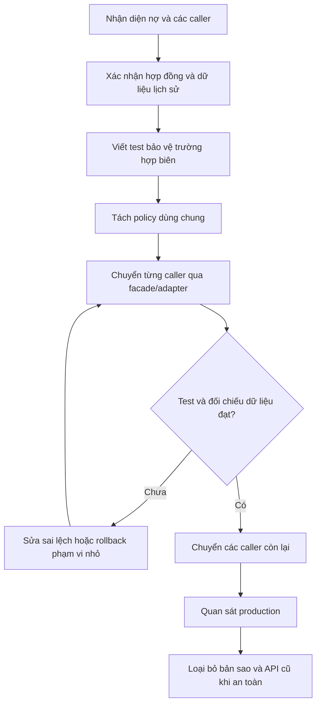

# Chi phí khắc phục và chi phí duy trì quyết định hiện tại

## 1. Vì sao quyết định “sửa ngay hay giữ nguyên” là một quyết định chất lượng?

Một hệ thống có thể đang chạy đúng yêu cầu hôm nay nhưng mỗi lần thêm chức năng lại phải sửa nhiều nơi, kiểm thử mất nhiều thời gian hoặc rất khó xác định hậu quả khi lỗi xảy ra. Khi đó, việc giữ nguyên thiết kế hiện tại không hẳn là “miễn phí”: chi phí sẽ xuất hiện ở những lần thay đổi, các đợt triển khai và sự cố sau này.

Ngược lại, không phải cấu trúc chưa đẹp nào cũng cần được viết lại ngay. Một phần mềm chuẩn bị ngừng sử dụng có thể không xứng đáng với một cuộc tái thiết kế lớn; một lớp cũ ít thay đổi và có hợp đồng ổn định có thể an toàn hơn nếu giữ nguyên và bổ sung vài kiểm tra cần thiết.

Trong module `CODE_QUALITY_FUNDAMENTALS`, mục tiêu là **hiểu những thuộc tính quyết định mã nguồn có đáng tin cậy, dễ hiểu và dễ thay đổi hay không**. Bài thuộc chương **Nợ kỹ thuật** này tập trung vào hai phía của một quyết định:

- **Chi phí khắc phục:** nguồn lực, rủi ro và công việc cần thiết để thay đổi một quyết định kỹ thuật đang gây trở ngại.
- **Chi phí duy trì quyết định hiện tại:** công sức và rủi ro phải tiếp tục gánh chịu nếu không thay đổi cách triển khai đang có.

Điều khó không phải là khẳng định “nợ kỹ thuật luôn xấu”, mà là lựa chọn **hành động có lợi nhất trong một bối cảnh cụ thể**, dựa trên bằng chứng về thay đổi dự kiến, độ tin cậy, khả năng vận hành và chi phí chuyển đổi.

Sau bài học, bạn có thể nhận diện nguồn nợ kỹ thuật và chi phí đi kèm, ước lượng hai phương án với giả định tường minh, tránh những phép tính quá chính xác trên dữ liệu thiếu chắc chắn, thiết kế lộ trình xử lý nợ theo từng bước, và bảo vệ tính đúng đắn bằng kiểm thử khi tái cấu trúc.

## 2. Hiểu nợ kỹ thuật đúng nghĩa: hiện trạng tạo ra chi phí tương lai

**Nợ kỹ thuật** (*technical debt*) là cách mô tả những quyết định hoặc thiếu sót kỹ thuật có thể giúp đạt một lợi ích trước mắt nhưng tạo thêm công việc, rủi ro hoặc giới hạn khi cần thay đổi hoặc vận hành về sau.

Ví dụ:

- Sao chép một quy tắc tính phí tại ba nơi để phát hành nhanh, khiến những lần đổi ngưỡng sau phải sửa và đồng bộ cả ba.
- Không thiết lập test cho trường hợp biên quan trọng, khiến mỗi lần refactor phải xác minh thủ công hoặc có nguy cơ hồi quy.
- Để code nghiệp vụ đọc trực tiếp database và SDK đối tác, làm việc đổi nhà cung cấp trở nên khó khăn.
- Giữ một schema cũ vì nhiều phiên bản client còn sử dụng, dù schema mới rõ nghĩa hơn.
- Viết một lớp xử lý quá nhiều trách nhiệm để hoàn thành deadline, khiến lỗi sau đó khó khoanh vùng.

Tuy nhiên, **không phải mọi đoạn mã cũ, dài, ít trừu tượng hoặc khác gu đều là nợ kỹ thuật**. Một thiết kế đơn giản phục vụ yêu cầu nhỏ không tự trở thành nợ chỉ vì chưa dùng interface hoặc pattern. Một hạn chế chỉ là nợ đáng quan tâm khi có **cơ chế cụ thể** làm tăng chi phí hoặc rủi ro so với lựa chọn phù hợp khác.

### 2.1. Nợ có chủ đích và nợ phát sinh ngoài dự kiến

| Nguồn hình thành | Ví dụ | Điểm cần lưu ý |
| --- | --- | --- |
| **Đánh đổi có chủ đích** | Chấp nhận triển khai tạm một bộ lọc để kịp thử nghiệm thị trường | Ghi rõ giả định, thời hạn xem lại và giới hạn rủi ro |
| **Thiếu hiểu biết ban đầu** | Sau khi có dữ liệu thật mới phát hiện lưu trữ không đáp ứng tải | Không nhất thiết có ai “làm sai”; hiểu biết đã thay đổi |
| **Thay đổi bối cảnh** | Thiết kế cho một đối tác nay phải hỗ trợ nhiều đối tác | Chi phí mới xuất hiện do yêu cầu mở rộng |
| **Thiếu bảo trì tích lũy** | Dependency, contract test và tài liệu không được cập nhật | Rủi ro tăng khi khoảng cách với hệ thống hiện tại lớn dần |
| **Khuyết tật kỹ thuật** | Lỗi race condition hoặc mất dữ liệu chưa được sửa | Nếu đang vi phạm hợp đồng quan trọng, xử lý có thể là nghĩa vụ hiện tại, không nên trì hoãn chỉ vì “đợi trả nợ” |

Nợ kỹ thuật là **mô hình giúp ra quyết định**, không phải nhãn dùng để trách móc lập trình viên cũ. Cần đánh giá quyết định trong điều kiện thông tin và ràng buộc khi nó được đưa ra, đồng thời xác định xem điều kiện ấy còn đúng hay không.

### 2.2. Phân biệt nợ với lỗi đang gây thiệt hại

Một quy tắc phí giao hàng bị tính sai tại đúng ngưỡng là **bug cần xác minh và sửa theo mức ảnh hưởng**. Việc quy tắc ấy bị sao chép ở nhiều nơi khiến sửa bug khó và dễ tái phát mới là một dạng nợ kỹ thuật. Hai vấn đề liên quan nhưng không đồng nhất:

- **Sửa bug** khôi phục hành vi đã cam kết.
- **Trả nợ kỹ thuật** giảm chi phí hoặc rủi ro của những lần thay đổi và vận hành tiếp theo.

Có thể cần làm cả hai, nhưng phải tách rõ trong kế hoạch và test để biết thay đổi nào sửa hành vi, thay đổi nào chỉ tái cấu trúc.

## 3. Gốc nợ, lãi nợ và chi phí cơ hội

Ẩn dụ tài chính hữu ích khi được dùng cẩn thận:

- **Gốc nợ** (*principal*, theo nghĩa ẩn dụ): công sức cần để sửa cấu trúc, bổ sung kiểm thử hoặc di chuyển dữ liệu mà quyết định trước đó chưa thực hiện.
- **Lãi nợ** (*interest*, theo nghĩa ẩn dụ): công sức hoặc rủi ro **tăng thêm** khi tiếp tục làm việc với thiết kế hiện tại so với một cấu trúc phù hợp hơn.
- **Chi phí cơ hội:** giá trị của việc đáng lẽ có thể hoàn thành nếu không phải dành thời gian giải quyết các tác động của nợ.

Ví dụ giả định: mỗi khi sửa chính sách phí giao hàng, nhóm phải thay ba bản sao code, chạy nhiều bước kiểm thử thủ công và xử lý sai lệch giữa các nơi. Công việc lặp lại đó là một phần “lãi” của thiết kế hiện tại. Tạo một chính sách dùng chung có test là một phần “gốc” cần chi để giảm chi phí về sau.

**Không phải mọi khoản thời gian bảo trì đều là lãi nợ.** Thay đổi nghiệp vụ nào cũng có chi phí hợp lý, kể cả với code chất lượng cao. Khi ước lượng, phải tìm phần **tăng thêm do thiết kế hiện tại**, tránh tính toàn bộ chi phí phát triển thành nợ.

### 3.1. Nợ không nhất thiết “tính lãi” đều đặn

Khác khoản vay có lịch trả và lãi suất xác định, nợ kỹ thuật có thể:

- **Hầu như không phát sinh chi phí** khi phần mềm ít thay đổi.
- **Tăng mạnh** khi xuất hiện yêu cầu mới đụng đúng khu vực bị ràng buộc.
- **Tăng theo tương tác** khi ngày càng nhiều module phụ thuộc vào cấu trúc cũ.
- **Giảm ý nghĩa** nếu tính năng bị loại bỏ hoặc sản phẩm đổi hướng.
- **Trở nên cấp bách** khi xuất hiện bug nghiêm trọng, lỗ hổng hoặc thay đổi chuẩn tương thích.

Do đó, không nên gán một “lãi suất 20% mỗi quý” như thể đó là sự thật chỉ vì code đã cũ. Hãy dự báo **cơ chế khiến chi phí phát sinh**, tần suất thay đổi và mức độ bất định.

### 3.2. Chi phí hiện ra ở nhiều nơi

| Nơi phát sinh | Ví dụ chi phí | Cách tìm bằng chứng |
| --- | --- | --- |
| Phát triển | Phải sửa 4 module cho một quy tắc | Lịch sử PR, số vị trí phải sửa |
| Kiểm thử | Dựng fixture phức tạp, regression test thiếu | Thời gian CI, ca test thủ công, lỗi hồi quy |
| Review | Người review phải lần theo quá nhiều lớp hoặc trạng thái ngầm | Thời gian review, nhận xét lặp lại |
| Triển khai | Phải nâng nhiều dịch vụ cùng lúc | Thời gian rollout, thay đổi hợp đồng |
| Vận hành | Log thiếu, khó đối soát, recovery thủ công | Incident report, thời gian phát hiện/khôi phục |
| Tích hợp | Bị khóa vào SDK hoặc schema cũ | Số adapter, điểm phụ thuộc, công chuyển đổi |
| Bảo mật | Phiên bản lỗi thời khó nâng cấp | Báo cáo dependency, độ khó patching |
| Cơ hội | Trì hoãn tính năng đáng giá hoặc cải tiến độ tin cậy | Danh sách công việc bị chậm có nguyên nhân rõ |

Các khoản này không nên cộng máy móc nếu chúng trùng nhau. Chẳng hạn, thời gian khắc phục một incident đã tính trong công vận hành thì không nên tính lại toàn bộ ở “công phát triển”.

## 4. Chi phí khắc phục gồm nhiều việc hơn số dòng cần sửa

Một refactor trông đơn giản trong editor có thể kéo theo công việc ở ranh giới hệ thống.

| Thành phần chi phí khắc phục | Câu hỏi cần đặt ra |
| --- | --- |
| **Hiểu hiện trạng** | Có biết đủ nhánh nghiệp vụ, dữ liệu lịch sử và caller đang dùng không? |
| **Thiết kế đích** | Ranh giới nào cần đổi, hợp đồng nào phải giữ, abstraction nào thực sự có ích? |
| **Bảo vệ hành vi** | Cần thêm unit, contract, integration, regression test nào trước khi sửa? |
| **Thay đổi code** | Bao nhiêu vị trí phải sửa, bao nhiêu module bị ảnh hưởng? |
| **Di chuyển dữ liệu** | Có backfill, schema migration, đối soát hoặc hỗ trợ dữ liệu cũ không? |
| **Tương thích** | Có public API, mobile client, job nền hoặc bên thứ ba còn dùng cách cũ không? |
| **Rollout** | Cần canary, feature flag, chạy song song, giám sát hoặc rollback không? |
| **Đào tạo và tài liệu** | Nhóm có cần đổi cách gọi API, runbook hay quy ước thiết kế không? |
| **Rủi ro chuyển đổi** | Bản sửa có thể tạo lỗi, mất dữ liệu hoặc gián đoạn nào? |
| **Xử lý sau phát hành** | Có cần đối soát, sửa dữ liệu và dọn phần cũ không? |

**Chi phí khắc phục không đồng nghĩa chi phí viết code mới.** Một phép đổi tên Java có thể tốn ít phút, nhưng nếu tên thuộc API công khai đã được nhiều phiên bản client dùng, chi phí migration và tương thích mới là phần đáng kể.

### 4.1. Phải tính chi phí xác nhận bản sửa đúng

Một số nợ kỹ thuật tồn tại lâu vì ít người hiểu hết hành vi cũ. Thay thế toàn bộ bằng một implementation “sạch” không tự chứng minh hợp đồng được giữ nguyên.

Trong các hệ thống có dữ liệu hoặc tiền, cần xem xét:

- Regression tests cho hành vi đã xác nhận.
- Contract tests cho caller cũ và mới.
- Integration tests cho database, transaction và adapter.
- Kiểm tra dữ liệu lịch sử, trường hợp thiếu trường và phiên bản schema.
- Kịch bản lỗi, timeout, retry và khôi phục.
- Giám sát sau triển khai để xác nhận không có sai lệch nghiệp vụ.

Bỏ các bước này có thể làm **ước lượng trả nợ trông rẻ hơn**, nhưng chuyển chi phí sang rủi ro production.

### 4.2. Đừng tính mọi cải thiện mong muốn vào một cuộc trả nợ

Một PR vừa đổi toàn bộ kiến trúc, thay quy tắc giá, đổi schema và nâng framework sẽ rất khó xác định nguyên nhân nếu thất bại. Chia rõ:

1. Bảo vệ hành vi bằng test.
2. Cô lập phụ thuộc và tạo ranh giới.
3. Chuyển đổi dần caller.
4. Xóa cấu trúc cũ khi chắc chắn không còn sử dụng.
5. Thực hiện thay đổi nghiệp vụ mới dưới hợp đồng rõ.

Lộ trình từng bước có thể tăng một phần chi phí triển khai ngắn hạn nhưng giảm **rủi ro chuyển đổi và chi phí rollback**.

## 5. Chi phí duy trì quyết định hiện tại là gì?

Nếu giữ nguyên code hôm nay, tương lai vẫn có chi phí hợp lý để sửa lỗi, thêm chức năng và vận hành. Phần cần đánh giá là **chi phí tăng thêm do cấu trúc hiện tại**.

### 5.1. Chi phí mỗi lần thay đổi

Giả sử một chính sách xuất hiện ở ba service. Khi nghiệp vụ đổi ngưỡng, nhóm phải:

1. Xác định các nơi trùng logic.
2. Đổi điều kiện ở từng nơi.
3. Kiểm tra xem từng nơi dùng tiền trước hay sau thuế.
4. Viết hoặc cập nhật các test riêng.
5. Triển khai và theo dõi nhiều thành phần.

Nếu một nơi bị bỏ sót, sản phẩm có thể trả kết quả không nhất quán. Mỗi thay đổi mới có một **phụ phí phối hợp** vì thiếu ranh giới dùng chung.

### 5.2. Chi phí rủi ro khi không thay đổi

Một dependency không được cập nhật có thể tăng rủi ro bảo mật; thiếu kiểm thử giao dịch có thể làm khó refactor; một đường đối soát thủ công có thể kéo dài sự cố. Chi phí ở đây gồm **xác suất xảy ra** và **mức thiệt hại nếu xảy ra**, nhưng cả hai thường khó ước lượng chính xác.

Đừng đưa một con số rủi ro trông rất khoa học mà không có dữ liệu. Có thể dùng phạm vi định tính **thấp/vừa/cao**, tình huống xấu nhất và dấu hiệu kích hoạt hành động.

### 5.3. Chi phí do khóa lựa chọn (*option cost*)

Một thư viện hoặc API cũ có thể giới hạn việc cập nhật JDK, thay hệ quản trị dữ liệu hoặc chuyển sang quy trình CI tốt hơn. Khi chưa cần thay đổi, chi phí gần như vô hình; khi có nhu cầu, chi phí chuyển đổi đột nhiên xuất hiện. Cần ghi rõ **phụ thuộc nào đang khóa lựa chọn** và những thay đổi dự kiến nào có thể làm chi phí này trở nên thực tế.

### 5.4. Chi phí của việc không có bằng chứng

Nếu thiếu contract tests và metrics, nhóm có thể phải review thủ công nhiều hơn mỗi lần triển khai hoặc không dám thay đổi cấu trúc. Đây là chi phí của **sự thiếu chắc chắn**; thêm test và quan sát phù hợp có thể mang lại lợi ích ngay cả trước khi refactor lớn.

## 6. So sánh hai con đường qua một khoảng thời gian cụ thể

Thay vì hỏi “refactor có tốt không?”, hãy hỏi:

> Trong khoảng thời gian chúng ta thực sự quan tâm, chi phí và rủi ro khi giữ thiết kế hiện tại so với chi phí và rủi ro sau khi thay đổi là gì?

Một mô hình đơn giản:

\[
C_{\text{giữ}}(H)
= \sum_{t=1}^{H} \left(M_{\text{cũ},t}+R_{\text{cũ},t}\right)
\]

\[
C_{\text{đổi}}(H)
= C_{\text{khắc phục}}+
\sum_{t=1}^{H}\left(M_{\text{mới},t}+R_{\text{mới},t}\right)
\]

Trong đó:

- \(H\): khoảng thời gian quyết định (tháng/quý hoặc số lần phát hành).
- \(M\): chi phí thay đổi và duy trì dự kiến.
- \(R\): chi phí kỳ vọng của rủi ro có thể ước lượng đáng tin; nếu không đủ dữ liệu, ghi rõ riêng thay vì giả làm số chính xác.
- \(C_{\text{khắc phục}}\): chi phí một lần để thiết kế, kiểm thử, migration và rollout, gồm cả rủi ro chuyển đổi được đánh giá.

Mô hình có thể mở rộng để xét giá trị thời gian của tiền hoặc sự bất định về nhu cầu. Trong nhiều cuộc trao đổi kỹ thuật, **một bảng phạm vi giờ công cùng các rủi ro không quy đổi thành tiền** hữu ích hơn một phép tính hiện giá có giả định thiếu căn cứ.

### 6.1. Ví dụ giả định: có nên gom quy tắc tính phí giao hàng?

Nhóm ước lượng:

- Trả nợ một lần để xây policy dùng chung, kiểm thử và chuyển caller: **40 giờ**.
- Công duy trì hiện tại do trùng logic và kiểm tra thủ công: **12 giờ/tháng**.
- Sau khi gom policy và có test: **4 giờ/tháng**.
- Phần tiết kiệm kỳ vọng: **8 giờ/tháng**.
- Khoảng nhìn quyết định: **9 tháng**.

Nếu những giả định giữ đúng:

\[
\text{Thời điểm hòa vốn}\approx 40/8=5\text{ tháng}
\]

\[
\text{Tiết kiệm gộp trong 9 tháng}=8\times9=72\text{ giờ}
\]

\[
\text{Lợi ích ròng ước tính}=72-40=32\text{ giờ}
\]

**Đây chỉ là tình huống minh họa, không phải số đo của một dự án thực.** Chưa quy đổi chi phí sự cố, công dừng release hay rủi ro chuyển đổi thành giờ công. Nếu số lần sửa chính sách giảm hoặc tính năng bị loại bỏ trước 5 tháng, lợi ích dự kiến có thể không đạt.

### 6.2. Kiểm tra độ nhạy, không chỉ một con số đẹp

Giữ chi phí khắc phục 40 giờ, nhưng đổi giả định về phần công tiết kiệm và thời gian còn sử dụng:

| Kịch bản giả định | Tiết kiệm mỗi tháng | Thời gian còn dùng | Tiết kiệm gộp | Ròng so với 40 giờ |
| --- | ---: | ---: | ---: | ---: |
| Ít thay đổi, sớm ngừng dùng | 3 giờ | 6 tháng | 18 giờ | **-22 giờ** |
| Cơ sở | 8 giờ | 9 tháng | 72 giờ | **+32 giờ** |
| Thay đổi thường xuyên | 12 giờ | 9 tháng | 108 giờ | **+68 giờ** |

Bảng cho thấy **cùng một giải pháp có thể đáng hoặc không đáng đầu tư tùy bối cảnh**. Khi dự báo không chắc chắn, nên thu thập thêm bằng chứng hoặc bắt đầu bằng bước nhỏ dễ đảo ngược.

### 6.3. Không nên quy đổi tất cả rủi ro thành giờ công

Nếu nợ liên quan rò rỉ dữ liệu, thu tiền hai lần hoặc không thể khôi phục sau mất điện, một phép tính “số giờ refactor so với số giờ sửa hàng tháng” có thể bỏ sót hậu quả không chấp nhận được. Với những bất biến nghiêm trọng, cần xác định **ngưỡng an toàn bắt buộc** trước khi dùng mô hình chi phí để chọn thứ tự thực hiện.

## 7. Thu thập bằng chứng chi phí thay vì đoán từ cảm giác

Một trong những rủi ro phổ biến khi quản lý nợ kỹ thuật là định giá dựa trên mức độ khó chịu chủ quan. Cảm nhận của người làm vẫn hữu ích để tìm nơi cần khảo sát, nhưng quyết định đầu tư nên liên kết với sự kiện có thể quan sát.

| Nguồn dữ liệu | Cho biết điều gì | Giới hạn |
| --- | --- | --- |
| Lịch sử PR | Số nơi phải sửa, số lần cùng sửa một policy | PR lớn có thể do phạm vi nghiệp vụ, không chỉ do nợ |
| Thời gian thực hiện thay đổi | Công việc thực tế trong những lần đổi tương tự | Cần phân biệt chờ review, phụ thuộc tổ chức và thời gian coding |
| Bug và incident | Lỗi hồi quy, thiệt hại, thời gian chẩn đoán | Một số lỗi chưa được phát hiện hoặc chưa được ghi |
| Build/CI | Test suite mất bao lâu, nơi nào flaky | CI chậm còn do hạ tầng, không chỉ code |
| Dependency graph | Những module hoặc caller phụ thuộc vào ranh giới cũ | Nhiều phụ thuộc chưa chắc đều không phù hợp |
| Số thao tác thủ công | Deployment, đối soát, khôi phục cần người can thiệp | Cần phân biệt việc bắt buộc với việc do thiết kế thiếu |
| Tracing/metrics | Vùng code hoặc dependency gây nghẽn có ảnh hưởng | Chỉ đo đúng phạm vi có instrumentation |
| Review kỹ thuật | Khái niệm nào làm thay đổi khó hiểu | Cần dẫn chứng bằng đường thay đổi cụ thể |

### 7.1. Ghi rõ giả định và độ tin cậy

Ví dụ một bản ghi nợ:

```text
Vấn đề:
  Quy tắc phí giao hàng bị sao chép tại checkout và batch export.

Hậu quả đã quan sát:
  Hai thay đổi ngưỡng gần đây phải sửa cả hai nơi;
  một lần bị lệch kết quả ở đúng ngưỡng.

Dự kiến:
  Sắp có thay đổi chính sách theo hợp đồng mới.
  Độ chắc chắn: vừa; chưa xác nhận số lần thay đổi tiếp theo.

Phương án:
  Gom policy dùng chung; giữ facade tương thích cho caller cũ.

Chi phí khắc phục:
  Cần ước lượng theo discovery, tests, migration và rollout.

Chi phí giữ nguyên:
  Phải sửa ở nhiều nơi mỗi lần; nguy cơ bỏ sót boundary tests.

Điều kiện xem lại:
  Khi có yêu cầu mới, incident mới, hoặc sau mốc đánh giá đã định.

Bằng chứng:
  Liên kết PR/incident/test thực tế của dự án khi có.
```

Các dòng trên mô tả **hồ sơ ví dụ**, không phải lịch sử đã xác minh của repository người học. Trong dự án thật không nên bịa mã ticket, số incident hoặc giờ công.

### 7.2. Không đánh đồng độ dễ đo với mức độ quan trọng

Một thay đổi format có thể được tính bằng hàng nghìn dòng; việc sửa race condition hiếm gặp có thể chỉ thay vài dòng nhưng bảo vệ dữ liệu rất quan trọng. Dùng metric để hỗ trợ định vị, không biến “xóa nhiều dòng nợ” thành mục tiêu duy nhất.

## 8. Ví dụ Java: chi phí của một quy tắc bị sao chép

Giả sử hai đường xử lý **checkout online** và **job xuất hóa đơn** đều phải áp dụng chính sách giả định:

- Tổng tiền hàng dùng cùng đồng tiền và không âm.
- **Từ 200.00 trở lên** được miễn phí giao hàng tiêu chuẩn.
- Dưới ngưỡng đó tính phí **30.00**.
- Kết quả phải giống nhau ở cả hai đường xử lý.

### 8.1. Thiết kế hiện tại: hai bản sao dễ lệch

Một số mã dạng minh họa:

```java
// Trong CheckoutService:
BigDecimal fee = subtotal.compareTo(new BigDecimal("200.00")) >= 0
        ? BigDecimal.ZERO
        : new BigDecimal("30.00");

// Trong InvoiceExportJob:
BigDecimal fee = subtotal.compareTo(new BigDecimal("200.00")) > 0
        ? BigDecimal.ZERO
        : new BigDecimal("30.00");
```

Hai đoạn trông rất giống nhau, nhưng khác một ký tự `=`. Ở đúng tổng tiền `200.00`, checkout trả phí bằng 0 còn job xuất hóa đơn trả 30.00. Đây là **bug về tính nhất quán** và cũng là ví dụ về nợ do logic nghiệp vụ bị lặp lại.

Nếu chỉ sửa dấu `>` thành `>=` trong job, bug hiện tại được xử lý nhưng chi phí mỗi lần đổi ngưỡng về sau vẫn tồn tại. Nếu gom mọi tính toán vào một policy dùng chung, ta có thể giảm nguy cơ sai lệch — với điều kiện xác minh hai caller thực sự có **cùng hợp đồng**.

**Không được gộp chỉ vì code trông giống nhau.** Nếu checkout xét tổng tiền trước thuế còn hóa đơn xét tổng sau thuế theo chính sách khác, hai đoạn có thể đại diện cho **hai quy tắc khác nhau**. Trước khi refactor phải xác nhận nguồn dữ liệu, đơn vị tiền, làm tròn và điều kiện ngưỡng.

### 8.2. Thiết kế đích: một chính sách có trách nhiệm rõ

Đặt mã Java 17+ sau trong tệp `StandardShippingFeePolicy.java`:

```java
import java.math.BigDecimal;
import java.util.Objects;

public final class StandardShippingFeePolicy {
    private final BigDecimal freeThreshold;
    private final BigDecimal standardFee;

    public StandardShippingFeePolicy(
            BigDecimal freeThreshold,
            BigDecimal standardFee) {
        this.freeThreshold = requireNonNegative(
                freeThreshold, "freeThreshold");
        this.standardFee = requireNonNegative(
                standardFee, "standardFee");
    }

    public BigDecimal calculate(BigDecimal merchandiseSubtotal) {
        requireNonNegative(merchandiseSubtotal, "merchandiseSubtotal");

        // Quy tắc đã xác nhận bao gồm giá trị đúng bằng ngưỡng.
        if (merchandiseSubtotal.compareTo(freeThreshold) >= 0) {
            return BigDecimal.ZERO;
        }
        return standardFee;
    }

    private static BigDecimal requireNonNegative(
            BigDecimal amount, String fieldName) {
        Objects.requireNonNull(amount, fieldName);
        if (amount.signum() < 0) {
            throw new IllegalArgumentException(
                    fieldName + " must not be negative");
        }
        return amount;
    }
}
```

Class này có vài đặc điểm quan trọng:

1. **Hợp đồng rõ:** phí dựa trên `merchandiseSubtotal` và hai giá trị cấu hình được kiểm tra.
2. **Không có I/O ẩn:** tính toán không cần database, mạng hoặc đồng hồ.
3. **Một nơi xác định điều kiện biên:** caller không phải tự nhớ dấu `>=`.
4. **Có thể kiểm thử độc lập:** không cần mock hoặc tạo framework policy.
5. **Đủ đơn giản:** chưa thêm strategy/factory khi chỉ có một chính sách thật.

Ví dụ giả định dữ liệu đã được đồng nhất về tiền tệ, thuế và scale ở ranh giới khác. Nếu chính sách phụ thuộc nhiều đồng tiền hoặc quy tắc làm tròn, cần bổ sung mô hình miền nghiệp vụ phù hợp, không dùng `BigDecimal` đơn lẻ để giả vờ đã bảo vệ mọi bất biến về tiền.

### 8.3. Giữ API cũ trong giai đoạn chuyển đổi

Nếu nhiều caller còn phụ thuộc vào một tên phương thức công khai, có thể cho API cũ **ủy quyền** về policy mới thay vì xóa ngay. Đặt trong tệp `LegacyShippingFees.java`:

```java
import java.math.BigDecimal;

public final class LegacyShippingFees {
    private static final StandardShippingFeePolicy POLICY =
            new StandardShippingFeePolicy(
                    new BigDecimal("200.00"),
                    new BigDecimal("30.00"));

    private LegacyShippingFees() {}

    /**
     * Hợp đồng cũ còn được hỗ trợ trong giai đoạn chuyển caller.
     * Caller mới nên dùng policy trực tiếp ở ranh giới phù hợp.
     */
    @Deprecated(since = "2.0")
    public static BigDecimal calculateStandardFee(
            BigDecimal merchandiseSubtotal) {
        return POLICY.calculate(merchandiseSubtotal);
    }
}
```

Đây là **facade chuyển đổi**. Nó giúp các caller có thể tiếp tục dùng cùng tên, tham số và kiểu trả về, trong khi hành vi được gom về một nguồn. Nhưng cần phân biệt:

- Nếu API cũ vốn có hành vi lỗi ở đúng ngưỡng, bản sửa thay đổi hành vi đó **có chủ đích** để đáp ứng hợp đồng đã xác nhận. Đây không phải “refactor thuần” không đổi ngữ nghĩa.
- `@Deprecated` chỉ cảnh báo và tài liệu hóa ý định chuyển đổi; nó không tự lên lịch xóa phương thức cũ.
- Khả năng tương thích **source/binary/API** còn phụ thuộc cách phát hành thư viện, phạm vi public API và những caller đã biên dịch. Giữ chữ ký thường giảm rủi ro nhưng không thay thế kiểm tra caller thực tế.
- Sau khi chuyển, phải xác minh không còn nơi nào tự tính lại điều kiện ngưỡng bằng một bản sao khác.

### 8.4. Unit test cho hành vi và đường chuyển đổi

Ví dụ JUnit 5 đặt trong `StandardShippingFeePolicyTest.java`:

```java
import static org.junit.jupiter.api.Assertions.*;
import java.math.BigDecimal;
import org.junit.jupiter.api.Test;

class StandardShippingFeePolicyTest {
    private final StandardShippingFeePolicy policy =
            new StandardShippingFeePolicy(
                    new BigDecimal("200.00"),
                    new BigDecimal("30.00"));

    @Test
    void chargesFeeJustBelowThreshold() {
        BigDecimal actual = policy.calculate(
                new BigDecimal("199.99"));

        assertEquals(0, actual.compareTo(new BigDecimal("30.00")));
    }

    @Test
    void makesFeeZeroAtExactThreshold() {
        BigDecimal actual = policy.calculate(
                new BigDecimal("200.00"));

        assertEquals(0, actual.compareTo(BigDecimal.ZERO));
    }

    @Test
    void makesFeeZeroAboveThreshold() {
        BigDecimal actual = policy.calculate(
                new BigDecimal("200.01"));

        assertEquals(0, actual.compareTo(BigDecimal.ZERO));
    }

    @Test
    void rejectsNegativeSubtotal() {
        assertThrows(IllegalArgumentException.class,
                () -> policy.calculate(new BigDecimal("-0.01")));
    }

    @Test
    void keepsOldFacadeConsistentWithPolicy() {
        var subtotal = new BigDecimal("200.00");

        BigDecimal viaPolicy = policy.calculate(subtotal);
        BigDecimal viaFacade =
                LegacyShippingFees.calculateStandardFee(subtotal);

        assertEquals(0, viaPolicy.compareTo(viaFacade));
    }
}
```

Các test này xác minh các trường hợp biên và bảo vệ facade tại một giá trị quan trọng. Trong dự án thật, cần thêm **contract/integration tests của các caller** để xác nhận dữ liệu và cách biểu diễn số tiền giống nhau. Nếu nhóm xác định các caller cũ dựa vào scale của `BigDecimal` hoặc định dạng JSON nào đó, phải kiểm tra thêm, vì `compareTo` chỉ xác nhận **giá trị số học**, không so sánh cả scale như `equals`.

Bộ test trên **chưa được chạy trong tài liệu này** và không tự chứng minh giảm giờ công hay số incident. Nó chỉ minh họa loại bằng chứng kỹ thuật cần có để thực hiện một cuộc trả nợ an toàn.

## 9. Lộ trình trả nợ theo từng bước và giới hạn rủi ro

Một cuộc viết lại toàn bộ thường làm chi phí khắc phục và rủi ro chuyển đổi tăng. Với ví dụ quy tắc phí giao hàng, có thể đi từng bước:

1. **Xác nhận cùng một hợp đồng:** làm rõ tổng tiền trước/sau thuế, tiền tệ, điều kiện tại ngưỡng và dữ liệu cũ.
2. **Tạo test đặc trưng cho hành vi cũ và đúng nghiệp vụ:** đánh dấu rõ test nào mô tả lỗi đã xác nhận và test nào bảo vệ tương thích.
3. **Tách policy thuần:** không đưa database, HTTP hoặc các service không liên quan vào logic tính phí.
4. **Chuyển một caller trước:** dùng facade/delegation hoặc adapter để giữ hợp đồng cần thiết.
5. **So sánh đầu ra trong môi trường thử nghiệm:** chọn bộ dữ liệu có giá trị dưới/bằng/trên ngưỡng và các trường hợp lịch sử.
6. **Chuyển các caller còn lại:** loại bỏ bản sao logic sau khi test tương ứng đạt.
7. **Quan sát sau rollout:** xem tỷ lệ sai lệch phí, exception, dữ liệu hóa đơn và khả năng rollback.
8. **Dọn phần cũ:** chỉ xóa facade khi đã xác nhận không còn caller được hỗ trợ cần nó.



Từng bước có **chi phí tích hợp tạm thời**, vì một thời gian sẽ tồn tại cả facade và policy mới. Nhưng nó cho phép kiểm chứng dần, giảm khả năng phải rollback một thay đổi khổng lồ và giữ công việc nghiệp vụ tiếp tục trong lúc trả nợ.

### 9.1. Tránh “trả nợ” bằng cách đổi luôn mọi thứ

Nếu cùng PR còn đổi ngưỡng miễn phí từ 200.00 thành 250.00, đổi đơn vị tiền và thay framework HTTP, việc kiểm chứng kết quả trở nên khó. Nên tách thay đổi **hành vi nghiệp vụ**, **cấu trúc code** và **hạ tầng** khi có thể, vì mỗi nhóm có nguồn bằng chứng và chiến lược rollback riêng.

## 10. Khi nào nên giữ nợ, giảm lãi thay vì trả hết?

Không phải mọi khoản nợ đều cần “trả hết” ngay. Có nhiều lựa chọn trung gian:

| Lựa chọn | Khi có thể phù hợp | Lưu ý |
| --- | --- | --- |
| **Giữ nguyên, ghi nhận và theo dõi** | Code ổn định, ít thay đổi, rủi ro thấp | Phải có điều kiện xem lại, tránh để nợ vô chủ |
| **Bổ sung test quanh code cũ** | Hành vi chưa đủ hiểu, viết lại rủi ro | Test không tự giảm coupling nhưng giảm rủi ro thay đổi |
| **Tạo adapter/facade** | API cũ còn caller, cần đổi implementation dần | Có thêm tầng tạm thời; cần kế hoạch dọn |
| **Trích xuất một policy nhỏ** | Quy tắc nghiệp vụ bị sao chép và hay đổi | Xác nhận đó là cùng một quy tắc, không gộp sai |
| **Cô lập vùng rủi ro** | Dependency cũ khó nâng cấp hoặc hạ tầng không ổn định | Thiết kế ranh giới và contract tests |
| **Đổi từng phần theo thay đổi tự nhiên** | Một khu vực được chỉnh sửa thường xuyên | Tránh “refactor tiện tay” vượt phạm vi gây hồi quy |
| **Thay thế toàn bộ** | Nền tảng không còn đáp ứng yêu cầu và đường migration có kiểm soát | Phải tính tương thích, dữ liệu và rủi ro chuyển đổi lớn |
| **Ngừng sử dụng / loại bỏ tính năng** | Giá trị nghiệp vụ đã hết hoặc có cách thay thế | Cần kế hoạch dữ liệu, caller và lưu trữ pháp lý nếu có |

Đôi khi cách tốt nhất để giảm chi phí duy trì là **giảm phạm vi hệ thống cần duy trì**, thay vì làm lại một cấu trúc cũ ngày càng lớn. Nhưng việc loại bỏ tính năng phải dựa trên nhu cầu và nghĩa vụ hiện tại, không chỉ vì code khó sửa.

### 10.1. Một khoản nợ có thể là lựa chọn chấp nhận được

Một demo dùng trong hai tuần, không xử lý dữ liệu thật và có thể xóa bỏ dễ dàng không nhất thiết cần đầy đủ tầng kiến trúc mở rộng. YAGNI và KISS giúp tránh trả trước cho những biến thể chưa có căn cứ.

Điều kiện quan trọng là **không đánh đổi những bảo đảm bắt buộc**, nhất là bảo mật, tính đúng đắn, không mất dữ liệu và hợp đồng với người dùng thật, chỉ vì gọi giải pháp đó là “tạm thời”.

### 10.2. Đánh giá lại khi môi trường đổi

Một quyết định đúng ở giai đoạn đầu có thể trở thành nợ khi:

- Tần suất thay đổi tăng mạnh.
- Có thêm caller hoặc tích hợp ngoài.
- Cần triển khai nhiều phiên bản cùng lúc.
- Luật và yêu cầu bảo mật thay đổi.
- Chí phí sự cố/đối soát tăng.
- Cấu trúc cũ không tương thích với phiên bản JDK hoặc hạ tầng cần hỗ trợ.

Đánh giá lại quyết định không phải thừa nhận nó từng sai; đó là phản ứng bình thường trước thông tin mới.

## 11. Ưu tiên nợ kỹ thuật bằng giá trị và rủi ro, không bằng độ khó chịu

Khi có nhiều khoản nợ, nhóm cần quyết định nên xử lý khoản nào trước. Một bảng đánh giá thực dụng:

| Tiêu chí | Câu hỏi |
| --- | --- |
| **Tác động người dùng** | Có tạo lỗi, giảm hiệu năng hoặc gián đoạn quan trọng không? |
| **Tính bắt buộc** | Có yêu cầu bảo mật, tuân thủ, nhất quán dữ liệu cần đáp ứng ngay không? |
| **Tần suất thay đổi** | Bao lâu nhóm lại chạm vào vùng code này? |
| **Phụ phí mỗi lần sửa** | Bao nhiêu thời gian, rủi ro và phối hợp tăng thêm? |
| **Phạm vi lan truyền** | Bao nhiêu caller và module phụ thuộc vào cấu trúc hiện tại? |
| **Khả năng giảm rủi ro bằng bước nhỏ** | Có thể thêm test, adapter hoặc constraint trước không? |
| **Chi phí chuyển đổi** | Có migration dữ liệu, public API hoặc rollout phức tạp không? |
| **Thời gian còn sử dụng** | Tính năng còn tồn tại bao lâu; có kế hoạch thay thế không? |
| **Bằng chứng** | Con số/tình huống đã quan sát hay mới là dự đoán? |
| **Khả năng đảo ngược** | Nếu quyết định sai, có rollback hoặc chuyển hướng dễ không? |

Có thể phân nhóm để thảo luận:

1. **Nguy cơ nghiêm trọng cần xử lý:** lỗi dữ liệu, bảo mật hoặc tình huống có hậu quả không thể chấp nhận.
2. **Nợ gây cản trở công việc thường xuyên:** nhiều lần sửa và bug lặp ở một khu vực đang thay đổi liên tục.
3. **Nợ có lợi ích kinh tế rõ khi trả:** chi phí giảm có khả năng vượt chi phí chuyển đổi trong thời gian còn dùng.
4. **Nợ nên quan sát:** ảnh hưởng thấp, ít thay đổi, chi phí sửa cao hoặc chưa có bằng chứng đủ rõ.
5. **Nợ sẽ biến mất khi loại bỏ tính năng:** xác nhận kế hoạch ngừng dùng trước khi đầu tư lớn.

Đừng biến nhóm này thành điểm số tự động thay thế đánh giá của người chịu trách nhiệm. Một lỗ hổng dữ liệu hiếm gặp có thể được ưu tiên cao dù “ROI giờ công” trông thấp hơn việc dọn code thông thường.

### 11.1. Chọn khoản nhỏ nhưng có tác động lặp lại

Một cải tiến 4 giờ làm giảm 1 giờ trong mỗi PR của một khu vực sửa hàng tuần có thể đem lại hiệu quả rõ. Một cuộc viết lại 6 tháng chỉ cải thiện cách đặt tên nhưng không giảm rủi ro hoặc phạm vi thay đổi có thể không hợp lý.

Điểm mấu chốt là **lợi ích thực trong đường công việc đang xảy ra**, không phải độ hoành tráng của abstraction mới.

## 12. Sai lầm khi ước lượng chi phí trả nợ và giữ nợ

### 12.1. Chỉ đếm thời gian viết code mới

Nếu không tính test, migration và triển khai, `C_{\text{khắc phục}}` bị đánh giá thấp. Hậu quả là dự án “refactor nhỏ” kéo dài vì đến cuối mới phát hiện hàng chục caller hoặc dữ liệu cũ.

### 12.2. Quy toàn bộ công bảo trì thành nợ

Mọi sản phẩm đều cần sửa lỗi và bổ sung tính năng. Nếu coi toàn bộ 12 giờ/tháng là “lãi nợ” dù policy mới vẫn mất 4 giờ/tháng, lợi ích được phóng đại. Cần so phần **tăng thêm** giữa hai phương án.

### 12.3. Dựa trên một dự báo duy nhất

Nếu giả định sản phẩm còn dùng ba năm mà thực tế ngừng sau một quý, quyết định sẽ rất khác. Hãy có các kịch bản ít thay đổi, cơ sở và nhiều thay đổi, cùng giả định về thời gian sử dụng.

### 12.4. Nhầm chi phí đã chi với chi phí tương lai

Một hệ thống đã tốn hàng nghìn giờ xây dựng không có nghĩa phải giữ nó bằng mọi giá. **Chi phí chìm** (*sunk cost*) đã xảy ra và không thể lấy lại; quyết định hiện tại nên dựa vào chi phí, lợi ích và rủi ro **từ thời điểm này trở đi**. Ngược lại, không thể coi mọi bài học và dữ liệu tích lũy từ hệ thống cũ là vô giá trị khi chuyển đổi.

### 12.5. Tái cấu trúc vì điểm số hoặc mỹ thuật

Giảm số dòng, số lớp hoặc cognitive complexity có thể hữu ích nhưng chưa chứng minh được tiết kiệm công duy trì. Nếu sau refactor người đọc phải tìm nhiều chỗ hơn hoặc test trở nên giòn, có thể chỉ đổi hình dạng nợ.

### 12.6. Tạo thêm abstraction làm tăng chi phí

Một rule đơn giản bị chuyển thành `AbstractRuleFactory`, `RuleRegistry` và `StrategyProvider` dù chỉ có một cách tính. Nếu không giải quyết phụ thuộc hoặc nhu cầu thật, hệ thống gánh thêm hợp đồng, cấu hình và nơi chẩn đoán. Việc “trả nợ” có thể **tạo một khoản nợ mới**.

### 12.7. Bỏ qua người đang dùng API cũ

Thay type, đổi nghĩa giá trị null, xóa trường JSON hoặc nâng version database không tính đến client cũ có thể tạo sự cố. Phải xác minh độ tương thích và giai đoạn hỗ trợ song song.

### 12.8. Biến phần tiết kiệm dự kiến thành thành quả đã đo

“Dự kiến tiết kiệm 8 giờ/tháng” là giả thuyết. Sau khi thực hiện, phải đo lại số lần sửa, công review, độ ổn định test và incident. Không nên báo lợi ích như sự thật chỉ vì kế hoạch đã được phê duyệt.

## 13. Đánh giá hiệu quả sau khi xử lý nợ kỹ thuật

Một quyết định tốt không kết thúc khi PR được merge. Nhóm cần xem các dự đoán ban đầu có trở thành kết quả thực tế hay không.

| Giả thuyết đầu tư | Bằng chứng sau triển khai | Giới hạn khi kết luận |
| --- | --- | --- |
| Một nơi sửa policy sẽ giảm sai lệch | Các caller dùng cùng policy; test ngưỡng cùng pass | Chưa chứng minh mọi lỗi nghiệp vụ biến mất |
| Thay đổi chính sách sẽ nhanh hơn | Thời gian từ yêu cầu đến release ở các lần sửa tương tự | Còn ảnh hưởng người review, độ khó yêu cầu |
| Số incident hồi quy giảm | Lịch sử incident theo nhóm lỗi | Số mẫu có thể ít và điều kiện tải thay đổi |
| Hệ thống dễ test hơn | Test ranh giới, thời gian dựng fixture, độ ổn định CI | Số lượng test không đồng nghĩa test mạnh |
| Deploy an toàn hơn | Contract tests, canary, tỷ lệ rollback và sai lệch dữ liệu | Cần so cùng loại release và tác động |
| Giảm chi phí vận hành | Công đối soát, số lần xử lý thủ công, chi phí hạ tầng | Phải kiểm tra thay đổi tải và giá dịch vụ |

Một cách làm hữu ích là **ghi giả thuyết trước khi sửa** và **xem lại sau một số lần thay đổi thực tế**, thay vì đòi kết luận ngay sau một ngày deploy. Nếu lợi ích không xuất hiện, tìm nguyên nhân: lựa chọn nợ sai, kỳ vọng quá lớn, migration chưa hoàn tất hay metric chưa đo đúng.

### 13.1. “Trả nợ xong” nghĩa là gì?

Không phải chỉ “đã thêm class mới”. Với ví dụ phí giao hàng, điều kiện kết thúc có thể gồm:

- Chính sách dùng chung đã được xác nhận bởi chủ nghiệp vụ.
- Các caller chính đã dùng policy hoặc facade nhất quán.
- Test ở dưới, đúng và trên ngưỡng đạt trong môi trường thật được cấu hình.
- Không còn bản sao quy tắc dễ lệch trong phạm vi đã cam kết.
- API cũ còn được hỗ trợ nếu cần; kế hoạch loại bỏ rõ ràng.
- Monitoring/đối soát liên quan cho thấy không có sai lệch mới.
- Công duy trì được quan sát lại khi có thay đổi tiếp theo.

Nếu vẫn còn một job quan trọng dùng code cũ, việc tuyên bố nợ đã được trả hết có thể là quá sớm.

## 14. Một mẫu hồ sơ quyết định về nợ kỹ thuật

Khi đề xuất trả nợ kỹ thuật trong review hoặc kế hoạch sprint, nên viết đủ để người khác đánh giá mà không cần suy đoán:

```text
TÊN QUYẾT ĐỊNH
  Gom chính sách phí giao hàng tiêu chuẩn đang bị sao chép.

VẤN ĐỀ CỤ THỂ
  Hai đường xử lý có thể dùng ngưỡng không nhất quán;
  các lần thay đổi phải sửa và kiểm chứng nhiều nơi.

BẰNG CHỨNG HIỆN TẠI
  [PR, incident, ca test, caller và số lần sửa đã xác minh].

LỰA CHỌN A: GIỮ NGUYÊN
  Chi phí thêm mỗi thay đổi: [ước lượng + nguồn].
  Rủi ro: [sai lệch, khó kiểm chứng, khả năng tác động].
  Điều kiện cần xem lại: [thay đổi nghiệp vụ, incident].

LỰA CHỌN B: KHẮC PHỤC
  Phương án: [policy chung + facade chuyển đổi].
  Chi phí: [discovery, coding, test, migration, rollout].
  Rủi ro chuyển đổi: [tương thích, dữ liệu, rollback].

GIẢ ĐỊNH
  Thời gian còn sử dụng: [phạm vi và độ chắc chắn].
  Số lần thay đổi tương lai: [phạm vi].
  Giới hạn chưa ước lượng được: [ghi rõ].

ĐIỀU KIỆN BẢO VỆ
  [Không thay đổi giá trị biên, không làm sai hóa đơn].
  [Contract/integration tests, rollout, rollback].

QUYẾT ĐỊNH
  [Làm ngay / làm theo bước / trì hoãn có điều kiện / loại bỏ].
  Lý do dựa trên bằng chứng và rủi ro.

ĐÁNH GIÁ SAU
  [Các metric và sự kiện cần xem lại; người phụ trách].
```

Các dấu ngoặc vuông là thông tin cần bổ sung **từ dự án thực tế**. Đừng điền số giờ, kết quả test hoặc mã incident bằng phỏng đoán rồi coi đó là dữ kiện.

## 15. Checklist khi review quyết định “trả nợ hay duy trì”

1. **Vấn đề có thật không?** Nợ tạo thêm chi phí hoặc rủi ro cụ thể nào, hay chỉ là khác sở thích thiết kế?
2. **Cơ chế tạo lãi là gì?** Mỗi lần thay đổi phải làm thêm bước nào, nhiều nơi nào có thể lệch?
3. **Hợp đồng nào không được phá?** Giá trị biên, dữ liệu lịch sử, API, thời gian, tiền tệ, tính đồng thời?
4. **Đã phân biệt bug hiện tại với cấu trúc gây bug chưa?** Mục nào cần sửa ngay, mục nào là đầu tư giảm tái phát?
5. **Chi phí khắc phục đã gồm test/migration/rollout chưa?** Có đang chỉ tính thời gian coding?
6. **Chi phí giữ nguyên có phải phần tăng thêm không?** Có vô tình tính cả công bảo trì bình thường?
7. **Có nhiều kịch bản về tương lai không?** Nếu ít thay đổi hoặc sớm ngừng dùng, quyết định có khác?
8. **Có rủi ro không nên đổi lấy giờ công không?** Bảo mật, mất tiền, mất dữ liệu và tính đúng đắn có guardrail?
9. **Có lựa chọn nhỏ hơn không?** Thêm test, adapter, constraint hoặc cô lập ranh giới trước khi viết lại?
10. **Migration có bảo vệ tương thích không?** Caller cũ, schema, API, phiên bản đang chạy và phương án rollback?
11. **Test có bảo vệ hành vi thay vì cấu trúc không?** Có ca ranh giới, dữ liệu cũ và tương tác thật khi cần?
12. **Có biết khi nào hoàn tất không?** Nợ đã giảm ở những nơi nào, còn phụ thuộc nào chưa được chuyển?
13. **Ai xem lại khi bối cảnh thay đổi?** Có trách nhiệm và tín hiệu kích hoạt đủ rõ?
14. **Có đo sau thay đổi không?** Giờ công, số lần sửa, sự cố và độ an toàn rollout được so sánh với giả thuyết ra sao?

## 16. Bài tập tình huống

### Bài 1 — Một refactor có thời gian hòa vốn

Một policy cũ khiến nhóm tốn thêm 6 giờ mỗi tháng. Trả nợ cần 30 giờ, chưa kể rủi ro chuyển đổi. Hãy xác định thời gian hòa vốn lý tưởng, sau đó phân tích hai tình huống: tính năng còn dùng 3 tháng và tính năng còn dùng 12 tháng. Nêu ít nhất ba chi phí hoặc rủi ro chưa có trong phép tính.

### Bài 2 — Code bị sao chép nhưng có cùng quy tắc không?

Checkout và job tạo hóa đơn đều có phép so sánh phí giao hàng theo ngưỡng. Một nơi dùng giá trước thuế, nơi kia dùng giá sau thuế. Hãy mô tả cách xác nhận hợp đồng trước khi gom, những test cần thiết và hậu quả nếu chỉ nhìn code giống nhau rồi trích xuất một hàm chung.

### Bài 3 — Code ít đổi nhưng có vấn đề bảo mật

Một thư viện cũ được gọi một lần mỗi tháng và gần như không thay đổi. Nhóm muốn giữ vì “lãi nợ thấp”, nhưng phiên bản đó chứa lỗ hổng có khả năng bị khai thác qua đầu vào không đáng tin. Hãy phân biệt quyết định bảo vệ rủi ro bắt buộc với bài toán hòa vốn giờ công; đề xuất hành động ngắn hạn và kế hoạch nâng cấp an toàn.

### Bài 4 — Chi phí migration bị đánh giá thấp

Một API cũ trả `null` khi không tìm thấy; API mới trả `Optional<Order>`. Người đề xuất tính chỉ 2 giờ đổi Java code nhưng có nhiều client đã biên dịch và job nền cần hỗ trợ song song. Hãy liệt kê chi phí source/binary/API compatibility, test, rollout và điều kiện xóa API cũ.

### Bài 5 — Nợ kỹ thuật hay chỉ là thiết kế đơn giản?

Một utility 40 dòng chỉ có một caller, ít thay đổi và không dùng framework DI. Một người muốn tạo 5 interface và một factory vì “thiếu clean architecture”. Hãy xác định bằng chứng cần có để gọi đây là nợ, so chi phí thêm abstraction với lợi ích thật và liên hệ KISS/YAGNI.

### Bài 6 — Trả nợ để giảm lỗi hồi quy

Một module thiếu regression test cho lỗi giá trị biên đã xảy ra hai lần. Mỗi lần sửa bug phải test thủ công nhiều ngày. Hãy so sánh phương án “viết lại toàn module” với phương án “viết test biên và tách policy nhỏ”, đồng thời xác định điều gì cần đo sau vài lần thay đổi.

### Bài 7 — Nợ có thể biến mất khi ngừng tính năng

Một tích hợp đối tác đang cũ và khó sửa, nhưng hợp đồng với đối tác sẽ hết trong ba tháng. Hãy đề xuất các kịch bản: giữ và cô lập, trả nợ một phần để giảm sự cố, hoặc thay thế hoàn toàn. Xác định yếu tố nào khiến lựa chọn đảo chiều.

### Bài 8 — Sau refactor, metric đẹp nhưng năng suất thực giảm

Một nhóm giảm điểm complexity trung bình bằng cách chia class thành nhiều lớp trung gian. Sau đó số file phải sửa cho một thay đổi tăng từ 2 lên 9 và thời gian review dài hơn. Hãy đánh giá liệu khoản nợ đã được trả hay chỉ đổi hình dạng, và đề xuất bằng chứng so sánh tiếp theo.

### Bài 9 — Chi phí sự cố không được tính hai lần

Báo cáo nợ tính 20 giờ khắc phục incident ở mục vận hành và lại tính 20 giờ ấy vào mục phát triển. Hãy chỉnh phương pháp theo dõi, phân biệt giờ công với thiệt hại nghiệp vụ và nêu cách báo phạm vi chi phí khi không đủ dữ liệu xác suất.

Với mỗi bài tập, hãy trả lời theo cấu trúc **hiện trạng → cơ chế phát sinh chi phí → lựa chọn thay thế → chi phí/rủi ro → bằng chứng cần thu thập → quyết định và điều kiện xem lại**.

## 17. Ghi nhớ

- **Nợ kỹ thuật là chi phí và rủi ro tăng thêm do quyết định hiện tại**, không phải nhãn dành cho mọi code cũ hoặc khác sở thích.
- **Chi phí khắc phục gồm nhiều phần:** hiểu hành vi, thiết kế, viết code, kiểm thử, migration, tương thích, rollout và kiểm tra sau phát hành.
- **Chi phí duy trì không phải toàn bộ công bảo trì:** cần tìm phần tăng thêm do cấu trúc hiện tại và cơ chế làm chi phí ấy lặp lại.
- **“Lãi nợ” không cố định:** phụ thuộc tần suất thay đổi, mức rủi ro, số caller và thời gian hệ thống còn được sử dụng.
- **So sánh trong một khoảng thời gian có ý nghĩa:** một refactor có thể đáng đầu tư nếu dùng lâu và thay đổi thường xuyên, nhưng không đáng nếu chức năng sắp ngừng.
- **Ước lượng cần kịch bản và độ bất định:** đừng biến số giờ công hoặc xác suất sự cố chưa có dữ liệu thành con số chắc chắn.
- **Tính đúng đắn và an toàn là guardrails:** mất dữ liệu, bảo mật, thanh toán trùng hoặc phá hợp đồng không nên được xem là chi tiết nhỏ trong phép tính ROI.
- **Trả nợ theo bước thường giảm rủi ro:** test, adapter/facade, migration có kiểm soát và dọn đường cũ khi an toàn.
- **Giữ nguyên đôi khi là quyết định đúng:** khi chi phí thấp, rủi ro chấp nhận được, thời gian còn dùng ngắn hoặc chưa có bằng chứng cần thay đổi.
- **Kết quả cần được đo lại:** chỉ xem là cải thiện đã xác nhận khi những lần sửa hoặc vận hành sau đó thật sự giảm chi phí hay rủi ro.
- **Lựa chọn tốt cần dễ giải thích:** người sau nên biết vì sao nợ được giữ hoặc trả, giả định nào đã sử dụng và khi nào cần đánh giá lại.

Quản lý nợ kỹ thuật không phải cuộc thi xóa code cũ hay đạt điểm chất lượng cao nhất. Đó là việc đưa ra **những quyết định có thể kiểm chứng về chi phí, rủi ro và khả năng thay đổi trong tương lai**. Khi hiểu cả **chi phí để sửa** lẫn **chi phí tiếp tục sống với cấu trúc hiện tại**, nhóm có thể đầu tư đúng chỗ, bảo vệ hành vi quan trọng và giữ mã nguồn **đáng tin cậy, dễ hiểu và dễ thay đổi**.
