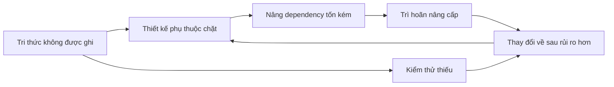
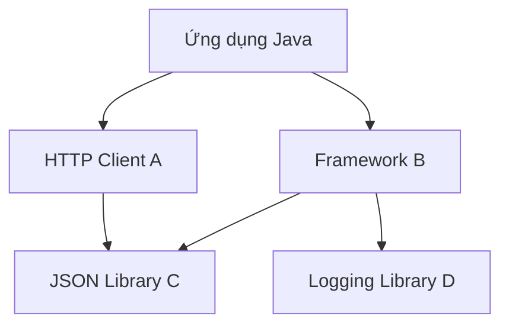
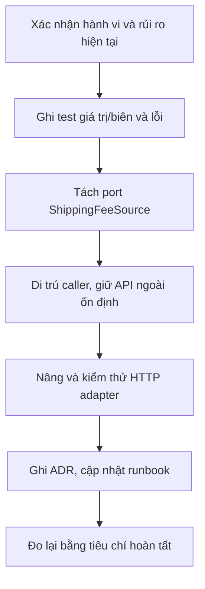

# Nợ trong thiết kế, kiểm thử, phụ thuộc và tri thức

Một chức năng báo giá vẫn hoạt động đúng hôm nay, nhưng mỗi lần thay nguồn phí vận chuyển, nhóm phải sửa ba lớp nghiệp vụ, chạy thủ công hàng chục kịch bản và hỏi một đồng nghiệp duy nhất về quy tắc tính tiền. Thư viện gọi dịch vụ ngoài đã lâu chưa cập nhật, khiến việc nâng JDK ngày càng khó. Các chi phí này không nhất thiết hiện ra trong số lỗi production hôm nay, nhưng chúng làm **những thay đổi trong tương lai chậm hơn, rủi ro hơn và khó dự đoán hơn**.

Đó là một cách nhận diện **nợ kỹ thuật** (*technical debt*). Trong chương **Nợ kỹ thuật** của **CODE_QUALITY_FUNDAMENTALS**, bài học này tập trung vào bốn nơi nợ thường tích tụ: **thiết kế, kiểm thử, phụ thuộc và tri thức**. Chủ đề gắn với mục tiêu của module: hiểu những thuộc tính quyết định mã nguồn có **đáng tin cậy, dễ hiểu và dễ thay đổi** hay không.

Nợ kỹ thuật không đồng nghĩa mọi đoạn mã xấu đều phải sửa ngay. Điều quan trọng là xác định **đánh đổi**, **chi phí phát sinh khi tiếp tục sử dụng**, **rủi ro** và **cách giảm nợ có thể kiểm chứng**.

## Mục tiêu học tập

Sau bài này, bạn có thể:

1. Phân biệt nợ kỹ thuật với lỗi phần mềm, yêu cầu tính năng và những lựa chọn thiết kế hợp lý.
2. Nhận diện nợ trong cấu trúc mã, mức độ bảo vệ của kiểm thử, dependency và tri thức vận hành.
3. Giải thích vì sao bốn loại nợ có thể khuếch đại tác động của nhau.
4. Ghi nhận nợ thành vấn đề cụ thể, có bằng chứng, người chịu trách nhiệm và điều kiện hoàn tất.
5. Ưu tiên xử lý theo tác động, tần suất thay đổi, xác suất sự cố và chi phí chuyển đổi thay vì chỉ dựa vào số lượng code smell.
6. Lập kế hoạch giảm nợ từng bước bằng Java refactoring, kiểm thử, quản lý dependency và tài liệu quyết định thiết kế.

## 1. Nợ kỹ thuật là gì?

Ẩn dụ “nợ” mô tả tình huống một lựa chọn hiện tại tiết kiệm thời gian hoặc công sức trước mắt nhưng có thể tạo **chi phí bổ sung** trong những lần sửa đổi, mở rộng, vận hành hoặc xử lý sự cố sau này.

Có thể hình dung:

- **Phần gốc** (*principal*): công sức cần bỏ ra để xử lý nguyên nhân hiện tại, ví dụ tách một lớp phụ thuộc chặt vào SDK.
- **“Lãi”** (*interest*): chi phí cộng thêm mà nhóm tiếp tục chịu khi chưa xử lý, ví dụ mỗi lần thay SDK lại phải sửa nhiều luồng nghiệp vụ.
- **Rủi ro tích tụ**: xác suất hoặc tác động sự cố tăng lên theo thời gian, ví dụ phụ thuộc không còn được hỗ trợ hoặc chỉ một người biết cách khôi phục dữ liệu.

Đây là **ẩn dụ quản trị**, không phải khoản vay tài chính có công thức lãi suất chuẩn. Phần gốc và “lãi” thường khó quy đổi chính xác thành tiền; có thể ước lượng bằng thời gian thay đổi, số lần phát sinh lỗi, gánh nặng vận hành hoặc mức rủi ro.

### Nợ có thể được tạo ra có chủ đích hoặc vô tình

| Cách hình thành | Ví dụ | Cách nhìn nhận |
| --- | --- | --- |
| **Đánh đổi có chủ đích** | Dùng adapter tạm để kịp tích hợp đối tác trong một mốc phát hành. | Có thể hợp lý nếu ghi phạm vi, thời điểm xem lại và kế hoạch loại bỏ. |
| **Thiếu thông tin ban đầu** | Khi thiết kế chưa biết sẽ có thêm nhiều nguồn tính phí. | Nợ có thể xuất hiện khi yêu cầu phát triển; không nhất thiết do quyết định ban đầu kém. |
| **Thiếu năng lực hoặc quy trình** | Mỗi tính năng được thêm nhưng không bổ sung test hay cập nhật dependency. | Nợ tăng đều nếu không có hàng rào duy trì. |
| **Thay đổi môi trường** | JDK, thư viện hoặc hạ tầng cũ hết hỗ trợ dù mã ứng dụng không đổi. | Nợ có thể phát sinh vì bối cảnh ngoài hệ thống thay đổi. |

Một quyết định từng hợp lý có thể **trở thành nợ** khi tần suất thay đổi, quy mô người dùng hoặc rủi ro vận hành đã khác trước.

### Phân biệt nợ kỹ thuật với các vấn đề khác

| Khái niệm | Câu hỏi chính | Ví dụ |
| --- | --- | --- |
| **Lỗi hiện hữu (bug)** | Phần mềm đang vi phạm hợp đồng nào? | Giỏ hàng 500.000 vẫn bị tính phí dù hợp đồng miễn phí từ ngưỡng đó. |
| **Tính năng còn thiếu** | Khả năng nào chưa được triển khai? | Chưa hỗ trợ tính phí theo khu vực mới. |
| **Nợ kỹ thuật** | Điều gì làm việc sửa, kiểm chứng hoặc vận hành sau này tốn kém/rủi ro hơn? | Quy tắc phí vận chuyển bị nhân bản ở bốn service, khiến mỗi thay đổi phải sửa bốn nơi. |
| **Lựa chọn thiết kế đơn giản có chủ đích** | Đã có bằng chứng cần cấu trúc phức tạp hơn chưa? | Một lớp nhỏ phụ thuộc trực tiếp vào một value object ổn định. |

Một vấn đề có thể nằm ở **nhiều nhóm**: quy tắc bị nhân bản là nợ thiết kế; khi một bản sao bị bỏ quên, nó đồng thời tạo bug. Nhưng **không nên gắn nhãn “nợ” để trì hoãn xử lý lỗi bảo mật hoặc mất dữ liệu đang xảy ra**. Những lỗi đó cần quy trình xử lý sự cố tương ứng.

## 2. Bốn nơi nợ kỹ thuật thường tích tụ

| Loại nợ | Dấu hiệu điển hình | “Lãi” phát sinh | Bằng chứng nên tìm |
| --- | --- | --- | --- |
| **Nợ thiết kế** | Cấu trúc phụ thuộc chặt, trách nhiệm lẫn lộn, quy tắc nhân bản. | Một thay đổi chạm nhiều lớp, khó thay adapter, dễ tạo lỗi dây chuyền. | Lịch sử sửa cùng file, vòng phụ thuộc, thời gian review, ca regression. |
| **Nợ kiểm thử** | Test thiếu nhánh lỗi, flaky, chỉ happy path, nhiều mock mô phỏng implementation. | Mỗi lần sửa phải kiểm thủ công, triển khai chậm, lỗi lọt qua. | Những kịch bản chưa có bằng chứng, tỷ lệ test thất thường, bug tái phát. |
| **Nợ phụ thuộc** | Dependency quá cũ, không còn hỗ trợ, phiên bản phân tán, khóa API cũ. | Khó nâng JDK, khó vá rủi ro, xung đột phiên bản, build khó tái hiện. | Danh mục direct/transitive dependency, release support, build và test nâng cấp. |
| **Nợ tri thức** | Quy tắc chỉ nằm trong đầu một người, runbook lỗi thời, thiếu lý do quyết định. | Onboarding chậm, xử lý sự cố phụ thuộc cá nhân, quyết định cũ bị lặp lại. | Câu hỏi lặp lại, tài liệu sai hành vi, thiếu ADR, thực hành vận hành chỉ truyền miệng. |

Các loại nợ thường **liên kết với nhau**. Nếu mã khó tách khỏi SDK cũ, việc nâng dependency đòi refactor lớn; vì test không đủ, nhóm không dám refactor; vì không ai biết lý do thiết kế, mọi người lại chọn cách vá tạm. Xử lý từng triệu chứng riêng lẻ có thể không cắt được vòng lặp.



Sơ đồ diễn đạt **một kiểu vòng lặp rủi ro**, không khẳng định mọi dự án đều đi theo đúng thứ tự đó.

## 3. Nợ thiết kế: mã chạy được nhưng khó thay đổi

Nợ thiết kế xuất hiện khi cấu trúc hiện tại buộc một thay đổi hợp lý phải **đụng đến nhiều trách nhiệm không liên quan** hoặc làm người sửa mã phải hiểu chi tiết đáng lẽ đã được che sau một ranh giới.

### Những dấu hiệu đáng điều tra

- Một lớp nghiệp vụ vừa tính toán vừa tự tạo HTTP client, gọi SQL và gửi email.
- Nhiều module import trực tiếp cùng một SDK hoặc DTO của dịch vụ ngoài.
- Quy tắc tính giá, quyền truy cập hoặc chuyển trạng thái bị lặp ở nhiều nơi.
- Những module đáng lẽ tách trách nhiệm lại phụ thuộc vòng vào nhau.
- Một phương thức dài chứa nhiều nhánh của các use case khác nhau.
- Chỉ thay công nghệ lưu trữ đã buộc sửa logic nghiệp vụ và hàng loạt kiểm thử.

**Không phải nhiều import hay nhiều dòng là bằng chứng tự thân.** Cần tìm tác động cụ thể: thời gian thay đổi tăng, loại thay đổi lặp lại, lỗi do sửa thiếu một nơi hoặc khó viết test vì các phụ thuộc bị gắn chặt.

### Ví dụ Java: logic báo giá gắn với chi tiết hạ tầng

Giả sử ứng dụng tính tổng gồm tiền hàng và phí vận chuyển. Bản thiết kế ban đầu có thể viết:

```java
// Ví dụ minh họa cấu trúc có nợ thiết kế.
// ShippingHttpClient là một adapter kỹ thuật được giả định có sẵn.
final class CheckoutService {
    private final ShippingHttpClient http = new ShippingHttpClient();

    long totalMinor(long goodsMinor, String zone) {
        long feeMinor = http.fetchShippingFee(zone);
        return goodsMinor + feeMinor;
    }
}
```

Đây là đoạn minh họa, **không phải ví dụ độc lập có thể biên dịch** nếu chưa có `ShippingHttpClient`. Nó cho thấy ba vấn đề:

1. `CheckoutService` tự tạo HTTP client, khiến unit test logic tổng tiền phụ thuộc kết nối và cấu hình thực tế.
2. Phép cộng có thể tràn `long` và không có kiểm tra giá trị âm theo hợp đồng.
3. Nếu đổi từ HTTP sang nguồn phí khác, chính lớp tính toán phải biết chi tiết chuyển đổi.

Mục tiêu sửa không phải thêm thật nhiều interface. Ta chỉ cần một **ranh giới nhỏ cho dữ liệu phí** mà ứng dụng thực sự cần.

### Tách chính sách ứng dụng khỏi adapter

**`CheckoutQuoteService.java` — ví dụ Java 17:**

```java
import java.util.Objects;

@FunctionalInterface
interface ShippingFeeSource {
    long feeMinorFor(String zone);
}

record CheckoutQuote(
        long goodsMinor,
        long shippingMinor,
        long totalMinor) {}

final class CheckoutQuoteService {
    private final ShippingFeeSource shippingFees;

    CheckoutQuoteService(ShippingFeeSource shippingFees) {
        this.shippingFees = Objects.requireNonNull(shippingFees);
    }

    CheckoutQuote quote(long goodsMinor, String zone) {
        if (goodsMinor < 0 || zone == null || zone.isBlank()) {
            throw new IllegalArgumentException("Invalid quote request");
        }

        long fee = shippingFees.feeMinorFor(zone);
        if (fee < 0) {
            throw new IllegalStateException("Invalid shipping fee");
        }

        return new CheckoutQuote(
                goodsMinor, fee, Math.addExact(goodsMinor, fee));
    }
}
```

Lúc chạy, adapter HTTP vẫn có thể cung cấp phí; nhưng **logic tính tổng** chỉ biết `ShippingFeeSource`. Điểm khởi tạo ứng dụng chịu trách nhiệm cung cấp implementation thực tế.

Giới hạn cần hiểu: tách interface **không** giải quyết việc adapter có thể timeout, trả dữ liệu sai hoặc dùng một kiểu tiền tệ khác. Hợp đồng của `ShippingFeeSource` còn phải quy định đơn vị tiền, lỗi và độ tin cậy; adapter cần kiểm thử tích hợp riêng. Trong ví dụ, tất cả giá trị được giả định cùng một đơn vị tiền nhỏ nhất và cùng loại tiền.

## 4. Nợ kiểm thử: thiếu bằng chứng để thay đổi tự tin

Nợ kiểm thử không chỉ là “chưa đạt 80% code coverage”. Nó xảy ra khi **hệ thống thiếu bằng chứng đủ tin cậy** để sửa đổi hoặc phát hành mà không phải dựa vào thử thủ công, đoán hành vi hoặc chấp nhận nguy cơ tái phát lỗi.

### Một số biểu hiện

| Biểu hiện | Hệ quả có thể thấy | Hướng cải thiện |
| --- | --- | --- |
| Chỉ test đường thành công. | Lỗi ở input biên, timeout và chuyển trạng thái sai. | Viết negative/boundary tests theo hợp đồng. |
| Test chỉ kiểm `not null` hoặc status `200`. | Kết quả sai nhưng test vẫn xanh. | Kiểm chứng giá trị, bất biến, mã lỗi và tác dụng phụ. |
| Test dùng quá nhiều mock phản chiếu implementation. | Refactor nội bộ làm test hỏng dù hành vi không đổi. | Test qua API/port rõ nghĩa; mock đúng ranh giới. |
| Test flaky do thời gian, mạng, dữ liệu chung. | Nhóm mất niềm tin và bắt đầu bỏ qua CI. | Clock được tiêm vào, dữ liệu cô lập, môi trường xác định. |
| Không có test tích hợp ở ranh giới quan trọng. | Adapter và DB sai dù unit test xanh. | Contract/integration tests cho giao thức, schema, transaction. |
| Test chạy quá lâu nên hiếm được chạy. | Phản hồi chậm, lỗi chỉ lộ gần phát hành. | Phân tầng kiểm thử nhanh/chậm, chọn phạm vi hợp lý. |

### JUnit 5: tăng bằng chứng mà không phụ thuộc HTTP thật

Từ `CheckoutQuoteService` ở mục 3, ta có thể viết những test có expected **độc lập với implementation**:

```java
import static org.junit.jupiter.api.Assertions.*;

import java.util.concurrent.atomic.AtomicInteger;
import org.junit.jupiter.api.Test;

class CheckoutQuoteServiceTest {

    @Test
    void calculatesTotalFromGoodsAndShipping() {
        ShippingFeeSource source = zone -> {
            assertEquals("LOCAL", zone);
            return 15_000L;
        };
        CheckoutQuoteService service = new CheckoutQuoteService(source);

        assertEquals(
                new CheckoutQuote(100_000L, 15_000L, 115_000L),
                service.quote(100_000L, "LOCAL"));
    }

    @Test
    void rejectsInvalidRequestBeforeCallingExternalPort() {
        AtomicInteger calls = new AtomicInteger();
        ShippingFeeSource source = zone -> {
            calls.incrementAndGet();
            return 15_000L;
        };
        CheckoutQuoteService service = new CheckoutQuoteService(source);

        assertThrows(IllegalArgumentException.class,
                () -> service.quote(-1L, "LOCAL"));
        assertThrows(IllegalArgumentException.class,
                () -> service.quote(100L, " "));
        assertEquals(0, calls.get());
    }

    @Test
    void rejectsInvalidFeeAndOverflow() {
        CheckoutQuoteService invalid = new CheckoutQuoteService(
                zone -> -1L);
        assertThrows(IllegalStateException.class,
                () -> invalid.quote(100L, "LOCAL"));

        CheckoutQuoteService overflow = new CheckoutQuoteService(
                zone -> 1L);
        assertThrows(ArithmeticException.class,
                () -> overflow.quote(Long.MAX_VALUE, "LOCAL"));
    }
}
```

Những test này xác minh **tính tổng, đầu vào sai, giá trị trả về không hợp lệ và tràn số** mà không cần dựng HTTP server. Chúng giúp giảm chi phí thử tay khi sửa logic. Nhưng fake `ShippingFeeSource` không chứng minh nguồn phí HTTP thật trả đúng cấu trúc, đơn vị và mã lỗi; phần đó phải được bảo vệ tại adapter bằng kiểm thử contract hoặc integration phù hợp.

### Kiểm thử cần độc lập với quyết định triển khai

Một test chỉ khẳng định “`http.fetchShippingFee()` được gọi đúng một lần” có thể gắn chặt với cách cài đặt, trong khi hợp đồng chỉ yêu cầu tổng tiền đúng. Khi cache được thêm vào, một số request không còn gọi HTTP nhưng hành vi vẫn đúng. Test nên khẳng định **những lời hứa thật sự cần giữ**; các lời gọi nội bộ chỉ nên bị kiểm tra nếu tần suất hoặc tác dụng phụ của chúng là một phần hợp đồng.

### Characterization test khi chưa hiểu mã cũ

Với legacy code không có test, trước khi refactor có thể ghi lại các trường hợp **hành vi đang quan sát** (*characterization tests*). Mục đích là phát hiện những thay đổi ngoài ý muốn trong quá trình di trú.

Tuy nhiên, characterization test **không tự xác nhận hành vi cũ đúng nghiệp vụ**. Nếu mã cũ tính phí sai ở ngưỡng, test ghi nhận giá trị sai chỉ nên đóng vai trò công cụ di trú có nhãn rõ; khi xác nhận yêu cầu đúng, cần tạo test theo hợp đồng và sửa bug riêng.

## 5. Nợ phụ thuộc: rủi ro nằm ngoài phần mã do nhóm viết

Ứng dụng Java sử dụng JDK, framework, thư viện và plugin build. Mỗi dependency có thể kéo theo **transitive dependencies** (phụ thuộc gián tiếp). Khi chúng già đi hoặc không tương thích, chi phí thay đổi và xử lý sự cố có thể tăng dù code ứng dụng ít thay đổi.

### Những dạng nợ phụ thuộc cần phân biệt

- **Thư viện không còn được hỗ trợ:** không có bản vá hoặc hướng dẫn tương thích mới.
- **Phiên bản quá xa bản có thể nâng:** mỗi bước nâng cấp lớn có nhiều thay đổi API và hành vi.
- **Phụ thuộc gián tiếp không được quan sát:** một thư viện kéo theo nhiều thành phần không ai biết đang hiện diện.
- **Xung đột phiên bản:** hai nhánh dependency cần những phiên bản không tương thích của cùng một thư viện.
- **Build thiếu khả năng tái hiện:** phiên bản động hoặc quy trình lấy artifact khiến hai lần build cùng commit có thể tạo ra dependency graph khác nhau.
- **Mã ứng dụng gắn trực tiếp với API đặc thù của thư viện:** đổi provider phải sửa rộng trong logic nghiệp vụ.

Không phải mọi phiên bản cũ đều đã có lỗ hổng khai thác được. Ngược lại, một bản thư viện “mới nhất” không tự động an toàn hoặc tương thích. Cần đánh giá **phiên bản thực tế, môi trường sử dụng, đường khai thác, mức hỗ trợ và khả năng nâng cấp**.

### Phụ thuộc trực tiếp và gián tiếp



Một bản sửa ở thư viện JSON C có thể đòi đánh giá tác động qua cả A và B. Do đó chỉ xem danh sách `implementation(...)` trực tiếp là chưa đủ.

### Quy trình nhận diện và xử lý

1. **Lập danh mục dependency hiện đang dùng.** Gồm direct, transitive, JDK, runtime và plugin build khi có liên quan; có thể dùng dependency report hoặc SBOM.
2. **Xác định mức hỗ trợ và rủi ro.** Đối chiếu thông tin nhà phát hành, thay đổi API, thông báo bảo mật và chính sách hỗ trợ.
3. **Đánh giá khả năng bị ảnh hưởng.** Một advisory không mặc nhiên đồng nghĩa mọi ứng dụng sử dụng thư viện đều khai thác được; cần xem phiên bản, cấu hình và đường gọi có liên quan.
4. **Chọn lộ trình nâng cấp.** Thử nâng từng nhóm hợp lý, tránh thay đồng thời toàn bộ runtime và framework nếu khó cô lập nguyên nhân.
5. **Chạy test theo ranh giới.** Unit, adapter contract, integration, schema, serialization và các kịch bản vận hành có tác động.
6. **Đánh giá khả năng rollback.** Khi đổi protocol hoặc schema, quay về phiên bản cũ có còn an toàn không?
7. **Gỡ dependency không còn dùng.** Không chỉ cập nhật phiên bản; giảm bề mặt phụ thuộc cũng có thể là mục tiêu.

### Một ví dụ lệnh kiểm tra, không phải yêu cầu chạy trong bài học

Với dự án dùng Gradle, có thể kiểm tra một dependency trong cấu hình runtime:

```shell
./gradlew dependencyInsight --dependency example-client --configuration runtimeClasspath
```

Đây là **lệnh minh họa**: `example-client` là tên placeholder cần thay bằng dependency thực, và cấu hình `runtimeClasspath` có thể khác tùy module. Tập công cụ khác (Maven, hệ thống quản lý SBOM) có thao tác tương ứng. Kết quả dependency graph chỉ giúp biết đang dùng gì; nó **không tự chứng minh** code đã an toàn hay tương thích.

### Không chữa nợ phụ thuộc bằng cách vô hiệu hóa kiểm tra

Nếu một lần nâng cấp làm test lỗi, việc tắt test, khóa cảnh báo hoặc vô hiệu hóa kiểm tra chữ ký/tính toàn vẹn chỉ để build xanh thường **chuyển nợ từ phụ thuộc sang kiểm thử và an toàn chuỗi cung ứng**.

Thay vào đó, cần xác định lỗi do API thay đổi, hành vi khác, cấu hình mới, dữ liệu test không phù hợp hay thực sự có hồi quy. Việc hoãn nâng cấp có thể hợp lý trong một thời gian, nhưng phải ghi **mức rủi ro và thời hạn xem lại**, không chỉ “để sau”.

## 6. Nợ tri thức: hệ thống không chỉ gồm source code

Một hệ thống có thể có code sạch và test tốt nhưng vẫn khó bảo trì nếu những quyết định cốt lõi không được ghi lại. Ví dụ:

- Chỉ một người biết vì sao không được retry một loại giao dịch thanh toán.
- Một ngưỡng tính phí được lưu trong config nhưng không ai biết nguồn phê duyệt.
- Runbook khôi phục dữ liệu mô tả tên bảng cũ; khi có sự cố mới phát hiện không dùng được.
- Người mới không biết service nào sở hữu dữ liệu khách hàng hoặc cách phát hành API tương thích.
- Mọi cuộc họp lại tranh luận lại quyết định từng được giải quyết nhưng chưa có lý do hay đánh đổi.

**Nợ tri thức** là chi phí và rủi ro do những thông tin cần cho phát triển/vận hành **khó tìm, lỗi thời, chỉ tồn tại truyền miệng hoặc không có người sở hữu**.

### Không phải cứ thiếu tài liệu là có nợ

Một helper nhỏ có tên và test rõ ràng có thể không cần một trang tài liệu riêng. Tài liệu dài nhưng lặp code hoặc đã lỗi thời còn nguy hiểm hơn việc không có nó.

Thông tin nên được ghi khi nó **không thể suy ra an toàn chỉ từ mã**, hoặc khi người khác cần biết nó để đưa ra quyết định:

| Loại tri thức | Ví dụ cần ghi | Vị trí thường phù hợp |
| --- | --- | --- |
| **Hợp đồng công khai** | Input, output, mã lỗi, trạng thái và giới hạn. | API spec, JavaDoc, contract test. |
| **Bất biến nghiệp vụ** | Tại sao phí không thể âm, thời điểm chốt giá. | Domain type, test, tài liệu nghiệp vụ ngắn. |
| **Lý do kiến trúc** | Tại sao chọn đồng bộ thay vì event cho thao tác thanh toán. | Architecture Decision Record (ADR). |
| **Quy trình vận hành** | Bước giảm tải hoặc khôi phục khi upstream lỗi. | Runbook có quyền truy cập phù hợp. |
| **Phụ thuộc và sở hữu** | Service nào sở hữu schema, ai duyệt thay contract. | Service catalog, module ownership. |
| **Cách xây dựng/phát hành** | Lệnh build, môi trường, điều kiện rollback. | Hướng dẫn phát triển và CI/CD được xác minh. |

**Cốt lõi:** ghi đúng thông tin cho **đúng người cần dùng**, đúng nơi họ tìm và với một cách để biết nó còn hiệu lực.

### ADR: ghi quyết định, không chỉ kết quả

Một ADR nhỏ có thể viết:

```markdown
# ADR-007: Tách nguồn phí vận chuyển khỏi logic báo giá

Trạng thái: Accepted
Ngày: 2026-11-16

## Bối cảnh
Logic báo giá tự tạo HTTP client. Test nghiệp vụ cần mạng
và việc đổi nhà cung cấp làm sửa lớp tính tổng.

## Quyết định
CheckoutQuoteService phụ thuộc ShippingFeeSource.
Adapter HTTP triển khai hợp đồng này ở lớp hạ tầng.

## Lý do và đánh đổi
Unit test tách khỏi mạng; có thêm một interface và wiring.
Không thay đổi contract API báo giá ngoài hệ thống.

## Hệ quả và kiểm chứng
Test giá trị, lỗi đầu vào và overflow ở tầng ứng dụng.
Test mapping HTTP/status/timeout ở adapter.

## Xem lại khi
Có nhiều loại tiền tệ hoặc quy tắc chốt giá thay đổi.
```

Đây là tài liệu **giả định trong ví dụ**, không phải quyết định đã được một tổ chức cụ thể phê duyệt. ADR nên có trạng thái như *Proposed*, *Accepted*, *Superseded* tùy quy ước và liên kết bản thay thế khi quyết định đổi. Không xóa lịch sử lý do chỉ để tài liệu trông “sạch”.

### Tránh tạo nợ tài liệu mới

Tài liệu có thể lệch code (*documentation drift*). Vì vậy:

- Đặt người chịu trách nhiệm cho tài liệu hoặc runbook quan trọng.
- Liên kết tài liệu với test/hợp đồng có thể kiểm tra khi phù hợp.
- Review tài liệu trong cùng thay đổi làm ảnh hưởng hành vi.
- Ghi phạm vi phiên bản, feature flag và môi trường khi cần.
- Diễn tập runbook có rủi ro lớn; không chỉ đọc mà tin là nó chạy đúng.
- Không đưa mật khẩu, token hoặc dữ liệu nhạy cảm vào ADR/runbook để “giúp vận hành tiện hơn”.

Tri thức nên được **chia sẻ và có thể kiểm chứng**, không chỉ chuyển sự phụ thuộc từ một người sang một tài liệu có nguy cơ bị bỏ quên.

## 7. Bốn loại nợ tương tác trong một thay đổi Java

Giả sử team được giao thay nhà cung cấp phí vận chuyển:

| Trạng thái hiện tại | Điều xảy ra khi thay nhà cung cấp |
| --- | --- |
| **Thiết kế:** service tự khởi tạo SDK ở nhiều lớp. | Phải thay API của SDK ở nhiều file, có nguy cơ sót nhánh. |
| **Kiểm thử:** test chỉ kiểm tổng dương. | Khó biết cách đổi làm tính sai giá hay sai tiền tệ; phải kiểm thủ công. |
| **Phụ thuộc:** SDK cũ còn kéo theo serializer đời cũ. | Nâng một SDK kéo theo thay đổi dependency graph và cách parse dữ liệu. |
| **Tri thức:** không ghi cách xử lý timeout và retry. | Người thay dễ mặc định retry khi lỗi dù giao dịch có tác dụng phụ. |

Nếu chỉ thay SDK, phần còn lại của vòng rủi ro vẫn tồn tại. Một kế hoạch có tính hệ thống hơn:

1. Xác nhận hợp đồng và những hành vi bắt buộc giữ: đơn vị tiền, ngưỡng, lỗi và tác dụng phụ.
2. Viết test cho hành vi quan trọng trước khi thay hạ tầng.
3. Tạo một ranh giới port/adapter có mục đích rõ ràng nếu nó giảm phạm vi thay đổi.
4. Nâng dependency và kiểm tra cách mapping JSON, lỗi, timeout ở adapter.
5. Ghi lại quyết định về retry, tiền tệ và cách rollback; cập nhật runbook.

Không phải mọi thay đổi đều cần làm đủ năm bước với cùng độ sâu. Mức kiểm chứng phải tương xứng với rủi ro; nhưng **một thay đổi tốt nên giảm ít nhất một nguyên nhân gốc, không chỉ chuyển nợ sang một chỗ khác**.

## 8. Làm sao biết một khoản nợ đáng ưu tiên?

Một backlog nợ kỹ thuật có hàng chục mục “refactor class X”, “viết lại test”, “nâng framework”. Nếu không có tác động và bằng chứng, rất khó quyết định thứ tự.

### Ưu tiên theo chi phí và rủi ro

Một cách thảo luận có cấu trúc là xét:

1. **Mức tác động:** nợ có ảnh hưởng đến tiền, dữ liệu, bảo mật, tính sẵn sàng hoặc năng suất nhóm không?
2. **Tần suất đụng chạm:** khu vực mã có thường xuyên phải thay đổi hoặc bị lỗi không?
3. **Chi phí phát sinh:** mỗi lần sửa thêm bao nhiêu công sức, test tay hoặc xử lý sự cố?
4. **Rủi ro trì hoãn:** dependency hết hỗ trợ, nhân sự chuyển nhóm, deadline tương thích hoặc tăng lưu lượng có làm vấn đề nghiêm trọng hơn không?
5. **Chi phí giảm nợ:** có thể xử lý theo bước nhỏ không; cần migration dữ liệu hoặc đổi hợp đồng công khai không?
6. **Độ tin cậy của bằng chứng:** có số liệu/ca lỗi cụ thể hay chỉ là cảm giác “code hơi xấu”?

### Ví dụ ma trận ưu tiên

| Khoản nợ minh họa | Bằng chứng | Mức ưu tiên có thể hợp lý |
| --- | --- | --- |
| Luồng hoàn tiền không có test retry sau timeout. | Có giao dịch quan trọng, chưa có kiểm chứng idempotency. | Cao vì hậu quả sai có thể lớn. |
| Một thư viện xác thực đã hết hỗ trợ. | Nhà phát hành công bố dừng hỗ trợ; ứng dụng dùng ở ranh giới xác thực. | Cao; đánh giá lộ trình nâng cấp và biện pháp giảm thiểu sớm. |
| Báo giá phải sửa năm file cùng nhau cho một quy tắc. | Nhiều PR gần đây cùng thay năm file và từng bỏ sót test. | Trung bình/cao tùy tần suất và tác động. |
| Một helper có sáu tham số nhưng rõ nghĩa, ít thay. | Chưa có sai sót hoặc thay đổi lặp lại liên quan. | Thấp; có thể chưa cần refactor. |
| Runbook xử lý mất kết nối DB đã lỗi thời. | Diễn tập không thành công, thời gian khôi phục kéo dài. | Cao nếu ảnh hưởng phục hồi production. |

Các mức trên chỉ là **đánh giá định tính trong ví dụ**. Không có bảng điểm hay công thức nào thay được quyết định dựa trên bối cảnh hệ thống thực.

### Ước lượng “lãi” theo thay đổi

Giả sử một nhóm quan sát thấy việc sửa quy tắc phí phát sinh trung bình **2 giờ công việc bổ sung** vì phải cập nhật nhiều bản sao. Nếu cùng loại thay đổi xuất hiện **10 lần mỗi năm**, có thể ước lượng sơ bộ:

```text
Chi phí bổ sung dự kiến theo quan sát
    ≈ 2 giờ/thay đổi × 10 thay đổi/năm
    ≈ 20 giờ/năm
```

Đây là **ước lượng minh họa** dựa trên giả định, không phải dự báo chắc chắn hay phép tính ROI hoàn chỉnh. Số thay đổi tương lai có thể khác; chi phí sửa một lần có thể biến động; rủi ro lỗi, review, cơ hội bị trì hoãn và hiệu quả của refactor cũng cần được cân nhắc.

Một khoản nợ có “lãi thời gian” nhỏ vẫn cần ưu tiên cao nếu hậu quả của một lỗi là mất dữ liệu, rò rỉ bí mật hoặc tạo giao dịch trùng.

## 9. Ghi nợ thành mục có thể hành động

Mục ghi nhận kém:

> “Checkout code rất xấu, phải rewrite.”

Nó không nêu lỗi cụ thể, ảnh hưởng hay tiêu chí hoàn tất.

Một mẫu ghi nhận hữu ích:

| Trường | Nội dung ví dụ |
| --- | --- |
| **ID** | `DEBT-CHECKOUT-07`. |
| **Loại nợ** | Thiết kế + kiểm thử. |
| **Vị trí** | `CheckoutService` và adapter phí vận chuyển. |
| **Triệu chứng** | Mỗi lần thay phí phải sửa nhiều lớp; unit test cần mạng. |
| **Bằng chứng** | Hai lần sửa gần đây gây regression do thiếu nhánh; test không chạy offline. |
| **Tác động** | Thời gian phát triển tăng, xác suất tính tổng sai khi đổi nguồn phí. |
| **Nguyên nhân nghi ngờ** | Mã nghiệp vụ trực tiếp tạo và dùng HTTP client. |
| **Phương án** | Tách `ShippingFeeSource`, thêm test giá trị và lỗi, adapter contract test. |
| **Đánh đổi** | Tăng một interface và wiring; không đổi API công khai. |
| **Người chịu trách nhiệm** | Chủ sở hữu module/nhóm được phân công. |
| **Điều kiện hoàn tất** | Test chạy offline; đổi nguồn phí chỉ sửa adapter/wiring; hành vi API giữ nguyên. |
| **Thời điểm xem lại** | Trước đợt đổi nhà cung cấp hoặc kỳ lập kế hoạch tiếp theo. |

Điều kiện hoàn tất nên là **kết quả quan sát được**, không phải một câu “đã refactor sạch”. Ví dụ “không cần sửa lớp tính tiền để đổi adapter” kiểm chứng cụ thể hơn “kiến trúc tốt hơn”.

### Có thể dùng những tín hiệu nào?

| Tín hiệu | Đối tượng mà nó gợi ý | Giới hạn |
| --- | --- | --- |
| Số file thường thay cùng nhau. | Coupling hoặc quy tắc nhân bản. | Một thay đổi tính năng lớn có thể hợp lý khi sửa nhiều file. |
| Branch coverage, mutation test. | Khoảng thiếu trong test và chất lượng assertion. | Coverage cao không chứng minh mọi hợp đồng đúng. |
| Flaky-test rate, thời gian CI. | Nợ kiểm thử và phản hồi chậm. | Cần tách nguyên nhân hạ tầng với test design. |
| Dependency age/support/advisory. | Nợ phụ thuộc và rủi ro cập nhật. | Thư viện cũ không tự động có lỗ hổng khai thác. |
| Thời gian onboarding, câu hỏi lặp. | Nợ tri thức. | Có thể chịu ảnh hưởng tổ chức, không chỉ tài liệu. |
| Thời gian sửa lỗi, tỷ lệ rollback. | “Lãi” của nợ và rủi ro vận hành. | Nhiều yếu tố khác cũng ảnh hưởng. |

**Không tối ưu một con số đến mức mất mục tiêu thực.** Đưa coverage lên 100% bằng test yếu, đóng tất cả cảnh báo dependency bằng suppression hoặc tạo hàng trăm trang tài liệu không ai dùng có thể làm dashboard đẹp hơn nhưng nợ thực tế chưa giảm.

## 10. Chọn chiến lược trả nợ phù hợp

Không phải mọi khoản nợ đều cần “viết lại hệ thống”.

### Trả nợ ngay khi chạm vào khu vực mã

Nếu đang sửa tính năng ở một lớp có logic lặp, có thể kết hợp một **refactor nhỏ được kiểm thử** với thay đổi cần thiết. Phù hợp khi chi phí thêm nhỏ, ranh giới rõ và test đủ để bảo vệ hành vi.

Ví dụ: đang thêm khu vực phí mới, trước hết đưa quy tắc tính phí dùng chung về một chính sách duy nhất rồi thêm test biên. Nhưng nên giữ **refactor không đổi hành vi** và **thay đổi nghiệp vụ** thành những bước có thể review/rollback riêng khi rủi ro cao.

### Đợt giảm nợ có kế hoạch

Khi cần nâng framework, thay thư viện đã hết hỗ trợ hoặc tách module có chu trình lớn, có thể cần công việc chuyên biệt với mục tiêu, mốc kiểm chứng và ngân sách rõ ràng.

Nên có các bước trung gian có giá trị độc lập:

- Viết test hiện trạng và hợp đồng.
- Chuyển một consumer sang interface mới.
- Đưa phiên bản dependency lên một nhánh hỗ trợ.
- Cập nhật một runbook và diễn tập lại.

Tránh dự án “rewrite toàn bộ” kéo dài mà **không có bước nào chứng minh rủi ro đã giảm**.

### Chấp nhận nợ có chủ đích

Đôi khi chưa nên xử lý ngay vì:

- Khu vực mã sắp được loại bỏ.
- Chi phí refactor hiện tại lớn hơn lợi ích dự kiến trong thời gian còn sử dụng.
- Cần đợi hợp đồng ngoài hệ thống ổn định để tránh làm lại.
- Tồn tại rủi ro nhưng đã có giới hạn sử dụng và biện pháp giảm thiểu tạm thời.

**Chấp nhận nợ không có nghĩa bỏ quên**. Cần ghi lý do, điều kiện xem lại và người chịu trách nhiệm. Nếu nợ liên quan lỗ hổng đã khai thác hoặc nguy cơ mất dữ liệu cấp bách, phải dùng quy trình ứng phó phù hợp chứ không viện “nợ chưa đến hạn”.

## 11. Một kế hoạch giảm nợ theo từng bước cho Java

Giả sử mục tiêu là giảm nợ ở luồng báo giá đã mô tả:



### Bước 1 — Xác nhận hợp đồng

Trước khi sửa code, cần biết:

- Tiền hàng và phí vận chuyển theo đơn vị nào, có cùng loại tiền không?
- Giá trị 0 có nghĩa miễn phí thật hay lỗi upstream?
- Khi upstream timeout, hệ thống trả lỗi hay fallback; có cho phép dùng dữ liệu cũ không?
- Có tác dụng phụ nào khi “chỉ tính báo giá” không?
- API báo giá có phải giữ schema và mã lỗi hiện tại không?

Đây là nơi phát hiện **nợ tri thức**. Nếu những câu hỏi không có câu trả lời, việc tách lớp quá sớm có thể chỉ cố định một hợp đồng đang bị hiểu sai.

### Bước 2 — Đặt bằng chứng kiểm thử

Viết test theo hợp đồng thay vì theo chi tiết HTTP client. Test giá trị, đầu vào sai, lỗi upstream, tràn số và nếu cần cả lỗi serialize/deserialize. Tách:

- Unit test cho phép tính và chính sách trong `CheckoutQuoteService`.
- Adapter/contract test cho HTTP request-response, tiền tệ, timeout.
- Integration test cho hành vi phụ thuộc dữ liệu hoặc transaction thực.

**Đừng biến test “ghi nhận hiện trạng” thành yêu cầu nghiệp vụ** khi có nghi ngờ mã cũ sai.

### Bước 3 — Thay một ranh giới, không đổi mọi thứ cùng lúc

Cho `CheckoutQuoteService` nhận `ShippingFeeSource`, giữ adapter HTTP ở tầng hạ tầng. Tại điểm khởi động, tạo implementation và truyền vào service. Nếu dùng framework DI, nguyên tắc tương tự; không bắt buộc dùng một framework cụ thể.

### Bước 4 — Nâng dependency và xác minh

Kiểm tra phiên bản client, cách xử lý lỗi, serialization, timeout, pool và cấu hình TLS theo hợp đồng. Chạy test adapter với stub phù hợp rồi test tích hợp nơi có thể. Không dùng kết quả unit test giả để kết luận HTTP provider thật vẫn tương thích.

### Bước 5 — Chuyển tri thức thành tài sản dùng được

Ghi ADR ngắn về hướng phụ thuộc và đánh đổi, cập nhật ví dụ tích hợp, hướng dẫn xử lý lỗi upstream và phương án rollback. Liên kết những phần có thể thực thi với test hoặc CI để giảm nguy cơ tài liệu lỗi thời.

### Bước 6 — Đánh giá nợ đã giảm thật chưa

Một số tiêu chí có thể kiểm chứng:

| Trước | Sau kỳ vọng | Cách kiểm chứng |
| --- | --- | --- |
| Unit test cần HTTP thực. | Logic báo giá test offline. | Chạy `CheckoutQuoteServiceTest` không khởi tạo HTTP server. |
| Đổi provider phải sửa service nghiệp vụ. | Chỉ adapter/wiring thay đổi nếu hợp đồng giữ nguyên. | Thử thay fake/adapter khác trong build thử. |
| Không biết logic timeout thuộc ai. | Hợp đồng lỗi có owner và test. | Xem ADR/contract test và thực hiện kịch bản timeout. |
| Dependency cũ không được theo dõi. | Có danh mục version, trạng thái hỗ trợ và lộ trình nâng. | Review dependency report và kết quả kiểm thử nâng cấp. |
| Quy tắc tiền tệ chỉ truyền miệng. | Đơn vị và giới hạn được ghi và kiểm tra. | Test giá trị, adapter mapping và tài liệu hợp đồng. |

Nếu chỉ chuyển HTTP client sang một lớp khác nhưng mọi service vẫn import DTO SDK cũ và test vẫn chỉ happy path, kết quả có thể mới là **đổi vị trí nợ**, chưa giải quyết nguyên nhân.

## 12. Ngăn nợ mới tích tụ nhanh hơn tốc độ trả

Giảm nợ sẽ không bền nếu mỗi tính năng mới lặp lại cùng cách gây nợ.

### Hàng rào ở thời điểm phát triển

1. **Review ranh giới trách nhiệm:** module nghiệp vụ không cần biết chi tiết HTTP/DB trừ khi có lý do rõ.
2. **Thêm test cho rủi ro thực:** input biên, trạng thái, lỗi, tác dụng phụ và hợp đồng ngoài.
3. **Kiểm tra dependency trong CI:** biết những thành phần mới được đưa vào và thay đổi phiên bản quan trọng.
4. **Ghi quyết định khác thường:** tại sao chọn cách tạm, nợ nào được chấp nhận và điều kiện xem lại.
5. **Duy trì ownership:** biết ai chịu trách nhiệm về module, runbook và contract.
6. **Đo sự thay đổi theo thời gian:** thời gian kiểm thử, flakiness, lỗi tái phát và chi phí nâng cấp.

Không cần biến tất cả thành gate cứng. Một dự án nhỏ có thể bắt đầu bằng checklist review và vài phép kiểm tra đáng tin; dự án có hệ quả bảo mật hoặc giao dịch lớn cần thêm ràng buộc tự động tương xứng.

### Tránh tạo “nợ quy trình”

Nếu quy trình đòi điền một biểu mẫu dài cho mọi thay đổi nhỏ, tài liệu sẽ nhanh chóng bị làm cho có. Tập trung vào **thông tin giúp quyết định và kiểm chứng**: điều gì đang đánh đổi, ai bị ảnh hưởng, khi nào phải xem lại, và bằng chứng nào cho thấy vấn đề đã được giải quyết.

## 13. Những ngộ nhận phổ biến

**“Nợ kỹ thuật chỉ là code xấu.”** Nợ còn nằm trong kiểm thử thiếu tin cậy, dependency khó nâng và tri thức vận hành không được bảo tồn.

**“Càng nhiều interface càng ít nợ.”** Abstraction thừa cũng có chi phí. Chỉ tách khi nó tạo ranh giới có ý nghĩa và giảm tác động thay đổi.

**“Test coverage cao nghĩa là không có nợ kiểm thử.”** Test có thể chạy nhiều dòng nhưng assertion yếu, bỏ qua lỗi tích hợp và dễ flaky.

**“Thư viện cũ đồng nghĩa có lỗ hổng.”** Cần xác minh advisory, phiên bản, đường sử dụng và hỗ trợ thực tế; không đánh đồng tuổi với mức bị khai thác.

**“Nâng tất cả dependency lên bản mới nhất là hết nợ.”** Có thể phát sinh thay đổi API, rủi ro tương thích và test mới cần thiết. Mục tiêu là phiên bản được hỗ trợ, phù hợp và có bằng chứng an toàn.

**“Viết thật nhiều tài liệu là trả được nợ tri thức.”** Tài liệu không có owner, không truy cập được hoặc không còn khớp hành vi chỉ chuyển sự phụ thuộc từ người sang văn bản.

**“Nợ luôn do lập trình viên cẩu thả.”** Nợ có thể là đánh đổi có chủ đích hoặc hệ quả của yêu cầu và môi trường thay đổi.

**“Cần trả hết nợ trước khi làm tính năng.”** Không thực tế với nhiều hệ thống. Nên ưu tiên theo tác động và kết hợp giảm nợ trong những khu vực sẽ tiếp tục thay đổi.

**“Rewrite toàn bộ là cách chắc chắn sạch nợ.”** Viết lại có thể làm mất tri thức nghiệp vụ, đưa vào lỗi mới và trì hoãn giá trị. Cần các mốc kiểm chứng và đánh giá chi phí chuyển đổi.

**“Nợ được đóng khi ticket chuyển Done.”** Cần chứng minh hành vi, khả năng nâng cấp hoặc chi phí thay đổi đã được cải thiện theo tiêu chí chấp nhận.

## 14. Checklist đánh giá một khoản nợ mới

Khi thấy một đoạn mã khó hiểu hoặc một công cụ báo cảnh báo, hãy trả lời:

1. **Vấn đề cụ thể là gì?** Thiết kế, kiểm thử, phụ thuộc, tri thức hay kết hợp?
2. **Có phải bug cần xử lý ngay không?** Có vi phạm hợp đồng, mất dữ liệu hoặc nguy cơ bảo mật cấp bách không?
3. **Chi phí nào đang phát sinh?** Thời gian sửa, test thủ công, incident, on-call hay lộ trình nâng JDK?
4. **Có bằng chứng không?** PR lặp, test flaky, advisory, runbook diễn tập thất bại hoặc phản hồi người dùng?
5. **Nếu chưa sửa sẽ ra sao?** Trong ba tháng tới có thay đổi, tăng tải, deadline hỗ trợ hay chuyển giao nhân sự không?
6. **Giảm nợ ở ranh giới nào là đủ?** Có thể sửa một nguồn quy tắc, thêm test hay adapter thay vì rewrite không?
7. **Những tác động phụ của việc sửa?** API compatibility, migration dữ liệu, build, môi trường và rủi ro triển khai?
8. **Cách xác minh hoàn tất?** Những test, chỉ số hoặc thao tác bảo trì nào sẽ chứng minh cải thiện?
9. **Ai sở hữu và khi nào xem lại?** Nếu chấp nhận trì hoãn, lý do và thời điểm phải rõ.
10. **Làm sao tránh tái tích tụ?** Review, test, dependency policy, ADR hoặc cải thiện quy trình nào có ích?

## 15. Câu hỏi tự kiểm tra

**Câu 1.** Một lớp Java tự tạo HTTP client và khó kiểm thử offline. Đây có phải là nợ kỹ thuật?

*Gợi ý:* Có thể là nợ thiết kế nếu cấu trúc làm mỗi lần đổi provider tốn công hoặc gây lỗi; cũng có thể tạo nợ kiểm thử. Cần bằng chứng về chi phí/rủi ro chứ không chỉ thấy từ khóa `new`.

**Câu 2.** Dự án có 90% line coverage nhưng không test trường hợp thanh toán timeout sau khi provider đã xử lý. Vì sao có thể vẫn có nợ kiểm thử?

*Gợi ý:* Coverage không chứng minh mọi hợp đồng hoặc tình huống lỗi quan trọng. Rủi ro retry tạo giao dịch trùng có thể chưa được kiểm chứng ở cấp tích hợp.

**Câu 3.** Một thư viện đã nhiều năm không nâng cấp nhưng vẫn được nhà phát hành hỗ trợ và chạy đúng. Có cần ưu tiên thay ngay?

*Gợi ý:* Không thể chỉ dựa vào tuổi. Đánh giá vòng đời hỗ trợ, advisory, mức sử dụng, khả năng nâng cấp và chi phí trì hoãn.

**Câu 4.** Một runbook phục hồi dữ liệu chỉ được biết qua lời kể và chưa ai thử lại sau khi đổi schema. Đó là loại nợ nào và vì sao nguy hiểm?

*Gợi ý:* Nợ tri thức; thời gian khôi phục phụ thuộc cá nhân và hướng dẫn chưa được kiểm chứng, có thể gây sai thao tác khi sự cố thật.

**Câu 5.** Tách logic báo giá khỏi adapter HTTP nhưng không bổ sung test hay cập nhật quyết định retry có đủ để giải quyết mọi khoản nợ liên quan chưa?

*Gợi ý:* Chưa. Nợ thiết kế có thể giảm, nhưng nợ kiểm thử và tri thức còn tồn tại; adapter và dependency vẫn cần được kiểm chứng.

**Câu 6.** Vì sao một mục backlog “Refactor checkout cho sạch” khó ưu tiên hơn một mục có bằng chứng và tiêu chí hoàn tất?

*Gợi ý:* Chưa biết tác động, chi phí, rủi ro hoặc kết quả cần đạt. Viết rõ hành vi khó thay đổi, cách xử lý và phép xác minh giúp quyết định có cơ sở.

**Câu 7.** Một quyết định tạm thời được ghi thành ADR và có ngày xem lại. Điều đó có làm nó không còn là nợ?

*Gợi ý:* Không hẳn. Ghi nhận làm **nợ được quản lý**, không xóa chi phí phát sinh. Cần xử lý hoặc chủ động chấp nhận theo lợi ích/rủi ro.

## Ghi nhớ

- **Nợ kỹ thuật không chỉ nằm trong mã**, mà còn trong thiết kế, kiểm thử, dependency và tri thức cần để bảo trì/vận hành.
- **Phần gốc và “lãi” là ẩn dụ hữu ích** cho chi phí xử lý và chi phí phát sinh theo thời gian; không nên xem như con số tài chính tuyệt đối.
- **Các loại nợ có thể khuếch đại nhau**: thiết kế phụ thuộc chặt làm nâng thư viện khó, thiếu test làm thay đổi rủi ro, thiếu tri thức khiến cả hai chậm hơn.
- **Đo bằng tác động thực và bằng chứng**: tần suất sửa, lỗi tái phát, flakiness, support status và khả năng khôi phục; không chỉ đếm smell, coverage hay số ticket.
- **Trả nợ từng bước và kiểm chứng được** thường an toàn hơn rewrite không có mốc; nợ được chấp nhận vẫn cần owner và thời điểm xem lại.
- **Mục tiêu cuối là giảm chi phí và rủi ro của thay đổi trong tương lai** mà vẫn giữ đúng hợp đồng nghiệp vụ hiện tại.

**Câu hỏi ra quyết định:** “Nếu chưa sửa vấn đề này, những thay đổi nào sắp tới sẽ trở nên chậm hơn hoặc nguy hiểm hơn; và bằng chứng nào cho thấy phương án xử lý thật sự giảm chi phí/rủi ro ấy?”
