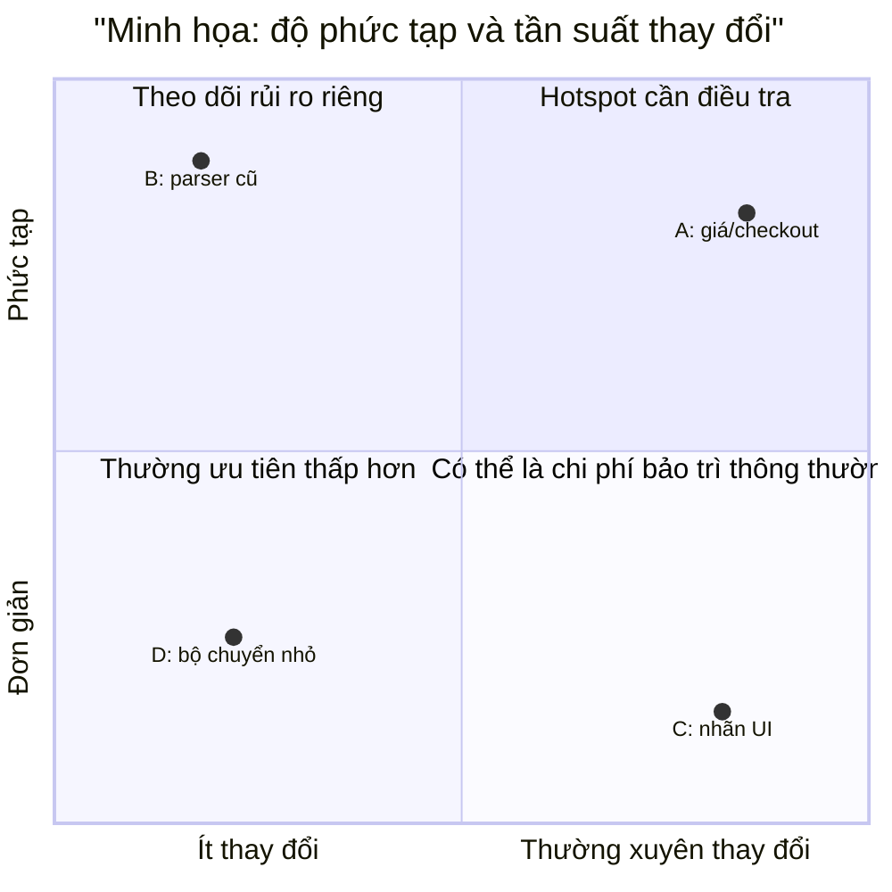
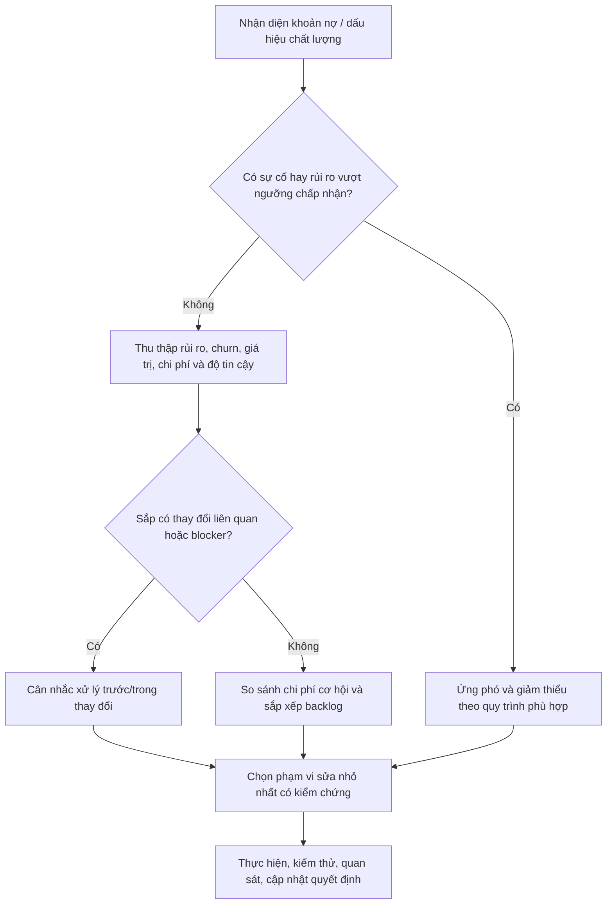
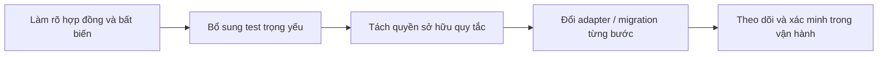

# Ưu tiên theo rủi ro, tần suất thay đổi và giá trị cải thiện

Một hệ thống Java có thể có hàng trăm điểm cần cải thiện: một lớp dài, hai nơi sao chép cùng quy tắc phí, một repository khó kiểm thử, một bộ xử lý dữ liệu cũ ít ai hiểu và một kết nối cơ sở dữ liệu đôi khi không được trả lại pool. Nhóm phát triển không đủ thời gian sửa tất cả cùng lúc. **Vậy nên xử lý khoản nợ kỹ thuật nào trước?**

Chọn theo “đoạn nào trông xấu nhất” có thể lãng phí thời gian. Chọn theo “file nào có complexity cao nhất” cũng có thể bỏ qua phần mã tuy ngắn nhưng thường xuyên thay đổi và gây lỗi. Ngược lại, một vấn đề về rò rỉ dữ liệu nhạy cảm hoặc mất dữ liệu có thể cần được xử lý khẩn cấp dù mã liên quan rất hiếm khi sửa.

Trong chương **Nợ kỹ thuật** của `CODE_QUALITY_FUNDAMENTALS`, chúng ta tìm hiểu cách **ưu tiên theo rủi ro, tần suất thay đổi và giá trị cải thiện**. Mục tiêu của module là hiểu những thuộc tính làm mã nguồn **đáng tin cậy, dễ hiểu và dễ thay đổi**. Vì vậy, việc trả nợ kỹ thuật cần gắn với tác động đối với những thuộc tính này, thay vì chỉ tối ưu con số hoặc hình thức.

Sau bài học, bạn có thể nhận diện khoản nợ đáng đưa vào kế hoạch, đánh giá rủi ro và chi phí thay đổi, ước lượng giá trị cải thiện một cách có điều kiện, ưu tiên theo bằng chứng, và thiết kế một đợt refactor Java có kiểm thử cùng tiêu chí hoàn tất rõ ràng.

## 1. Phân biệt nợ kỹ thuật với lỗi và cải tiến tùy chọn

**Nợ kỹ thuật (technical debt)** là cách diễn đạt cho những quyết định hoặc thiếu sót trong thiết kế và triển khai khiến việc phát triển, vận hành hay thay đổi hệ thống trong tương lai **tốn chi phí hoặc mang nhiều rủi ro hơn** so với một phương án đủ phù hợp với nhu cầu hiện tại.

Ví dụ:

- Cùng chính sách miễn phí giao hàng được viết độc lập trong ba luồng, nên mỗi lần đổi ngưỡng phải sửa ba nơi.
- Một service trực tiếp tạo `Connection` JDBC và cấu hình SMTP, khiến kiểm thử logic đơn giản cần nhiều hạ tầng.
- Đường xử lý upload không có giới hạn tài nguyên và chưa có cách quan sát mức sử dụng.
- Một module có hợp đồng ngầm, không có test hồi quy cho những hành vi thường xuyên bị sửa.

Nợ kỹ thuật **có thể được chấp nhận có chủ đích**. Chẳng hạn, nhóm chọn cấu trúc đơn giản để kiểm chứng nhu cầu sản phẩm trong thời gian ngắn, ghi rõ giới hạn và điều kiện xem xét lại. Nợ cũng có thể xuất hiện ngoài ý muốn do kiến trúc phát triển, yêu cầu đổi hoặc các thay đổi nhỏ tích lũy qua thời gian.

Tuy nhiên, cần phân biệt:

| Loại vấn đề | Bản chất | Cách phản ứng |
| --- | --- | --- |
| **Nợ kỹ thuật** | Cấu trúc hoặc lựa chọn hiện tại làm thay đổi, kiểm thử, vận hành trong tương lai khó/đắt/rủi ro hơn | Ước lượng ảnh hưởng, theo dõi và giảm nợ ở thời điểm hợp lý |
| **Lỗi chức năng đã xác nhận** | Hành vi đang vi phạm yêu cầu hoặc hợp đồng | Sửa lỗi theo mức ảnh hưởng và ưu tiên sự cố, không trì hoãn chỉ vì được gắn nhãn “debt” |
| **Lỗ hổng bảo mật, rủi ro mất dữ liệu nghiêm trọng** | Có nguy cơ gây thiệt hại lớn hoặc vượt ngưỡng chấp nhận | Áp dụng quy trình ứng phó rủi ro/bảo mật và biện pháp giảm thiểu kịp thời |
| **Cải tiến thẩm mỹ** | Đổi cách viết, tên hoặc bố cục mà chưa có tác động rõ đến chất lượng cần đạt | Xem xét trong phạm vi refactor liên quan, không tự mặc định ưu tiên cao |
| **Chi phí kỹ thuật tất yếu** | Độ phức tạp thật sự do yêu cầu sản phẩm hoặc nền tảng | Quản lý, kiểm thử và tài liệu hóa; không coi mọi độ phức tạp là nợ |

Một hệ thống có thể đồng thời chứa **nợ**, **lỗi** và **rủi ro an ninh**. Ghi nhận chúng đúng loại giúp tránh dùng bảng điểm trả nợ để trì hoãn việc khắc phục một vấn đề cấp thiết.

### 1.1. “Lãi nợ kỹ thuật” là gì?

**Lãi nợ (debt interest)** là chi phí hoặc rủi ro phát sinh lặp lại vì khoản nợ còn tồn tại. Nó có thể biểu hiện bằng:

- Thêm thời gian đọc hiểu trước khi sửa một tính năng.
- Phải cập nhật nhiều bản sao của cùng quy tắc.
- Kiểm thử hồi quy tốn thêm nhiều giờ vì thành phần khó cô lập.
- Tăng xác suất lỗi khi chỉnh mã hoặc triển khai.
- Sự cố vận hành lặp lại, trực ca và thời gian khôi phục cao hơn.
- Mất cơ hội giao tính năng vì nhóm bị chậm bởi nền tảng hiện tại.

Không phải khoản nợ nào cũng có “lãi” cố định như khoản vay tài chính. **Chi phí phụ thuộc tần suất đụng tới phần mã, quy mô thay đổi, mức rủi ro và bối cảnh hệ thống.** Mã cũ ít thay đổi có thể tốn chi phí thấp trong một thời gian dài; cùng đoạn mã đó có thể trở thành điểm nghẽn khi sản phẩm chuẩn bị mở rộng.

## 2. Ba trục ưu tiên chính

Đối với bài học này, đánh giá nợ theo ba câu hỏi:

1. **Rủi ro:** Nếu giữ nguyên, hệ thống và người dùng có thể chịu thiệt hại gì, với khả năng xuất hiện như thế nào?
2. **Tần suất thay đổi:** Phần mã hoặc quy tắc đó có thường xuyên được sửa, mở rộng, kiểm thử và triển khai không?
3. **Giá trị cải thiện:** Nếu xử lý khoản nợ, điều gì trở nên tốt hơn và có thể kiểm chứng bằng cách nào?

Cần thêm một biến thực tế: **chi phí và rủi ro của chính biện pháp xử lý**. Một đề xuất mang lại nhiều lợi ích nhưng đòi hỏi một cuộc di chuyển dữ liệu lớn, có nguy cơ gián đoạn hoạt động và không có phương án rollback sẽ cần được lập kế hoạch khác với một refactor nhỏ, có test đầy đủ.

| Trục | Câu hỏi điều tra | Bằng chứng có thể dùng |
| --- | --- | --- |
| **Rủi ro** | Nếu không sửa, hậu quả xấu nào có thể xảy ra? | Incident, lỗi hồi quy, thiếu kiểm soát quyền, dữ liệu sai, độ nghiêm trọng và phạm vi ảnh hưởng |
| **Tần suất thay đổi** | Bao lâu mã lại bị sửa hoặc trở thành phụ thuộc của tính năng mới? | Lịch sử commit/PR, kế hoạch sản phẩm, số lần sửa cùng quy tắc, mức độ xung đột khi merge |
| **Giá trị cải thiện** | Sau khi sửa, chi phí/rủi ro gì giảm đi, năng lực gì xuất hiện? | Giờ bảo trì tiết kiệm, test chạy nhanh/ổn định hơn, giảm incident, đáp ứng yêu cầu mới |
| **Chi phí thực hiện** | Sửa tốn bao nhiêu công và có rủi ro chuyển đổi nào? | Ước lượng phạm vi sửa, migration, test, release, monitoring và rollback |

**Không nên dùng một trục thay thế mọi trục còn lại.** Ví dụ một file ít thay đổi vẫn có thể chứa rủi ro bảo mật không chấp nhận được; một file rất hay sửa nhưng đã rõ và được kiểm thử tốt có thể không cần refactor.

## 3. Ưu tiên theo rủi ro: nhìn vào hậu quả và mức phơi nhiễm

Một phân tích rủi ro thường tách hai thành phần:

- **Mức độ ảnh hưởng (impact):** Nếu sự cố xảy ra thì hậu quả lớn đến đâu?
- **Khả năng xảy ra hoặc mức phơi nhiễm (likelihood/exposure):** Điều kiện gây ra sự cố có thể xuất hiện thường xuyên đến mức nào?

Mô hình khái niệm đơn giản:

\[
\text{Mức rủi ro dự kiến} \approx
\text{Khả năng xảy ra} \times \text{Mức ảnh hưởng}
\]

Đây chỉ là **khung lập luận**. Với dữ liệu hạn chế, không nên giả vờ có xác suất chính xác. Nếu dùng thang 1–5 cho khả năng xảy ra và ảnh hưởng, tích số chỉ giúp **xếp nhóm để thảo luận**, không phải xác suất thống kê hay tổn thất tiền tệ thực.

### 3.1. Tại sao “ít thay đổi” chưa chắc “ít rủi ro”?

Một lớp kiểm tra quyền hiếm khi được sửa nhưng chứa đường bỏ qua authorization có thể gây lộ dữ liệu khi bị khai thác. Ngược lại, một lớp hiển thị nhãn trạng thái rất hay sửa có thể chỉ gây lỗi giao diện mức nhẹ.

Vì vậy nên đánh giá **rủi ro nền** độc lập với tần suất thay đổi:

| Tình huống | Mức ảnh hưởng có thể có | Điểm cần quyết định |
| --- | --- | --- |
| Bỏ kiểm tra quyền với tài liệu riêng tư | Rất cao | Xử lý theo chính sách bảo mật, không chờ điểm ROI đẹp |
| Không bảo vệ cập nhật tồn kho đồng thời | Cao nếu dẫn tới bán quá hàng | Đo lỗi, kiểm tra transaction/locking tại nơi sở hữu tồn kho |
| Mẫu email có hai chuỗi điều kiện giống nhau | Thường thấp hơn | Xem xét khi sửa mẫu hoặc có lỗi thực tế |
| Thư viện cũ ít được dùng và không còn hỗ trợ | Tùy lỗ hổng, vận hành và kế hoạch nâng cấp | Đánh giá phơi nhiễm, sự phụ thuộc và hạn hỗ trợ |
| Trùng chính sách phí giữa báo giá và checkout | Có thể cao vì sai tiền và trải nghiệm khách | Ưu tiên theo tần suất đổi quy tắc và mức lệch đã xảy ra |

Các giá trị ở đây là **minh họa**, không phải đánh giá một hệ thống thực tế. Ngay cả lỗi nội dung email có thể trở nên nghiêm trọng nếu nó gây vi phạm pháp lý; vì vậy phải đặt trong ngữ cảnh sản phẩm và chính sách cụ thể.

### 3.2. Dùng bằng chứng thay cho cảm giác

Để đánh giá rủi ro, hãy tìm:

- Sự cố đã xảy ra, thời gian khôi phục và mức ảnh hưởng.
- Các lần sửa lỗi liên tiếp ở cùng thành phần.
- Những nhánh quan trọng thiếu test, nhất là lỗi, quyền truy cập và cạnh tranh.
- Mức độ lan truyền lỗi giữa module/dịch vụ.
- Các phụ thuộc đã hết hỗ trợ hoặc điểm hỏng đơn (single point of failure).
- Tính khó đảo ngược: mất dữ liệu, giao dịch tài chính sai, không thể rollback.

**Không có dữ liệu sự cố không có nghĩa rủi ro bằng không.** Một lỗi hiếm hoặc một lỗ hổng chưa bị khai thác có thể chưa để lại incident. Khi mức ảnh hưởng tiềm tàng cao nhưng độ tin cậy của ước lượng thấp, nên thực hiện bước xác minh/giảm thiểu rủi ro trước thay vì tự chọn điểm thấp.

### 3.3. Trường hợp không được xếp hàng như nợ thông thường

Nếu có dấu hiệu **lộ dữ liệu, mất tiền, hủy hoại dữ liệu, vi phạm yêu cầu bắt buộc hoặc sự cố đang diễn ra**, hãy dùng quy trình ứng phó sự cố và quản trị rủi ro của tổ chức. Có thể cần cô lập chức năng, áp dụng biện pháp tạm thời, thông báo bên liên quan hoặc khắc phục ngay.

Một công thức chia “lợi ích / giờ công” không nên cho phép vấn đề nghiêm trọng bị xếp sau việc đổi tên biến hoặc dọn code ít rủi ro. **Ngưỡng rủi ro không chấp nhận được phải được xử lý trước bước tối ưu hóa thông thường.**

## 4. Tần suất thay đổi: phần nào của hệ thống đang phải trả lãi nhiều lần?

Mã thường xuyên bị sửa có thể là nơi **lãi nợ tích lũy nhanh**. Nếu mỗi lần thay đổi một chính sách phải chỉnh nhiều file, chạy một bộ test rất chậm và xử lý lỗi hồi quy, chi phí đó lặp lại qua nhiều vòng phát triển.

### 4.1. “Hotspot” là gì?

Trong phân tích mã nguồn, **hotspot** thường chỉ vùng mã **thay đổi thường xuyên và có dấu hiệu phức tạp/rủi ro**. Một file có complexity cao nhưng lâu không sửa có thể chưa tạo ra nhiều chi phí bảo trì ngay lúc này; một file vừa phức tạp vừa thay đổi liên tục có thể là ưu tiên cải thiện rõ ràng.



Tọa độ và tên A/B/C/D trên hình **hoàn toàn giả định** để giải thích cách đọc, không dựa trên số đo của dự án. Sơ đồ chưa biểu diễn tác động bảo mật hoặc mất dữ liệu; do đó không được dùng riêng nó để bỏ qua các điểm rủi ro nghiêm trọng.

### 4.2. Chỉ đếm commit có đủ không?

**Không.** Một số nguyên nhân:

- File được auto-format nhiều lần có thể có nhiều commit nhưng ít thay đổi nghiệp vụ.
- Một module ổn định và thiết kế tốt vẫn thường được mở rộng vì nhu cầu sản phẩm lớn.
- Số commit của file không phản ánh số đội phải phối hợp hoặc tác động của mỗi thay đổi.
- Một hotspot có thể nằm ở **quy tắc** rải qua nhiều file, không gói trong một file.
- Lịch sử ít thay đổi có thể do nhóm **né phần mã nguy hiểm**, không phải vì nó an toàn.
- Mục tiêu trong kỳ tới có thể khác hoàn toàn lịch sử.

Nên kết hợp **lịch sử sửa mã**, **chi phí mỗi lần sửa**, **những lỗi liên quan** và **kế hoạch thay đổi sắp tới**.

### 4.3. Tần suất dự kiến quan trọng hơn quá khứ khi sản phẩm sắp đổi hướng

Giả sử module tính phí trong một năm qua chỉ đổi hai lần, nhưng ba tháng tới công ty dự định mở rộng nhiều khu vực và chính sách vận chuyển. Khoản nợ trong module có thể cần xử lý **trước khi** chuỗi thay đổi diễn ra, không đợi báo cáo churn lịch sử cao.

Hãy hỏi:

1. Tính năng nào sắp dùng hoặc sửa thành phần này?
2. Điều kiện nghiệp vụ nào sẽ biến động?
3. Có đợt migration, nâng JDK, thay API đối tác hoặc triển khai vùng mới không?
4. Nếu không cải thiện trước, kế hoạch sẽ chậm bao nhiêu?
5. Nếu cải thiện quá sớm, ta có nguy cơ thiết kế dựa trên yêu cầu chưa chắc xảy ra không?

Ưu tiên cần phản ánh **tương lai có bằng chứng**, không chỉ dashboard quá khứ.

## 5. Giá trị cải thiện: mô tả đầu ra bằng kết quả quan sát được

Một đề xuất xử lý nợ nên nêu rõ **điều gì sẽ thay đổi sau khi thực hiện**. Mục tiêu “làm mã sạch hơn” quá chung để so sánh với các công việc khác.

Ví dụ mục tiêu cụ thể hơn:

- **Giảm điểm sửa chính sách:** Thay vì điều chỉnh ngưỡng miễn phí ở ba service, chỉ còn một policy có hợp đồng rõ.
- **Tăng khả năng kiểm thử:** Kiểm tra quy tắc tính tiền mà không phải kết nối database hoặc SMTP.
- **Giảm thời gian bảo trì:** Một thay đổi thường gặp giảm từ vài giờ tìm và sửa nhiều chỗ xuống còn một vị trí có test.
- **Giảm rủi ro vận hành:** Connection được trả pool trên mọi đường thành công và lỗi, có chỉ số quan sát số connection đang mượn.
- **Mở khóa tính năng:** Thiết kế API giúp thêm một kênh vận chuyển mà không phải sửa toàn bộ quy trình đặt hàng.
- **Tăng khả năng phục hồi:** Có cơ chế retry/idempotency phù hợp để tránh xử lý trùng khi mạng timeout.

**Giá trị không nhất thiết được đo bằng tiền.** Có thể là giảm rủi ro mất dữ liệu, rút ngắn thời gian khắc phục sự cố, tăng tốc độ giao hàng hoặc giảm sự phụ thuộc vào một cá nhân. Nhưng nếu không thể nói rõ cách nhận ra cải thiện đã đạt, đề xuất còn thiếu tiêu chí hoàn tất.

### 5.1. Ước lượng lãi nợ do thay đổi lặp lại

Với khoản nợ làm tăng thời gian cho mỗi lần thay đổi, một phép tính **minh họa**:

\[
\text{Giờ lãng phí dự kiến mỗi năm}
\approx
\text{Số lần thay đổi/năm}
\times
\text{Giờ tăng thêm/lần}
\]

Và:

\[
\text{Thời gian hoàn vốn (tháng)}
\approx
12 \times
\frac{\text{Giờ thực hiện cải thiện}}
{\text{Giờ tiết kiệm dự kiến mỗi năm}}
\]

Công thức này có những **giả định mạnh**: tần suất thay đổi và thời gian tiết kiệm tương đối ổn định; khoản refactor thực sự tạo được lợi ích; chưa tính chi phí duy trì cách làm mới, lãi suất, rủi ro triển khai, giá trị của việc giảm lỗi hoặc giá trị cơ hội.

Vì vậy, thời gian hoàn vốn chỉ là **một thông tin** trong quyết định, không phải công thức xếp hạng mọi khoản nợ.

### 5.2. Ví dụ có số liệu giả định

Giả sử nhóm ghi nhận:

- Quy tắc phí giao hàng phải chỉnh khoảng **12 lần/năm**.
- Do logic bị sao chép, mỗi lần sửa mất thêm trung bình **1,5 giờ** để dò vị trí, sửa và kiểm tra.
- Để gom quy tắc vào một policy và bổ sung test, nhóm ước lượng **9 giờ**.

Lãi nợ theo thời gian bảo trì:

\[
12 \times 1{,}5 = 18\text{ giờ/năm}
\]

Thời gian hoàn vốn dự kiến:

\[
12 \times \frac{9}{18} = 6\text{ tháng}
\]

Nói cách khác, **nếu những giả định trên đúng**, sau khoảng 6 tháng lượng giờ tiết kiệm tích lũy có thể bù 9 giờ refactor. Bên cạnh đó còn có lợi ích giảm nguy cơ báo giá và checkout áp dụng hai chính sách khác nhau, nhưng **chưa tính** lợi ích này trong phép tính.

Với một bộ parser cũ chỉ bị chỉnh **2 lần/năm**, mỗi lần tốn thêm **2 giờ**, nhưng refactor cần **40 giờ**, nếu chỉ xét chi phí bảo trì thì:

\[
2 \times 2 = 4\text{ giờ/năm}
\]

\[
12 \times \frac{40}{4} = 120\text{ tháng}
\]

Tức khoảng **10 năm**, theo cùng giả định đơn giản. Điều này gợi ý chưa nên refactor parser chỉ vì nó dài và khó đọc — **trừ khi** có yếu tố khác như lỗi bảo mật, dữ liệu sai, sắp thay giao thức hoặc thiếu hỗ trợ vận hành. Không nên xem kết quả “10 năm” là một dự báo chắc chắn.

### 5.3. Đừng đếm lợi ích hai lần

Nếu cùng một sự cố khiến nhóm tốn 2 giờ sửa và 3 giờ hỗ trợ khách, hãy ghi rõ các thành phần thay vì cộng tùy ý những chỉ số trùng nhau. **Giảm thời gian sửa**, **giảm số sự cố**, **giảm thời gian khôi phục** và **giảm rủi ro mất khách** có thể liên quan nhưng không tự độc lập.

Một bản ước lượng tốt nêu **giả định, phạm vi, độ tin cậy và điều chưa tính**, thay vì trình bày số liệu chính xác đến nhiều chữ số thập phân khi đầu vào chỉ là phỏng đoán.

## 6. Ưu tiên không chỉ là “điểm cao nhất thắng”

Một cách tổ chức quyết định thực tế là **lọc rủi ro bắt buộc trước**, rồi so sánh lợi ích/chi phí của những đề xuất còn lại.



Đây là **mô hình quyết định**, không tự thay thế đánh giá rủi ro hoặc quy trình ưu tiên của tổ chức. Một mục cần ứng phó khẩn cấp có thể phải được cô lập ngay **trước khi** biết phương án refactor dài hạn.

### 6.1. Một bảng so sánh minh họa

| Khoản nợ | Rủi ro giữ nguyên | Dự kiến thay đổi | Giá trị cải thiện | Chi phí/đánh đổi | Hướng ưu tiên |
| --- | --- | --- | --- | --- | --- |
| **A. Quy tắc phí lặp ở báo giá và checkout** | Lệch số tiền | Cao: chính sách thay thường xuyên | Giảm nơi sửa, tăng test, tránh sai lệch | Nhỏ–vừa; phải kiểm tra các luồng sử dụng | **Xử lý sớm**, nhất là trước đợt đổi phí |
| **B. Parser cũ dài nhưng ít sửa** | Chưa có lỗi/rủi ro cao được xác nhận | Thấp trong kế hoạch hiện có | Có thể cải thiện khả năng hiểu | Lớn; nguy cơ làm sai định dạng cũ | **Theo dõi**, ưu tiên điều tra rủi ro trước |
| **C. Đường phân quyền thiếu kiểm tra tại tài nguyên** | Rò rỉ dữ liệu trái phép | Có thể thấp | Giảm rủi ro an ninh nghiêm trọng | Phụ thuộc phạm vi, cần xác minh đầy đủ | **Xử lý theo mức độ an ninh**, không chờ tính ROI |
| **D. Test tích hợp checkout thường xuyên không ổn định** | CI nhiễu, chậm phát hành, khó phát hiện lỗi thật | Cao: chạy mỗi PR | Phản hồi tin cậy, ít rerun/điều tra | Vừa; có thể cần cô lập fixture | **Ưu tiên nếu ảnh hưởng nhịp giao hàng** |
| **E. Thư viện tiện ích có naming chưa thống nhất** | Thấp trong phạm vi hiện tại | Thấp | Tăng nhất quán nhỏ | Nhỏ, nhưng cần nhiều điểm gọi | **Gộp cùng thay đổi liên quan** |

Mức độ trong bảng là **đánh giá ví dụ**, không phải kết luận từ dữ liệu của bất kỳ repository nào. Bảng giúp nhìn sự khác nhau giữa **điểm nóng phát triển**, **rủi ro nghiêm trọng** và **cải tiến nhỏ nên xử lý theo cơ hội**.

### 6.2. Điểm số giúp thảo luận, không phải một chân lý

Một số nhóm đặt thang định tính cho mỗi tiêu chí, ví dụ 1–5, rồi tạo một điểm tổng để ưu tiên sơ bộ. Cách này có thể hữu ích cho một backlog lớn nếu mọi người **thống nhất ý nghĩa từng mức**.

Nhưng cần cảnh giác:

- “Rủi ro = 4” không phải xác suất 40% hay tổn thất tương đương 4 đơn vị tiền.
- Cộng “rủi ro + churn + giá trị” có thể **đếm cùng một tác động nhiều lần**.
- Chia một tổng điểm chủ quan cho giờ công làm ra số thập phân có vẻ khoa học nhưng chưa chắc phản ánh giá trị thật.
- Một đề xuất ít effort nhưng rất ít lợi ích không nên luôn thắng vấn đề hệ thống quan trọng.
- Vấn đề vượt ngưỡng an ninh hoặc tuân thủ cần **nhánh xử lý riêng**, không chờ cộng điểm.

Dùng điểm như **công cụ tạo cuộc thảo luận có cấu trúc**, rồi ghi quyết định và lý do. Nếu hai khoản gần điểm, độ tin cậy của dữ liệu, phụ thuộc triển khai và bối cảnh roadmap có thể quan trọng hơn sự chênh lệch một điểm.

## 7. Ví dụ Java 17: xử lý khoản nợ có tần suất đổi cao

Giả sử báo giá và checkout cùng áp dụng một chính sách:

- Khách VIP được miễn phí vận chuyển.
- Khách thường có tổng tiền hàng từ **300.000 VND** được miễn phí.
- Khách thường dưới ngưỡng chịu **30.000 VND**.
- Tổng tiền hàng không âm; phép cộng phải phát hiện overflow.

Đây là một quy tắc có **một chủ sở hữu nghiệp vụ** trong tình huống minh họa. Nếu nó được viết ở hai nơi độc lập, mỗi lần thay chính sách phải sửa và kiểm thử cả hai.

### 7.1. Trước cải thiện: hai bản sao của một quyết định

```java
// Minh họa phiên bản TRƯỚC refactor.
final class QuoteCalculator {
    long totalVnd(long subtotalVnd, boolean vip) {
        if (subtotalVnd < 0) {
            throw new IllegalArgumentException("Negative subtotal");
        }

        long fee = (vip || subtotalVnd >= 300_000L)
                ? 0L : 30_000L;

        return Math.addExact(subtotalVnd, fee);
    }
}

final class CheckoutCalculator {
    long totalVnd(long subtotalVnd, boolean vip) {
        if (subtotalVnd < 0) {
            throw new IllegalArgumentException("Negative subtotal");
        }

        long fee = 30_000L;
        if (subtotalVnd >= 300_000L) {
            fee = 0L;
        }
        if (vip) {
            fee = 0L;
        }

        return Math.addExact(subtotalVnd, fee);
    }
}
```

Hai lớp dùng cách viết khác nhưng có cùng **tri thức chính sách**. Giả sử nhóm đổi ngưỡng thành **350.000 VND**. Nếu chỉ sửa `QuoteCalculator`, người dùng sẽ thấy phí báo giá khác phí khi xác nhận. Đây là một khoản nợ có liên hệ rõ với **tần suất thay đổi** và **nguy cơ sai tiền**, không chỉ là vấn đề thẩm mỹ về duplicate code.

### 7.2. Sau cải thiện: quy tắc có chủ sở hữu rõ

```java
import java.util.Objects;

record ShippingFeePolicy(
        long freeThresholdVnd,
        long standardFeeVnd) {

    ShippingFeePolicy {
        if (freeThresholdVnd < 0 || standardFeeVnd < 0) {
            throw new IllegalArgumentException(
                    "Threshold and fee must be nonnegative");
        }
    }

    long feeFor(long subtotalVnd, boolean vip) {
        if (subtotalVnd < 0) {
            throw new IllegalArgumentException("Negative subtotal");
        }

        return (vip || subtotalVnd >= freeThresholdVnd)
                ? 0L : standardFeeVnd;
    }
}

final class QuoteCalculator {
    private final ShippingFeePolicy policy;

    QuoteCalculator(ShippingFeePolicy policy) {
        this.policy = Objects.requireNonNull(policy);
    }

    long totalVnd(long subtotalVnd, boolean vip) {
        return Math.addExact(
                subtotalVnd, policy.feeFor(subtotalVnd, vip));
    }
}

final class CheckoutCalculator {
    private final ShippingFeePolicy policy;

    CheckoutCalculator(ShippingFeePolicy policy) {
        this.policy = Objects.requireNonNull(policy);
    }

    long totalVnd(long subtotalVnd, boolean vip) {
        return Math.addExact(
                subtotalVnd, policy.feeFor(subtotalVnd, vip));
    }
}
```

Hai đoạn **trước** và **sau** là hai phương án độc lập để so sánh; không đặt các lớp trùng tên vào cùng package khi biên dịch. `record` cần Java 16+, vì thế ví dụ chọn Java 17.

Ở phương án sau:

- `ShippingFeePolicy` sở hữu **ngưỡng miễn phí** và **mức phí chuẩn**.
- Hai calculator chỉ cần biết hợp đồng `feeFor`, không chứa bản sao điều kiện.
- Một cấu hình chính sách có thể được tạo ở nơi lắp ghép ứng dụng và truyền vào hai luồng.
- Nếu muốn phiên bản chính sách khác nhau theo thị trường/thời điểm, cần **quy định rõ policy nào áp dụng**, không âm thầm thay cùng một object toàn cục.

Mã dùng `long` cho số tiền VND nguyên nhằm tập trung vào bài học nợ kỹ thuật. Với đa tiền tệ, thuế, chiết khấu hoặc làm tròn, cần mô hình tiền và hợp đồng số học đầy đủ hơn.

**Giới hạn quan trọng:** Refactor không tự bảo đảm dữ liệu `vip` đến từ danh tính đã xác thực, giá trong giỏ là giá có thẩm quyền, hoặc checkout thật sử dụng đúng instance policy. Cần kiểm chứng những ranh giới đó bằng kiểm thử phù hợp.

### 7.3. Kiểm thử hồi quy trước và sau thay đổi

```java
import static org.junit.jupiter.api.Assertions.assertEquals;
import static org.junit.jupiter.api.Assertions.assertThrows;

import org.junit.jupiter.api.Test;

class ShippingFeePolicyTest {
    private final ShippingFeePolicy policy =
            new ShippingFeePolicy(300_000L, 30_000L);

    @Test
    void standardCustomerPaysBelowThreshold() {
        assertEquals(30_000L, policy.feeFor(299_999L, false));
    }

    @Test
    void standardCustomerGetsFreeShippingAtThreshold() {
        assertEquals(0L, policy.feeFor(300_000L, false));
    }

    @Test
    void vipGetsFreeShippingBelowThreshold() {
        assertEquals(0L, policy.feeFor(50_000L, true));
    }

    @Test
    void rejectsInvalidSubtotal() {
        assertThrows(IllegalArgumentException.class,
                () -> policy.feeFor(-1L, false));
    }

    @Test
    void bothConsumersUseSamePolicy() {
        QuoteCalculator quote = new QuoteCalculator(policy);
        CheckoutCalculator checkout = new CheckoutCalculator(policy);

        assertEquals(329_999L, quote.totalVnd(299_999L, false));
        assertEquals(329_999L, checkout.totalVnd(299_999L, false));
        assertEquals(300_000L, quote.totalVnd(300_000L, false));
        assertEquals(300_000L, checkout.totalVnd(300_000L, false));
        assertEquals(50_000L, quote.totalVnd(50_000L, true));
        assertEquals(50_000L, checkout.totalVnd(50_000L, true));
    }

    @Test
    void newPolicyCanBeConfiguredWithoutCopyingBranches() {
        ShippingFeePolicy updated =
                new ShippingFeePolicy(350_000L, 30_000L);

        assertEquals(30_000L, updated.feeFor(300_000L, false));
        assertEquals(0L, updated.feeFor(350_000L, false));
    }
}
```

Các test JUnit 5 này tạo bằng chứng về:

- Điều kiện biên của chính sách.
- Quy tắc VIP và đầu vào không hợp lệ.
- Hai consumer cùng sử dụng một chính sách.
- Khả năng thay ngưỡng mà không sửa logic ở từng calculator.

**Chúng chưa chứng minh** cách DI/wiring của ứng dụng thật, dữ liệu database hoặc hợp đồng HTTP. Nếu mục tiêu giảm nợ là “mọi luồng báo giá và checkout phải luôn thống nhất”, cần có **integration/contract test** xác nhận hai luồng thực tế sử dụng đúng quy tắc theo phiên bản được công bố.

### 7.4. Ưu tiên refactor này vì điều gì?

Không phải vì số dòng Java đã giảm nhiều. Thực tế, tổng số dòng sau khi thêm `ShippingFeePolicy`, constructor và test có thể **tăng**. Giá trị nằm ở:

1. **Giảm số nguồn quyết định:** Ngưỡng và phí chỉ cần được định nghĩa ở một policy cho các luồng dùng chung chính sách.
2. **Giảm rủi ro sai lệch:** Một thay đổi ngưỡng ít có khả năng bị bỏ sót ở consumer.
3. **Tăng khả năng kiểm chứng:** Có test trực tiếp cho policy và test consumer.
4. **Giảm chi phí thay đổi lặp lại:** Khi chính sách được cập nhật thường xuyên, lợi ích tích lũy qua nhiều lần.

Đây là ví dụ điển hình cho lý do phải nhìn **tần suất thay đổi và giá trị cải thiện**, không chỉ các metric như dòng code hoặc độ phức tạp của một phương thức.

## 8. Chi phí sửa nợ cũng cần được đánh giá như một rủi ro

Một phương án cải thiện có thể làm hệ thống tốt hơn về lâu dài nhưng vẫn **gây lỗi trong lúc thực hiện**. Điều đó đặc biệt quan trọng khi refactor liên quan đến dữ liệu lịch sử, giao dịch tài chính hoặc API đã có consumer độc lập.

Các rủi ro thường cần xem:

| Rủi ro khi xử lý | Ví dụ | Biện pháp giảm thiểu |
| --- | --- | --- |
| **Thay đổi hành vi ngoài ý muốn** | Đổi `>=` thành `>` khi gom điều kiện | Test giá trị biên và so sánh đầu ra trước/sau |
| **Cài đặt sai dependency** | Báo giá dùng policy mới nhưng checkout vẫn dùng policy cũ | Integration/contract test, kiểm tra cấu hình và version |
| **Migration dữ liệu** | Thay biểu diễn trạng thái trong database | Kiểm tra dữ liệu cũ, migration có thể kiểm chứng, rollout theo giai đoạn |
| **Tăng coupling** | Hai service phát hành độc lập bị buộc nâng thư viện chung cùng lúc | Hợp đồng version hóa, tương thích ngược, phương án triển khai |
| **Suy giảm hiệu năng** | Thêm nhiều lời gọi hoặc cấp phát không cần thiết | Benchmark/profiling với workload đại diện |
| **Gián đoạn vận hành** | Thay adapter connection pool trong giờ cao điểm | Triển khai kiểm soát, monitoring và rollback |
| **Thiếu test cho ngoại lệ** | Nhánh lỗi hiếm thay đổi sau refactor | Test lỗi, timeout, concurrent update khi có liên quan |

Vì vậy, **phương án nhỏ nhất đạt lợi ích thiết yếu** thường đáng cân nhắc trước. Thay vì viết lại toàn bộ checkout, nhóm có thể bắt đầu bằng việc tách chính sách phí, giữ hợp đồng đầu ra và bổ sung test. Nếu cần thay kiến trúc lớn hơn, hãy tách thành các bước có thể kiểm chứng.

### 8.1. “Cơ hội sửa ngay lúc chạm mã” và giới hạn của nó

Một nguyên tắc thực dụng là cải thiện phần mã **đang được sửa vì yêu cầu thật**, nếu phạm vi đủ an toàn. Ví dụ khi thêm mức phí mới, có thể tách quy tắc phí đang bị sao chép thành policy trước rồi triển khai yêu cầu.

Nhưng không nên biến một bug fix khẩn cấp thành cuộc refactor toàn module không có test và phương án rollback. **Cơ hội không đồng nghĩa với tự động mở rộng phạm vi**. Hãy cân nhắc mức rủi ro, thời điểm release và yêu cầu của người đang chịu trách nhiệm sản phẩm/vận hành.

## 9. Dùng “debt register” để biến cảm giác thành quyết định theo dõi được

Một **sổ theo dõi nợ kỹ thuật (technical debt register)** nên mô tả đủ để người khác hiểu khoản nợ, tác động và lý do ưu tiên mà không cần hỏi lại toàn bộ nhóm.

Một mẫu gọn:

| Trường | Nội dung nên ghi |
| --- | --- |
| **ID / khu vực** | Mã khoản nợ, module/luồng nghiệp vụ bị ảnh hưởng |
| **Bối cảnh và triệu chứng** | Điều gì đang khó, ví dụ cùng chính sách phí có ba bản sao |
| **Bằng chứng** | Lỗi hồi quy, lịch sử thay đổi, test chậm, thời gian xử lý, metric có phạm vi |
| **Rủi ro nếu không sửa** | Kịch bản xấu, mức ảnh hưởng, khả năng phơi nhiễm, điều chưa biết |
| **Tần suất thay đổi** | Lịch sử và kế hoạch sắp tới; độ tin cậy của ước lượng |
| **Giá trị kỳ vọng** | Điều đo được sau cải thiện: ít nơi sửa hơn, ít lỗi, test nhanh hơn |
| **Phương án xử lý** | Phạm vi nhỏ nhất, hợp đồng ảnh hưởng, cách kiểm thử |
| **Công sức và rủi ro thực hiện** | Ước lượng, migration, rollout/rollback, dependency |
| **Chủ sở hữu và thời điểm xem lại** | Nhóm quyết định, điều kiện kích hoạt và hạn xử lý nếu có |
| **Quyết định** | Làm ngay / làm cùng tính năng / theo dõi / chấp nhận có điều kiện; lý do |

### 9.1. Một bản ghi minh họa

```text
ID: TD-SHIPPING-01
Khu vực: Quote + Checkout
Vấn đề: Ngưỡng và mức phí vận chuyển được cài đặt ở hai nơi.
Rủi ro: Báo giá khác checkout khi cập nhật sót một nơi.
Bằng chứng: Hai đoạn điều kiện riêng; dự kiến thay đổi phí thường xuyên.
Tần suất: Giả định 12 lần/năm; cần đối chiếu lịch sử và roadmap.
Giá trị: Một policy có thẩm quyền; test biên và test consumer.
Ước lượng: 9 giờ để tách policy, cập nhật caller, bổ sung test.
Rủi ro khi sửa: Sai tương thích, wiring giữa các luồng.
Quyết định: Ưu tiên trước đợt đổi chính sách kế tiếp.
Tiêu chí hoàn tất: Các luồng được kiểm chứng dùng chính sách đúng;
                   không còn bản sao điều kiện cũ trong phạm vi đã thống nhất.
Chủ sở hữu: Nhóm nghiệp vụ/ứng dụng phụ trách chính sách vận chuyển.
```

Đây là **mẫu giả định**, không phải dữ liệu đo được của dự án hiện tại. Sổ nợ cần được cập nhật khi giả định sai, khi thay đổi roadmap hoặc khi rủi ro không còn.

### 9.2. Ghi rõ vì sao tạm chấp nhận nợ

Một quyết định “chưa xử lý” có thể hợp lý nếu:

- Chức năng ít thay đổi và tác động khi sai ở mức chấp nhận được.
- Refactor hiện tại có nguy cơ cao hơn lợi ích gần hạn.
- Hệ thống sắp được thay thế hoặc ngừng sử dụng có căn cứ.
- Chưa đủ bằng chứng để chọn phương án; cần một bước đo/điều tra trước.

Nhưng **chấp nhận nợ** nên đi kèm **điều kiện xem lại**, chẳng hạn “khi cập nhật giao thức”, “nếu có incident” hoặc “trước đợt mở rộng thị trường”. Nếu không, nhãn “để sau” có thể trở thành trạng thái vĩnh viễn mà không ai còn biết lý do.

## 10. Những chỉ số giúp kiểm chứng giá trị sau cải thiện

Không nên tuyên bố “đã trả nợ” chỉ vì merge được một PR. Cần nhìn vào **mục tiêu đã hứa** và xem thay đổi có thực sự giảm rủi ro/chi phí không.

| Mục tiêu | Chỉ số hoặc bằng chứng trước/sau | Điều cần thận trọng |
| --- | --- | --- |
| Giảm nơi sửa cùng quy tắc | Số nguồn chính sách được duy trì độc lập | Nhiều bản sao runtime vẫn có thể hợp lệ nếu có nguồn có thẩm quyền |
| Giảm lỗi khi đổi chính sách | Số lỗi hồi quy liên quan sau những đợt đổi tương tự | Cần đủ thời gian và mẫu so sánh; ít lỗi có thể chỉ do ít thay đổi |
| Giảm thời gian sửa | Thời gian từ bắt đầu tới hoàn tất thay đổi tương tự | Độ phức tạp yêu cầu và kinh nghiệm người sửa có thể khác |
| Tăng khả năng kiểm thử | Thời gian setup, mức phụ thuộc hạ tầng, test ổn định | Nhiều test hơn không tự có nghĩa test tốt hơn |
| Giảm incident vận hành | Số incident/timeout, thời gian phục hồi, active/idle connection | Cần so sánh trong điều kiện tải hợp lý |
| Giảm phơi nhiễm rủi ro | Các đường truy cập đã được kiểm soát, test security, kết quả review | Không nên thay xác minh thực bằng số điểm cảm tính |
| Cải thiện tốc độ giao hàng | Lead time, số lần phải mở lại PR, công việc bị chặn | Bị ảnh hưởng bởi nhiều yếu tố ngoài một khoản nợ |

### 10.1. Đo trước, đo sau, nhưng đừng đòi kết luận quá mức

Ví dụ nhóm giảm thời gian viết test từ 20 phút xuống 5 phút cho một luồng cụ thể. Đó là một kết quả tốt **nếu đo cùng điều kiện** và test còn giữ hợp đồng cần kiểm chứng.

Tuy nhiên, nếu đổi test tích hợp thật thành toàn mock, test có thể chạy nhanh hơn nhưng mất bằng chứng về database. **Chỉ số đẹp hơn không có nghĩa chất lượng tốt hơn** nếu mục tiêu kiểm tra bị thay đổi.

Nên ghi:

1. Baseline và điều kiện đo.
2. Phiên bản mã trước/sau.
3. Điều đã thay đổi ở môi trường, tải hoặc test.
4. Mức tin cậy và giới hạn của kết quả.
5. Quyết định tiếp theo: hoàn tất, cần quan sát thêm hoặc còn khoản nợ phụ thuộc.

## 11. Dành năng lực cho nợ kỹ thuật trong kế hoạch phát triển

Nhóm có thể xử lý nợ theo nhiều nhịp:

- **Làm cùng tính năng:** Khi thay chính sách phí, xử lý phần lặp làm chính thay đổi đó khó an toàn.
- **Cải thiện nhỏ liên tục:** Những refactor có test, phạm vi hẹp, ít rủi ro được thực hiện thường xuyên.
- **Đợt đầu tư riêng:** Khi nợ liên quan đến migration, nâng nền tảng, test architecture hoặc nhiều module, cần kế hoạch và người chịu trách nhiệm.
- **Khắc phục rủi ro cấp thiết:** Tách khỏi backlog cải tiến thông thường để xử lý theo tiêu chí an toàn và vận hành.
- **Điều tra trước khi quyết định:** Thu thập profiling, lỗi thực tế, số lần thay đổi, kiểm tra quyền hoặc thử nghiệm nhỏ để giảm bất định.

Không có tỷ lệ cố định như “mọi sprint dành đúng X% cho nợ” đúng cho tất cả các nhóm. Phân bổ năng lực phụ thuộc vào trạng thái hệ thống, nghĩa vụ sản phẩm, rủi ro và kế hoạch phát triển.

### 11.1. Phụ thuộc giữa các khoản nợ

Một khoản nợ có thể là **điều kiện để giải quyết khoản khác**. Ví dụ trước khi thay toàn bộ adapter database, nhóm cần có integration test đủ tin cậy. Khi đó, dù “viết test” chưa tạo ngay tính năng mới, nó là công việc **mở khóa khả năng thay đổi an toàn**.

Một thứ tự khả thi:



Sơ đồ chỉ minh họa một chuỗi phụ thuộc hợp lý. Với một sự cố bảo mật đang diễn ra, nhóm có thể cần **giảm thiểu ngay** trước khi hoàn thiện toàn bộ bộ test.

## 12. Bốn tình huống chọn ưu tiên trong thực tế

### Tình huống A: Chính sách phí hay thay đổi và nhiều nơi cùng cài đặt

**Bằng chứng:** Ngưỡng phí xuất hiện trong báo giá, checkout và một job báo cáo; kế hoạch sản phẩm có các chiến dịch vận chuyển mới.

**Nhận định:** Tần suất sửa có khả năng cao, rủi ro lệch tiền và tác động khách hàng đáng kể. Giảm số nguồn quyết định sẽ làm các thay đổi tiếp theo dễ kiểm chứng hơn.

**Hướng xử lý:** Xác nhận có thật là một chính sách chung; đưa vào nơi sở hữu rõ; kiểm thử ở giá trị biên và các consumer. Không gom nếu một luồng cần áp dụng chính sách theo phiên bản lịch sử.

### Tình huống B: Module import CSV dài và khó đọc nhưng ít sửa

**Bằng chứng:** Nhiều nhánh và code cũ; chưa có incident được xác nhận; vài năm gần đây chỉ sửa một lần; kế hoạch gần hạn ít thay đổi.

**Nhận định:** Refactor toàn diện có thể tốn nhiều công và có nguy cơ làm sai định dạng cũ. Nhưng cần kiểm tra dữ liệu không đáng tin, giới hạn tài nguyên và các lỗi đã biết trước khi chấp nhận theo dõi.

**Hướng xử lý:** Điều tra rủi ro, bổ sung test định dạng/đầu vào quan trọng khi có cơ hội, ghi điều kiện xem lại. Chưa nhất thiết viết lại toàn bộ chỉ vì metric độ phức tạp cao.

### Tình huống C: Một đường xử lý thanh toán có khả năng tạo giao dịch trùng

**Bằng chứng:** Đã quan sát hoặc có khả năng rõ rằng retry sau timeout có thể thực hiện lại tác dụng phụ mà không kiểm soát idempotency.

**Nhận định:** Tác động có thể nghiêm trọng về tiền và tính đúng. Đây không đơn thuần là vấn đề “mã không đẹp”. Chờ tính thời gian hoàn vốn theo số giờ bảo trì có thể không phù hợp.

**Hướng xử lý:** Đánh giá và giảm thiểu rủi ro theo mức độ khẩn cấp; xác minh trạng thái giao dịch, chính sách retry và idempotency, bổ sung kiểm thử tích hợp tại ranh giới thực. Refactor lớn nếu cần sẽ được chia giai đoạn có kiểm soát.

### Tình huống D: Bộ test hồi quy thường xuyên đỏ ngẫu nhiên

**Bằng chứng:** Pipeline CI phải chạy lại nhiều lần; các lần fail không gắn với lỗi sản phẩm; thời gian chờ PR tăng.

**Nhận định:** Giá trị cải thiện có thể nằm ở **khả năng phát hiện lỗi thật và thời gian phản hồi**, không chỉ số dòng test được sửa.

**Hướng xử lý:** Tìm nguyên nhân như fixture chia sẻ, thời gian bất định, dữ liệu cũ hoặc phụ thuộc mạng; sửa đúng nguồn flaky. Không chỉ tăng timeout hoặc retry vô hạn rồi tuyên bố đã hết nợ.

## 13. Những sai lầm phổ biến khi xếp ưu tiên

### 13.1. “File có nhiều code smell nhất phải sửa trước”

Code smell là tín hiệu điều tra. File lớn hoặc có complexity cao có thể ít bị sửa và không tạo rủi ro gần hạn; file nhỏ chứa điểm phân quyền quan trọng lại có rủi ro cao hơn nhiều.

### 13.2. “Khoản dễ sửa nhất luôn mang lại ROI tốt nhất”

Một thay đổi 30 phút có lợi ích không đáng kể không nhất thiết nên chen trước khoản nợ gây incident liên tục. Chi phí thấp giúp giảm rủi ro thực hiện, nhưng **không thay thế mức ảnh hưởng và giá trị**.

### 13.3. “Không có incident thì không có nợ”

Có thể chưa có điều kiện kích hoạt hoặc chưa có giám sát để nhận diện lỗi. Nếu tác động tiềm ẩn cao, cần đánh giá phơi nhiễm ngay cả khi hệ thống chưa từng ghi nhận incident.

### 13.4. “Tần suất commit càng cao thì nợ càng lớn”

Commit cao có thể phản ánh vùng mã đang có nhiều chức năng mới và thiết kế tốt. Cần kết hợp churn với lỗi, thời gian sửa, độ phức tạp và mức thay đổi trong tương lai.

### 13.5. “Lợi ích tiết kiệm giờ được tính chính xác”

Ước lượng giờ/lần thay đổi thường có độ bất định lớn. Trình bày phạm vi và điều kiện giúp người ra quyết định tránh kỳ vọng sai. Không nên gán một số tiền tuyệt đối cho rủi ro mà không có dữ liệu hỗ trợ.

### 13.6. “Refactor xong là xóa khoản nợ khỏi sổ”

Nếu chưa chạy test, chưa xác minh adapter thật hoặc chưa quan sát sau release, vẫn chưa đủ bằng chứng kết luận lợi ích đã đạt. Hoàn tất cần theo **tiêu chí chấp nhận** đã xác định.

### 13.7. “Muốn hết nợ thì phải viết lại toàn hệ thống”

Big rewrite có thể tạo rủi ro chức năng, dữ liệu và triển khai lớn hơn chính khoản nợ. Nhiều khoản nợ có thể được giảm từng phần thông qua tách hợp đồng, test, adapter hoặc cơ chế thay thế từng bước.

### 13.8. “Gom mọi đoạn giống nhau là giảm nợ”

Hai quy tắc độc lập có thể tình cờ giống cú pháp. Gom sai tạo coupling và chi phí mới. Hãy dựa trên **cùng lý do thay đổi và cùng nơi sở hữu**, không chỉ số dòng lặp.

### 13.9. “Một điểm số đủ để quyết định”

Điểm rủi ro, tần suất và lợi ích có thể giúp xếp nhóm, nhưng không tự nắm được mức độ nghiêm trọng không chấp nhận, phụ thuộc triển khai, độ tin cậy hoặc mục tiêu chiến lược.

### 13.10. “Nợ cũ luôn phải được trả”

Nếu một thành phần sắp ngừng sử dụng, rủi ro được kiểm soát và không cần thay đổi nữa, trả toàn bộ nợ có thể không đáng. Quyết định hợp lý có thể là **duy trì biện pháp giảm thiểu và theo dõi cho đến khi thay thế**, với lý do và ngày xem lại rõ ràng.

## 14. Checklist cho review và họp ưu tiên

Khi đề xuất một khoản nợ kỹ thuật, hãy trả lời:

1. **Vấn đề cụ thể là gì?** Nêu đoạn mã, ranh giới hoặc quy trình bị ảnh hưởng; tránh chỉ ghi “code xấu”.
2. **Đây là nợ, bug, hay rủi ro phải xử lý khẩn?** Có cần chuyển sang quy trình ứng phó sự cố không?
3. **Giữ nguyên gây hậu quả gì?** Mất dữ liệu, sai tiền, chậm sửa, CI nhiễu hay tăng chi phí vận hành?
4. **Có bằng chứng nào?** Incident, test, code review, lịch sử sửa, metrics, yêu cầu sắp tới?
5. **Tần suất thay đổi dự kiến là bao nhiêu?** Có kế hoạch sản phẩm hoặc migration đang đến gần không?
6. **Mục tiêu cải thiện đo được là gì?** Giảm số nơi sửa, giảm thời gian, giảm lỗi hay mở khóa năng lực?
7. **Có tính lãi nợ theo những giả định minh bạch không?** Con số là đo được, ước lượng hay giả định?
8. **Chi phí sửa và chi phí cơ hội là gì?** Công sức, thời gian kiểm thử, migration, vận hành và tính năng bị dời?
9. **Phương án nhỏ nhất có ích là gì?** Có thể khắc phục rủi ro cốt lõi mà không viết lại toàn bộ?
10. **Ai sở hữu quyết định và hợp đồng?** Có đội chịu trách nhiệm cập nhật chính sách hoặc module không?
11. **Làm sao chứng minh không phá hành vi cũ?** Có test giá trị biên, lỗi, contract, integration và kế hoạch rollout?
12. **Khi nào xem lại?** Có trigger rõ nếu đang chọn theo dõi hoặc chấp nhận nợ không?
13. **Có phụ thuộc với khoản nợ khác không?** Cần bổ sung test hoặc observability trước khi refactor lớn?
14. **Sau khi làm, bằng chứng nào xác nhận lợi ích?** Cùng điều kiện đo, phản hồi người bảo trì và chỉ số vận hành?

Một đề xuất tốt có thể được trình bày ngắn:

> “Chính sách phí hiện được cài đặt độc lập ở báo giá và checkout. Trong kế hoạch sắp tới, ngưỡng dự kiến đổi nhiều lần. Tách vào một policy và thêm test biên giúp giảm nguy cơ lệch số tiền; phạm vi sửa nhỏ, có thể kiểm chứng bằng unit và integration test.”

Đề xuất này mô tả **rủi ro, tần suất, giá trị và cách xác minh**, thay vì chỉ yêu cầu “refactor cho sạch”.

## 15. Bài tập tự kiểm tra

**Câu 1.** Một file Java có cyclomatic complexity rất cao nhưng chưa bị sửa trong ba năm. Có nên ưu tiên sửa chỉ vì con số này không?

*Gợi ý:* Chưa đủ căn cứ. Cần đánh giá mức phơi nhiễm rủi ro, kế hoạch thay đổi sắp tới, lỗi đã biết, chi phí refactor và khả năng thay thế. Complexity là dấu hiệu điều tra, không phải thứ hạng tự động.

**Câu 2.** Hai luồng cùng dùng mức phí vận chuyển nhưng chính sách sắp được đổi nhiều lần. Ba trục ưu tiên phản ánh điều gì?

*Gợi ý:* Rủi ro lệch tiền và hành vi; tần suất thay đổi cao; giá trị của một policy có thẩm quyền và test hồi quy. Chi phí refactor và wiring cũng cần đánh giá.

**Câu 3.** Vì sao một rủi ro lộ dữ liệu nghiêm trọng có thể được xử lý trước một khoản nợ có thời gian hoàn vốn 3 tháng?

*Gợi ý:* Rủi ro vượt ngưỡng chấp nhận và nghĩa vụ bảo vệ người dùng không nên bị xếp hạng như công việc tiết kiệm vài giờ bảo trì. Cần áp dụng quy trình khắc phục/ứng phó thích hợp.

**Câu 4.** Một refactor cần 9 giờ, tiết kiệm dự kiến 1,5 giờ cho mỗi lần thay đổi, và có 12 lần thay đổi mỗi năm. Thời gian hoàn vốn ước tính là bao lâu?

*Gợi ý:* `12 × 9 / (12 × 1,5) = 6 tháng`, nếu giả định tần suất và mức tiết kiệm đúng, chưa tính rủi ro/lợi ích khác.

**Câu 5.** Một module rất ít sửa nhưng quý tới sẽ phải hỗ trợ thêm năm đối tác mới. Có nên chỉ dùng lịch sử commit để quyết định không?

*Gợi ý:* Không. Kế hoạch sắp tới có thể làm tần suất thay đổi tăng mạnh; cần đánh giá khả năng mở rộng, hợp đồng và mức rủi ro của các thay đổi dự kiến.

**Câu 6.** Mức duplicate code giảm sau refactor, nhưng một helper mới có tám cờ boolean. Có thể kết luận nợ đã giảm không?

*Gợi ý:* Chưa. Có thể đã đổi một mùi mã thành coupling và tổ hợp nhánh khó kiểm soát hơn. Hãy đo khả năng đọc, kiểm thử, số nguồn quy tắc và chi phí thay đổi thực tế.

**Câu 7.** Sau khi tạo `ShippingFeePolicy`, unit test đều xanh. Điều này đủ để biết hai endpoint báo giá và checkout dùng cùng chính sách trong production không?

*Gợi ý:* Không. Cần kiểm tra wiring, cấu hình phiên bản và hành vi đầu/cuối ở ranh giới thực; integration/contract test phù hợp sẽ bổ sung bằng chứng.

**Câu 8.** Một test flaky khiến CI phải chạy lại nhiều lần. Giá trị cải thiện nên được mô tả thế nào?

*Gợi ý:* Giảm thời gian chờ PR và công điều tra, tăng độ tin cậy của tín hiệu lỗi. Nên xử lý nguyên nhân flaky và đo lại trên điều kiện tương đương.

**Câu 9.** Khi nào quyết định “chưa trả nợ” là hợp lý?

*Gợi ý:* Khi rủi ro được chấp nhận có căn cứ, ít thay đổi, refactor hiện tại có chi phí cao hơn lợi ích gần hạn hoặc thành phần sắp thay thế. Quyết định cần có chủ sở hữu và điều kiện xem lại.

**Câu 10.** Hai service có cùng bản sao một quy tắc vì triển khai độc lập. Có nên bắt buộc dùng chung một thư viện Java không?

*Gợi ý:* Không nhất thiết. Cần cân nhắc versioning, lịch phát hành, hợp đồng, tính nhất quán và quyền sở hữu. Thư viện chung là một lựa chọn, không phải đáp án duy nhất.

**Câu 11.** Một báo cáo nợ kỹ thuật chỉ viết “lớp OrderService quá dài, cần chia nhỏ”. Thiếu điều gì để đủ căn cứ ưu tiên?

*Gợi ý:* Thiếu hệ quả cụ thể, bằng chứng về lỗi/chi phí, mức thay đổi, giá trị kỳ vọng, phạm vi giải pháp, chi phí/rủi ro sửa và tiêu chí kiểm chứng.

**Câu 12.** Sau refactor, thời gian chạy test giảm 70% vì thay database thật bằng mock cho mọi bài test. Có thể khẳng định chất lượng tăng tương ứng không?

*Gợi ý:* Không. Test nhanh hơn nhưng có thể mất bằng chứng tích hợp. Cần giữ đúng lớp kiểm chứng cho từng rủi ro và đánh giá hiệu quả toàn bộ chiến lược test.

## Ghi nhớ

**Ưu tiên nợ kỹ thuật là một quyết định về rủi ro và đầu tư, không phải cuộc thi làm sạch code.** Hãy xem vấn đề có thể gây thiệt hại gì, vùng mã sẽ được thay đổi bao nhiêu lần, cải thiện mang lại lợi ích cụ thể nào và biện pháp xử lý có chi phí/rủi ro ra sao.

**Rủi ro nghiêm trọng phải có cơ chế xử lý riêng;** những khoản nợ thông thường có thể được so sánh theo lãi nợ dự kiến, tần suất thay đổi và giá trị mở khóa. Dùng metric và phép tính như bằng chứng hỗ trợ, ghi giả định và mức tin cậy, không coi điểm số là chân lý.

Một khoản nợ được xử lý tốt khi **quy tắc có chủ sở hữu rõ hơn, hành vi vẫn được kiểm chứng, chi phí thay đổi hoặc rủi ro thực sự giảm** và kết quả được theo dõi sau cải thiện. Cách ưu tiên như vậy giúp mã nguồn Java trở nên **đáng tin cậy, dễ hiểu và dễ thay đổi an toàn hơn** qua nhiều vòng phát triển.
