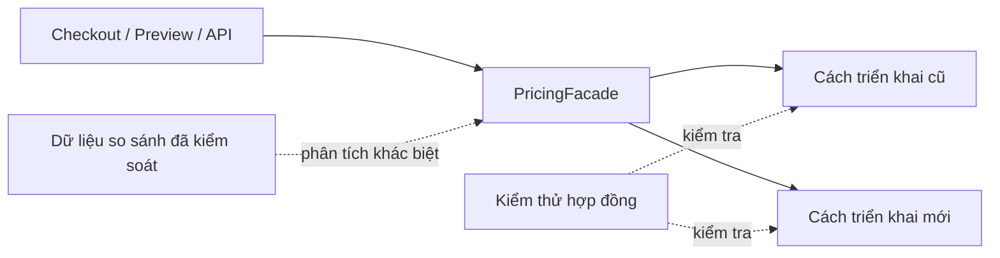

# Phân biệt đầu tư cải thiện với viết lại theo sở thích

Trong module `CODE_QUALITY_FUNDAMENTALS`, mục tiêu của chất lượng mã nguồn là làm phần mềm **đáng tin cậy, dễ hiểu và dễ thay đổi**. Ở chương **Nợ kỹ thuật**, một quyết định khó không phải chỉ là nhận ra đoạn mã chưa đẹp, mà là xác định **khi nào cần bỏ nguồn lực để cải thiện** và khi nào việc viết lại chủ yếu phản ánh sở thích của người thực hiện.

Một hệ thống có thể có lớp dài, quy tắc đặt tên không hoàn hảo hoặc cấu trúc khác phong cách bạn quen dùng nhưng vẫn chạy ổn định và dễ sửa với nhóm hiện tại. Ngược lại, một module trông khá gọn nhưng buộc phải chạy toàn bộ dịch vụ bên ngoài khi kiểm thử một công thức nhỏ, khiến các thay đổi thường xuyên bị lỗi hồi quy, có thể là khoản nợ kỹ thuật đáng trả. Do đó, **mức độ khó chịu khi đọc mã không đủ để kết luận một cuộc viết lại mang lại lợi ích**.

Hãy xét hai đề xuất:

> **Đề xuất A:** “Tôi thích dùng `Stream` hơn vòng `for`, nên muốn viết lại toàn bộ 40 phương thức xử lý danh sách.”  
> **Đề xuất B:** “Quy tắc chiết khấu được sao chép ở hai đường checkout và xem trước hóa đơn. Trong ba lần đổi chính sách gần nhất, hai nơi lệch nhau một lần. Ta có thể gom quy tắc dùng chung sau khi xác nhận cùng hợp đồng và bổ sung kiểm thử hồi quy.”

Cả hai đều có thể tạo mã khác trước, nhưng **B gắn thay đổi với một rủi ro thực và một phép xác minh cụ thể**. A chưa nêu được tác động, chi phí, giới hạn và vì sao phong cách mới tốt hơn trong ngữ cảnh dự án. Không có nghĩa A luôn vô giá trị: nếu dự án có quy ước nhất quán giúp bảo trì và thay đổi nhỏ với chi phí thấp, việc chuẩn hóa vẫn có thể hợp lý. Điểm phân biệt là **bằng chứng và giá trị đạt được**, không phải tên kỹ thuật được dùng.

Sau bài học, bạn có thể:

- Giải thích nợ kỹ thuật như một **đánh đổi có chi phí duy trì**, không đánh đồng với mọi đoạn mã không đẹp.
- Tìm bằng chứng về chi phí thay đổi, lỗi hồi quy, chậm kiểm thử, sự cố và rủi ro vận hành.
- Phân biệt sửa lỗi, refactor, tái cấu trúc, nâng cấp công nghệ và viết lại toàn bộ.
- So sánh các phương án theo tác động, chi phí, rủi ro và khả năng hoàn tác.
- Đề xuất cải thiện nhỏ có kiểm thử cho một trường hợp Java thực tế.
- Viết quyết định kỹ thuật nêu rõ giả thuyết, tiêu chí thành công, giới hạn và bằng chứng sau thay đổi.

## 1. Nợ kỹ thuật là chi phí của một lựa chọn thiết kế trong bối cảnh cụ thể

Hình ảnh **nợ kỹ thuật (technical debt)** giúp thảo luận một sự đánh đổi: một giải pháp có thể giúp giao giá trị nhanh hơn ở hiện tại nhưng khiến **các lần sửa đổi, mở rộng hoặc vận hành sau này tốn hơn**. “Lãi” của khoản nợ có thể xuất hiện như thời gian tìm hiểu lâu, nhiều nơi phải sửa, test chậm, lỗi lặp hoặc khó nâng cấp.

Không phải khoản nợ nào cũng đến từ quyết định tồi. Chẳng hạn, nhóm có thể chủ động dùng cấu trúc tạm trong phiên bản thử nghiệm để kiểm chứng nhu cầu thị trường, với kế hoạch xử lý khi nhu cầu được xác nhận. Ngược lại, nợ có thể phát sinh ngoài ý muốn khi yêu cầu thay đổi, quy mô dữ liệu tăng, công cụ hết hỗ trợ hoặc ranh giới thiết kế ban đầu không còn phù hợp.

### Ba điều cần phân biệt

| Khái niệm | Bản chất | Ví dụ |
| --- | --- | --- |
| **Lỗi hành vi (defect)** | Hệ thống vi phạm hợp đồng hoặc bất biến hiện hành | Tính sai tổng tiền tại ngưỡng giảm giá |
| **Nợ kỹ thuật** | Cấu trúc, phụ thuộc, kiểm thử hoặc quy trình khiến thay đổi/vận hành tốn kém hay rủi ro hơn mức cần thiết | Một quy tắc giá phải cập nhật ở bốn nơi, thường bỏ sót |
| **Sở thích thiết kế (preference)** | Lựa chọn cách viết hoặc kiến trúc khác chưa chứng minh được lợi ích đủ lớn so với chi phí | Đổi vòng `for` thành `stream()` chỉ vì thích cú pháp |

Ba nhóm có thể chồng lấp. Một lỗi hành vi có thể phơi bày nợ kỹ thuật trong cách tổ chức dữ liệu; một quy ước phong cách có thể trở thành vấn đề bảo trì khi cả nhóm thường xuyên hiểu nhầm. Việc phân loại giúp quyết định **mục tiêu sửa đổi**, chứ không dán nhãn để bác bỏ đề xuất của ai.

### Nợ kỹ thuật không đồng nghĩa với “mọi code cũ”

- Một thư viện cũ nhưng còn hỗ trợ, đáp ứng bảo mật và không gây trở ngại thay đổi **không tự động** là khoản nợ phải thay ngay.
- Một công nghệ mới nhưng ít người trong nhóm hiểu, khó vận hành hoặc không có đường quay lại **không tự động** giảm nợ.
- Một phương thức dài có thể cần tách vì thường xuyên thay đổi với nhiều lý do; nhưng phương thức dài ổn định và dễ kiểm thử chưa chắc là ưu tiên.
- Một thư viện đã hết hỗ trợ, có lỗ hổng liên quan hoặc chặn nâng cấp JDK có thể cần xử lý dù chưa phát sinh nhiều lỗi trong vận hành hiện tại.
- Nợ kiểm thử và quan sát vận hành có thể nghiêm trọng dù mã sản phẩm nhìn qua rất gọn.

**Chi phí của nợ là quan hệ giữa thiết kế và nhu cầu thay đổi thực tế.** Một thiết kế có thể phù hợp cho hệ thống ít biến thể nhưng trở thành trở ngại khi phải thêm chính sách mới hằng tuần.

## 2. Triệu chứng đáng điều tra phải liên kết với tác động

Một cuộc thảo luận “đây là code xấu” dễ rơi vào ý kiến đối lập. Cách hữu ích hơn là chuyển sang **hiện tượng quan sát được**:

| Triệu chứng | Bằng chứng có thể thu | Rủi ro hoặc chi phí cần giải thích |
| --- | --- | --- |
| Thêm một chính sách phải sửa nhiều lớp không liên quan | Diff các thay đổi gần đây, số tệp cùng bị chạm | Tăng nguy cơ bỏ sót, chi phí review và hồi quy |
| Một thay đổi nhỏ mất nhiều thời gian xác định nơi sửa | Thời gian lead time, nhật ký điều tra, phản hồi người phát triển | Chi phí thay đổi cao và khó onboarding |
| Kiểm thử cần DB/mạng thật dù chỉ kiểm tra công thức | Thời gian test, flaky rate, dependency setup | Chu kỳ phản hồi chậm, khó tái hiện lỗi |
| Mỗi lần release lỗi xuất hiện ở cùng một khu vực | Sự cố, rollback, hotfix, thời gian phục hồi | Tác động đến người dùng và độ tin cậy |
| Thư viện chặn nâng cấp bảo mật hoặc nền tảng | Khả năng hỗ trợ, thông báo bảo mật, kế hoạch migration | Rủi ro an toàn và chi phí trì hoãn |
| Muốn thay một nhà cung cấp phải sửa quy tắc nghiệp vụ | Sơ đồ phụ thuộc, phạm vi diff, bài test tích hợp | Khớp nối gây tăng công thay đổi |
| Tài liệu và quy trình triển khai không còn đúng | Sự cố vận hành, bước thủ công, lần rollback thất bại | Rủi ro thao tác và thời gian phục hồi |
| Số lượng cảnh báo analyzer cao | Finding được xác minh, loại rule, phạm vi và tần suất sửa | **Chưa đủ** để kết luận ưu tiên nếu thiếu tác động |

Không phải chỉ số nào cũng có sẵn. Một nhóm nhỏ có thể bắt đầu bằng **hai hoặc ba thay đổi thực tế gần nhất**, ghi ai phải sửa những gì, lỗi nào phát sinh, điều gì khiến sửa lâu và mức rủi ro nếu tình trạng kéo dài. Định tính có căn cứ vẫn tốt hơn một con số rất chính xác nhưng đo sai vấn đề.

### Đừng đọc chỉ số tách khỏi bối cảnh

**Cyclomatic Complexity** cao có thể cho thấy nhiều nhánh cần kiểm thử, nhưng không chứng minh một lần viết lại sẽ giảm lỗi. **Độ bao phủ test** cao không bảo đảm assertion đúng; test có thể bỏ qua bất biến quan trọng. **Số tệp bị sửa** nhiều có thể là hệ quả của một thay đổi giao thức có chủ đích, không nhất thiết là kiến trúc tồi.

Một chỉ số là **điểm bắt đầu đặt câu hỏi**. Để ra quyết định, cần liên hệ nó với chi phí, hành vi, quy mô thay đổi và bằng chứng cụ thể. Tránh biến chỉ số thành mục tiêu để “làm đẹp dashboard”.

## 3. Đầu tư cải thiện có giả thuyết và tiêu chí kiểm chứng

Một đề xuất đáng xem xét thường trả lời được:

1. **Vấn đề:** việc gì đang khó, nguy hiểm, chậm hoặc tốn tiền? Có một ví dụ kiểm chứng được không?
2. **Bối cảnh:** khu vực đó được sửa bao lâu một lần, ai chịu ảnh hưởng, chi phí hiện tại là gì?
3. **Nguyên nhân giả định:** cấu trúc mã, phụ thuộc, thiếu hợp đồng hay thiếu kiểm thử đang góp phần thế nào?
4. **Phương án:** thay đổi nhỏ nhất có khả năng giảm nguyên nhân là gì? Có phương án không viết lại không?
5. **Bằng chứng thành công:** kết quả nào phải đúng trước/sau, chỉ số nào kỳ vọng thay đổi?
6. **Chi phí và rủi ro:** cần bao nhiêu công, di chuyển dữ liệu nào, có gây sai hợp đồng hoặc chậm phát hành không?
7. **Giới hạn:** điều gì chưa chứng minh được, khi nào nên dừng hoặc xem lại quyết định?

Điều này không đòi mọi cải thiện nhỏ phải có bản phân tích tài chính phức tạp. Ví dụ đổi tên một biến mơ hồ ngay trong PR đang sửa nó có thể rất rẻ, dễ hiểu và không cần mở dự án mới. Nhưng **viết lại cả module** nên có lập luận chặt chẽ hơn việc đổi tên một phương thức.

### So sánh hai đề xuất cho cùng một module

| Tiêu chí | “Viết lại cho hiện đại” | “Giảm lỗi lặp khi thay chính sách giá” |
| --- | --- | --- |
| Lý do | “Tôi thích kiến trúc nhiều interface hơn” | “Ba thay đổi giá gần đây sửa lặp hai nơi; một lần bị lệch” |
| Phạm vi | Viết lại toàn bộ checkout | Trích xuất một quy tắc dùng chung khi hợp đồng thực sự trùng |
| Kỳ vọng | “Code sẽ đẹp và sạch hơn” | “Một lần sửa chính sách, có test biên cho cả checkout và preview” |
| Chi phí | Lớn, nhiều luồng nghiệp vụ phải kiểm thử lại | Giới hạn ở một quy tắc và hai đường gọi |
| Cách xác minh | Chưa rõ | Test hồi quy, so sánh kết quả trước/sau, review diff |
| Điều kiện dừng | Không xác định | Dừng nếu hai đường có hợp đồng khác nhau hoặc quy tắc chưa chốt |

Chỉ sau khi so sánh nhu cầu và ràng buộc mới có thể kết luận phương án nào phù hợp. Một cuộc viết lại **vẫn có thể cần thiết** nếu kiến trúc cũ thực sự ngăn thay đổi bắt buộc, không còn được hỗ trợ hoặc không thể vận hành an toàn; điều đó cần được chứng minh và quản lý như một quyết định rủi ro.

## 4. Chi phí nợ, lợi ích trả nợ và tính không chắc chắn

Ẩn dụ nợ giúp lượng hóa sơ bộ, nhưng không phải mọi lợi ích đều chuyển đổi chính xác thành tiền. Có thể dùng mô hình đơn giản:

\[
\text{Lợi ích kỳ vọng ròng} =
\text{Chi phí tương lai tránh được}
- \text{Chi phí cải thiện}
- \text{Chi phí/rủi ro mới}
\]

“Chi phí tương lai tránh được” có thể bao gồm công sức sửa mỗi lần, kiểm thử hồi quy, xử lý sự cố, thời gian triển khai và cơ hội kinh doanh bị trì hoãn. Cần tránh **đếm hai lần** cùng một tác động, ví dụ vừa tính giờ kỹ sư sửa lỗi vừa tính lại chính giờ đó trong ước lượng chi phí sự cố.

### Ví dụ ước lượng có điều kiện

Giả sử chính sách giá được thay khoảng **5 lần mỗi tháng**. Theo lịch sử nội bộ của tình huống giả định, mỗi thay đổi hiện cần **3 giờ xử lý công việc trùng lặp**, và sau refactor nhóm dự kiến giảm còn **1 giờ**. Trong ba tháng tới:

\[
5\ \text{lần/tháng} \times 3\ \text{tháng}
\times (3 - 1)\ \text{giờ/lần} = 30\ \text{giờ tiết kiệm dự kiến}
\]

Nếu refactor, kiểm thử, review và triển khai cần **18 giờ**, chênh lệch sơ bộ là **12 giờ** có lợi trong khoảng thời gian đó, *trước khi tính rủi ro và những biến số khác*. Đây không phải bảo đảm: tần suất thay đổi có thể giảm, công việc mới có thể phát sinh và dự đoán thời gian tiết kiệm có thể sai.

| Giả định | Kịch bản thận trọng | Kịch bản cơ sở | Kịch bản thuận lợi |
| --- | ---: | ---: | ---: |
| Số lần thay chính sách mỗi tháng | 2 | 5 | 8 |
| Giờ tiết kiệm mỗi lần | 1 | 2 | 2,5 |
| Tiết kiệm dự kiến trong 3 tháng | 6 giờ | 30 giờ | 60 giờ |
| Chi phí cải thiện giả định | 18 giờ | 18 giờ | 18 giờ |
| Chênh lệch trước rủi ro | -12 giờ | +12 giờ | +42 giờ |

Những con số trên chỉ dùng để **minh họa phân tích kịch bản**, không phải benchmark hay dữ liệu của một dự án thực tế. Điều quan trọng là thấy quyết định rất nhạy với **tần suất thay đổi** và **lợi ích thực thu**; không nên hứa một “ROI chắc chắn” dựa trên giả định chưa kiểm chứng.

### Không chỉ tính chi phí phát triển

Một số vấn đề phải ưu tiên dù khó định lượng:

- **Bảo mật:** phụ thuộc đã hết hỗ trợ hoặc lỗ hổng liên quan cần đánh giá theo mức phơi nhiễm và biện pháp giảm thiểu, không chờ số sự cố xảy ra mới trả nợ.
- **Tính đúng đắn:** mất dữ liệu, ghi trùng giao dịch hoặc sai phân quyền có hậu quả cao dù tần suất nhỏ.
- **Khả năng phục hồi:** quy trình rollback không tin cậy hoặc thiếu quan sát có thể khiến sự cố nhỏ trở thành sự cố diện rộng.
- **Tuân thủ và hợp đồng:** thay đổi nền tảng bắt buộc, tiêu chuẩn dữ liệu hoặc yêu cầu audit có thể khiến phương án hiện tại không còn chấp nhận được.
- **Cơ hội:** nếu cấu trúc hiện tại chặn một tính năng quan trọng đã được xác nhận, chi phí trì hoãn cũng cần đưa vào quyết định.

Trong các trường hợp này, mô hình “tiết kiệm bao nhiêu giờ phát triển?” là **một phần** của lập luận, không thay thế đánh giá hậu quả và trách nhiệm vận hành.

## 5. Đừng gọi mọi thay đổi cấu trúc là “viết lại”

Trước khi quyết định, cần gọi đúng tên và phạm vi phương án:

| Phương án | Mục tiêu thường gặp | Đánh đổi cần xem |
| --- | --- | --- |
| **Không thay đổi lúc này** | Chấp nhận chi phí hiện tại khi ít tác động hoặc có việc ưu tiên hơn | Cần ghi nhận điều kiện sẽ xem xét lại, không đơn thuần quên rủi ro |
| **Sửa lỗi (bug fix)** | Điều chỉnh hành vi sai so với hợp đồng | Phải kiểm thử tình huống gốc và tác động tới bên sử dụng |
| **Refactor cục bộ** | Cải thiện cấu trúc bên trong, về nguyên tắc giữ hành vi quan sát được | Cần đặc tả đủ hành vi cũ và tránh đưa thay đổi nghiệp vụ lẫn vào |
| **Cải thiện khi chạm mã (opportunistic cleanup)** | Đổi tên, tách hàm, bổ sung test đúng khu vực đang sửa | Giữ diff tập trung, tránh kéo scope quá xa |
| **Nâng cấp phụ thuộc/công cụ** | Đáp ứng hỗ trợ, bảo mật, tương thích hoặc vận hành | API phá tương thích, cấu hình, rủi ro migration |
| **Tái cấu trúc một ranh giới** | Giảm phụ thuộc, cô lập tích hợp, tách trách nhiệm | Có thêm adapter/interface, thay đổi hợp đồng và đường dữ liệu |
| **Thay thế dần (incremental replacement)** | Di chuyển phần chức năng sang cách triển khai mới từng bước | Cần routing, theo dõi hai phiên bản, quản lý dữ liệu và điểm quay lại |
| **Viết lại lớn (big-bang rewrite)** | Thay phần lớn triển khai trong một đợt | Khó chứng minh tương đương, di chuyển nhiều chức năng ẩn, rủi ro triển khai cao |

**Refactor** thường nhằm thay đổi cấu trúc mà **không thay đổi hành vi theo hợp đồng hiện có**. Nếu yêu cầu mới buộc tính lại chính sách giá, đổi dữ liệu xuất ra hoặc sửa một bug cũ, hãy ghi rõ phần **thay đổi hành vi có chủ đích** thay vì che nó dưới nhãn “chỉ dọn code”.

**Đầu tư cải thiện không nhất thiết là viết lại**. Đôi khi thêm một bộ kiểm thử hợp đồng, một bước quan sát trong CI, một adapter để đổi nhà cung cấp hoặc tài liệu hóa quy tắc dữ liệu đã đủ giảm rủi ro lớn. Mọi phương án đều cần được so sánh với lựa chọn **giữ nguyên** và chi phí cơ hội của công việc chưa làm.

### Phân biệt nhu cầu kỹ thuật với sự hấp dẫn của công nghệ mới

Những câu như “nên chuyển hết sang reactive”, “dùng microservice sẽ sạch hơn”, “thay mọi class bằng record” hoặc “viết lại bằng framework mới” chưa phải mô tả vấn đề. Cần hỏi:

- Tác vụ đang chậm vì CPU, I/O, chờ hay độ trễ phối hợp dịch vụ?
- Khung hiện tại có giới hạn đã đo hoặc vấn đề hỗ trợ thực sự không?
- Nhóm có đủ năng lực phát triển và vận hành giải pháp mới không?
- Việc di chuyển làm thay đổi hợp đồng, dữ liệu, monitoring hoặc chiến lược rollback thế nào?
- Lợi ích nào chỉ có thể đạt bằng công nghệ mới, và lợi ích nào đạt được bằng sửa cục bộ?

Một công nghệ mới có thể mang lợi ích quan trọng; nó cũng có thể chuyển nợ từ **code hiện tại** sang **độ phức tạp triển khai và vận hành**. Chỉ đánh giá độ đẹp của mã mới mà bỏ qua rủi ro tích hợp là so sánh không đầy đủ.

## 6. Ví dụ Java: cải thiện có mục tiêu thay vì đổi cú pháp cho đẹp

Giả sử hai đường của cửa hàng — **tính tiền checkout** và **xem trước hóa đơn chưa chốt** — cùng dùng quy tắc giá được xác nhận:

- Khách hàng `REGULAR` không giảm giá.
- Khách hàng `MEMBER` giảm 5%.
- Khách hàng `VIP` giảm 10%.
- Giá trị đầu vào là số tiền không âm, tính theo **đồng nguyên**, rồi làm tròn kết quả xuống 0 chữ số thập phân theo `HALF_UP`.
- Loại khách không hợp lệ phải báo lỗi, không mặc nhiên được giảm 0%.

Quy tắc ở đây là tình huống học tập. Trước khi tái sử dụng code thật, phải xác minh hai đường **thực sự có cùng hợp đồng**, đặc biệt nếu hóa đơn đã phát hành phải giữ **giá lịch sử** thay vì tính lại từ chính sách hiện tại.

### 6.1. Mã trước cải tiến: quy tắc nằm trong nơi sử dụng

```java
import java.math.BigDecimal;
import java.math.RoundingMode;

final class CheckoutQuote {
    BigDecimal total(BigDecimal subtotal, String tier) {
        if (subtotal == null || subtotal.signum() < 0) {
            throw new IllegalArgumentException("Invalid subtotal");
        }

        BigDecimal rate;
        if ("VIP".equals(tier)) {
            rate = new BigDecimal("0.10");
        } else if ("MEMBER".equals(tier)) {
            rate = new BigDecimal("0.05");
        } else if ("REGULAR".equals(tier)) {
            rate = BigDecimal.ZERO;
        } else {
            throw new IllegalArgumentException("Unknown tier");
        }

        return subtotal.multiply(BigDecimal.ONE.subtract(rate))
                .setScale(0, RoundingMode.HALF_UP);
    }
}
```

**Đoạn mã này không nhất thiết xấu**: nếu chỉ có một nơi gọi, ba loại khách ổn định và test tốt, tạo thêm nhiều lớp có thể làm khó đọc hơn. Nhưng giả sử có một bản sao tương tự ở `InvoicePreview`, và đội thường xuyên sửa hai bản với một lần bỏ sót. Khi đó vấn đề cần xử lý là **hai nguồn quy tắc có thể phân kỳ**, không phải `if/else` “kém hiện đại”.

Một ý tưởng không đủ căn cứ sẽ là “đổi `if/else` thành `switch` cho đẹp”. Nó có thể cải thiện tính rõ ràng cục bộ, nhưng **không** giải quyết được việc một thay đổi chính sách vẫn cần chỉnh ở hai nơi. Phương án có mục tiêu hơn là trích xuất **một chính sách tính tiền có tên rõ** rồi cho cả hai luồng dùng nếu hợp đồng đúng là chung.

### 6.2. Bản sửa nhỏ: trích xuất một nguồn quy tắc

```java
import java.math.BigDecimal;
import java.math.RoundingMode;
import java.util.Objects;

final class TierPricing {
    BigDecimal totalAfterDiscount(BigDecimal subtotal, String tier) {
        if (subtotal == null || subtotal.signum() < 0) {
            throw new IllegalArgumentException("Invalid subtotal");
        }
        if (tier == null) {
            throw new IllegalArgumentException("Unknown tier");
        }

        BigDecimal rate = switch (tier) {
            case "REGULAR" -> BigDecimal.ZERO;
            case "MEMBER" -> new BigDecimal("0.05");
            case "VIP" -> new BigDecimal("0.10");
            default -> throw new IllegalArgumentException("Unknown tier");
        };

        return subtotal.multiply(BigDecimal.ONE.subtract(rate))
                .setScale(0, RoundingMode.HALF_UP);
    }
}

final class CheckoutQuote {
    private final TierPricing pricing;

    CheckoutQuote(TierPricing pricing) {
        this.pricing = Objects.requireNonNull(pricing);
    }

    BigDecimal total(BigDecimal subtotal, String tier) {
        return pricing.totalAfterDiscount(subtotal, tier);
    }
}

final class InvoicePreview {
    private final TierPricing pricing;

    InvoicePreview(TierPricing pricing) {
        this.pricing = Objects.requireNonNull(pricing);
    }

    BigDecimal total(BigDecimal subtotal, String tier) {
        return pricing.totalAfterDiscount(subtotal, tier);
    }
}
```

Trong mã này, `switch` là một lựa chọn trình bày, **không phải nguồn lợi ích chính**. Cải thiện chính là có một chỗ xác định các mức giảm và chính sách làm tròn. Không cần tạo interface `PricingStrategy` cho từng loại khách khi số biến thể nhỏ và ổn định. Nếu chính sách sau này thực sự có nhiều biến thể độc lập, có thể xem xét mở rộng kiến trúc dựa trên nhu cầu mới thay vì thiết kế trước mọi trường hợp.

Một chi tiết dễ bỏ sót là **loại ngoại lệ**: mã cũ ném `IllegalArgumentException` khi `subtotal` bằng `null`. Nếu refactor đổi sang `Objects.requireNonNull(subtotal)`, lỗi lúc này là `NullPointerException`. **Nếu loại ngoại lệ là một phần của hợp đồng mà bên gọi dựa vào, đây không còn là refactor hoàn toàn giữ hành vi.** Phiên bản trích xuất ở trên cố ý giữ cách báo lỗi cũ bằng nhánh kiểm tra tường minh. Ví dụ này cho thấy ngay cả một trích xuất nhỏ cũng cần bảo vệ trường hợp biên và loại lỗi, không chỉ giá trị thành công. Với API công khai, cách ánh xạ ngoại lệ sang HTTP cũng có thể ảnh hưởng client.

### 6.3. Kiểm thử đặc tả và hồi quy

Trước khi refactor, viết hoặc xác nhận các ca kiểm thử cho cả hai luồng theo hợp đồng:

```java
import static org.junit.jupiter.api.Assertions.assertEquals;
import static org.junit.jupiter.api.Assertions.assertThrows;

import java.math.BigDecimal;
import org.junit.jupiter.api.Test;

class TierPricingTest {
    private final TierPricing pricing = new TierPricing();

    @Test
    void appliesRatesAccordingToTier() {
        BigDecimal subtotal = new BigDecimal("100000");
        assertEquals(new BigDecimal("100000"),
                pricing.totalAfterDiscount(subtotal, "REGULAR"));
        assertEquals(new BigDecimal("95000"),
                pricing.totalAfterDiscount(subtotal, "MEMBER"));
        assertEquals(new BigDecimal("90000"),
                pricing.totalAfterDiscount(subtotal, "VIP"));
    }

    @Test
    void keepsRoundingContract() {
        assertEquals(new BigDecimal("10"),
                pricing.totalAfterDiscount(
                        new BigDecimal("11"), "VIP"));
    }

    @Test
    void rejectsInvalidBusinessInputs() {
        assertThrows(IllegalArgumentException.class,
                () -> pricing.totalAfterDiscount(
                        new BigDecimal("-1"), "REGULAR"));
        assertThrows(IllegalArgumentException.class,
                () -> pricing.totalAfterDiscount(
                        new BigDecimal("100"), "UNKNOWN"));
        assertThrows(IllegalArgumentException.class,
                () -> pricing.totalAfterDiscount(null, "VIP"));
        assertThrows(IllegalArgumentException.class,
                () -> pricing.totalAfterDiscount(
                        new BigDecimal("100"), null));
    }
}
```

Khi triển khai thực tế, hãy giữ thêm test tại điểm gọi của `CheckoutQuote` và `InvoicePreview` để chứng minh cả hai dùng đúng chính sách và không vô tình bỏ qua những quy tắc khác. Nếu có dữ liệu lịch sử hoặc một hợp đồng làm tròn khác nhau giữa hai luồng, **không gom bằng mọi giá**: một điểm trùng code có thể che giấu hai lý do thay đổi độc lập.

Các ca ở trên xác minh những đầu vào đã chọn, **không** chứng minh mọi giá trị hoặc mọi integration đều đúng. Cần kiểm tra thêm trường hợp `null`, giá trị biên, khả năng tràn/giới hạn dữ liệu nếu có, cùng cách lưu/đọc tiền tệ trong hệ thống thật.

### 6.4. Bằng chứng nào chứng minh khoản đầu tư có ích?

Không phải chỉ “bộ test pass”. Những tín hiệu cần theo dõi sau vài lần thay đổi chính sách:

- Khi đổi một mức giảm, team sửa quy tắc tại **một nguồn** thay vì hai nguồn rời.
- Test cho checkout và preview cùng được chạy, phát hiện phân kỳ trước khi deploy.
- Thời gian review và lỗi hồi quy do bỏ sót bản sao giảm so với tình trạng cũ, nếu đủ lần quan sát.
- Người mới có thể tìm đúng quy tắc và giới hạn áp dụng của nó mà không cần đọc nhiều luồng nghiệp vụ.
- Không phát sinh mâu thuẫn mới với hóa đơn lịch sử, giao dịch đã chốt hoặc chính sách tiền tệ.

Đây là cách đánh giá một **khoản đầu tư cải thiện có mục tiêu**. Việc đổi phong cách `if` thành `switch` có thể tốt cho tính nhất quán nội bộ, nhưng nếu không giảm vấn đề đã xác định thì không nên trình bày như đã trả xong khoản nợ do sao chép chính sách.

## 7. Khi nào một cuộc viết lại lớn có thể hợp lý?

Viết lại toàn bộ thường hấp dẫn vì cho cảm giác **khởi đầu mới**, không còn phải hiểu những quyết định cũ. Nhưng phần lớn hệ thống có những hợp đồng không nằm trong tài liệu: dữ liệu lịch sử, các giá trị ngoại lệ, hành vi mà khách hàng đang dựa vào, giao thức giữa dịch vụ và những giới hạn vận hành được tích lũy qua nhiều sự cố.

Một bản triển khai mới cần **khám phá, bảo tồn hoặc thay thế có chủ đích** các hợp đồng đó. Nếu chỉ nhìn mã đang khó đọc mà không xác định hành vi nào phải giữ, nhóm có thể đổi nợ kỹ thuật cũ thành lỗi tương thích và nợ vận hành mới.

### Tín hiệu khiến phương án viết lại đáng xem xét

| Tình huống | Vì sao thay thế lớn có thể có giá trị | Bằng chứng và câu hỏi cần có |
| --- | --- | --- |
| Nền tảng đã hết hỗ trợ, không thể vá rủi ro nghiêm trọng | Duy trì hệ thống trở thành rủi ro không thể chấp nhận | Có phương án hỗ trợ tạm, migration bắt buộc, phụ thuộc còn tương thích không? |
| Ranh giới dữ liệu/kiến trúc không đáp ứng yêu cầu mới đã xác nhận | Vá cục bộ không giải quyết được bất biến hoặc năng lực cần thiết | Giới hạn cụ thể nằm ở đâu; đã thử phương án tách dần chưa? |
| Dự án nhiều năm không thể triển khai an toàn vì cấu trúc phụ thuộc chồng chéo | Một thay đổi nhỏ ảnh hưởng diện rộng và liên tục gây lỗi | Lịch sử sự cố, lead time, phạm vi sửa, nguyên nhân lặp lại |
| Công nghệ cũ không còn công cụ hoặc nhân lực để vận hành | Rủi ro vận hành và khả năng khôi phục không đạt yêu cầu | Có thể nâng cấp tại chỗ hoặc đóng gói qua adapter trước không? |
| Dữ liệu/qui tắc hiện tại đã hoàn toàn khác sản phẩm mục tiêu | Giữ kiến trúc cũ khiến mọi tính năng đều là ngoại lệ | Hợp đồng mới đã ổn định chưa; hệ thống nào phải cùng tồn tại? |

Đây là các **dấu hiệu cần phân tích**, không phải lệnh mặc định viết lại. Với nhiều hệ thống, một chiến lược **thay thế dần** ít rủi ro hơn việc chuyển mọi chức năng trong một ngày.

### Ba rủi ro đặc biệt của big-bang rewrite

1. **Mất hành vi ẩn:** hệ thống cũ đã xử lý các trường hợp hiếm, các tập dữ liệu cũ hoặc lỗi nhà cung cấp theo cách không được ghi vào tài liệu. Hệ thống mới có thể trông đúng trong demo nhưng sai ở production.
2. **Khoảng cách triển khai kéo dài:** trong lúc làm bản mới, bản cũ vẫn nhận sửa lỗi và yêu cầu mới. Hai nhánh phát triển tách xa nhau, làm việc bắt kịp thay đổi thêm tốn kém.
3. **Chuyển đổi khó quay lại:** schema và dữ liệu đã migrate, khách hàng đã dùng API mới, thao tác ghi có tác dụng phụ. Rollback không đơn thuần là quay lại commit trước.

Một viết lại vẫn có thể là lựa chọn đúng khi những rủi ro trên được **nhận diện, giới hạn và quản lý**. Lập luận tốt sẽ nêu rõ vì sao sửa từng phần không đủ, chức năng nào phải giữ, chi phí kiểm chứng tương đương, kế hoạch chạy thử/đối soát và điều kiện dừng.

## 8. Thay thế dần: giảm rủi ro trong khi vẫn tạo giá trị

Giả sử cần thay mô-đun tính khuyến mãi đã gắn vào nhiều luồng nhưng hợp đồng đầu ra của nó đủ rõ. Có thể dùng một **facade** làm ranh giới, rồi chuyển từng nhóm yêu cầu sang implementation mới sau khi có kiểm thử.



Các bước hợp lý:

1. **Ghi hợp đồng ở facade:** đầu vào, đơn vị tiền, kết quả, lỗi, tính lặp an toàn, phụ thuộc dữ liệu và hiệu lực chính sách.
2. **Viết test đặc tả hành vi:** ca thường, ca biên, dữ liệu lịch sử và các tình huống lỗi đã từng xảy ra.
3. **Tách đường đọc hoặc phép tính thuần trước nếu phù hợp:** những phép tính không có tác dụng phụ dễ so sánh hơn việc tạo đơn hoặc thanh toán.
4. **Chuyển một nhóm nhỏ có thể quan sát:** bật implementation mới với phạm vi rõ, theo dõi khác biệt và khả năng rollback.
5. **Kiểm tra dữ liệu và tác động vận hành:** latency, tỷ lệ lỗi, kết quả nghiệp vụ, sự nhất quán và hỗ trợ.
6. **Mở rộng dần, xóa đường cũ đúng lúc:** tránh duy trì hai phiên bản vô thời hạn chỉ vì chưa định nghĩa tiêu chí hoàn tất.

### Shadow mode cần phân biệt đọc với ghi

Ở chế độ **shadow comparison**, có thể chạy phép tính giá thuần trên cả phiên bản cũ và mới, rồi so sánh kết quả **mà chỉ một kết quả được dùng để quyết định nghiệp vụ**. Việc này hữu ích để phát hiện sai khác trước khi chuyển traffic.

Nhưng không được mù quáng phát đồng thời hai lệnh **thu tiền, giữ hàng, gửi email hoặc ghi đơn** chỉ để so sánh. Hai lần gọi có tác dụng phụ có thể tạo giao dịch trùng hoặc làm đổi trạng thái ngoài dự kiến. Nếu cần kiểm chứng thao tác ghi, phải có môi trường sandbox, dữ liệu thử được cô lập, idempotency hoặc phương pháp mô phỏng đủ an toàn.

### Tiêu chí chuyển đổi cần định nghĩa trước

Ví dụ, một phương án thay `PricingService` có thể yêu cầu:

- 100% ca kiểm thử hợp đồng quan trọng pass ở cả hai phiên bản trong phạm vi công bố.
- Những sai khác của tính toán ở dữ liệu lịch sử được phân loại: lỗi cũ cần sửa có chủ đích, quy tắc đã đổi, hay lỗi implementation mới.
- Không làm tăng lỗi tính tiền hoặc phá trạng thái đơn đã xác nhận.
- Độ trễ và sử dụng tài nguyên nằm trong ngưỡng được nhóm xác định.
- Có đường quay lại an toàn cho chức năng đã chuyển, hoặc kế hoạch phục hồi nếu dữ liệu đã thay đổi.

Các con số/ngưỡng phải do đội dự án đặt từ mức rủi ro thực. Không chọn tỷ lệ thành công chỉ để làm báo cáo đẹp: với một giao dịch tài chính, **một khác biệt chưa giải thích được** cũng có thể đủ để dừng triển khai.

## 9. Ưu tiên danh mục nợ kỹ thuật thay vì “dọn tất cả”

Thời gian của đội phát triển có hạn. Có thể có nhiều khoản nợ: test chạy chậm, phụ thuộc cũ, truy vấn N+1, cấu trúc điều phối khó sửa, log không đủ để đối soát. Không phải khoản nợ nào cũng cần giải quyết ngay; cần quản lý chúng như **các khoản đầu tư cạnh tranh về nguồn lực**.

Một danh sách nợ nên chứa cả **tác động** và **điều kiện cần xem lại**, thay vì chỉ các nhãn “code xấu”:

| Trường | Nội dung nên ghi |
| --- | --- |
| Mô tả | Khu vực nào, trở ngại/rủi ro cụ thể nào? |
| Bằng chứng | PR, incident, số liệu test/CI, ví dụ đổi một tính năng phải sửa nhiều nơi |
| Phạm vi ảnh hưởng | Tần suất thay đổi, người dùng/dịch vụ bị ảnh hưởng, hậu quả nếu bỏ qua |
| Giả thuyết nguyên nhân | Phụ thuộc chặt, trùng quy tắc, không có test, thư viện hết hỗ trợ... |
| Lựa chọn | Không làm, cải thiện tại chỗ, refactor, thay thế dần, viết lại |
| Chi phí & rủi ro | Ước lượng công, công việc bị trì hoãn, rủi ro hồi quy, migration/rollback |
| Điều kiện thành công | Hành vi, test, độ trễ, sự cố hoặc thời gian sửa dự kiến |
| Chủ sở hữu và thời điểm xem xét | Ai chịu trách nhiệm và khi nào quyết định lại |

### Cách xếp ưu tiên không nên che sự bất định

Có thể thảo luận theo các yếu tố: **hậu quả nếu để nguyên**, **xác suất/tần suất gặp vấn đề**, **mức độ sắp phải thay đổi vùng mã**, **khả năng giảm rủi ro của phương án**, **chi phí thực hiện** và **độ tin cậy của bằng chứng**.

Ví dụ danh mục giả định:

| Khoản nợ | Tác động hiện thấy | Ưu tiên gợi ý | Lý do |
| --- | --- | --- | --- |
| Phụ thuộc xác thực hết hỗ trợ, có cảnh báo bảo mật liên quan | Nguy cơ an toàn và yêu cầu nâng cấp | Cao, cần đánh giá cụ thể ngay | Hậu quả lớn ngay cả khi chưa có sự cố quan sát |
| Chính sách giá sao chép ở hai nơi đổi thường xuyên | Một lỗi phân kỳ gần đây, nhiều PR chạm hai nơi | Có thể làm trong đợt cải tiến gần nhất | Có bài toán và ca kiểm thử rõ, phạm vi nhỏ |
| Biến tên `tmp` trong hàm ổn định 10 dòng | Khó đọc nhẹ, ít thay đổi | Sửa khi chạm tới | Thay đổi nhỏ có lợi nhưng không cần dự án riêng |
| Chuyển toàn bộ code sang mẫu kiến trúc mới | Chưa đo được ảnh hưởng | Chưa ưu tiên | Chưa có mục tiêu/rủi ro cụ thể để biện minh chi phí |
| CI integration test thất thường, làm chặn release | Lịch sử rerun, thời gian chờ, kết quả không tin cậy | Ưu tiên nếu thường xuyên làm chậm việc phát hành | Có tác động vào khả năng xác minh và tốc độ phản hồi |

Đừng coi “ưu tiên thấp” là kết luận cố định. Một khoản nợ có thể trở nên cấp bách khi sản phẩm bắt đầu có nhiều người dùng, phải nâng JDK, đối tác đổi API hoặc sự cố liên quan xuất hiện.

### Nợ chủ động có cần ghi lại không?

Có. Nếu đội biết một giải pháp tạm có hạn chế và vẫn chọn vì thời gian đưa sản phẩm ra thị trường, hãy ghi:

- **Lợi ích ngắn hạn** nhận được.
- **Giới hạn** chấp nhận, ví dụ chỉ xử lý một mức tải hoặc một loại sản phẩm.
- **Dấu hiệu kích hoạt việc xem lại**, ví dụ xuất hiện nhiều biến thể khuyến mãi hoặc số lỗi hồi quy tăng.
- **Phương án tháo bỏ** và ai chịu trách nhiệm.

Điều này giúp khoản nợ trở thành quyết định có trách nhiệm, thay vì một “TODO refactor later” không thời hạn và không ai sở hữu.

## 10. Cách bảo vệ một đề xuất trong code review

Khi đề xuất thay đổi cấu trúc, không cần biến code review thành cuộc tranh luận về trường phái. Hãy tách **nhận xét quan sát được**, **giả thuyết về vấn đề** và **lựa chọn thiết kế**.

Ví dụ nhận xét chưa rõ:

> “Class này xấu, phải dùng SOLID. Hãy viết lại.”

Có thể chuyển thành:

> “Ba PR gần đây thêm chính sách khuyến mãi đều phải sửa cả `CheckoutQuote` và `InvoicePreview`. Một lần chỉ cập nhật một nơi khiến khách hàng thấy hai tổng tiền khác nhau. Nếu hai đường đúng là dùng cùng chính sách, ta nên trích xuất quy tắc dùng chung và bổ sung test hợp đồng ở hai đường. Nếu hợp đồng khác nhau vì giá lịch sử, hãy ghi rõ và không gom nhầm.”

Nhận xét thứ hai vẫn có thể tranh luận, nhưng **có dữ liệu, giả thuyết, điều kiện và phép kiểm chứng**. Người review có thể đưa ra giải pháp rẻ hơn hoặc bác bỏ giả thuyết bằng bằng chứng, thay vì chỉ bảo vệ sở thích cá nhân.

### Phân biệt “không thích cách viết” với “người đọc thường hiểu sai”

Sở thích vẫn có thể trở thành vấn đề cần giải quyết nếu ảnh hưởng thực tế:

- Tên biến `p` trong một hàm 5 dòng cục bộ có thể chưa cần dự án riêng; tên `p` mang nghĩa “tỷ lệ phần trăm” trong 12 đường tính tiền, từng gây nhầm `20` với `0.2` là rủi ro đáng xử lý.
- Một vòng `for` và một `stream()` cho kết quả tương đương: nên ưu tiên quy ước hiện hành và tính dễ đọc cho nhóm, không thay hàng loạt vì cá nhân thích một cách.
- Một chuỗi điều kiện dài nhưng có test và ít thay đổi có thể chưa cấp bách; chuỗi đó phải sửa hằng tuần, thường gây bỏ sót nhánh và không có kiểm thử biên thì cần đánh giá refactor.
- Một công cụ formatter tự động giúp giảm tranh luận nhỏ với chi phí thấp; không cần chờ số liệu ROI phức tạp cho từng dấu cách, nhưng không nên biến PR sửa chức năng thành cuộc đổi định dạng toàn repository.

Tiêu chí hữu ích là **mức rõ nghĩa cho người đọc và rủi ro trong công việc thật**, không phải tác giả dùng phong cách nào.

### Mẫu ghi nhận một quyết định kỹ thuật ngắn

Một quyết định quan trọng có thể được lưu trong mô tả PR, issue hoặc ADR (*Architecture Decision Record*). Ví dụ:

```text
Vấn đề:
  Thêm một chính sách giá cần sửa hai luồng tương đương;
  đã có một sự cố phân kỳ.

Bằng chứng:
  Ba PR gần nhất cùng sửa hai nơi; một hotfix sau deploy;
  test hiện chưa bảo vệ tính đồng nhất của hai kết quả.

Các lựa chọn:
  A. Giữ nguyên và tăng review thủ công.
  B. Trích xuất một TierPricing có test và cho hai luồng dùng.
  C. Viết lại toàn bộ module định giá.

Quyết định đề xuất:
  B, sau khi xác nhận checkout và preview có cùng hợp đồng.

Tiêu chí thành công:
  Giữ đúng kết quả và loại lỗi trên ca đã xác nhận;
  đổi một mức giảm chỉ sửa một nơi;
  cả hai luồng có kiểm thử hồi quy.

Rủi ro / giới hạn:
  Hóa đơn đã chốt không được tính lại từ quy tắc mới;
  không mở rộng scope sang thanh toán hoặc dữ liệu lịch sử.

Điểm xem lại:
  Sau ba lần thay đổi chính sách tiếp theo, xem số lỗi phân kỳ,
  thời gian review và phản hồi của nhóm.
```

Mẫu trên không cần định lượng giả tạo; nó giúp người đến sau hiểu **vì sao giải pháp được chọn**, **điều kiện nào từng đúng** và **khi nào cần xem xét lại**.

## 11. Triển khai khoản cải thiện như một thay đổi có thể kiểm soát

Ngay cả đề xuất có ích cũng có thể thất bại nếu thực hiện quá rộng hoặc không thể xác minh. Một kế hoạch trả nợ kỹ thuật nên ưu tiên:

### 11.1. Cố định hành vi cần bảo vệ

Tạo hoặc xác nhận kiểm thử cho:

- Luồng hợp lệ thường dùng.
- Giá trị biên và dữ liệu không hợp lệ.
- Lỗi từ dịch vụ ngoài, timeout và trạng thái chưa xác định nếu liên quan.
- Hợp đồng công khai (API, schema, exception hoặc thông điệp lỗi mà client đang dựa vào).
- Các bất biến dữ liệu khi có nhiều yêu cầu đồng thời.

Không phải **mọi hành vi cũ đều cần giữ**. Nếu hành vi cũ là bug, phải có yêu cầu sửa lỗi đã xác nhận và test thể hiện **hành vi mới đúng**. Việc phân tách hai mục tiêu này giúp reviewer biết đâu là thay đổi cấu trúc và đâu là thay đổi sản phẩm.

### 11.2. Giữ thay đổi theo lát nhỏ

Ví dụ với một module bị phụ thuộc chặt:

1. Viết test đặc tả cho ranh giới hiện tại.
2. Đưa lời gọi SDK vào adapter có hợp đồng rõ, vẫn giữ hành vi.
3. Cho một client dùng adapter, chạy kiểm thử tích hợp liên quan.
4. Di chuyển những client còn lại theo nhóm nhỏ.
5. Chỉ bỏ đường cũ sau khi không còn người dùng và dữ liệu liên quan đã được đối soát.

Mỗi lát nhỏ giúp biết **thay đổi nào gây lỗi**, giảm chi phí rollback và tạo giá trị sớm. Nếu quy trình không thể tách được như vậy, rủi ro tổng thể cần được ghi nhận công khai thay vì giả định một bản thay thế lớn sẽ tự thuận lợi.

### 11.3. Định nghĩa rollback theo tác dụng phụ thật

Rollback code không tự khôi phục dữ liệu đã ghi. Nếu thay đổi liên quan:

- **Schema:** migration có tương thích với phiên bản cũ trong thời gian chuyển đổi không?
- **Giao dịch thanh toán:** một lần retry sau rollback có phát sinh thu tiền lần hai không?
- **Sự kiện:** dữ liệu phát đi đã được bên nhận tiêu thụ hay chưa?
- **Định danh:** dữ liệu được tạo bởi hệ mới có được hệ cũ đọc đúng không?
- **Cache và read model:** có cần rebuild hoặc chờ hội tụ khi quay lại không?

Hãy xác định điều kiện an toàn trước khi triển khai, không đợi xảy ra sự cố mới tìm cách đảo ngược trạng thái.

### 11.4. Đo sau khi thay đổi, kể cả khi không có sự cố

Một đợt cải thiện nên đối chiếu điều kiện đã cam kết:

| Mục tiêu | Bằng chứng trước/sau cần xem | Giới hạn |
| --- | --- | --- |
| Giảm thời gian sửa chính sách | Thời gian triển khai, số nơi sửa, thời gian review của những thay đổi cùng loại | Số lần quan sát nhỏ và độ khó mỗi yêu cầu khác nhau |
| Giảm lỗi hồi quy | Số defect cùng nhóm, test thất bại đúng mục tiêu, hotfix | Không thể kết luận xác suất lỗi bằng 0 |
| Tăng khả năng kiểm thử | Test độc lập khỏi DB/mạng, thời gian chạy, mức flaky | Test nhanh không bảo đảm test có assertion hữu ích |
| Giảm khớp nối | Phạm vi diff khi đổi một tích hợp, số client biết SDK | Nhiều interface hơn không tự chứng minh coupling thấp hơn |
| Cải thiện hiệu năng | p95/p99, throughput, CPU/GC/I-O dưới tải so sánh được | Cần kiểm soát quy mô dữ liệu, cache, môi trường |
| Giảm rủi ro vận hành | Khả năng rollback, độ tin cậy của runbook, thời gian phục hồi | Ít incident trong thời gian ngắn chưa chứng minh an toàn tuyệt đối |

Nếu lợi ích không xuất hiện, cần xem lại giả thuyết: có thể khoản nợ được xác định sai, cách sửa không đủ, thay đổi sản phẩm quá ít để đo hoặc chi phí phát sinh chưa được tính. **Đừng tiếp tục đầu tư chỉ vì đã chi nhiều công trước đó**; chi phí đã bỏ ra không tự biện minh cho những khoản đầu tư tiếp theo.

## 12. Các sai lầm thường gặp khi “trả nợ”

| Sai lầm | Hậu quả | Cách xử lý có căn cứ |
| --- | --- | --- |
| Gọi mọi mã không hợp gu là nợ | Backlog phình ra, ưu tiên thiếu rõ ràng | Nêu tác động, bối cảnh và điều kiện chấp nhận |
| Viết lại toàn bộ vì “không hiểu mã cũ” | Mất hành vi ẩn, chậm giao tính năng, khó rollback | Học hợp đồng bằng test và tài liệu; thay từng ranh giới nếu có thể |
| Chỉ dựa vào số lượng code smell | Tối ưu dashboard, bỏ qua rủi ro thật | Phân loại finding và liên hệ tới chất lượng có thể quan sát |
| Refactor và đổi nghiệp vụ trong một commit lớn | Khó biết nguyên nhân sai khác | Tách thay đổi hành vi có chủ đích khỏi thay đổi cấu trúc |
| Chia một lớp thành nhiều lớp chuyển tiếp vô nghĩa | Luồng đọc dài hơn, tăng chi phí tìm hiểu | Tách theo lý do thay đổi và hợp đồng có ích |
| Chuyển mọi mã sang framework/cú pháp mới | Tạo công di chuyển lớn, có thể tăng nợ vận hành | Nêu giới hạn hiện tại mà công nghệ mới giải quyết được |
| “Giữ nguyên tuyệt đối mọi hành vi cũ” | Vô tình hợp thức hóa bug cũ | Phân loại hành vi cần giữ và lỗi cần sửa bằng đặc tả |
| Bỏ qua test của dữ liệu lịch sử | Mã mới chỉ đúng với dữ liệu sạch | Khảo sát, kiểm thử và di chuyển dữ liệu cũ có chủ đích |
| Không có điều kiện dừng | Công việc “dọn code” kéo dài vô hạn | Định nghĩa phạm vi, tiêu chí thành công, ngân sách và mốc review |
| Cố bảo vệ phương án vì đã đầu tư quá nhiều | Tăng chi phí không mang lại giá trị | Dùng bằng chứng mới để điều chỉnh hoặc dừng đầu tư |
| Không ghi nhận nợ chủ động | Quyết định tạm trở thành mặc định lâu dài | Ghi giới hạn, chủ sở hữu và tín hiệu cần xem lại |

Điểm chung của các sai lầm này là **lấy hình thức triển khai làm đích đến**. Chất lượng mã cần được đánh giá bằng khả năng hỗ trợ những hành vi và thay đổi quan trọng, không phải số lượng pattern, interface hoặc dòng mã được viết lại.

## 13. Bài tập thực hành

### Bài 1 — Phân loại đề xuất

Đọc bốn nhận định sau:

1. “Chuyển toàn bộ vòng lặp thành Stream vì tôi thích cách đọc đó.”
2. “Mỗi lần nâng SDK thanh toán phải sửa ba service nghiệp vụ; tháng trước gây lỗi timeout ở hai endpoint.”
3. “Nhà cung cấp thư viện mã hóa đã ngừng hỗ trợ và có cảnh báo bảo mật phù hợp với đường xử lý đang dùng.”
4. “Một biến tên `x` trong hàm nhỏ ít thay đổi nên đổi thành `discountFraction` khi sửa chính hàm đó.”

Hãy phân loại đâu là sở thích chưa có bằng chứng, khoản nợ/rủi ro cần đánh giá và cải thiện nhỏ có thể thực hiện khi chạm mã. Với mỗi nhận định, nêu **một thông tin bổ sung** có thể làm thay đổi quyết định ưu tiên.

### Bài 2 — Viết giả thuyết có thể bác bỏ

Một lớp checkout có 900 dòng và nhiều nhánh. Người review đề nghị “tách thành 20 class vì 900 dòng là xấu”. Hãy chuyển đề nghị thành hai giả thuyết dựa trên hành vi: ví dụ nhiều lý do thay đổi độc lập, thiếu test biên hoặc sự cố hồi quy. Với mỗi giả thuyết, chọn một phép kiểm tra có thể **bác bỏ** nó.

### Bài 3 — Refactor có mục tiêu

Dựa trên `CheckoutQuote` và `TierPricing` ở mục 6, viết test cho ba nhóm khách, giá trị 0, giá trị âm, loại khách lạ và `null`. Giả sử luồng preview thật có cùng chính sách, hãy trích xuất một nguồn quy tắc dùng chung mà không đổi hợp đồng lỗi. Giải thích vì sao chỉ thay `if/else` bằng `switch` không giải quyết khoản nợ do trùng chính sách.

### Bài 4 — Phân tích kịch bản đầu tư

Một refactor dự kiến mất 25 giờ. Mỗi lần thay quy tắc hiện tốn thêm 2 giờ do cấu trúc mã; số lần đổi trong quý tới có thể là 4, 12 hoặc 20. Hãy tính lượng thời gian có thể tiết kiệm trong ba kịch bản, so với chi phí ban đầu. Nêu ít nhất ba giả định có thể khiến mô hình sai, và một rủi ro quan trọng không đo được chỉ bằng giờ phát triển.

### Bài 5 — Đánh giá đề xuất viết lại lớn

Một nhóm muốn viết lại module đặt hàng 5 năm tuổi bằng framework mới. Module hiện có quy trình thanh toán, tồn kho, hóa đơn cũ và nhiều sự kiện bất đồng bộ. Hãy lập danh sách các hợp đồng cần bảo vệ, cách chứng minh giải pháp hiện tại thật sự chặn nhu cầu mới và phương án di chuyển từng lát thay vì chuyển một lần.

### Bài 6 — Shadow mode an toàn

Thiết kế cách so sánh thuật toán tính giá cũ và mới trên cùng đầu vào mà không làm phát sinh hai đơn hàng. Phân biệt trường hợp chạy song song **phép tính thuần** với trường hợp chạy song song **lệnh thanh toán có tác dụng phụ**. Nêu khi nào phải dừng triển khai dù tỷ lệ kết quả khớp nhau rất cao.

### Bài 7 — Ưu tiên danh mục nợ

Nhóm đang có ba việc: thư viện xác thực hết hỗ trợ, test CI chậm 15 phút nhưng ổn định, và đổi tên hàng trăm phương thức để hợp sở thích. Với thông tin hiện tại, hãy nêu dữ liệu cần thu để ưu tiên; đừng chỉ xếp hạng theo số lượng tệp bị ảnh hưởng. Tạo một bản ghi nợ có chủ sở hữu, bằng chứng và điều kiện xem lại.

### Bài 8 — Review tránh thiên kiến phong cách

Một reviewer quen `for`; tác giả quen `stream()`. Cả hai cách đều đúng và tương tự về hiệu năng trên tập dữ liệu hiện tại. Hãy viết một nhận xét review tập trung vào quy ước dự án, tính rõ nghĩa, rủi ro thay đổi và phạm vi diff thay vì sở thích cá nhân. Khi nào việc chuẩn hóa theo formatter hoặc guideline lại đáng thực hiện?

### Bài 9 — Viết quyết định kỹ thuật

Soạn một ADR ngắn cho đề xuất trích xuất chính sách giá: vấn đề, bằng chứng, ít nhất ba phương án (bao gồm giữ nguyên), lợi ích kỳ vọng, rủi ro và hợp đồng cần giữ, tiêu chí thành công và thời điểm xem lại. Giải thích vì sao quyết định có thể cần thay đổi nếu tần suất sửa giá giảm mạnh sau sáu tháng.

**Tiêu chí tự đánh giá:** lời giải phải kết nối được **vấn đề → bằng chứng → nguyên nhân giả định → lựa chọn ít rủi ro → phép xác minh → giới hạn kết luận**. Người học cần phân biệt trường hợp phải sửa ngay vì an toàn/tính đúng đắn với trường hợp cải tiến chủ yếu nhằm tăng hiệu quả thay đổi, và biết khi nào **không viết lại** là quyết định có trách nhiệm.

## Ghi nhớ

**Trả nợ kỹ thuật là quyết định đầu tư vào khả năng thay đổi và độ tin cậy, không phải cuộc thi viết mã theo phong cách ưa thích.** Một thay đổi có giá trị khi giải quyết được trở ngại hoặc rủi ro đã xác định, bằng cách có chi phí và phạm vi chấp nhận được, với kiểm thử và số đo đủ để chứng minh kết quả. Khi một chỉnh sửa nhỏ đạt mục tiêu, không cần viết lại cả module; khi hệ thống cũ thực sự không còn phù hợp, hãy lập kế hoạch thay thế có kiểm soát và bảo vệ những hợp đồng quan trọng. Chấp nhận, trì hoãn, sửa cục bộ hay viết lại đều có thể là lựa chọn đúng **tùy bằng chứng và bối cảnh**. Mục tiêu cuối cùng vẫn là mã nguồn **đáng tin cậy, dễ hiểu và dễ thay đổi**, không phải mã mới hơn hoặc giống sở thích của một người hơn.
