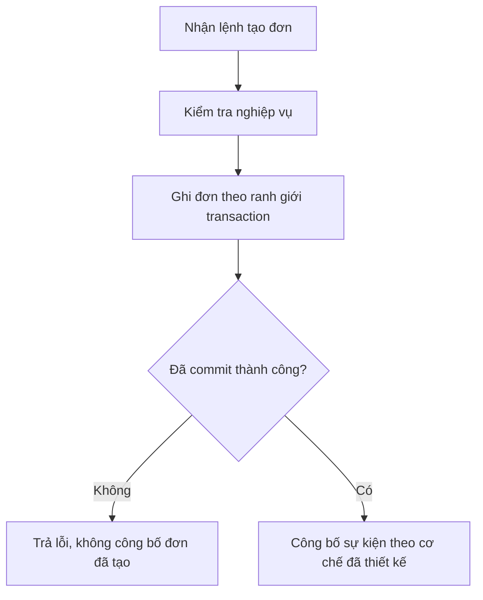
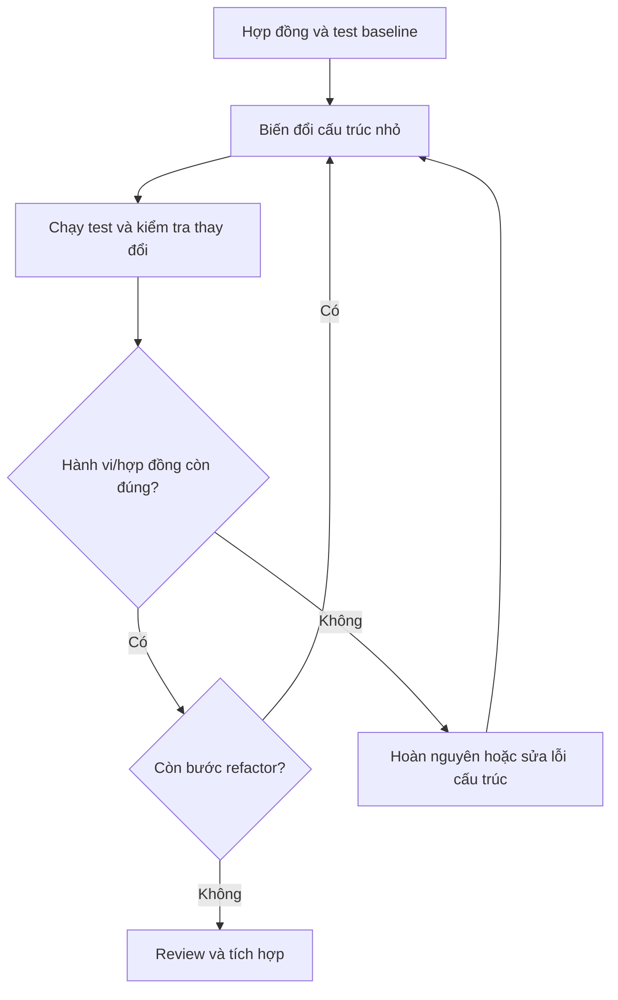

# Tái cấu trúc là thay đổi cấu trúc trong khi giữ hợp đồng hành vi

## 1. Mục tiêu bài học

Trong chương **Tái cấu trúc** của module **CODE_QUALITY_FUNDAMENTALS**, chúng ta tìm hiểu khái niệm cốt lõi của *refactoring*: **cải thiện tổ chức và thiết kế bên trong mã mà không chủ đích thay đổi hành vi được các bên sử dụng trông đợi**.

Module hướng đến việc **hiểu những thuộc tính quyết định mã nguồn có đáng tin cậy, dễ hiểu và dễ thay đổi hay không**. Mã dễ thay đổi không chỉ là mã chạy đúng hôm nay: người bảo trì cần có thể đổi cấu trúc, giảm lặp và điều chỉnh ranh giới trách nhiệm mà vẫn tin rằng hợp đồng hiện hành được bảo vệ.

Sau bài học, bạn có thể:

- Phân biệt **refactoring**, **thêm tính năng**, **sửa lỗi nghiệp vụ** và **tối ưu hiệu năng** theo mục đích cũng như phạm vi hành vi thay đổi.
- Xác định **hợp đồng hành vi** bao gồm những gì ngoài giá trị trả về: đầu vào, lỗi, tác dụng phụ, tính tương thích và bảo đảm thời gian/tài nguyên khi có yêu cầu.
- Nhận diện các dấu hiệu nên tái cấu trúc và chọn thay đổi nhỏ phù hợp với trách nhiệm thực tế.
- So sánh ví dụ Java 17 trước/sau khi tách phương thức tính phí lưu kho, giữ nguyên quy tắc và xử lý trường hợp biên.
- Viết kiểm thử JUnit 5 theo hợp đồng, phân biệt kiểm thử hồi quy với chứng minh tương đương tuyệt đối.
- Thực hiện một quy trình refactor có kiểm soát, đặc biệt khi mã cũ chưa có đặc tả đầy đủ.

## 2. Định nghĩa thực hành: đổi cách tổ chức, không đổi lời hứa

**Tái cấu trúc (refactoring)** là thay đổi cấu trúc nội bộ của phần mềm nhằm làm nó dễ hiểu, dễ bảo trì hoặc dễ mở rộng hơn, **trong khi giữ nguyên hành vi bên ngoài theo hợp đồng đã xác định**.

Ví dụ về những thay đổi *có thể là refactor*:

- Đổi một tên biến cục bộ khó hiểu thành tên diễn đạt đúng ý nghĩa.
- Tách một khối tính toán dài thành các phương thức có trách nhiệm rõ.
- Đưa quy tắc bị sao chép ở nhiều nơi vào một thành phần dùng chung.
- Thay cấu trúc điều kiện bằng mô hình dễ đọc hơn, với cùng mọi trường hợp đầu vào được hỗ trợ.
- Di chuyển logic sang đúng module hoặc hướng phụ thuộc phù hợp hơn mà vẫn giữ hợp đồng mà caller sử dụng.

Điều quyết định **không phải** số dòng thay đổi hoặc tên thao tác IDE. Một lệnh *Extract Method* vẫn có thể vô tình làm thay đổi thứ tự kiểm tra, thời điểm đọc trạng thái hoặc cách xử lý ngoại lệ. Khi đó thay đổi chưa đáp ứng yêu cầu “giữ hành vi”.

### Phân biệt các loại thay đổi

| Loại thay đổi | Mục tiêu chính | Hợp đồng hành vi có chủ đích thay đổi? | Ví dụ |
| --- | --- | --- | --- |
| **Refactoring** | Cải thiện cấu trúc bên trong | **Không** | Tách hàm tính phí nhưng giữ cùng công thức và lỗi. |
| **Thêm tính năng** | Cung cấp khả năng hoặc quy tắc mới | **Có**, ở phần liên quan | Thêm phụ phí cho kho lạnh. |
| **Sửa bug** | Khôi phục hành vi đúng theo yêu cầu | **Có thể có**, so với mã cũ bị sai | Đổi cách xử lý ngày miễn phí đang tính nhầm. |
| **Tối ưu hiệu năng** | Giảm thời gian, bộ nhớ hoặc I/O | Cố giữ chức năng; **đặc tính tài nguyên có chủ đích đổi** | Thay sắp xếp toàn bộ bằng heap khi chỉ cần top K. |
| **Đổi hợp đồng API** | Điều chỉnh cách caller sử dụng thành phần | **Có** | Đổi kiểu trả về, quy tắc null hoặc phương thức công khai. |

Một đợt tối ưu có thể chứa các bước refactor, và việc sửa bug cũng có thể bắt đầu bằng refactor để mã dễ hiểu hơn. Tuy nhiên, khi mô tả thay đổi với reviewer, nên **tách mục đích và bằng chứng**: đâu là bước chỉ tổ chức mã, đâu là bước đã cố ý thay đổi hành vi.

## 3. Hợp đồng hành vi bao gồm những gì?

“Giữ hành vi” không có nghĩa giữ từng câu lệnh, từng lời gọi helper hay mọi chi tiết thực thi. Cần đặt câu hỏi: **những bên sử dụng thành phần có quyền dựa vào điều gì?**

| Khía cạnh | Ví dụ thuộc hợp đồng cần giữ | Ví dụ thường chỉ là chi tiết bên trong |
| --- | --- | --- |
| **Đầu vào hợp lệ** | `quantity > 0`, không chấp nhận giá âm | Tên biến dùng để lưu giá trị đã kiểm tra |
| **Đầu ra** | Phí tính bằng VND nguyên, công thức và ngưỡng miễn phí | Cách tách phép tính ra phương thức private |
| **Lỗi** | Đầu vào sai bị từ chối; phép nhân tràn không âm thầm cho số sai | Số tầng stack trace do helper nội bộ tạo ra |
| **Tác dụng phụ** | Ghi một giao dịch, không gửi trùng thông báo, không sửa dữ liệu mượn | Tên biến tạm trong quá trình tính |
| **Trật tự quan sát được** | Giao dịch phải commit trước khi phát sự kiện xác nhận | Thứ tự thực hiện hai phép tính thuần độc lập nếu kết quả như nhau |
| **Vòng đời tài nguyên** | Caller sở hữu stream; phương thức không tự đóng tài nguyên mượn | Cách chia hàm mở/ghi/đóng ở nội bộ sở hữu tài nguyên |
| **Tính tương thích API** | Chữ ký, ý nghĩa kiểu, serialization, mã lỗi đã công bố | Tổ chức các class private không bị caller thấy |
| **Đồng thời** | Không mất cập nhật, không giữ hàng quá số lượng | Tên lock hoặc cách tổ chức helper, nếu các bảo đảm giữ nguyên |
| **Phi chức năng khi có cam kết** | Ngân sách bộ nhớ, timeout hoặc SLO đã quy định | Chi phí một lời gọi helper không có ràng buộc riêng |

Một số hành vi **quan sát được** chưa chắc là **lời hứa phải giữ nguyên**. Ví dụ nội dung log debug, thứ tự duyệt `HashMap` hoặc thông điệp lỗi chưa được công bố có thể thay đổi mà không phá hợp đồng. Ngược lại, nếu một hệ thống khác phân tích log như một giao thức hoặc khách hàng dựa vào mã lỗi cụ thể, nó đã trở thành ràng buộc cần xem xét.

**Ranh giới cần bảo vệ phải được phát biểu trước khi thay mã.** Nếu yêu cầu mơ hồ, đừng mặc định rằng mọi kết quả tình cờ của mã cũ đều đúng.

### Tương đương theo phạm vi xác định

Có thể hình dung hai phiên bản `before` và `after` là tương đương **theo hợp đồng** nếu với mỗi đầu vào hợp lệ và điều kiện môi trường thuộc phạm vi đã hứa:

1. Các giá trị đầu ra và trạng thái quan trọng có cùng ý nghĩa.
2. Các trường hợp lỗi và cách xử lý phù hợp với hợp đồng.
3. Các tác dụng phụ hoặc tương tác bắt buộc vẫn có ý nghĩa và thứ tự cần thiết.

Không phải ứng dụng nào cũng hoàn toàn xác định. Ví dụ hai lần gọi mạng có thể nhận dữ liệu khác nhau theo thời điểm; khi ấy cần bảo vệ **các bất biến và cam kết của giao thức**, thay vì yêu cầu từng byte kết quả bằng nhau bất kể điều kiện ngoài.

## 4. Khi nào nên tái cấu trúc?

Một số tín hiệu đáng xem xét:

- **Duplicate logic:** cùng quy tắc nghiệp vụ được sao chép ở nhiều nơi; sửa một lần dễ bỏ sót.
- **Long Method:** một phương thức gánh kiểm tra đầu vào, tính toán, I/O, chuyển đổi định dạng và ghi trạng thái khiến khó theo dõi.
- **Feature Envy / Message Chain:** một lớp biết quá nhiều chi tiết bên trong đối tượng khác.
- **Mixed Responsibilities:** nhiều lý do thay đổi không liên quan bị đặt trong cùng một lớp.
- **Divergent Change / Shotgun Surgery:** một yêu cầu nhỏ buộc sửa nhiều thành phần hoặc một thành phần thường bị sửa vì nhiều nhóm yêu cầu khác nhau.
- **High Coupling / Dependency Cycle:** mã phụ thuộc sai tầng, khó kiểm thử độc lập hoặc khó phát hành riêng.
- **Difficult Tests:** phải tạo đối tượng phức tạp hoặc phụ thuộc mạng/đồng hồ chỉ để kiểm tra một quy tắc nhỏ.

Đó là **dấu hiệu để điều tra**, không phải mệnh lệnh tách lớp. Một phương thức dài có thể mô tả một thuật toán liền mạch và dễ hiểu; một lớp điều phối được phép có nhiều phụ thuộc; một hàm nhỏ dùng một lần có thể không cần abstraction.

Trước khi chọn kỹ thuật, hãy trả lời: **cấu trúc hiện tại đang gây chi phí nào**, **chuyển trách nhiệm về đâu là hợp lý**, và **một người dùng thành phần sẽ nhìn thấy thay đổi gì**.

## 5. Ví dụ Java 17: quy tắc tính phí lưu kho

Giả sử hệ thống có chức năng báo phí cho hàng đang lưu kho. Chính sách được xác nhận:

1. `storedDays` là **số ngày lưu kho đã tính theo quy ước nghiệp vụ**, nguyên và không âm; **0–3 ngày đầu miễn phí lưu kho**.
2. Từ ngày thứ 4 trở đi, mỗi **đơn vị hàng** chịu **1.000 VND mỗi ngày vượt mốc miễn phí**.
3. `units` phải **lớn hơn 0**.
4. Nếu chọn **nhận hàng ưu tiên** (`priorityPickup = true`), cộng **5.000 VND**, kể cả khi phí lưu kho bằng 0.
5. Báo giá trả ba khoản: phí lưu kho, phí nhận hàng ưu tiên và tổng; đơn vị đều là **VND nguyên**.
6. Đầu vào sai bị từ chối bằng `IllegalArgumentException`; phép toán vượt giới hạn `long` phải báo `ArithmeticException`, không được tràn âm thầm.
7. Phép tính đồng bộ, không ghi database, không thay trạng thái bên ngoài và không làm tròn.

Ví dụ chưa xét tiền cọc, VAT, trả từng phần hoặc phí vận chuyển. Quy tắc “3 ngày đầu miễn phí” được hiểu là `storedDays = 3` còn 0 phí, `storedDays = 4` bắt đầu tính một ngày.

### Bảng hành vi cần giữ

| `storedDays` | `units` | `priorityPickup` | Phí lưu kho | Phí ưu tiên | Tổng |
| ---: | ---: | :---: | ---: | ---: | ---: |
| 0 | 2 | false | 0 | 0 | 0 |
| 3 | 2 | true | 0 | 5.000 | 5.000 |
| 4 | 2 | false | 2.000 | 0 | 2.000 |
| 5 | 3 | true | 6.000 | 5.000 | 11.000 |
| 8 | 1 | false | 5.000 | 0 | 5.000 |

Các ví dụ trên là **test oracle dựa vào đặc tả**. Nếu cả code trước và sau đều cho ra một con số khác, không thể coi chúng tương đương là đủ: còn phải đáp ứng yêu cầu nghiệp vụ.

### 5.1. Kiểu kết quả: phần công khai của hợp đồng

```java
// StorageQuote.java — dùng chung cho cả hai phiên bản dưới đây.
public record StorageQuote(
        long storageFeeVnd,
        long pickupFeeVnd,
        long totalVnd) {
}
```

`StorageQuote` là giá trị kết quả. Trong ví dụ này, **hợp đồng của `StoragePricing.quote`** bảo đảm tạo ra các khoản không âm, tổng đúng; bản thân constructor của `StorageQuote` không kiểm tra bất biến nếu một caller tự tạo record. Khi cần bảo vệ bất biến cho **mọi** đối tượng `StorageQuote` bất kể nguồn tạo, có thể đưa kiểm tra vào constructor và đánh giá đó như một quyết định thiết kế riêng.

### 5.2. Trước refactor: một phương thức chứa toàn bộ quy trình

```java
// StoragePricing.java — phiên bản BEFORE.
public final class StoragePricing {
    private StoragePricing() {}

    public static StorageQuote quote(
            int storedDays, int units, boolean priorityPickup) {
        if (storedDays < 0) {
            throw new IllegalArgumentException(
                    "storedDays must not be negative");
        }
        if (units <= 0) {
            throw new IllegalArgumentException(
                    "units must be positive");
        }

        long billableDays = Math.max(0L, (long) storedDays - 3L);
        long unitDays = Math.multiplyExact(billableDays, (long) units);
        long storageFeeVnd = Math.multiplyExact(unitDays, 1_000L);
        long pickupFeeVnd = priorityPickup ? 5_000L : 0L;
        long totalVnd = Math.addExact(storageFeeVnd, pickupFeeVnd);

        return new StorageQuote(
                storageFeeVnd, pickupFeeVnd, totalVnd);
    }
}
```

Đoạn mã này **không nhất thiết là mã xấu**: nó nhỏ và có một trách nhiệm rõ. Nhưng nếu chính sách phát triển thêm nhiều khoản, hoặc nhóm cần kiểm tra riêng các phép tính, có thể tách các bước ra thành những phương thức private có ý nghĩa. Trường hợp này được chọn vì dễ kiểm chứng sự **tương đương về hành vi**, không vì mọi phương thức tương tự đều bắt buộc phải tách.

Chú ý các chi tiết có chủ đích:

- Kiểm tra `storedDays` **trước** `units`. Khi cả hai đều sai, ngoại lệ đầu tiên mang ý nghĩa nếu thứ tự kiểm tra đã thuộc hợp đồng hoặc đã được bên gọi dựa vào.
- Ép `storedDays` thành `long` trước khi trừ; sau đó dùng `Math.multiplyExact` với các toán hạng `long`, tránh tràn ngầm trong phép nhân `int`.
- Dùng `Math.addExact` cho tổng, không dùng phép cộng có thể tràn âm thầm.
- Phí ưu tiên được cộng **dù phí lưu kho miễn**; đừng vô tình đặt logic phí ưu tiên trong nhánh chỉ xử lý những ngày có phí.

### 5.3. Sau refactor: tách tên hành vi, giữ cùng đường kiểm tra

Đây là **phiên bản thay thế** cho `StoragePricing.java` ở mục 5.2; **không** đặt đồng thời hai lớp cùng tên vào cùng một package.

```java
// StoragePricing.java — phiên bản AFTER.
public final class StoragePricing {
    private static final int FREE_DAYS = 3;
    private static final long FEE_PER_UNIT_DAY_VND = 1_000L;
    private static final long PRIORITY_PICKUP_FEE_VND = 5_000L;

    private StoragePricing() {}

    public static StorageQuote quote(
            int storedDays, int units, boolean priorityPickup) {
        if (storedDays < 0) {
            throw new IllegalArgumentException(
                    "storedDays must not be negative");
        }
        if (units <= 0) {
            throw new IllegalArgumentException(
                    "units must be positive");
        }

        long storageFeeVnd = calculateStorageFeeVnd(
                storedDays, units);
        long pickupFeeVnd = calculatePickupFeeVnd(priorityPickup);
        long totalVnd = Math.addExact(storageFeeVnd, pickupFeeVnd);

        return new StorageQuote(
                storageFeeVnd, pickupFeeVnd, totalVnd);
    }

    private static long calculateStorageFeeVnd(
            int storedDays, int units) {
        long billableDays = Math.max(
                0L, (long) storedDays - FREE_DAYS);
        long unitDays = Math.multiplyExact(
                billableDays, (long) units);
        return Math.multiplyExact(
                unitDays, FEE_PER_UNIT_DAY_VND);
    }

    private static long calculatePickupFeeVnd(
            boolean priorityPickup) {
        return priorityPickup ? PRIORITY_PICKUP_FEE_VND : 0L;
    }
}
```

**Cấu trúc thay đổi:** các hằng số nghiệp vụ có tên, hai loại phí được tách thành hai phép tính private, còn `quote` thể hiện rõ luồng **kiểm tra → tính từng khoản → cộng tổng → trả kết quả**.

**Hợp đồng không đổi:** chữ ký public, thứ tự từ chối đầu vào, công thức, ngưỡng 3 ngày, phí ưu tiên, loại kết quả và cách phát hiện tràn số đều giữ nguyên. Vì các helper là private, caller không cần biết chúng tồn tại hay không.

Nếu chính sách thay đổi từ “3 ngày miễn phí” sang “5 ngày miễn phí”, đó **không còn là refactor thuần túy**: giá trị trả về của một số đầu vào sẽ đổi. Việc đặt tên `FREE_DAYS` giúp thay đổi chính sách **dễ thực hiện hơn**, nhưng không biến một thay đổi nghiệp vụ thành thay đổi chỉ về cấu trúc.

## 6. Kiểm thử hợp đồng trước và sau tái cấu trúc

Kiểm thử tốt ở đây phải **không gọi phương thức private** `calculateStorageFeeVnd` hoặc kiểm tra số lần chúng được gọi. Nó cần bảo vệ hợp đồng public `quote(...)`.

Ví dụ JUnit 5 (dùng hỗ trợ kiểm thử tham số hóa):

```java
import static org.junit.jupiter.api.Assertions.assertEquals;
import static org.junit.jupiter.api.Assertions.assertThrows;

import java.util.stream.Stream;
import org.junit.jupiter.api.Test;
import org.junit.jupiter.params.ParameterizedTest;
import org.junit.jupiter.params.provider.Arguments;
import org.junit.jupiter.params.provider.MethodSource;

class StoragePricingTest {
    static Stream<Arguments> validQuotes() {
        return Stream.of(
                Arguments.of(0, 2, false,
                        new StorageQuote(0, 0, 0)),
                Arguments.of(3, 2, true,
                        new StorageQuote(0, 5_000, 5_000)),
                Arguments.of(4, 2, false,
                        new StorageQuote(2_000, 0, 2_000)),
                Arguments.of(5, 3, true,
                        new StorageQuote(6_000, 5_000, 11_000)),
                Arguments.of(8, 1, false,
                        new StorageQuote(5_000, 0, 5_000))
        );
    }

    @ParameterizedTest
    @MethodSource("validQuotes")
    void preservesPublishedPricingRules(
            int days, int units, boolean priority, StorageQuote expected) {
        assertEquals(expected,
                StoragePricing.quote(days, units, priority));
    }

    @Test
    void invalidInputsAreRejected() {
        assertThrows(IllegalArgumentException.class,
                () -> StoragePricing.quote(-1, 1, false));
        assertThrows(IllegalArgumentException.class,
                () -> StoragePricing.quote(1, 0, false));
        assertThrows(IllegalArgumentException.class,
                () -> StoragePricing.quote(1, -2, true));
    }

    @Test
    void reportsOverflowInsteadOfReturningCorruptMoney() {
        assertThrows(ArithmeticException.class,
                () -> StoragePricing.quote(
                        Integer.MAX_VALUE, Integer.MAX_VALUE, false));
    }

    @Test
    void prioritiesAreIndependentOfFreeStorageDays() {
        assertEquals(new StorageQuote(0, 5_000, 5_000),
                StoragePricing.quote(0, 1, true));
    }
}
```

Những ca này có giá trị vì:

1. **Kỳ vọng đến từ quy tắc nghiệp vụ**, không phải được sao chép bằng cách gọi lại chính hàm `quote`.
2. Có điểm biên **ngày 3/ngày 4**, tình huống ưu tiên dù được miễn lưu kho, đầu vào không hợp lệ và phép nhân vượt miền `long`.
3. Chúng dùng **API public**: có thể giữ nguyên cùng mã test khi triển khai chuyển từ BEFORE sang AFTER.
4. `record` có `equals` theo các thành phần, phù hợp để so sánh ba khoản kết quả.

Đối với một API xử lý tiền, có thể bổ sung **bất biến**: phí và tổng không âm với dữ liệu hợp lệ có thể biểu diễn; tổng bằng hai khoản cộng lại; tăng số ngày sau mốc miễn phí không làm giảm phí khi số đơn vị giữ nguyên. Các bất biến này hỗ trợ kiểm chứng mà không gắn vào việc code chia mấy phương thức.

**Quan trọng:** mọi test xanh **không chứng minh** hai phiên bản tương đương cho mọi đầu vào có thể có. Các phép kiểm tra hữu hạn cung cấp bằng chứng, còn phân tích logic, các trường hợp biên chưa thử và yêu cầu ngoài phạm vi test vẫn cần được xem xét.

## 7. Những thứ có thể đổi ngầm dù công thức trông giống nhau

Nhiều refactor gặp lỗi ở các chi tiết **có thể quan sát được** dù kết quả chính trên dữ liệu thường vẫn đúng.

### 7.1. Kiểu dữ liệu và thứ tự phép toán

Xem hai biểu thức:

```java
// Có thể tràn trong phép nhân int trước khi gán sang long.
long wrong = storedDays * units * 1_000;

// Ép sang long và phát hiện tràn theo hợp đồng.
long daysTimesUnits = Math.multiplyExact(
        (long) storedDays, (long) units);
long checked = Math.multiplyExact(daysTimesUnits, 1_000L);
```

Chỉ thêm helper hoặc gộp phép toán theo kiểu sai có thể khiến kết quả khác nhau ở dữ liệu lớn. Refactor tiền tệ cần giữ **đơn vị, độ chính xác, thứ tự làm tròn và cách xử lý tràn số**, không chỉ giữ hình dạng công thức.

### 7.2. Thứ tự xác thực và ngoại lệ

Giả sử cả `storedDays` và `units` đều không hợp lệ. Nếu hai phiên bản ném **loại exception** giống nhau nhưng lời gọi trả về thông điệp khác, điều đó có thể hoặc không thể phá hợp đồng — tùy cam kết của API. Nếu một luồng bên ngoài dựa vào **mã lỗi**, thay đổi mã lỗi là thay đổi quan sát được quan trọng.

Không nên đổi một `IllegalArgumentException` thành giá trị `0` rồi gọi đó là “viết code gọn hơn”: caller có thể coi `0` là báo giá hợp lệ.

### 7.3. Tác dụng phụ và thời điểm thực hiện

Ví dụ một use case thực hiện **lưu đơn → phát sự kiện**. Nếu refactor đưa thao tác phát sự kiện lên trước khi transaction hoàn tất, có thể tạo sự kiện cho đơn không được lưu thành công.



Sơ đồ chỉ diễn đạt **thứ tự nghĩa vụ**. Trong hệ thống phân tán, “commit rồi gửi sự kiện” vẫn có khoảng rủi ro mất sự kiện nếu tiến trình dừng giữa hai bước; có thể cần **transactional outbox**, idempotency và xử lý lại. Refactor không được âm thầm thay bảo đảm đã có hoặc hứa bảo đảm chưa được thiết kế.

### 7.4. Tài nguyên và khả năng đồng thời

- Đưa thao tác đọc stream ra khỏi `try-with-resources` có thể khiến stream đã đóng trước khi được xử lý.
- Đưa trạng thái local thành trường dùng chung có thể làm phát sinh race condition.
- Chuyển một phép cộng bảo vệ bằng lock thành “đọc rồi ghi” không nguyên tử có thể gây mất cập nhật.
- Chuyển thứ tự duyệt từ list sang `HashMap` có thể làm đầu ra thay đổi nếu API đã cam kết thứ tự.

Vì vậy, “cùng giá trị với vài ví dụ” mới chỉ là **một phần** của yêu cầu giữ hợp đồng.

## 8. Quy trình refactor an toàn theo bước nhỏ

Một quy trình thực tế giúp giảm phạm vi cần suy luận ở mỗi bước:

1. **Đặt mục tiêu cấu trúc cụ thể.** Ví dụ: giảm lặp công thức tính phí hoặc tách I/O khỏi nghiệp vụ. Tránh mục tiêu mơ hồ “làm code đẹp hơn”.
2. **Xác định hợp đồng phải giữ.** Ghi đầu vào, đầu ra, lỗi, tác dụng phụ, tính tương thích, ranh giới tài nguyên và điều kiện phi chức năng quan trọng.
3. **Biết baseline trước khi sửa.** Chạy bộ test liên quan trên phiên bản hiện tại; xác định test nào đã đỏ sẵn, test nào bị vô hiệu hóa và phần nào chưa có bằng chứng.
4. **Bổ sung ca hồi quy khi cần.** Ưu tiên điểm biên, đầu vào sai, tác dụng phụ và các bất biến chính. Không viết test chỉ dựa trên cấu trúc dự định tạo ra.
5. **Thực hiện một biến đổi nhỏ.** Ví dụ đặt tên hằng số trước, chạy test; rồi tách `calculateStorageFeeVnd`, chạy test; rồi tách `calculatePickupFeeVnd`.
6. **Chạy lại kiểm tra phù hợp sau mỗi bước.** Unit test nhanh, rồi kiểm thử hợp đồng/tích hợp nếu có thay đổi ranh giới hoặc cấu hình.
7. **Review diff và bất biến.** Tìm lỗi do đổi thứ tự kiểm tra, kiểu số, null, tác dụng phụ, concurrency hoặc API bị làm lộ.
8. **Giữ phạm vi thay đổi rõ.** Không tranh thủ đổi chính sách tính tiền hoặc cấu hình production trong cùng một commit thuần refactor nếu có thể tách.
9. **Đo khi chạm tới hiệu năng.** Nếu refactor thay thuật toán, số lần I/O hoặc cấp phát, kiểm tra các ràng buộc hiệu năng đã cam kết ở môi trường thích hợp.
10. **Tổng kết bằng chứng và phần chưa kiểm tra.** Nêu test đã chạy, giới hạn và rủi ro còn lại thay vì tuyên bố “đã chứng minh tương đương toàn bộ”.

Một thay đổi lớn có thể chia thành các bước nhỏ để từng bước dễ hoàn nguyên. Nếu mỗi bước đều sửa cả logic nghiệp vụ và kiến trúc cùng lúc, khi test đỏ rất khó xác định nguyên nhân.

### Chu trình kiểm tra ngắn



**Đừng chỉ nhìn tín hiệu màu xanh.** Nếu bộ test thiếu trường hợp quan trọng, refactor sai vẫn có thể xanh; cần kết hợp kiểm tra cấu trúc, lập luận về hành vi và các loại test khác khi cần.

## 9. Khi mã cũ chưa có đặc tả hoặc test đủ tốt

Với hệ thống legacy, khó khăn lớn nhất đôi khi không nằm ở kỹ thuật tách hàm mà ở câu hỏi: **“Hành vi nào phải giữ, hành vi nào chỉ tình cờ tồn tại?”**

Một hướng đi là tạo **characterization test**:

- Ghi nhận kết quả hiện tại trên dữ liệu đại diện, đặc biệt ở các nhánh khó hiểu.
- Dùng đầu vào ổn định, kiểm soát thời gian, ngẫu nhiên và nguồn dữ liệu để tái hiện.
- Phân biệt rõ kỳ vọng **đã được nghiệp vụ xác nhận** với kỳ vọng **chỉ được quan sát từ mã cũ**.
- Đối chiếu những hành vi đáng ngờ trước khi coi chúng là hợp đồng cần bảo vệ.

Ví dụ mã cũ tính phí lưu kho **ngày thứ 3 đã phải trả tiền**, nhưng đặc tả được chấp thuận là **hết ngày thứ 3 vẫn miễn phí**. Nếu test ghi `storedDays=3` phải trả 1.000 VND chỉ vì đó là đầu ra cũ, nó có thể giúp mô tả bug hiện tại nhưng **không phải căn cứ để giữ bug vĩnh viễn**.

Trong tình huống đó, cách trình bày có trách nhiệm:

1. Ghi nhận hành vi cũ và bằng chứng cho thấy nó sai với yêu cầu.
2. Thống nhất quyết định sửa lỗi.
3. Tách thay đổi sửa bug khỏi refactor thuần túy khi có thể, hoặc đánh dấu rõ các phần thay đổi hành vi trong PR.
4. Viết ca hồi quy theo **quy tắc đúng**, không theo lỗi cũ.

### Differential testing: đối chiếu trước và sau

Khi hai hiện thực tạm thời cùng tồn tại dưới tên khác nhau, có thể cho chúng xử lý cùng một tập đầu vào và so sánh:

- Giá trị trả về.
- Kiểu lỗi hoặc mã lỗi theo hợp đồng.
- Tác dụng phụ quan trọng được ghi nhận tại boundary.

Phương pháp này giúp tìm sai lệch khi refactor lớn, nhưng **nếu cả hai cùng sai so với đặc tả**, chúng vẫn có thể cho kết quả giống nhau. Các test dựa trên yêu cầu độc lập phải được giữ bên cạnh kiểm thử đối chiếu.

Không nên giữ cả bản cũ và bản mới tồn tại mãi chỉ để “phòng khi cần”. Khi đã chuyển đổi và kiểm chứng xong, cần xác định nguồn triển khai duy nhất và cách loại bỏ mã không còn sử dụng.

## 10. Chọn kỹ thuật tái cấu trúc phù hợp với nguyên nhân

| Vấn đề đang có | Kỹ thuật có thể phù hợp | Bằng chứng cần giữ |
| --- | --- | --- |
| Phương thức dài chứa các bước khác nhau | **Extract Method**, đặt tên theo hành vi | Cùng đầu ra, lỗi, tác dụng phụ và thứ tự quan trọng |
| Giá trị nghiệp vụ lặp dưới dạng số “ma thuật” | **Introduce Named Constant** | Cùng giá trị, đơn vị và phạm vi áp dụng |
| Một quy tắc bị sao chép nhiều nơi | **Consolidate Duplicate Logic** | Không vô tình gộp những biến thể có yêu cầu khác nhau |
| Một lớp xử lý trách nhiệm thuộc đối tượng khác | **Move Method** hoặc tách service chính sách | Trách nhiệm và quyền sở hữu dữ liệu hợp lý, API cũ được giữ/di chuyển có kế hoạch |
| Bên dùng phụ thuộc lớp hạ tầng cụ thể | **Introduce Interface / Dependency Inversion** | Hợp đồng, lỗi, tác dụng phụ và lựa chọn adapter lúc chạy |
| Điều kiện phức tạp khó đọc | **Decompose Conditional**, tách predicate có tên | Thứ tự ưu tiên giữa các điều kiện và các điểm biên |
| Dữ liệu thô bị truyền qua nhiều tham số liên quan | **Introduce Parameter Object** | Input validation, kiểu dữ liệu và tính tương thích với caller |
| Package hoặc module phụ thuộc vòng | **Move Responsibility / Extract Port** | Không tạo đường động ngầm, dependency graph và test tích hợp |

Tên kỹ thuật không tự chứng minh cần dùng nó. Ví dụ tách từng biểu thức thành một phương thức một dòng có thể khiến người đọc phải nhảy liên tục giữa các hàm mà không hiểu rõ thêm nghiệp vụ.

**Tiêu chí là giảm chi phí hiểu và sửa mã**, không phải tăng số class, interface hoặc giảm số dòng trong một phương thức cho đẹp báo cáo.

## 11. Phân biệt kiểm thử ổn định với kiểm thử khóa chặt triển khai

Một kiểm thử dễ hỏng khi refactor thường kiểm tra **cách mã thực hiện** thay vì **điều mã phải bảo đảm**.

| Kiểm thử dựa trên hợp đồng | Kiểm thử quá bám vào triển khai |
| --- | --- |
| `quote(4, 2, false)` trả 2.000 VND phí lưu kho | `calculateStorageFeeVnd` được gọi đúng một lần |
| `quote(-1, 2, false)` từ chối đầu vào sai | Trình tự gọi hai helper private phải cố định |
| Không ghi dữ liệu hoặc gửi thông báo khi thao tác không hợp lệ | Assert toàn bộ cấu trúc object graph nội bộ |
| Adapter gửi đúng một yêu cầu thu tiền khi đó là yêu cầu hợp đồng | Assert mọi method phụ trợ bên trong adapter được gọi theo số lần cụ thể |

**Không phải mọi kiểm tra tương tác đều xấu.** Nếu hợp đồng yêu cầu “chỉ gửi một lệnh thu tiền” thì số lần gọi **ra cổng thanh toán** là hành vi thật. Nhưng nếu test yêu cầu “gọi private helper `formatAmount` đúng một lần”, việc gộp helper có thể làm test đỏ vô ích.

Thực hành tốt là **đưa assertion đến ranh giới mà bên sử dụng thực sự quan sát**. Với phần thuần, kiểm tra đầu vào/đầu ra và bất biến; với I/O, kiểm tra hiệu ứng ở cổng liên quan; với tích hợp, kiểm tra contract giao tiếp thật.

## 12. Tác dụng phụ của việc “refactor quá rộng”

Một lần thay đổi đồng thời các việc sau thường khó review:

- Đổi tên package.
- Tách lớp.
- Chuyển database.
- Đổi chính sách tính phí.
- Đổi định dạng JSON công khai.
- Chỉnh timeout hoặc retry.

Đây không còn là một refactor nhỏ thuần túy; có nhiều loại rủi ro và bằng chứng khác nhau. Khi một test thất bại, khó biết do **sai cấu trúc**, **đổi hợp đồng có chủ đích** hay **môi trường tích hợp**.

Nên ưu tiên một kế hoạch có thứ tự:

1. Bảo vệ hiện trạng và hợp đồng.
2. Cải thiện cấu trúc mà giữ hành vi.
3. Thay đổi nghiệp vụ hoặc kỹ thuật tích hợp trong bước riêng có đặc tả/test mới.
4. Dọn mã cũ, tài liệu và cấu hình sau khi chuyển đổi được xác minh.

Không phải dự án nào cũng tách được hoàn toàn do hạn chót hoặc phụ thuộc triển khai. Khi phải gộp, hãy **phân định rõ trong review** những phần đã đổi hành vi và những phần chỉ thay cấu trúc.

## 13. Đo lường kết quả refactor mà không chạy theo số đẹp

Mục tiêu cuối là **khả năng thay đổi an toàn**, không phải đạt số lượng hàm hoặc điểm linter nhất định.

| Tín hiệu | Cách dùng hợp lý | Điều không thể kết luận chỉ từ tín hiệu |
| --- | --- | --- |
| Nhiều nơi dùng chung một quy tắc | Xem số bản sao logic có được tập trung đúng chỗ không | Mọi biến thể đã được giữ đúng chưa |
| Giảm phụ thuộc vào adapter cụ thể | Kiểm tra chiều phụ thuộc và API có ổn định hơn không | Hành vi tích hợp chắc chắn đúng chưa |
| Phương thức ngắn và đặt tên rõ | Người đọc có hiểu luồng chính dễ hơn không | Cứ ngắn hơn là thiết kế tốt hơn |
| Unit test ít cần fixture phức tạp | Phần quy tắc đã tách khỏi I/O và dữ liệu không cần thiết chưa | Fake có mô phỏng đúng hệ thống thật chưa |
| Bộ kiểm thử vẫn xanh | Chưa phát hiện vi phạm trên các ca đã chạy | Hai hiện thực tương đương cho mọi đầu vào |
| Ít file phải sửa khi thay chính sách mới | Phạm vi tác động có tập trung đúng trách nhiệm không | Một sửa đổi ít file luôn an toàn hơn |
| Thời gian xử lý không đổi hoặc cải thiện | Bảo đảm hiệu năng có được giữ/đo đúng điều kiện không | Không có rủi ro tính đúng đắn hoặc đồng thời |

Đừng tách một lớp thành mười lớp chỉ để giảm số dòng mỗi class; đừng đổi thuật toán chỉ để giảm Big-O nếu chưa biết điểm nghẽn; đừng cấm mọi phụ thuộc vì biểu đồ nhìn dày. **Chất lượng refactor cần được nhìn trong ngữ cảnh nghiệp vụ và chi phí bảo trì thực tế.**

## 14. Những sai lầm thường gặp

**“Đổi được tên và chạy được là refactor thành công.”** Chưa đủ. Cần xác nhận hành vi, lỗi và tác dụng phụ đã được bảo vệ.

**“Unit test xanh chứng minh không đổi hành vi.”** Không. Test chỉ kiểm tra các ca và tính chất đã được viết; ranh giới chưa test vẫn có thể thay đổi.

**“Tái cấu trúc được phép sửa luôn bug nhưng không cần ghi rõ.”** Sửa bug là cần thiết, nhưng đó là thay đổi hành vi so với mã cũ; nên có bằng chứng yêu cầu và phân biệt trong review.

**“Đưa mọi logic vào interface là tốt.”** Interface chỉ có ích khi tạo ranh giới có ý nghĩa hoặc cô lập một biến đổi thực tế. Thừa abstraction cũng làm code khó hiểu.

**“Có thể thay đổi thứ tự các thao tác vì tổng kết quả bằng nhau.”** Chưa chắc: với I/O, transaction, exception và concurrency, thứ tự có thể là một phần của hợp đồng.

**“Rút gọn phép toán thì luôn tương đương.”** Có thể đổi kiểu `int`/`long`, thứ tự làm tròn, cách xử lý tràn số hoặc điều kiện biên.

**“Phải bảo tồn mọi bug legacy để gọi là refactor.”** Không. Cần xác nhận hành vi nào là hợp đồng và tách quyết định sửa lỗi khỏi thay đổi cấu trúc khi phù hợp.

**“Mã càng nhiều helper thì càng dễ đọc.”** Không. Mức tách phù hợp phụ thuộc vào ý nghĩa và khả năng theo dõi của luồng chính.

## 15. Bài tập tự kiểm tra

### Bài tập 1 — phân loại thay đổi

Xét bốn đề xuất với `StoragePricing.quote`:

1. Đổi `unitDays` thành `chargeableUnitDays`.
2. Tách phép tính phí lưu kho sang một phương thức private.
3. Thay mốc miễn phí từ 3 ngày thành 5 ngày.
4. Đổi phép nhân `Math.multiplyExact` thành phép nhân `*` thông thường.

**Hỏi:** Đề xuất nào có thể là refactor thuần túy? Đề xuất nào làm đổi hợp đồng và cần kiểm thử/đặc tả khác?

**Gợi ý:** (1) và (2) có thể là refactor nếu giữ nguyên hành vi. (3) là thay chính sách nghiệp vụ. (4) có thể thay đổi cách xử lý tràn số, vì vậy **không** phải refactor giữ nguyên hợp đồng đã nêu.

### Bài tập 2 — xác định hành vi bên ngoài

Một service ghi đơn hàng rồi gửi email. Nhóm chuyển thao tác gửi email lên đầu phương thức để “tách đoạn xử lý”. Những hành vi nào có thể bị thay đổi nếu việc ghi đơn thất bại?

**Gợi ý:** Email có thể được gửi dù đơn chưa commit; lỗi và khả năng retry có thể tạo thông báo trùng. Cần kiểm tra ranh giới giao dịch, cơ chế công bố sự kiện và hợp đồng tác dụng phụ, không chỉ giá trị trả về.

### Bài tập 3 — tìm điểm biên

Một người refactor biểu thức `Math.max(0L, (long) storedDays - 3L)` thành `storedDays > 3 ? storedDays - 3 : 0` rồi bỏ kiểm thử ngày thứ 3.

**Hỏi:** Với `storedDays` không âm kiểu `int`, hai công thức có cho cùng số ngày tính phí không? Vì sao vẫn nên giữ ca `storedDays = 3` và `4`?

**Gợi ý:** Trong miền đầu vào hợp lệ đã nêu, hai biểu thức cho **cùng giá trị số ngày** (kết quả biểu thức thứ hai được nâng lên `long` nếu gán vào biến `long`). Nhưng các ca 3/4 bảo vệ quy tắc ranh giới, và khi tiếp tục sửa loại dữ liệu hoặc điều kiện, test giúp phát hiện sai lệch.

### Bài tập 4 — test bám vào triển khai

Sau khi tách `calculatePickupFeeVnd`, test mới kiểm tra helper ấy được gọi đúng một lần nhưng không assert tổng báo giá. Tại sao test này có thể cản trở refactor mà vẫn bỏ sót lỗi tiền?

**Gợi ý:** Số lần gọi helper private không phải lời hứa với caller; code có thể gọi đúng một lần nhưng trả sai tổng, hoặc thay helper khác mà vẫn đúng quy tắc. Nên assert hợp đồng public và các trường hợp biên.

### Bài tập 5 — quyết định bước tiếp theo

Một module không có unit test, các kỳ vọng trong tài liệu mâu thuẫn với kết quả hệ thống hiện tại. Nhóm được giao tách lớp để giảm phụ thuộc vòng.

**Hỏi:** Nên lập baseline và kiểm tra hợp đồng như thế nào trước khi sửa? Có nên sửa luôn các hành vi nghi ngờ sai không?

**Gợi ý:** Thu thập yêu cầu/contract đã chấp thuận, ghi nhận hiện trạng bằng characterization test, phân loại hành vi nghi ngờ, xác nhận với bên chịu trách nhiệm, sau đó thực hiện thay đổi cấu trúc theo bước nhỏ. Sửa bug có bằng chứng và theo dõi riêng thay vì âm thầm gộp.

## 16. Checklist ngắn trước khi kết luận “refactor xong”

1. **Mục tiêu tổ chức mã rõ chưa?** Biến đổi này giải quyết khó khăn đọc hiểu, lặp logic hay ranh giới nào?
2. **Hợp đồng nào cần giữ?** Input, output, lỗi, thứ tự tác dụng phụ, tài nguyên, concurrency, tương thích API và ràng buộc phi chức năng?
3. **Có test dựa trên đặc tả đúng không?** Không chỉ ghi lại kết quả tình cờ của mã cũ?
4. **Đã thử điểm biên chưa?** Dữ liệu rỗng, null nếu có, ngưỡng, số lớn, tràn số và các đường lỗi?
5. **Có giữ đúng kiểu và thứ tự phép toán không?** Nhất là tiền tệ và thời gian?
6. **Đã kiểm tra các tác dụng phụ chưa?** Không gửi trùng, không ghi sai transaction, không đóng tài nguyên do caller sở hữu?
7. **Cấu trúc mới thật sự rõ trách nhiệm hơn chưa?** Hay chỉ có thêm delegate và lớp trung gian?
8. **Các test liên quan đã chạy và kết quả được hiểu đúng phạm vi chưa?** Có test bị bỏ qua hoặc phụ thuộc môi trường không?
9. **Có thay đổi hành vi có chủ đích không?** Nếu có, đã tách hoặc ghi rõ như bug fix/feature và cập nhật tài liệu?
10. **Bằng chứng còn thiếu gì?** Có cần kiểm thử tích hợp, tính tương thích, tải hoặc concurrency không?

## 17. Ghi nhớ

**Tái cấu trúc là thay đổi cấu trúc trong khi giữ hợp đồng hành vi**. Điều này cho phép người phát triển sửa tổ chức mã, tên gọi, vị trí trách nhiệm hoặc hướng phụ thuộc **mà không vô tình đổi những gì bên sử dụng được quyền trông đợi**. Muốn làm tốt, cần xác định hợp đồng trước, bổ sung kiểm thử hành vi và ca biên, thay đổi từng bước nhỏ, xem xét cả lỗi/tác dụng phụ/tài nguyên và phân biệt rõ refactor với sửa bug hay thêm tính năng. Một lần refactor có giá trị khi cấu trúc mới **dễ hiểu hơn, ít rủi ro thay đổi hơn, nhưng vẫn giữ đúng những bảo đảm đã được xác nhận**.
